# 《安全通论》第2章 安全经络图（课件）

原件的每一页，下面附识别出的文字。

### 第2章---安全经络图

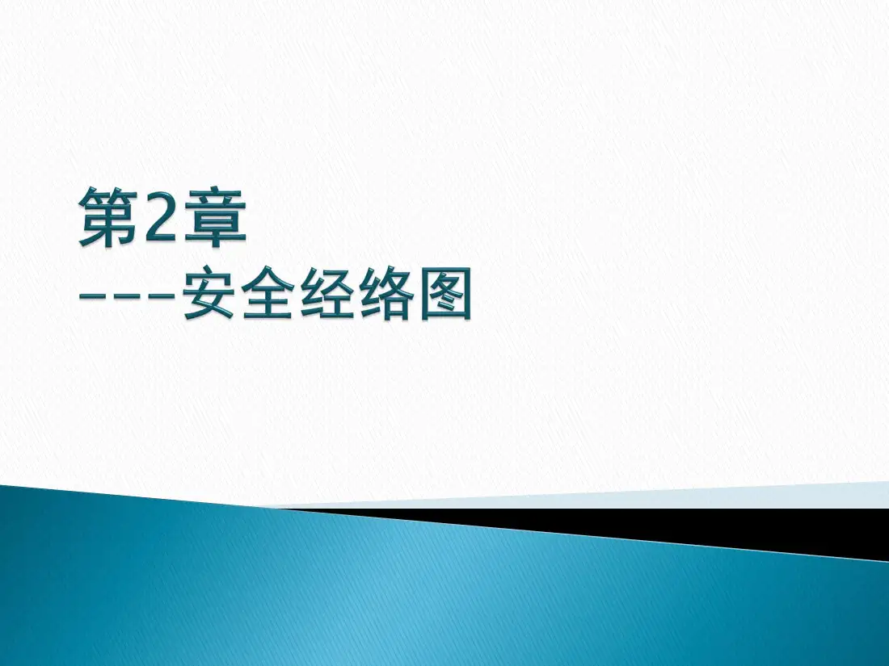

原文：

第2章---安全经络图

### 第2章安全经络图

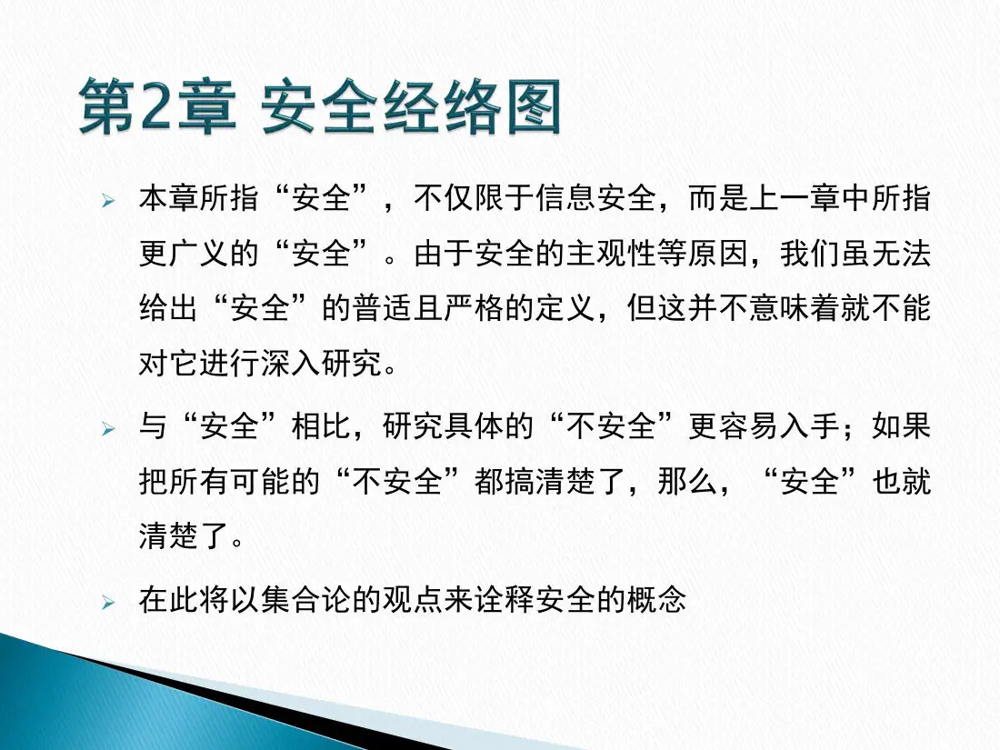

原文：

第2章安全经络图

➢ 本章所指“安全”，不仅限于信息安全，而是上一章中所指更广义的“安全”。由于安全的主观性等原因，我们虽无法给出“安全”的普适且严格的定义，但这并不意味着就不能对它进行深入研究。

➢ 与“安全”相比，研究具体的“不安全”更容易入手；如果把所有可能的“不安全”都搞清楚了，那么，“安全”也就清楚了。

➢ 在此将以集合论的观点来诠释安全的概念

### 第2章安全经络图

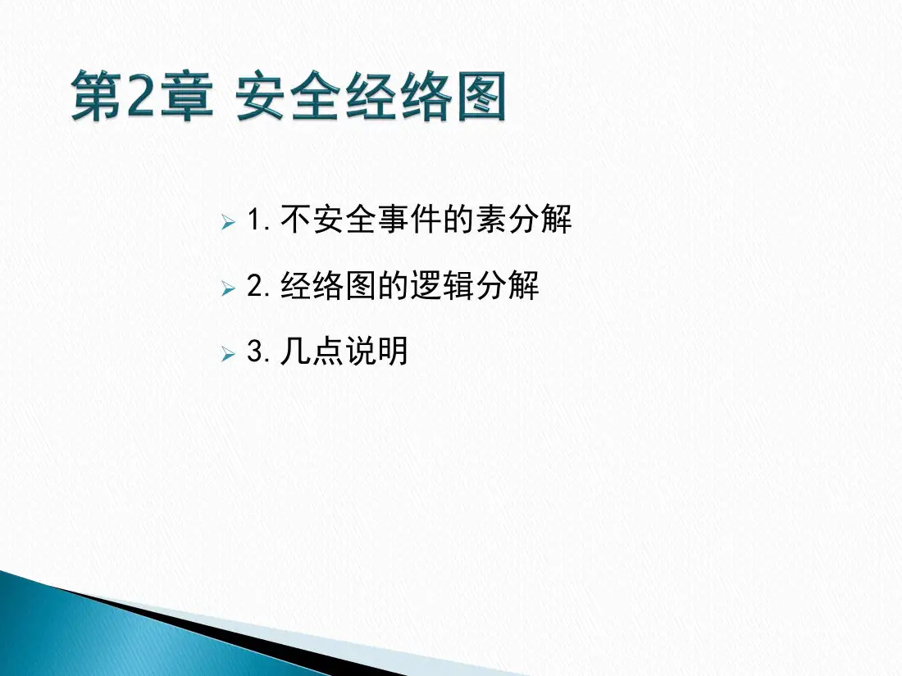

原文：

第2章安全经络图

➢ 1.不安全事件的素分解

➢ 2.经络图的逻辑分解

3.几点说明

### 2.1不安全事件的素分解

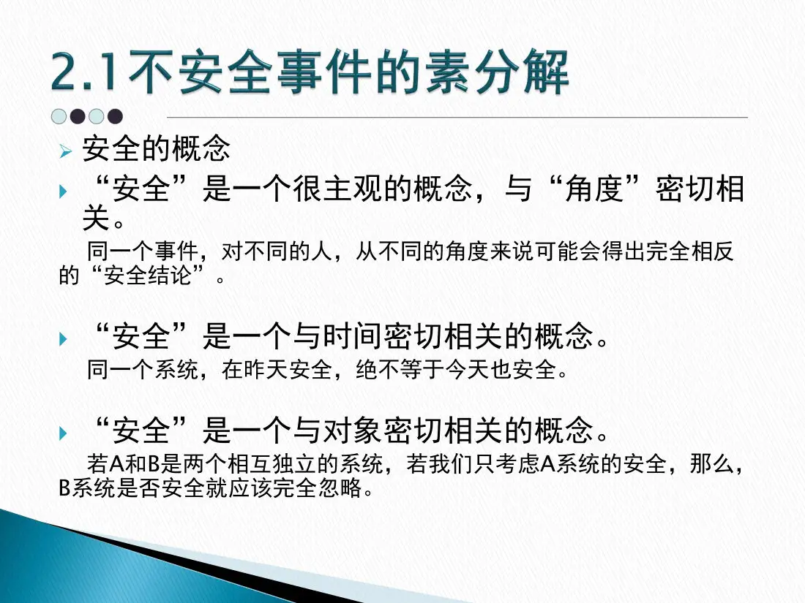

原文：

2.1不安全事件的素分解

安全的概念

 “安全”是一个很主观的概念，与“角度”密切相关。

同一个事件，对不同的人，从不同的角度来说可能会得出完全相反的“安全结论”。

 “安全”是一个与时间密切相关的概念。

同一个系统，在昨天安全，绝不等于今天也安全。

“安全”是一个与对象密切相关的概念。

若A和B是两个相互独立的系统，若我们只考虑A系统的安全，那么，B系统是否安全就应该完全忽略。

### 2.1不安全事件的素分解

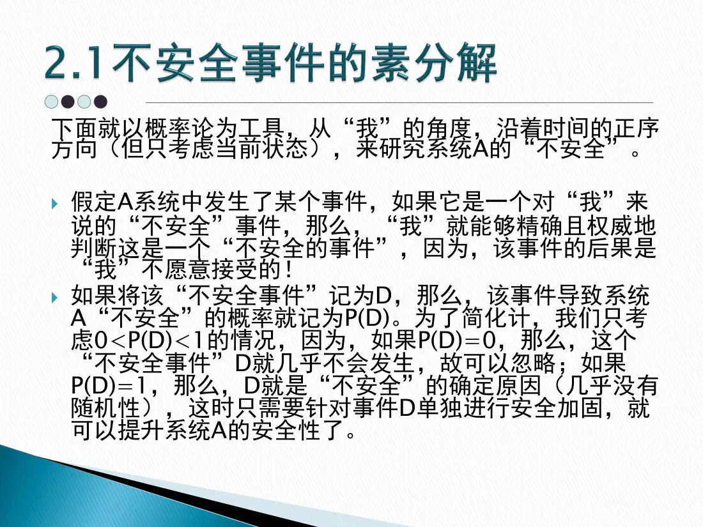

原文：

2.1不安全事件的素分解

下面就以概率论为工具，从“我”的角度，沿着时间的正序方向（但只考虑当前状态），来研究系统A的“不安全”。

假定A系统中发生了某个事件，如果它是一个对“我”来说的“不安全”事件，那么，“我”就能够精确且权威地判断这是一个“不安全的事件”，因为，该事件的后果是“我”不愿意接受的！

 如果将该“不安全事件”记为D，那么，该事件导致系统A“不安全”的概率就记为P(D)。为了简化计，我们只考虑0<P(D)<1的情况，因为，如果P(D)=0，那么，这个“不安全事件”D就几乎不会发生，故可以忽略；如果P(D)=1，那么，D就是“不安全”的确定原因（几乎没有随机性），这时只需要针对事件D单独进行安全加固，就可以提升系统A的安全性了。

### 2.1不安全事件的素分解

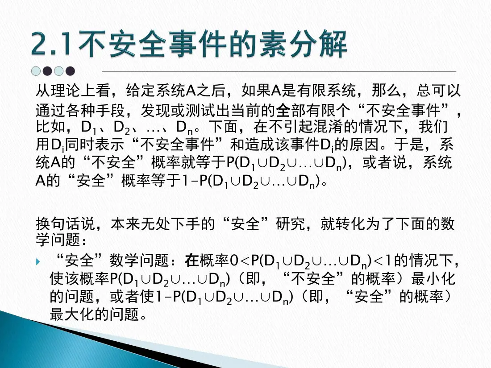

原文：

2.1不安全事件的素分解

从理论上看，给定系统A之后，如果A是有限系统，那么，总可以通过各种手段，发现或测试出当前的全部有限个“不安全事件”比如， $\mathsf { D } _ { 1 } , \mathsf { D } _ { 2 } , \ldots , \mathsf { D } _ { n }$ 。下面，在不引起混淆的情况下，我们用D同时表示“不安全事件”和造成该事件D的原因。于是，系统A的“不安全”概率就等于 $\mathsf { P } ( \mathsf { D } _ { 1 } \cup \mathsf { D } _ { 2 } \cup \ldots \cup \mathsf { D } _ { \mathsf { n } } )$ ，或者说，系统A的“安全”概率等于 ${ \mathsf { I } } - { \mathsf { P } } ( { \mathsf { D } } _ { 1 } \cup { \mathsf { D } } _ { 2 } \cup \ldots \cup { \mathsf { D } } _ { \mathsf { n } } )$

换句话说，本来无处下手的“安全”研究，就转化为了下面的数学问题：

 “安全”数学问题：在概率 $0 < \mathsf { P } ( \mathsf { D } _ { 1 } \cup \mathsf { D } _ { 2 } \cup \ldots \cup \mathsf { D } _ { \mathsf { n } } ) < 1$ 的情况下，使该概率 $\mathsf { P } ( \mathsf { D } _ { 1 } \cup \mathsf { D } _ { 2 } \cup \ldots \cup \mathsf { D } _ { \mathsf { n } } )$ （即，“不安全”的概率）最小化的问题，或者使 ${ \mathsf { I } } - { \mathsf { P } } ( { \mathsf { D } } _ { 1 } \cup { \mathsf { D } } _ { 2 } \cup \ldots \cup { \mathsf { D } } _ { \mathsf { n } } )$ （即， “安全”的概率）最大化的问题。

### 2.1不安全事件的素分解

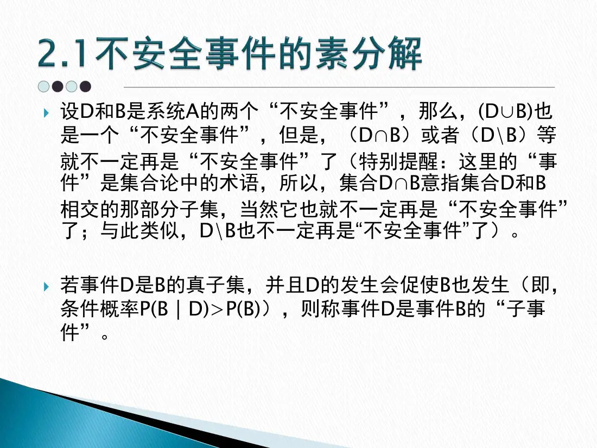

原文：

2.1不安全事件的素分解

 设D和B是系统A的两个“不安全事件”，那么，(D∪B)也是一个“不安全事件”，但是，（D∩B）或者（D\B）等就不一定再是“不安全事件”了（特别提醒：这里的“事件”是集合论中的术语，所以，集合D∩B意指集合D和B相交的那部分子集，当然它也就不一定再是“不安全事件”了；与此类似，D\B也不一定再是“不安全事件”了）。

若事件D是B的真子集，并且D的发生会促使B也发生（即，条件概率P(B│D)>P(B)），则称事件D是事件B的“子事件”。

### 2.1不安全事件的素分解

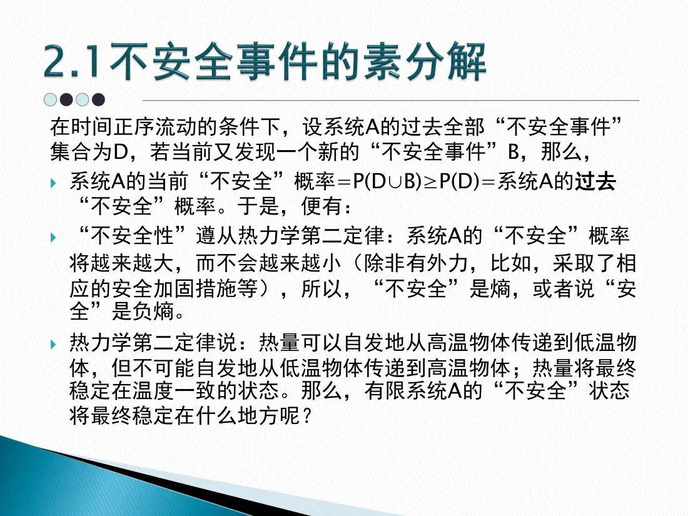

原文：

2.1不安全事件的素分解

在时间正序流动的条件下，设系统A的过去全部“不安全事件”集合为D，若当前又发现一个新的“不安全事件”B，那么，

 系统A的当前“不安全”概率=P(D∪B)≥P(D)=系统A的过去“不安全”概率。于是，便有：

 “不安全性”遵从热力学第二定律：系统A的“不安全”概率将越来越大，而不会越来越小（除非有外力，比如，采取了相应的安全加固措施等），所以，“不安全”是熵，或者说“安全”是负熵。

热力学第二定律说：热量可以自发地从高温物体传递到低温物体，但不可能自发地从低温物体传递到高温物体；热量将最终稳定在温度一致的状态。那么，有限系统A的“不安全”状态将最终稳定在什么地方呢？

### 2.1不安全事件的素分解

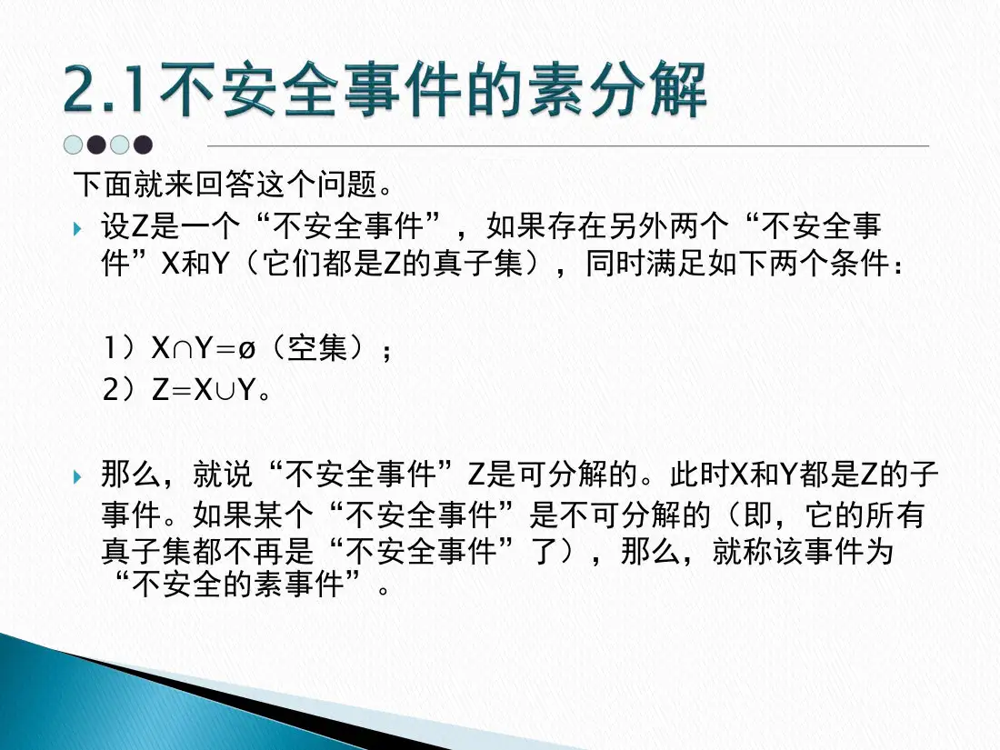

原文：

2.1不安全事件的素分解

下面就来回答这个问题。

设Z是一个“不安全事件”，如果存在另外两个“不安全事件”X和Y（它们都是Z的真子集），同时满足如下两个条件：

1） $\Chi \cap \mathop { } \forall \mathop { = } \emptyset$ （空集）；

2） ${ \cal Z } = \mathsf { X } \cup \mathsf { Y } .$ o

那么，就说“不安全事件”Z是可分解的。此时X和Y都是Z的子事件。如果某个“不安全事件”是不可分解的（即，它的所有真子集都不再是“不安全事件”了），那么，就称该事件为“不安全的素事件”。

### 2.1不安全事件的素分解

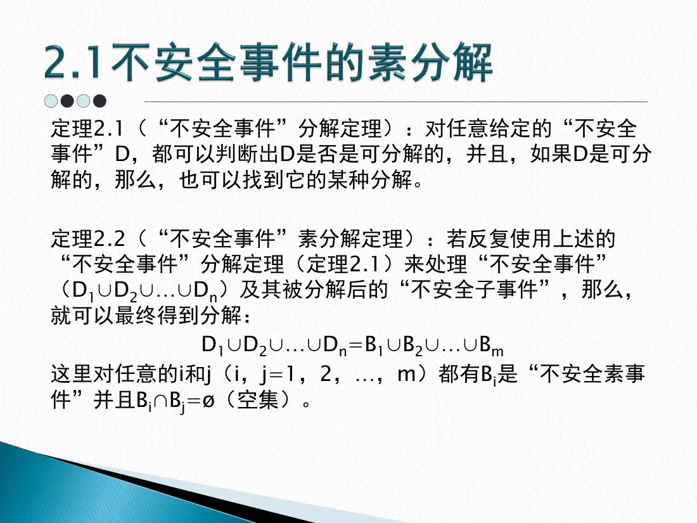

原文：

2.1不安全事件的素分解

定理2.1（“不安全事件”分解定理）：对任意给定的“不安全事件”D，都可以判断出D是否是可分解的，并且，如果D是可分解的，那么，也可以找到它的某种分解。

定理2.2（“不安全事件”素分解定理）：若反复使用上述的“不安全事件”分解定理（定理2.1）来处理“不安全事件”$( \mathsf { D } _ { 1 } \cup \mathsf { D } _ { 2 } \cup \ldots \cup \mathsf { D } _ { n } )$ 及其被分解后的“不安全子事件”，那么，就可以最终得到分解：

$$
\mathsf {D} _ {1} \cup \mathsf {D} _ {2} \cup \dots \cup \mathsf {D} _ {n} = \mathsf {B} _ {1} \cup \mathsf {B} _ {2} \cup \dots \cup \mathsf {B} _ {m}
$$

这里对任意的i和j $( \mathsf { i } , \mathsf { j } { = } 1 , 2 , . . . , \mathsf { m } )$ 都有 $B _ { i }$ 是“不安全素事件”并且 $B _ { i } \cap B _ { j } = \emptyset$ （空集）。

### 2.1不安全事件的素分解

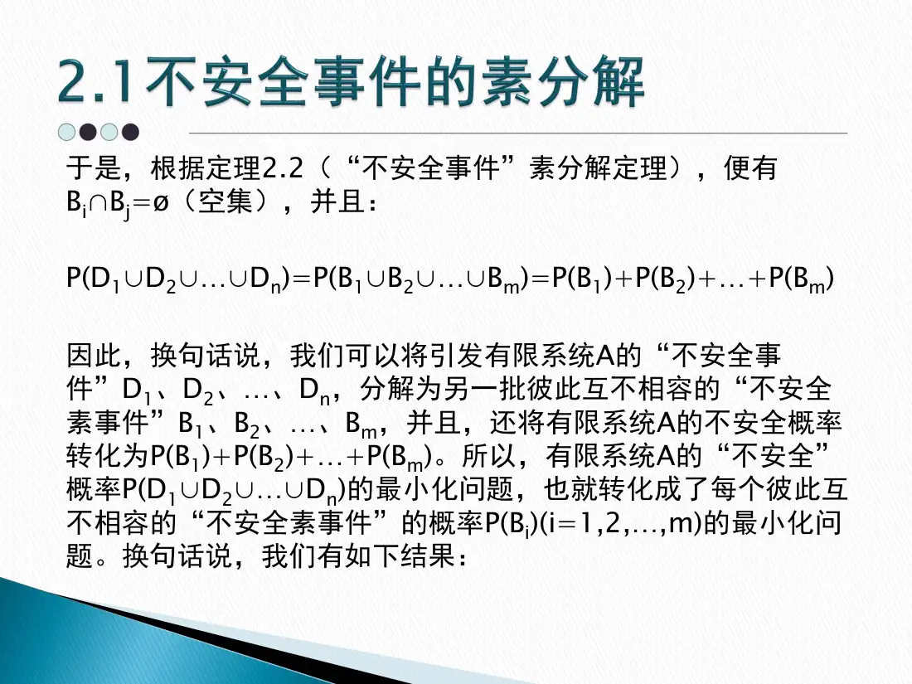

原文：

2.1不安全事件的素分解

于是，根据定理2.2（“不安全事件”素分解定理），便有$B _ { i } \cap B _ { j } = \emptyset$ （空集），并且：

$$
P \left(D _ {1} \cup D _ {2} \cup \dots \cup D _ {n}\right) = P \left(B _ {1} \cup B _ {2} \cup \dots \cup B _ {m}\right) = P \left(B _ {1}\right) + P \left(B _ {2}\right) + \dots + P \left(B _ {m}\right)
$$

因此，换句话说，我们可以将引发有限系统A的“不安全事件” $\mathsf { D } _ { 1 } \setminus \mathsf { D } _ { 2 } \setminus \ldots \setminus \mathsf { D } _ { \mathsf { n } }$ 分解为另一批彼此互不相容的“不安全素事件” $B _ { 1 } \cdot B _ { 2 } \cdot \ldots B _ { m }$ ，并且，还将有限系统A的不安全概率转化为 $\mathsf { P } ( \mathsf { B } _ { 1 } ) + \mathsf { P } ( \mathsf { B } _ { 2 } ) + \ldots + \mathsf { P } ( \mathsf { B } _ { \mathsf { m } } )$ 。所以，有限系统A的“不安全”概率 $\mathsf { P } ( \mathsf { D } _ { 1 } \cup \mathsf { D } _ { 2 } \cup \ldots \cup \mathsf { D } _ { \mathsf { n } } )$ 的最小化问题，也就转化成了每个彼此互不相容的“不安全素事件”的概率 $\mathsf { P } ( \mathsf { B } _ { \mathrm { i } } ) ( \mathsf { i } = 1 , 2 , \ldots , m )$ 的最小化问题。换句话说，我们有如下结果：

### 2.1不安全事件的素分解

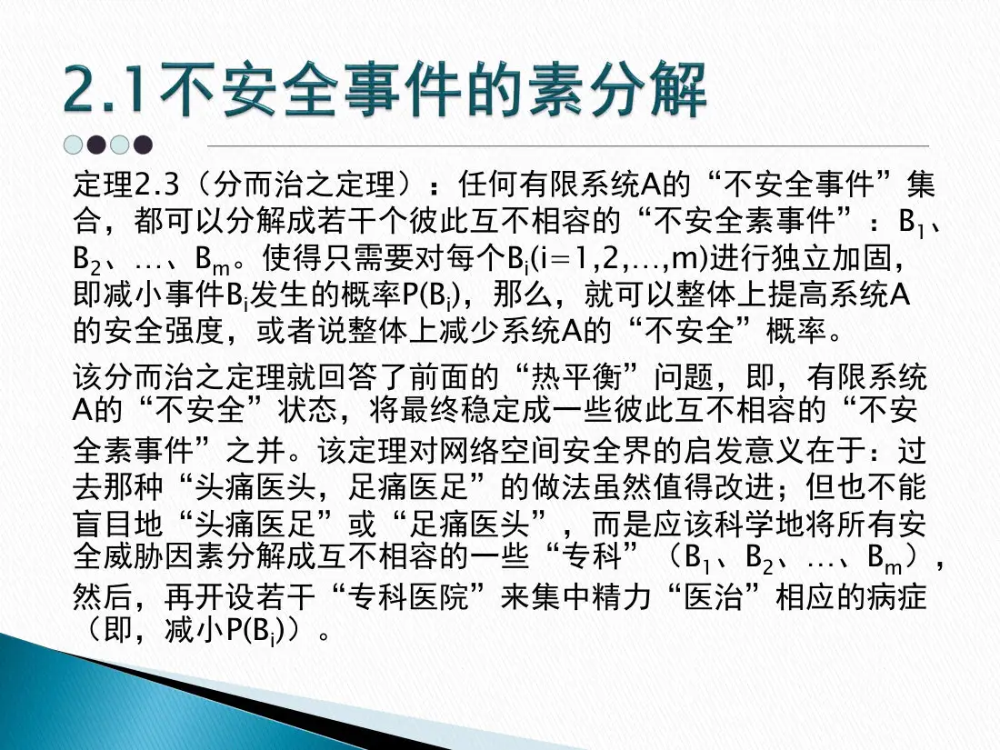

原文：

2.1不安全事件的素分解

定理2.3（分而治之定理）：任何有限系统A的“不安全事件”集合，都可以分解成若干个彼此互不相容的“不安全素事件”： $\mathsf { B } _ { \mathsf { l } }$ $B _ { 2 } \ldots B _ { m }$ 。使得只需要对每个 $\mathtt { B _ { i } } ( \mathsf { i } = 1 , 2 , \ldots , m )$ 进行独立加固，即减小事件 $B _ { i }$ 发生的概率P(B)，那么，就可以整体上提高系统A的安全强度，或者说整体上减少系统A的“不安全”概率。

该分而治之定理就回答了前面的“热平衡”问题，即，有限系统A的“不安全”状态，将最终稳定成一些彼此互不相容的“不安全素事件”之并。该定理对网络空间安全界的启发意义在于：过去那种“头痛医头，足痛医足”的做法虽然值得改进；但也不能盲目地“头痛医足”或“足痛医头”，而是应该科学地将所有安全威胁因素分解成互不相容的一些“专科” $( B _ { 1 } \cdot B _ { 2 } \cdot \ldots B _ { m } )$ 然后，再开设若干“专科医院”来集中精力“医治”相应的病症（即，减 $\begin{array} { r } { \iota \vert \setminus \mathsf { P } ( \mathsf { B } _ { \mathrm { i } } ) . } \end{array}$

### 2.2经络图的逻辑分解

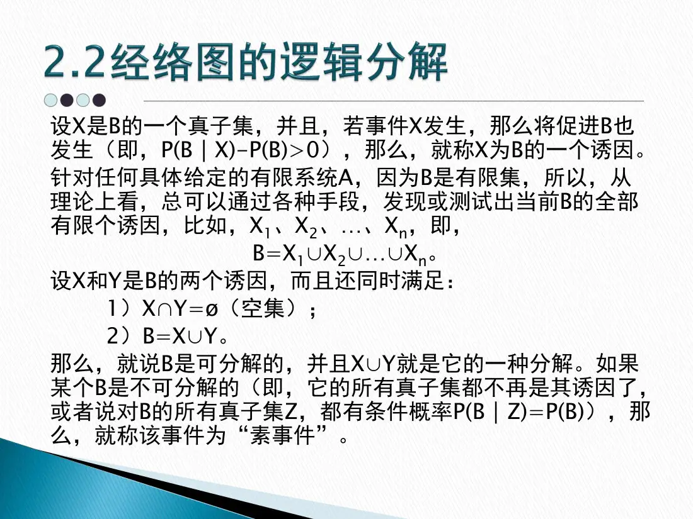

原文：

2.2经络图的逻辑分解

设X是B的一个真子集，并且，若事件X发生，那么将促进B也发生（即， $\mathsf { P } ( \mathsf { B } \mid \mathsf { X } ) - \mathsf { P } ( \mathsf { B } ) > 0 )$ ，那么，就称X为B的一个诱因。针对任何具体给定的有限系统A，因为B是有限集，所以，从理论上看，总可以通过各种手段，发现或测试出当前B的全部有限个诱因，比如， $x _ { 1 } , x _ { 2 } , \ldots x _ { n }$ ，即，

$$
\mathsf {B} = \mathsf {X} _ {1} \cup \mathsf {X} _ {2} \cup \dots \cup \mathsf {X} _ {n} 。
$$

设X和Y是B的两个诱因，而且还同时满足：

1） $\Chi \cap \mathop { } \forall \mathop { = } \emptyset$ （空集）；

2） $B { = } X \cup Y$ 。

那么，就说B是可分解的，并且X∪Y就是它的一种分解。如果某个B是不可分解的（即，它的所有真子集都不再是其诱因了，或者说对B的所有真子集Z，都有条件概率P(B│Z)=P(B)），那么，就称该事件为“素事件”。

### 2.2经络图的逻辑分解

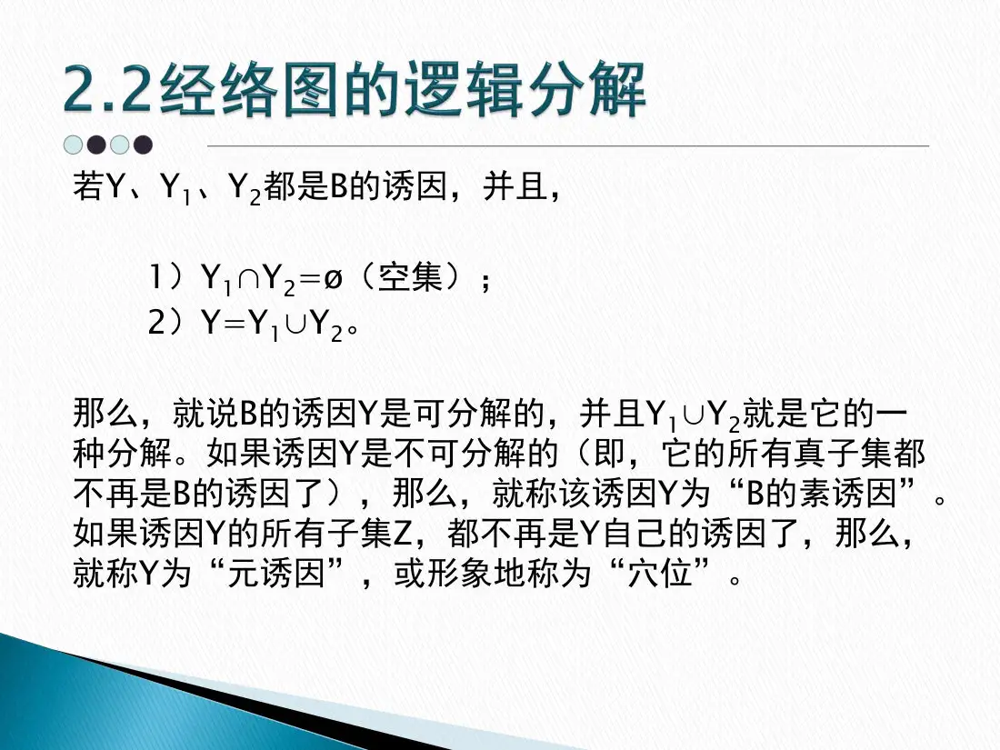

原文：

2.2经络图的逻辑分解

若Y、 $Y _ { 1 } , Y _ { 2 }$ 都是B的诱因，并且，

1） $r _ { 1 } \cap r _ { 2 } = \theta$ （空集）；

2） $\mathsf { Y } = \mathsf { Y } _ { 1 } \cup \mathsf { Y } _ { 2 ^ { \circ } }$

那么，就说B的诱因Y是可分解的，并且 $r _ { 1 } \cup r _ { 2 }$ 就是它的一种分解。如果诱因Y是不可分解的（即，它的所有真子集都不再是B的诱因了），那么，就称该诱因Y为“B的素诱因”如果诱因Y的所有子集Z，都不再是Y自己的诱因了，那么，就称Y为“元诱因”，或形象地称为“穴位”。

### 2.2经络图的逻辑分解

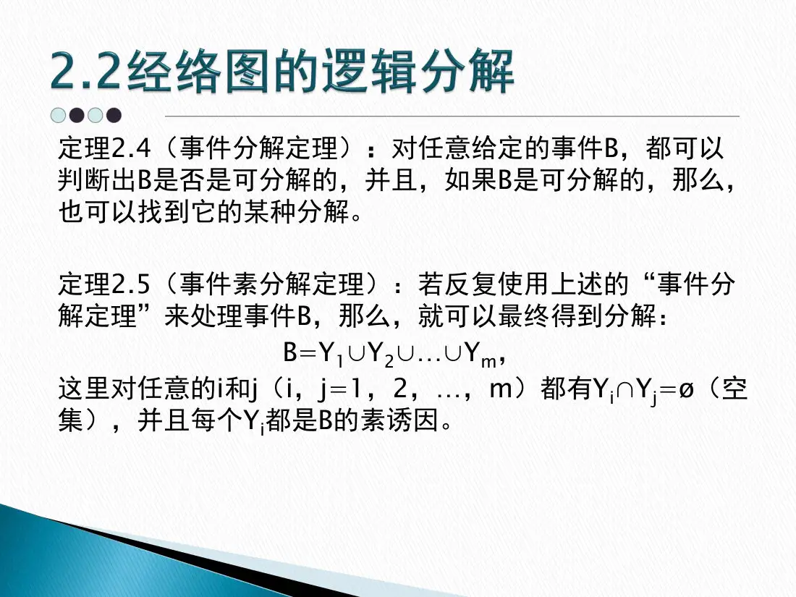

原文：

2.2经络图的逻辑分解

定理2.4（事件分解定理）：对任意给定的事件B，都可以判断出B是否是可分解的，并且，如果B是可分解的，那么，也可以找到它的某种分解。

定理2.5（事件素分解定理）：若反复使用上述的“事件分解定理”来处理事件B，那么，就可以最终得到分解：

$$
\mathsf {B} = \mathsf {Y} _ {1} \cup \mathsf {Y} _ {2} \cup \dots \cup \mathsf {Y} _ {m},
$$

这里对任意的i和j $( 1 , ) = 7 , 2 , \ldots , m )$ 都有 $\Upsilon _ { \mathrm { i } } \cap \Upsilon _ { \mathrm { j } } { = } \emptyset$ （空集），并且每个 $Y _ { i }$ 都是B的素诱因。

### 2.2经络图的逻辑分解

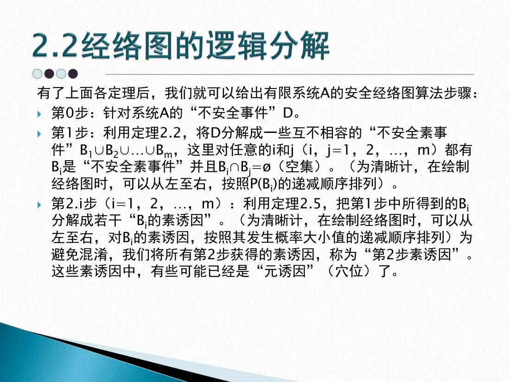

原文：

2.2经络图的逻辑分解

有了上面各定理后，我们就可以给出有限系统A的安全经络图算法步骤：第0步：针对系统A的“不安全事件”D。

 第1步：利用定理2.2，将D分解成一些互不相容的“不安全素事件” $\mathsf { B } _ { 1 } \cup \mathsf { B } _ { 2 } \cup \ldots \cup \mathsf { B } _ { \mathsf { m } }$ 这里对任意的i和j $( \mathsf { i } , \mathsf { j } { = } 1 , 2 , . . . , \mathsf { m } )$ 都有B是“不安全素事件”并且 $B _ { i } \cap B _ { i } = \emptyset$ （空集）。（为清晰计，在绘制经络图时，可以从左至右，按照 $P ( B _ { i } )$ 的递减顺序排列）。

第2.i步 $( \mathsf { i } = 1 , 2 , . . . , m )$ ：利用定理2.5，把第1步中所得到的B分解成若干 ${ } ^ { 6 6 } { \mathsf { B } } _ { \mathrm { i } }$ 的素诱因”。（为清晰计，在绘制经络图时，可以从左至右，对 $B _ { i }$ 的素诱因，按照其发生概率大小值的递减顺序排列）为避免混淆，我们将所有第2步获得的素诱因，称为“第2步素诱因”这些素诱因中，有些可能已经是“元诱因”（穴位）了。

### 2.2经络图的逻辑分解

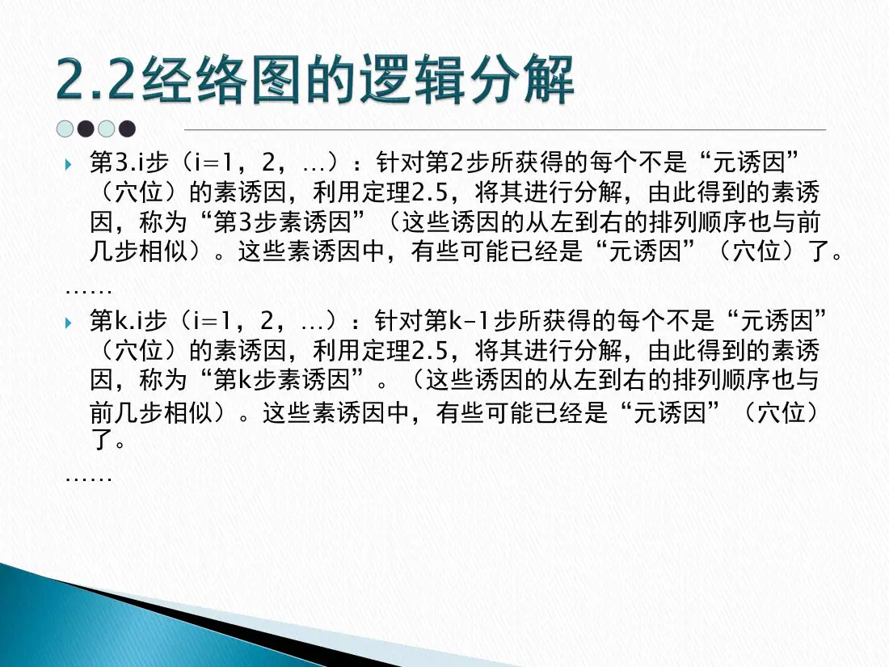

原文：

2.2经络图的逻辑分解

 第3.i步（i=1，2，…）：针对第2步所获得的每个不是“元诱因”（穴位）的素诱因，利用定理2.5，将其进行分解，由此得到的素诱因，称为“第3步素诱因”（这些诱因的从左到右的排列顺序也与前几步相似）。这些素诱因中，有些可能已经是“元诱因”（穴位）了。

 第k.i步（i=1，2，…）：针对第k-1步所获得的每个不是“元诱因”（穴位）的素诱因，利用定理2.5，将其进行分解，由此得到的素诱因，称为“第k步素诱因”。（这些诱因的从左到右的排列顺序也与前几步相似）。这些素诱因中，有些可能已经是“元诱因”（穴位）了。

### 2.2经络图的逻辑分解

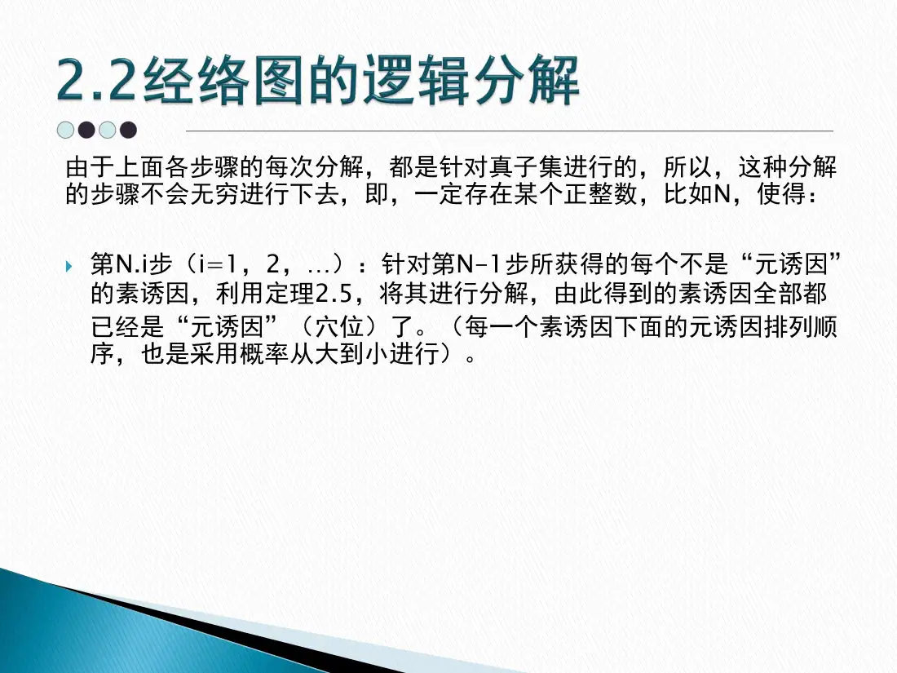

原文：

2.2经络图的逻辑分解

由于上面各步骤的每次分解，都是针对真子集进行的，所以，这种分解的步骤不会无穷进行下去，即，一定存在某个正整数，比如N，使得：

第N.i步（i=1，2，…）：针对第N-1步所获得的每个不是“元诱因”的素诱因，利用定理2.5，将其进行分解，由此得到的素诱因全部都已经是“元诱因”（穴位）了。（每一个素诱因下面的元诱因排列顺序，也是采用概率从大到小进行）。

### 2.2经络图的逻辑分解

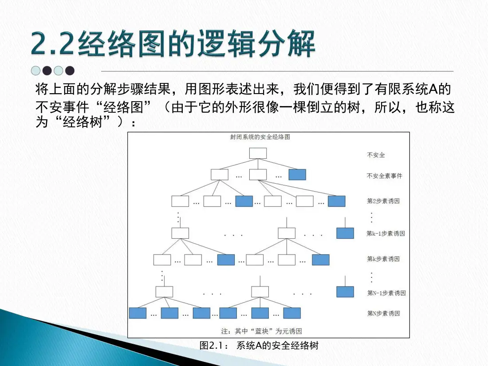

原文：

2.2经络图的逻辑分解

将上面的分解步骤结果，用图形表述出来，我们便得到了有限系统A的不安事件“经络图”（由于它的外形很像一棵倒立的树，所以，也称这为“经络树”）：

### 2.2经络图的逻辑分解

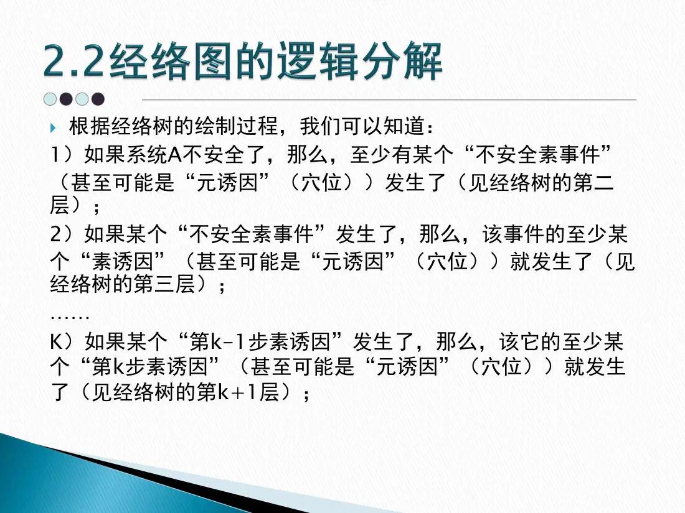

原文：

2.2经络图的逻辑分解

 根据经络树的绘制过程，我们可以知道：

1）如果系统A不安全了，那么，至少有某个“不安全素事件”（甚至可能是“元诱因”（穴位））发生了（见经络树的第二层）；

2）如果某个“不安全素事件”发生了，那么，该事件的至少某个“素诱因”（甚至可能是“元诱因”（穴位））就发生了（见经络树的第三层）；

K）如果某个“第k-1步素诱因”发生了，那么，该它的至少某个“第k步素诱因”（甚至可能是“元诱因”（穴位））就发生了（见经络树的第k+1层）；

### 2.2经络图的逻辑分解

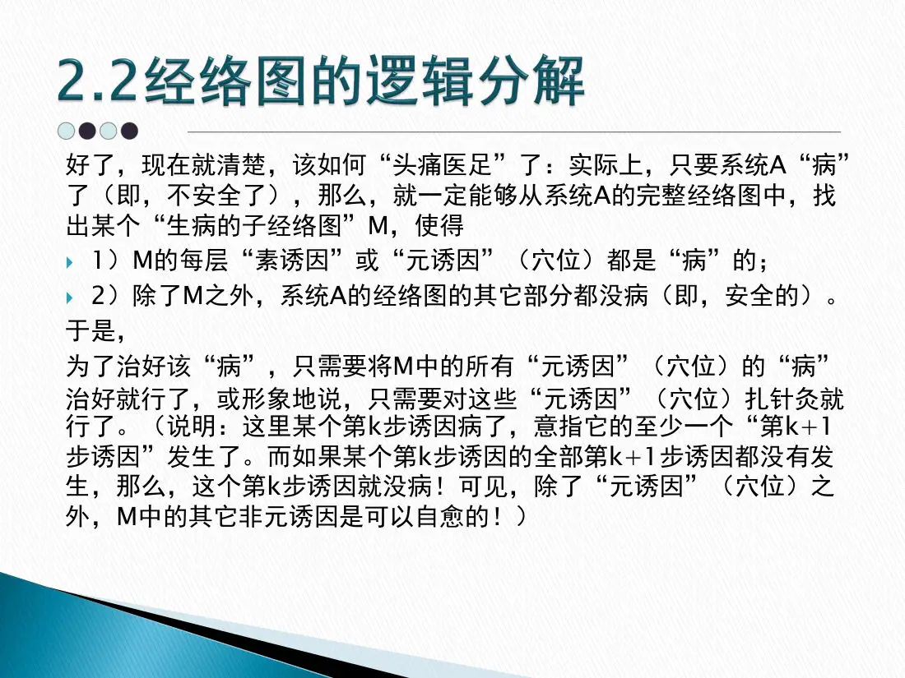

原文：

2.2经络图的逻辑分解

好了，现在就清楚，该如何“头痛医足”了：实际上，只要系统A“病”了（即，不安全了），那么，就一定能够从系统A的完整经络图中，找出某个“生病的子经络图”M，使得

 1）M的每层“素诱因”或“元诱因”（穴位）都是“病”的；

 2）除了M之外，系统A的经络图的其它部分都没病（即，安全的）。于是，

为了治好该“病”，只需要将M中的所有“元诱因”（穴位）的“病”治好就行了，或形象地说，只需要对这些“元诱因”（穴位）扎针灸就行了。（说明：这里某个第k步诱因病了，意指它的至少一个“第k+1步诱因”发生了。而如果某个第k步诱因的全部第k+1步诱因都没有发生，那么，这个第k步诱因就没病！可见，除了“元诱因”（穴位）之外，M中的其它非元诱因是可以自愈的！）

### 2.2经络图的逻辑分解

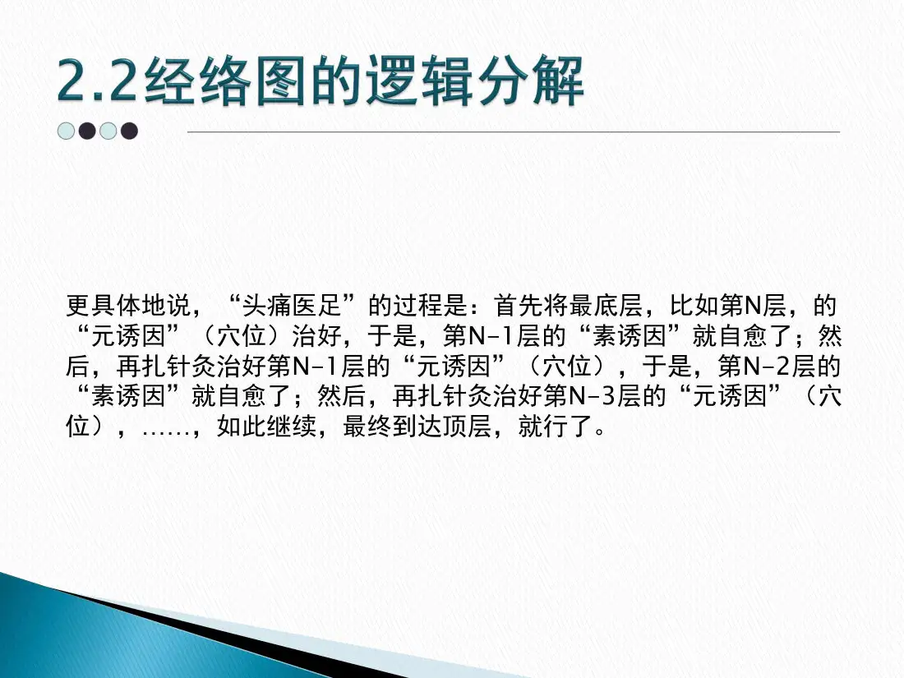

原文：

2.2经络图的逻辑分解

更具体地说，“头痛医足”的过程是：首先将最底层，比如第N层，的“元诱因”（穴位）治好，于是，第N-1层的“素诱因”就自愈了；然后，再扎针灸治好第N-1层的“元诱因”（穴位），于是，第N-2层的“素诱因”就自愈了；然后，再扎针灸治好第N-3层的“元诱因”（穴位），……，如此继续，最终到达顶层，就行了。

### 2.3几点说明

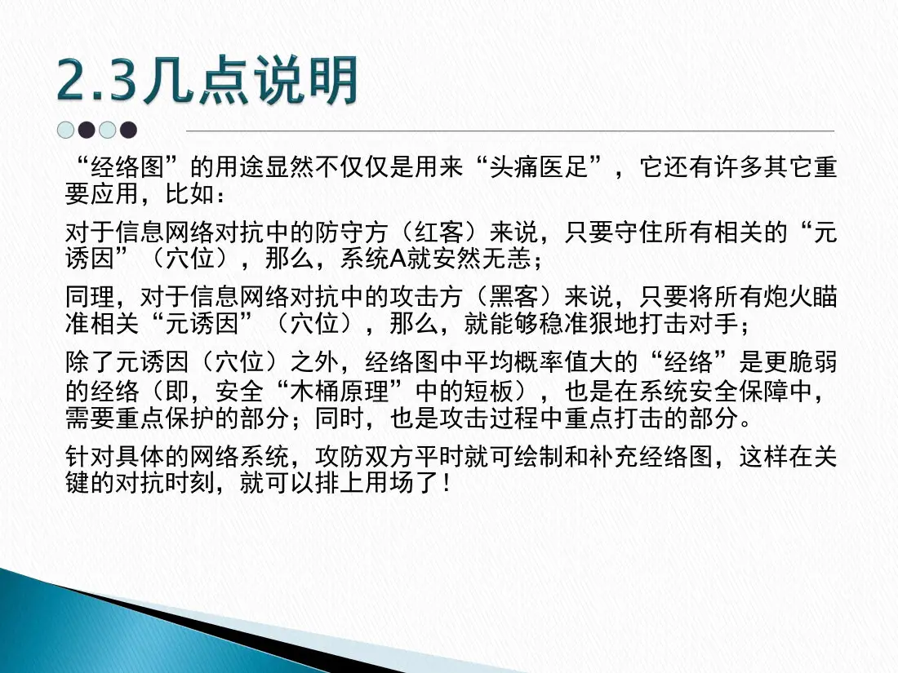

原文：

2.3几点说明

0●0●

“经络图”的用途显然不仅仅是用来“头痛医足”，它还有许多其它重要应用，比如：

对于信息网络对抗中的防守方（红客）来说，只要守住所有相关的“元诱因”（穴位），那么，系统A就安然无恙；

同理，对于信息网络对抗中的攻击方（黑客）来说，只要将所有炮火瞄准相关“元诱因”（穴位），那么，就能够稳准狠地打击对手；

除了元诱因（穴位）之外，经络图中平均概率值大的“经络”是更脆弱的经络（即，安全“木桶原理”中的短板），也是在系统安全保障中，需要重点保护的部分；同时，也是攻击过程中重点打击的部分。

针对具体的网络系统，攻防双方平时就可绘制和补充经络图，这样在关键的对抗时刻，就可以排上用场了！

### 2.3几点说明

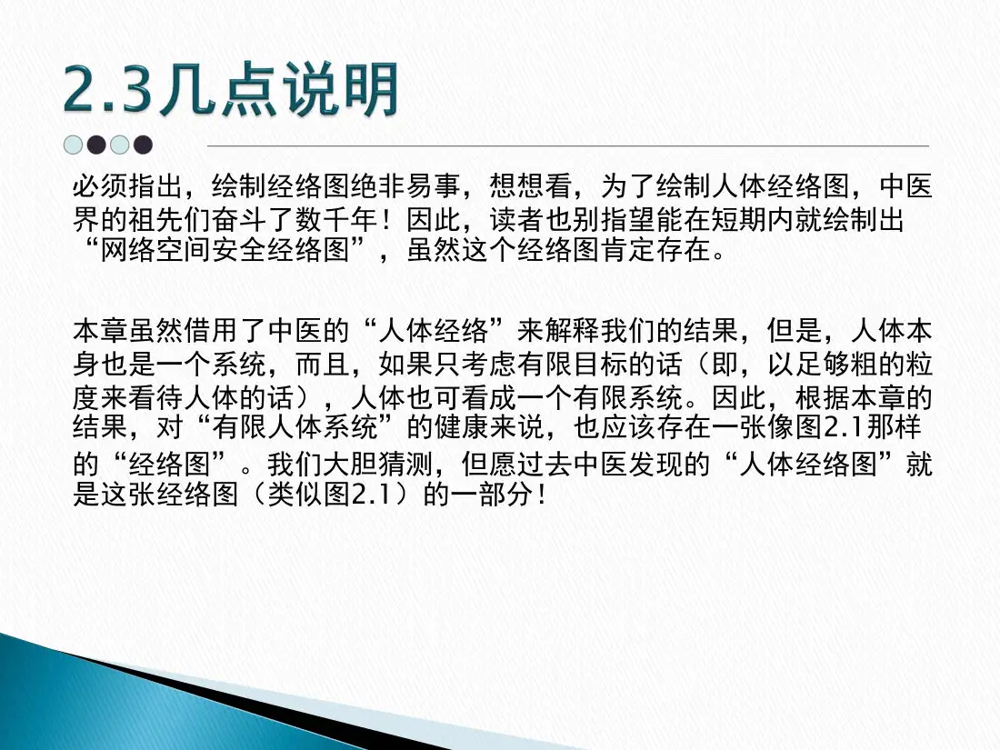

原文：

2.3几点说明

必须指出，绘制经络图绝非易事，想想看，为了绘制人体经络图，中医界的祖先们奋斗了数千年！因此，读者也别指望能在短期内就绘制出“网络空间安全经络图”，虽然这个经络图肯定存在。

本章虽然借用了中医的“人体经络”来解释我们的结果，但是，人体本身也是一个系统，而且，如果只考虑有限目标的话（即，以足够粗的粒度来看待人体的话），人体也可看成一个有限系统。因此，根据本章的结果，对“有限人体系统”的健康来说，也应该存在一张像图2.1那样的“经络图”。我们大胆猜测，但愿过去中医发现的“人体经络图”就是这张经络图（类似图2.1）的一部分！

### 2.3几点说明

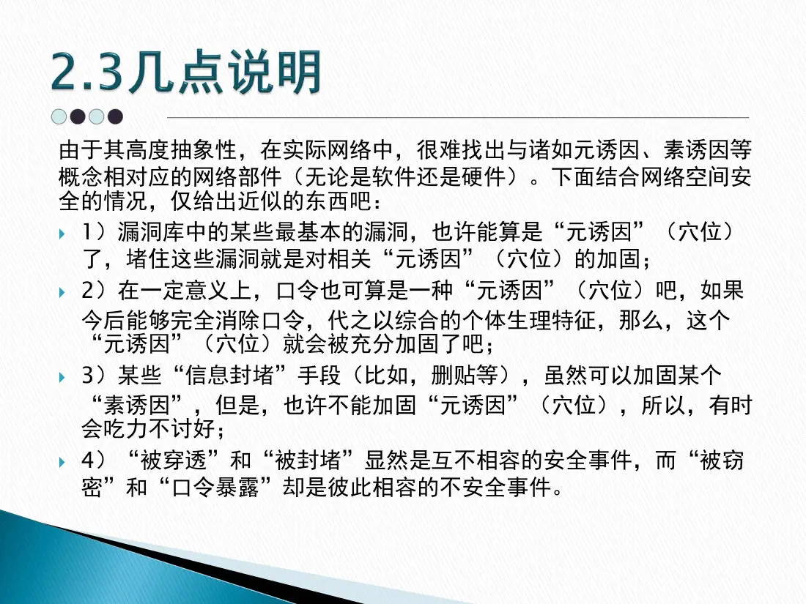

原文：

2.3几点说明

由于其高度抽象性，在实际网络中，很难找出与诸如元诱因、素诱因等概念相对应的网络部件（无论是软件还是硬件）。下面结合网络空间安全的情况，仅给出近似的东西吧：

1）漏洞库中的某些最基本的漏洞，也许能算是“元诱因”（穴位）了，堵住这些漏洞就是对相关“元诱因”（穴位）的加固；

 2）在一定意义上，口令也可算是一种“元诱因”（穴位）吧，如果今后能够完全消除口令，代之以综合的个体生理特征，那么，这个“元诱因”（穴位）就会被充分加固了吧；

 3）某些“信息封堵”手段（比如，删贴等），虽然可以加固某个“素诱因”，但是，也许不能加固“元诱因”（穴位），所以，有时会吃力不讨好；

4）“被穿透”和“被封堵”显然是互不相容的安全事件，而“被窃密”和“口令暴露”却是彼此相容的不安全事件。

### 2.3几点说明

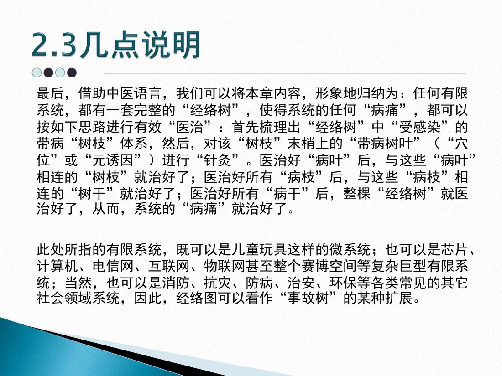

原文：

2.3几点说明

最后，借助中医语言，我们可以将本章内容，形象地归纳为：任何有限系统，都有一套完整的“经络树”，使得系统的任何“病痛”，都可以按如下思路进行有效“医治”：首先梳理出“经络树”中“受感染”的带病“树枝”体系，然后，对该“树枝”末梢上的“带病树叶”（“穴位”或“元诱因”）进行“针灸”。医治好“病叶”后，与这些“病叶”相连的“树枝”就治好了；医治好所有“病枝”后，与这些“病枝”相连的“树干”就治好了；医治好所有“病干”后，整棵“经络树”就医治好了，从而，系统的“病痛”就治好了。

此处所指的有限系统，既可以是儿童玩具这样的微系统；也可以是芯片、计算机、电信网、互联网、物联网甚至整个赛博空间等复杂巨型有限系统；当然，也可以是消防、抗灾、防病、治安、环保等各类常见的其它社会领域系统，因此，经络图可以看作“事故树”的某种扩展。

### 本章结束，谢谢

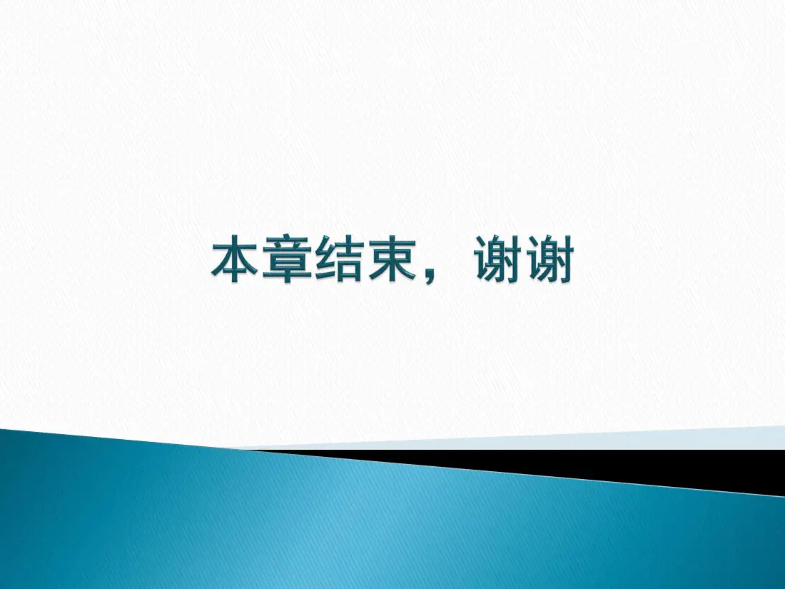

原文：

本章结束，谢谢
