# 《安全通论》第3章 黑客（课件）

原件的每一页，下面附识别出的文字。

### 第3章--黑客

原文：

第3章--黑客

### 第3章 黑客

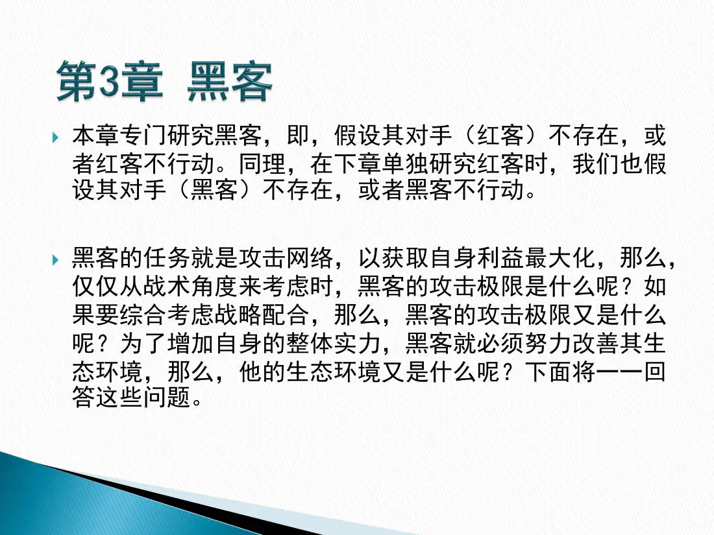

原文：

第3章 黑客

 本章专门研究黑客，即，假设其对手（红客）不存在，或者红客不行动。同理，在下章单独研究红客时，我们也假设其对手（黑客）不存在，或者黑客不行动。

黑客的任务就是攻击网络，以获取自身利益最大化，那么，仅仅从战术角度来考虑时，黑客的攻击极限是什么呢？如果要综合考虑战略配合，那么，黑客的攻击极限又是什么呢？为了增加自身的整体实力，黑客就必须努力改善其生态环境，那么，他的生态环境又是什么呢？下面将一一回答这些问题。

### 第3章黑客

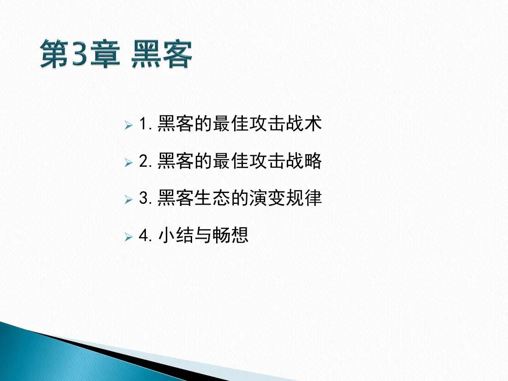

原文：

第3章黑客

1. 黑客的最佳攻击战术
2. 黑客的最佳攻击战略
3. 黑客生态的演变规律
4. 小结与畅想

### 3.1 黑客的最佳攻击战术

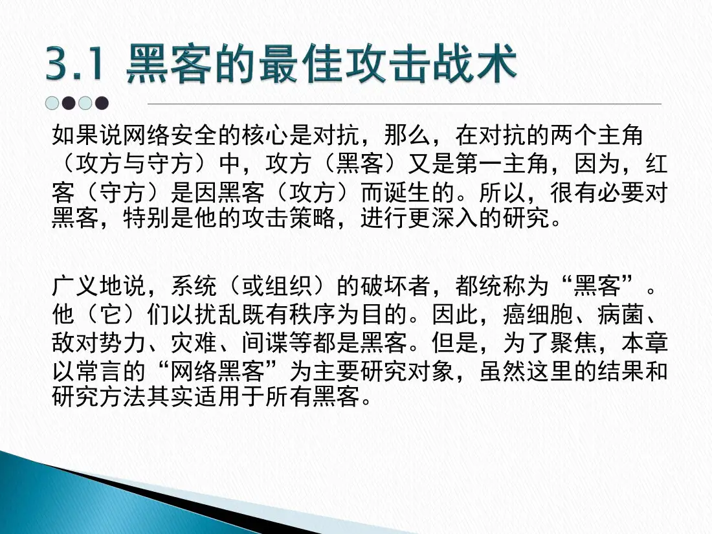

原文：

3.1 黑客的最佳攻击战术

如果说网络安全的核心是对抗，那么，在对抗的两个主角（攻方与守方）中，攻方（黑客）又是第一主角，因为，红客（守方）是因黑客（攻方）而诞生的。所以，很有必要对黑客，特别是他的攻击策略，进行更深入的研究。

广义地说，系统（或组织）的破坏者，都统称为“黑客”。他（它）们以扰乱既有秩序为目的。因此，癌细胞、病菌、敌对势力、灾难、间谍等都是黑客。但是，为了聚焦，本章以常言的“网络黑客”为主要研究对象，虽然这里的结果和研究方法其实适用于所有黑客。

### 3.1黑客的最佳攻击战术

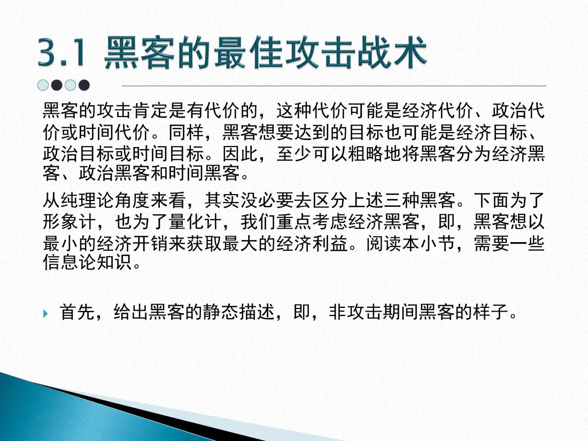

原文：

3.1黑客的最佳攻击战术

黑客的攻击肯定是有代价的，这种代价可能是经济代价、政治代价或时间代价。同样，黑客想要达到的目标也可能是经济目标、政治目标或时间目标。因此，至少可以粗略地将黑客分为经济黑客、政治黑客和时间黑客。

从纯理论角度来看，其实没必要去区分上述三种黑客。下面为了形象计，也为了量化计，我们重点考虑经济黑客，即，黑客想以最小的经济开销来获取最大的经济利益。阅读本小节，需要一些信息论知识。

首先，给出黑客的静态描述，即，非攻击期间黑客的样子。

### 3.1黑客的最佳攻击战术

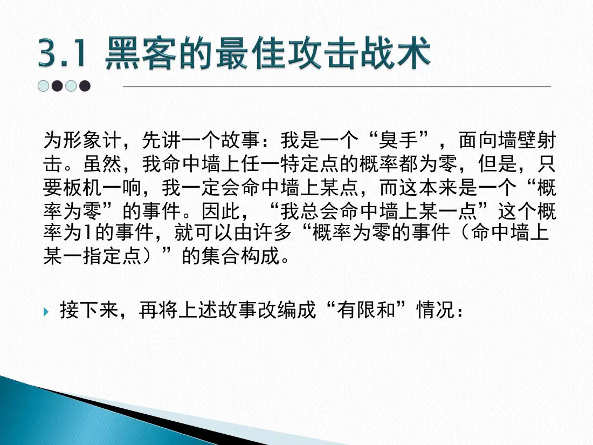

原文：

3.1黑客的最佳攻击战术

为形象计，先讲一个故事：我是一个“臭手”，面向墙壁射击。虽然，我命中墙上任一特定点的概率都为零，但是，只要板机一响，我一定会命中墙上某点，而这本来是一个“概率为零”的事件。因此，“我总会命中墙上某一点”这个概率为1的事件，就可以由许多“概率为零的事件（命中墙上某一指定点）”的集合构成。

 接下来，再将上述故事改编成“有限和”情况：

### 3.1 黑客的最佳攻击战术

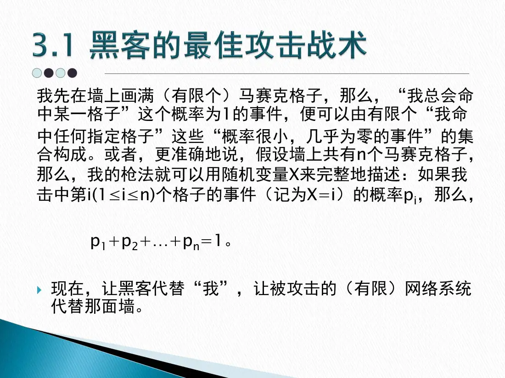

原文：

3.1 黑客的最佳攻击战术

我先在墙上画满（有限个）马赛克格子，那么，“我总会命中某一格子”这个概率为1的事件，便可以由有限个“我命中任何指定格子”这些“概率很小，几乎为零的事件”的集合构成。或者，更准确地说，假设墙上共有n个马赛克格子，那么，我的枪法就可以用随机变量X来完整地描述：如果我击中第i $( 1 \leq i \leq n )$ 个格子的事件（记为X=i）的概率p，那么，

$$
\mathsf {p} _ {1} + \mathsf {p} _ {2} + \dots + \mathsf {p} _ {n} = 1 。
$$

现在，让黑客代替“我”，让被攻击的（有限）网络系统代替那面墙。

### 3.1黑客的最佳攻击战术

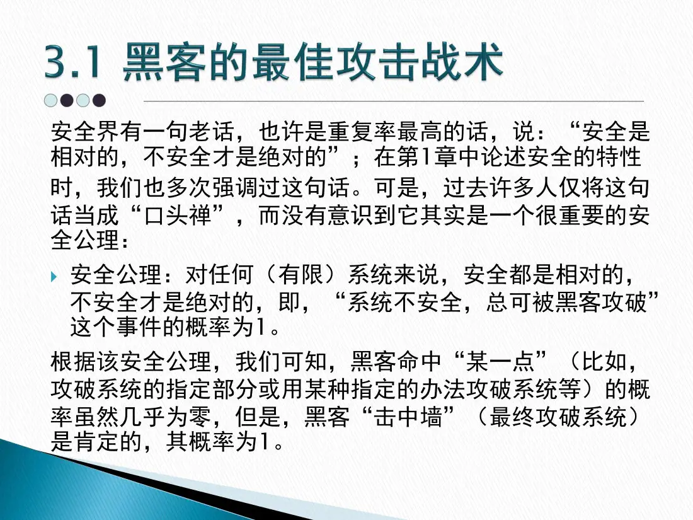

原文：

3.1黑客的最佳攻击战术

安全界有一句老话，也许是重复率最高的话，说：“安全是相对的，不安全才是绝对的”；在第1章中论述安全的特性时，我们也多次强调过这句话。可是，过去许多人仅将这句话当成“口头禅”，而没有意识到它其实是一个很重要的安全公理：

 安全公理：对任何（有限）系统来说，安全都是相对的，不安全才是绝对的，即，“系统不安全，总可被黑客攻破”这个事件的概率为1。

根据该安全公理，我们可知，黑客命中“某一点”（比如，攻破系统的指定部分或用某种指定的办法攻破系统等）的概率虽然几乎为零，但是，黑客“击中墙”（最终攻破系统）是肯定的，其概率为1。

### 3.1黑客的最佳攻击战术

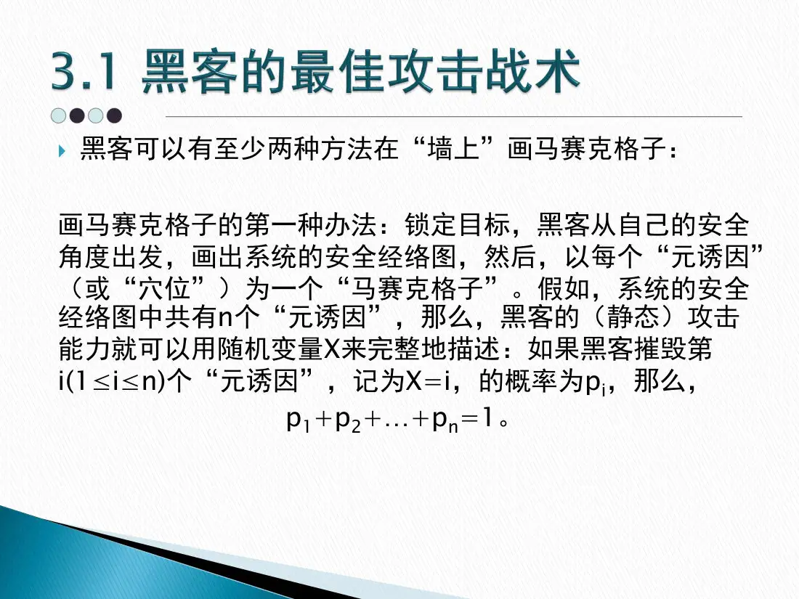

原文：

3.1黑客的最佳攻击战术

黑客可以有至少两种方法在“墙上”画马赛克格子：

画马赛克格子的第一种办法：锁定目标，黑客从自己的安全角度出发，画出系统的安全经络图，然后，以每个“元诱因”（或“穴位”）为一个“马赛克格子”。假如，系统的安全经络图中共有n个“元诱因”，那么，黑客的（静态）攻击能力就可以用随机变量X来完整地描述：如果黑客摧毁第$i ( 1 \leq i \leq n )$ 个“元诱因”，记为X=i，的概率为 $p _ { i }$ ，那么，

$$
\mathsf {p} _ {1} + \mathsf {p} _ {2} + \dots + \mathsf {p} _ {n} = 1 。
$$

### 3.1 黑客的最佳攻击战术

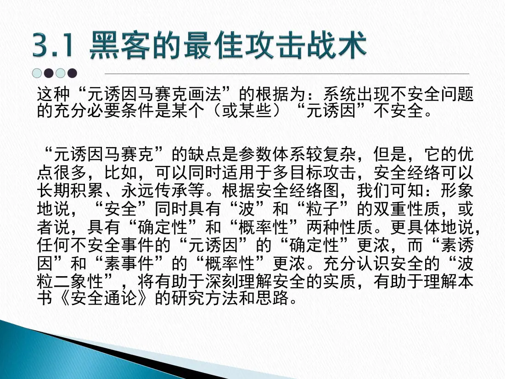

原文：

3.1 黑客的最佳攻击战术

这种“元诱因马赛克画法”的根据为：系统出现不安全问题的充分必要条件是某个（或某些）“元诱因”不安全。

“元诱因马赛克”的缺点是参数体系较复杂，但是，它的优点很多，比如，可以同时适用于多目标攻击，安全经络可以长期积累、永远传承等。根据安全经络图，我们可知：形象地说，“安全”同时具有“波”和“粒子”的双重性质，或者说，具有“确定性”和“概率性”两种性质。更具体地说，任何不安全事件的“元诱因”的“确定性”更浓，而“素诱因”和“素事件”的“概率性”更浓。充分认识安全的“波粒二象性”，将有助于深刻理解安全的实质，有助于理解本书《安全通论》的研究方法和思路。

### 3.1黑客的最佳攻击战术

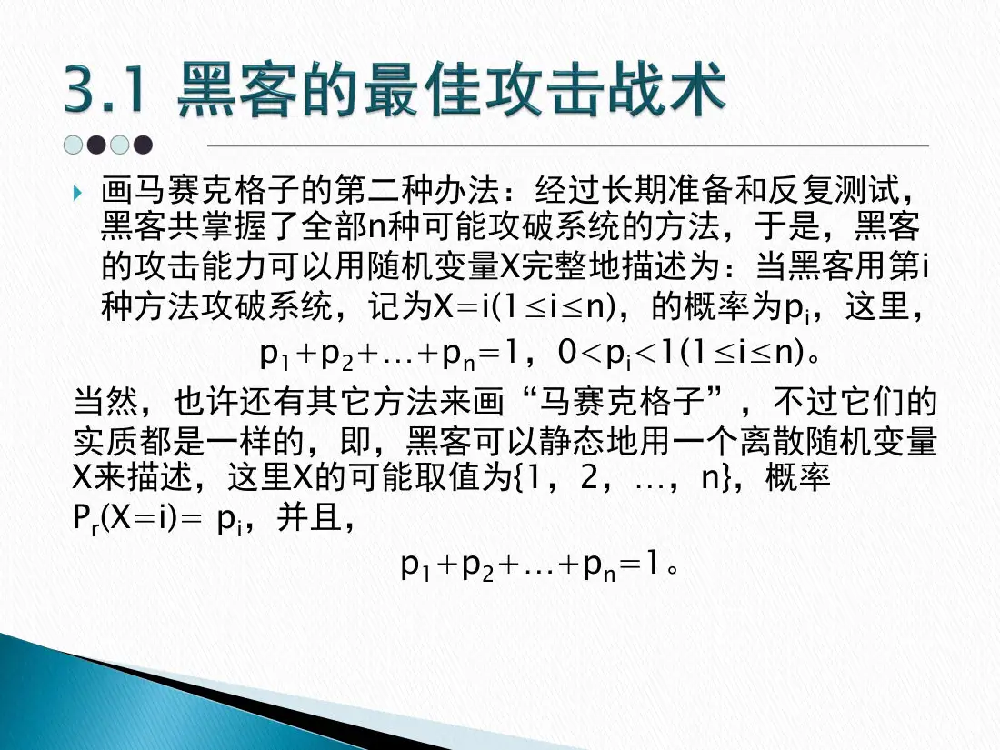

原文：

3.1黑客的最佳攻击战术

画马赛克格子的第二种办法：经过长期准备和反复测试，黑客共掌握了全部n种可能攻破系统的方法，于是，黑客的攻击能力可以用随机变量X完整地描述为：当黑客用第i种方法攻破系统，记为 $x = i ( 1 \leq i \leq n )$ 的概率为p，这里，

$$
p _ {1} + p _ {2} + \dots + p _ {n} = 1, \quad 0 <   p _ {i} <   1 (1 \leq i \leq n) 。
$$

当然，也许还有其它方法来画“马赛克格子”，不过它们的实质都是一样的，即，黑客可以静态地用一个离散随机变量X来描述，这里X的可能取值为{1， $2 , \ldots , n 3$ ，概率$p _ { r } ( x = i ) = p _ { i }$ ，并且，

$$
p _ {1} + p _ {2} + \dots + p _ {n} = 1 。
$$

### 3.1黑客的最佳攻击战术

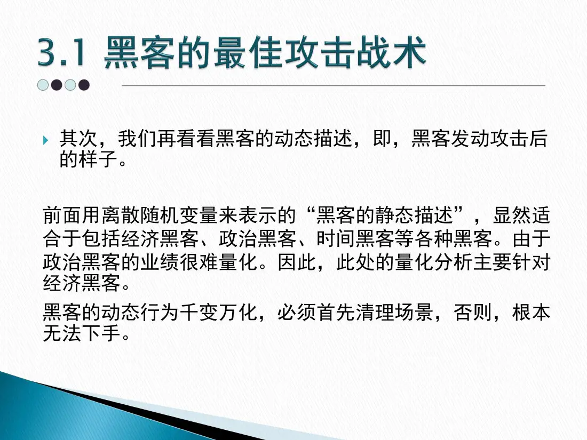

原文：

3.1黑客的最佳攻击战术

其次，我们再看看黑客的动态描述，即，黑客发动攻击后的样子。

前面用离散随机变量来表示的“黑客的静态描述”，显然适合于包括经济黑客、政治黑客、时间黑客等各种黑客。由于政治黑客的业绩很难量化。因此，此处的量化分析主要针对经济黑客。

黑客的动态行为千变万化，必须首先清理场景，否则，根本无法下手。

### 3.1黑客的最佳攻击战术

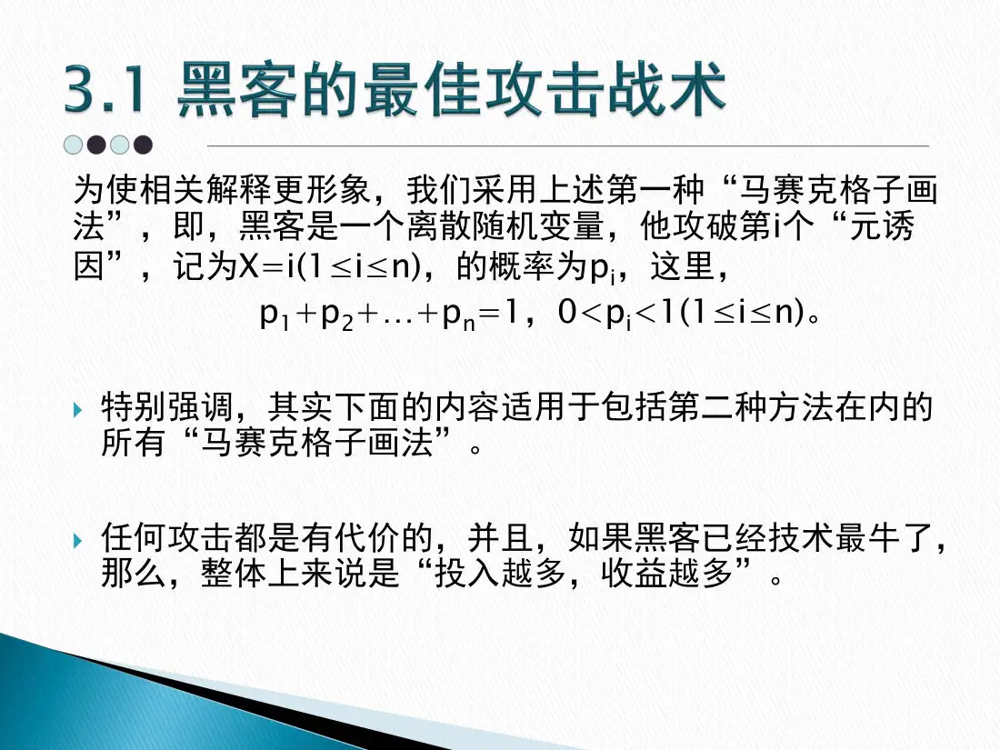

原文：

3.1黑客的最佳攻击战术

为使相关解释更形象，我们采用上述第一种“马赛克格子画法”，即，黑客是一个离散随机变量，他攻破第i个“元诱因”，记为 $x = i ( 1 \leq i \leq n )$ ，的概率为 $p _ { i }$ ，这里，

$$
p _ {1} + p _ {2} + \dots + p _ {n} = 1, \quad 0 <   p _ {i} <   1 (1 \leq i \leq n) 。
$$

特别强调，其实下面的内容适用于包括第二种方法在内的所有“马赛克格子画法”。

 任何攻击都是有代价的，并且，如果黑客已经技术最牛了，那么，整体上来说是“投入越多，收益越多”。

### 3.1 黑客的最佳攻击战术

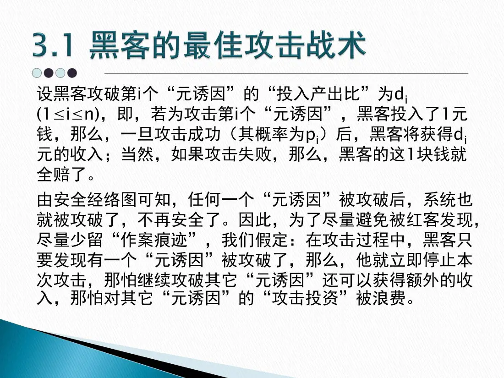

原文：

3.1 黑客的最佳攻击战术

设黑客攻破第i个“元诱因”的“投入产出比”为d(1≤i≤n)，即，若为攻击第i个“元诱因”，黑客投入了1元钱，那么，一旦攻击成功（其概率为p）后，黑客将获得d元的收入；当然，如果攻击失败，那么，黑客的这1块钱就全赔了。

由安全经络图可知，任何一个“元诱因”被攻破后，系统也就被攻破了，不再安全了。因此，为了尽量避免被红客发现，尽量少留“作案痕迹”，我们假定：在攻击过程中，黑客只要发现有一个“元诱因”被攻破了，那么，他就立即停止本次攻击，那怕继续攻破其它“元诱因”还可以获得额外的收入，那怕对其它“元诱因”的“攻击投资”被浪费。

### 3.1 黑客的最佳攻击战术

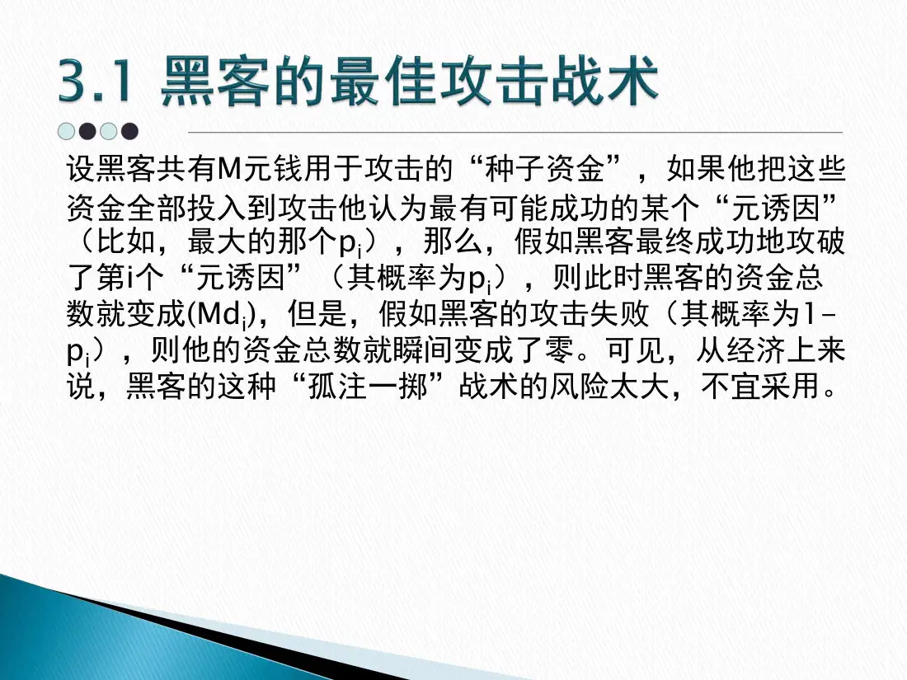

原文：

3.1 黑客的最佳攻击战术

设黑客共有M元钱用于攻击的“种子资金”，如果他把这些资金全部投入到攻击他认为最有可能成功的某个“元诱因”（比如，最大的那个p），那么，假如黑客最终成功地攻破了第i个“元诱因”（其概率为p），则此时黑客的资金总数就变成(Md)，但是，假如黑客的攻击失败（其概率为1-p），则他的资金总数就瞬间变成了零。可见，从经济上来说，黑客的这种“孤注一掷”战术的风险太大，不宜采用。

### 3.1 黑客的最佳攻击战术

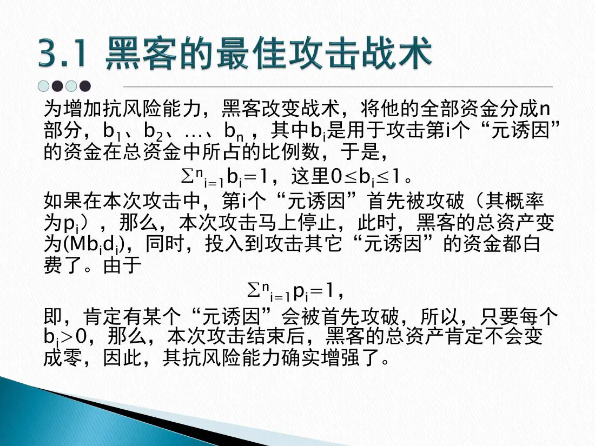

原文：

3.1 黑客的最佳攻击战术

为增加抗风险能力，黑客改变战术，将他的全部资金分成n部分， $b _ { 1 } , b _ { 2 } , \ldots b _ { n }$ 其中 $b _ { i }$ 是用于攻击第i个“元诱因”的资金在总资金中所占的比例数，于是，

$$
\Sigma_ {i = 1} ^ {n} b _ {i} = 1, \text {这里} 0 \leq b _ {i} \leq 1 。
$$

如果在本次攻击中，第i个“元诱因”首先被攻破（其概率$p _ { \mathrm { i } } )$ ，那么，本次攻击马上停止，此时，黑客的总资产变$( M b , 0 . )$ 同时，投入到攻击其它“元诱因”的资金都白i i费了。由于

$$
\sum_ {i = 1} ^ {n} p _ {i} = 1,
$$

即，肯定有某个“元诱因”会被首先攻破，所以，只要每个$b _ { \mathrm { i } } > 0$ 那么，本次攻击结束后，黑客的总资产肯定不会变成零，因此，其抗风险能力确实增强了。

### 3.1 黑客的最佳攻击战术

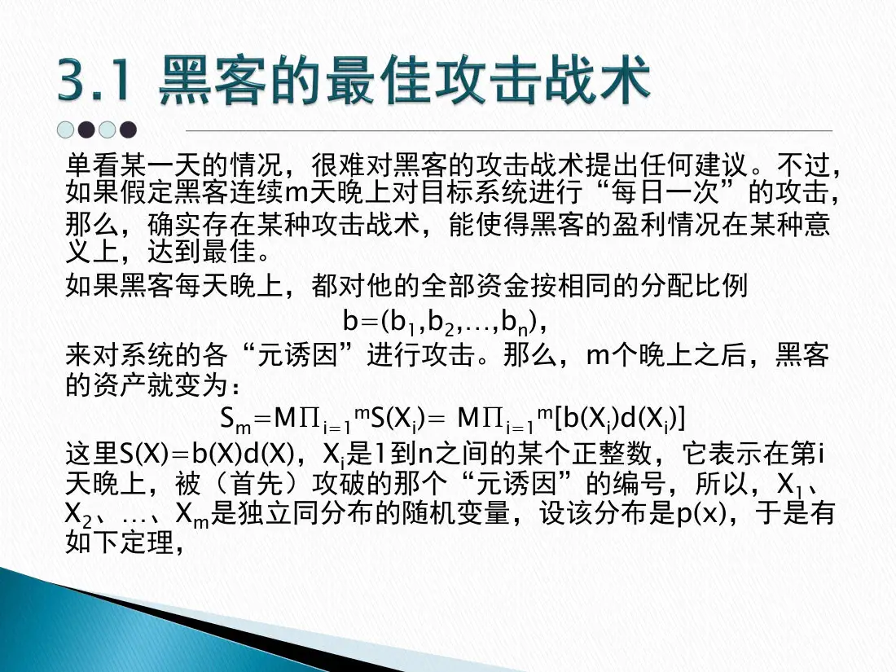

原文：

3.1 黑客的最佳攻击战术

单看某一天的情况，很难对黑客的攻击战术提出任何建议。不过，如果假定黑客连续m天晚上对目标系统进行“每日一次”的攻击，那么，确实存在某种攻击战术，能使得黑客的盈利情况在某种意义上，达到最佳。

如果黑客每天晚上，都对他的全部资金按相同的分配比例

$$
\mathsf {b} = (\mathsf {b} _ {1}, \mathsf {b} _ {2}, \dots , \mathsf {b} _ {n}),
$$

来对系统的各“元诱因”进行攻击。那么，m个晚上之后，黑客的资产就变为：

$$
S _ {m} = M \Pi_ {i = 1} ^ {m} S (X _ {i}) = M \Pi_ {i = 1} ^ {m} [ b (X _ {i}) d (X _ {i}) ]
$$

这里 $\mathsf { S } ( \mathsf { X } ) { = } \mathsf { b } ( \mathsf { X } ) \mathsf { d } ( \mathsf { X } )$ X是1到n之间的某个正整数，它表示在第i天晚上，被（首先）攻破的那个“元诱因”的编号，所以， $X _ { 1 }$ $x _ { 2 } 、 \cdots x _ { m }$ 是独立同分布的随机变量，设该分布是p(x)，于是有如下定理，

### 3.1 黑客的最佳攻击战术

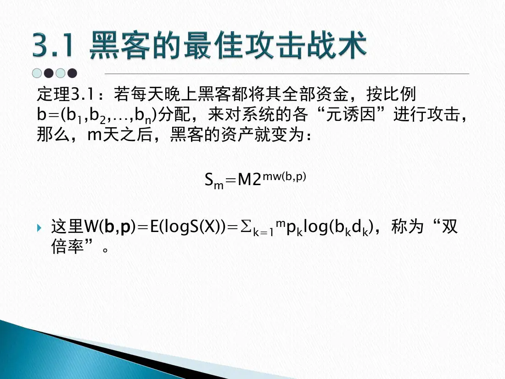

原文：

3.1 黑客的最佳攻击战术

定理3.1：若每天晚上黑客都将其全部资金，按比例$\mathsf { b } { = } ( \mathsf { b } _ { 1 } , \mathsf { b } _ { 2 } , \ldots , \mathsf { b } _ { n } )$ 分配，来对系统的各“元诱因”进行攻击，那么，m天之后，黑客的资产就变为：

$$
S _ {m} = M 2 ^ {m w (b, p)}
$$

 这里 $\mathsf { W } ( \mathsf { b } , \mathsf { p } ) { = } \mathsf { E } ( \mathsf { l o g } \mathsf { S } ( \mathsf { X } ) ) { = } \Sigma _ { \mathsf { k } = 1 } \mathsf { m } ^ { } \mathsf { p } _ { \mathsf { k } } \mathsf { l o g } ( \mathsf { b } _ { \mathsf { k } } \mathsf { d } _ { \mathsf { k } } )$ ，称为“双倍率”。

### 3.1 黑客的最佳攻击战术

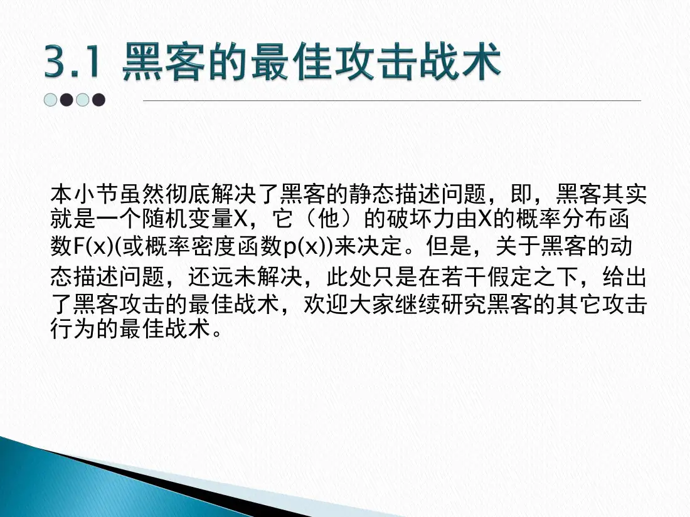

原文：

3.1 黑客的最佳攻击战术

本小节虽然彻底解决了黑客的静态描述问题，即，黑客其实就是一个随机变量X，它（他）的破坏力由X的概率分布函数F(x)(或概率密度函数p(x))来决定。但是，关于黑客的动态描述问题，还远未解决，此处只是在若干假定之下，给出了黑客攻击的最佳战术，欢迎大家继续研究黑客的其它攻击行为的最佳战术。

### 3.2 黑客的最佳攻击战略

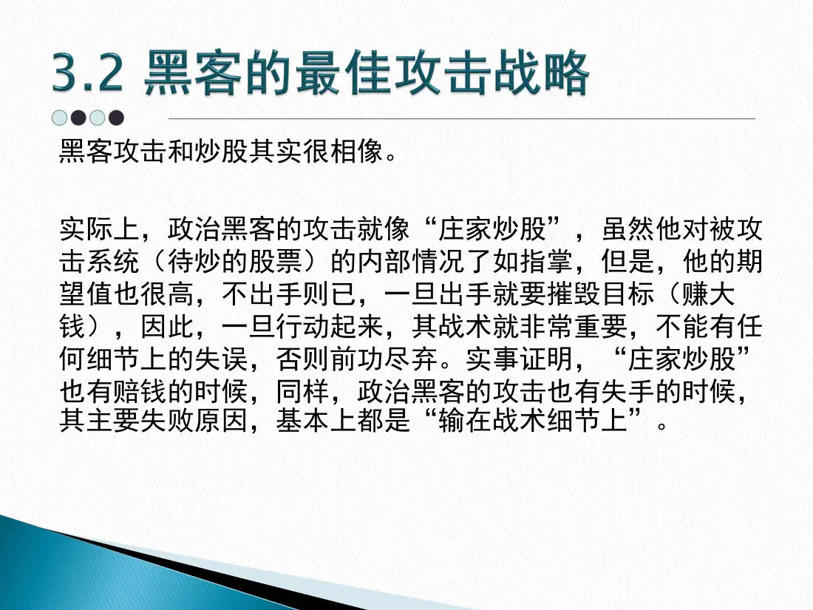

原文：

3.2 黑客的最佳攻击战略

黑客攻击和炒股其实很相像。

实际上，政治黑客的攻击就像“庄家炒股”，虽然他对被攻击系统（待炒的股票）的内部情况了如指掌，但是，他的期望值也很高，不出手则已，一旦出手就要摧毁目标（赚大钱），因此，一旦行动起来，其战术就非常重要，不能有任何细节上的失误，否则前功尽弃。实事证明，“庄家炒股”也有赔钱的时候，同样，政治黑客的攻击也有失手的时候，其主要失败原因，基本上都是“输在战术细节上”

### 3.2 黑客的最佳攻击战略

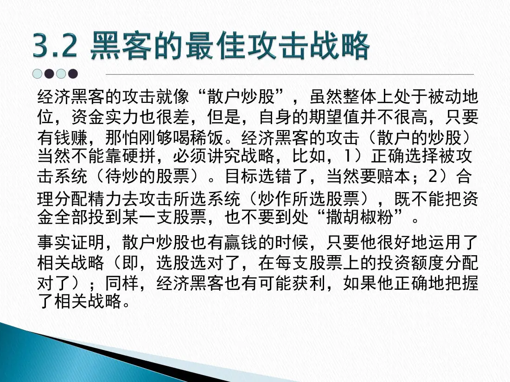

原文：

3.2 黑客的最佳攻击战略

经济黑客的攻击就像“散户炒股”，虽然整体上处于被动地位，资金实力也很差，但是，自身的期望值并不很高，只要有钱赚，那怕刚够喝稀饭。经济黑客的攻击（散户的炒股）当然不能靠硬拼，必须讲究战略，比如，1）正确选择被攻击系统（待炒的股票）。目标选错了，当然要赔本；2）合理分配精力去攻击所选系统（炒作所选股票），既不能把资金全部投到某一支股票，也不要到处“撒胡椒粉”。

事实证明，散户炒股也有赢钱的时候，只要他很好地运用了相关战略（即，选股选对了，在每支股票上的投资额度分配对了）；同样，经济黑客也有可能获利，如果他正确地把握了相关战略。

### 3.2 黑客的最佳攻击战略

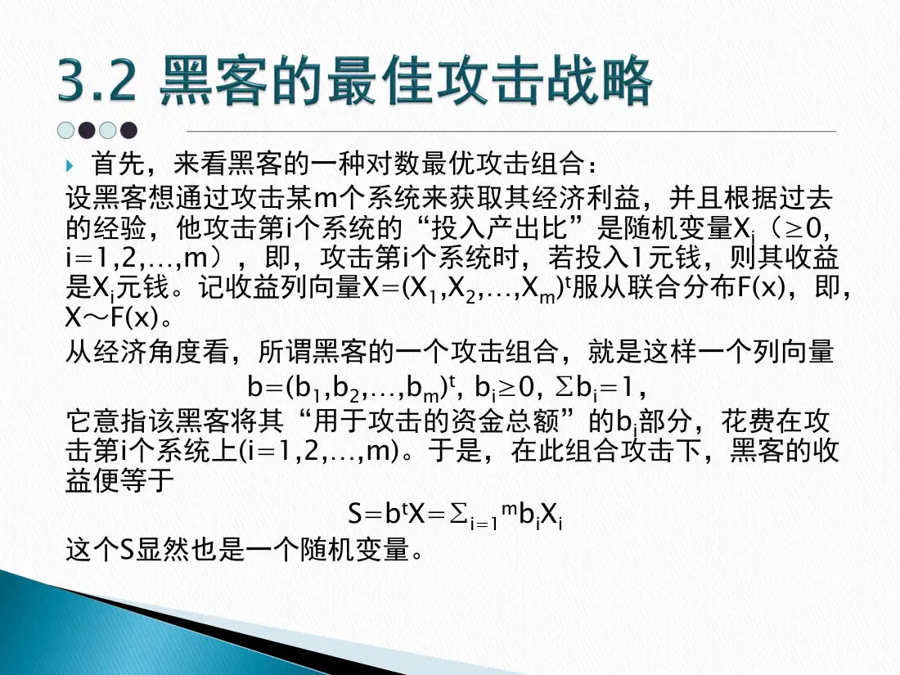

原文：

3.2 黑客的最佳攻击战略

 首先，来看黑客的一种对数最优攻击组合：

设黑客想通过攻击某m个系统来获取其经济利益，并且根据过去的经验，他攻击第i个系统的“投入产出比”是随机变量X $( \geq 0$ $\mathsf { i } = 1 , 2 , \ldots , \mathsf { m } )$ 即，攻击第i个系统时，若投入1元钱，则其收益是X元钱。记收益列向量 $\mathsf { X } { = } ( \mathsf { X } _ { 1 } , \mathsf { X } _ { 2 } , \ldots , \mathsf { X } _ { \mathrm { m } } )$ t服从联合分布F(x)，即，$x { \sim } F ( x )$ o

从经济角度看，所谓黑客的一个攻击组合，就是这样一个列向量

$$
\mathsf {b} = \left(\mathsf {b} _ {1}, \mathsf {b} _ {2}, \dots , \mathsf {b} _ {\mathsf {m}}\right) ^ {\mathrm{t}}, \mathsf {b} _ {\mathrm{i}} \geq 0, \Sigma \mathsf {b} _ {\mathrm{i}} = 1,
$$

它意指该黑客将其“用于攻击的资金总额”的 $b _ { i }$ 部分，花费在攻击第i个系统上 $( \mathsf { i } = 1 , 2 , \ldots , m )$ 。于是，在此组合攻击下，黑客的收益便等于

$$
S = b ^ {t} X = \sum_ {i = 1} ^ {m} b _ {i} X _ {i}
$$

这个S显然也是一个随机变量。

### 3.2 黑客的最佳攻击战略

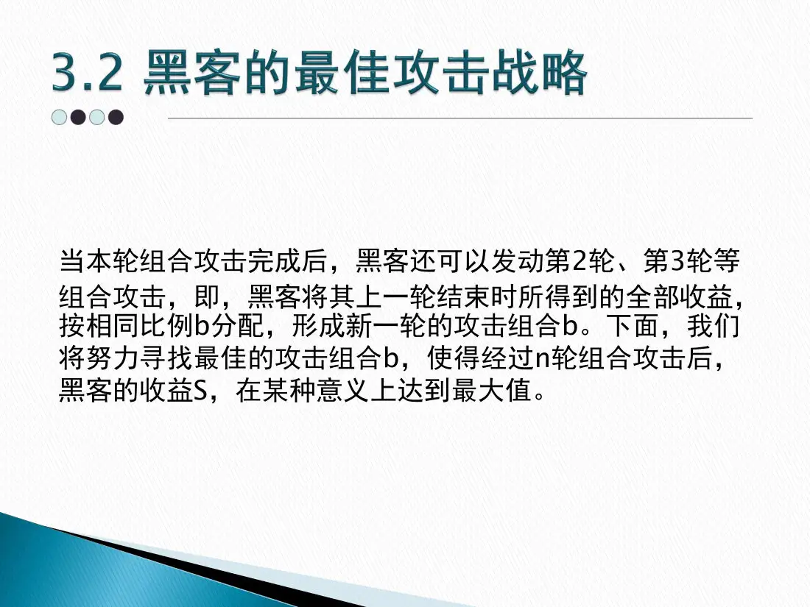

原文：

3.2 黑客的最佳攻击战略

当本轮组合攻击完成后，黑客还可以发动第2轮、第3轮等组合攻击，即，黑客将其上一轮结束时所得到的全部收益，按相同比例b分配，形成新一轮的攻击组合b。下面，我们将努力寻找最佳的攻击组合b，使得经过n轮组合攻击后，黑客的收益S，在某种意义上达到最大值。

### 3.2 黑客的最佳攻击战略

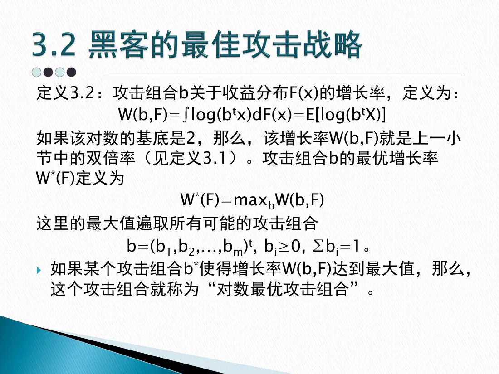

原文：

3.2 黑客的最佳攻击战略

定义3.2：攻击组合b关于收益分布F(x)的增长率，定义为：

$$
W (b, F) = \int \log \left(b ^ {t} x\right) d F (x) = E [ \log \left(b ^ {t} X\right) ]
$$

如果该对数的基底是2，那么，该增长率W(b,F)就是上一小节中的双倍率（见定义3.1）。攻击组合b的最优增长率$\boldsymbol { \mathsf { W } } ^ { * } ( \boldsymbol { \mathsf { F } } )$ 定义为

$$
W ^ {*} (F) = \max _ {b} W (b, F)
$$

这里的最大值遍取所有可能的攻击组合

$$
\mathsf {b} = \left(\mathsf {b} _ {1}, \mathsf {b} _ {2}, \dots , \mathsf {b} _ {m}\right) ^ {\mathrm{t}}, \mathsf {b} _ {\mathrm{i}} \geq 0, \Sigma \mathsf {b} _ {\mathrm{i}} = 1 。
$$

如果某个攻击组合 $b ^ { * }$ 使得增长率 $W ( b , F )$ 达到最大值，那么，这个攻击组合就称为“对数最优攻击组合”。

### 3.3 黑客生态的演变规律

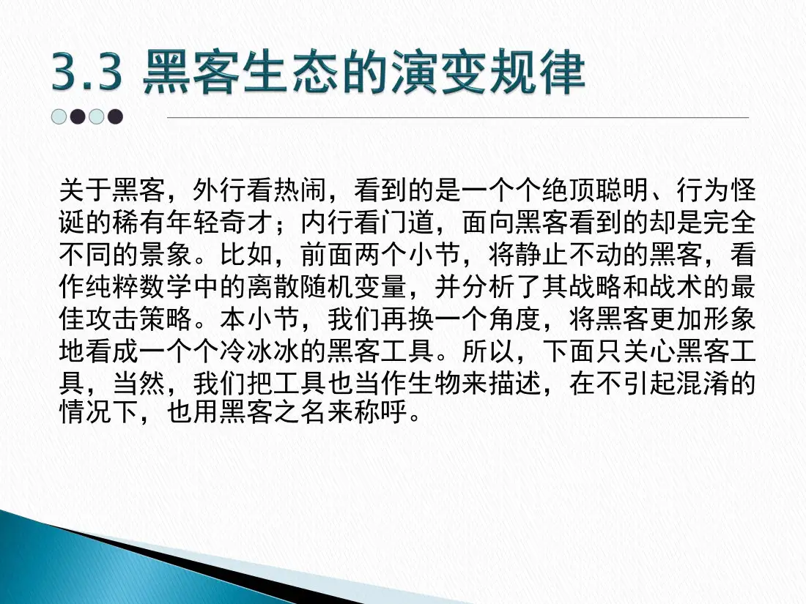

原文：

3.3 黑客生态的演变规律

关于黑客，外行看热闹，看到的是一个个绝顶聪明、行为怪诞的稀有年轻奇才；内行看门道，面向黑客看到的却是完全不同的景象。比如，前面两个小节，将静止不动的黑客，看作纯粹数学中的离散随机变量，并分析了其战略和战术的最佳攻击策略。本小节，我们再换一个角度，将黑客更加形象地看成一个个冷冰冰的黑客工具。所以，下面只关心黑客工具，当然，我们把工具也当作生物来描述，在不引起混淆的情况下，也用黑客之名来称呼。

### 3.3 黑客生态的演变规律

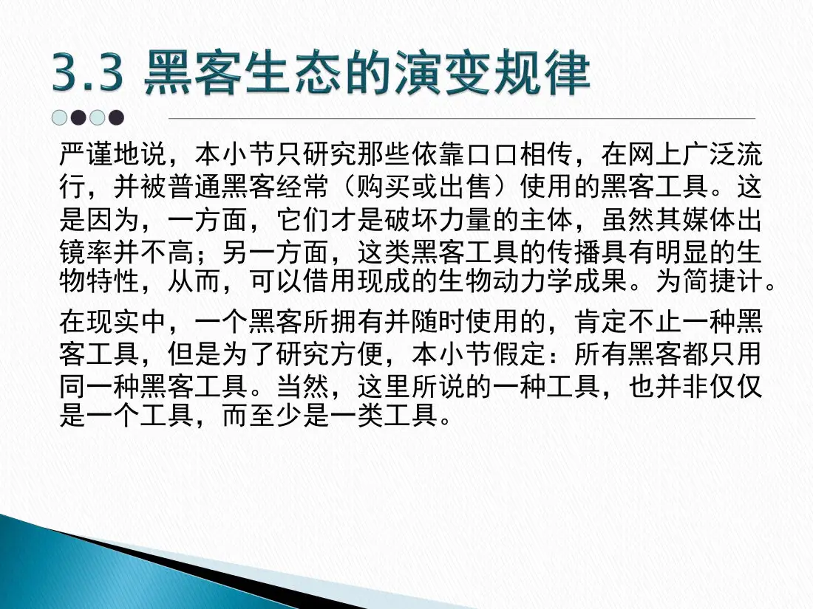

原文：

3.3 黑客生态的演变规律

严谨地说，本小节只研究那些依靠口口相传，在网上广泛流行，并被普通黑客经常（购买或出售）使用的黑客工具。这是因为，一方面，它们才是破坏力量的主体，虽然其媒体出镜率并不高；另一方面，这类黑客工具的传播具有明显的生物特性，从而，可以借用现成的生物动力学成果。为简捷计。

在现实中，一个黑客所拥有并随时使用的，肯定不止一种黑客工具，但是为了研究方便，本小节假定：所有黑客都只用同一种黑客工具。当然，这里所说的一种工具，也并非仅仅是一个工具，而至少是一类工具。

### 3.3 黑客生态的演变规律

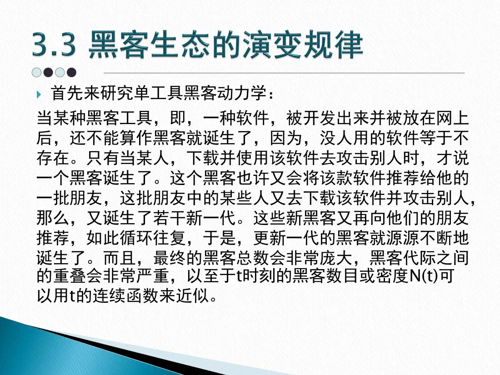

原文：

3.3 黑客生态的演变规律

首先来研究单工具黑客动力学：

当某种黑客工具，即，一种软件，被开发出来并被放在网上后，还不能算作黑客就诞生了，因为，没人用的软件等于不存在。只有当某人，下载并使用该软件去攻击别人时，才说一个黑客诞生了。这个黑客也许又会将该款软件推荐给他的一批朋友，这批朋友中的某些人又去下载该软件并攻击别人，那么，又诞生了若干新一代。这些新黑客又再向他们的朋友推荐，如此循环往复，于是，更新一代的黑客就源源不断地诞生了。而且，最终的黑客总数会非常庞大，黑客代际之间的重叠会非常严重，以至于t时刻的黑客数目或密度N(t)可以用t的连续函数来近似。

### 3.3 黑客生态的演变规律

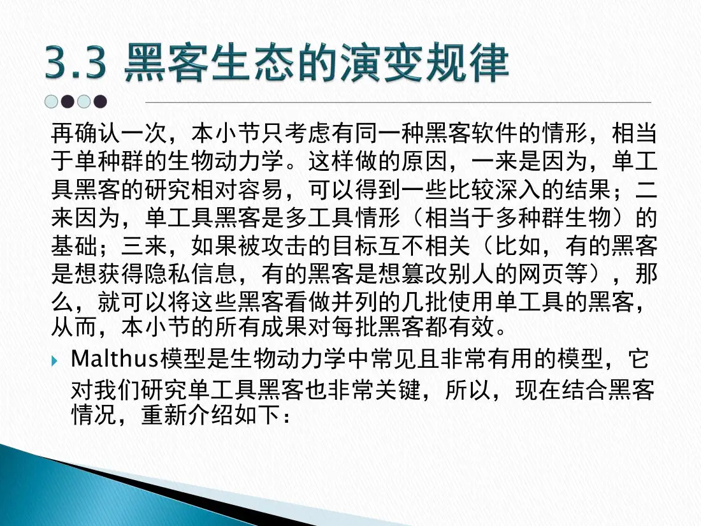

原文：

3.3 黑客生态的演变规律

再确认一次，本小节只考虑有同一种黑客软件的情形，相当于单种群的生物动力学。这样做的原因，一来是因为，单工具黑客的研究相对容易，可以得到一些比较深入的结果；二来因为，单工具黑客是多工具情形（相当于多种群生物）的基础；三来，如果被攻击的目标互不相关（比如，有的黑客是想获得隐私信息，有的黑客是想篡改别人的网页等），那么，就可以将这些黑客看做并列的几批使用单工具的黑客，从而，本小节的所有成果对每批黑客都有效。

Malthus模型是生物动力学中常见且非常有用的模型，它对我们研究单工具黑客也非常关键，所以，现在结合黑客情况，重新介绍如下：

### 3.3 黑客生态的演变规律

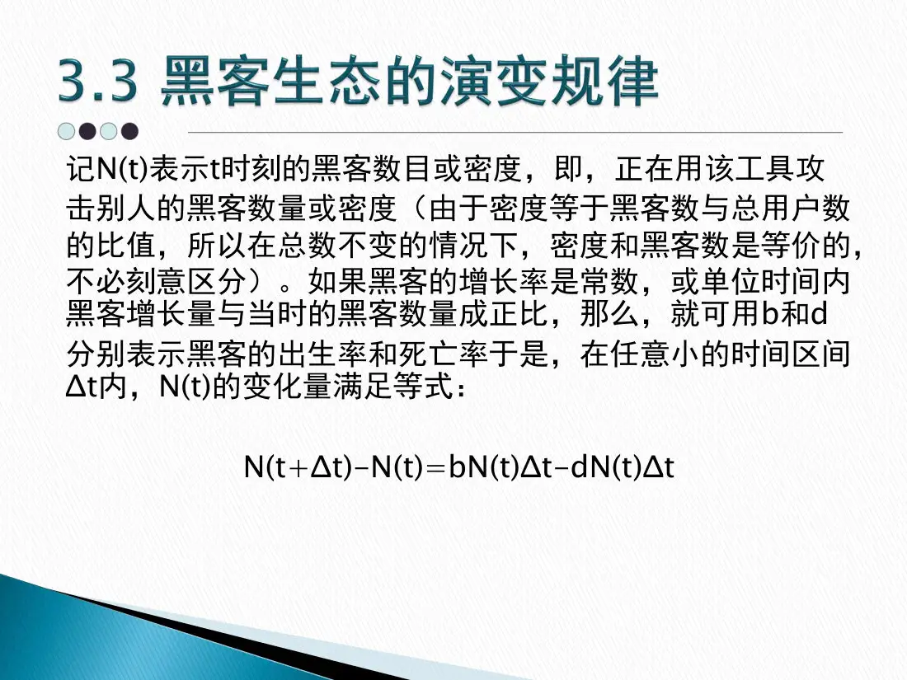

原文：

3.3 黑客生态的演变规律

记N(t)表示t时刻的黑客数目或密度，即，正在用该工具攻击别人的黑客数量或密度（由于密度等于黑客数与总用户数的比值，所以在总数不变的情况下，密度和黑客数是等价的，不必刻意区分）。如果黑客的增长率是常数，或单位时间内黑客增长量与当时的黑客数量成正比，那么，就可用b和d分别表示黑客的出生率和死亡率于是，在任意小的时间区间Δt内，N(t)的变化量满足等式：

$$
N (t + \Delta t) - N (t) = b N (t) \Delta t - d N (t) \Delta t
$$

### 3.3 黑客生态的演变规律

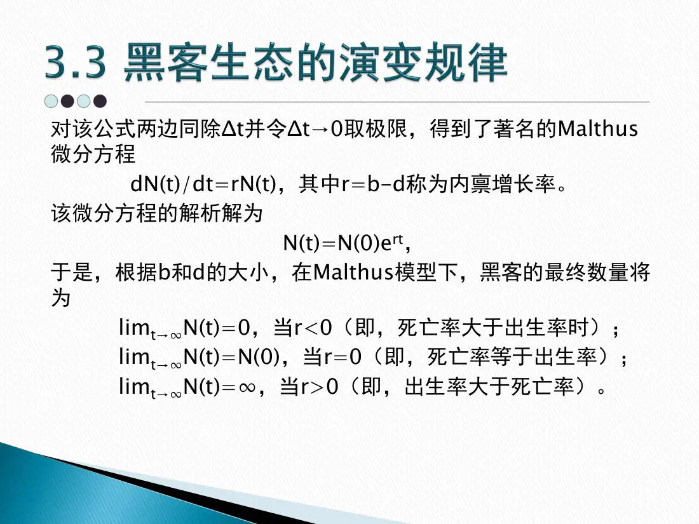

原文：

3.3 黑客生态的演变规律

对该公式两边同除 $\Delta t$ 并令 $\Delta t  0$ 取极限，得到了著名的Malthus微分方程

$\mathsf { d N } ( \mathsf { t } ) / \mathsf { d t } = \mathsf { r N } ( \mathsf { t } )$ ，其中 $r = b - d$ 称为内禀增长率。

该微分方程的解析解为

$$
N (t) = N (0) e ^ {r t},
$$

于是，根据b和d的大小，在Malthus模型下，黑客的最终数量将为

$\lim _ { \mathrm { t  \infty } } N ( t ) = 0$ ，当 $\boldsymbol { \mathsf { r } } < 0$ （即，死亡率大于出生率时）；

$\mathsf { i m } _ { \mathrm { t } \to \infty } \mathsf { N } ( \mathrm { t } ) { = } \mathsf { N } ( 0 )$ ，当 $\boldsymbol { \mathsf { r } } = \boldsymbol { 0 }$ （即，死亡率等于出生率）；

$\lim _ { t  \infty } N ( t ) = \infty$ ，当 $r > 0$ （即，出生率大于死亡率）。

### 3.3 黑客生态的演变规律

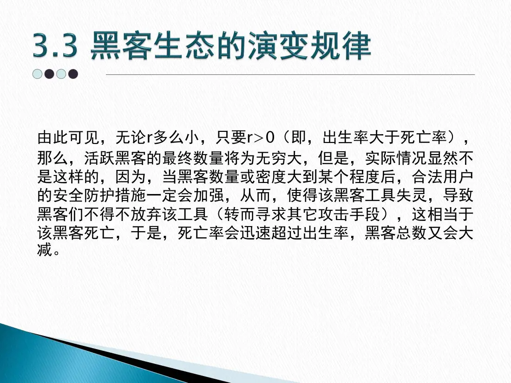

原文：

3.3 黑客生态的演变规律

由此可见，无论r多么小，只要r>0（即，出生率大于死亡率）那么，活跃黑客的最终数量将为无穷大，但是，实际情况显然不是这样的，因为，当黑客数量或密度大到某个程度后，合法用户的安全防护措施一定会加强，从而，使得该黑客工具失灵，导致黑客们不得不放弃该工具（转而寻求其它攻击手段），这相当于该黑客死亡，于是，死亡率会迅速超过出生率，黑客总数又会大减。

### 3.3 黑客生态的演变规律

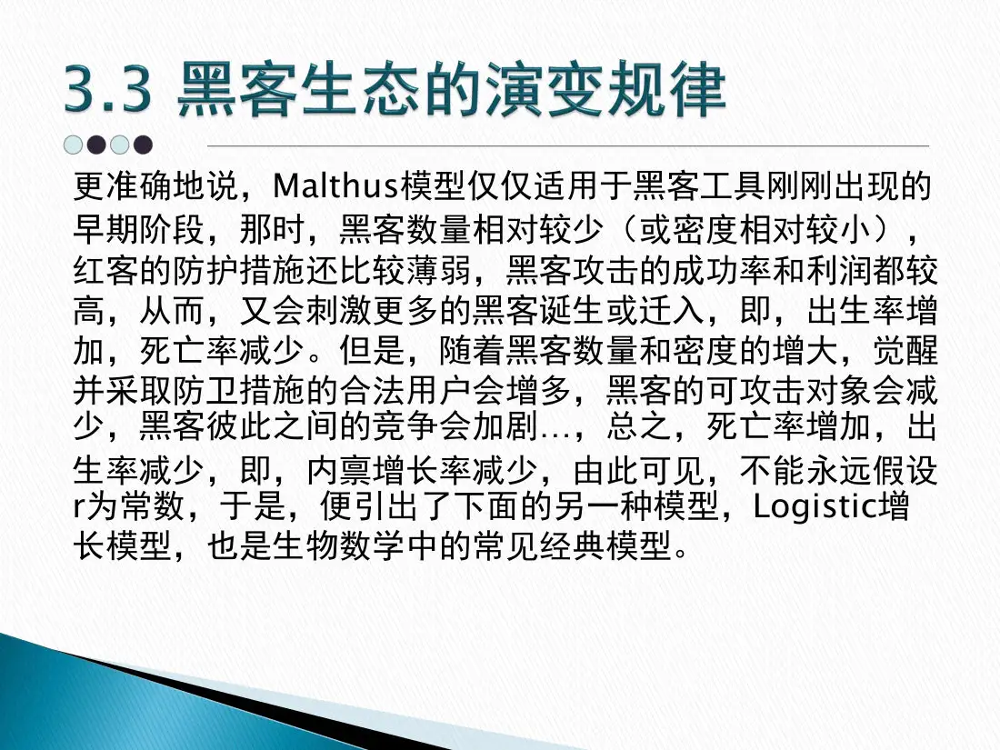

原文：

3.3 黑客生态的演变规律

更准确地说，Malthus模型仅仅适用于黑客工具刚刚出现的早期阶段，那时，黑客数量相对较少（或密度相对较小）红客的防护措施还比较薄弱，黑客攻击的成功率和利润都较高，从而，又会刺激更多的黑客诞生或迁入，即，出生率增加，死亡率减少。但是，随着黑客数量和密度的增大，觉醒并采取防卫措施的合法用户会增多，黑客的可攻击对象会减少，黑客彼此之间的竞争会加剧…，总之，死亡率增加，出生率减少，即，内禀增长率减少，由此可见，不能永远假设r为常数，于是，便引出了下面的另一种模型，Logistic增长模型，也是生物数学中的常见经典模型。

### 3.3 黑客生态的演变规律

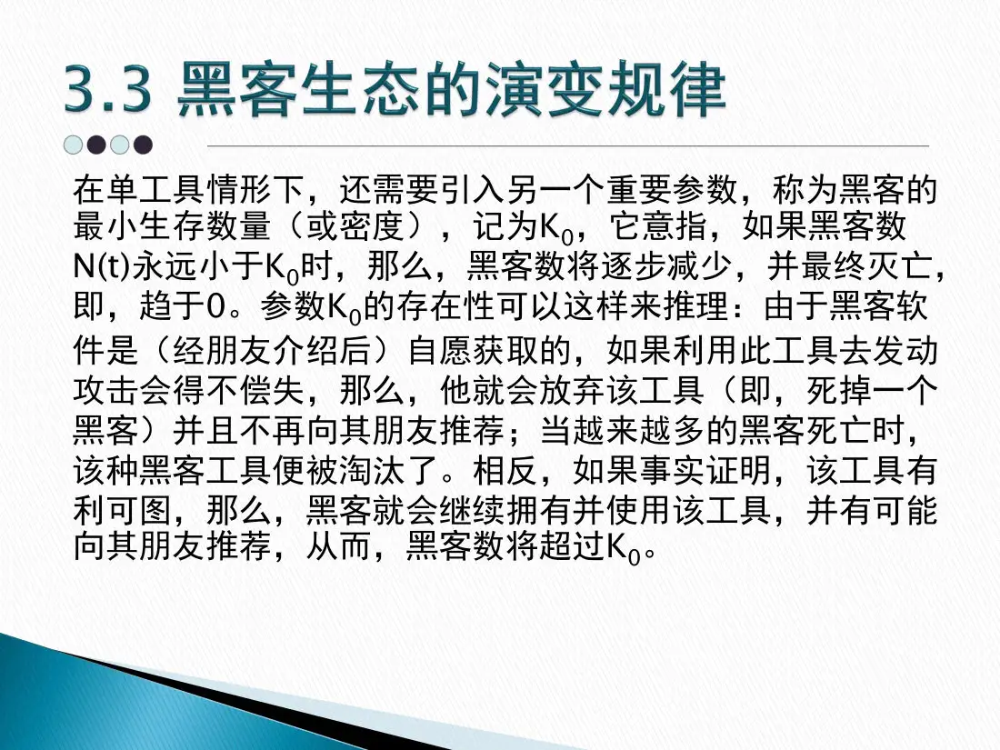

原文：

3.3 黑客生态的演变规律

在单工具情形下，还需要引入另一个重要参数，称为黑客的最小生存数量（或密度），记为 ${ \sf K } _ { 0 }$ ，它意指，如果黑客数N(t)永远小于 ${ \sf K } _ { 0 }$ 时，那么，黑客数将逐步减少，并最终灭亡，即，趋于0。参数 $\mathsf { K } _ { 0 }$ 的存在性可以这样来推理：由于黑客软件是（经朋友介绍后）自愿获取的，如果利用此工具去发动攻击会得不偿失，那么，他就会放弃该工具（即，死掉一个黑客）并且不再向其朋友推荐；当越来越多的黑客死亡时，该种黑客工具便被淘汰了。相反，如果事实证明，该工具有利可图，那么，黑客就会继续拥有并使用该工具，并有可能向其朋友推荐，从而，黑客数将超过 $\mathsf { K } _ { 0 }$

### 3.3 黑客生态的演变规律

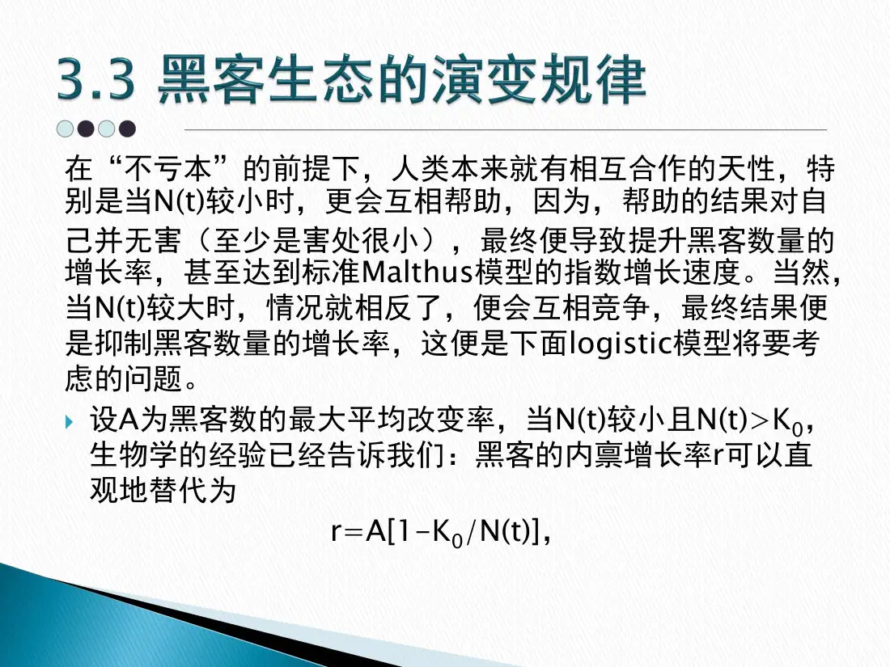

原文：

3.3 黑客生态的演变规律

在“不亏本”的前提下，人类本来就有相互合作的天性，特别是当N(t)较小时，更会互相帮助，因为，帮助的结果对自己并无害（至少是害处很小），最终便导致提升黑客数量的增长率，甚至达到标准Malthus模型的指数增长速度。当然，当N(t)较大时，情况就相反了，便会互相竞争，最终结果便是抑制黑客数量的增长率，这便是下面logistic模型将要考虑的问题。

设A为黑客数的最大平均改变率，当N(t)较小且 $N ( t ) > K _ { 0 }$ 生物学的经验已经告诉我们：黑客的内禀增长率r可以直观地替代为

$$
r = A \left[ 1 - K _ {0} / N (t) \right],
$$

### 3.3 黑客生态的演变规律

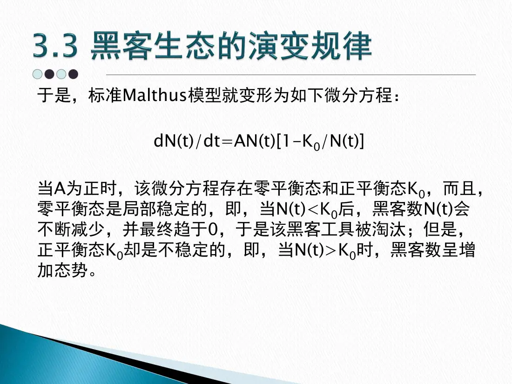

原文：

3.3 黑客生态的演变规律

于是，标准Malthus模型就变形为如下微分方程：

$$
\mathrm{d} N (t) / \mathrm{d} t = A N (t) [ 1 - K _ {0} / N (t) ]
$$

当A为正时，该微分方程存在零平衡态和正平衡态 $\mathsf { K } _ { 0 }$ ，而且，零平衡态是局部稳定的，即，当 $N ( t ) < K _ { 0 }$ 后，黑客数N(t)会不断减少，并最终趋于0，于是该黑客工具被淘汰；但是，正平衡态 ${ \sf K } _ { 0 }$ 却是不稳定的，即，当 $N ( t ) > K _ { 0 }$ 时，黑客数呈增加态势。

### 3.3 黑客生态的演变规律

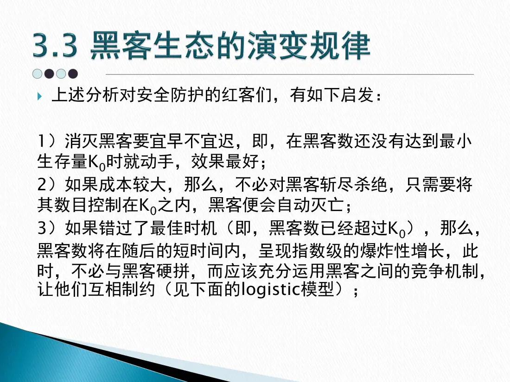

原文：

3.3 黑客生态的演变规律

 上述分析对安全防护的红客们，有如下启发：

1）消灭黑客要宜早不宜迟，即，在黑客数还没有达到最小生存量 $\mathsf { K } _ { 0 }$ 时就动手，效果最好；

2）如果成本较大，那么，不必对黑客斩尽杀绝，只需要将其数目控制在 $\mathsf { K } _ { 0 }$ 之内，黑客便会自动灭亡；

3）如果错过了最佳时机（即，黑客数已经超过 $\mathsf { K } _ { 0 } )$ ），那么，黑客数将在随后的短时间内，呈现指数级的爆炸性增长，此时，不必与黑客硬拼，而应该充分运用黑客之间的竞争机制，让他们互相制约（见下面的logistic模型）；

### 3.3 黑客生态的演变规律

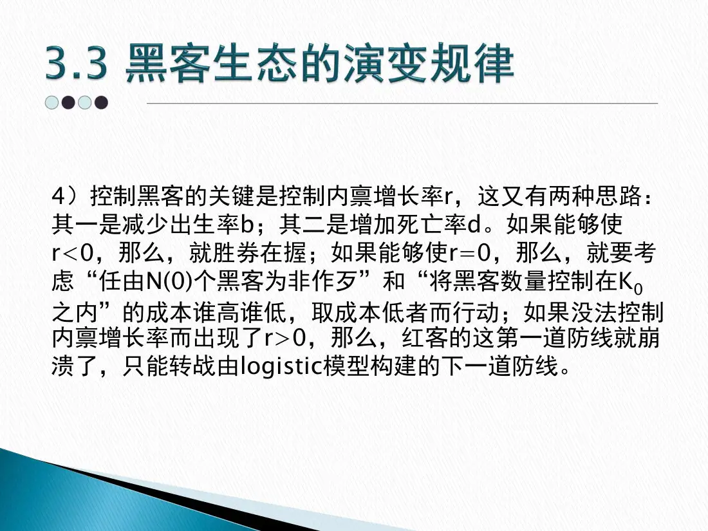

原文：

3.3 黑客生态的演变规律

4）控制黑客的关键是控制内禀增长率r，这又有两种思路：其一是减少出生率b；其二是增加死亡率d。如果能够使r<0，那么，就胜券在握；如果能够使r=0，那么，就要考虑“任由N(0)个黑客为非作歹”和“将黑客数量控制在 ${ \sf K } _ { 0 }$ 之内”的成本谁高谁低，取成本低者而行动；如果没法控制内禀增长率而出现了r>0，那么，红客的这第一道防线就崩溃了，只能转战由logistic模型构建的下一道防线。

### 3.4 小结与畅想

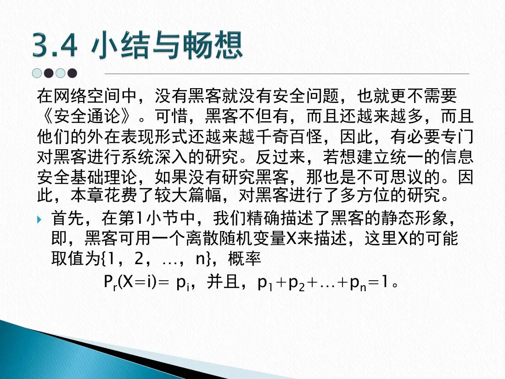

原文：

3.4 小结与畅想

在网络空间中，没有黑客就没有安全问题，也就更不需要《安全通论》。可惜，黑客不但有，而且还越来越多，而且他们的外在表现形式还越来越千奇百怪，因此，有必要专门对黑客进行系统深入的研究。反过来，若想建立统一的信息安全基础理论，如果没有研究黑客，那也是不可思议的。因此，本章花费了较大篇幅，对黑客进行了多方位的研究。

首先，在第1小节中，我们精确描述了黑客的静态形象，即，黑客可用一个离散随机变量X来描述，这里X的可能取值为{1， $2 , \ldots , n 3$ ，概率

$$
P _ {r} (X = i) = p _ {i}, \text {并且，} p _ {1} + p _ {2} + \dots + p _ {n} = 1 。
$$

### 3.4 小结与畅想

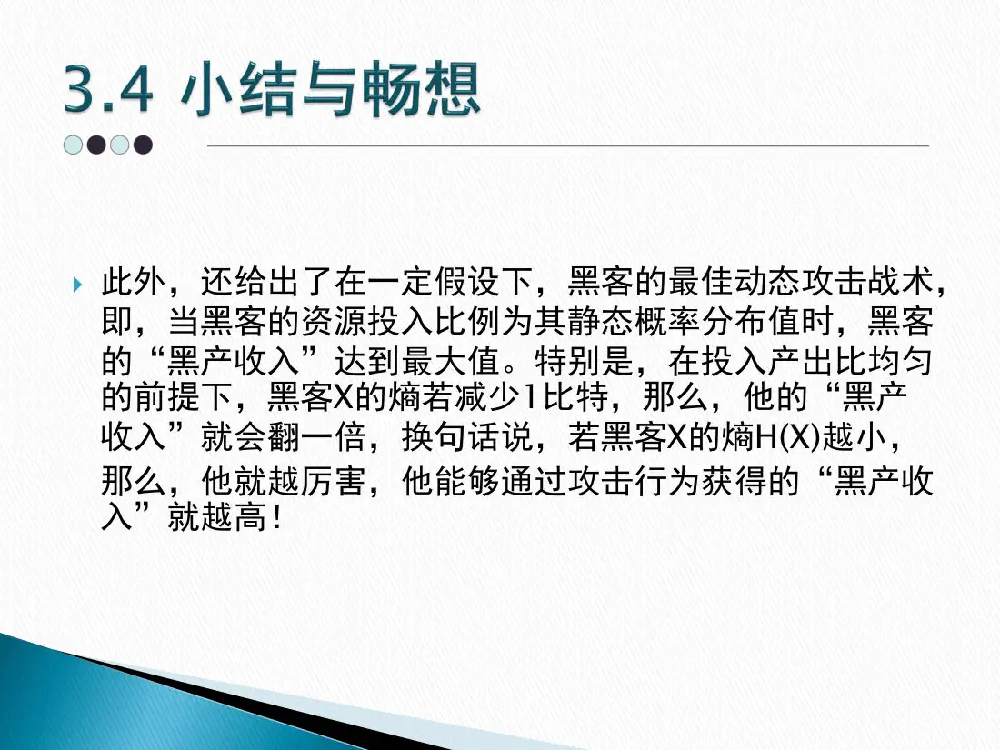

原文：

3.4 小结与畅想

此外，还给出了在一定假设下，黑客的最佳动态攻击战术，即，当黑客的资源投入比例为其静态概率分布值时，黑客的“黑产收入”达到最大值。特别是，在投入产出比均匀的前提下，黑客X的熵若减少1比特，那么，他的“黑产收入”就会翻一倍，换句话说，若黑客X的熵H(X)越小，那么，他就越厉害，他能够通过攻击行为获得的“黑产收入”就越高！

### 3.4 小结与畅想

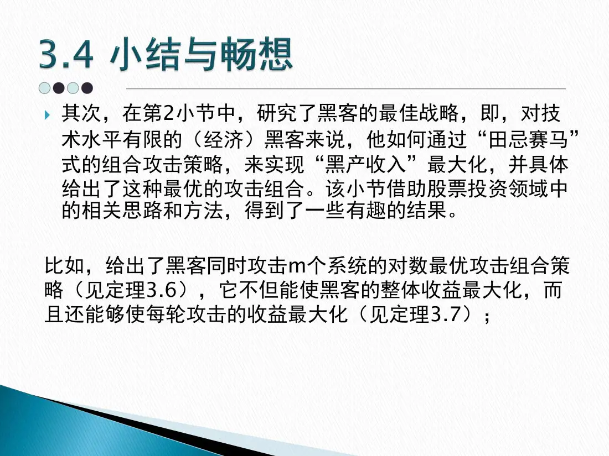

原文：

3.4 小结与畅想

 其次，在第2小节中，研究了黑客的最佳战略，即，对技术水平有限的（经济）黑客来说，他如何通过“田忌赛马”式的组合攻击策略，来实现“黑产收入”最大化，并具体给出了这种最优的攻击组合。该小节借助股票投资领域中的相关思路和方法，得到了一些有趣的结果。

比如，给出了黑客同时攻击m个系统的对数最优攻击组合策略（见定理3.6），它不但能使黑客的整体收益最大化，而且还能够使每轮攻击的收益最大化（见定理3.7）；

### 3.4 小结与畅想

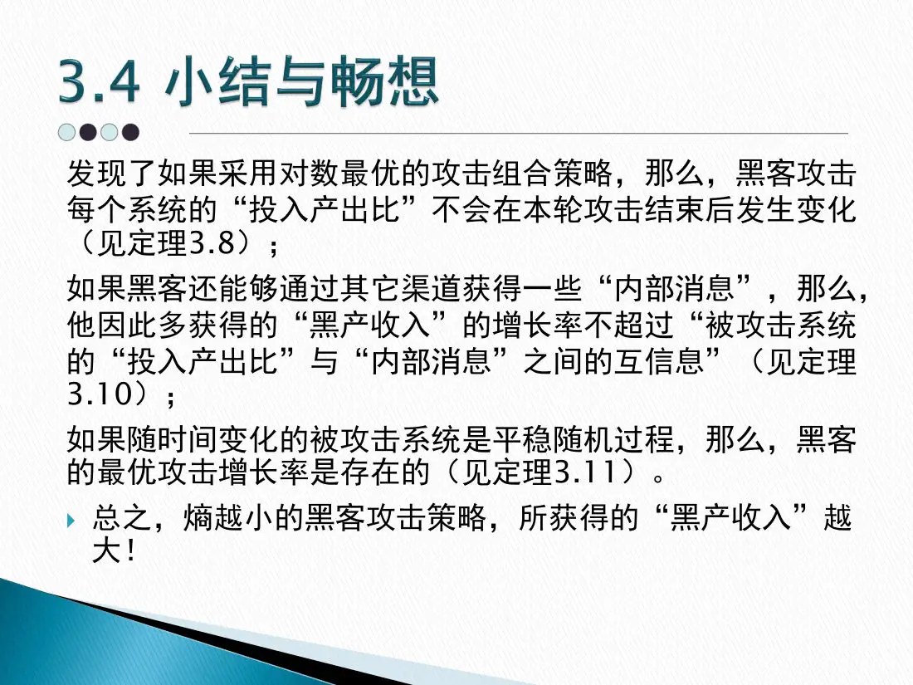

原文：

3.4 小结与畅想

发现了如果采用对数最优的攻击组合策略，那么，黑客攻击每个系统的“投入产出比”不会在本轮攻击结束后发生变化（见定理3.8）；

如果黑客还能够通过其它渠道获得一些“内部消息”，那么，他因此多获得的“黑产收入”的增长率不超过“被攻击系统的“投入产出比”与“内部消息”之间的互信息”（见定理3.10）；

如果随时间变化的被攻击系统是平稳随机过程，那么，黑客的最优攻击增长率是存在的（见定理3.11）。

总之，熵越小的黑客攻击策略，所获得的“黑产收入”越大！

### 3.4 小结与畅想

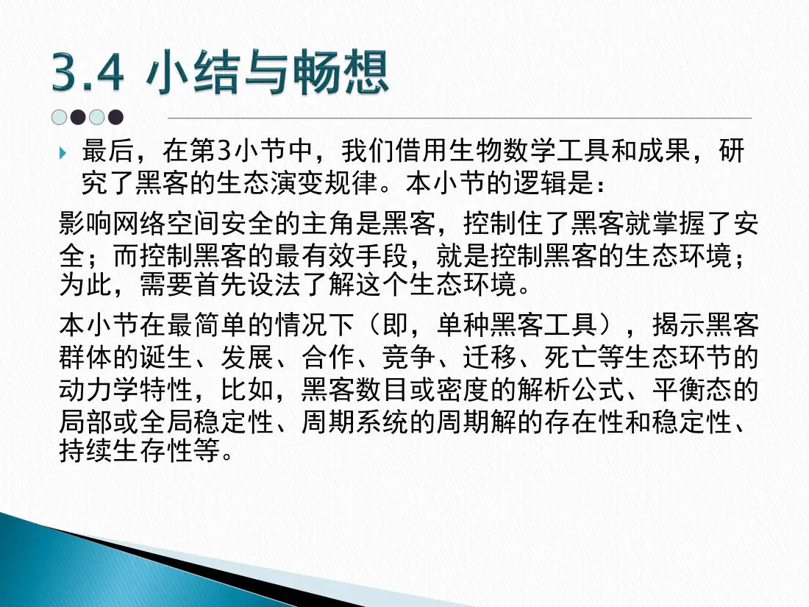

原文：

3.4 小结与畅想

最后，在第3小节中，我们借用生物数学工具和成果，研究了黑客的生态演变规律。本小节的逻辑是：

影响网络空间安全的主角是黑客，控制住了黑客就掌握了安全；而控制黑客的最有效手段，就是控制黑客的生态环境；为此，需要首先设法了解这个生态环境。

本小节在最简单的情况下（即，单种黑客工具），揭示黑客群体的诞生、发展、合作、竞争、迁移、死亡等生态环节的动力学特性，比如，黑客数目或密度的解析公式、平衡态的局部或全局稳定性、周期系统的周期解的存在性和稳定性、持续生存性等。

### 3.4 小结与畅想

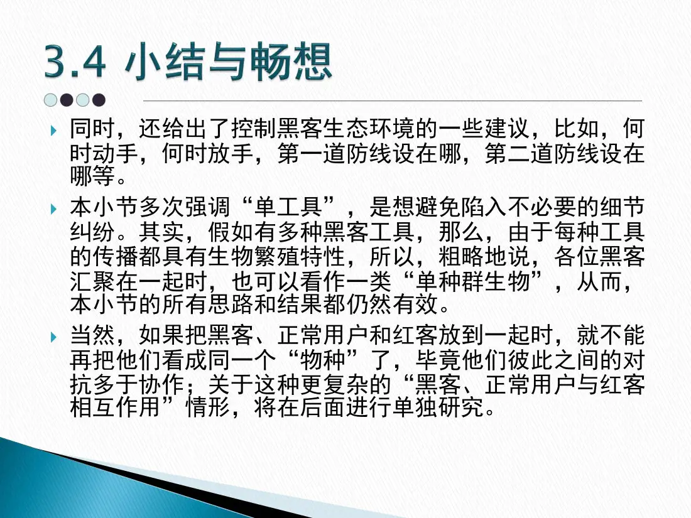

原文：

3.4 小结与畅想

同时，还给出了控制黑客生态环境的一些建议，比如，何时动手，何时放手，第一道防线设在哪，第二道防线设在哪等。

本小节多次强调“单工具”，是想避免陷入不必要的细节纠纷。其实，假如有多种黑客工具，那么，由于每种工具的传播都具有生物繁殖特性，所以，粗略地说，各位黑客汇聚在一起时，也可以看作一类“单种群生物”，从而，本小节的所有思路和结果都仍然有效。

 当然，如果把黑客、正常用户和红客放到一起时，就不能再把他们看成同一个“物种”了，毕竟他们彼此之间的对抗多于协作；关于这种更复杂的“黑客、正常用户与红客相互作用”情形，将在后面进行单独研究。

### 本章结束，谢谢

原文：

本章结束，谢谢
