# 《安全通论》第4章 红客（课件）

原件的每一页，下面附识别出的文字。

### 第4章--红客

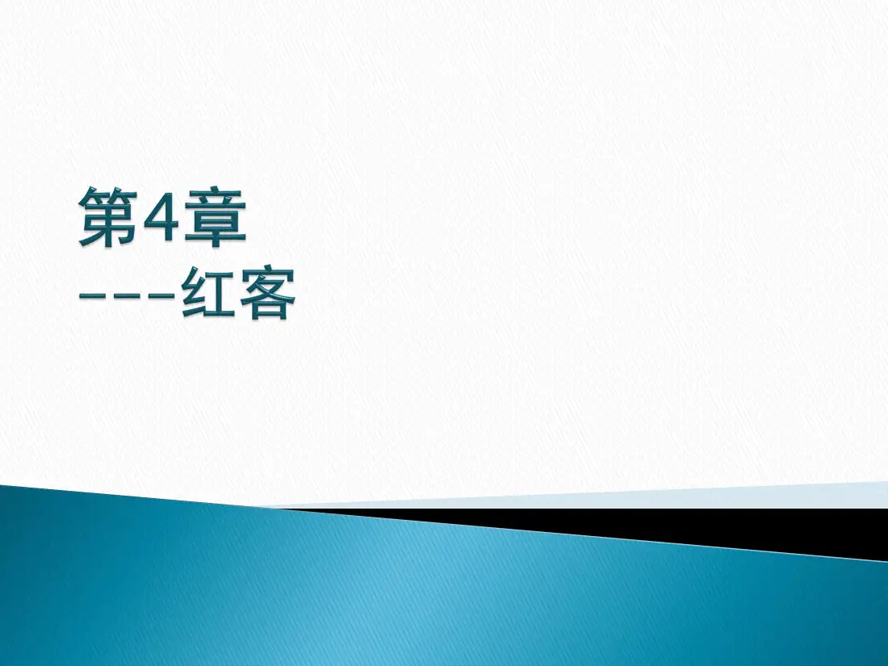

原文：

第4章--红客

### 第4章：红客

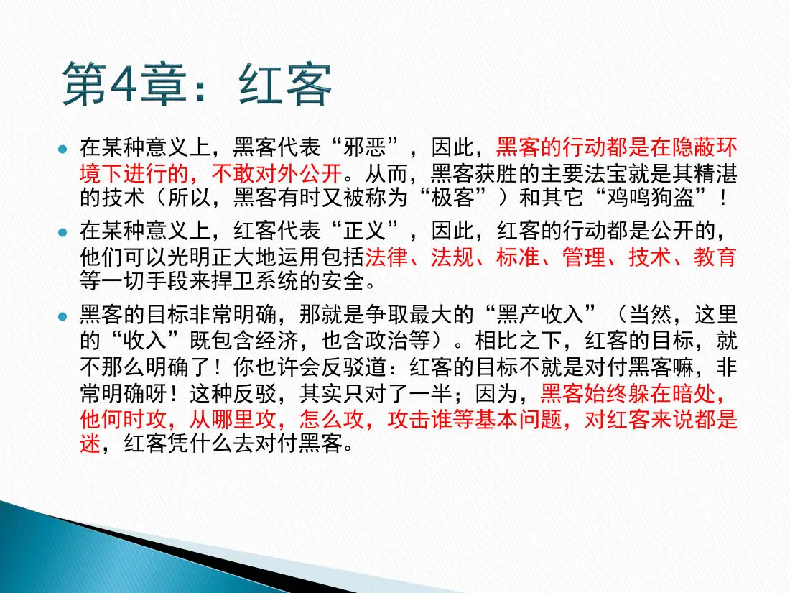

原文：

第4章：红客

在某种意义上，黑客代表“邪恶”，因此，黑客的行动都是在隐蔽环境下进行的，不敢对外公开。从而，黑客获胜的主要法宝就是其精湛的技术（所以，黑客有时又被称为“极客”）和其它“鸡鸣狗盗”！

在某种意义上，红客代表“正义”，因此，红客的行动都是公开的，他们可以光明正大地运用包括法律、法规、标准、管理、技术、教育等一切手段来捍卫系统的安全。

黑客的目标非常明确，那就是争取最大的“黑产收入”（当然，这里的“收入”既包含经济，也含政治等）。相比之下，红客的目标，就不那么明确了！你也许会反驳道：红客的目标不就是对付黑客嘛，非常明确呀！这种反驳，其实只对了一半；因为，黑客始终躲在暗处，他何时攻，从哪里攻，怎么攻，攻击谁等基本问题，对红客来说都是迷，红客凭什么去对付黑客。

### 第4章：红客

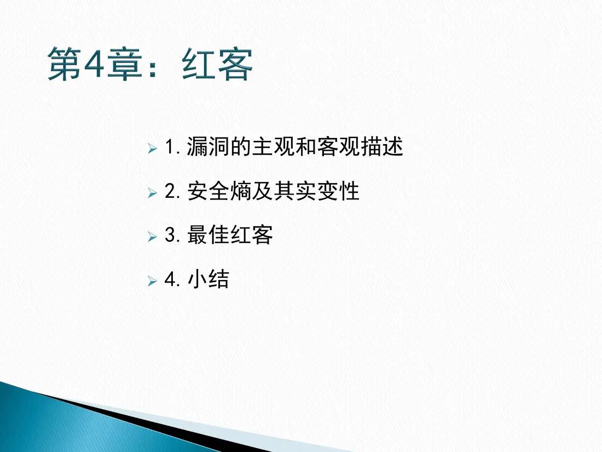

原文：

第4章：红客

1. 漏洞的主观和客观描述
2. 安全熵及其实变性
3. 最佳红客
4. 小结

### 4.1 漏洞的主观和客观描述

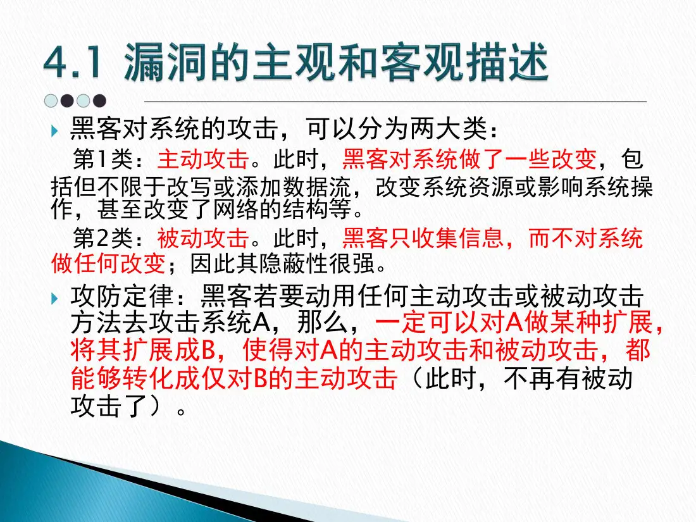

原文：

4.1 漏洞的主观和客观描述

 黑客对系统的攻击，可以分为两大类：

第1类：主动攻击。此时，黑客对系统做了一些改变，包括但不限于改写或添加数据流，改变系统资源或影响系统操作，甚至改变了网络的结构等。

第2类：被动攻击。此时，黑客只收集信息，而不对系统做任何改变；因此其隐蔽性很强。

攻防定律：黑客若要动用任何主动攻击或被动攻击方法去攻击系统A，那么，一定可以对A做某种扩展，将其扩展成B，使得对A的主动攻击和被动攻击，都能够转化成仅对B的主动攻击（此时，不再有被动攻击了）。

### 4.1 漏洞的主观和客观描述

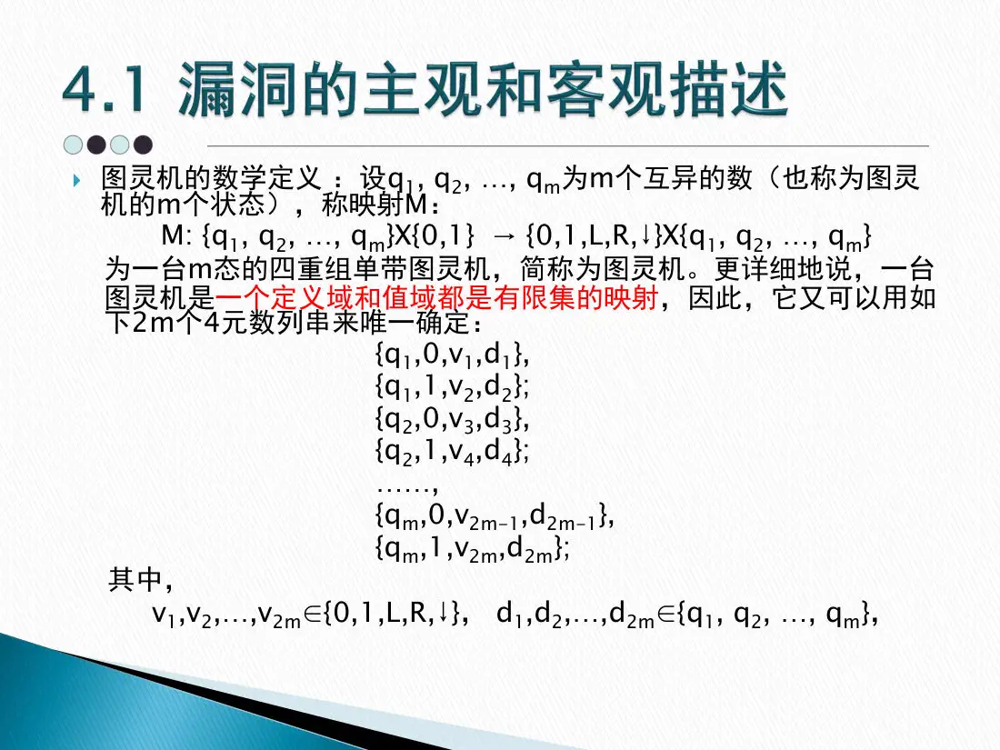

原文：

4.1 漏洞的主观和客观描述

图灵机的数学定义 ：设 $\mathsf { q } _ { 1 } , \mathsf { q } _ { 2 } , . . . , \mathsf { q } _ { m }$ 为m个互异的数（也称为图灵机的m个状态），称映射M：

$$
\mathsf {M} \colon \left\{\mathsf {q} _ {1}, \mathsf {q} _ {2}, \dots , \mathsf {q} _ {\mathsf {m}} \right\} \mathrm{X} \{0, 1 \} \rightarrow \{0, 1, L, R, \downarrow \} \mathrm{X} \left\{\mathsf {q} _ {1}, \mathsf {q} _ {2}, \dots , \mathsf {q} _ {\mathsf {m}} \right\}
$$

为一台m态的四重组单带图灵机，简称为图灵机。更详细地说，一台图灵机是一个定义域和值域都是有限集的映射，因此，它又可以用如下2m个4元数列串来唯一确定：

$$
\begin{array}{l} \{\mathsf {q} _ {1}, 0, \mathsf {v} _ {1}, \mathsf {d} _ {1} \}, \\ \{\mathsf {q} _ {1}, 1, \mathsf {v} _ {2}, \mathsf {d} _ {2} \}; \\ \{\mathsf {q} _ {2}, 0, \mathsf {v} _ {3}, \mathsf {d} _ {3} \}, \\ \{\mathsf {q} _ {2}, 1, \mathsf {v} _ {4}, \mathsf {d} _ {4} \}; \\ \dots\dots , \\ \{\mathsf {q} _ {m}, 0, \mathsf {v} _ {2 m - 1}, \mathsf {d} _ {2 m - 1} \}, \\ \{\mathsf {q} _ {m}, 1, \mathsf {v} _ {2 m}, \mathsf {d} _ {2 m} \}; \end{array}
$$

其中，

$$
\mathsf {v} _ {1}, \mathsf {v} _ {2}, \dots , \mathsf {v} _ {2 m} \in \{0, 1, L, R, \downarrow \}, \quad \mathsf {d} _ {1}, \mathsf {d} _ {2}, \dots , \mathsf {d} _ {2 m} \in \{\mathsf {q} _ {1}, \mathsf {q} _ {2}, \dots , \mathsf {q} _ {m} \},
$$

### 4.1 漏洞的主观和客观描述

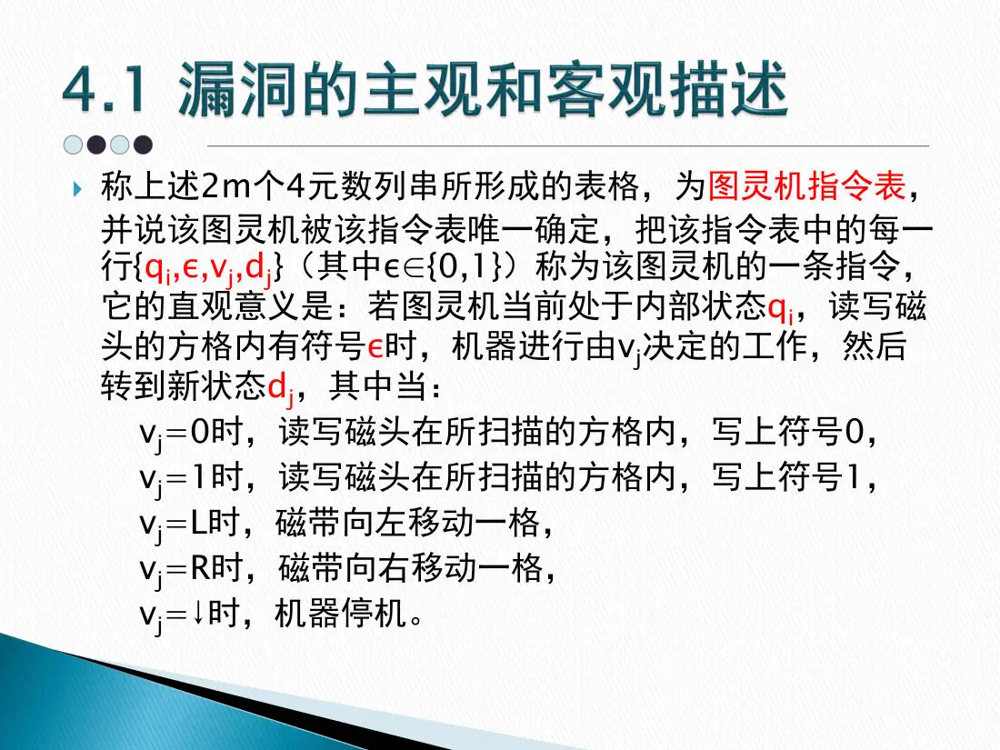

原文：

4.1 漏洞的主观和客观描述

称上述2m个4元数列串所形成的表格，为图灵机指令表，并说该图灵机被该指令表唯一确定，把该指令表中的每一行{ $\displaystyle \langle \mathbf { q } _ { \mathrm { i } } , \mathbf { \epsilon } , \mathbf { v } _ { \mathrm { j } } , \mathbf { d } _ { \mathrm { j } } \}$ （其中 $\epsilon { \in } \{ 0 , 1 \} )$ 称为该图灵机的一条指令，它的直观意义是：若图灵机当前处于内部状态 $q _ { i }$ ，读写磁头的方格内有符号ε时，机器进行由 $v _ { \mathrm { j } }$ 决定的工作，然后转到新状态 ${ \mathsf { d } } _ { \mathrm { j } }$ ，其中当：

vj=0时，读写磁头在所扫描的方格内，写上符号0，

v=1时，读写磁头在所扫描的方格内，写上符号1，

v=L时，磁带向左移动一格，

v=R时，磁带向右移动一格，

vj=↓时，机器停机。

### 4.1漏洞的主观和客观描述

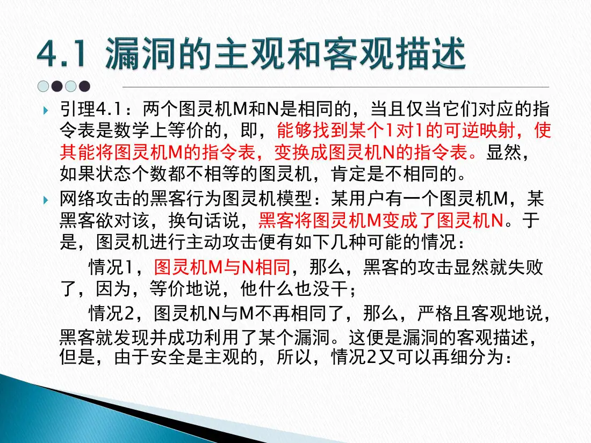

原文：

4.1漏洞的主观和客观描述

引理4.1：两个图灵机M和N是相同的，当且仅当它们对应的指令表是数学上等价的，即，能够找到某个1对1的可逆映射，使其能将图灵机M的指令表，变换成图灵机N的指令表。显然，如果状态个数都不相等的图灵机，肯定是不相同的。

网络攻击的黑客行为图灵机模型：某用户有一个图灵机M，某黑客欲对该，换句话说，黑客将图灵机M变成了图灵机N。于是，图灵机进行主动攻击便有如下几种可能的情况：

情况1，图灵机M与N相同，那么，黑客的攻击显然就失败了，因为，等价地说，他什么也没干；

情况2，图灵机N与M不再相同了，那么，严格且客观地说，黑客就发现并成功利用了某个漏洞。这便是漏洞的客观描述，但是，由于安全是主观的，所以，情况2又可以再细分为：

### 4.1 漏洞的主观和客观描述

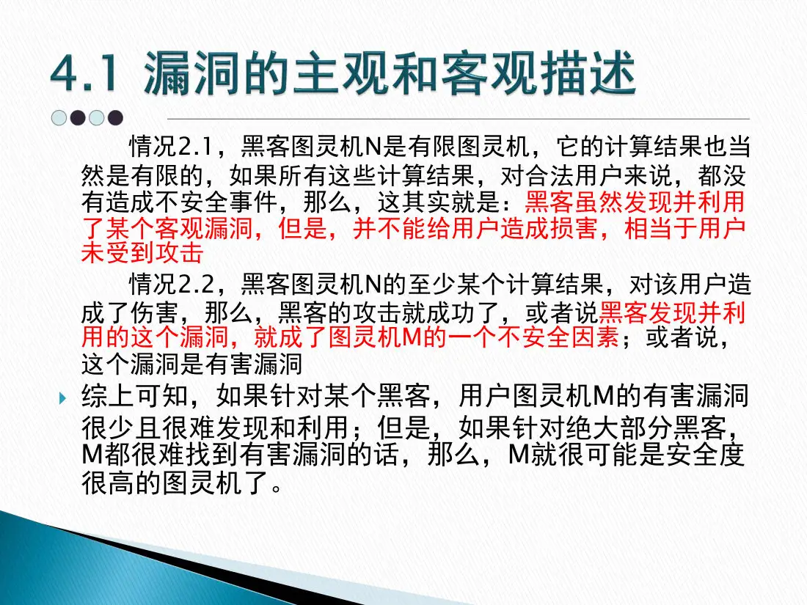

原文：

4.1 漏洞的主观和客观描述

情况2.1，黑客图灵机N是有限图灵机，它的计算结果也当然是有限的，如果所有这些计算结果，对合法用户来说，都没有造成不安全事件，那么，这其实就是：黑客虽然发现并利用了某个客观漏洞，但是，并不能给用户造成损害，相当于用户未受到攻击

情况2.2，黑客图灵机N的至少某个计算结果，对该用户造成了伤害，那么，黑客的攻击就成功了，或者说黑客发现并利用的这个漏洞，就成了图灵机M的一个不安全因素；或者说，这个漏洞是有害漏洞

 综上可知，如果针对某个黑客，用户图灵机M的有害漏洞很少且很难发现和利用；但是，如果针对绝大部分黑客，M都很难找到有害漏洞的话，那么，M就很可能是安全度很高的图灵机了。

### 4.2 安全熵及其时变性

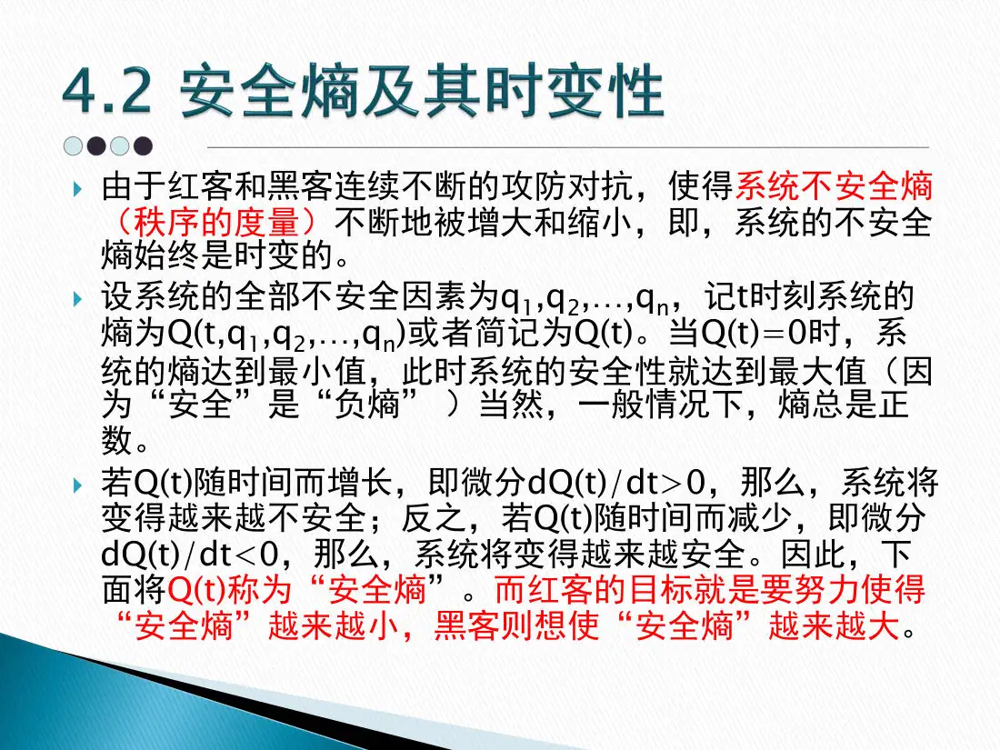

原文：

4.2 安全熵及其时变性

由于红客和黑客连续不断的攻防对抗，使得系统不安全熵（秩序的度量）不断地被增大和缩小，即，系统的不安全熵始终是时变的。

设系统的全部不安全因素为 ${ \sf q } _ { 1 } , { \sf q } _ { 2 } , \ldots , { \sf q } _ { n } ,$ 记t时刻系统的熵为 $\mathrm { Q } ( \mathfrak { t } , \mathfrak { q } _ { 1 } , \mathfrak { q } _ { 2 } , \dots , \mathfrak { q } _ { n } )$ 或者简记为Q(t)。当Q(t)=0时，系统的熵达到最小值，此时系统的安全性就达到最大值（因为“安全”是“负熵” ）当然，一般情况下，熵总是正数。

若Q(t)随时间而增长，即微分dQ(t)/dt>0，那么，系统将变得越来越不安全；反之，若Q(t)随时间而减少，即微分dQ(t)/dt<0，那么，系统将变得越来越安全。因此，下面将Q(t)称为“安全熵”。而红客的目标就是要努力使得“安全熵”越来越小，黑客则想使“安全熵”越来越大。

### 4.2 安全熵及其时变性

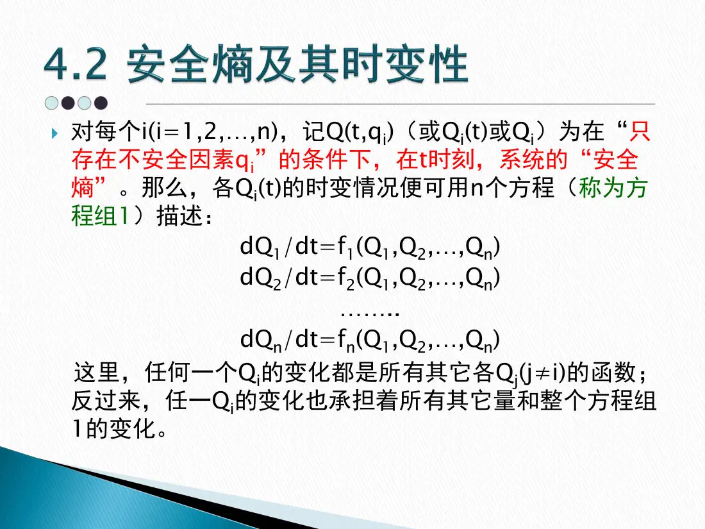

原文：

4.2 安全熵及其时变性

对每个 ${ \mathfrak { i } } ( { \mathfrak { i } } = 1 , 2 , \ldots , { \mathfrak { n } } )$ ，记 $\sf { Q } ( t , { \sf q } _ { i } )$ （或 $Q _ { i }$ (t)或 $Q _ { i } )$ 为在“只存在不安全因素 $q _ { i } ^ { 3 9 }$ 的条件下，在t时刻，系统的“安全熵”。那 $4$ ，各 $\mathsf { Q } _ { \mathrm { i } } ( \mathsf { t } )$ 的时变情况便可用n个方程（称为方程组1）描述：

$$
\begin{array}{c} \mathrm {d Q _ {1} / dt = f_ {1} (Q_ {1} , Q_ {2} , \dots, Q_ {n})} \\ \mathrm {d Q _ {2} / dt = f_ {2} (Q_ {1} , Q_ {2} , \dots, Q_ {n})} \\ \dots \dots \\ \mathrm {d Q _ {n} / dt = f_ {n} (Q_ {1} , Q_ {2} , \dots, Q_ {n})} \end{array}
$$

这里，任何一个 $Q _ { i }$ 的变化都是所有其它各 $\mathrm { Q } _ { \mathrm { i } } ( \mathrm { j } \neq \mathrm { i } )$ 的函数；反过来，任一 $Q _ { i }$ 的变化也承担着所有其它量和整个方程组1的变化。

### 4.2 安全熵及其时变性

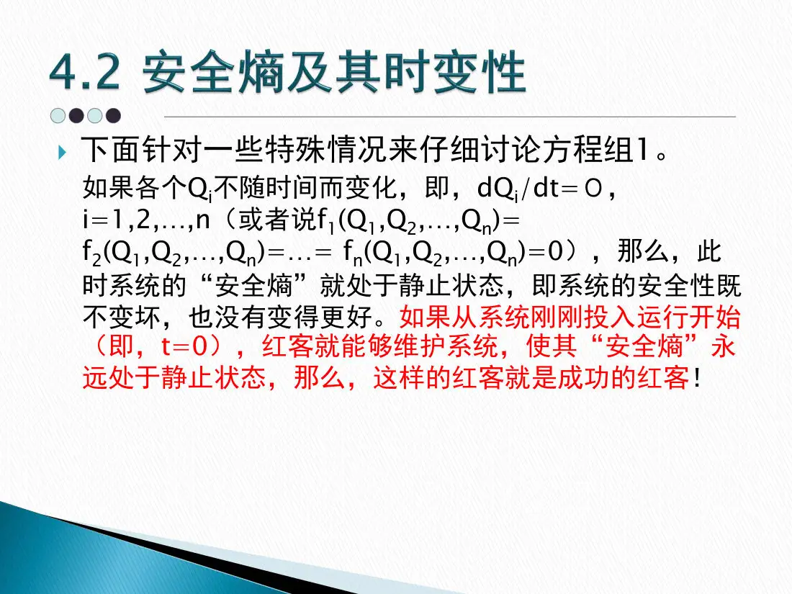

原文：

4.2 安全熵及其时变性

下面针对一些特殊情况来仔细讨论方程组1。如果各个 $Q _ { i }$ 不随时间而变化，即， ${ \mathsf { d } } { \mathsf { Q } } _ { \mathrm { i } } / { \mathsf { d } } { \mathsf { t } } = { \mathsf { O } }$ $\mathsf { i } = 1 , 2 , \ldots , \mathsf { n }$ （或者说f $( \mathsf { Q } _ { 1 } , \mathsf { Q } _ { 2 } , \ldots , \mathsf { Q } _ { n } ) =$ $\mathsf { f } _ { 2 } ( \mathsf { Q } _ { 1 } , \mathsf { Q } _ { 2 } , . . . , \mathsf { Q } _ { \mathsf { n } } ) = . . . = \mathsf { f } _ { \mathsf { n } } ( \mathsf { Q } _ { 1 } , \mathsf { Q } _ { 2 } , . . . , \mathsf { Q } _ { \mathsf { n } } ) = 0 )$ ，那 $4$ ，此时系统的“安全熵”就处于静止状态，即系统的安全性既不变坏，也没有变得更好。如果从系统刚刚投入运行开始（即， $t = 0 )$ ），红客就能够维护系统，使其“安全熵”永远处于静止状态，那么，这样的红客就是成功的红客！

### 4.2 安全熵及其时变性

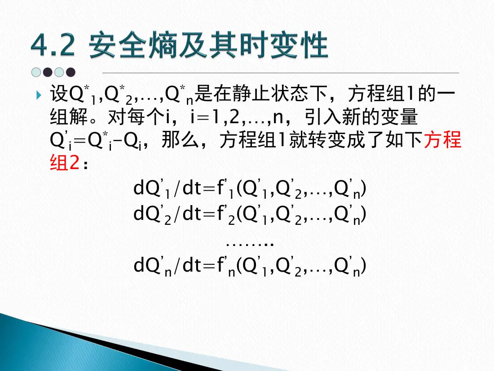

原文：

4.2 安全熵及其时变性

 设 $\mathbf { Q } _ { 1 } ^ { * } , \mathbf { Q } _ { 2 } ^ { * } , \ldots , \mathbf { Q } _ { n } ^ { * }$ 是在静止状态下，方程组1的一组解。对每个i， $\mathsf { i } = 1 , 2 , \ldots , \mathsf { n }$ ，引入新的变量$a _ { i } ^ { \prime } = 0 _ { i } ^ { \prime } - 0$ ，那么，方程组1就转变成了如下方程组2：

$$
\begin{array}{l} \mathrm {d Q _ {1} ^ {\prime} /dt = f_ {1} (Q_ {1} ^ {\prime} , Q_ {2} ^ {\prime} , \dots, Q_ {n} ^ {\prime})} \\ \mathrm {d Q _ {2} ^ {\prime} /dt = f_ {2} (Q_ {1} ^ {\prime} , Q_ {2} ^ {\prime} , \dots, Q_ {n} ^ {\prime})} \end{array}
$$

$$
d Q _ {n} ^ {\prime} / d t = f _ {n} ^ {\prime} (Q _ {1} ^ {\prime}, Q _ {2} ^ {\prime}, \dots , Q _ {n} ^ {\prime})
$$

### 4.2 安全熵及其时变性

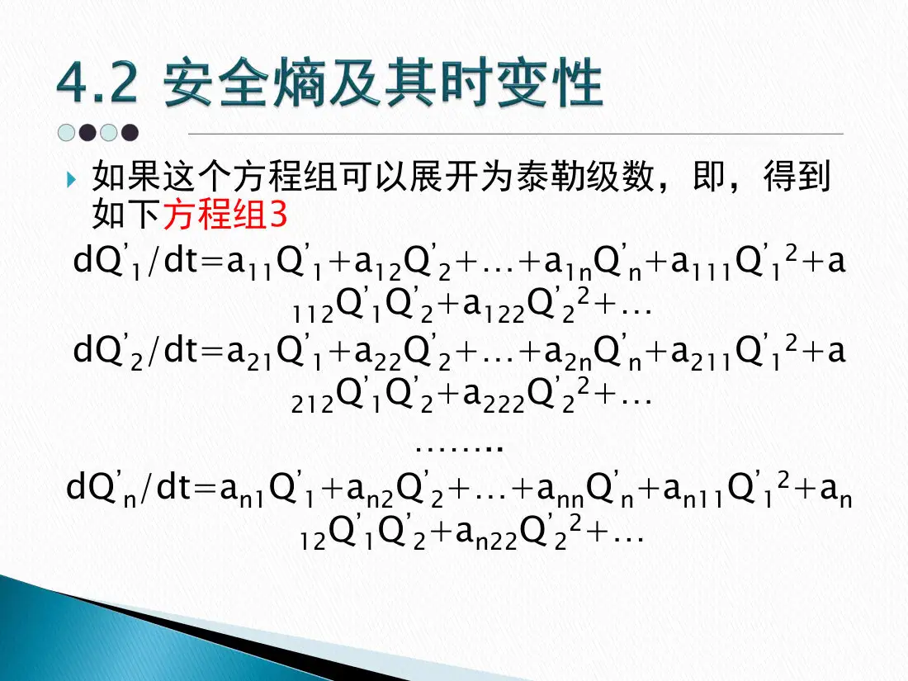

原文：

4.2 安全熵及其时变性

 如果这个方程组可以展开为泰勒级数，即，得到如下方程组3

$$
\begin{array}{c} \mathsf {d Q ^ {\prime}} _ {1} / \mathsf {d t} = \mathsf {a} _ {1 1} \mathsf {Q ^ {\prime}} _ {1} + \mathsf {a} _ {1 2} \mathsf {Q ^ {\prime}} _ {2} + \ldots + \mathsf {a} _ {1 n} \mathsf {Q ^ {\prime}} _ {n} + \mathsf {a} _ {1 1 1} \mathsf {Q ^ {\prime}} _ {1} ^ {2} + \mathsf {a} \\ _ {1 1 2} \mathsf {Q ^ {\prime}} _ {1} \mathsf {Q ^ {\prime}} _ {2} + \mathsf {a} _ {1 2 2} \mathsf {Q ^ {\prime}} _ {2} ^ {2} + \ldots \\ \mathsf {d Q ^ {\prime}} _ {2} / \mathsf {d t} = \mathsf {a} _ {2 1} \mathsf {Q ^ {\prime}} _ {1} + \mathsf {a} _ {2 2} \mathsf {Q ^ {\prime}} _ {2} + \ldots + \mathsf {a} _ {2 n} \mathsf {Q ^ {\prime}} _ {n} + \mathsf {a} _ {2 1 1} \mathsf {Q ^ {\prime}} _ {1} ^ {2} + \mathsf {a} \\ _ {2 1 2} \mathsf {Q ^ {\prime}} _ {1} \mathsf {Q ^ {\prime}} _ {2} + \mathsf {a} _ {2 2 2} \mathsf {Q ^ {\prime}} _ {2} ^ {2} + \ldots \end{array}
$$

$$
\begin{array}{c} \mathsf {d Q ^ {\prime}} _ {n} / \mathsf {d t} = \mathsf {a} _ {n 1} \mathsf {Q ^ {\prime}} _ {1} + \mathsf {a} _ {n 2} \mathsf {Q ^ {\prime}} _ {2} + \ldots + \mathsf {a} _ {n n} \mathsf {Q ^ {\prime}} _ {n} + \mathsf {a} _ {n 1 1} \mathsf {Q ^ {\prime}} _ {1} ^ {2} + \mathsf {a} _ {n} \\ _ {1 2} \mathsf {Q ^ {\prime}} _ {1} \mathsf {Q ^ {\prime}} _ {2} + \mathsf {a} _ {n 2 2} \mathsf {Q ^ {\prime}} _ {2} ^ {2} + \ldots \end{array}
$$

### 4.2 安全熵及其时变性

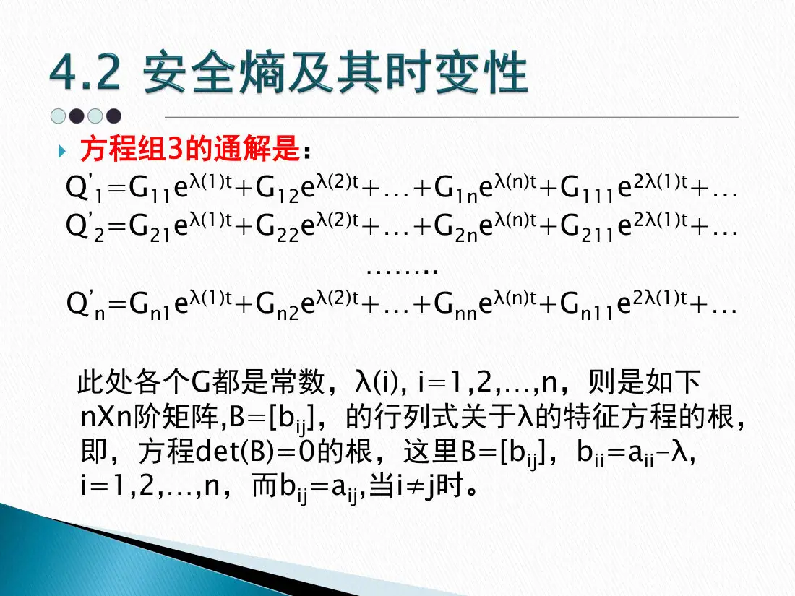

原文：

4.2 安全熵及其时变性

方程组3的通解是：

$$
\begin{array}{r l} & {Q _ {1} ^ {\prime} = G _ {1 1} e ^ {\lambda (1) t} + G _ {1 2} e ^ {\lambda (2) t} + \ldots + G _ {1 n} e ^ {\lambda (n) t} + G _ {1 1 1} e ^ {2 \lambda (1) t} + \ldots} \\ & {Q _ {2} ^ {\prime} = G _ {2 1} e ^ {\lambda (1) t} + G _ {2 2} e ^ {\lambda (2) t} + \ldots + G _ {2 n} e ^ {\lambda (n) t} + G _ {2 1 1} e ^ {2 \lambda (1) t} + \ldots} \\ & {\qquad \dots \dots .} \\ & {Q _ {n} ^ {\prime} = G _ {n 1} e ^ {\lambda (1) t} + G _ {n 2} e ^ {\lambda (2) t} + \ldots + G _ {n n} e ^ {\lambda (n) t} + G _ {n 1 1} e ^ {2 \lambda (1) t} + \ldots} \end{array}
$$

此处各个G都是常数， $\lambda ( \mathfrak { i } ) , \mathfrak { i } = 1 , 2 , \ldots , \mathfrak { n }$ 则是如下nXn阶矩阵, $B = [ b _ { \mathrm { i j } } ]$ 的行列式关于λ的特征方程的根，即，方程 ${ \mathsf { d e t } } ( { \mathsf { B } } ) = { \mathsf { 0 } }$ 的根，这里 $B = [ b _ { \mathrm { i j } } ] , \ b _ { \mathrm { i i } } = a _ { \mathrm { i i } } - \lambda$ $i = 1 , 2 , \ldots , n$ ，而 $b _ { i j } = a _ { i j }$ ,当i≠j时。

### 4.2 安全熵及其时变性

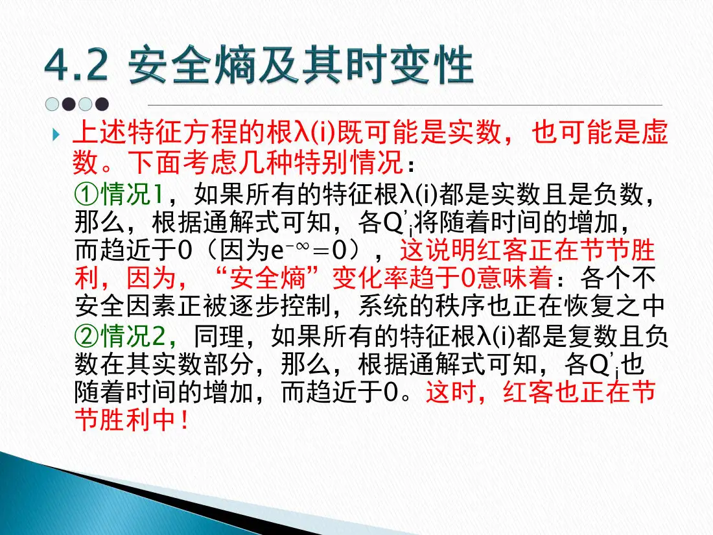

原文：

4.2 安全熵及其时变性

上述特征方程的根λ(i)既可能是实数，也可能是虚数。下面考虑几种特别情况：

①情况1，如果所有的特征根λ(i)都是实数且是负数，那么，根据通解式可知，各 $\overrightarrow { a }$ 将随着时间的增加，而趋近于0（因为 $\mathsf { e } ^ { - \infty } { = } 0 )$ 这说明红客正在节节胜利，因为，“安全熵”变化率趋于0意味着：各个不安全因素正被逐步控制，系统的秩序也正在恢复之中②情况2，同理，如果所有的特征根λ(i)都是复数且负数在其实数部分，那么，根据通解式可知，各 $\mathrm { Q } ^ { \prime }$ 也随着时间的增加，而趋近于0。这时，红客也正在节节胜利中！

### 4.2 安全熵及其时变性

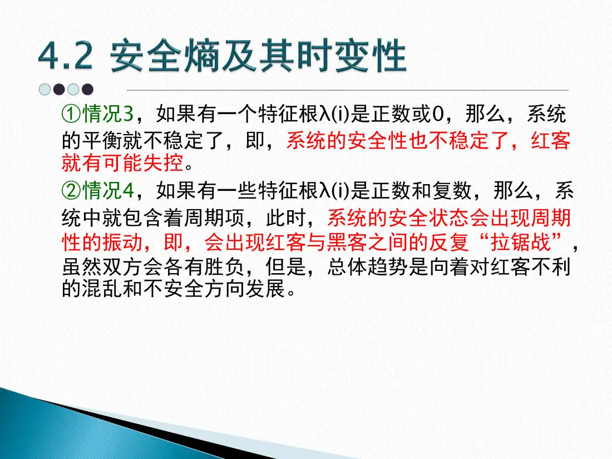

原文：

4.2 安全熵及其时变性

①情况3，如果有一个特征根λ(i)是正数或0，那么，系统的平衡就不稳定了，即，系统的安全性也不稳定了，红客就有可能失控。

②情况4，如果有一些特征根λ(i)是正数和复数，那么，系统中就包含着周期项，此时，系统的安全状态会出现周期性的振动，即，会出现红客与黑客之间的反复“拉锯战”虽然双方会各有胜负，但是，总体趋势是向着对红客不利的混乱和不安全方向发展。

### 4.3 最佳红客

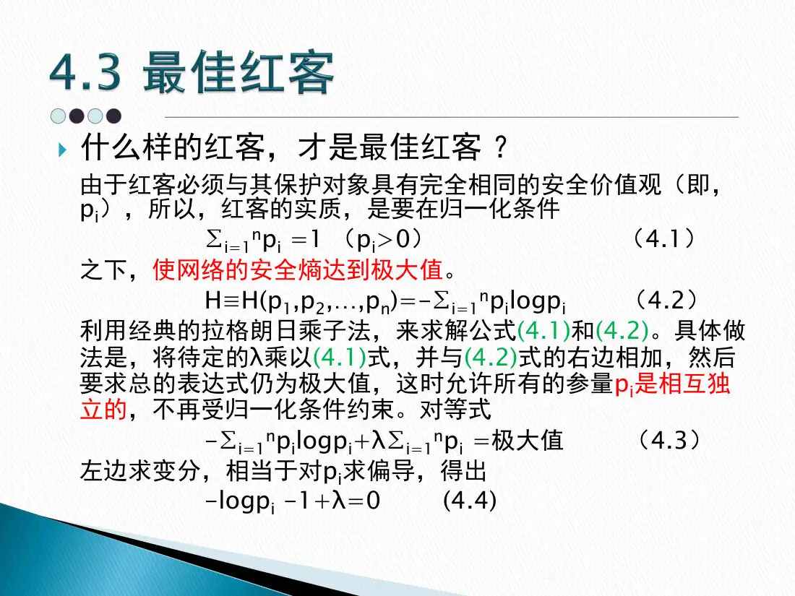

原文：

4.3 最佳红客

 什么样的红客，才是最佳红客 ？

由于红客必须与其保护对象具有完全相同的安全价值观（即，$p _ { \mathrm { i } } )$ ，所以，红客的实质，是要在归一化条件

$$
\sum_ {i = 1} ^ {n} p _ {i} = 1 \quad (p _ {i} > 0)\tag{4.1}
$$

之下，使网络的安全熵达到极大值。

$$
H \equiv H (p _ {1}, p _ {2}, \dots , p _ {n}) = - \sum_ {i = 1} ^ {n} p _ {i} \log p _ {i}\tag{4.2}
$$

利用经典的拉格朗日乘子法，来求解公式(4.1)和(4.2)。具体做法是，将待定的λ乘以(4.1)式，并与(4.2)式的右边相加，然后要求总的表达式仍为极大值，这时允许所有的参量 $p _ { \mathrm { i } }$ 是相互独立的，不再受归一化条件约束。对等式

$$
- \Sigma_ {i = 1} ^ {n} p _ {i} \log p _ {i} + \lambda \Sigma_ {i = 1} ^ {n} p _ {i} = \text {极大值}\tag{4.3}
$$

左边求变分，相当于对 $p _ { i }$ 求偏导，得出

$$
- \log p _ {i} - 1 + \lambda = 0 \tag {4.4}
$$

### 4.3 最佳红客

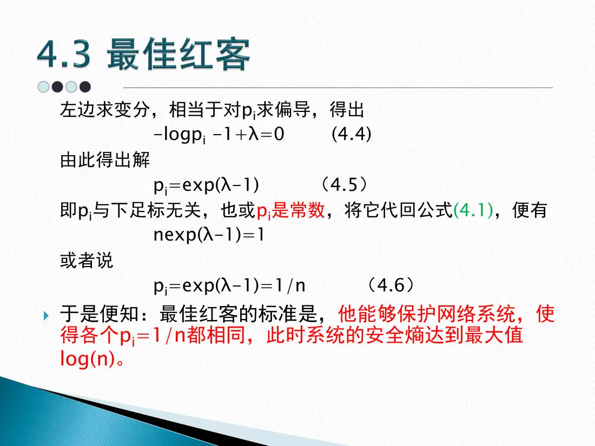

原文：

4.3 最佳红客

左边求变分，相当于对 $p _ { i }$ 求偏导，得出-logpi -1+λ=0 (4.4)

由此得出解

$$
p _ {i} = \exp (\lambda - 1)\tag{4.5}
$$

即 $p _ { i }$ 与下足标无关，也或 $p _ { \mathrm { i } }$ 是常数，将它代回公式(4.1)，便有nexp(λ-1)=1

或者说

$$
p _ {i} = \exp (\lambda - 1) = 1 / n\tag{4.6}
$$

于是便知：最佳红客的标准是，他能够保护网络系统，使得各个p=1/n都相同，此时系统的安全熵达到最大值log(n)。

### 2、平均自信息量H(X)

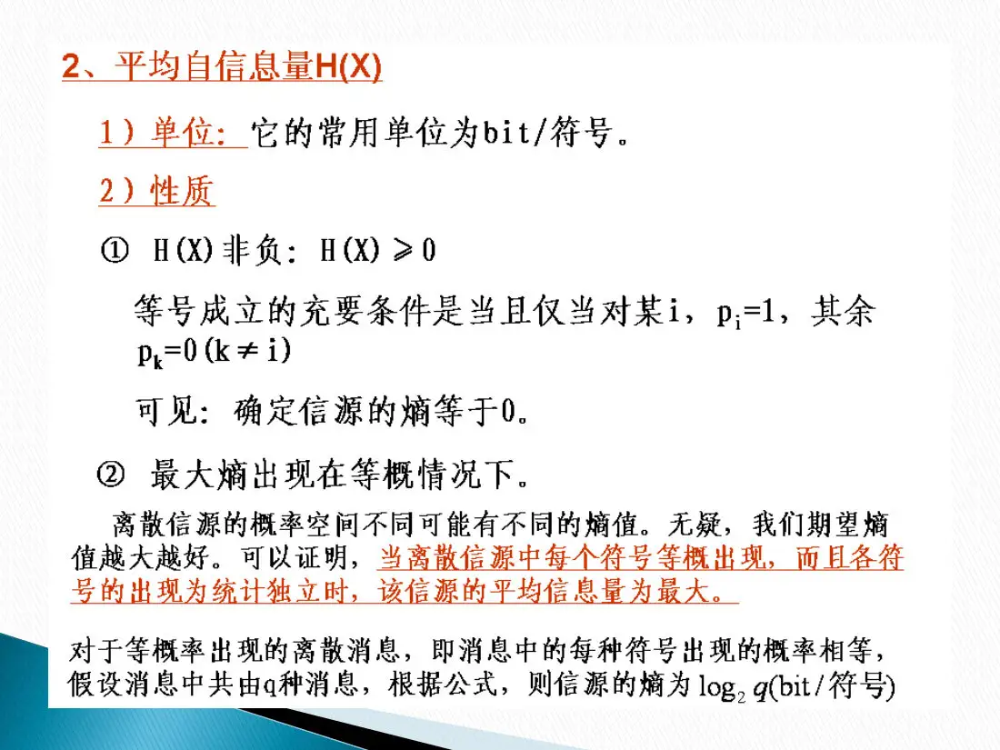

原文：

2、平均自信息量H(X)

1）单位：它的常用单位为bit/符号。

2）性质

① H(X)非负： $\mathbb { H } \left( \mathbb { X } \right) \geqslant \mathbb { 0 }$

等号成立的充要条件是当且仅当对某i， $\mathfrak { p } _ { \mathrm { i } } { = } 1$ ，其余$\mathfrak { p } _ { \mathbf { k } } \mathbf { = } \mathbf { 0 } \left( \mathbf { k } \neq \mathbf { i } \right)$

可见：确定信源的熵等于0。

②最大熵出现在等概情况下。

离散信源的概率空间不同可能有不同的熵值。无疑，我们期望熵值越大越好。可以证明，当离散信源中每个符号等概出现，而且各符号的出现为统计独立时，该信源的平均信息量为最大。

对于等概率出现的离散消息，即消息中的每种符号出现的概率相等，假设消息中共由q种消息，根据公式，则信源的熵为 $\log _ { 2 }$ q(bit/符号)

### 4.3 最佳红客

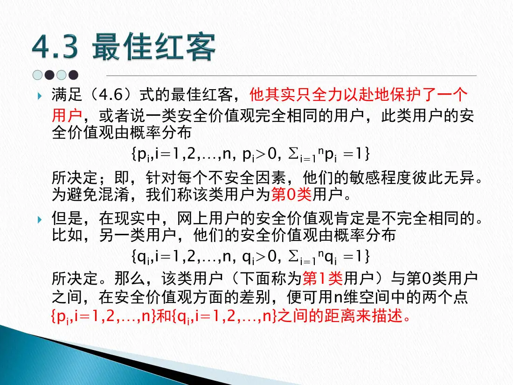

原文：

4.3 最佳红客

满足（4.6）式的最佳红客，他其实只全力以赴地保护了一个用户，或者说一类安全价值观完全相同的用户，此类用户的安全价值观由概率分布

$$
\{p _ {i}, i = 1, 2, \dots , n, p _ {i} > 0, \Sigma_ {i = 1} ^ {n} p _ {i} = 1 \}
$$

所决定；即，针对每个不安全因素，他们的敏感程度彼此无异。为避免混淆，我们称该类用户为第0类用户。

但是，在现实中，网上用户的安全价值观肯定是不完全相同的。比如，另一类用户，他们的安全价值观由概率分布

$$
\left\{q _ {i}, i = 1, 2, \dots , n, q _ {i} > 0, \Sigma_ {i = 1} ^ {n} q _ {i} = 1 \right\}
$$

所决定。那么，该类用户（下面称为第1类用户）与第0类用户之间，在安全价值观方面的差别，便可用n维空间中的两个点$\{ p _ { i } , 1 = 1 , 2 , \ldots , n$ }和 $[ 9 , 1 = 7 , 2 , \ldots , n ]$ 之间的距离来描述。

### 4.3 最佳红客

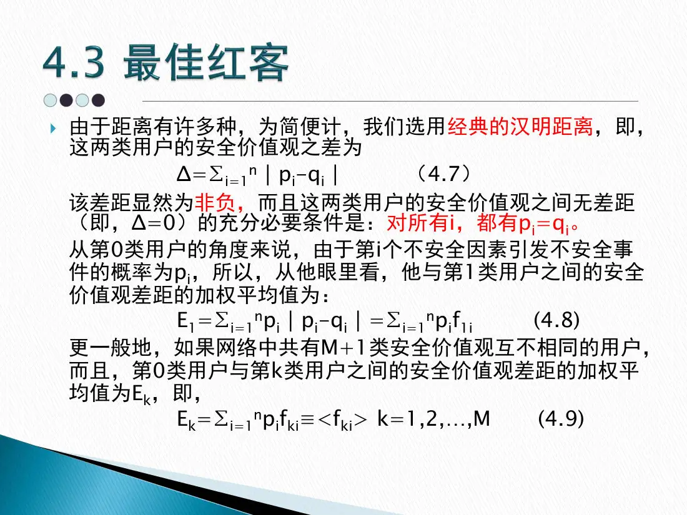

原文：

4.3 最佳红客

由于距离有许多种，为简便计，我们选用经典的汉明距离，即，这两类用户的安全价值观之差为

$$
\Delta = \sum_ {i = 1} ^ {n} | p _ {i} - q _ {i} | \tag {4.7}
$$

该差距显然为非负，而且这两类用户的安全价值观之间无差距（即， $\Delta = 0 )$ 的充分必要条件是：对所有i，都有 ${ \mathsf { p } } _ { \mathrm { i } } { = } { \mathsf { q } } _ { \mathrm { i } }$ 0

从第0类用户的角度来说，由于第i个不安全因素引发不安全事件的概率为 $p _ { i }$ ，所以，从他眼里看，他与第1类用户之间的安全价值观差距的加权平均值为：

$$
E _ {1} = \sum_ {i = 1} ^ {n} p _ {i} | p _ {i} - q _ {i} | = \sum_ {i = 1} ^ {n} p _ {i} f _ {1 i}\tag{4.8}
$$

更一般地，如果网络中共有 $\mathsf { M } + \mathsf { l }$ 类安全价值观互不相同的用户，而且，第0类用户与第k类用户之间的安全价值观差距的加权平均值为 $\mathsf { E } _ { \mathsf { k } }$ ，即，

$$
E _ {k} = \sum_ {i = 1} ^ {n} p _ {i} f _ {k i} \equiv <   f _ {k i} > k = 1, 2, \dots , M\tag{4.9}
$$

### 4.3 最佳红客

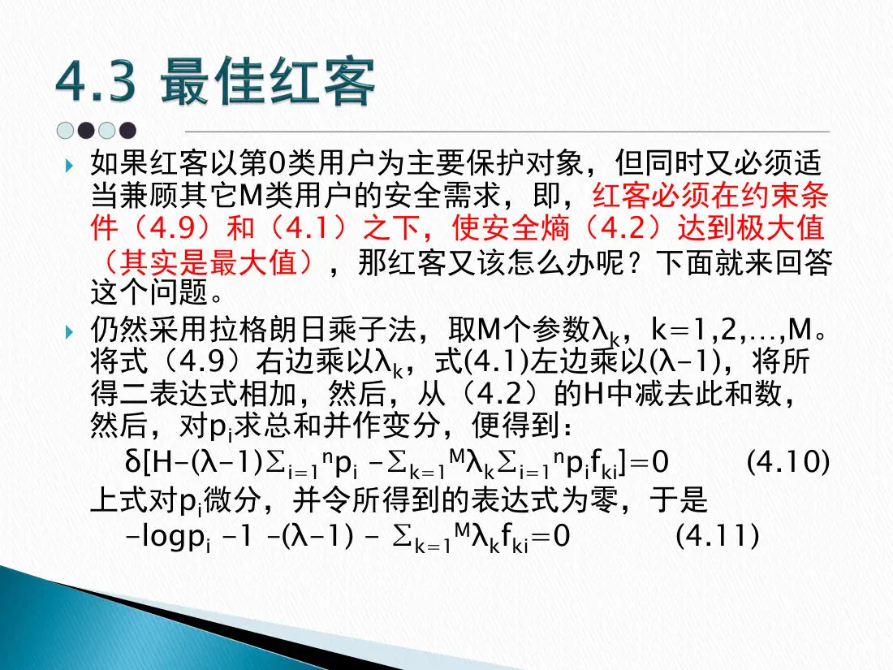

原文：

4.3 最佳红客

如果红客以第0类用户为主要保护对象，但同时又必须适当兼顾其它M类用户的安全需求，即，红客必须在约束条件（4.9）和（4.1）之下，使安全熵（4.2）达到极大值（其实是最大值），那红客又该怎么办呢？下面就来回答这个问题。

 仍然采用拉格朗日乘子法，取M个参数 $\lambda _ { \mathrm { k } } , \mathrm { ~ } \mathrm { } k = 1 , 2 , \ldots , \mathsf { M }$ 将式（4.9）右边乘以 $\lambda _ { \boldsymbol { \mathrm { k } } }$ ，式(4.1)左边乘以(λ-1)，将所得二表达式相加，然后，从（4.2）的H中减去此和数，然后，对 $p _ { i }$ 求总和并作变分，便得到：

$$
\delta [ H - (\lambda - 1) \Sigma_ {i = 1} ^ {n} p _ {i} - \Sigma_ {k = 1} ^ {M} \lambda_ {k} \Sigma_ {i = 1} ^ {n} p _ {i} f _ {k i} ] = 0\tag{4.10}
$$

上式对 $p _ { i }$ 微分，并令所得到的表达式为零，于是

$$
- \log p _ {i} - 1 - (\lambda - 1) - \sum_ {k = 1} ^ {M} \lambda_ {k} f _ {k i} = 0\tag{4.11}
$$

### 4.4小结

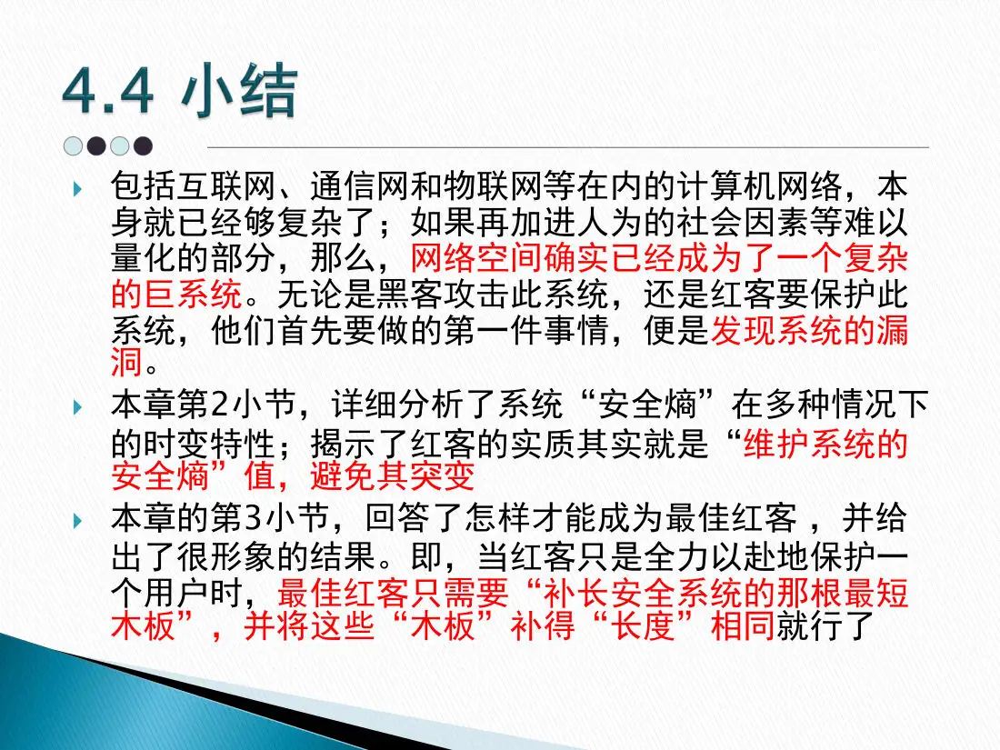

原文：

4.4小结

包括互联网、通信网和物联网等在内的计算机网络，本身就已经够复杂了；如果再加进人为的社会因素等难以量化的部分，那么，网络空间确实已经成为了一个复杂的巨系统。无论是黑客攻击此系统，还是红客要保护此系统，他们首先要做的第一件事情，便是发现系统的漏洞。

本章第2小节，详细分析了系统“安全熵”在多种情况下的时变特性；揭示了红客的实质其实就是“维护系统的安全熵”值，避免其突变

本章的第3小节，回答了怎样才能成为最佳红客 ，并给出了很形象的结果。即，当红客只是全力以赴地保护个用户时，最佳红客只需要“补长安全系统的那根最短木板”，并将这些“木板”补得“长度”相同就行了

### 本章结束，谢谢

原文：

本章结束，谢谢
