# 《安全通论》第5章 红客与黑客的单挑对抗极限（课件）

原件的每一页，下面附识别出的文字。

### 第5章---红客与黑客的单挑对抗极限

原文：

第5章---红客与黑客的单挑对抗极限

### 第5章红客与黑客的单挑对抗极限

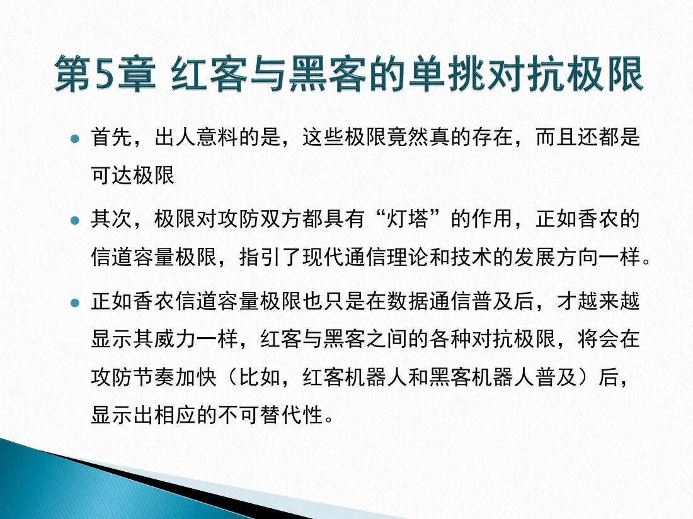

原文：

第5章红客与黑客的单挑对抗极限

首先，出人意料的是，这些极限竟然真的存在，而且还都是可达极限

其次，极限对攻防双方都具有“灯塔”的作用，正如香农的信道容量极限，指引了现代通信理论和技术的发展方向一样。

正如香农信道容量极限也只是在数据通信普及后，才越来越显示其威力一样，红客与黑客之间的各种对抗极限，将会在攻防节奏加快（比如，红客机器人和黑客机器人普及）后，显示出相应的不可替代性。

### 二、平均互信息量

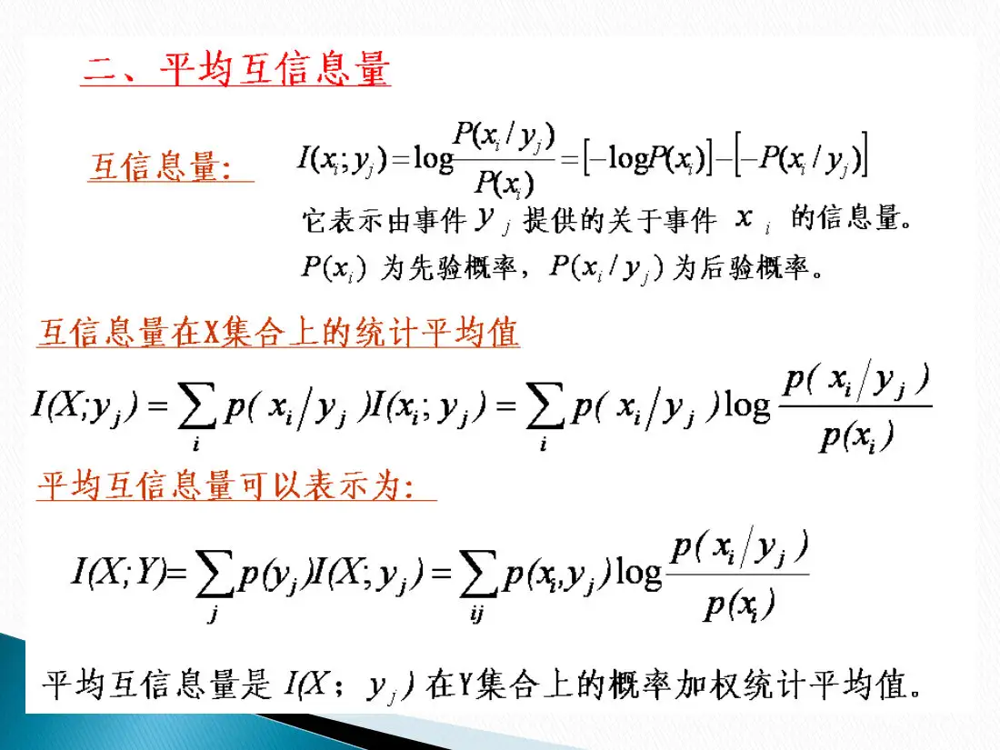

原文：

二、平均互信息量

互信息量：

$$
I (x _ {i}; y _ {j}) = \log \frac {P (x _ {i} / y _ {j})}{P (x _ {i})} = [ - \log P (x _ {i}) ] - [ - P (x _ {i} / y _ {j}) ]
$$

它表示由事件 $y _ { \textit { j } }$ 提供的关于事件 $\textbf { \textit { x } } _ { i }$ 的信息量。

$P ( \pmb { x } _ { i } )$ 为先验概率， $P ( x _ { i } / y _ { j } )$ 为后验概率。

互信息量在X集合上的统计平均值

$$
I (X; y _ {j}) = \sum_ {i} p \left(x _ {i} / y _ {j}\right) I \left(x _ {i}; y _ {j}\right) = \sum_ {i} p \left(x _ {i} / y _ {j}\right) \log \frac {p \left(x _ {i} / y _ {j}\right)}{p \left(x _ {i}\right)}
$$

平均互信息量可以表示为：

$$
I (X; Y) = \sum_ {j} p \left(y _ {j}\right) I (X; y _ {j}) = \sum_ {i j} p \left(x _ {i}, y _ {j}\right) \log \frac {p \left(x _ {i} / y _ {j}\right)}{p \left(x _ {i}\right)}
$$

平均互信息量是 $I ( X ; ~ y _ { j } )$ 在Y集合上的概率加权统计平均值。

### 第 4 页

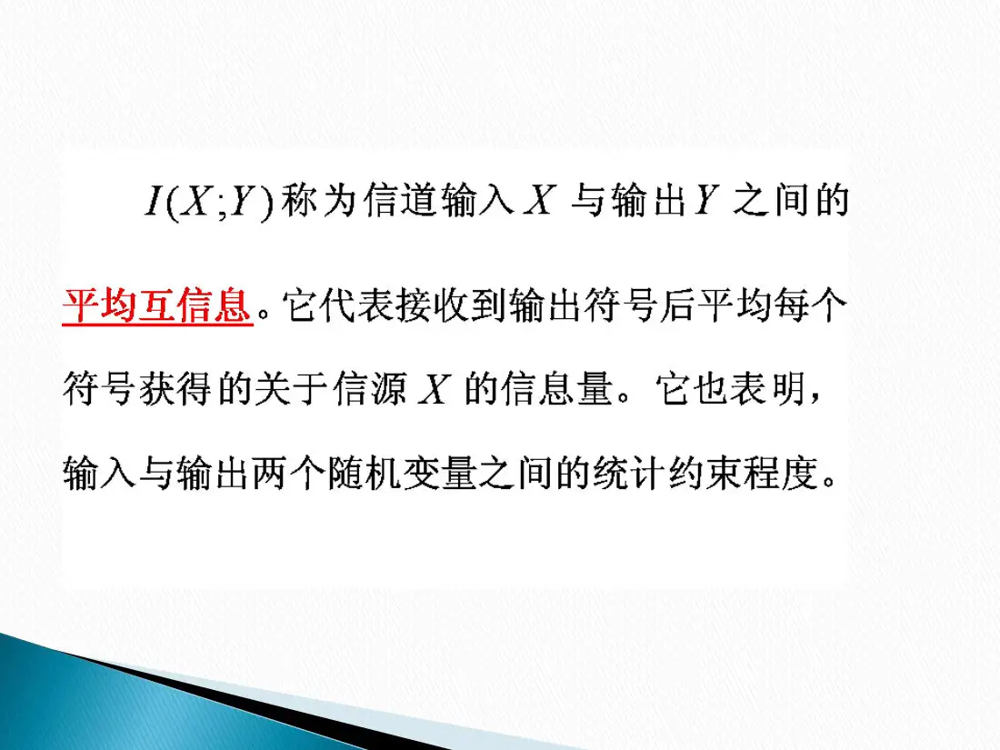

原文：

I(X:Y)称为信道输入X与输出Y之间的平均互信息。它代表接收到输出符号后平均每个符号获得的关于信源X的信息量。它也表明，输入与输出两个随机变量之间的统计约束程度。

### $$

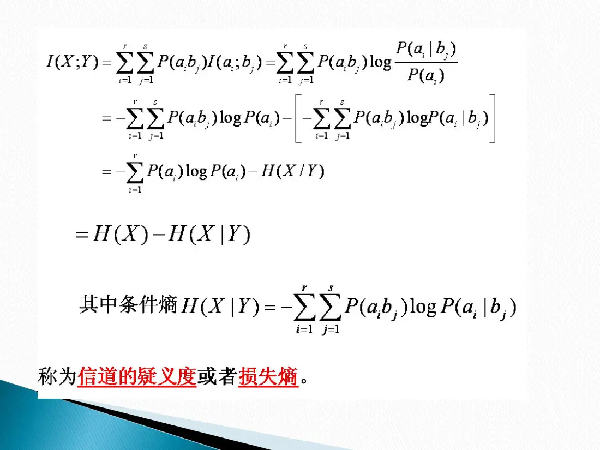

原文：

$$
\begin{array}{r l} I (X; Y) & = \sum_ {i = 1} ^ {r} \sum_ {j = 1} ^ {s} P (a _ {i} b _ {j}) I (a _ {i}; b _ {j}) = \sum_ {i = 1} ^ {r} \sum_ {j = 1} ^ {s} P (a _ {i} b _ {j}) \log \frac {P (a _ {i} \mid b _ {j})}{P (a _ {i})} \\ & = - \sum_ {i = 1} ^ {r} \sum_ {j = 1} ^ {s} P (a _ {i} b _ {j}) \log P (a _ {i}) - \left[ - \sum_ {i = 1} ^ {r} \sum_ {j = 1} ^ {s} P (a _ {i} b _ {j}) \log P (a _ {i} \mid b _ {j}) \right] \\ & = - \sum_ {i = 1} ^ {r} P (a _ {i}) \log P (a _ {i}) - H (X / Y) \\ & = H (X) - H (X \mid Y) \end{array}
$$

其中条件熵 $H ( X \mid Y ) = - \sum _ { i = 1 } ^ { r } \sum _ { j = 1 } ^ { s } P ( a _ { i } b _ { j } ) \log P ( a _ { i } \mid b _ { j } )$ 称为信道的疑义度或者损失熵。

### $$

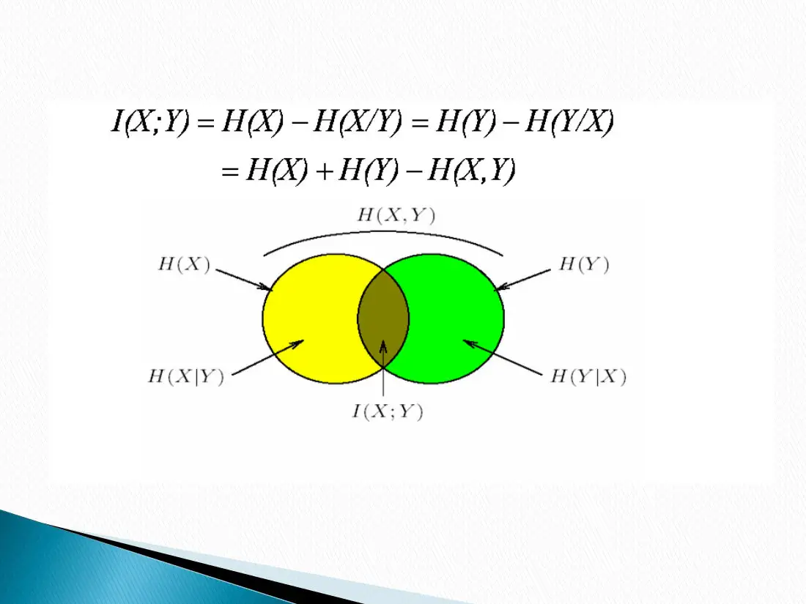

原文：

$$
\begin{array}{r l} I (X; Y) & = H (X) - H (X / Y) = H (Y) - H (Y / X) \\ & = H (X) + H (Y) - H (X, Y) \end{array}
$$

### 一、几个定义

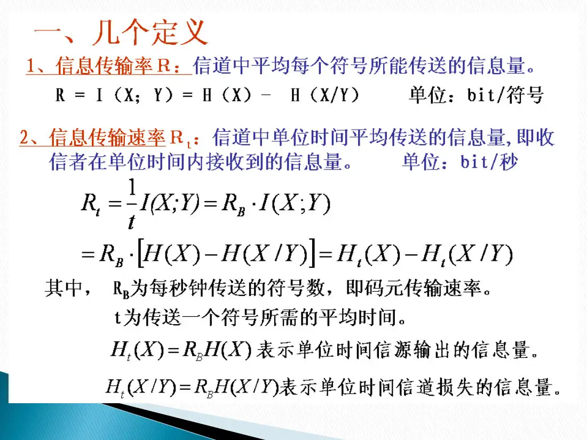

原文：

一、几个定义

1、信息传输率R：信道中平均每个符号所能传送的信息量。

$$
R = I (X; Y) = H (X) - H (X / Y) \quad \text {单位: bit / 符号}
$$

2、信息传输速率 $\mathrm { ~ R ~ } _ { \mathrm { t } }$ ：信道中单位时间平均传送的信息量，即收信者在单位时间内接收到的信息量。 单位：bit/秒

$$
\begin{array}{l} {R _ {t} = \frac {1}{t} I (X; Y) = R _ {B} \cdot I (X; Y)} \\ {= R _ {B} \cdot \left[ H (X) - H (X / Y) \right] = H _ {t} (X) - H _ {t} (X / Y)} \end{array}
$$

其中， $\mathbb { R } _ { \mathtt { B } }$ 为每秒钟传送的符号数，即码元传输速率。

t为传送一个符号所需的平均时间。

$H _ { t } ( X ) = R _ { \bar { s } } H ( X )$ 表示单位时间信源输出的信息量。

$H _ { t } ( X / Y ) { = } R _ { s } H ( X / Y )$ 表示单位时间信道损失的信息量。

### 试计算：

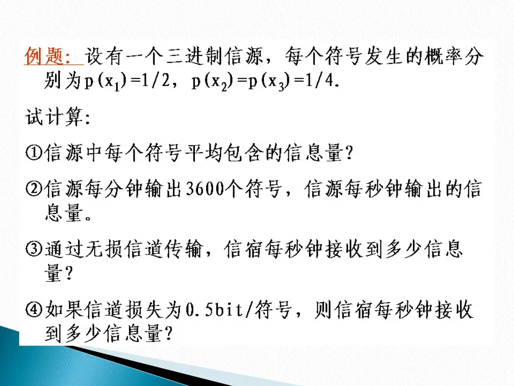

原文：

例题：设有一个三进制信源，每个符号发生的概率分别为 $\mathrm { ~ p ~ } ( \mathrm { x } _ { 1 } ) = 1 / 2 , \mathrm { ~ p ~ } ( \mathrm { x } _ { 2 } ) = \mathrm { p } ( \mathrm { x } _ { 3 } ) = 1 / 4$

试计算：

①信源中每个符号平均包含的信息量？

②信源每分钟输出3600个符号，信源每秒钟输出的信息量。

③通过无损信道传输，信宿每秒钟接收到多少信息量？

④如果信道损失为0.5bit/符号，则信宿每秒钟接收到多少信息量？

### 第 9 页

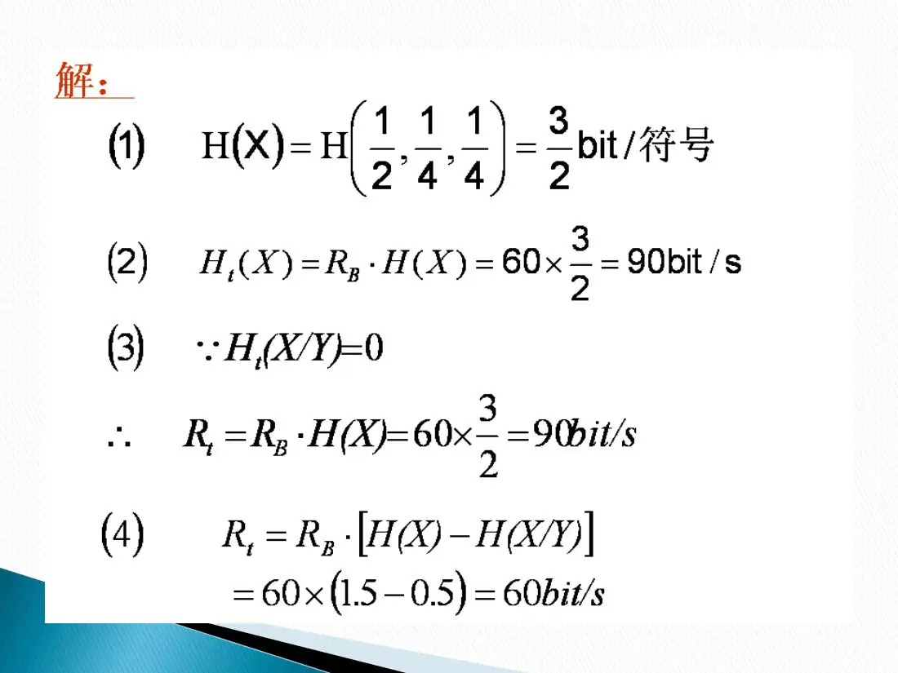

原文：

(1) $\operatorname { H } ( \mathsf { X } ) = \operatorname { H } \left( \frac { 1 } { 2 } , \frac { 1 } { 4 } , \frac { 1 } { 4 } \right) = \frac { 3 } { 2 }$ bit/符号

(2) $H _ { t } ( X ) = R _ { B } \cdot H ( X ) = { \bar { 5 } } 0 \times { \frac { 3 } { 2 } } = 9 0 { \mathrm { } } 0 { \mathrm { } } { \mathrm { } } { \mathrm { } } { \mathrm { ~ } } 1 { \mathrm { ~ } } 5$

(3) $\because H _ { t } ( X Y Y ) { = } 0$

$\therefore$ $R _ { t } = R _ { B } \cdot H ( X ) = 6 0 \times \frac { 3 } { 2 } = 9 0 b i t / s$

(4) $\begin{array} { c } { { R _ { t } = R _ { s } \cdot \left[ H ( X ) - H ( X / Y ) \right] } } \\ { { = 6 0 \times \left( 1 . 5 - 0 . 5 \right) = 6 0 b i t / s } } \end{array}$

### 3、信道容量C

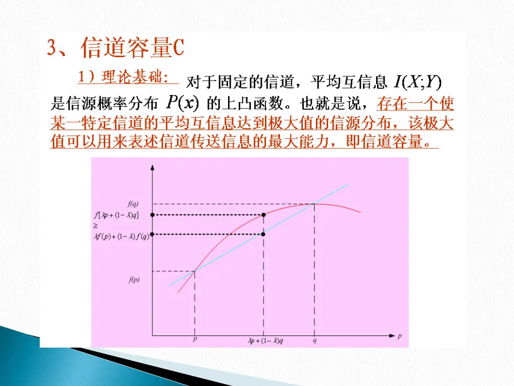

原文：

3、信道容量C

1）理论基础： 对于固定的信道，平均互信息I(X;Y)是信源概率分布P(x)的上凸函数。也就是说，存在一个使某一特定信道的平均互信息达到极大值的信源分布，该极大值可以用来表述信道传送信息的最大能力，即信道容量。

### 2）信道容量的定义

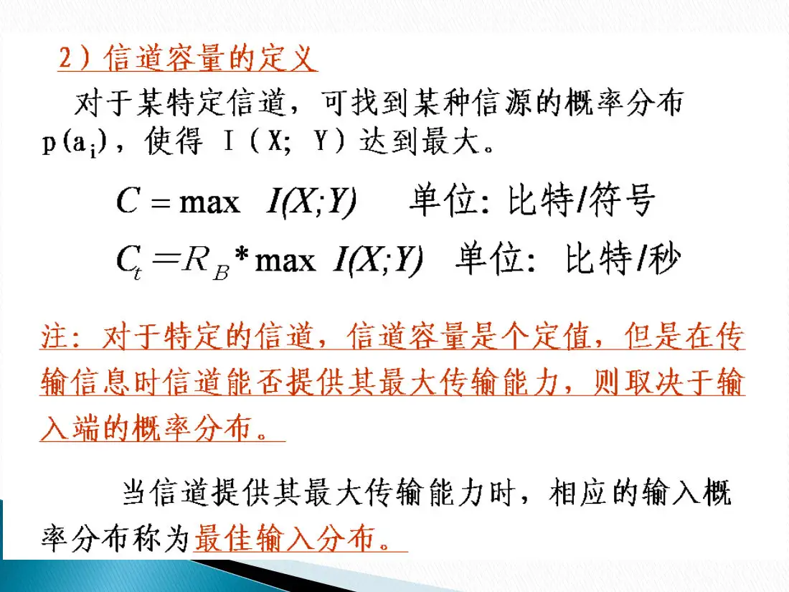

原文：

2）信道容量的定义

对于某特定信道，可找到某种信源的概率分布$\mathbb { p } \left( \mathbf { a } _ { \mathbf { i } } \right)$ ，使得 $\mathrm { ~ \bf ~ I ~ } \left( \begin{array} { l l } { \mathbf { \nabla } \mathbf { X } ; } & { \mathbf { \nabla } \mathbf { Y } } \end{array} \right)$ 达到最大。

$$
C = \max I (X; Y) \quad \text {单位:比特} / \text {符号}
$$

$$
C _ {t} = R _ {B} ^ {*} \max I (X; Y) \quad \text {单位:比特/秒}
$$

注：对于特定的信道，信道容量是个定值，但是在传输信息时信道能否提供其最大传输能力，则取决于输入端的概率分布。

当信道提供其最大传输能力时，相应的输入概率分布称为最佳输入分布。

### 能使平均互信息达到信道容量C的信源，称为匹配信源。

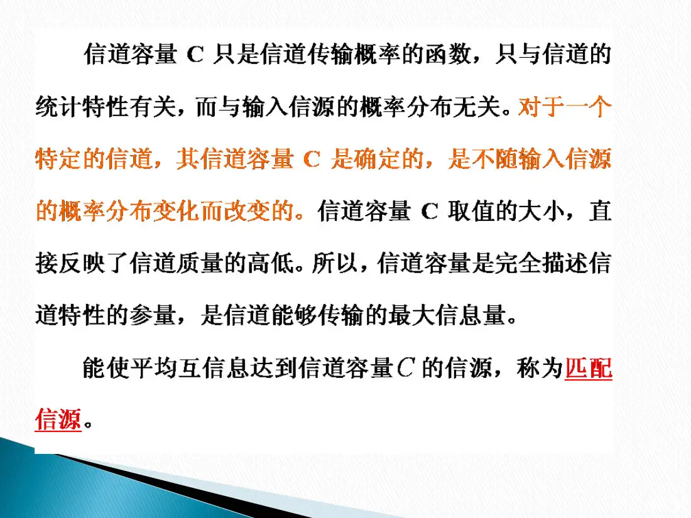

原文：

信道容量C只是信道传输概率的函数，只与信道的统计特性有关，而与输入信源的概率分布无关。对于一个特定的信道，其信道容量C是确定的，是不随输入信源的概率分布变化而改变的。信道容量C取值的大小，直接反映了信道质量的高低。所以，信道容量是完全描述信道特性的参量，是信道能够传输的最大信息量。

能使平均互信息达到信道容量C的信源，称为匹配信源。

### 第 13 页

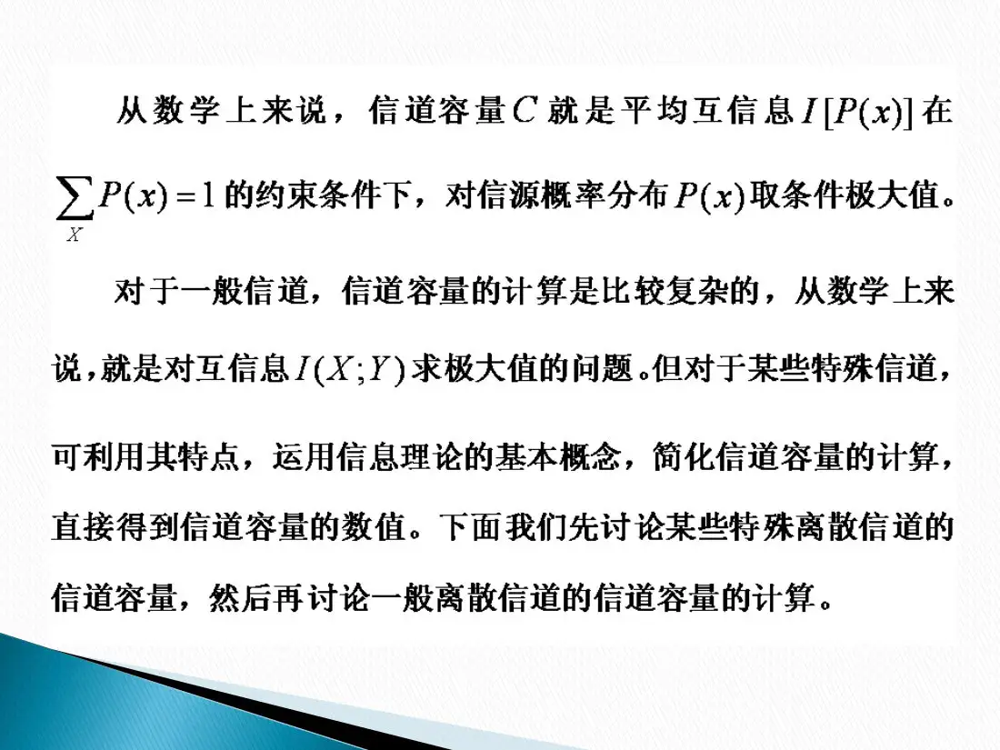

原文：

从数学上来说，信道容量C就是平均互信息 $I [ P ( x ) ]$ 在$\sum _ { X } P ( x ) = 1$ 的约束条件下，对信源概率分布 $P ( x )$ 取条件极大值。

对于一般信道，信道容量的计算是比较复杂的，从数学上来说，就是对互信息 $I ( X ; Y )$ 求极大值的问题。但对于某些特殊信道可利用其特点，运用信息理论的基本概念，简化信道容量的计算直接得到信道容量的数值。下面我们先讨论某些特殊离散信道的信道容量，然后再讨论一般离散信道的信道容量的计算。

### 信道编码定理

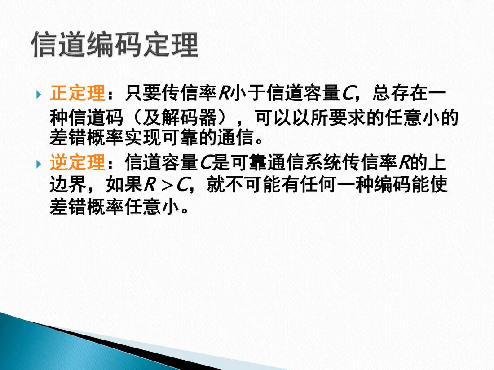

原文：

信道编码定理

正定理：只要传信率R小于信道容量C，总存在一种信道码（及解码器），可以以所要求的任意小的差错概率实现可靠的通信。

逆定理：信道容量C是可靠通信系统传信率R的上边界，如果R>C，就不可能有任何一种编码能使差错概率任意小。

### 第5章红客与黑客的单挑对抗极限

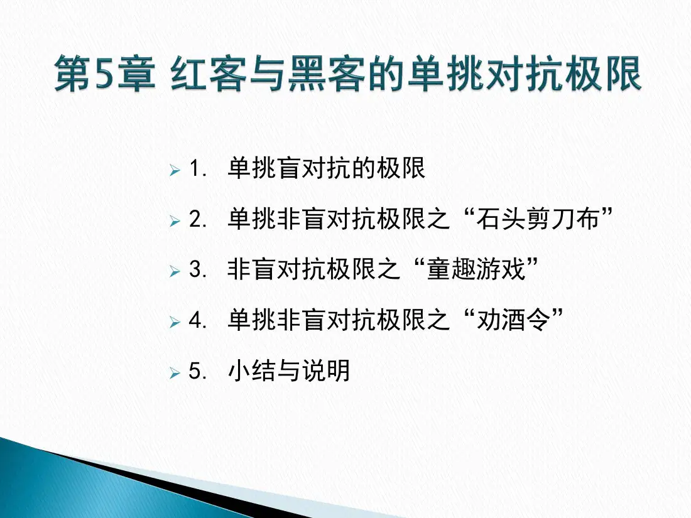

原文：

第5章红客与黑客的单挑对抗极限

1. 单挑盲对抗的极限
2. 单挑非盲对抗极限之“石头剪刀布”
3. 非盲对抗极限之“童趣游戏”
4. 单挑非盲对抗极限之“劝酒令”
5. 小结与说明

### 5.1单挑盲对抗的极限

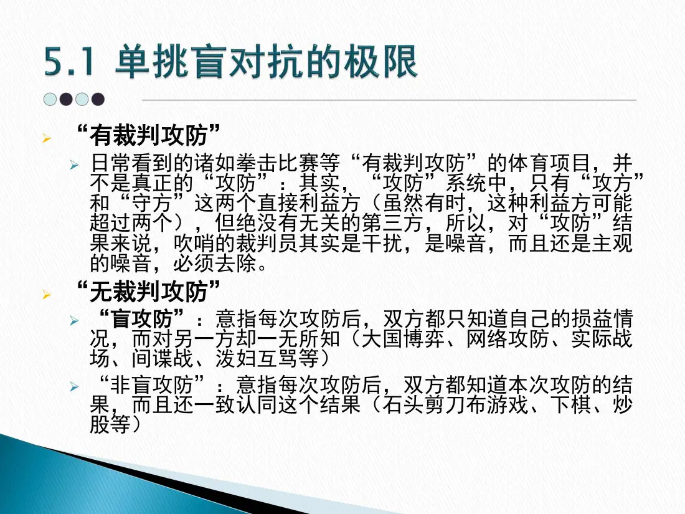

原文：

5.1单挑盲对抗的极限

“有裁判攻防”

➢ 日常看到的诸如拳击比赛等“有裁判攻防”的体育项目，并不是真正的“攻防”：其实， “攻防”系统中，只有“攻方”和“守方”这两个直接利益方（虽然有时，这种利益方可能超过两个），但绝没有无关的第三方，所以，对“攻防”结果来说，吹哨的裁判员其实是干扰，是噪音，而且还是主观的噪音，必须去除。

“无裁判攻防”

➢ “盲攻防”：意指每次攻防后，双方都只知道自己的损益情况，而对另一方却一无所知（大国博弈、网络攻防、实际战场、间谍战、泼妇互骂等）

➢ “非盲攻防”：意指每次攻防后，双方都知道本次攻防的结果，而且还一致认同这个结果（石头剪刀布游戏、下棋、炒股等）

### 5.1 单挑盲对抗的极限“盲攻防”系统

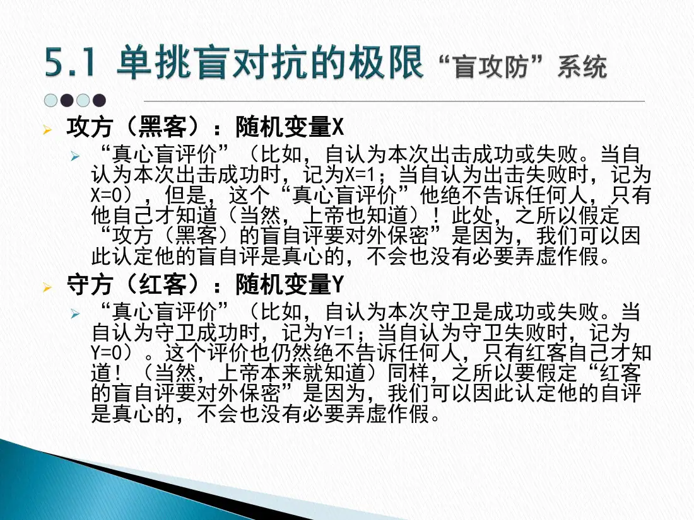

原文：

5.1 单挑盲对抗的极限“盲攻防”系统

攻方（黑客）：随机变量X

“真心盲评价”（比如，自认为本次出击成功或失败。当自认为本次出击成功时，记为X=1；当自认为出击失败时，记为X=0），但是，这个“真心盲评价”他绝不告诉任何人，只有他自己才知道（当然，上帝也知道）！此处，之所以假定“攻方（黑客）的盲自评要对外保密”是因为，我们可以因此认定他的盲自评是真心的，不会也没有必要弄虚作假。

守方（红客）：随机变量Y

“真心盲评价”（比如，自认为本次守卫是成功或失败。当自认为守卫成功时，记为Y=1；当自认为守卫失败时，记为Y=0）。这个评价也仍然绝不告诉任何人，只有红客自己才知道！（当然，上帝本来就知道）同样，之所以要假定“红客的盲自评要对外保密”是因为，我们可以因此认定他的自评是真心的，不会也没有必要弄虚作假。

### 5.1 单挑盲对抗的极限“盲攻防”系统

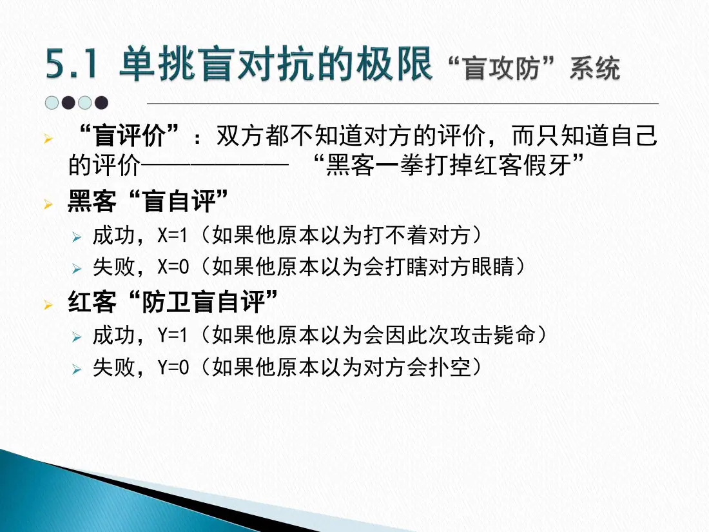

原文：

5.1 单挑盲对抗的极限“盲攻防”系统

➢ “盲评价”：双方都不知道对方的评价，而只知道自己的评价— “黑客一拳打掉红客假牙”

黑客“盲自评”

➢ 成功，X=1（如果他原本以为打不着对方）

➢ 失败，X=0（如果他原本以为会打瞎对方眼睛）

➢ 红客“防卫盲自评”

➢ 成功，Y=1（如果他原本以为会因此次攻击毙命）

➢ 失败，Y=0（如果他原本以为对方会扑空）

### 5.1 单挑盲对抗的极限“盲攻防”系统

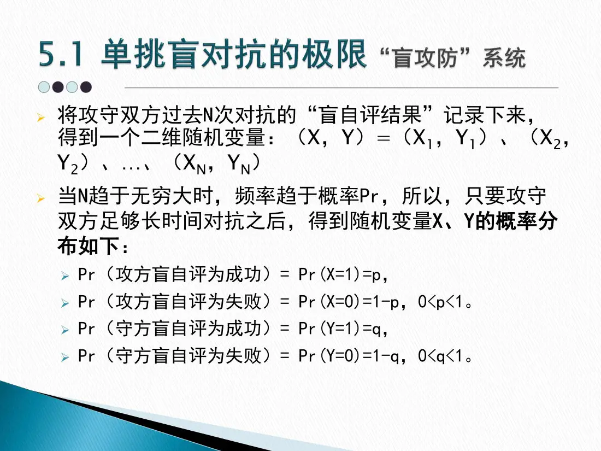

原文：

5.1 单挑盲对抗的极限“盲攻防”系统

➢ 将攻守双方过去N次对抗的“盲自评结果”记录下来，得到一个二维随机变量： $( { \sf X } , { \sf Y } ) = ( { \sf X } _ { 1 } , { \sf Y } _ { 1 } ) , ( { \sf X } _ { 2 } , { \sf Y } )$ $v _ { 2 } ) \ldots ( x _ { N } , y _ { N } )$

➢ 当N趋于无穷大时，频率趋于概率Pr，所以，只要攻守双方足够长时间对抗之后，得到随机变量X、Y的概率分布如下：

➢ Pr（攻方盲自评为成功）= Pr(X=1)=p，

➢ Pr（攻方盲自评为失败） $= P r ( x = 0 ) = 1 - p , 0 < p < 1$ 。

➢ Pr（守方盲自评为成功） $= P r ( r = 1 ) = a$

➢ Pr（守方盲自评为失败） $= P r ( \gamma = 0 ) = 1 - 9 , 0 < q < 1$ o

### 5.1 单挑盲对抗的极限“盲攻防”系统

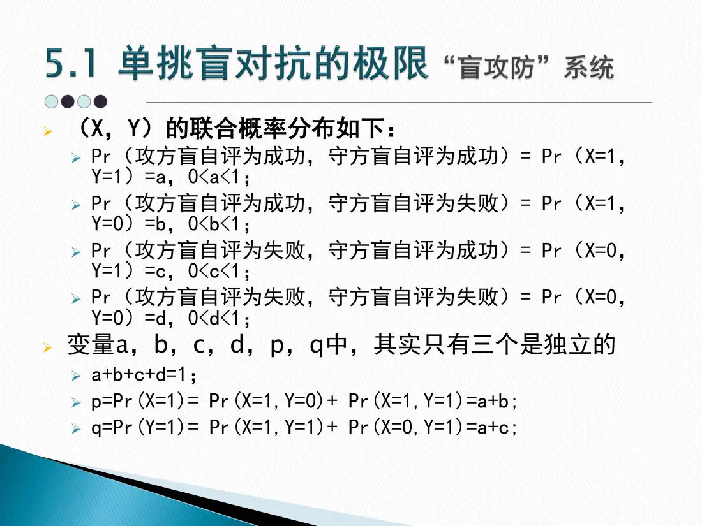

原文：

5.1 单挑盲对抗的极限“盲攻防”系统

（X，Y）的联合概率分布如下：

Pr（攻方盲自评为成功，守方盲自评为成功）= Pr（X=1，$\forall = 1 ) = a , 0 < a < 1$ ；

➢ Pr（攻方盲自评为成功，守方盲自评为失败）= Pr（X=1，$v = 0 ) = b , 0 < b < 1$ ；

Pr（攻方盲自评为失败，守方盲自评为成功）= Pr（X=0，$y = 1 ) = c , 0 < c < 1$

➢ Pr（攻方盲自评为失败，守方盲自评为失败）= Pr（X=0，${ \mathsf { Y } } = 0 ) = { \mathsf { d } } , 0 < { \mathsf { d } } < 1$ ；

➢ 变量 ${ \sf a } , { \sf b } , { \sf c } , { \sf d } , { \sf p } ,$ q中，其实只有三个是独立的➢ a+b+c+d=1；

$$
p = \operatorname * {P r} (X = 1) = \operatorname * {P r} (X = 1, Y = 0) + \operatorname * {P r} (X = 1, Y = 1) = a + b;
$$

$$
q = \operatorname * {P r} (Y = 1) = \operatorname * {P r} (X = 1, Y = 1) + \operatorname * {P r} (X = 0, Y = 1) = a + c;
$$

### 5.1 单挑盲对抗的极限“盲攻防”系统

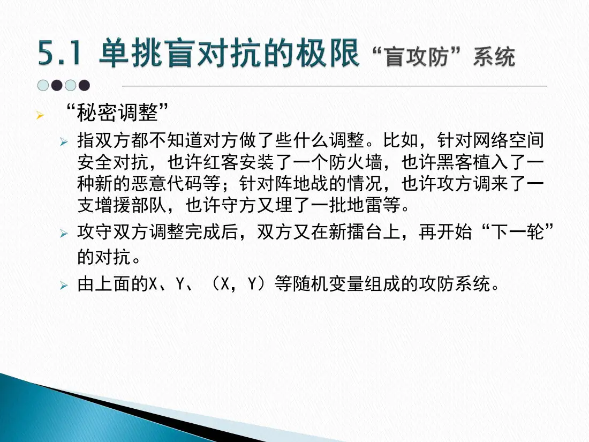

原文：

5.1 单挑盲对抗的极限“盲攻防”系统

“秘密调整”

➢ 指双方都不知道对方做了些什么调整。比如，针对网络空间安全对抗，也许红客安装了一个防火墙，也许黑客植入了一种新的恶意代码等；针对阵地战的情况，也许攻方调来了一支增援部队，也许守方又埋了一批地雷等。

➢ 攻守双方调整完成后，双方又在新擂台上，再开始“下一轮”的对抗。

➢ 由上面的X、Y、（X，Y）等随机变量组成的攻防系统。

### 5.1 单挑盲对抗的极限 黑客攻击能力的极限

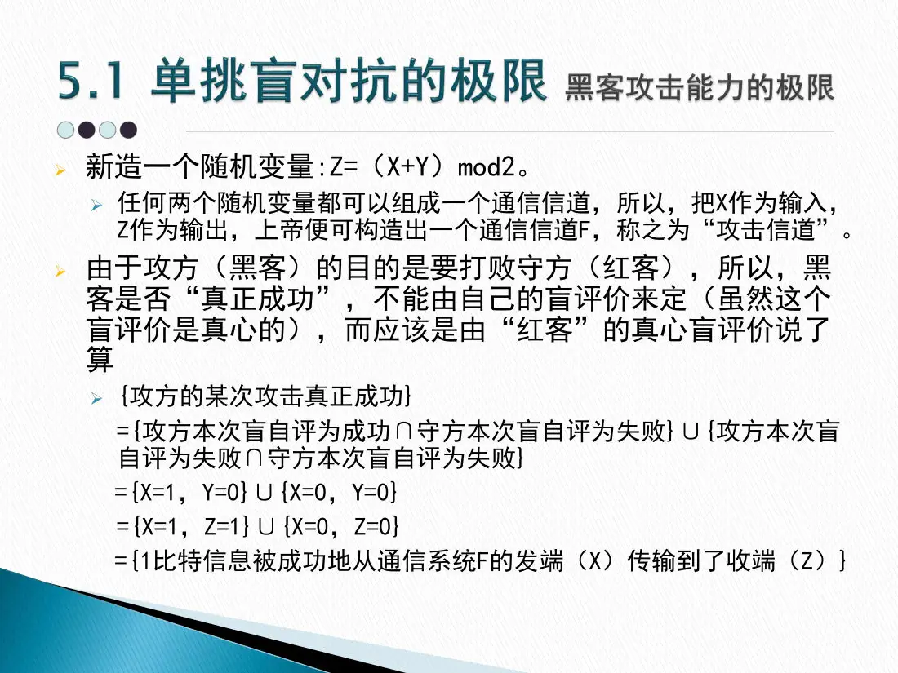

原文：

5.1 单挑盲对抗的极限 黑客攻击能力的极限

新造一个随机变量:Z=（X+Y）mod2。

任何两个随机变量都可以组成一个通信信道，所以，把X作为输入，Z作为输出，上帝便可构造出一个通信信道F，称之为“攻击信道”。

➢ 由于攻方（黑客）的目的是要打败守方（红客），所以，黑客是否“真正成功”，不能由自己的盲评价来定（虽然这个盲评价是真心的），而应该是由“红客”的真心盲评价说了算

➢ {攻方的某次攻击真正成功}

={攻方本次盲自评为成功∩守方本次盲自评为失败}∪{攻方本次盲 自评为失败∩守方本次盲自评为失败}

$$
\begin{array}{l} {= \{X = 1, Y = 0 \} \cup \{X = 0, Y = 0 \}} \\ {= \{X = 1, Z = 1 \} \cup \{X = 0, Z = 0 \}} \end{array}
$$

={1比特信息被成功地从通信系统F的发端（X）传输到了收端（Z）}

### 5.1 单挑盲对抗的极限 黑客攻击能力的极限

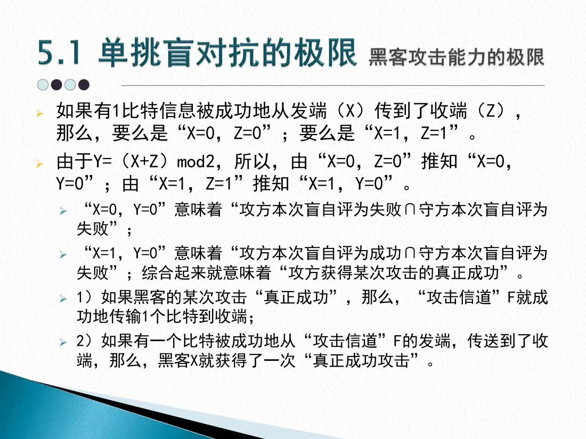

原文：

5.1 单挑盲对抗的极限 黑客攻击能力的极限

➢ 如果有1比特信息被成功地从发端（X）传到了收端（Z），那么，要么是 $x = 0 , 2 = 0 ^ { 3 }$ ；要么是“X=1， $z = 1 ^ { 9 9 }$ 。

➢ 由于Y=（X+Z）mod2，所以，由 $x = 0 , 2 = 0 ^ { 3 }$ 推知“X=0，$\gamma = 0 ^ { 9 9 }$ ；由“X=1， $z = 1 ^ { 9 9 }$ 推知“X=1， $\gamma = 0 ^ { 9 9 }$ o

➢ “X=0，Y=0”意味着“攻方本次盲自评为失败∩守方本次盲自评为失败”；

➢ “X=1，Y=0”意味着“攻方本次盲自评为成功∩守方本次盲自评为失败”；综合起来就意味着“攻方获得某次攻击的真正成功”。

➢ 1）如果黑客的某次攻击“真正成功”，那么，“攻击信道”F就成功地传输1个比特到收端；

➢ 2）如果有一个比特被成功地从“攻击信道”F的发端，传送到了收端，那么，黑客X就获得了一次“真正成功攻击”。

### 5.1 单挑盲对抗的极限 黑客攻击能力的极限

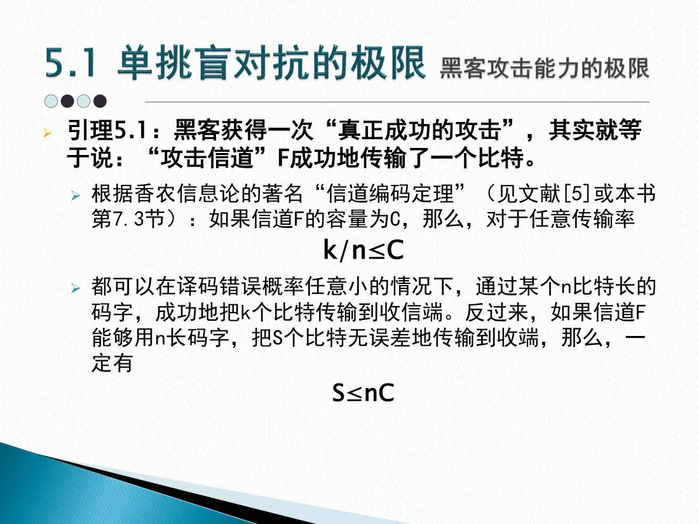

原文：

5.1 单挑盲对抗的极限 黑客攻击能力的极限

➢ 引理5.1：黑客获得一次“真正成功的攻击”，其实就等于说：“攻击信道”F成功地传输了一个比特。

➢ 根据香农信息论的著名“信道编码定理”（见文献[5]或本书第7.3节）：如果信道F的容量为C，那么，对于任意传输率

$$
k / n \leq C
$$

➢ 都可以在译码错误概率任意小的情况下，通过某个n比特长的码字，成功地把k个比特传输到收信端。反过来，如果信道F能够用n长码字，把S个比特无误差地传输到收端，那么，定有

$$
S \leq n C
$$

### 5.1 单挑盲对抗的极限 黑客攻击能力的极限

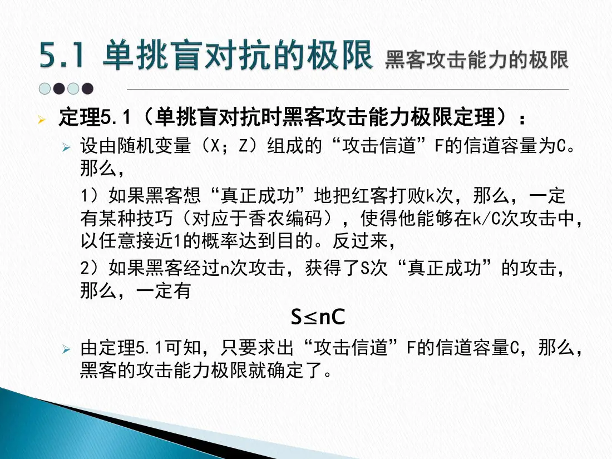

原文：

5.1 单挑盲对抗的极限 黑客攻击能力的极限

➢ 定理5.1（单挑盲对抗时黑客攻击能力极限定理）：

➢ 设由随机变量（X；Z）组成的“攻击信道”F的信道容量为C。 那么，

1）如果黑客想“真正成功”地把红客打败k次，那么，一定有某种技巧（对应于香农编码），使得他能够在k/C次攻击中，以任意接近1的概率达到目的。反过来，

2）如果黑客经过n次攻击，获得了S次“真正成功”的攻击，那么，一定有

$$
S \leq n C
$$

➢ 由定理5.1可知，只要求出“攻击信道”F的信道容量C，那么，黑客的攻击能力极限就确定了。

### 5.1 单挑盲对抗的极限 红客守卫能力极限

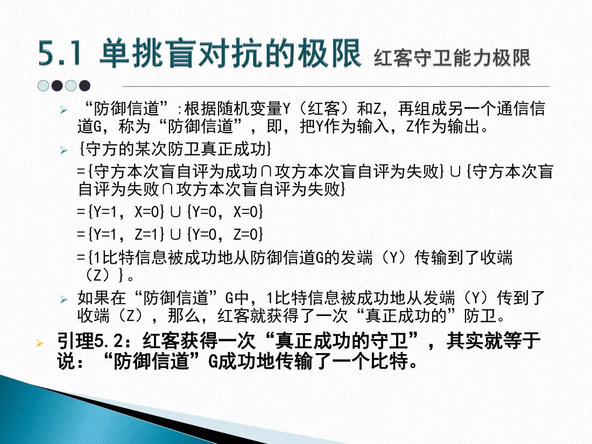

原文：

5.1 单挑盲对抗的极限 红客守卫能力极限

“防御信道”:根据随机变量Y（红客）和Z，再组成另一个通信信道G，称为“防御信道”，即，把Y作为输入，Z作为输出。

➢ {守方的某次防卫真正成功}

={守方本次盲自评为成功∩攻方本次盲自评为失败}∪{守方本次盲自评为失败∩攻方本次盲自评为失败}={Y=1，X=0}∪{Y=0，X=0}={Y=1，Z=1}∪{Y=0，Z=0}={1比特信息被成功地从防御信道G的发端（Y）传输到了收端（Z）}。

如果在“防御信道”G中，1比特信息被成功地从发端（Y）传到了收端（Z），那么，红客就获得了一次“真正成功的”防卫。

➢ 引理5.2：红客获得一次“真正成功的守卫”，其实就等于说：“防御信道”G成功地传输了一个比特。

### 5.1 单挑盲对抗的极限 红客守卫能力极限

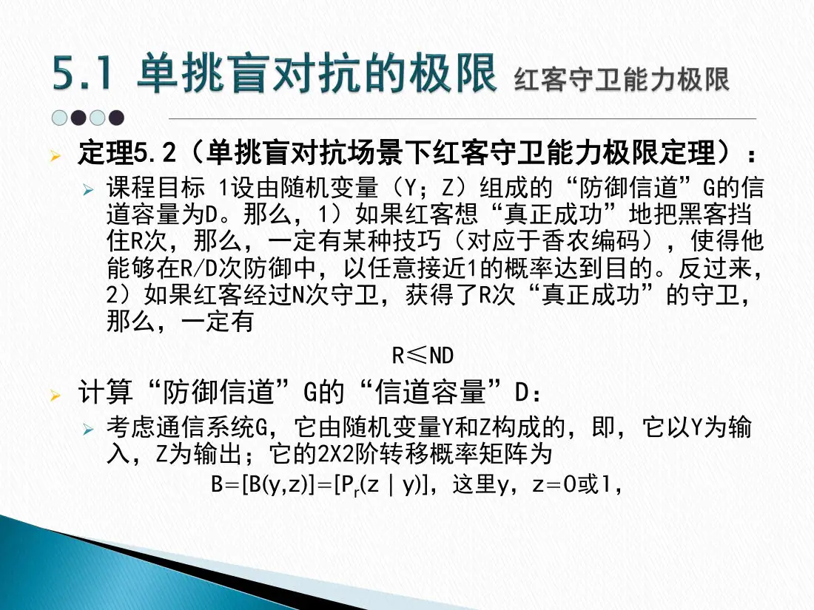

原文：

5.1 单挑盲对抗的极限 红客守卫能力极限

➢ 定理5.2（单挑盲对抗场景下红客守卫能力极限定理）：

课程目标 1设由随机变量（Y；Z）组成的“防御信道”G的信道容量为D。那么，1）如果红客想“真正成功”地把黑客挡住R次，那么，一定有某种技巧（对应于香农编码），使得他能够在R/D次防御中，以任意接近1的概率达到目的。反过来，2）如果红客经过N次守卫，获得了R次“真正成功”的守卫，那么，一定有

$$
R \leqslant N D
$$

➢ 计算“防御信道”G的“信道容量”D：

考虑通信系统G，它由随机变量Y和Z构成的，即，它以Y为输入，Z为输出；它的2X2阶转移概率矩阵为

$$
\mathrm{B} = [ \mathrm{B} (\mathrm{y}, \mathrm{z}) ] = [ \mathrm{P} _ {\mathrm{r}} (\mathrm{z} \mid \mathrm{y}) ], \text {这里} \mathrm{y}, \mathrm{z} = 0 \text {或} 1,
$$

### 5.1 单挑盲对抗的极限 攻守双方的实力对比

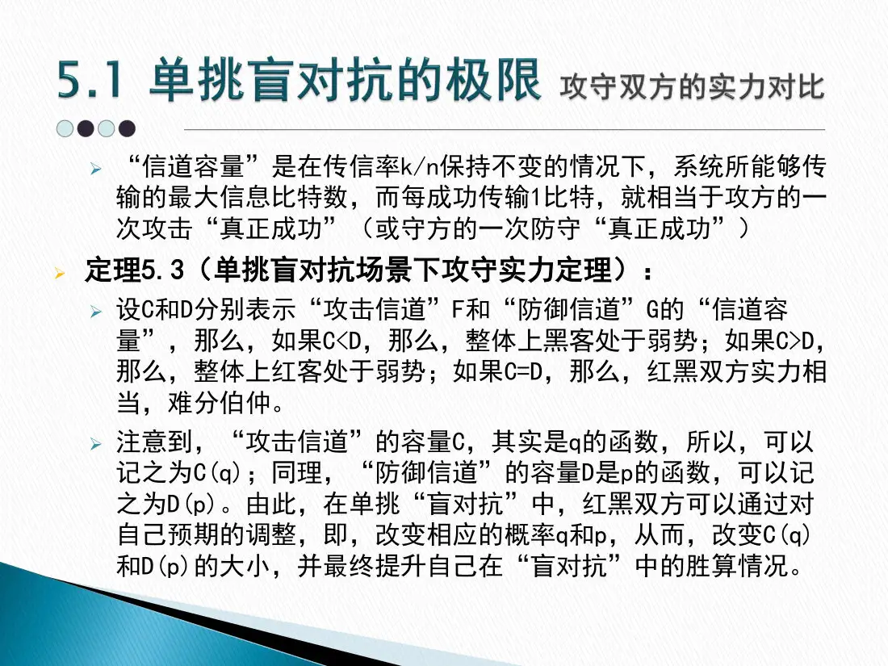

原文：

5.1 单挑盲对抗的极限 攻守双方的实力对比

“信道容量”是在传信率k/n保持不变的情况下，系统所能够传输的最大信息比特数，而每成功传输1比特，就相当于攻方的一次攻击“真正成功”（或守方的一次防守“真正成功”）

定理5.3（单挑盲对抗场景下攻守实力定理）：

➢ 设C和D分别表示“攻击信道”F和“防御信道”G的“信道容量”，那么，如果C<D，那么，整体上黑客处于弱势；如果C>D，那么，整体上红客处于弱势；如果C=D，那么，红黑双方实力相当，难分伯仲。

注意到，“攻击信道”的容量C，其实是q的函数，所以，可以记之为C(q)；同理，“防御信道”的容量D是p的函数，可以记之为D(p)。由此，在单挑“盲对抗”中，红黑双方可以通过对自己预期的调整，即，改变相应的概率q和p，从而，改变C(q)和D(p)的大小，并最终提升自己在“盲对抗”中的胜算情况。

### 5.1 单挑盲对抗的极限 攻守双方的实力对比

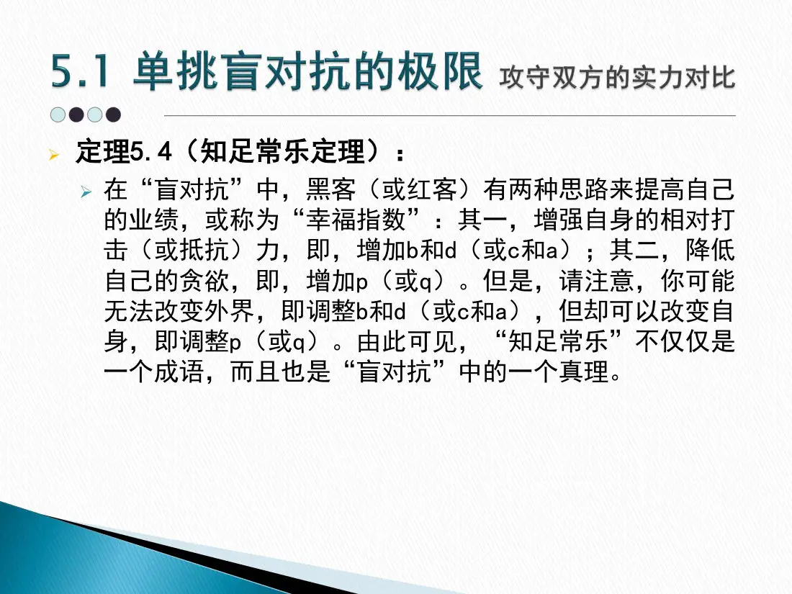

原文：

5.1 单挑盲对抗的极限 攻守双方的实力对比

➢ 定理5.4（知足常乐定理）：

➢ 在“盲对抗”中，黑客（或红客）有两种思路来提高自己的业绩，或称为“幸福指数”：其一，增强自身的相对打击（或抵抗）力，即，增加b和d（或c和a）；其二，降低自己的贪欲，即，增加p（或q）。但是，请注意，你可能无法改变外界，即调整b和d（或c和a），但却可以改变自身，即调整p（或q）。由此可见，“知足常乐”不仅仅是一个成语，而且也是“盲对抗”中的一个真理。

### 5.1 单挑盲对抗的极限 总结

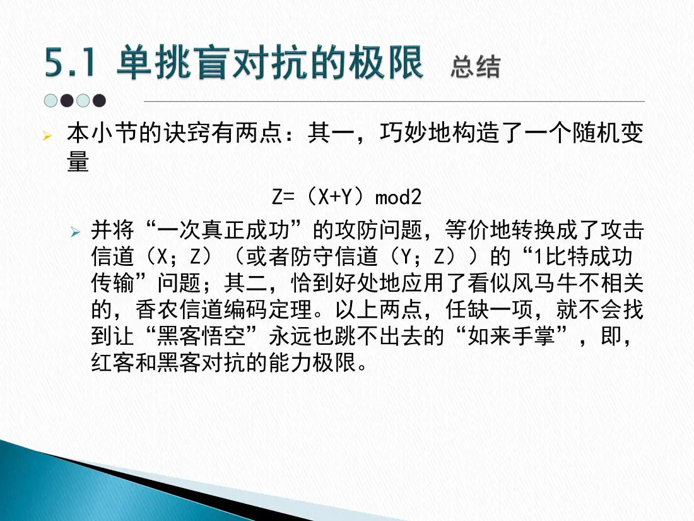

原文：

5.1 单挑盲对抗的极限 总结

➢ 本小节的诀窍有两点：其一，巧妙地构造了一个随机变量

$$
Z = (X + Y) \mod 2
$$

并将“一次真正成功”的攻防问题，等价地转换成了攻击信道（X；Z）（或者防守信道（Y；Z））的“1比特成功传输”问题；其二，恰到好处地应用了看似风马牛不相关的，香农信道编码定理。以上两点，任缺一项，就不会找到让“黑客悟空”永远也跳不出去的“如来手掌”，即，红客和黑客对抗的能力极限。

### 5.2单挑非盲对抗极限之“石头剪刀布”

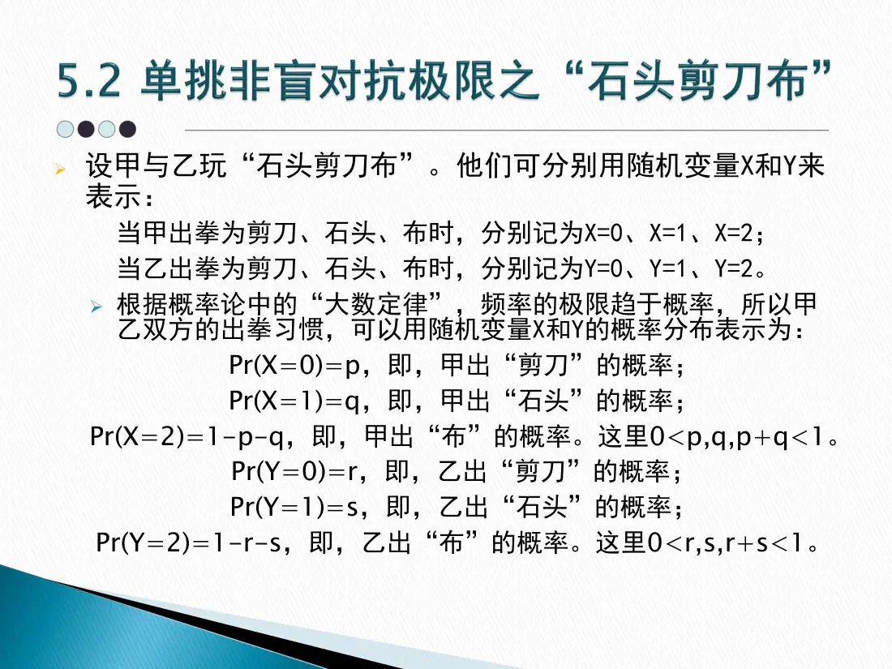

原文：

5.2单挑非盲对抗极限之“石头剪刀布”

➢ 设甲与乙玩“石头剪刀布”。他们可分别用随机变量X和Y来表示：

当甲出拳为剪刀、石头、布时，分别记为 $x = 0 , x = 1 , x = 2$

当乙出拳为剪刀、石头、布时，分别记为 $y = 0 , y = 1 , y = 2$ o

➢ 根据概率论中的“大数定律”，频率的极限趋于概率，所以甲乙双方的出拳习惯，可以用随机变量X和Y的概率分布表示为：

$\mathsf { P r } ( \mathsf { X } = 0 ) = \mathsf { p }$ ，即，甲出“剪刀”的概率；

Pr(X=1)=q，即，甲出“石头”的概率；

$\mathsf { P r } ( \mathsf { X } = 2 ) = \mathsf { I } - \mathsf { p } - \mathsf { q }$ ，即，甲出“布”的概率。这里 $0 < p , q , p + q < 1$ o

Pr(Y=0)=r，即，乙出“剪刀”的概率；

Pr(Y=1)=s，即，乙出“石头”的概率；

$p r ( \gamma = 2 ) = 1 - r - s$ ，即，乙出“布”的概率。这里 $0 < r , s , r + s < 7$ o

### 5.2单挑非盲对抗极限之“石头剪刀布”

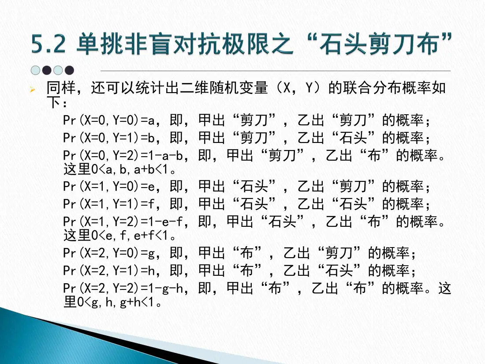

原文：

5.2单挑非盲对抗极限之“石头剪刀布”

➢ 同样，还可以统计出二维随机变量（X，Y）的联合分布概率如下：

Pr(X=0,Y=0)=a，即，甲出“剪刀”，乙出“剪刀”的概率；Pr(X=0,Y=1)=b，即，甲出“剪刀”，乙出“石头”的概率；Pr(X=0,Y=2)=1-a-b，即，甲出“剪刀”，乙出“布”的概率。这里0<a,b,a+b<1。

Pr(X=1,Y=0)=e，即，甲出“石头”，乙出“剪刀”的概率；Pr(X=1,Y=1)=f，即，甲出“石头”，乙出“石头”的概率；Pr(X=1,Y=2)=1-e-f，即，甲出“石头”，乙出“布”的概率。这里0<e,f,e+f<1。

Pr(X=2,Y=0)=g，即，甲出“布”，乙出“剪刀”的概率；

Pr(X=2,Y=1)=h，即，甲出“布”，乙出“石头”的概率；

Pr(X=2,Y=2)=1-g-h，即，甲出“布”，乙出“布”的概率。这里0<g,h,g+h<1。

### 5.2单挑非盲对抗极限之“石头剪刀布”

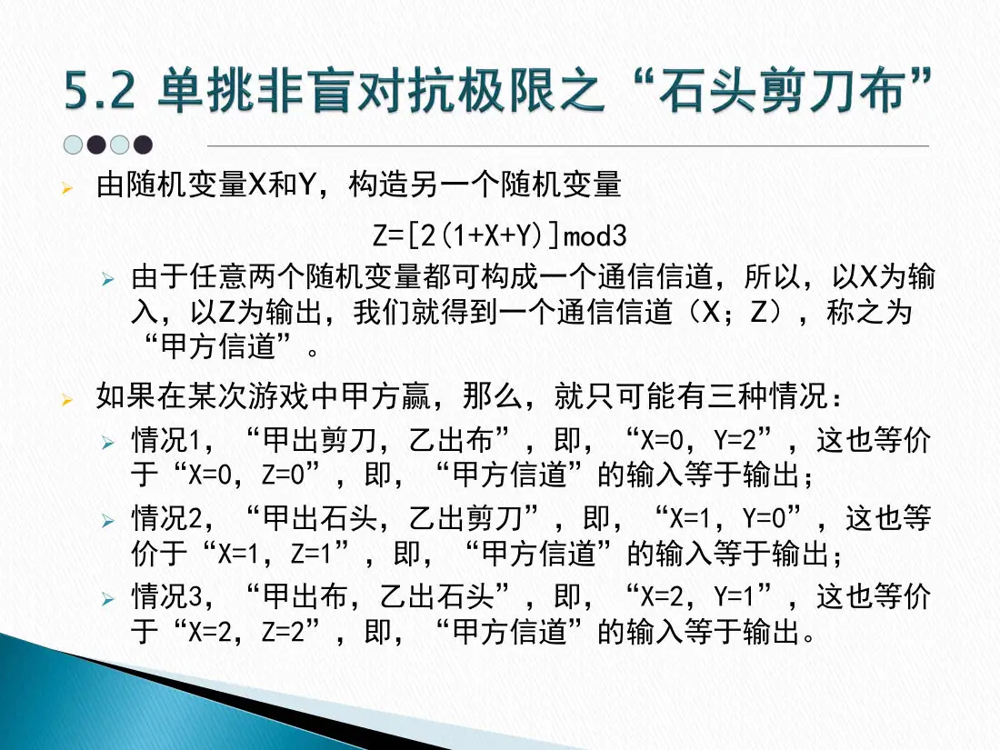

原文：

5.2单挑非盲对抗极限之“石头剪刀布”

➢ 由随机变量X和Y，构造另一个随机变量

$$
Z = [ 2 (1 + X + Y) ] \bmod 3
$$

➢ 由于任意两个随机变量都可构成一个通信信道，所以，以X为输入，以Z为输出，我们就得到一个通信信道（X；Z），称之为“甲方信道”。

➢ 如果在某次游戏中甲方赢，那么，就只可能有三种情况：

➢ 情况1，“甲出剪刀，乙出布”，即， $x = 0 , y = 2 ^ { 3 }$ ，这也等价于 $x = 0 , 2 = 0 ^ { 3 }$ ，即，“甲方信道”的输入等于输出；

➢ 情况2，“甲出石头，乙出剪刀”，即， $x = 1 , y = 0 ^ { 3 3 }$ ，这也等价于 $x = 1 , 2 = 1 ^ { 3 9 }$ ，即，“甲方信道”的输入等于输出；

情况3，“甲出布，乙出石头”，即， $x = 2 , y = 1 ^ { 3 3 }$ ，这也等价于 $x = 2 , 2 = 2 ^ { 3 9 }$ ，即，“甲方信道”的输入等于输出。

### 5.2单挑非盲对抗极限之“石头剪刀布”

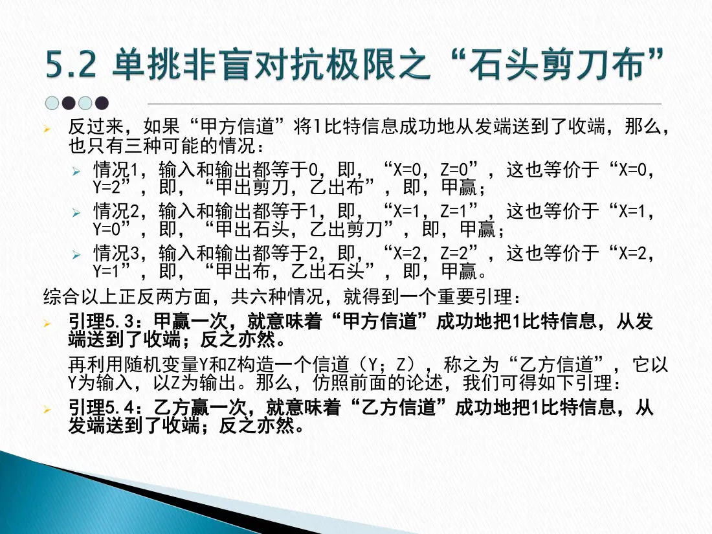

原文：

5.2单挑非盲对抗极限之“石头剪刀布”

➢ 反过来，如果“甲方信道”将1比特信息成功地从发端送到了收端，那么，也只有三种可能的情况：

情况1，输入和输出都等于0，即， $x = 0 , 2 = 0 ^ { 3 9 }$ ，这也等价于“X=0，Y=2”，即，“甲出剪刀，乙出布”，即，甲赢；

➢ 情况2，输入和输出都等于1，即， $x = 1 , 2 = 1 ^ { 3 9 }$ 这也等价于“X=1，Y=0”，即，“甲出石头，乙出剪刀”，即，甲赢；

情况3，输入和输出都等于2，即， $x = 2 , 2 = 2 ^ { 3 9 }$ ，这也等价于“X=2，Y=1”，即，“甲出布，乙出石头”，即，甲赢。

综合以上正反两方面，共六种情况，就得到一个重要引理：

引理5.3：甲赢一次，就意味着“甲方信道”成功地把1比特信息，从发端送到了收端；反之亦然。

再利用随机变量Y和Z构造一个信道（Y；Z），称之为“乙方信道”，它以Y为输入，以Z为输出。那么，仿照前面的论述，我们可得如下引理：

➢ 引理5.4：乙方赢一次，就意味着“乙方信道”成功地把1比特信息，从发端送到了收端；反之亦然。

### 5.2单挑非盲对抗极限之“石头剪刀布”

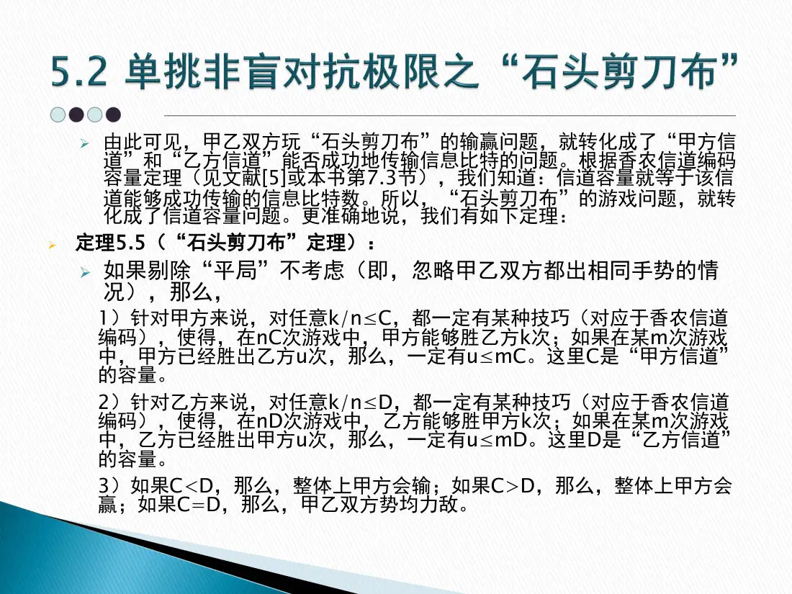

原文：

5.2单挑非盲对抗极限之“石头剪刀布”

由此可见，甲乙双方玩“石头剪刀布”的输赢问题，就转化成了“甲方信码

➢ 定理5.5（“石头剪刀布”定理）：

➢ 如果剔除“平局”不考虑（即，忽略甲乙双方都出相同手势的情况），那么，

1）针对甲方来说，对任意k/n≤C，都一定有某种技巧（对应于香农信道编码），使得，在nC次游戏中，甲方能够胜乙方k次；如果在某m次游戏中，甲方已经胜出乙方u次，那么，一定有u≤mC。这里C是“甲方信道”的容量。

2）针对乙方来说，对任意k/n≤D，都一定有某种技巧（对应于香农信道编码），使得，在nD次游戏中，乙方能够胜甲方k次；如果在某m次游戏中，乙方已经胜出甲方u次，那么，一定有u≤mD。这里D是“乙方信道”的容量。

3）如果C<D，那么，整体上甲方会输；如果C>D，那么，整体上甲方会赢；如果C=D，那么，甲乙双方势均力敌。

### 5.3非盲对抗极限之“童趣游戏

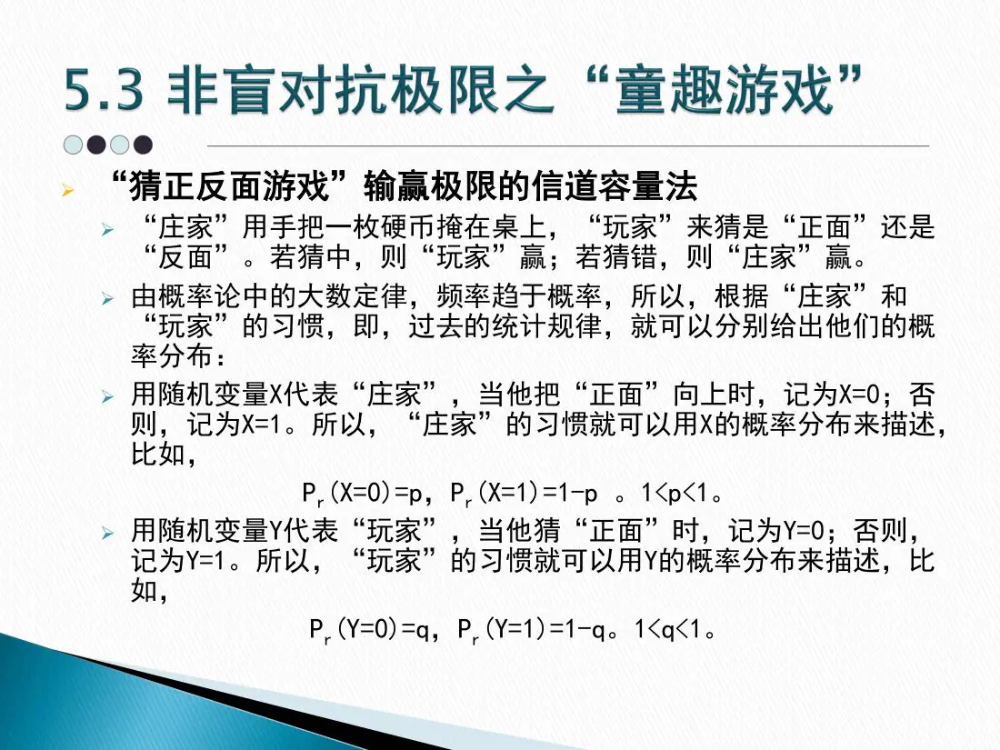

原文：

5.3非盲对抗极限之“童趣游戏

“猜正反面游戏”输赢极限的信道容量法

“庄家”用手把一枚硬币掩在桌上，“玩家”来猜是“正面”还是“反面”。若猜中，则“玩家”赢；若猜错，则“庄家”赢。

由概率论中的大数定律，频率趋于概率，所以，根据“庄家”和“玩家”的习惯，即，过去的统计规律，就可以分别给出他们的概率分布：

➢ 用随机变量X代表“庄家”，当他把“正面”向上时，记为X=0；否则，记为X=1。所以，“庄家”的习惯就可以用X的概率分布来描述，比如，

$$
P _ {r} (X = 0) = p, \quad P _ {r} (X = 1) = 1 - p 。 1 <   p <   1 。
$$

用随机变量Y代表“玩家”，当他猜“正面”时，记为Y=0；否则，记为Y=1。所以，“玩家”的习惯就可以用Y的概率分布来描述，比如，

$$
P _ {r} (Y = 0) = q, \quad P _ {r} (Y = 1) = 1 - q 。 1 <   q <   1 。
$$

### 5.3非盲对抗极限之“童趣游戏

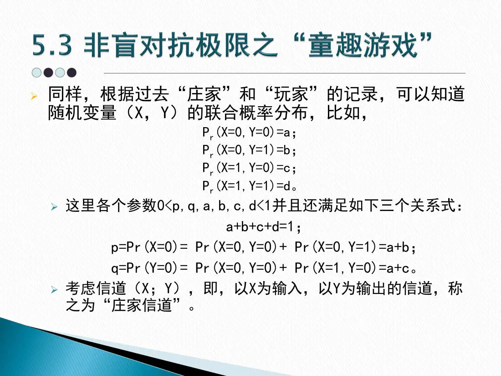

原文：

5.3非盲对抗极限之“童趣游戏

➢ 同样，根据过去“庄家”和“玩家”的记录，可以知道随机变量（X，Y）的联合概率分布，比如，

$$
\begin{array}{l} \mathrm {P_ {r}} (X = 0, Y = 0) = a; \\ \mathrm {P_ {r}} (X = 0, Y = 1) = b; \\ \mathrm {P_ {r}} (X = 1, Y = 0) = c; \\ \mathrm {P_ {r}} (X = 1, Y = 1) = d _ {\circ} \end{array}
$$

➢ 这里各个参数0<p,q,a,b,c,d<1并且还满足如下三个关系式：

$$
a + b + c + d = 1;
$$

$$
p = \operatorname * {P r} (X = 0) = \operatorname * {P r} (X = 0, Y = 0) + \operatorname * {P r} (X = 0, Y = 1) = a + b;
$$

$$
q = \operatorname * {P r} (Y = 0) = \operatorname * {P r} (X = 0, Y = 0) + \operatorname * {P r} (X = 1, Y = 0) = a + c 。
$$

考虑信道（X；Y），即，以X为输入，以Y为输出的信道，称之为“庄家信道”。

### 5.3非盲对抗极限之“童趣游戏

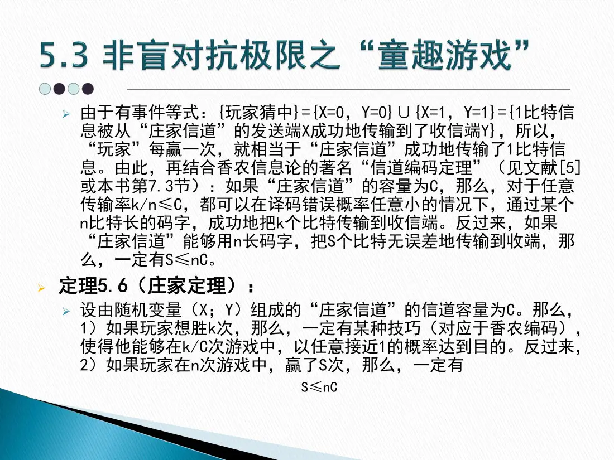

原文：

5.3非盲对抗极限之“童趣游戏

由于有事件等式：{玩家猜中}={X=0，Y=0}∪{X=1，Y=1}={1比特信息被从“庄家信道”的发送端X成功地传输到了收信端Y}，所以，“玩家”每赢一次，就相当于“庄家信道”成功地传输了1比特信息。由此，再结合香农信息论的著名“信道编码定理”（见文献[5]或本书第7.3节）：如果“庄家信道”的容量为C，那么，对于任意传输率k/n≤C，都可以在译码错误概率任意小的情况下，通过某个n比特长的码字，成功地把k个比特传输到收信端。反过来，如果“庄家信道”能够用n长码字，把S个比特无误差地传输到收端，那么，一定有S≤nC。

定理5.6（庄家定理）：

设由随机变量（X；Y）组成的“庄家信道”的信道容量为C。那么，1）如果玩家想胜k次，那么，一定有某种技巧（对应于香农编码）使得他能够在k/C次游戏中，以任意接近1的概率达到目的。反过来，2）如果玩家在n次游戏中，赢了S次，那么，一定有

$$
S \leqslant n C
$$

### 5.3非盲对抗极限之“童趣游戏

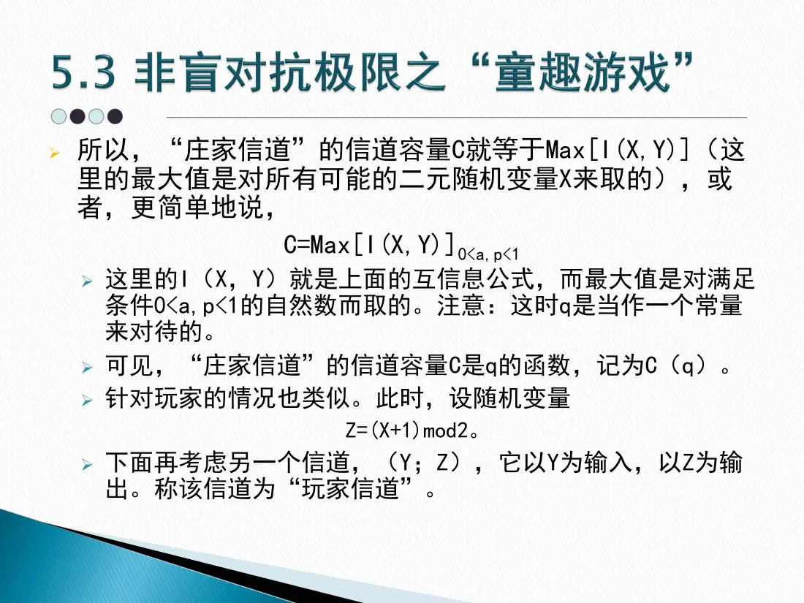

原文：

5.3非盲对抗极限之“童趣游戏

➢ 所以，“庄家信道”的信道容量C就等于Max[I(X,Y)]（这里的最大值是对所有可能的二元随机变量X来取的），或者，更简单地说，

$$
C = \text { Max } [ I (X, Y) ] _ {0 <   a, p <   1}
$$

➢ 这里的I（X，Y）就是上面的互信息公式，而最大值是对满足条件0<a,p<1的自然数而取的。注意：这时q是当作一个常量来对待的。

➢ 可见，“庄家信道”的信道容量C是q的函数，记为C（q）。

➢ 针对玩家的情况也类似。此时，设随机变量

$$
Z = (X + 1) \bmod 2 。
$$

➢ 下面再考虑另一个信道，（Y；Z），它以Y为输入，以Z为输出。称该信道为“玩家信道”。

### 5.3非盲对抗极限之“童趣游戏

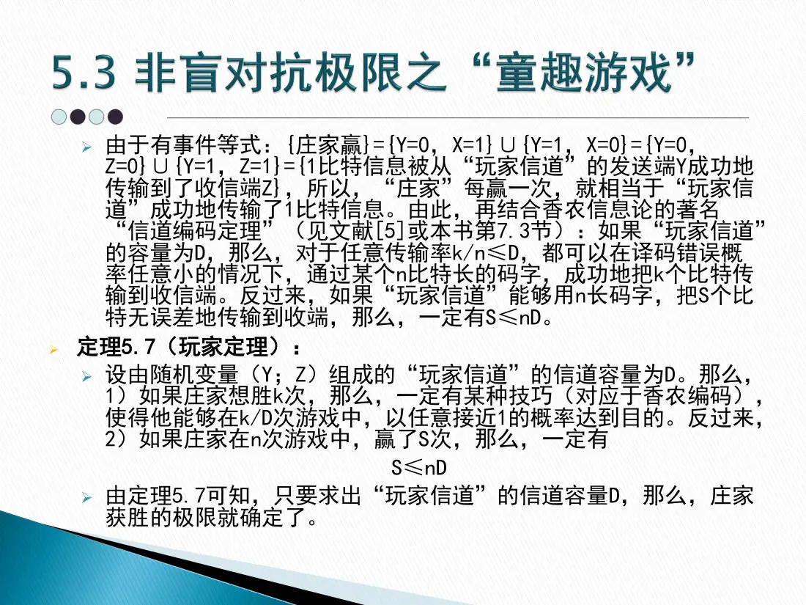

原文：

5.3非盲对抗极限之“童趣游戏

由于有事件等式：{庄家赢}={Y=0，X=1}∪{Y=1，X=0}={Y=0，Z=0}∪{Y=1，Z=1}={1比特信息被从“玩家信道”的发送端Y成功地传输到了收信端Z}，所以，“庄家”每赢一次，就相当于“玩家信道”成功地传输了1比特信息。由此，再结合香农信息论的著名“信道编码定理”（见文献[5]或本书第7.3节）：如果“玩家信道”的容量为D，那么，对于任意传输率k/n≤D，都可以在译码错误概率任意小的情况下，通过某个n比特长的码字，成功地把k个比特传输到收信端。反过来，如果“玩家信道”能够用n长码字，把S个比特无误差地传输到收端，那么，一定有S≤nD。

定理5.7（玩家定理）：

➢ 设由随机变量（Y；Z）组成的“玩家信道”的信道容量为D。那么，1）如果庄家想胜k次，那么，一定有某种技巧（对应于香农编码）使得他能够在k/D次游戏中，以任意接近1的概率达到目的。反过来，2）如果庄家在n次游戏中，赢了S次，那么，一定有

$$
S \leqslant n D
$$

➢ 由定理5.7可知，只要求出“玩家信道”的信道容量D，那么，庄家获胜的极限就确定了。

### 5.3非盲对抗极限之“童趣游戏

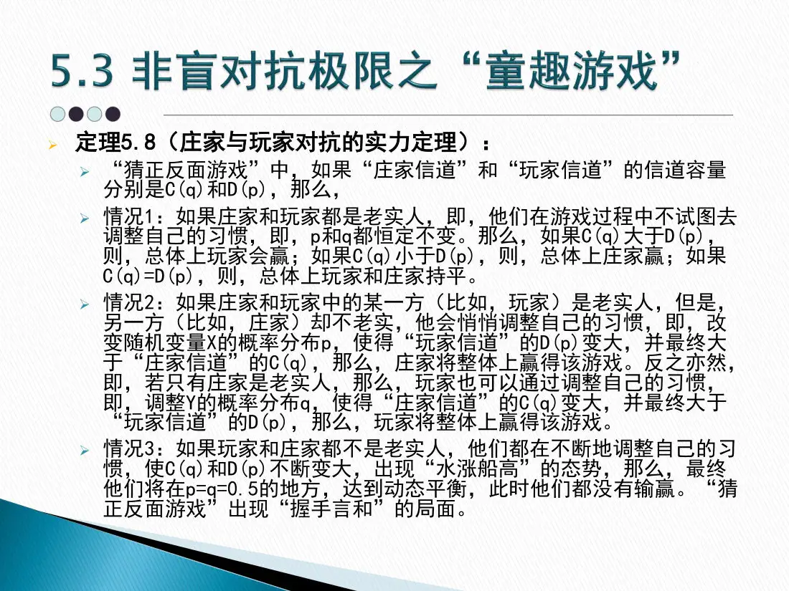

原文：

5.3非盲对抗极限之“童趣游戏

定理5.8（庄家与玩家对抗的实力定理）：

“猜正反面游戏”中，如果“庄家信道”和“玩家信道”的信道容量分别是C(q)和D(p)，那么，

情况1：如果庄家和玩家都是老实人，即，他们在游戏过程中不试图去调整自己的习惯，即，p和q都恒定不变。那么，如果C(q)大于D(p)，则，总体上玩家会赢；如果C(q)小于D(p)，则，总体上庄家赢；如果C(q)=D(p)，则，总体上玩家和庄家持平。

情况2：如果庄家和玩家中的某一方（比如，玩家）是老实人，但是，另一方（比如，庄家）却不老实，他会悄悄调整自己的习惯，即，改变随机变量X的概率分布p，使得“玩家信道”的D(p)变大，并最终大于“庄家信道”的C(q)，那么，庄家将整体上赢得该游戏。反之亦然，即，若只有庄家是老实人，那么，玩家也可以通过调整自己的习惯，即，调整Y的概率分布q，使得“庄家信道”的C(q)变大，并最终大于

➢ 情况3：如果玩家和庄家都不是老实人，他们都在不断地调整自己的习惯，使C(q)和D(p)不断变大，出现“水涨船高”的态势，那么，最终他们将在p=q=0.5的地方，达到动态平衡，此时他们都没有输赢。“猜正反面游戏”出现“握手言和”的局面。

### 5.4单挑非盲对抗极限之“劝酒令” “猜拳”

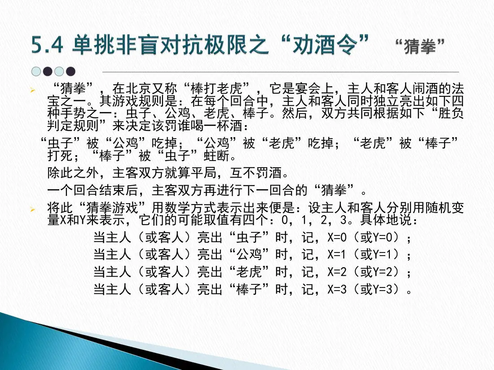

原文：

5.4单挑非盲对抗极限之“劝酒令” “猜拳”

拳” 它是，主 宴会人和 主人和客人闹酒的法宝种 其游戏规则是：在 客人同时独立 亮 出如下 四势 之 虫子、公鸡、老虎、棒子。然后，双方共同根据如下“胜负判定规则”来决定该罚谁喝一杯酒：

“虫子” 被“公鸡”吃掉；“公鸡”被“老虎”吃掉；“老虎”被“棒子”打死； “棒子”被“虫子”蛀断。

除此之外，主客双方就算平局，互不罚酒。

一个回合结束后，主客双方再进行下一回合的“猜拳”。

➢ 将此“猜拳游戏”用数学方式表示出来便是：设主人和客人分别用随机变量X和Y来表示，它们的可能取值有四个：0，1，2，3。具体地说：

当主人（或客人）亮出“虫子”时，记，X=0（或Y=0）；

当主人（或客人）亮出“公鸡”时，记，X=1（或Y=1）；

当主人（或客人）亮出“老虎”时，记，X=2（或Y=2）；

当主人（或客人）亮出“棒子”时，记，X=3（或Y=3）。

### 5.4 单挑非盲对抗极限之“劝酒令” “猜拳”

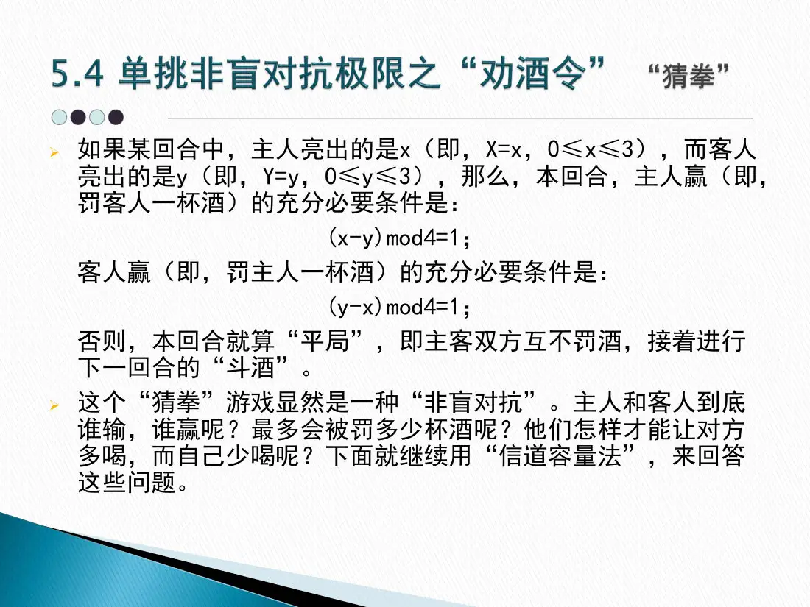

原文：

5.4 单挑非盲对抗极限之“劝酒令” “猜拳”

➢ 如果某回合中，主人亮出的是x（即， $x = x , 0 \leq x \leq 3 )$ 而客人亮出的是y（即，Y=y， $0 \leq y \leq 3 )$ 那么，本回合，主人赢（即，罚客人一杯酒）的充分必要条件是：

$$
(x - y) \bmod 4 = 1;
$$

客人赢（即，罚主人一杯酒）的充分必要条件是：

$$
(y - x) \bmod 4 = 1;
$$

否则，本回合就算“平局”，即主客双方互不罚酒，接着进行下一回合的“斗酒”。

➢ 这个“猜拳”游戏显然是一种“非盲对抗”。主人和客人到底谁输，谁赢呢？最多会被罚多少杯酒呢？他们怎样才能让对方多喝，而自己少喝呢？下面就继续用“信道容量法”，来回答这些问题。

### 5.4单挑非盲对抗极限之“劝酒令”

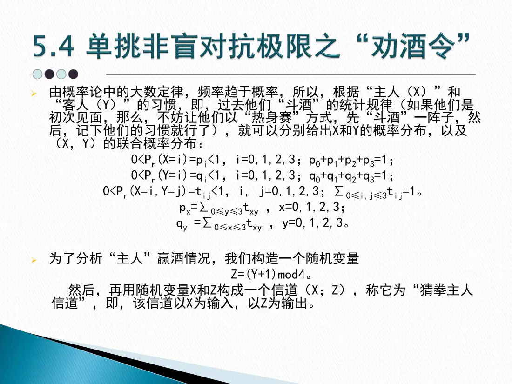

原文：

5.4单挑非盲对抗极限之“劝酒令”

➢ 由概率论中的大数定律，频率趋于概率，所以，根据“主人（X）”和“客人（Y）”的习惯，即，过去他们“斗酒”的统计规律（如果他们是初次见面，那么，不妨让他们以“热身赛”方式，先“斗酒”一阵子，然后，记下他们的习惯就行了），就可以分别给出X和Y的概率分布，以及（X，Y）的联合概率分布：

$$
0 <   P _ {r} (X = i) = p _ {i} <   1, \quad i = 0, 1, 2, 3; \quad p _ {0} + p _ {1} + p _ {2} + p _ {3} = 1;
$$

$$
0 <   P _ {r} (Y = i) = q _ {i} <   1, \quad i = 0, 1, 2, 3; \quad q _ {0} + q _ {1} + q _ {2} + q _ {3} = 1;
$$

$$
0 <   P _ {r} (X = i, Y = j) = t _ {i j} <   1, \quad i, \quad j = 0, 1, 2, 3; \quad \sum_ {0 \leqslant i, j \leqslant 3} t _ {i j} = 1 。
$$

$$
p _ {x} = \sum_ {0 \leqslant y \leqslant 3} t _ {x y}, x = 0, 1, 2, 3;
$$

$$
\mathbf {q} _ {\mathrm{y}} = \sum_ {0 \leqslant x \leqslant 3} t _ {x y}, \quad \mathrm{y} = 0, 1, 2, 3 。
$$

➢ 为了分析“主人”赢酒情况，我们构造一个随机变量

$$
Z = (Y + 1) \bmod 4 。
$$

然后，再用随机变量X和Z构成一个信道（X；Z），称它为“猜拳主人信道”，即，该信道以X为输入，以Z为输出。

### 5.4单挑非盲对抗极限之“劝酒令”

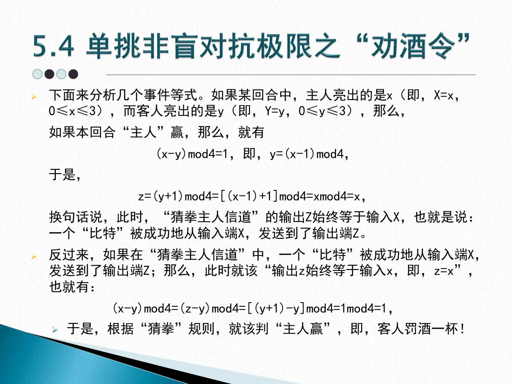

原文：

5.4单挑非盲对抗极限之“劝酒令”

➢ 下面来分析几个事件等式。如果某回合中，主人亮出的是x（即， $x = x$ $0 \leq x \leq 3 )$ ，而客人亮出的是y（即， $\forall = y , 0 \leq y \leq 3 )$ ，那么，

如果本回合“主人”赢，那么，就有

$$
(x - y) \bmod 4 = 1, \text {即,} y = (x - 1) \bmod 4,
$$

于是，

$$
z = (y + 1) \bmod 4 = [ (x - 1) + 1 ] \bmod 4 = x \bmod 4 = x,
$$

换句话说，此时，“猜拳主人信道”的输出Z始终等于输入X，也就是说：一个“比特”被成功地从输入端X，发送到了输出端Z。

➢ 反过来，如果在“猜拳主人信道”中，一个“比特”被成功地从输入端X，发送到了输出端Z；那么，此时就该“输出z始终等于输入x，即， $z = x ^ { y }$ 也就有：

$$
(x - y) \bmod 4 = (z - y) \bmod 4 = [ (y + 1) - y ] \bmod 4 = 1 \bmod 4 = 1,
$$

于是，根据“猜拳”规则，就该判“主人赢”，即，客人罚酒一杯！

### 5.4 单挑非盲对抗极限之“劝酒令”

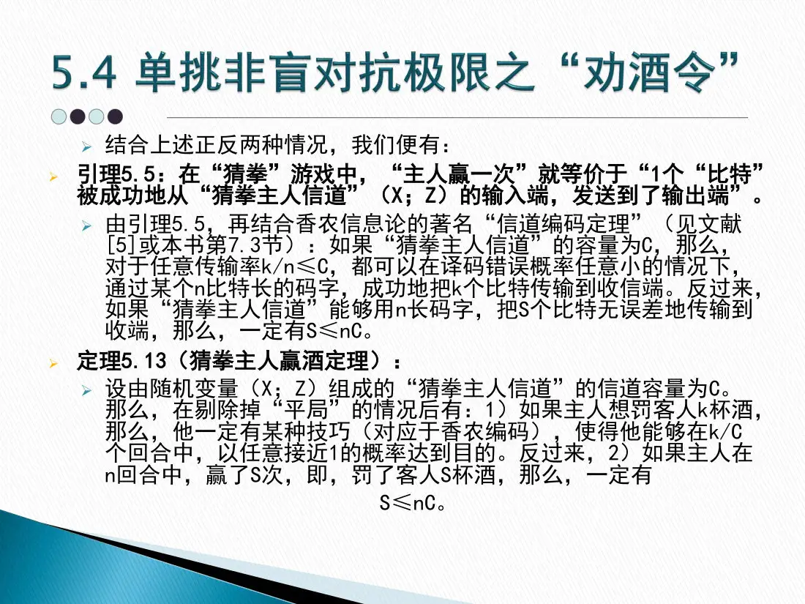

原文：

5.4 单挑非盲对抗极限之“劝酒令”

➢ 结合上述正反两种情况，我们便有：

➢ 引理5.5：在“猜拳”游戏中，“主人赢一次”就等价于“1个“比特”被成功地从“猜拳主人信道”（X；Z）的输入端，发送到了输出端”。

➢ 由引理5.5，再结合香农信息论的著名“信道编码定理”（见文献[5]或本书第7.3节）：如果“猜拳主人信道”的容量为C，那么，对于任意传输率k/n≤C，都可以在译码错误概率任意小的情况下，通过某个n比特长的码字，成功地把k个比特传输到收信端。反过来，如果“猜拳主人信道”能够用n长码字，把S个比特无误差地传输到收端，那么，一定有S≤nC。

➢ 定理5.13（猜拳主人赢酒定理）：

➢ 设由随机变量（X；Z）组成的“猜拳主人信道”的信道容量为C。那么，在剔除掉“平局”的情况后有：1）如果主人想罚客人k杯酒，那么，他一定有某种技巧（对应于香农编码），使得他能够在k/C个回合中，以任意接近1的概率达到目的。反过来，2）如果主人在n回合中，赢了S次，即，罚了客人S杯酒，那么，一定有S≤nC。

### 5.5小结与说明

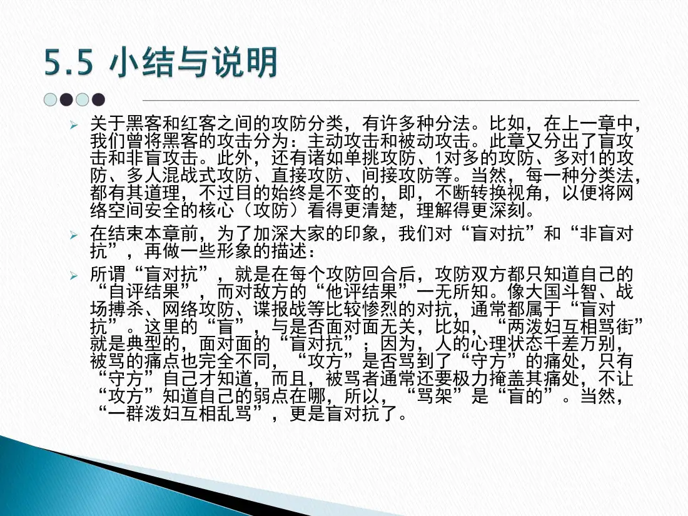

原文：

5.5小结与说明

关于黑客和红客之间的攻防分类，有许多种分法。比如，在上一章中，我们曾将黑客的攻击分为：主动攻击和被动攻击。此章又分出了盲攻击和非盲攻击。此外，还有诸如单挑攻防、1对多的攻防、多对1的攻防、多人混战式攻防、直接攻防、间接攻防等。当然，每一种分类法，都有其道理，不过目的始终是不变的，即，不断转换视角，以便将网络空间安全的核心（攻防）看得更清楚，理解得更深刻。

在结束本章前，为了加深大家的印象，我们对“盲对抗”和“非盲对抗”，再做一些形象的描述：

➢ 所谓“盲对抗”，就是在每个攻防回合后，攻防双方都只知道自己的“自评结果” ，而对敌方的“他评结果”一无所知。像大国斗智、战场搏杀、网络攻防、谍报战等比较惨烈的对抗，通常都属于“盲对抗”。这里的“盲”，与是否面对面无关，比如，“两泼妇互相骂就是典型的，面对面的“盲对抗”；因为，人的心理状态千差万别， 骂“守 有让“攻方”知道自己的弱点在哪，所以， “骂架”是“盲的”。当然，群泼妇互相乱骂”，更是盲对抗了。

### 5.5 单挑非盲对抗极限之“劝酒令”线性可分“非盲对抗”

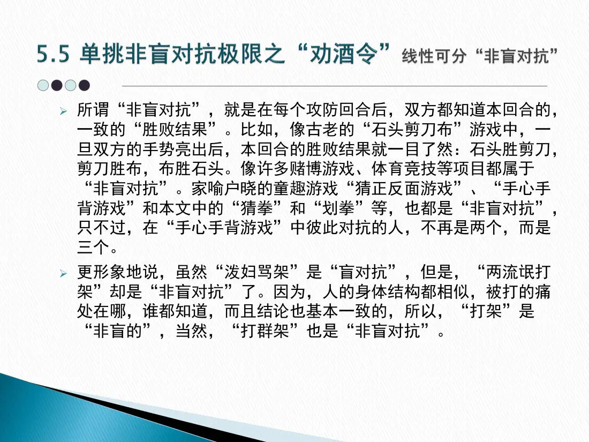

原文：

5.5 单挑非盲对抗极限之“劝酒令”线性可分“非盲对抗”

所谓“非盲对抗”，就是在每个攻防回合后，双方都知道本回合的，一致的“胜败结果”。比如，像古老的“石头剪刀布”游戏中，一旦双方的手势亮出后，本回合的胜败结果就一目了然：石头胜剪刀，剪刀胜布，布胜石头。像许多赌博游戏、体育竞技等项目都属于“非盲对抗”。家喻户晓的童趣游戏“猜正反面游戏”、“手心手背游戏”和本文中的“猜拳”和“划拳”等，也都是“非盲对抗”只不过，在“手心手背游戏”中彼此对抗的人，不再是两个，而是三个。

更形象地说，虽然“泼妇骂架”是“盲对抗”，但是，“两流氓打架”却是“非盲对抗”了。因为，人的身体结构都相似，被打的痛处在哪，谁都知道，而且结论也基本一致的，所以，“打架”是“非盲的”，当然，“打群架”也是“非盲对抗”。

### 5.5 单挑非盲对抗极限之“劝酒令”线性可分“非盲对抗”

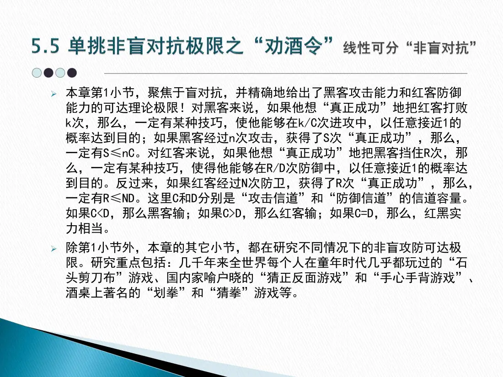

原文：

5.5 单挑非盲对抗极限之“劝酒令”线性可分“非盲对抗”

➢ 本章第1小节，聚焦于盲对抗，并精确地给出了黑客攻击能力和红客防御能力的可达理论极限！对黑客来说，如果他想“真正成功”地把红客打败k次，那么，一定有某种技巧，使他能够在k/C次进攻中，以任意接近1的概率达到目的；如果黑客经过n次攻击，获得了S次“真正成功”，那么，一定有S≤nC。对红客来说，如果他想“真正成功”地把黑客挡住R次，那么，一定有某种技巧，使得他能够在R/D次防御中，以任意接近1的概率达到目的。反过来，如果红客经过N次防卫，获得了R次“真正成功”，那么，一定有R≤ND。这里C和D分别是“攻击信道”和“防御信道”的信道容量。如果C<D，那么黑客输；如果C>D，那么红客输；如果C=D，那么，红黑实力相当。

除第1小节外，本章的其它小节，都在研究不同情况下的非盲攻防可达极限。研究重点包括：几千年来全世界每个人在童年时代几乎都玩过的“石头剪刀布”游戏、国内家喻户晓的“猜正反面游戏”和“手心手背游戏”酒桌上著名的“划拳”和“猜拳”游戏等。

### 5.5 单挑非盲对抗极限之“劝酒令”线性可分“非盲对抗”

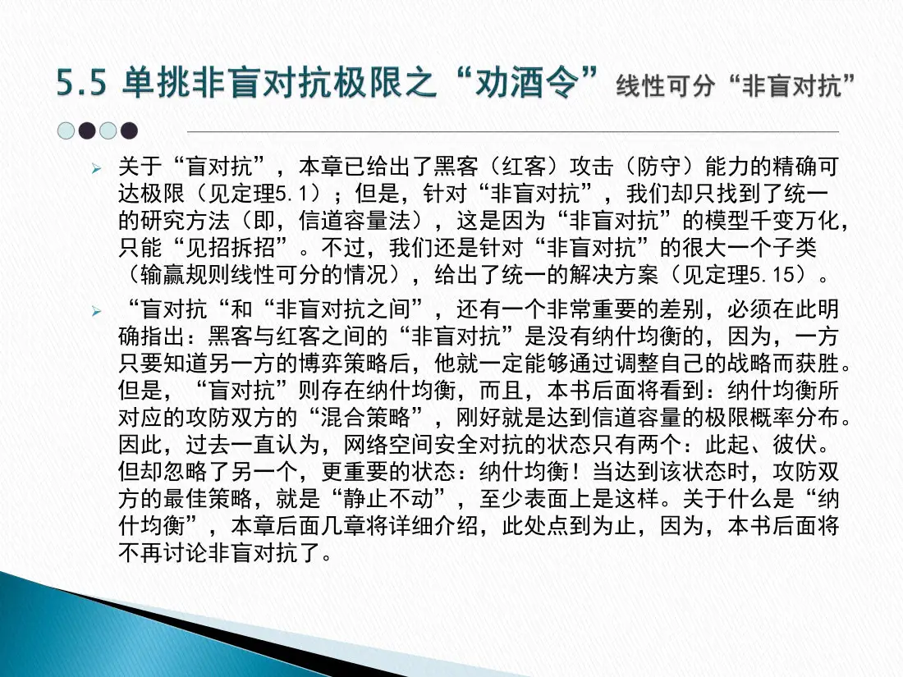

原文：

5.5 单挑非盲对抗极限之“劝酒令”线性可分“非盲对抗”

关于“盲对抗”，本章已给出了黑客（红客）攻击（防守）能力的精确可达极限（见定理5.1）；但是，针对“非盲对抗”，我们却只找到了统一的研究方法（即，信道容量法），这是因为“非盲对抗”的模型千变万化，只能“见招拆招”。不过，我们还是针对“非盲对抗”的很大一个子类（输赢规则线性可分的情况），给出了统一的解决方案（见定理5.15）。

“盲对抗“和“非盲对抗之间”，还有一个非常重要的差别，必须在此明确指出：黑客与红客之间的“非盲对抗”是没有纳什均衡的，因为，一方只要知道另一方的博弈策略后，他就一定能够通过调整自己的战略而获胜。但是，“盲对抗”则存在纳什均衡，而且，本书后面将看到：纳什均衡所对应的攻防双方的“混合策略”，刚好就是达到信道容量的极限概率分布。因此，过去一直认为，网络空间安全对抗的状态只有两个：此起、彼伏。但却忽略了另一个，更重要的状态：纳什均衡！当达到该状态时，攻防双方的最佳策略，就是“静止不动”，至少表面上是这样。关于什么是“纳什均衡”，本章后面几章将详细介绍，此处点到为止，因为，本书后面将不再讨论非盲对抗了。

### 本章结束，谢谢

原文：

本章结束，谢谢
