# 《安全通论》第6章 红客与黑客的多方对抗极限（课件）

原件的每一页，下面附识别出的文字。

### 第6章---红客与黑客的多方对抗极限

原文：

第6章---红客与黑客的多方对抗极限

### 第6章红客与黑客的多方对抗极限

原文：

第6章红客与黑客的多方对抗极限

在上一章中，为了简捷计算，我们做了两个假定：1）红客与黑客是1对1的单挑；2）红客是红客，黑客是黑客，彼此界线十分明确。

但是，在网络空间安全对抗的实际场景中，上述假定都有待突破。比如，

①多攻1的情形：几乎任何一个重要的网络系统，随时都在遭受众多黑客的攻击，而且，这些黑客彼此之间可能根本就不认识，甚至不知道相互的存在。

②1攻多的情形：每一个重要的信息系统，它一定有多个备份；假若黑客只是将该系统和其部分备份攻破了，但没能全部攻破所有备份，那么，就不能算黑客赢。

在网络空间安全的实战中，其实攻与防是一体的，既没有纯粹的黑客，同时也没有纯粹的红客。

### 第6章红客与黑客的多方对抗极限

原文：

第6章红客与黑客的多方对抗极限

1. 多攻一可达极限
2. 一攻多可达极限
3. 攻防一体星状网的可达极限
4. 攻防一体榕树网的可达极限
5. 攻防一体麻将网的可达极限
6. 小结与答疑

### 6.1 多攻一可达极限

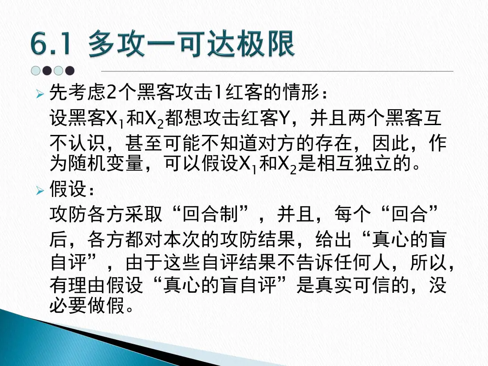

原文：

6.1 多攻一可达极限

➢先考虑2个黑客攻击1红客的情形：

设黑客 $x _ { 1 }$ 和 $X _ { 2 }$ 都想攻击红客Y，并且两个黑客互不认识，甚至可能不知道对方的存在，因此，作为随机变量，可以假设 $X _ { 1 }$ 和 $X _ { 2 }$ 是相互独立的。

假设：

攻防各方采取“回合制”，并且，每个“回合”后，各方都对本次的攻防结果，给出“真心的盲自评”，由于这些自评结果不告诉任何人，所以，有理由假设“真心的盲自评”是真实可信的，没必要做假。

### 6.1多攻一可达极限

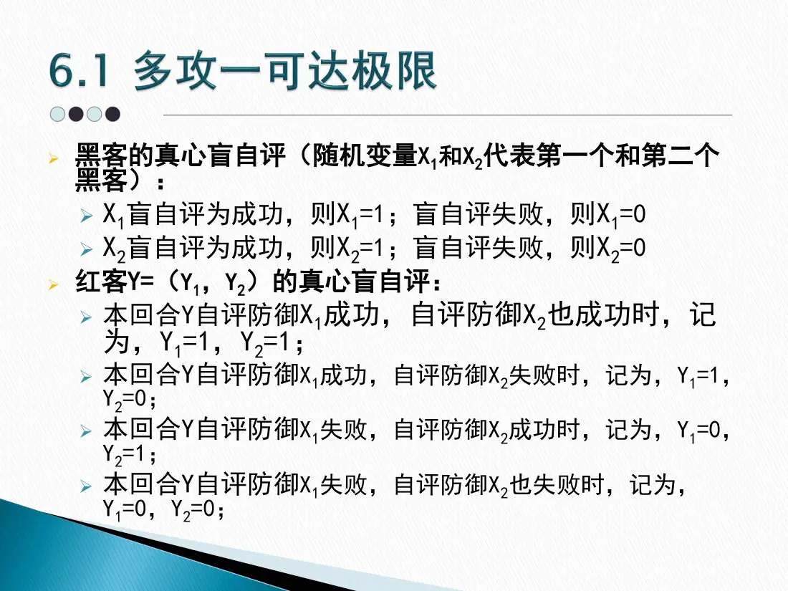

原文：

6.1多攻一可达极限

➢ 黑客的真心盲自评（随机变量 $X _ { 1 }$ 和 $| X _ { 2 }$ 代表第一个和第二个黑客）：

➢ $X _ { 1 }$ 盲自评为成功，则 $x _ { 1 } = 1$ ；盲自评失败，则 $x _ { 1 } = 0$

$X _ { 2 }$ 盲自评为成功，则 $x _ { 2 } = 1$ ；盲自评失败，则 $x _ { 2 } = 0$

红客Y= $( Y _ { 1 } , Y _ { 2 } )$ 的真心盲自评：

➢ 本回合Y自评防御 $X _ { 1 }$ 成功，自评防御 $X _ { 2 }$ 也成功时，记为， $\gamma _ { 1 } = 1$ $Y _ { 2 } = 1$ ；

➢ 本回合Y自评防御 $X _ { 1 }$ 成功，自评防御 $X _ { 2 }$ 失败时，记为， $\mathsf { Y } _ { 1 } = 1$ $r _ { 2 } = 0$ ；

本回合Y自评防御 $X _ { 1 }$ 失败，自评防御 $X _ { 2 }$ 成功时，记为， $\dot { Y } _ { 1 } = 0$ $\mathsf { Y } _ { 2 } = 1$

➢ 本回合Y自评防御 $X _ { 1 }$ 失败，自评防御 $X _ { 2 }$ 也失败时，记为，$\cdot = 0 , \cdot = 0$

### 6.1多攻一可达极限

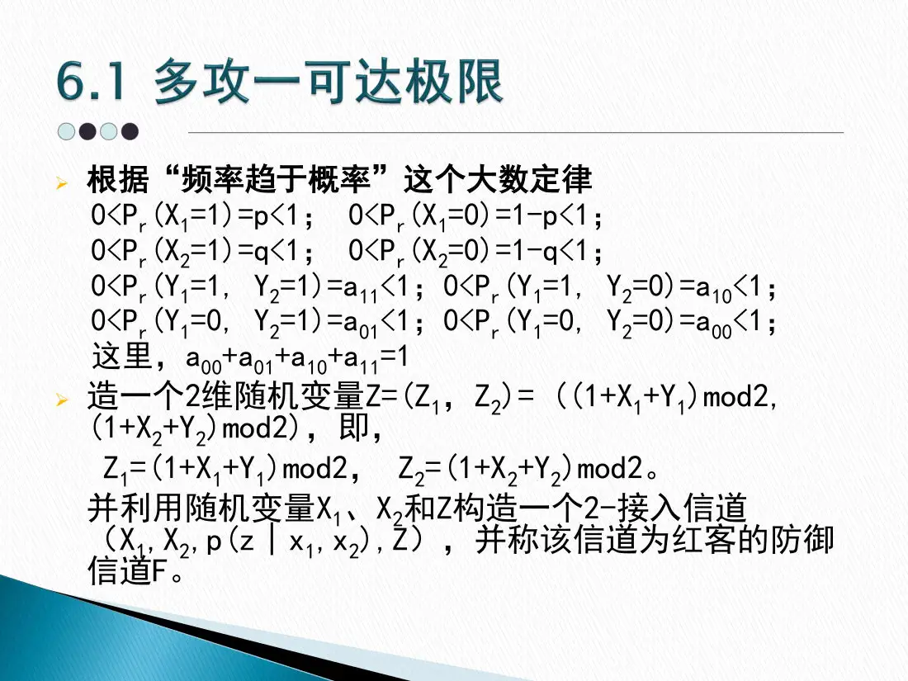

原文：

6.1多攻一可达极限

➢ 根据“频率趋于概率”这个大数定律

$0 < P _ { r } ( x _ { 1 } = 1 ) = 0 < 1 ; 0 < P _ { r } ( x _ { 1 } = 0 ) = 1 - p < 1 ;$ $O C P _ { r } ( x _ { 2 } = 1 ) = a < 1 ; O C P _ { r } ( x _ { 2 } = 0 ) = 1 - a < 1$ $0 < \mathsf { P } _ { r } ( \mathsf { Y } _ { 1 } = 1 , \mathsf { Y } _ { 2 } = 1 ) = \mathsf { a } _ { 1 1 } < 1 \ ; \mathsf { 0 } < \mathsf { P } _ { r } ( \mathsf { Y } _ { 1 } = 1 , \mathsf { Y } _ { 2 } = 0 ) = \mathsf { a } _ { 1 0 } < 1$ $0 < \mathsf { P } _ { r } ( \mathsf { Y } _ { 1 } = 0 , \mathsf { Y } _ { 2 } = 1 ) = \mathsf { a } _ { 0 1 } < 1 \ ; \ : \ : 0 < \mathsf { P } _ { r } ( \mathsf { Y } _ { 1 } = 0 , \mathsf { Y } _ { 2 } = 0 ) = \mathsf { a } _ { 0 0 } < 1 \ ;$ 这里， $a _ { 0 0 } + a _ { 0 1 } + a _ { 1 0 } + a _ { 1 1 } = 1$

➢ 造一个2维随机变量 $Z = ( Z _ { 1 } , Z _ { 2 } ) = ( ( 1 + X _ { 1 } + Y _ { 1 } ) \bmod 2 ,$ $( 1 + x _ { 2 } + y _ { 2 } ) m 0 0 2 )$ ，即，$z _ { 1 } = ( 1 + x _ { 1 } + Y _ { 1 } ) _ { 1 } = 0 . 2 = ( 1 + x _ { 2 } + Y _ { 2 } ) _ { } \bmod 2 .$

并利用随机变量 $x _ { 1 } , x _ { 2 }$ 和Z构造一个2-接入信道$( \mathsf { X } _ { 1 } , \mathsf { X } _ { 2 } , \mathsf { p } ( \mathsf { z } | \mathsf { x } _ { 1 } , \mathsf { x } _ { 2 } ) , \mathsf { \bar { Z } } )$ 并称该信道为红客的防御信道F。

### 6.1多攻一可达极限

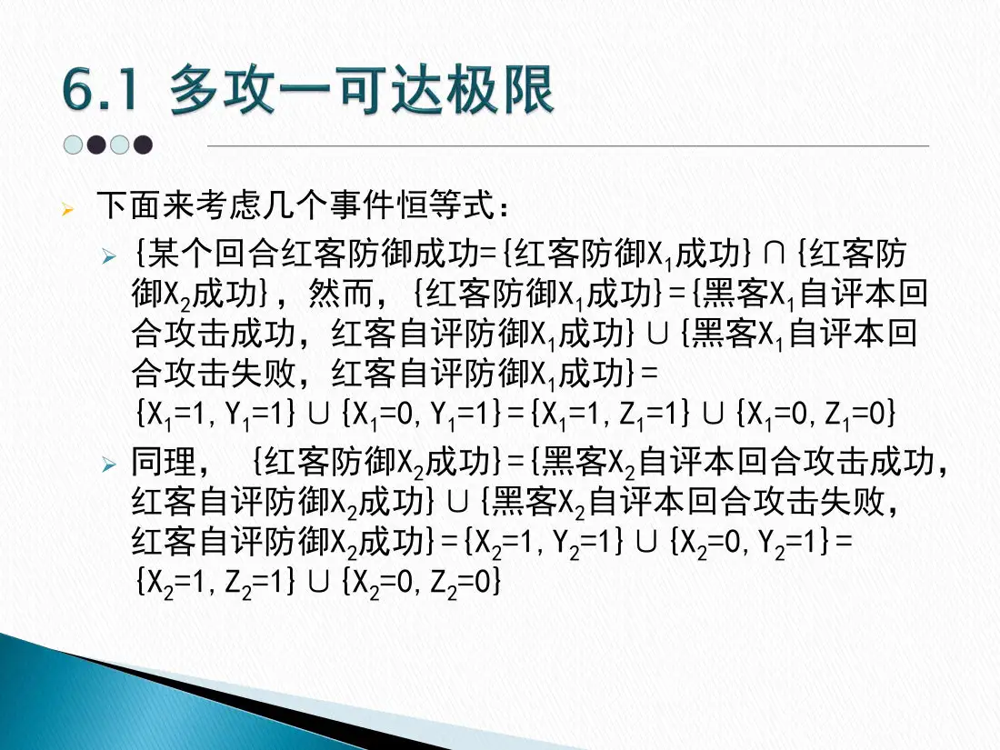

原文：

6.1多攻一可达极限

➢ 下面来考虑几个事件恒等式：

➢ {某个回合红客防御成功={红客防御 $X _ { 1 }$ 成功}∩{红客防 御 $X _ { 2 }$ 成功}，然而，{红客防御 $X _ { 1 }$ 成功}={黑客 $X _ { 1 }$ 自评本回 合攻击成功，红客自评防御 $X _ { 1 }$ 成功} $\cup$ {黑客 $x _ { 1 }$ 自评本回 合攻击失败，红客自评防御 $X _ { 1 }$ 成功}= $\{ x _ { 1 } = 1 , Y _ { 1 } = 1 \} \cup \{ x _ { 1 } = 0 , Y _ { 1 } = 1 \} = \{ x _ { 1 } = 1 , Z _ { 1 } = 1 \} \cup \{ x _ { 1 } = 0 , Z _ { 1 } = 0 \}$

➢ 同理， {红客防御 $X _ { 2 }$ 成功}={黑客 $X _ { 2 }$ 自评本回合攻击成功，红客自评防御 $X _ { 2 }$ 成功} $\cup$ {黑客 $X _ { 2 }$ 自评本回合攻击失败，红客自评防御 $X _ { 2 }$ 成功 $y = \{ x _ { 2 } = 1 , y _ { 2 } = 1 \} \cup \{ x _ { 2 } = 0 , y _ { 2 } = 1 \} =$ $\{ x _ { 2 } = 1 , Z _ { 2 } = 1 \} \cup \{ x _ { 2 } = 0 , Z _ { 2 } = 0 \}$

### 6.1多攻一可达极限

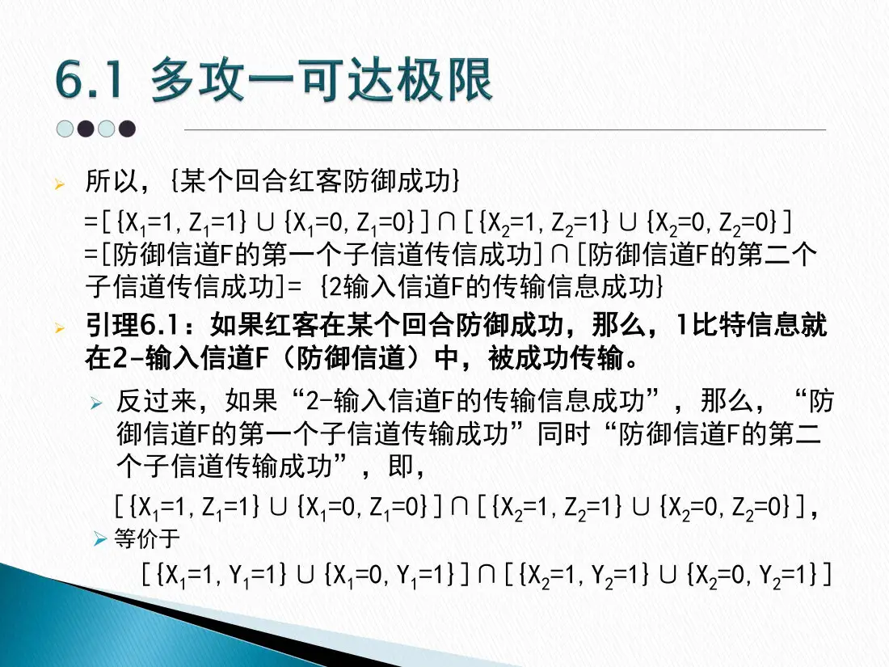

原文：

6.1多攻一可达极限

➢ 所以，{某个回合红客防御成功}

$= [ \{ X _ { 1 } = 1 , Z _ { 1 } = 1 \} \cup \{ X _ { 1 } = 0 , Z _ { 1 } = 0 \} ] \cap [ \{ X _ { 2 } = 1 , Z _ { 2 } = 1 \} \cup \{ X _ { 2 } = 0 , Z _ { 2 } = 0 \} ]$ =[防御信道F的第一个子信道传信成功]∩[防御信道F的第二个子信道传信成功]= {2输入信道F的传输信息成功}

引理6.1：如果红客在某个回合防御成功，那么，1比特信息就在2-输入信道F（防御信道）中，被成功传输。

➢ 反过来，如果“2-输入信道F的传输信息成功”，那么，“防御信道F的第一个子信道传输成功”同时“防御信道F的第二个子信道传输成功”，即，

$$
[ \{X _ {1} = 1, Z _ {1} = 1 \} \cup \{X _ {1} = 0, Z _ {1} = 0 \} ] \cap [ \{X _ {2} = 1, Z _ {2} = 1 \} \cup \{X _ {2} = 0, Z _ {2} = 0 \} ],
$$

➢ 等价于

$$
[ \{X _ {1} = 1, Y _ {1} = 1 \} \cup \{X _ {1} = 0, Y _ {1} = 1 \} ] \cap [ \{X _ {2} = 1, Y _ {2} = 1 \} \cup \{X _ {2} = 0, Y _ {2} = 1 \} ]
$$

### 6.1多攻一可达极限

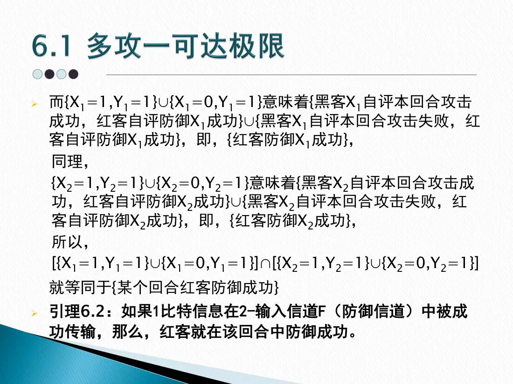

原文：

6.1多攻一可达极限

➢ 而 $\{ { \mathsf X } _ { 1 } = { \mathsf I } , { \mathsf Y } _ { 1 } = { \mathsf I } \} { \mathsf U } \{ { \mathsf X } _ { 1 } = { \mathsf { 0 } } , { \mathsf Y } _ { 1 } = { \mathsf I }$ }意味着{黑客 $X _ { 1 }$ 自评本回合攻击成功，红客自评防御 $X _ { 1 }$ 成功}∪{黑客 $x _ { 1 }$ 自评本回合攻击失败，红客自评防御 $X _ { 1 }$ 成功}，即，{红客防御 $X _ { 1 }$ 成功}，同理，$\{ { \mathsf X } _ { 2 } = { \mathsf I } , { \mathsf Y } _ { 2 } = { \mathsf I } \} { \mathsf U } \{ { \mathsf X } _ { 2 } = { \mathsf { 0 } } , { \mathsf Y } _ { 2 } = { \mathsf I }$ }意味着{黑客 $x _ { 2 }$ 自评本回合攻击成功，红客自评防御 $x _ { 2 }$ 成功}∪{黑客 $x _ { 2 }$ 自评本回合攻击失败，红客自评防御 $X _ { 2 }$ 成功}，即，{红客防御 $X _ { 2 }$ 成功}，所以，$[ \{ \mathsf X _ { 1 } = 1 , \mathsf Y _ { 1 } = 1 \} \cup \{ \mathsf X _ { 1 } = 0 , \mathsf Y _ { 1 } = 1 \} ] \cap [ \{ \mathsf X _ { 2 } = 1 , \mathsf Y _ { 2 } = 1 \} \cup \{ \mathsf X _ { 2 } = 0 , \mathsf Y _ { 2 } = 1 \} ]$ 就等同于{某个回合红客防御成功}

引理6.2：如果1比特信息在2-输入信道F（防御信道）中被成功传输，那么，红客就在该回合中防御成功。

### 6.1多攻一可达极限

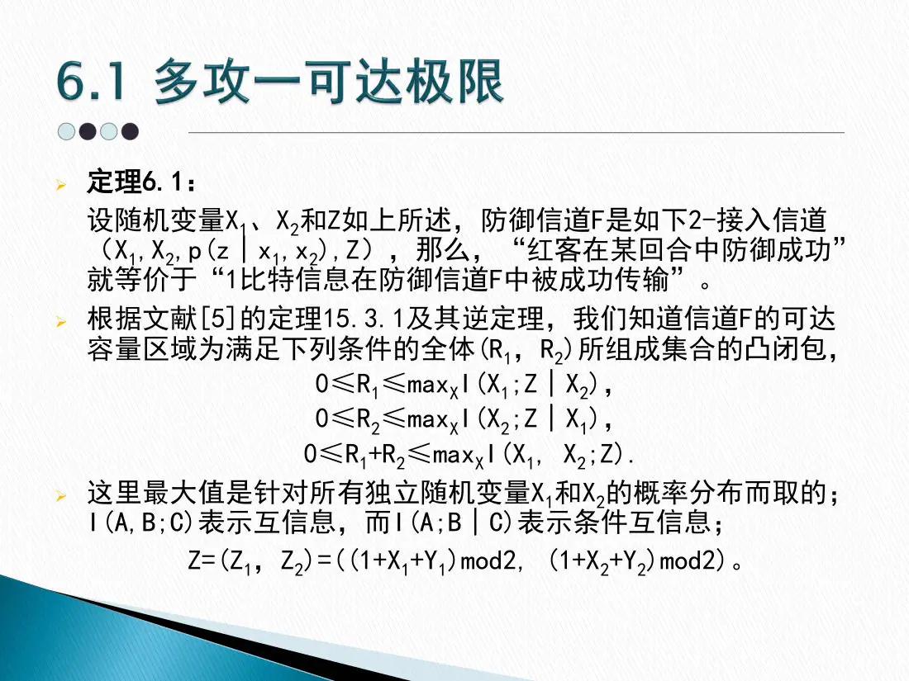

原文：

6.1多攻一可达极限

定理6.1：

设随机变量 $x _ { 1 } , x _ { 2 }$ 和Z如上所述，防御信道F是如下2-接入信道$( x _ { 1 } , x _ { 2 } , 0 ( z \vert x _ { 1 } , x _ { 2 } ) , z )$ 那么， “红客在某回合中防御成功”就等价于“1比特信息在防御信道F中被成功传输”。

➢ 根据文献[5]的定理15.3.1及其逆定理，我们知道信道F的可达容量区域为满足下列条件的全体 $( R _ { 1 } , R _ { 2 } )$ 所组成集合的凸闭包，

$$
\begin{array}{l} 0 \leqslant R _ {1} \leqslant \max _ {X} I (X _ {1}; Z | X _ {2}), \\ 0 \leqslant R _ {2} \leqslant \max _ {X} I (X _ {2}; Z | X _ {1}), \\ 0 \leqslant R _ {1} + R _ {2} \leqslant \max _ {X} I (X _ {1}, X _ {2}; Z). \end{array}
$$

➢ 这里最大值是针对所有独立随机变量 $X _ { 1 }$ 和 $X _ { 2 }$ 的概率分布而取的；I(A,B;C)表示互信息，而 $( A ; B \mid 0 )$ 表示条件互信息；

$$
Z = \left(Z _ {1}, Z _ {2}\right) = \left(\left(1 + X _ {1} + Y _ {1}\right) \bmod 2, \left(1 + X _ {2} + Y _ {2}\right) \bmod 2\right) 。
$$

### 6.1多攻一可达极限

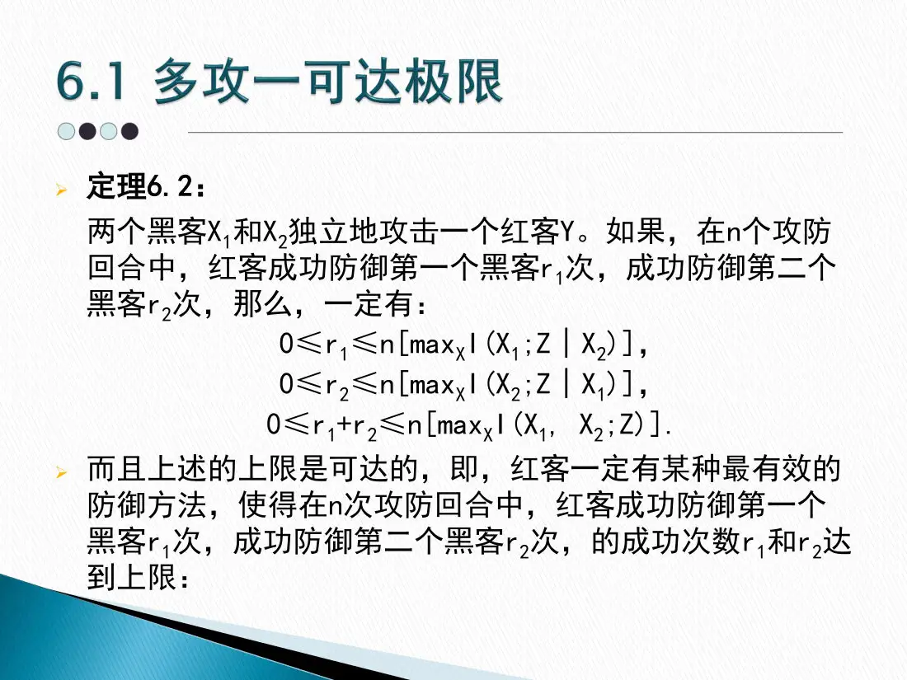

原文：

6.1多攻一可达极限

定理6.2：

两个黑客 $X _ { 1 }$ 和 $X _ { 2 }$ 独立地攻击一个红客Y。如果，在n个攻防回合中，红客成功防御第一个黑客 $r _ { 1 }$ 次，成功防御第二个黑客 $r _ { 2 }$ 次，那么，一定有：

$$
\begin{array}{l} 0 \leqslant r _ {1} \leqslant n [ \max _ {X} I (X _ {1}; Z | X _ {2}) ], \\ 0 \leqslant r _ {2} \leqslant n [ \max _ {X} I (X _ {2}; Z | X _ {1}) ], \\ 0 \leqslant r _ {1} + r _ {2} \leqslant n [ \max _ {X} I (X _ {1}, X _ {2}; Z) ]. \end{array}
$$

➢ 而且上述的上限是可达的，即，红客一定有某种最有效的防御方法，使得在n次攻防回合中，红客成功防御第一个黑客 $\boldsymbol { \mathsf { r } } _ { 1 }$ 次，成功防御第二个黑客 $r _ { 2 }$ 次，的成功次数 $r _ { 1 }$ 和 $r _ { 2 }$ 达到上限：

### 6.1多攻一可达极限

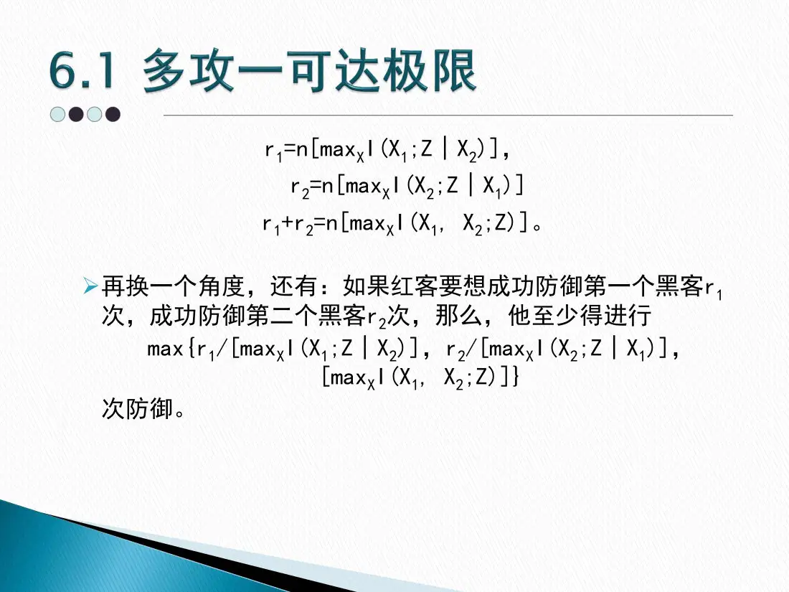

原文：

6.1多攻一可达极限

$$
r _ {1} = n \left[ \max _ {X} I \left(X _ {1}; Z \mid X _ {2}\right) \right],
$$

$$
r _ {2} = n \left[ \max _ {X} I \left(X _ {2}; Z \mid X _ {1}\right) \right]
$$

$$
r _ {1} + r _ {2} = n \left[ \max _ {X} I \left(X _ {1}, X _ {2}; Z\right) \right] 。
$$

➢再换一个角度，还有：如果红客要想成功防御第一个黑客 $r _ { 1 }$ 次，成功防御第二个黑客 $r _ { 2 }$ 次，那么，他至少得进行

$$
\begin{array}{c} \max \left\{r _ {1} / \left[ \max _ {X} I (X _ {1}; Z | X _ {2}) \right], r _ {2} / \left[ \max _ {X} I (X _ {2}; Z | X _ {1}) \right], \right. \\ \left. \left[ \max _ {X} I (X _ {1}, X _ {2}; Z) \right] \right\} \end{array}
$$

次防御。

### 6.1多攻一可达极限

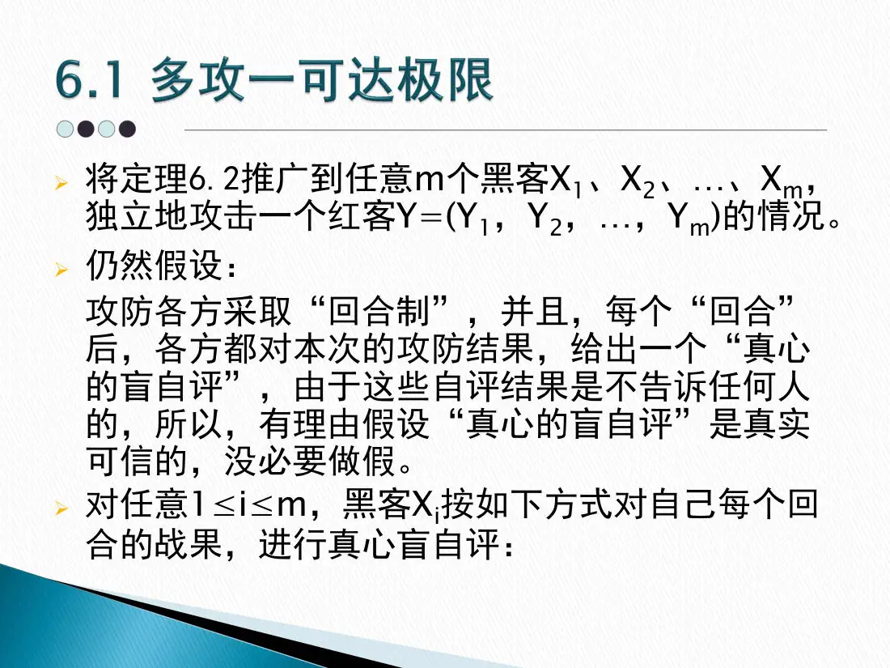

原文：

6.1多攻一可达极限

➢ 将定理6.2推广到任意m个黑客 $x _ { 1 } , x _ { 2 } , \ldots x _ { m } ,$ 独立地攻击一个红客 $\pmb { \gamma } { = } ( \pmb { \gamma } _ { 1 } , \ \pmb { \gamma } _ { 2 } , \ \ldots , \ \pmb { \gamma } _ { m } )$ 的情况。

仍然假设：

攻防各方采取“回合制”，并且，每个“回合”后，各方都对本次的攻防结果，给出一个“真心的盲自评”，由于这些自评结果是不告诉任何人的，所以，有理由假设“真心的盲自评”是真实可信的，没必要做假。

对任意1≤i≤m，黑客X按如下方式对自己每个回合的战果，进行真心盲自评：

### 6.1 多攻一可达极限

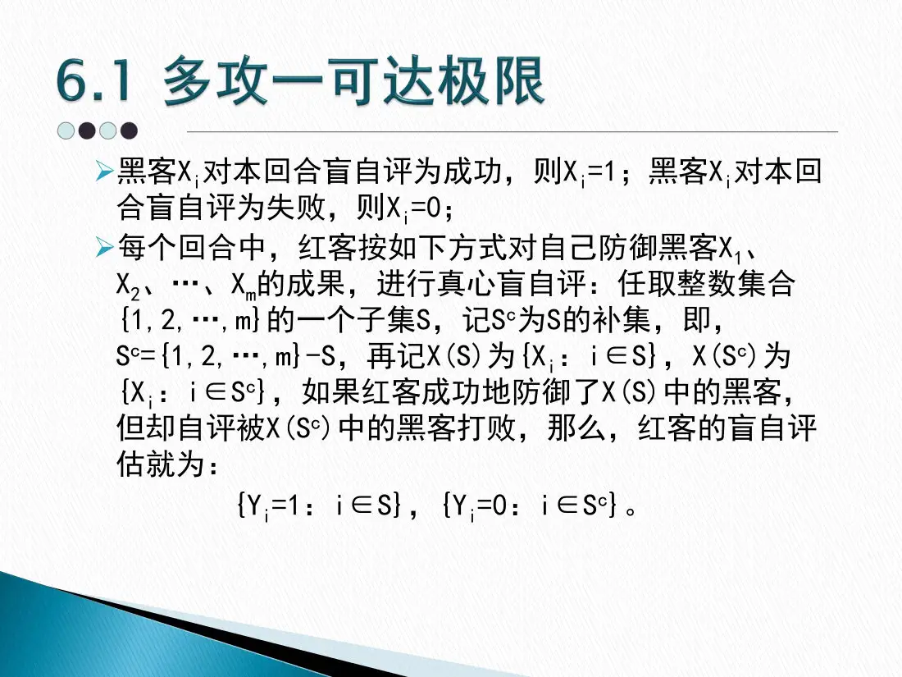

原文：

6.1 多攻一可达极限

➢黑客X 对本回合盲自评为成功，则 $x _ { i } = 1$ ；黑客 $X _ { i }$ 对本回合盲自评为失败，则 $x _ { i } = 0$ ；

每个回合中，红客按如下方式对自己防御黑客 $X _ { 1 }$ $x _ { 2 } 、 \cdots x _ { m }$ 的成果，进行真心盲自评：任取整数集合$\lbrace 1 , 2 , \cdots , \ m \rbrace$ 的一个子集S，记 $S ^ { \circ }$ 为S的补集，即，$S ^ { \mathrm { c } } = \{ 1 , 2 , \cdots , m \} - S$ 再记X(S)为 $\{ x _ { \mathrm { i } } : \ \mathrm { i } \in \mathsf { S } \} \ , \ x \left( \mathsf { S } ^ { \mathrm { c } } \right)$ 为$\{ X _ { i } : i \in S ^ { \mathsf { c } } \}$ ，如果红客成功地防御了X(S)中的黑客，但却自评被 $X ( S ^ { c } )$ 中的黑客打败，那么，红客的盲自评估就为：

$$
\left\{Y _ {i} = 1: i \in S \right\}, \quad \left\{Y _ {i} = 0: i \in S ^ {c} \right\} 。
$$

### 6.1多攻一可达极限

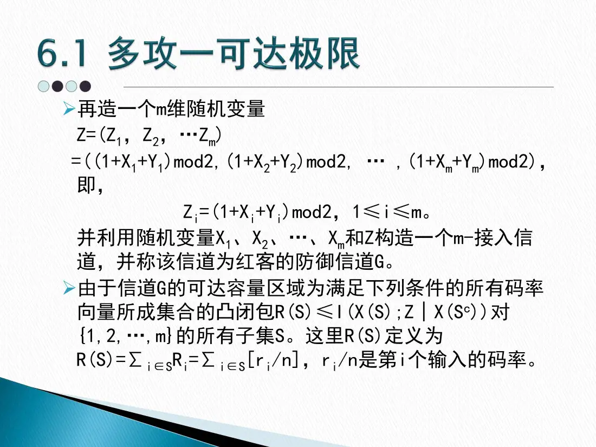

原文：

6.1多攻一可达极限

再造一个m维随机变量

$$
\begin{array}{l} Z = \left(Z _ {1}, Z _ {2}, \dots Z _ {m}\right) \\ = \left(\left(1 + X _ {1} + Y _ {1}\right) \bmod 2, \left(1 + X _ {2} + Y _ {2}\right) \bmod 2, \dots , \left(1 + X _ {m} + Y _ {m}\right) \bmod 2\right), \\ \text {即，} \end{array}
$$

$$
Z _ {i} = (1 + X _ {i} + Y _ {i}) \bmod 2, \quad 1 \leqslant i \leqslant m 。
$$

并利用随机变量 $x _ { 1 } 、 x _ { 2 } 、 \cdots x _ { m }$ 和Z构造一个m-接入信道，并称该信道为红客的防御信道G。

由于信道G的可达容量区域为满足下列条件的所有码率向量所成集合的凸闭包R $( { \mathbb S } ) \leqslant \mid ( { \mathbb X } \left( { \mathbb S } \right) ; { \mathbb Z } \mid { \mathbb X } \left( { \mathbb S } ^ { \mathsf { c } } \right)$ )对{1,2,…,m}的所有子集S。这里R(S)定义为$R ( s ) = \sum \limits _ { i \in s } R _ { i } = \sum \limits _ { i \in s } [ r _ { i } / n ] , r _ { i } / n$ 是第i个输入的码率。

### 6.1多攻一可达极限

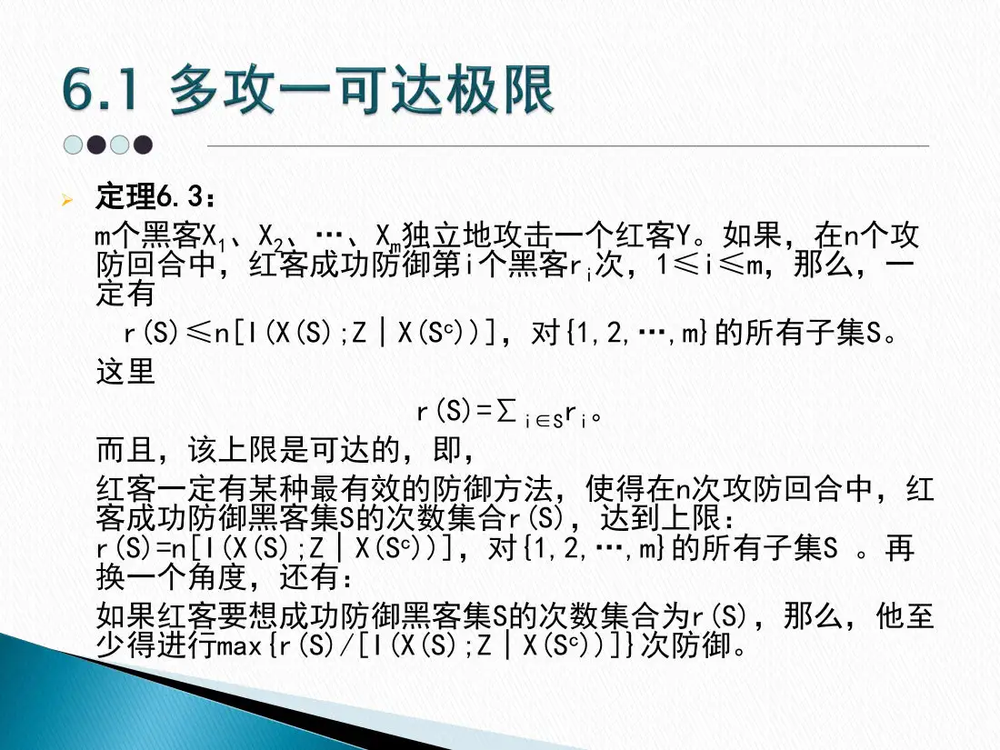

原文：

6.1多攻一可达极限

定理6.3：

m个黑客 $x _ { 1 } 、 x _ { 2 } 、 \cdots x _ { m }$ 独立地攻击一个红客Y。如果，在n个攻防回合中，红客成功防御第i个黑客 $r _ { i }$ 次， $1 \leq i \leq m$ ，那么，一定有

$r ~ ( { \mathsf { S } } ) \leqslant n \left[ { \mathsf { I } } ~ ( \mathsf { X } ( { \mathsf { S } } ) ~ ; \mathsf { Z } ~ \vert ~ \mathsf { X } ( { \mathsf { S } } ^ { \mathsf { c } } ) ) ~ \right]$ ，对{1,2,…,m}的所有子集S。这里

$$
r (S) = \sum_ {i \in S} r _ {i} 。
$$

而且，该上限是可达的，即，

红客一定有某种最有效的防御方法，使得在n次攻防回合中，红客成功防御黑客集S的次数集合r(S)，达到上限：$r ( S ) = n [ 1 ( X ( S ) ; Z ) \times ( S ^ { c } ) ]$ ]，对{1,2,…,m}的所有子集S 。再换一个角度，还有：

如果红客要想成功防御黑客集S的次数集合为r(S)，那么，他至少得进行max{r(S)/[I(X(S);Z│X(Sc))]}次防御。

### 6.2一攻多可达极限

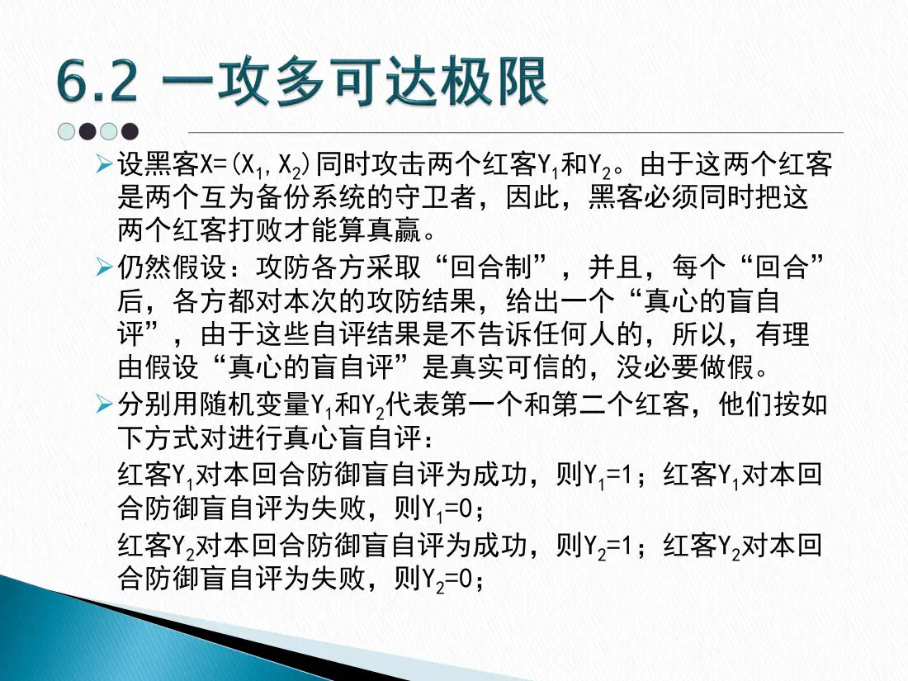

原文：

6.2一攻多可达极限

➢设黑客 $. x = ( x _ { 1 } , x _ { 2 } )$ 同时攻击两个红客 $\mathsfit { Y } _ { 1 }$ 和 $Y _ { 2 }$ 。由于这两个红客是两个互为备份系统的守卫者，因此，黑客必须同时把这两个红客打败才能算真赢。

仍然假设：攻防各方采取“回合制”，并且，每个“回合”后，各方都对本次的攻防结果，给出一个“真心的盲自评”，由于这些自评结果是不告诉任何人的，所以，有理由假设“真心的盲自评”是真实可信的，没必要做假。

➢分别用随机变量 ${ \sf Y } _ { 1 }$ 和 $\mathsf { Y } _ { 2 }$ 代表第一个和第二个红客，他们按如下方式对进行真心盲自评：

红客 $Y _ { 1 }$ 对本回合防御盲自评为成功，则 $\mathsf { Y } _ { 1 } = 1$ ；红客 $Y _ { 1 }$ 对本回合防御盲自评为失败，则 $\dot { Y } _ { 1 } = 0$ ；

红客 $\mathsf { Y } _ { 2 }$ 对本回合防御盲自评为成功，则 $Y _ { 2 } = 1$ ；红客 $Y _ { 2 }$ 对本回合防御盲自评为失败，则 $r _ { 2 } = 0$ ；

### 6.2一攻多可达极限

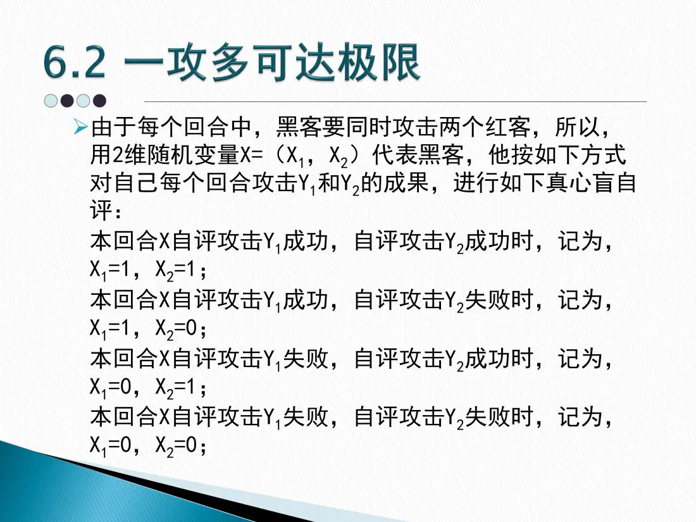

原文：

6.2一攻多可达极限

➢由于每个回合中，黑客要同时攻击两个红客，所以，用2维随机变量 $x = ( x _ { 1 } , x _ { 2 } )$ 代表黑客，他按如下方式对自己每个回合攻击 $\mathsf { Y } _ { 1 }$ 和 $Y _ { 2 }$ 的成果，进行如下真心盲自评：本回合X自评攻击 $\mathsf { Y } _ { 1 }$ 成功，自评攻击 $Y _ { 2 }$ 成功时，记为，$x _ { 1 } = 1 , x _ { 2 } = 1$ ；本回合X自评攻击 $\mathsf { Y } _ { 1 }$ 成功，自评攻击 $Y _ { 2 }$ 失败时，记为，$x _ { 1 } = 1 , x _ { 2 } = 0$ ；本回合X自评攻击 $\mathsf { Y } _ { 1 }$ 失败，自评攻击 $Y _ { 2 }$ 成功时，记为，$x _ { 1 } = 0 , x _ { 2 } = 1$ ；本回合X自评攻击 $\mathsf { Y } _ { 1 }$ 失败，自评攻击 $Y _ { 2 }$ 失败时，记为，$x _ { 1 } = 0 , x _ { 2 } = 0$ ；

### 6.2一攻多可达极限

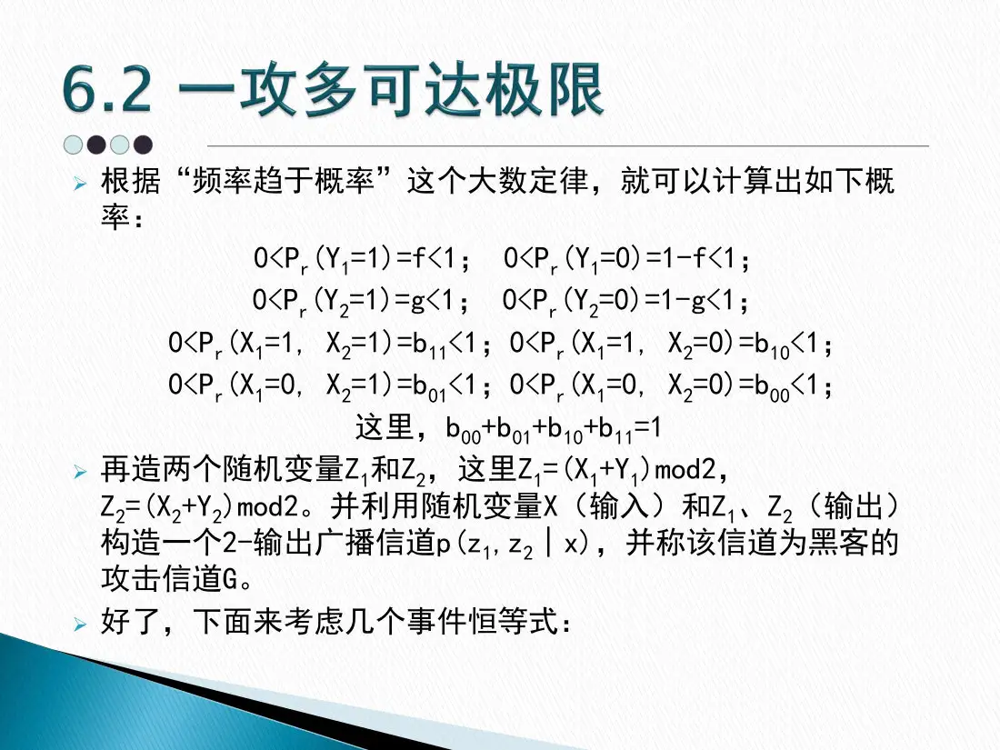

原文：

6.2一攻多可达极限

根据“频率趋于概率”这个大数定律，就可以计算出如下概率：

$$
0 <   P _ {r} \left(Y _ {1} = 1\right) = f <   1; \quad 0 <   P _ {r} \left(Y _ {1} = 0\right) = 1 - f <   1;
$$

$$
0 <   P _ {r} (Y _ {2} = 1) = g <   1; \quad 0 <   P _ {r} (Y _ {2} = 0) = 1 - g <   1;
$$

$$
0 <   P _ {r} \left(X _ {1} = 1, X _ {2} = 1\right) = b _ {1 1} <   1; 0 <   P _ {r} \left(X _ {1} = 1, X _ {2} = 0\right) = b _ {1 0} <   1;
$$

$$
0 <   P _ {r} \left(X _ {1} = 0, X _ {2} = 1\right) = b _ {0 1} <   1; 0 <   P _ {r} \left(X _ {1} = 0, X _ {2} = 0\right) = b _ {0 0} <   1;
$$

$$
\text {这里，} b _ {0 0} + b _ {0 1} + b _ {1 0} + b _ {1 1} = 1
$$

再造两个随机变量 $Z _ { 1 }$ 和 $Z _ { 2 }$ ，这里 $Z _ { 1 } = ( X _ { 1 } + Y _ { 1 } ) _ { \max }$ $Z _ { 2 } = ( X _ { 2 } + Y _ { 2 } ) _ { \mathrm { m o d } 2 }$ 。并利用随机变量X（输入）和 $z _ { 1 } 、 z _ { 2 }$ （输出）构造一个2-输出广播信道p $( z _ { 1 } , z _ { 2 } \mid \times )$ 并称该信道为黑客的攻击信道G。

➢ 好了，下面来考虑几个事件恒等式：

### 6.2一攻多可达极限

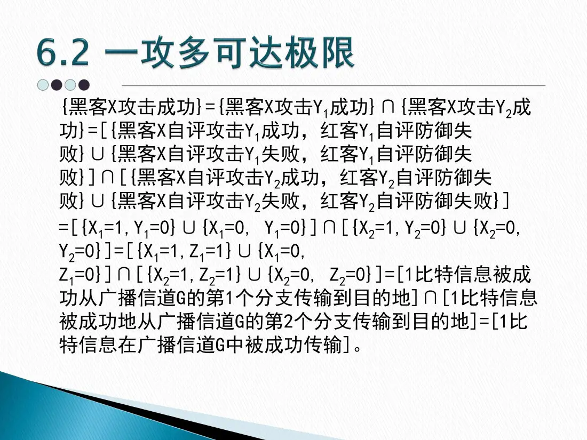

原文：

6.2一攻多可达极限

{黑客X攻击成功}={黑客X攻击 $Y _ { 1 }$ 成功}∩{黑客X攻击 $Y _ { 2 }$ 成功}=[{黑客X自评攻击 $Y _ { 1 }$ 成功，红客 ${ \sf Y } _ { 1 }$ 自评防御失败}∪{黑客X自评攻击 $Y _ { 1 }$ 失败，红客 $Y _ { 1 }$ 自评防御失败}]∩[{黑客X自评攻击 $Y _ { 2 }$ 成功，红客 $Y _ { 2 }$ 自评防御失败} $\cup$ {黑客X自评攻击 $Y _ { 2 }$ 失败，红客 $Y _ { 2 }$ 自评防御失败}]$= [ \{ X _ { 1 } = 1 , Y _ { 1 } = 0 \} \cup \{ X _ { 1 } = 0 , Y _ { 1 } = 0 \} ] \cap [ \{ X _ { 2 } = 1 , Y _ { 2 } = 0 \} \cup \{ X _ { 2 } = 0 ,$ $y _ { 2 } = 0 1 ] = [ \{ x _ { 1 } = 1 , Z _ { 1 } = 1 \} \cup \{ x _ { 1 } = 0$ $z _ { 1 } = 0 1 ] \cap [ \{ x _ { 2 } = 1 , z _ { 2 } = 1 \} \cup \{ x _ { 2 } = 0 , z _ { 2 } = 0 \} ] = [ 1 , 1 ] \cup [ x _ { 2 } = 0 , z _ { 2 } = 0 \} ] = 0 .$ 比特信息被成功从 $\dot { \Gamma }$ 播信道G的第1个分支传输到目的地]∩[1比特信息被成功地从广播信道G的第2个分支传输到目的地]=[1比特信息在广播信道G中被成功传输]。

### 6.2一攻多可达极限

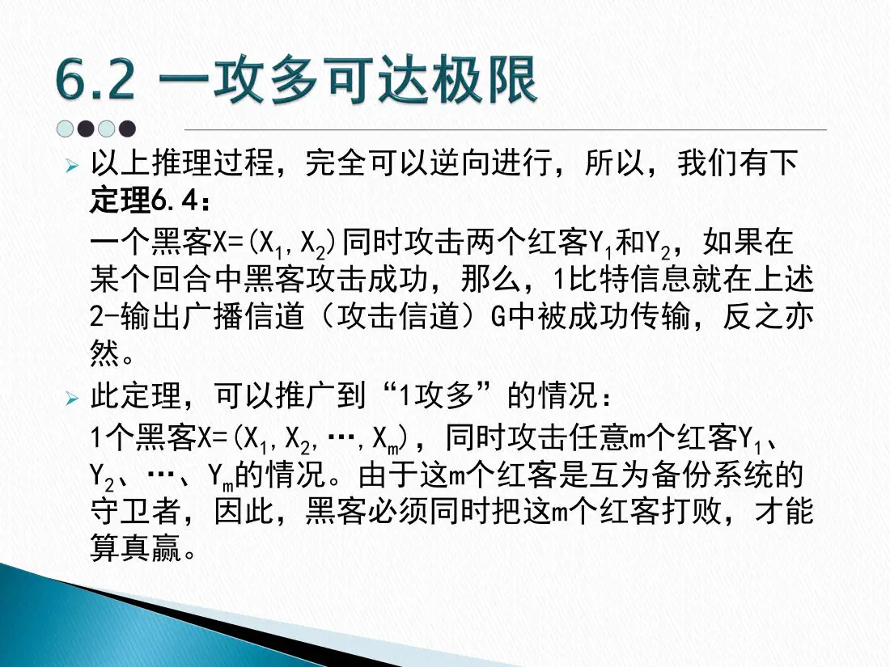

原文：

6.2一攻多可达极限

➢ 以上推理过程，完全可以逆向进行，所以，我们有下定理6.4：

一个黑客 $x = ( x _ { 1 } , x _ { 2 } )$ 同时攻击两个红客 $\mathsf { Y } _ { 1 }$ 和 $Y _ { 2 }$ ，如果在某个回合中黑客攻击成功，那么，1比特信息就在上述2-输出广播信道（攻击信道）G中被成功传输，反之亦然。

➢ 此定理，可以推广到“1攻多”的情况：

1个黑客 $x = ( x _ { 1 } , x _ { 2 } , \ldots , x _ { m } )$ 同时攻击任意m个红客 $\Upsilon _ { 1 } ,$ $Y _ { 2 } , \cdots , Y _ { m }$ 的情况。由于这m个红客是互为备份系统的守卫者，因此，黑客必须同时把这m个红客打败，才能算真赢。

### 6.2一攻多可达极限

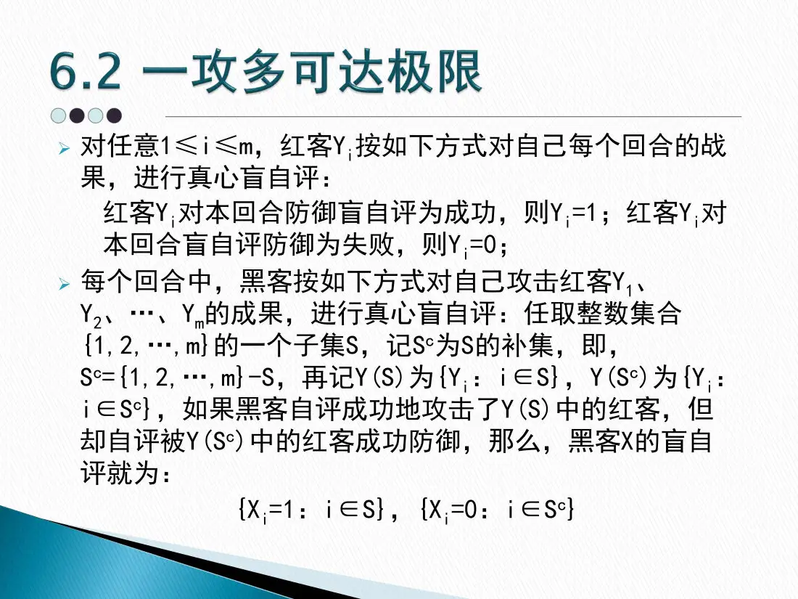

原文：

6.2一攻多可达极限

➢ 对任意 $1 \leq i \leq m$ 红客Y 按如下方式对自己每个回合的战果，进行真心盲自评：

红客 $Y _ { i }$ 对本回合防御盲自评为成功，则 $Y _ { i } = 1$ ；红客Y 对本回合盲自评防御为失败，则 $\dot { Y } _ { \mathrm { i } } = 0$ ；

➢ 每个回合中，黑客按如下方式对自己攻击红客 $\mathsf { Y } _ { 1 }$ $Y _ { 2 } , \cdots , Y _ { m }$ 的成果，进行真心盲自评：任取整数集合$\{ 1 , 2 , \cdots , m \}$ 的一个子集S，记Sc为S的补集，即，$S ^ { \mathrm { c } } = \{ 1 , 2 , \cdots , m \} - S$ 再记Y(S)为 $\{ Y _ { i } : \ i \in \ S \} , \forall ( S ^ { c } )$ 为 $\{ Y _ { i }$ $i \in S ^ { \circ } \}$ 如果黑客自评成功地攻击了Y(S)中的红客，但却自评被Y(Sc)中的红客成功防御，那么，黑客X的盲自评就为：

$$
\{X _ {i} = 1: i \in S \}, \{X _ {i} = 0: i \in S ^ {c} \}
$$

### 6.2一攻多可达极限

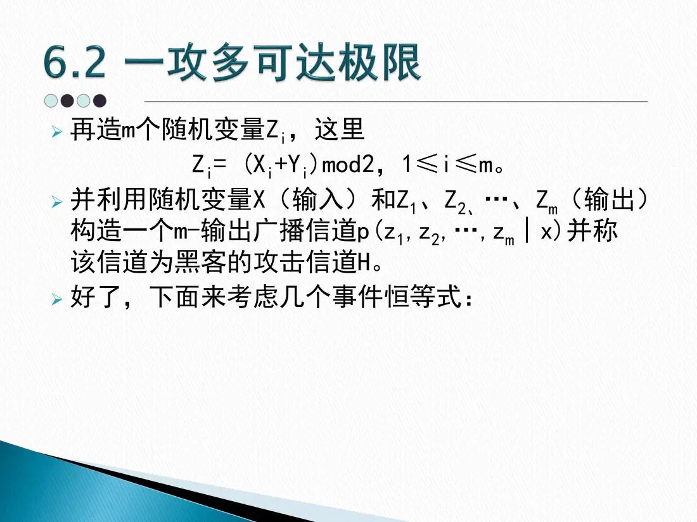

原文：

6.2一攻多可达极限

再造m个随机变量 $Z _ { i }$ ，这里

$$
Z _ {i} = \left(X _ {i} + Y _ {i}\right) \bmod 2, 1 \leqslant i \leqslant m 。
$$

➢ 并利用随机变量X（输入）和 $Z _ { 1 } 、 Z _ { 2 } 、 \cdots Z _ { m }$ （输出）构造一个m-输出广播信道p $( z _ { 1 } , z _ { 2 } , \cdots , z _ { m } \times )$ 并称该信道为黑客的攻击信道H。

➢好了，下面来考虑几个事件恒等式：

### 6.2一攻多可达极限

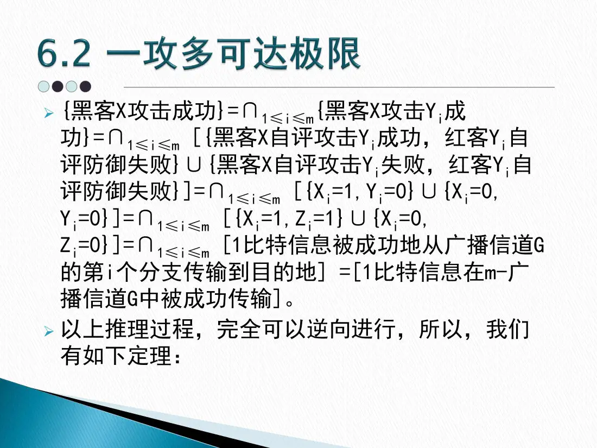

原文：

6.2一攻多可达极限

➢ {黑客X攻击成功} $l = \cap \ubscript { 1 \leq i \leq m }$ {黑客X攻击Y 成功} $b = n _ { 1 } \leq i \leq m$ [{黑客X自评攻击Y 成功，红客Y 自评防御失败}∪{黑客X自评攻击Yi失败，红客Yi自评防御失败} $] = \cap _ { 1 \leqslant \mathsf { i } \leqslant \mathsf { m } } [ \{ \mathsf { X } _ { \mathsf { i } } = 1 , \mathsf { Y } _ { \mathsf { i } } = 0 \} \cup \{ \mathsf { X } _ { \mathsf { i } } = 0$ $v _ { i } = 0 1 7 = \cap _ { 1 \leqslant i \leqslant m } [ \{ x _ { i } = 1 , 2 _ { i } = 1 \} \cup \{ x _ { i } = 0 ,$ $z _ { i } = 0 . 3 7 = n _ { 1 \leq i \leq m }$ [1比特信息被成功地从广播信道G的第i个分支传输到目的地] =[1比特信息在m-广播信道G中被成功传输]。

➢ 以上推理过程，完全可以逆向进行，所以，我们有如下定理：

### 6.2一攻多可达极限

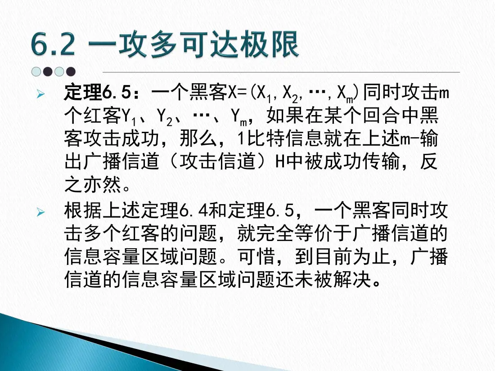

原文：

6.2一攻多可达极限

➢ 定理6.5：一个黑客 $x = ( x _ { 1 } , x _ { 2 } , \ldots , x _ { m } )$ 同时攻击m个红客 $Y _ { 1 } 、 Y _ { 2 } 、 \cdots r _ { m }$ ，如果在某个回合中黑客攻击成功，那么，1比特信息就在上述m-输出广播信道（攻击信道）H中被成功传输，反之亦然。

➢ 根据上述定理6.4和定理6.5，一个黑客同时攻击多个红客的问题，就完全等价于广播信道的信息容量区域问题。可惜，到目前为止，广播信道的信息容量区域问题还未被解决。

### 6.2一攻多可达极限

原文：

6.2一攻多可达极限

两个猜测：

猜测1，中继信道可用于研究黑客的跳板攻击；猜测2，边信息信道可用于研究有内奸攻击。

### 6.3 攻防一体星状网可达极限

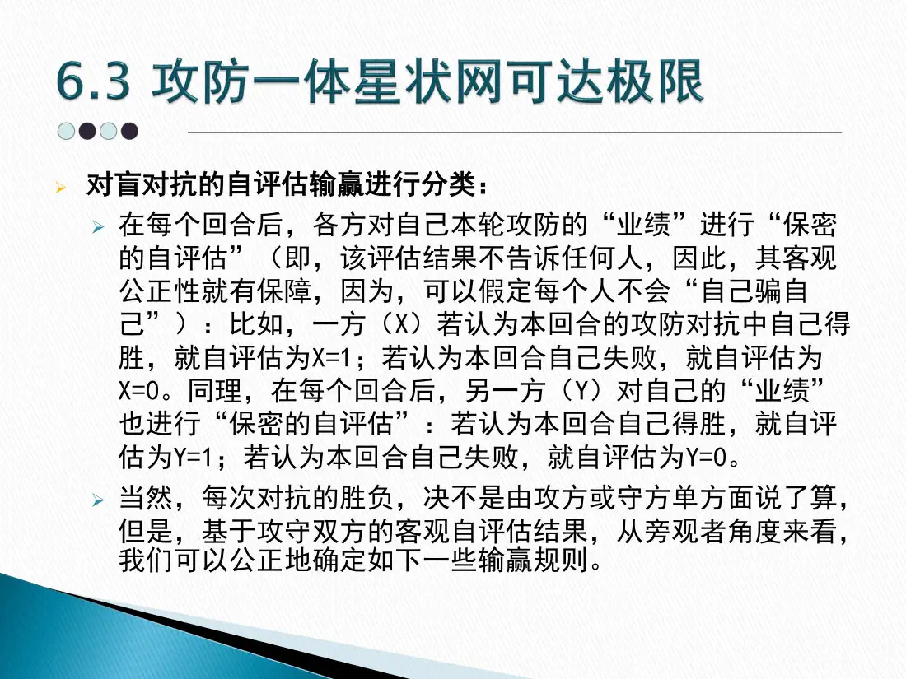

原文：

6.3 攻防一体星状网可达极限

对盲对抗的自评估输赢进行分类：

➢ 在每个回合后，各方对自己本轮攻防的“业绩”进行“保密的自评估”（即，该评估结果不告诉任何人，因此，其客观公正性就有保障，因为，可以假定每个人不会“自己骗自己”）：比如，一方（X）若认为本回合的攻防对抗中自己得胜，就自评估为X=1；若认为本回合自己失败，就自评估为X=0。同理，在每个回合后，另一方（Y）对自己的“业绩”也进行“保密的自评估”：若认为本回合自己得胜，就自评估为Y=1；若认为本回合自己失败，就自评估为Y=0。

当然，每次对抗的胜负，决不是由攻方或守方单方面说了算，但是，基于攻守双方的客观自评估结果，从旁观者角度来看，我们可以公正地确定如下一些输赢规则。

### 6.3 攻防一体星状网可达极限

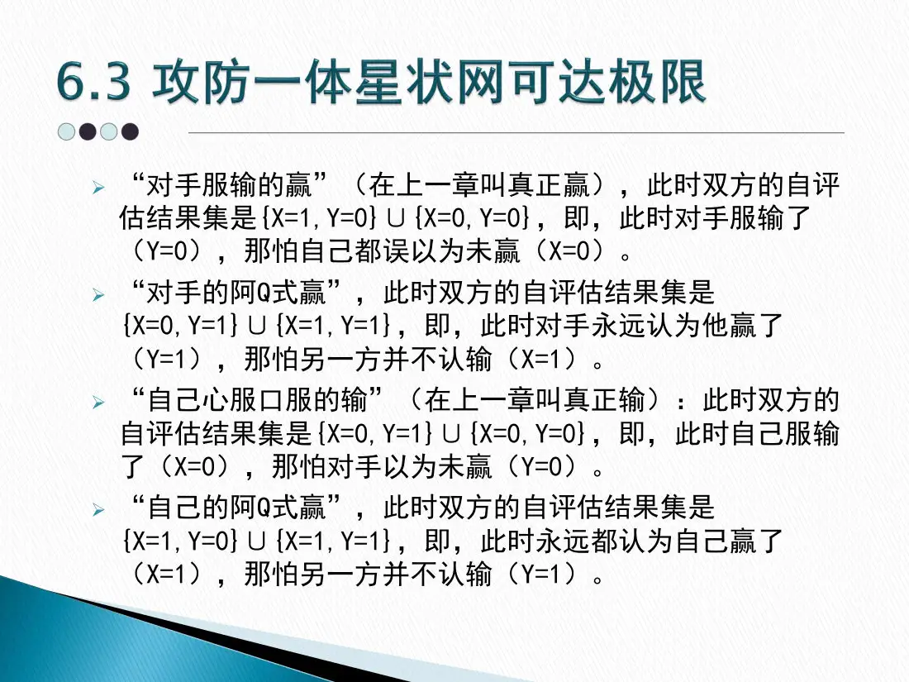

原文：

6.3 攻防一体星状网可达极限

➢ “对手服输的赢” （在上一章叫真正赢），此时双方的自评估结果集是 $\{ x = 1 , Y = 0 \} \cup \{ x = 0 , Y = 0 \}$ 即，此时对手服输了（Y=0），那怕自己都误以为未赢（X=0）。

“对手的阿Q式赢”，此时双方的自评估结果集是{X=0,Y=1}∪{X=1,Y=1}，即，此时对手永远认为他赢了（Y=1），那怕另一方并不认输（X=1）。

➢ “自己心服口服的输”（在上一章叫真正输）：此时双方的自评估结果集是{X=0,Y=1}∪{X=0,Y=0}，即，此时自己服输了（X=0），那怕对手以为未赢（Y=0）。

“自己的阿Q式赢”，此时双方的自评估结果集是{X=1,Y=0}∪{X=1,Y=1}，即，此时永远都认为自己赢了（X=1），那怕另一方并不认输（Y=1）。

### 6.3 攻防一体星状网可达极限

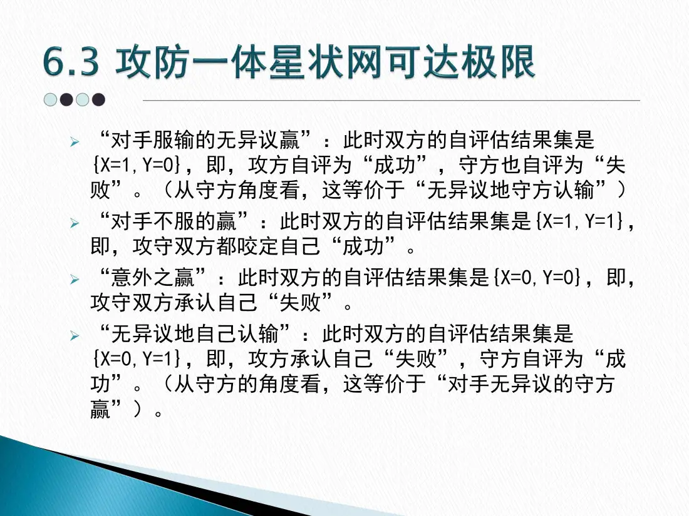

原文：

6.3 攻防一体星状网可达极限

“对手服输的无异议赢”：此时双方的自评估结果集是{X=1,Y=0}，即，攻方自评为“成功”，守方也自评为“失败”。（从守方角度看，这等价于“无异议地守方认输”）

V “对手不服的赢”：此时双方的自评估结果集是{X=1,Y=1}，即，攻守双方都咬定自己“成功”。

➢ “意外之赢”：此时双方的自评估结果集是{X=0,Y=0}，即，攻守双方承认自己“失败”。

“无异议地自己认输”：此时双方的自评估结果集是{X=0,Y=1}，即，攻方承认自己“失败”，守方自评为“成功”。（从守方的角度看，这等价于“对手无异议的守方赢”）。

### 6.3 攻防一体星状网可达极限

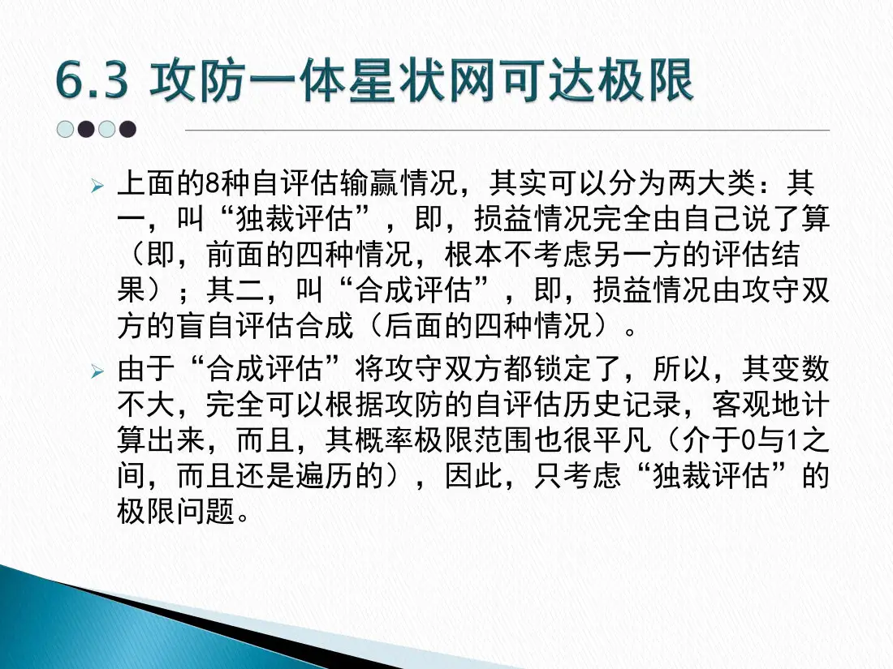

原文：

6.3 攻防一体星状网可达极限

上面的8种自评估输赢情况，其实可以分为两大类：其一，叫“独裁评估”，即，损益情况完全由自己说了算（即，前面的四种情况，根本不考虑另一方的评估结果）；其二，叫“合成评估”，即，损益情况由攻守双方的盲自评估合成（后面的四种情况）。

由于“合成评估”将攻守双方都锁定了，所以，其变数不大，完全可以根据攻防的自评估历史记录，客观地计算出来，而且，其概率极限范围也很平凡（介于0与1之间，而且还是遍历的），因此，只考虑“独裁评估”的极限问题。

### 6.3 攻防一体星状网可达极限

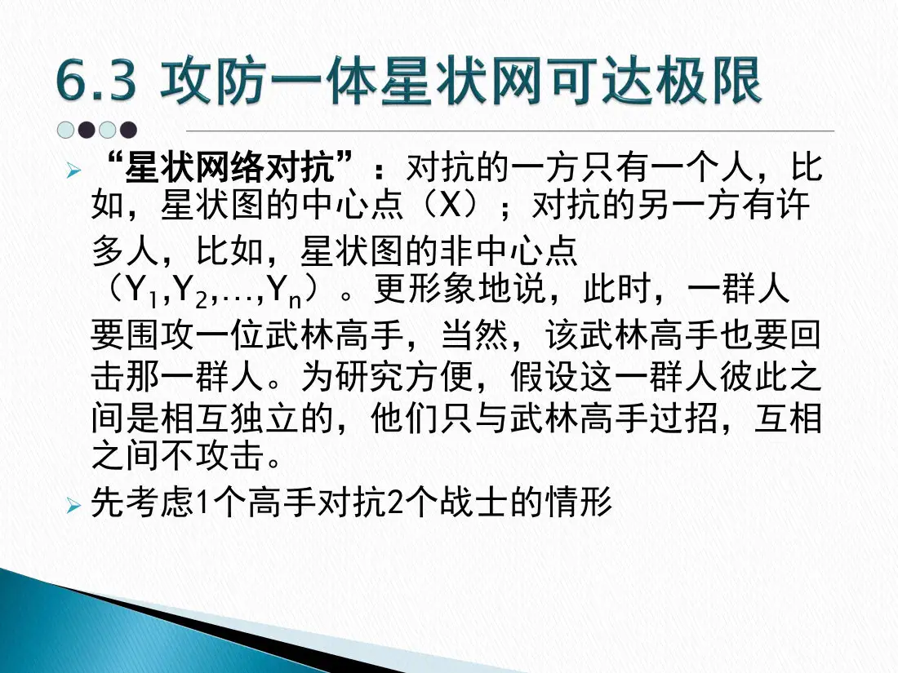

原文：

6.3 攻防一体星状网可达极限

➢ “星状网络对抗”：对抗的一方只有一个人，比如，星状图的中心点（X）；对抗的另一方有许多人，比如，星状图的非中心点

$( Y _ { 1 } , Y _ { 2 } , \ldots , Y _ { n } )$ 。更形象地说，此时，一群人要围攻一位武林高手，当然，该武林高手也要回击那一群人。为研究方便，假设这一群人彼此之间是相互独立的，他们只与武林高手过招，互相之间不攻击。

➢先考虑1个高手对抗2个战士的情形

### 6.3 攻防一体星状网可达极限

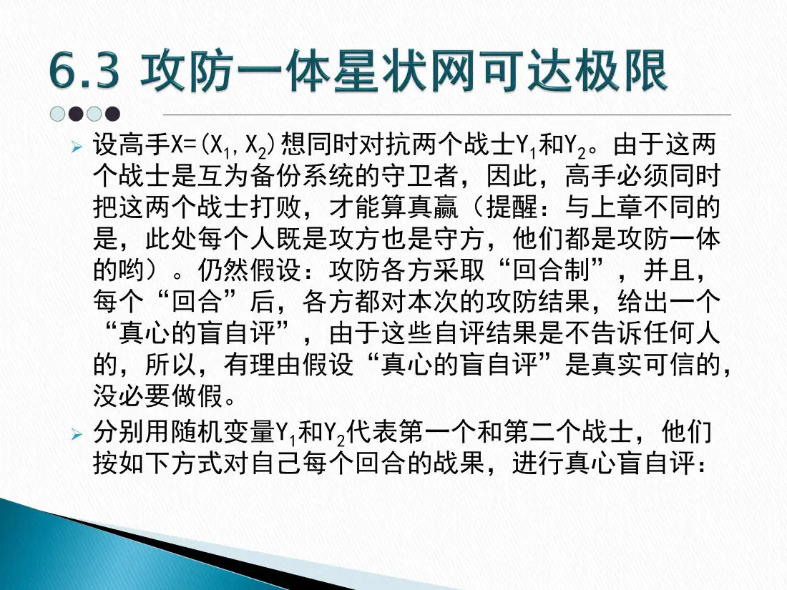

原文：

6.3 攻防一体星状网可达极限

设高手 $x = ( x _ { 1 } , x _ { 2 } )$ 想同时对抗两个战士 $\mathsf { Y } _ { 1 }$ 和 $Y _ { 2 }$ 。由于这两个战士是互为备份系统的守卫者，因此，高手必须同时把这两个战士打败，才能算真赢（提醒：与上章不同的是，此处每个人既是攻方也是守方，他们都是攻防一体的哟）。仍然假设：攻防各方采取“回合制”，并且，每个“回合”后，各方都对本次的攻防结果，给出一个“真心的盲自评”，由于这些自评结果是不告诉任何人的，所以，有理由假设“真心的盲自评”是真实可信的，没必要做假。

➢ 分别用随机变量 $\mathsf { Y } _ { 1 }$ 和 $Y _ { 2 }$ 代表第一个和第二个战士，他们按如下方式对自己每个回合的战果，进行真心盲自评：

### 6.3攻防一体星状网可达极限

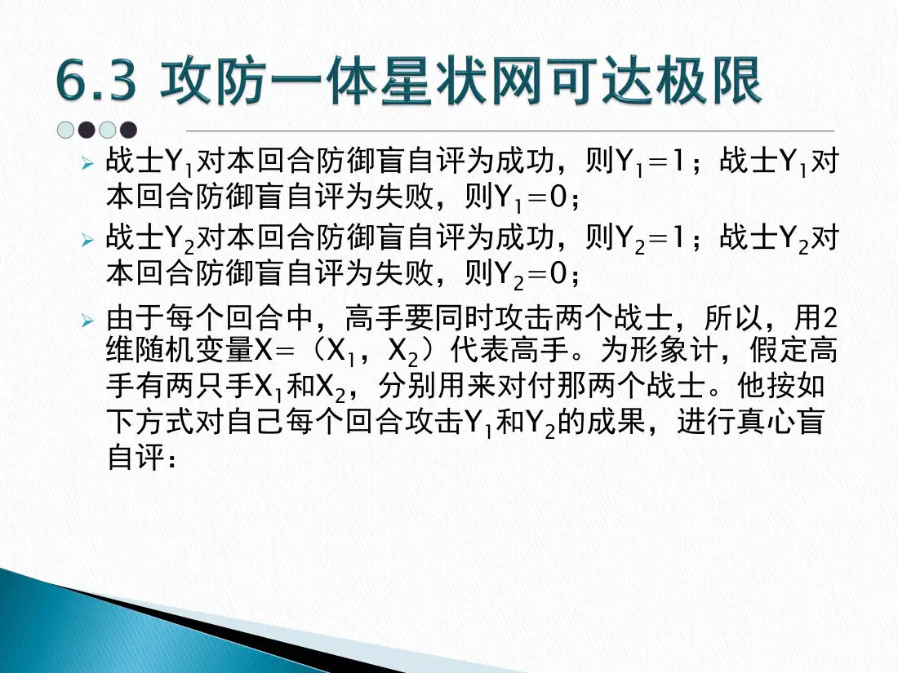

原文：

6.3攻防一体星状网可达极限

➢ 战士 $Y _ { 1 }$ 对本回合防御盲自评为成功，则 $\mathsf { Y } _ { 1 } = \mathsf { l }$ ；战士 $\mathsf { Y } _ { \mathbb { 1 } }$ 对本回合防御盲自评为失败，则 $\mathsf { Y } _ { 1 } = 0$ ；

➢ 战士 $Y _ { 2 }$ 对本回合防御盲自评为成功，则 $Y _ { 2 } = ]$ ；战士 $Y _ { 2 }$ 对本回合防御盲自评为失败，则 $r _ { 2 } = 0$ ；

➢ 由于每个回合中，高手要同时攻击两个战士，所以，用 $2$ 维随机变量 $x = ( X _ { 1 } , X _ { 2 } )$ 代表高手。为形象计，假定高手有两只手 $X _ { 1 }$ 和 $X _ { 2 }$ ，分别用来对付那两个战士。他按如下方式对自己每个回合攻击 $Y _ { 1 }$ 和 $Y _ { 2 }$ 的成果，进行真心盲自评：

### 6.3攻防一体星状网可达极限

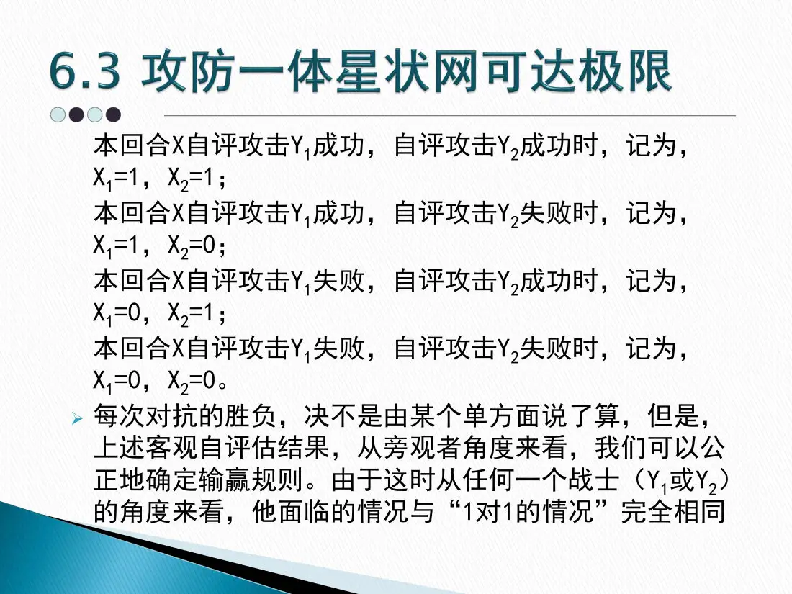

原文：

6.3攻防一体星状网可达极限

本回合X自评攻击 $\mathsf { Y } _ { 1 }$ 成功，自评攻击 $Y _ { 2 }$ 成功时，记为，$x _ { 1 } = 1 , x _ { 2 } = 1$ ；

本回合X自评攻击 $Y _ { 1 }$ 成功，自评攻击 $Y _ { 2 }$ 失败时，记为，$x _ { 1 } = 1 , x _ { 2 } = 0$ ；

本回合X自评攻击 $\mathsfit { Y } _ { 1 }$ 失败，自评攻击 $Y _ { 2 }$ 成功时，记为，$x _ { 1 } = 0 , x _ { 2 } = 1$ ；

本回合X自评攻击 $Y _ { 1 }$ 失败，自评攻击 $Y _ { 2 }$ 失败时，记为，$x _ { 1 } = 0 , x _ { 2 } = 0$

每次对抗的胜负，决不是由某个单方面说了算，但是，上述客观自评估结果，从旁观者角度来看，我们可以公正地确定输赢规则。由于这时从任何一个战士 $( Y _ { 1 }$ 或 $Y _ { 2 } )$ 的角度来看，他面临的情况与“1对1的情况”完全相同

### 6.3 攻防一体星状网可达极限

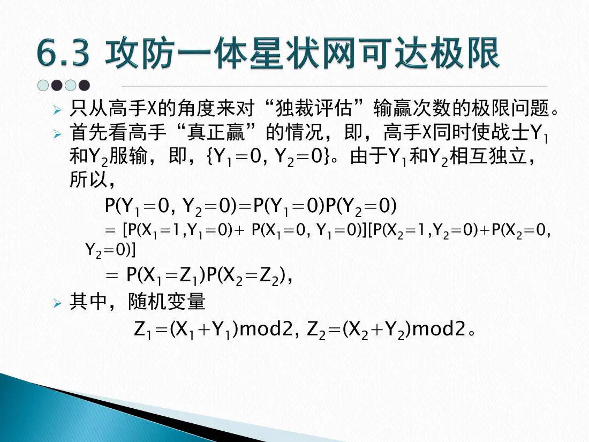

原文：

6.3 攻防一体星状网可达极限

➢ 只从高手X的角度来对“独裁评估”输赢次数的极限问题。

➢ 首先看高手“真正赢”的情况，即，高手X同时使战士 $Y _ { 1 }$ 和 $Y _ { 2 }$ 服输，即， $\{ Y _ { 1 } = 0 , Y _ { 2 } = 0 \}$ 。由于 ${ \mathsf { Y } } _ { 1 }$ 和 $Y _ { 2 }$ 相互独立，所以，

$$
\begin{array}{r l} & P (Y _ {1} = 0, Y _ {2} = 0) = P (Y _ {1} = 0) P (Y _ {2} = 0) \\ & = [ P (X _ {1} = 1, Y _ {1} = 0) + P (X _ {1} = 0, Y _ {1} = 0) ] [ P (X _ {2} = 1, Y _ {2} = 0) + P (X _ {2} = 0, \\ & Y _ {2} = 0) ] \\ & = P (X _ {1} = Z _ {1}) P (X _ {2} = Z _ {2}), \end{array}
$$

其中，随机变量

$$
Z _ {1} = \left(X _ {1} + Y _ {1}\right) \bmod 2, Z _ {2} = \left(X _ {2} + Y _ {2}\right) \bmod 2 。
$$

### 6.3 攻防一体星状网可达极限

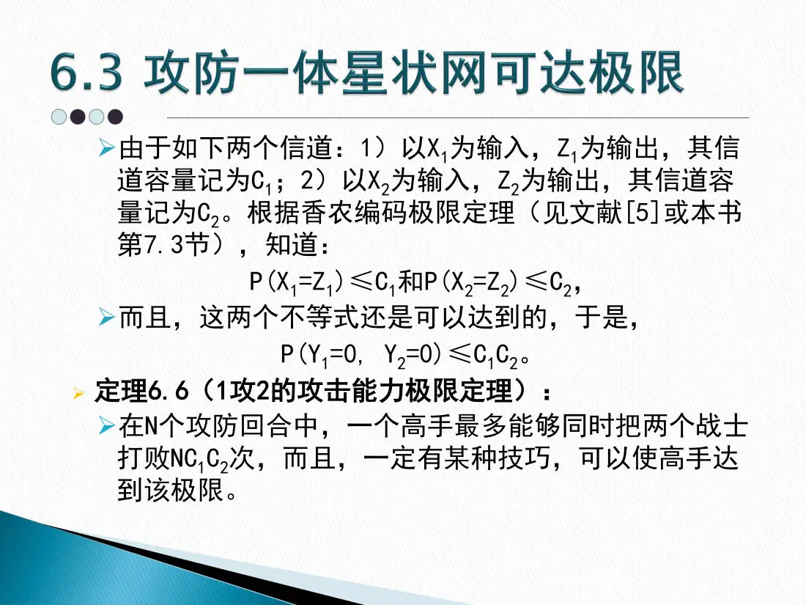

原文：

6.3 攻防一体星状网可达极限

由于如下两个信道：1）以 $X _ { 1 }$ 为输入， $Z _ { 1 }$ 为输出，其信道容量记为 ${ \sf C } _ { 1 }$ ；2）以 $X _ { 2 }$ 为输入， $Z _ { 2 }$ 为输出，其信道容量记为 $\mathsf { C } _ { 2 }$ 。根据香农编码极限定理（见文献[5]或本书第7.3节），知道：

$$
P (X _ {1} = Z _ {1}) \leqslant C _ {1} \text {和} P (X _ {2} = Z _ {2}) \leqslant C _ {2},
$$

➢而且，这两个不等式还是可以达到的，于是，

$$
P \left(Y _ {1} = 0, Y _ {2} = 0\right) \leqslant C _ {1} C _ {2} 。
$$

➢ 定理6.6（1攻2的攻击能力极限定理）：

在N个攻防回合中，一个高手最多能够同时把两个战士打败NC ${ \sf C } _ { 2 }$ 次，而且，一定有某种技巧，可以使高手达到该极限。

### 6.3 攻防一体星状网可达极限

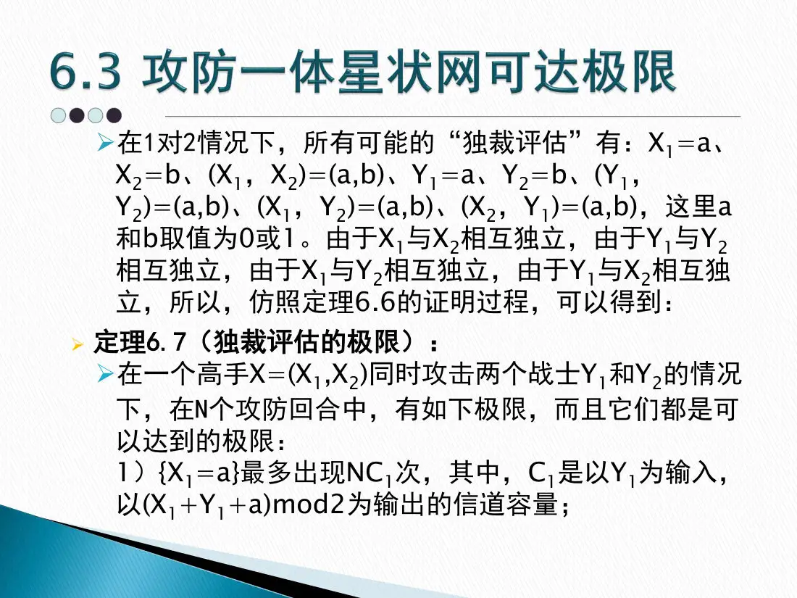

原文：

6.3 攻防一体星状网可达极限

➢在1对2情况下，所有可能的“独裁评估”有： $x _ { 1 } = a$ $\mathsf X _ { 2 } = \mathsf b , ( \mathsf X _ { 1 } , \mathsf X _ { 2 } ) = ( \mathsf a , \mathsf b ) , \mathsf Y _ { 1 } = \mathsf a , \mathsf Y _ { 2 } = \mathsf b$ $( Y _ { 1 }$ $\mathsf { Y } _ { 2 } ) = ( \mathsf { a } , \mathsf { b } ) , ( \mathsf { X } _ { 1 } , \mathsf { Y } _ { 2 } ) = ( \mathsf { a } , \mathsf { b } ) , ( \mathsf { X } _ { 2 } , \mathsf { Y } _ { 1 } ) = ( \mathsf { a } , \mathsf { b } )$ ，这里a和b取值为0或1。由于 $x _ { 1 }$ 与 $X _ { 2 }$ 相互独 $\dot { \underline { { \dot { \Pi } } } }$ ，由于 $\mathsf { Y } _ { \mathsf { l } }$ 与 $Y _ { 2 }$ 相互独立，由于 $x _ { 1 }$ 与 $Y _ { 2 }$ 相互独立，由于 $\mathsf { Y } _ { 1 }$ 与 $X _ { 2 }$ 相互独$\dot { \overline { { \mathbf { \psi } } } }$ ，所以，仿照定理6.6的证明过程，可以得到：

➢ 定理6.7（独裁评估的极限）：

➢在一个高手 $x = ( x _ { 1 } , x _ { 2 } )$ 同时攻击两个战士 $Y _ { 1 }$ 和 $Y _ { 2 }$ 的情况下，在N个攻防回合中，有如下极限，而且它们都是可以达到的极限：

1） $\{ X _ { 1 } = a \}$ 最多出现 ${ \mathsf { N C } } _ { 1 }$ 次，其中， $C _ { 1 }$ 是以 $\mathsf { Y } _ { \mathbb { 1 } }$ 为输入，以 $( X _ { 1 } + Y _ { 1 } + \mathsf { a } ) \mathsf { m o d } 2$ 为输出的信道容量；

### 6.3 攻防一体星状网可达极限

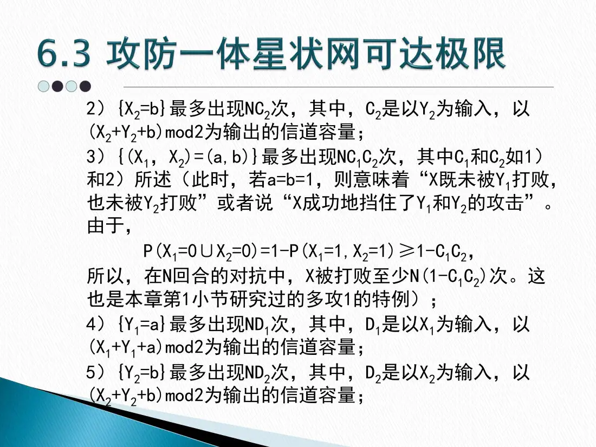

原文：

6.3 攻防一体星状网可达极限

2） $\{ x _ { 2 } = 0 \}$ 最多出现 ${ \mathsf { N C } } _ { 2 }$ 次，其中， $\mathsf { C } _ { 2 }$ 是以 $Y _ { 2 }$ 为输入，以$( x _ { 2 } + y _ { 2 } + b ) m 0 d 2$ 为输出的信道容量；

3） $\{ ( x _ { 1 } , x _ { 2 } ) = ( { \bf a } , { \bf b } ) \}$ 最多出现 ${ \mathsf { N C } } _ { 1 } { \mathsf { C } } _ { 2 }$ 次，其中 ${ \sf C } _ { 1 }$ 和 $\mathsf { C } _ { 2 }$ 如1）和2）所述（此时，若 $a = b = 1$ 则意味着 $^ { 6 6 } X$ 既未被 $Y _ { 1 }$ 打败，也未被 $Y _ { 2 }$ 打败”或者说“X成功地挡住了 ${ \sf Y } _ { 1 }$ 和 $Y _ { 2 }$ 的攻击”。由于，

$$
P \left(X _ {1} = 0 \cup X _ {2} = 0\right) = 1 - P \left(X _ {1} = 1, X _ {2} = 1\right) \geqslant 1 - C _ {1} C _ {2},
$$

所以，在N回合的对抗中，X被打败至少N $( 1 - \mathsf { C } _ { 1 } \mathsf { C } _ { 2 } )$ 次。这也是本章第1小节研究过的多攻1的特例）；

4） $\{ Y _ { 1 } = a \}$ 最多出现 ${ \mathsf { N D } } _ { 1 }$ 次，其中， $\mathsf { D } _ { 1 }$ 是以 $X _ { 1 }$ 为输入，以$( x _ { 1 } + y _ { 1 } + a ) m 0 d 2$ 为输出的信道容量；

5） $\{ Y _ { 2 } = b \}$ 最多出现 ${ \mathsf { N D } } _ { 2 }$ 次，其中， $\mathsf { D } _ { 2 }$ 是以 $X _ { 2 }$ 为输入，以1 $( x _ { 2 } + y _ { 2 } + b ) m 0 d 2$ 为输出的信道容量；

### 6.3攻防一体星状网可达极限

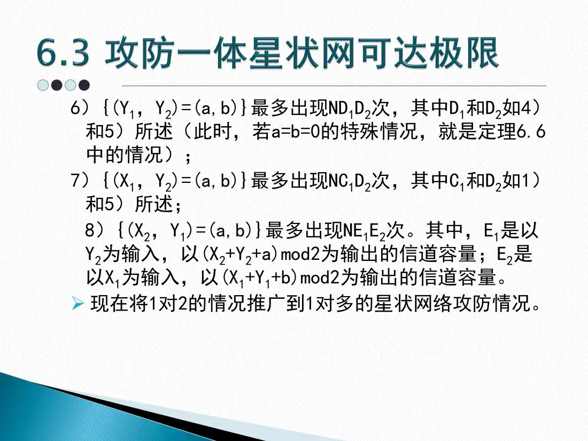

原文：

6.3攻防一体星状网可达极限

6） $\{ ( Y _ { 1 } , Y _ { 2 } ) = ( a , b )$ }最多出现 ${ \tt N D } _ { 1 } \mathsf { D } _ { 2 }$ 次，其中 $\mathsf { D } _ { 1 }$ 和 $| \mathsf { D } _ { 2 } ^ { \phantom { \dagger } }$ 如4）和5）所述（此时，若 $a = b = 0$ 的特殊情况，就是定理6.6中的情况）；

7） $\{ ( x _ { 1 } , y _ { 2 } ) = ( 0 , b )$ }最多出现 ${ \tt N C } _ { 1 } \mathsf { D } _ { 2 }$ 次，其中 ${ \sf C } _ { 1 }$ 和 $| \mathsf { D } _ { 2 } ^ { \phantom { \dagger } }$ 如1）和5）所述；

8） $\{ ( x _ { 2 } , y _ { 1 } ) = ( 0 , b ) \}$ 最多出现 ${ \mathsf { N E } } _ { 1 } \mathsf { E } _ { 2 }$ 次。其中， $\mathsf { E } _ { 1 }$ 是以$Y _ { 2 }$ 为输入，以 $( x _ { 2 } + y _ { 2 } + a ) m 0 d 2$ 为输出的信道容量； $\mathsf { E } _ { 2 }$ 是以 $X _ { 1 }$ 为输入，以 $( x _ { 1 } + y _ { 1 } + b ) m o d 2$ 为输出的信道容量。

➢ 现在将1对2的情况推广到1对多的星状网络攻防情况。

### 6.3 攻防一体星状网可达极限

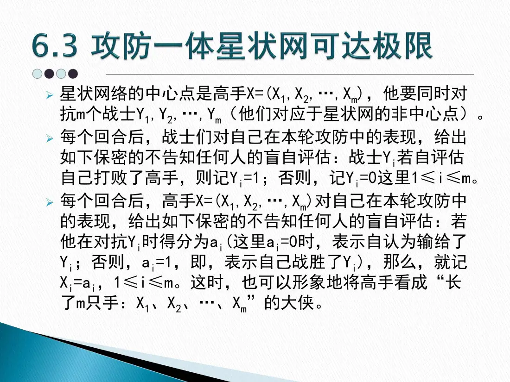

原文：

6.3 攻防一体星状网可达极限

星状网络的中心点是高手 $x = ( x _ { 1 } , x _ { 2 } , \ldots , x _ { m } )$ 他要同时对抗m个战士 $\mathsf { Y } _ { 1 } , \mathsf { Y } _ { 2 } , \ldots , \mathsf { Y } _ { \mathrm { m } }$ （他们对应于星状网的非中心点）。

➢ 每个回合后，战士们对自己在本轮攻防中的表现，给出如下保密的不告知任何人的盲自评估：战士 $Y _ { i }$ 若自评估自己打败了高手，则记 $\Upsilon _ { i } = 1$ ；否则，记 $\mathtt { Y } _ { \mathrm { i } } = 0$ 这里 $1 \leq i \leq m$

每个回合后，高手 $x = ( x _ { 1 } , x _ { 2 } , \ldots , x _ { m } )$ 对自己在本轮攻防中的表现，给出如下保密的不告知任何人的盲自评估：若他在对抗 $Y _ { i }$ 时得分为a (这里 $a _ { i } = 0$ 时，表示自认为输给了$Y _ { i } ,$ 否则， $a _ { i } = 1$ ，即，表示自己战胜了Y )，那么，就记$x _ { i } = a _ { i } , 1 \leq i \leq m$ 。这时，也可以形象地将高手看成“长了m只手： $x _ { 1 } 、 x _ { 2 } 、 \cdots , x _ { n }$ 的大侠。

### 6.3攻防一体星状网可达极限

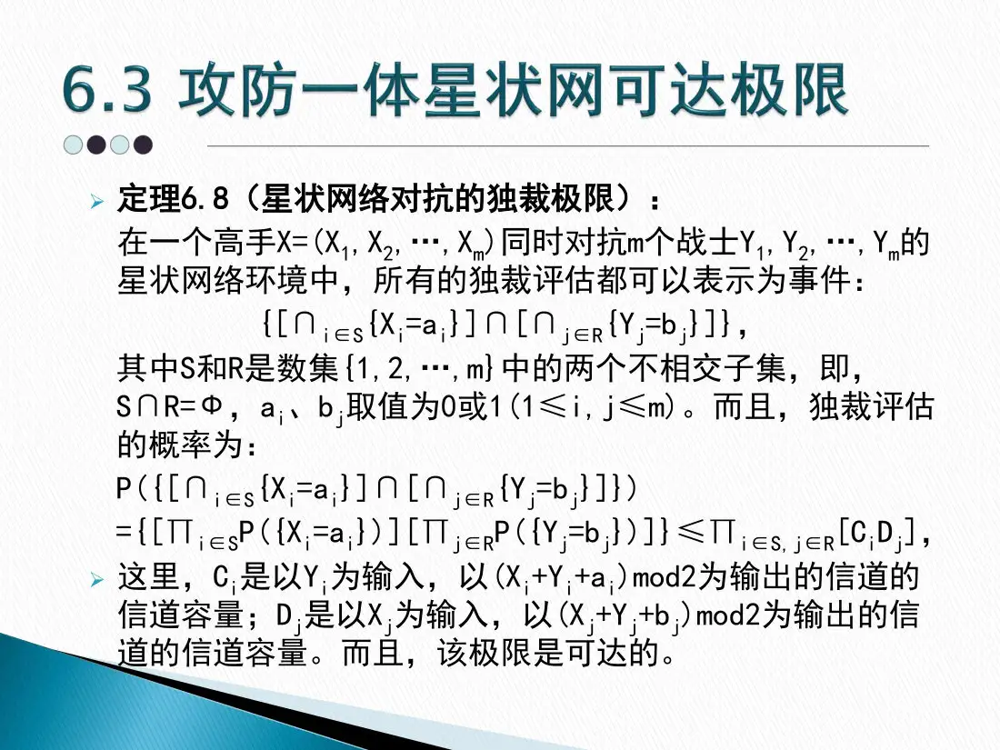

原文：

6.3攻防一体星状网可达极限

➢ 定理6.8（星状网络对抗的独裁极限）：

在一个高手 $x = ( x _ { 1 } , x _ { 2 } , \cdots , x _ { m } )$ 同时对抗m个战士 $\mathsf { Y } _ { 1 } , \mathsf { Y } _ { 2 } , \cdots , \mathsf { Y } _ { m }$ 的星状网络环境中，所有的独裁评估都可以表示为事件：

$$
\left. \right.\left\{\left[ \cap_ {i \in S} \left\{X _ {i} = a _ {i} \right\}\right] \cap \left[ \cap_ {j \in R} \left\{Y _ {j} = b _ {j} \right\}\right]\right\},
$$

其中S和R是数集 $\{ 1 , 2 , \cdots , m \}$ 中的两个不相交子集，即，$\mathsf { S } \cap \mathsf { R } = \Phi , a _ { i } , b _ { j }$ 取值为0或 $1 ( 1 \leq i , j \leq m )$ 。而且，独裁评估的概率为：

$$
\begin{array}{l} \mathsf {P} (\{\left[ \bigcap_ {i \in S} \{X _ {i} = a _ {i} \} \right] \cap [ \bigcap_ {j \in R} \{Y _ {j} = b _ {j} \} ] \}) \\ = \{\left[ \prod_ {i \in S} \mathsf {P} (\{X _ {i} = a _ {i} \}) \right] [ \prod_ {j \in R} \mathsf {P} (\{Y _ {j} = b _ {j} \}) ] \} \leqslant \prod_ {i \in S, j \in R} [ C _ {i} D _ {j} ] \end{array}
$$

这里， ${ \sf C } _ { \mathrm { i } }$ 是以 $Y _ { i }$ 为输入，以 $( x _ { i } + y _ { i } + a _ { i } ) m o d 2$ 为输出的信道的信道容量； $\mathsf { D } _ { \mathrm { j } }$ 是以 $X _ { j }$ 为输入，以 $( x _ { j } + y _ { j } + b _ { j } ) m o d 2$ 为输出的信道的信道容量。而且，该极限是可达的。

### 6.3 攻防一体星状网可达极限

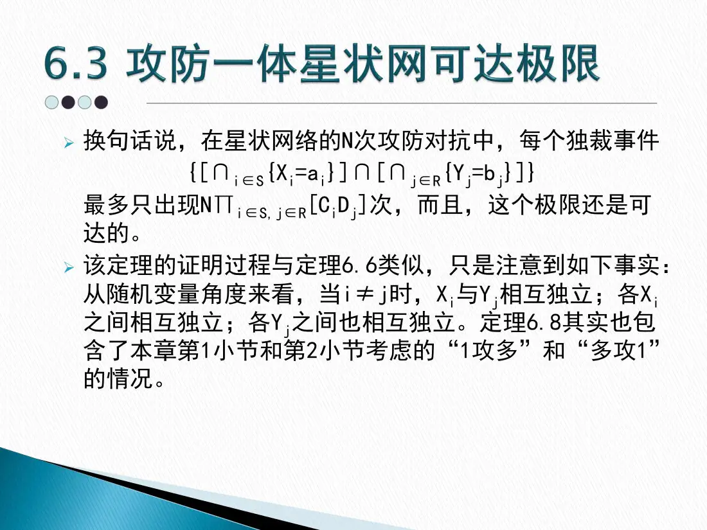

原文：

6.3 攻防一体星状网可达极限

➢ 换句话说，在星状网络的N次攻防对抗中，每个独裁事件

$$
\left\{\left[ \bigcap_ {i \in S} \left\{X _ {i} = a _ {i} \right\} \right] \cap \left[ \bigcap_ {j \in R} \left\{Y _ {j} = b _ {j} \right\} \right] \right\}
$$

最多只出现N∏ $\mathsf { i } \in \mathsf { S } , \mathsf { j } \in \mathsf { R }  ^ { [ \mathsf { C } _ { \mathrm { i } } \mathsf { D } _ { \mathrm { j } } ] }$ 次，而且，这个极限还是可达的。

➢ 该定理的证明过程与定理6.6类似，只是注意到如下事实：从随机变量角度来看，当i≠j时， $X _ { i }$ 与 $Y _ { j }$ 相互独立；各X之间相互独立；各 $Y _ { j }$ 之间也相互独立。定理6.8其实也包含了本章第1小节和第2小节考虑的“1攻多”和“多攻1”的情况。

### 6.6 小结与答疑

原文：

6.6 小结与答疑

➢ 在现实对抗中，会经常出现“群殴”事件，特别是多位黑客攻击一位红客；一个黑客攻击多位红客；黑客借助跳板来攻击红客；在有人协助时，黑客攻击红客等，于是，便引出了本章的主题：多人对抗。当然，由于在网络空间安全对抗中，几乎只涉及“盲对抗”，所以，下面我们也就只研究了“盲群殴”。此处的结果，绝不仅仅限于网络空间安全，仍然对各类对抗性的安全都有效。

### 6.6 小结与答疑

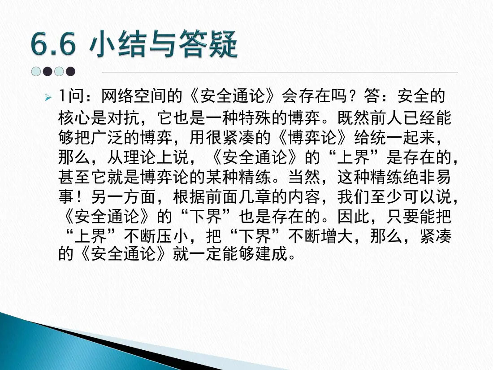

原文：

6.6 小结与答疑

➢ 1问：网络空间的《安全通论》会存在吗？答：安全的核心是对抗，它也是一种特殊的博弈。既然前人已经能够把广泛的博弈，用很紧凑的《博弈论》给统一起来，那么，从理论上说，《安全通论》的“上界”是存在的，甚至它就是博弈论的某种精练。当然，这种精练绝非易事！另一方面，根据前面几章的内容，我们至少可以说，《安全通论》的“下界”也是存在的。因此，只要能把“上界”不断压小，把“下界”不断增大，那么，紧凑的《安全通论》就一定能够建成。

### 6.6 小结与答疑

原文：

6.6 小结与答疑

2问：上章和本章讨论对抗时，都假定了“回合制”；但是实际的网络攻防不是回合制呀？答：表面上，现实世界的网络攻防确实不是回合制！但是，设想一下，如果把时间进行必要的局部拉伸和压缩（这样做，对攻防各方来说，并无实质性的改变），那么，所有攻防也都可转化成回合制了。况且，既然《博弈论》都是采用的回合制，那么，作为一种特殊的博弈，为什么安全对抗就不能是回合制呢？理论研究一定要建立相应的模型，一定要抛弃一些不必要的差异和非核心细节，否则，就只能做“能工巧匠”了。采用什么制，并不重要。重要的是，是否能够把所有安全分支给紧凑地统一起来。

### 6.6 小结与答疑

原文：

6.6 小结与答疑

➢ 3问：为什么你只考虑了对抗的输赢次数？答：必须承认，对抗中的“输赢次数”只包含了部分输赢信息（比如，一次大赢可能胜过多次小输），但是，在没有能力揭示更多输赢信息的情况下，能“向前迈一步”总好过无所作为。做科研，特别是创立一门新学科，只能步步逼近，不可能一步登天。

4问：假如《安全通论》完成后，对网络空间安全到底有什么具体的指导价值？答：关键看今后《安全通论》完成后，到底是什么样子。也许它会是安全界的“信息论”，也许一钱不值。但是，如果是后者，就说明网络空间安全根本就是“一堆扶不上墙的烂泥”，我们不相信会出现这种情况。当然，你若问今后到底如何用《安全通论》去指导安全的各个细枝末叶，那么，我们可以告诉你：香农也不知道如何用《信息论》去指导电视机的生产。

### 本章结束，谢谢

原文：

本章结束，谢谢
