# 《安全通论》第7章 信息论与博弈论的融合（课件）

原件的每一页，下面附识别出的文字。

### 第7章---信息论与博弈论的融合

原文：

第7章---信息论与博弈论的融合

### 第7章信息论与博弈论的融合

原文：

第7章信息论与博弈论的融合

1. 信息论与博弈论的再认识

➢ 2.《博弈论》核心凝练

➢ 3.《信息论》核心凝练

➢ 4. 三论融合

➢ 5. 几点反省

### 7.1：信息论与博弈论的再认识

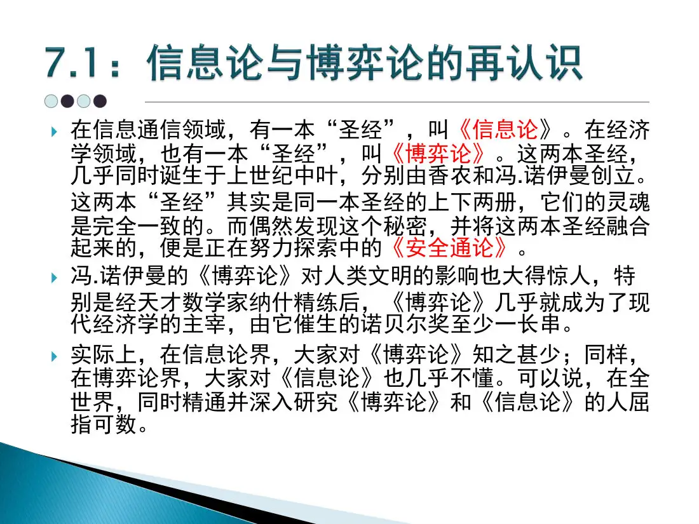

原文：

7.1：信息论与博弈论的再认识

 在信息通信领域，有一本“圣经”，叫《信息论》。在经济学领域，也有一本“圣经”，叫《博弈论》。这两本圣经，几乎同时诞生于上世纪中叶，分别由香农和冯.诺伊曼创立。这两本“圣经”其实是同一本圣经的上下两册，它们的灵魂是完全一致的。而偶然发现这个秘密，并将这两本圣经融合起来的，便是正在努力探索中的《安全通论》。

 冯.诺伊曼的《博弈论》对人类文明的影响也大得惊人，特别是经天才数学家纳什精练后，《博弈论》几乎就成为了现代经济学的主宰，由它催生的诺贝尔奖至少一长串。

 实际上，在信息论界，大家对《博弈论》知之甚少；同样，在博弈论界，大家对《信息论》也几乎不懂。可以说，在全世界，同时精通并深入研究《博弈论》和《信息论》的人屈指可数。

### 7.1：信息论与博弈论的再认识

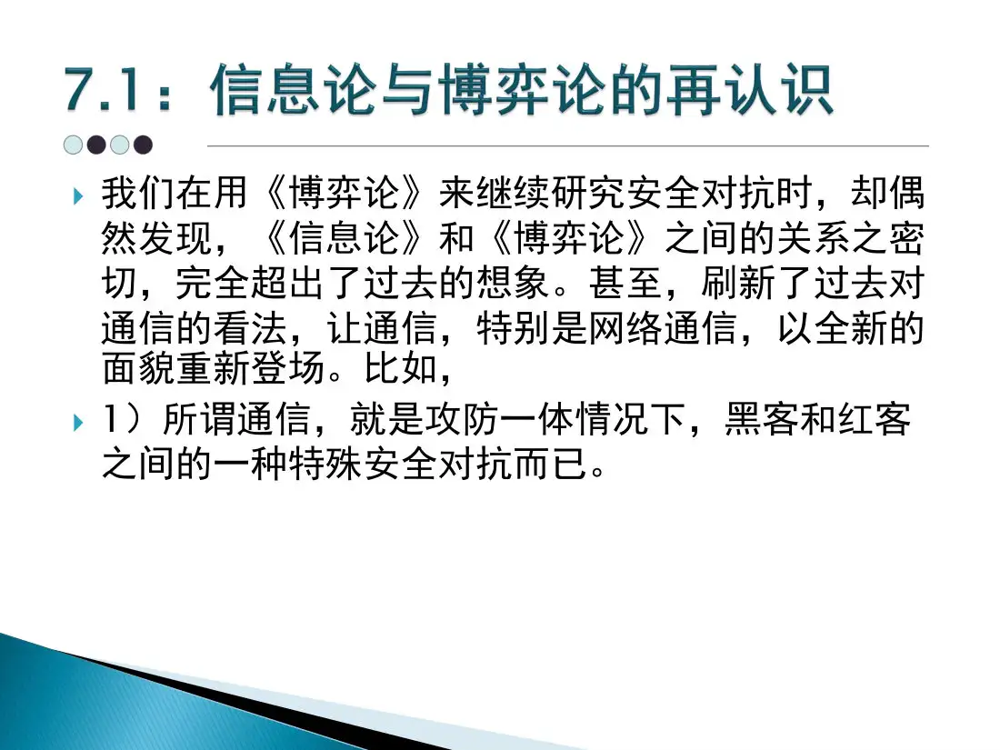

原文：

7.1：信息论与博弈论的再认识

 我们在用《博弈论》来继续研究安全对抗时，却偶然发现，《信息论》和《博弈论》之间的关系之密切，完全超出了过去的想象。甚至，刷新了过去对通信的看法，让通信，特别是网络通信，以全新的面貌重新登场。比如，

 1）所谓通信，就是攻防一体情况下，黑客和红客之间的一种特殊安全对抗而已。

### 7.1：信息论与博弈论的再认识

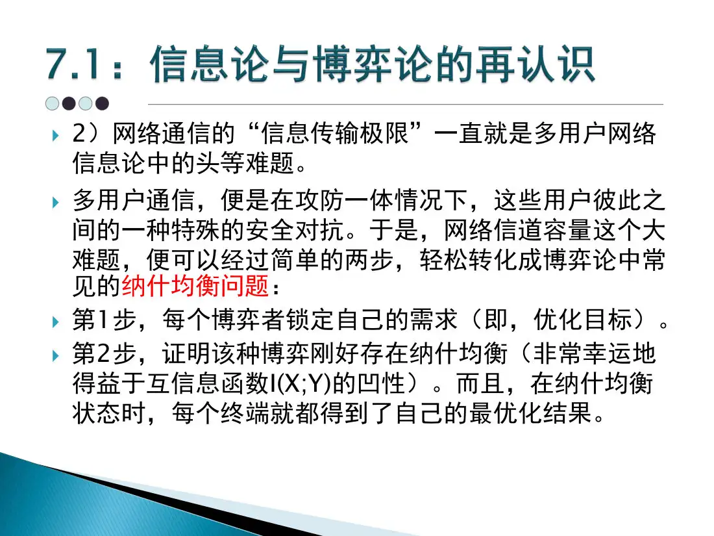

原文：

7.1：信息论与博弈论的再认识

 2）网络通信的“信息传输极限”一直就是多用户网络信息论中的头等难题。

 多用户通信，便是在攻防一体情况下，这些用户彼此之间的一种特殊的安全对抗。于是，网络信道容量这个大难题，便可以经过简单的两步，轻松转化成博弈论中常见的纳什均衡问题：

 第1步，每个博弈者锁定自己的需求（即，优化目标）。

第2步，证明该种博弈刚好存在纳什均衡（非常幸运地得益于互信息函数I(X;Y)的凹性）。而且，在纳什均衡状态时，每个终端就都得到了自己的最优化结果。

### 7.1：信息论与博弈论的再认识

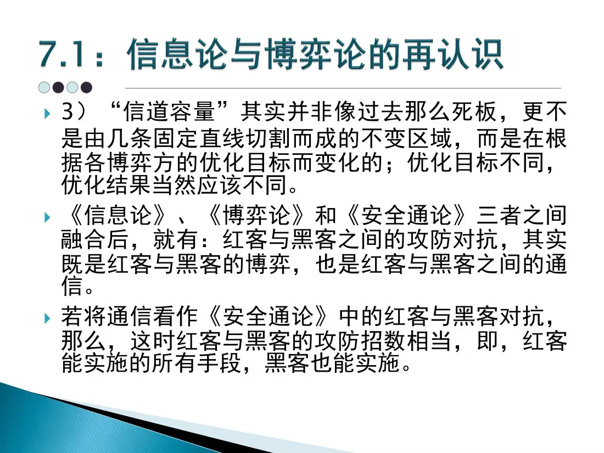

原文：

7.1：信息论与博弈论的再认识

 3）“信道容量”其实并非像过去那么死板，更不是由几条固定直线切割而成的不变区域，而是在根据各博弈方的优化目标而变化的；优化目标不同，优化结果当然应该不同。

 《信息论》、《博弈论》和《安全通论》三者之间融合后，就有：红客与黑客之间的攻防对抗，其实既是红客与黑客的博弈，也是红客与黑客之间的通信。

 若将通信看作《安全通论》中的红客与黑客对抗，那么，这时红客与黑客的攻防招数相当，即，红客能实施的所有手段，黑客也能实施。

### 7.1：信息论与博弈论的再认识

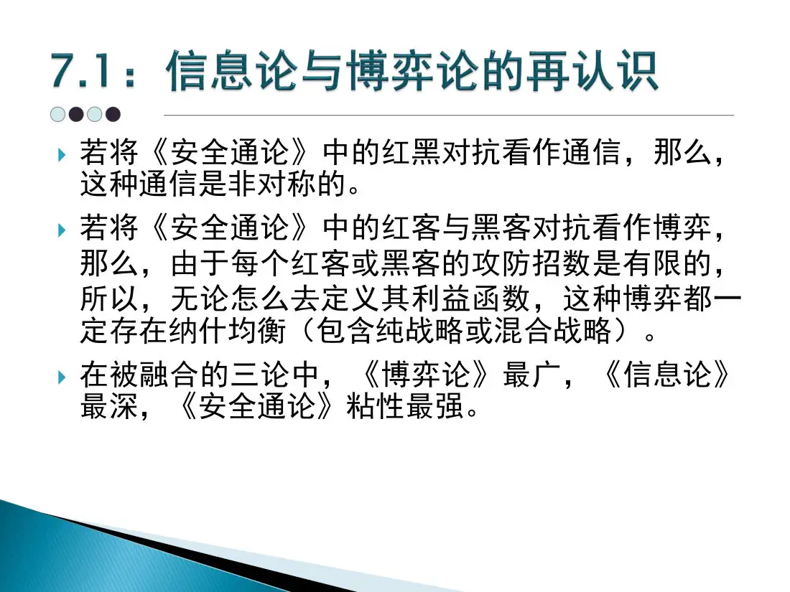

原文：

7.1：信息论与博弈论的再认识

 若将《安全通论》中的红黑对抗看作通信，那么，这种通信是非对称的。

 若将《安全通论》中的红客与黑客对抗看作博弈，那么，由于每个红客或黑客的攻防招数是有限的，所以，无论怎么去定义其利益函数，这种博弈都一定存在纳什均衡（包含纯战略或混合战略）。

 在被融合的三论中，《博弈论》最广，《信息论》最深，《安全通论》粘性最强。

### 7.2：《博弈论》核心凝练

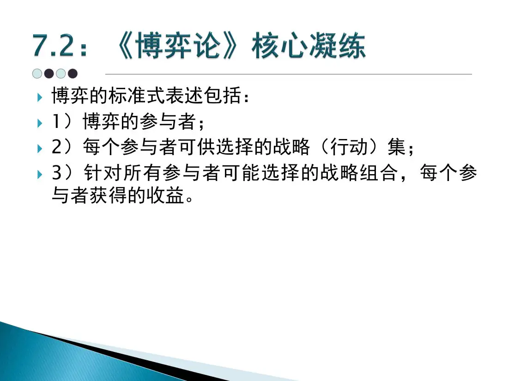

原文：

7.2：《博弈论》核心凝练

博弈的标准式表述包括：

1）博弈的参与者；

 2）每个参与者可供选择的战略（行动）集；

 3）针对所有参与者可能选择的战略组合，每个参与者获得的收益。

### 7.2：《博弈论》核心凝练

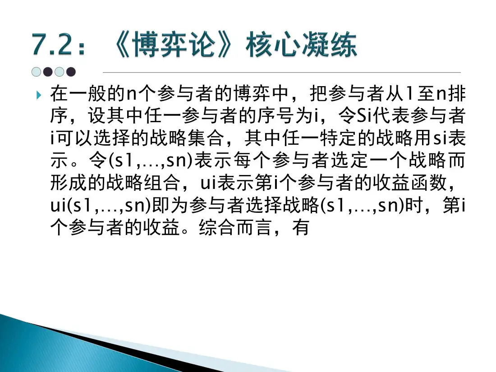

原文：

7.2：《博弈论》核心凝练

 在一般的n个参与者的博弈中，把参与者从1至n排序，设其中任一参与者的序号为i，令Si代表参与者i可以选择的战略集合，其中任一特定的战略用si表示。令 $( s 1 , \ldots , s n )$ 表示每个参与者选定一个战略而形成的战略组合，ui表示第i个参与者的收益函数，$\mathsf { u i } ( \mathsf { s } 1 , \ldots , \mathsf { s n } )$ 即为参与者选择战略 $( s 1 , \ldots , s n )$ 时，第i个参与者的收益。综合而言，有

### 7.2：《博弈论》核心凝练

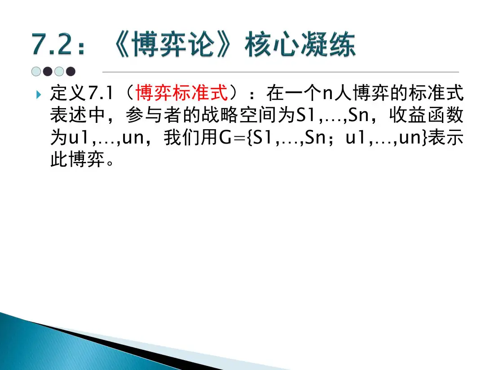

原文：

7.2：《博弈论》核心凝练

 定义7.1（博弈标准式）：在一个n人博弈的标准式表述中，参与者的战略空间为 $S 1 , \ldots , S n$ ，收益函数为 $\boldsymbol { \mathsf { u } } \boldsymbol { \mathsf { l } } , \ldots , \boldsymbol { \mathsf { u } } \boldsymbol { \mathsf { n } }$ ，我们用 $\mathsf { G } { = } \{ \mathsf { S } \mathsf { I } , { \ldots } , \mathsf { S } \mathsf { n } ; \mathsf { u } \mathsf { I } , { \ldots } , \mathsf { u } \mathsf { n } \}$ 表示此博弈。

### 7.2：《博弈论》核心凝练

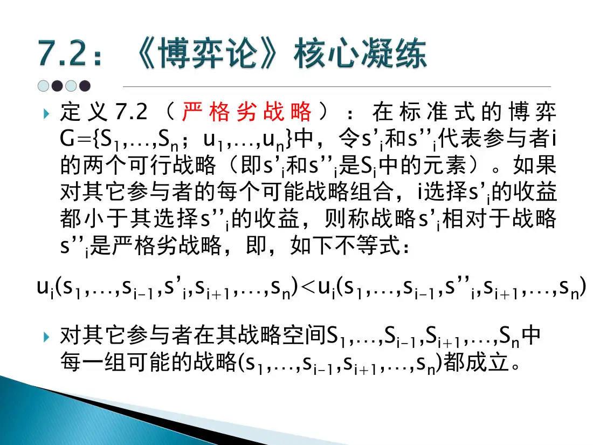

原文：

7.2：《博弈论》核心凝练

 定义7.2（严格劣战略）：在标准式的博弈$\mathsf { C } { = } \{ \mathsf { S } _ { 1 } , . . . , \mathsf { S } _ { \mathsf { n } } ; ~ \mathsf { U } _ { 1 } , . . . , \mathsf { U } _ { \mathsf { n } } \}$ 中，令 $s ^ { \prime }$ 和 $S ^ { \prime \prime }$ 代表参与者i的两个可行战略（即 $s ^ { \prime }$ 和 $\mathsf { S } ^ { \prime \prime } { } _ { | }$ 是 $S _ { j }$ 中的元素）。如果对其它参与者的每个可能战略组合，i选择 $s ^ { \prime }$ 的收益都小于其选择 $S ^ { \prime \prime }$ 的收益，则称战略 ${ \boldsymbol { \mathsf { S } } } _ { \mathrm { ~ i ~ } } ^ { \prime }$ 相对于战略$\mathsf { S } ^ { \prime \prime } { } _ { \mathsf { i } }$ 是严格劣战略，即，如下不等式：

$$
u _ {i} (s _ {1}, \dots , s _ {i - 1}, s _ {i} ^ {\prime}, s _ {i + 1}, \dots , s _ {n}) <   u _ {i} (s _ {1}, \dots , s _ {i - 1}, s _ {i} ^ {\prime \prime}, s _ {i + 1}, \dots , s _ {n})
$$

 对其它参与者在其战略空间 $\mathsf { S } _ { 1 } , \ldots , \mathsf { S } _ { \mathsf { i } - 1 } , \mathsf { S } _ { \mathsf { i } + 1 } , \ldots , \mathsf { S } _ { \mathsf { n } }$ 中每一组可能的战略 $( \mathsf { s } _ { 1 } , \ldots , \mathsf { s } _ { \mathsf { i } - 1 } , \mathsf { s } _ { \mathsf { i } + 1 } , \ldots , \mathsf { s } _ { \mathsf { n } } )$ 都成 $\dot { \underline { { \dot { \boldsymbol { \mu } } } } }$ 。

### 7.2：《博弈论》核心凝练

原文：

7.2：《博弈论》核心凝练

 理性的参与者不会选择严格劣战略，因为，他（对其它人选择的战略）无法做出这样的推断，使这一战略成为他的最优反应。在博弈中，每个参与者要选择的战略，必须是针对其它参与者选择战略的最优反应，这种理论推测结果可以叫做“战略稳定”或“自动实施”的，因为，没有哪位参与者愿意独自离弃他所选定的战略，我们把这一状态称为“纳什均衡”。

### 7.2：《博弈论》核心凝练

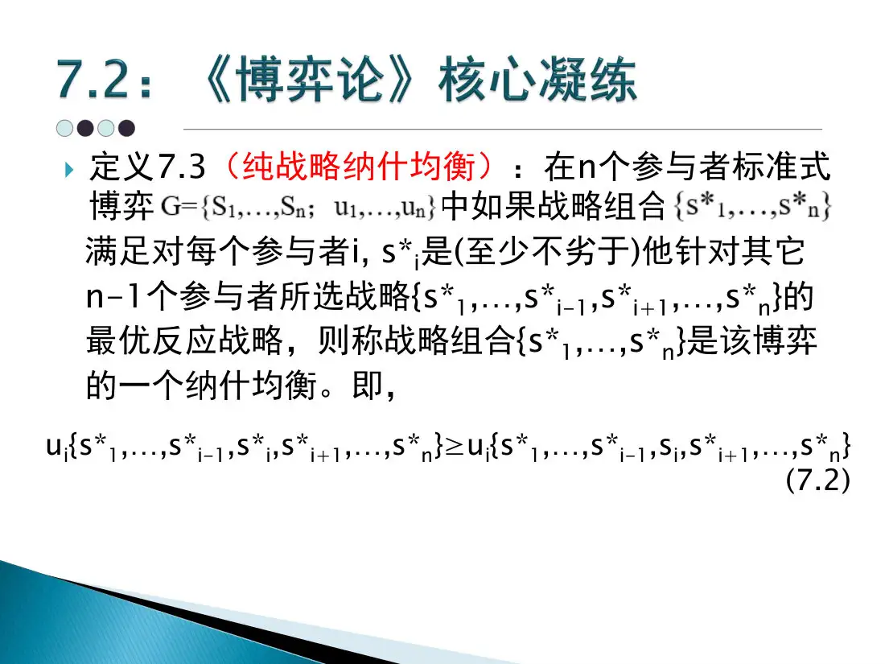

原文：

7.2：《博弈论》核心凝练

 定义7.3（纯战略纳什均衡）：在n个参与者标准式博弈 $\mathrm { { G } = \{ S _ { 1 } , . . . , S _ { n } ; ~ \ u _ { 1 } , . . . , u _ { n } \} }$ 中如果战略组合 $\{ \mathbf { s } ^ { * } \mathbf { \Phi } _ { 1 } , \dots , \mathbf { s } ^ { * } \mathbf { \Phi } _ { \mathrm { n } } \}$ 满足对每个参与者i, $S ^ { \ast } { } _ { \mathrm { i } }$ 是(至少不劣于)他针对其它n-1个参与者所选战略 $\left\{ \mathsf { S } ^ { \ast } { } _ { 1 } , \ldots , \mathsf { S } ^ { \ast } { } _ { \mathrm { i - l } } , \mathsf { S } ^ { \ast } { } _ { \mathrm { i + l } } , \ldots , \mathsf { S } ^ { \ast } { } _ { \mathrm { n } } \right\}$ 的最优反应战略，则称战略组合 $\{ \boldsymbol { \mathsf { S } } ^ { * } \} _ { \parallel } , \hdots , \boldsymbol { \mathsf { S } } ^ { * } \mathrm { \Sigma } _ { \mathsf { n } } \}$ 是该博弈的一个纳什均衡。即，

$$
u _ {i} \{s _ {1} ^ {*}, \dots , s _ {i - 1} ^ {*}, s _ {i} ^ {*}, s _ {i + 1} ^ {*}, \dots , s _ {n} ^ {*} \} \geq u _ {i} \{s _ {1} ^ {*}, \dots , s _ {i - 1} ^ {*}, s _ {i}, s _ {i + 1} ^ {*}, \dots , s _ {n} ^ {*} \}\tag{7.2}
$$

### 7.2：《博弈论》核心凝练

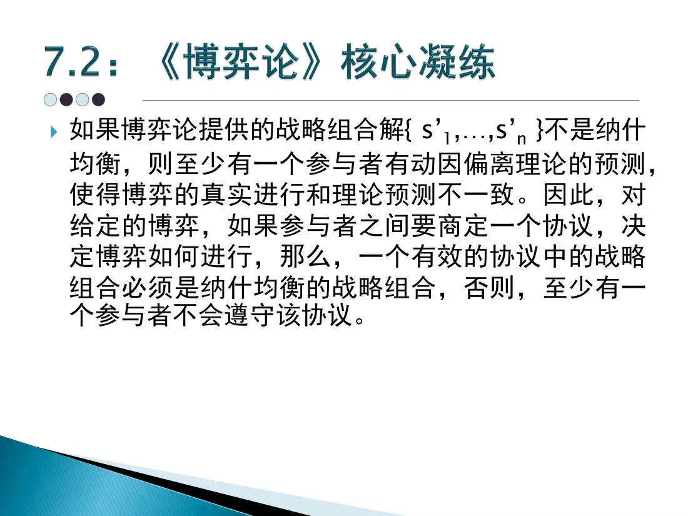

原文：

7.2：《博弈论》核心凝练

 如果博弈论提供的战略组合解{ $S _ { \mathrm { ~ l ~ } } ^ { \prime } , \ldots , S _ { \mathrm { ~ n ~ } } ^ { \prime }$ }不是纳什均衡，则至少有一个参与者有动因偏离理论的预测，使得博弈的真实进行和理论预测不一致。因此，对给定的博弈，如果参与者之间要商定一个协议，决定博弈如何进行，那么，一个有效的协议中的战略组合必须是纳什均衡的战略组合，否则，至少有一个参与者不会遵守该协议。

### 7.2：《博弈论》核心凝练

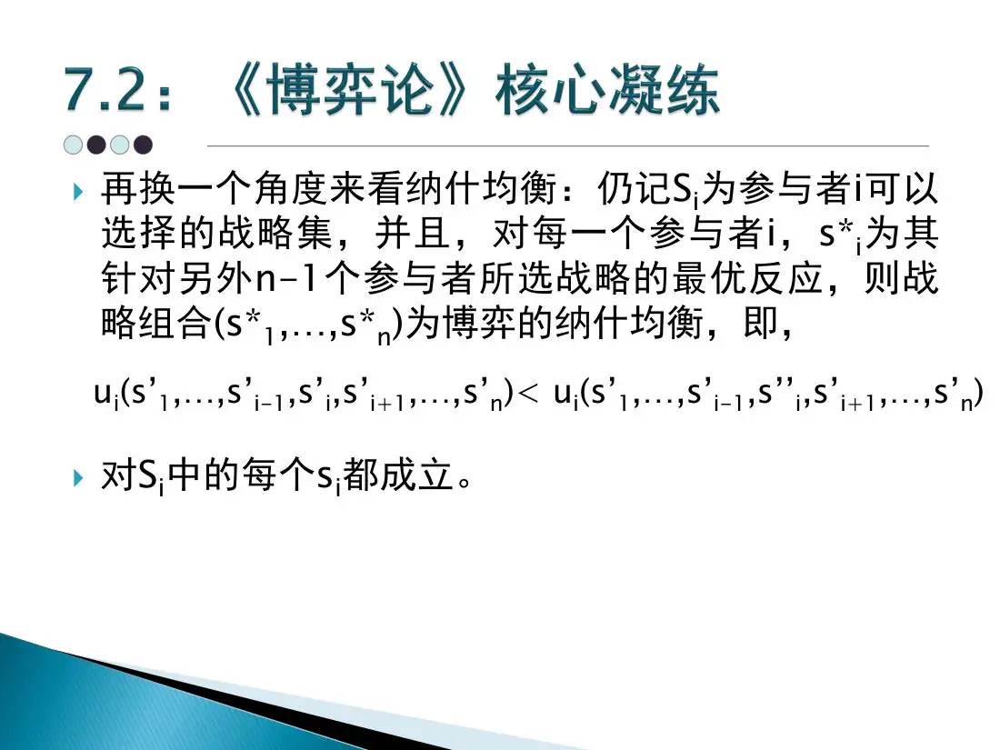

原文：

7.2：《博弈论》核心凝练

 再换一个角度来看纳什均衡：仍记 $S _ { j }$ 为参与者i可以选择的战略集，并且，对每一个参与者i， $S ^ { \ast } { } _ { \mathrm { i } }$ 为其针对另外n-1个参与者所选战略的最优反应，则战略组合 $( \mathsf { s } ^ { \ast } _ { \mathsf { l } } , \hdots , \mathsf { s } ^ { \ast } _ { \mathsf { n } } )$ 为博弈的纳什均衡，即，

$$
u _ {i} \left(s _ {1} ^ {\prime}, \dots , s _ {i - 1} ^ {\prime}, s _ {i} ^ {\prime}, s _ {i + 1} ^ {\prime}, \dots , s _ {n} ^ {\prime}\right) <   u _ {i} \left(s _ {1} ^ {\prime}, \dots , s _ {i - 1} ^ {\prime}, s _ {i} ^ {\prime \prime}, s _ {i + 1} ^ {\prime}, \dots , s _ {n} ^ {\prime}\right)
$$

 对 $S _ { \mathrm { j } }$ 中的每个 $\mathsf { S } _ { \mathrm { i } }$ 都成立。

### 7.2：《博弈论》核心凝练

原文：

7.2：《博弈论》核心凝练

 如果仅按定义7.3来定义纳什均衡，那么，在某些情况下，这样的纳什均衡就不存在，更一般地有：在博弈中，一旦每个参与者都竭力猜测其它参与者的战略选择，那么，就不存在“由定义7.3所定义的纳什均衡”，因为，这时参与者的最优行为是不确定的，而博弈的结果必然要包括这种不确定性。因此，又引入了所谓“混合战略”的概念，它可以解释为一个参与者对其它参与者行为的不确定性。从而，将纳什均衡的定义扩展到包括混合战略的情况。

### 7.2：《博弈论》核心凝练

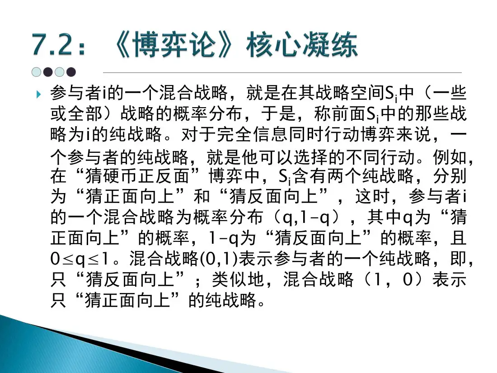

原文：

7.2：《博弈论》核心凝练

 参与者i的一个混合战略，就是在其战略空间 $\mathsf { S } _ { \mathrm { i } }$ 中（一些或全部）战略的概率分布，于是，称前面 $S _ { \mathrm { j } }$ 中的那些战略为i的纯战略。对于完全信息同时行动博弈来说，一个参与者的纯战略，就是他可以选择的不同行动。例如，在“猜硬币正反面”博弈中， $\mathsf { S } _ { \mathrm { i } }$ 含有两个纯战略，分别为“猜正面向上”和“猜反面向上”，这时，参与者i的一个混合战略为概率分布 $( \mathsf { q } , \mathsf { l } - \mathsf { q } )$ ，其中 $\mathsf { q }$ 为“猜正面向上”的概率，1-q为“猜反面向上”的概率，且$0 { \leq } { \mathsf { q } } { \leq } { \mathsf { l } }$ 。混合战略(0,1)表示参与者的一个纯战略，即，只“猜反面向上”；类似地，混合战略（1，0）表示只“猜正面向上”的纯战略。

### 7.2：《博弈论》核心凝练

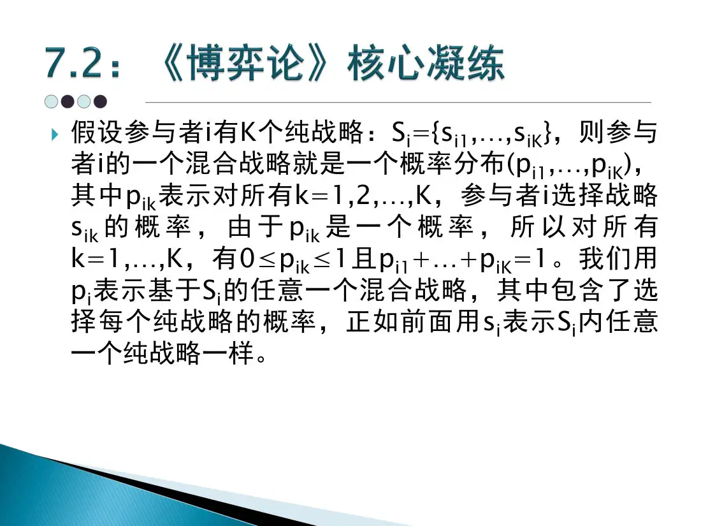

原文：

7.2：《博弈论》核心凝练

 假设参与者i有K个纯战略： $S _ { i } { = } \{ s _ { i 1 } , \ldots , s _ { i | k } \}$ ，则参与者i的一个混合战略就是一个概率分布 $( p _ { \ i _ { 1 } } , \ldots , p _ { \ i _ { k } } )$ 其中 $\mathsf { p } _ { \mathsf { i k } }$ 表示对所有 $k = 1 , 2 , \ldots , k$ ，参与者i选择战略$\mathsf { S } _ { \mathrm { i k } }$ 的概率，由于 $\mathsf { p } _ { \mathsf { i k } }$ 是一个概率，所以对所有$k = 1 , \ldots , k$ ，有 $0 \leq \mathsf { p } _ { \mathsf { i k } } \leq \mathsf { l }$ 且 $\mathsf { p } _ { \mathsf { i } } \mathsf { _ { l } } + \ldots + \mathsf { p } _ { \mathsf { i } \mathsf { k } } \mathsf { = } \mathsf { I }$ 。我们用$p _ { \mathrm { i } }$ 表示基于 $\mathsf { S } _ { \mathrm { i } }$ 的任意一个混合战略，其中包含了选择每个纯战略的概率，正如前面用 $\mathsf { S } _ { \mathrm { i } }$ 表示 $\mathsf { S } _ { \mathrm { i } }$ 内任意一个纯战略一样。

### 7.2：《博弈论》核心凝练

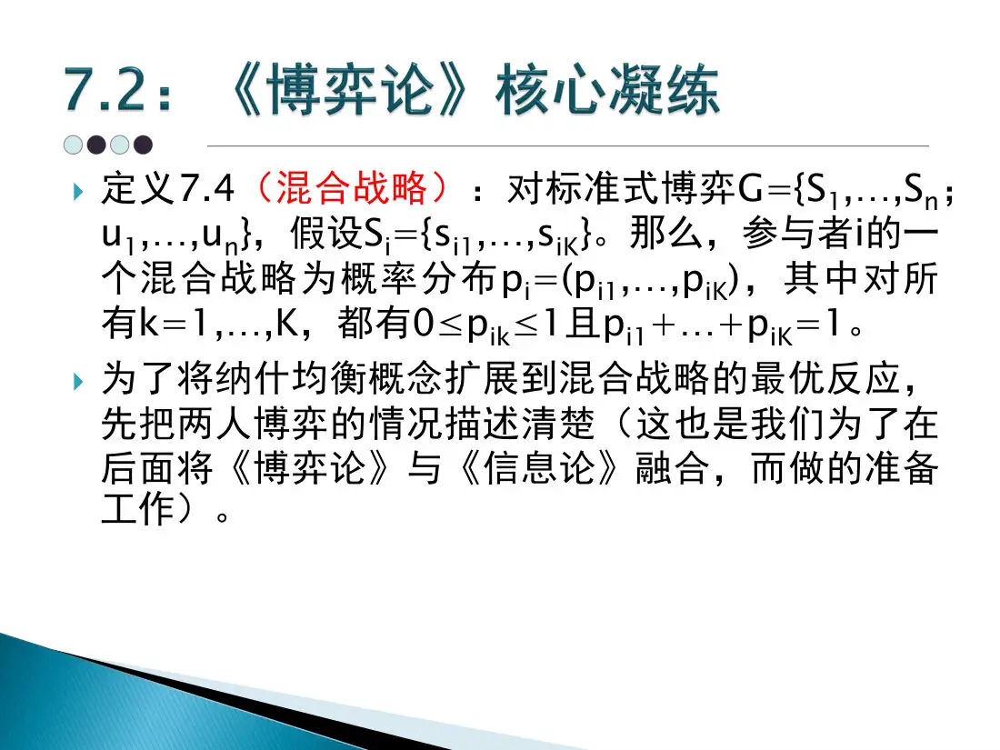

原文：

7.2：《博弈论》核心凝练

 定义7.4（混合战略）：对标准式博弈 $\mathsf { G } { = } \{ \mathsf { S } _ { \mathsf { l } } , \ldots , \mathsf { S } _ { \mathsf { n } }$ $\boldsymbol { \mathsf { U } } _ { 1 } , \ldots , \boldsymbol { \mathsf { U } } _ { \mathsf { n } } \boldsymbol  \}$ ，假设 $S _ { i } { = } \{ s _ { i 1 } , \ldots , s _ { i | k } \}$ 。那么，参与者i的一个混合战略为概率分布 $\mathsf { p } _ { \mathrm { i } } { = } ( \mathsf { p } _ { \mathrm { i } } { _ { 1 } } , \ldots , \mathsf { p } _ { \mathrm { i } } { _ { \mathsf { k } } } )$ ，其中对所有 $k = 1 , \ldots , k$ ，都有 $0 \leq p _ { \mathrm { i k } } \leq 1$ 且 $\mathsf { p } _ { \mathsf { i } } \mathsf { _ { l } } + \ldots + \mathsf { p } _ { \mathsf { i } \mathsf { k } } \mathsf { = } \mathsf { I }$ o

 为了将纳什均衡概念扩展到混合战略的最优反应，先把两人博弈的情况描述清楚（这也是我们为了在后面将《博弈论》与《信息论》融合，而做的准备工作）。

### 7.3：《信息论》核心凝练

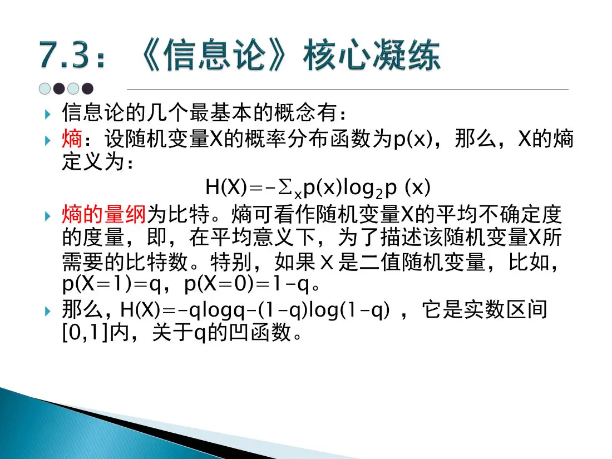

原文：

7.3：《信息论》核心凝练

信息论的几个最基本的概念有：

熵：设随机变量X的概率分布函数为p(x)，那么，X的熵定义为：

$$
H (X) = - \sum_ {x} p (x) \log_ {2} p (x)
$$

熵的量纲为比特。熵可看作随机变量X的平均不确定度的度量，即，在平均意义下，为了描述该随机变量X所需要的比特数。特别，如果X是二值随机变量，比如，$p ( \mathsf { X } = \mathsf { I } ) = \mathsf { q } , \mathsf { p } ( \mathsf { X } = 0 ) = \mathsf { I } - \mathsf { q }$

 那么， ${ \sf H } ( { \sf X } ) = - { \sf q } | \log { \sf q } - ( 1 - { \sf q } ) | \log { ( 1 - { \sf q } ) }$ ，它是实数区间[0,1]内，关于q的凹函数。

### 7.3：《信息论》核心凝练

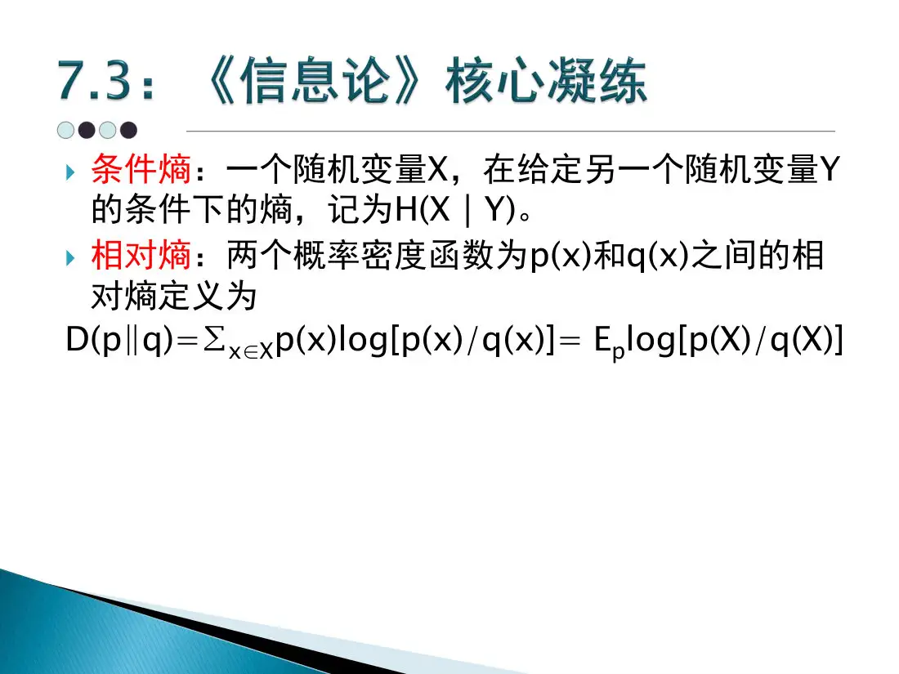

原文：

7.3：《信息论》核心凝练

 条件熵：一个随机变量X，在给定另一个随机变量Y的条件下的熵，记为H $( \mathsf { X } \mid \mathsf { Y } )$ o

 相对熵：两个概率密度函数为 $\mathsf { p } ( \mathsf { x } )$ 和 ${ \sf q } ( { \sf x } )$ 之间的相对熵定义为

$$
D (p \mid | q) = \sum_ {x \in X} p (x) \log [ p (x) / q (x) ] = E _ {p} \log [ p (X) / q (X) ]
$$

### 7.3：《信息论》核心凝练

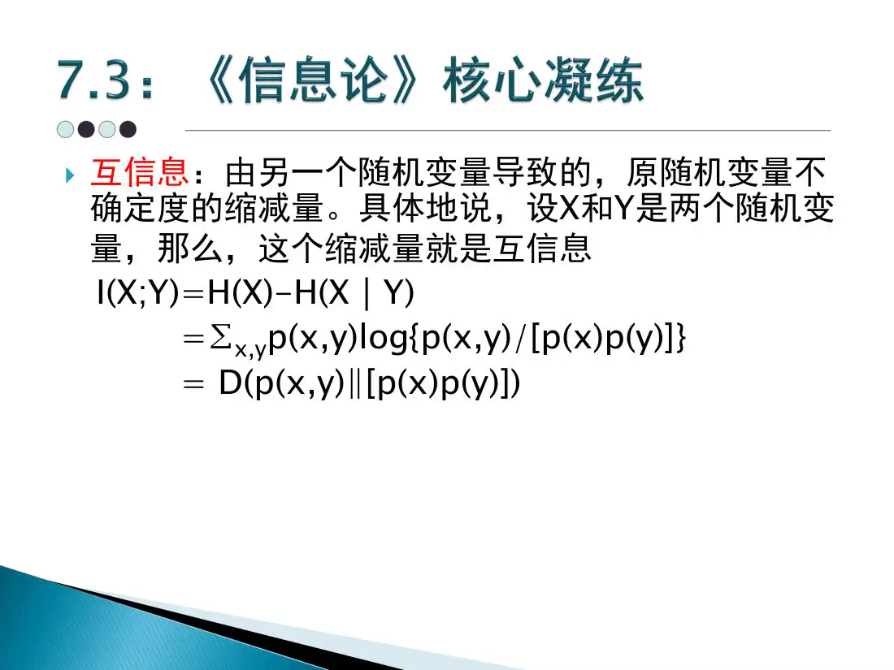

原文：

7.3：《信息论》核心凝练

 互信息：由另一个随机变量导致的，原随机变量不确定度的缩减量。具体地说，设X和Y是两个随机变量，那么，这个缩减量就是互信息

$$
\begin{array}{r l} \mathsf {I} (\mathsf {X}; \mathsf {Y}) & = \mathsf {H} (\mathsf {X}) - \mathsf {H} (\mathsf {X} \mid \mathsf {Y}) \\ & = \sum_ {\mathsf {x}, \mathsf {y}} \mathsf {p} (\mathsf {x}, \mathsf {y}) \log \{\mathsf {p} (\mathsf {x}, \mathsf {y}) / [ \mathsf {p} (\mathsf {x}) \mathsf {p} (\mathsf {y}) ] \} \\ & = \mathsf {D} (\mathsf {p} (\mathsf {x}, \mathsf {y}) | | [ \mathsf {p} (\mathsf {x}) \mathsf {p} (\mathsf {y}) ]) \end{array}
$$

### 7.3：《信息论》核心凝练

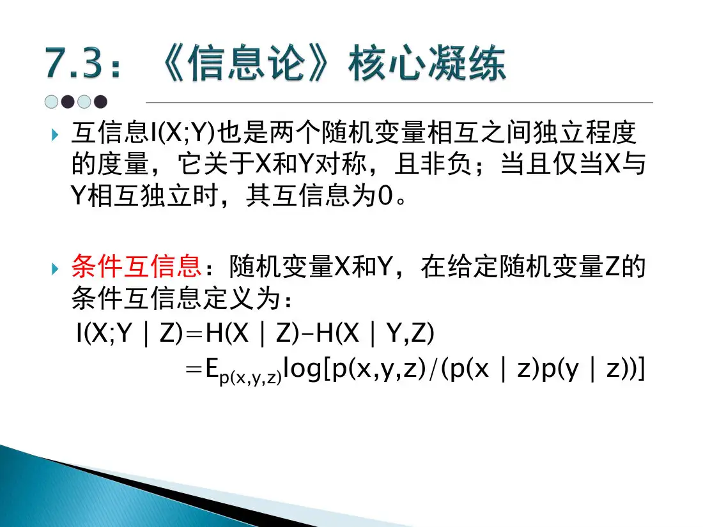

原文：

7.3：《信息论》核心凝练

 互信息I(X;Y)也是两个随机变量相互之间独立程度的度量，它关于X和Y对称，且非负；当且仅当X与Y相互独立时，其互信息为0。

 条件互信息：随机变量X和Y，在给定随机变量Z的条件互信息定义为：

$$
\begin{array}{r l} \mathsf {I} (\mathsf {X}; \mathsf {Y} \mid \mathsf {Z}) & = \mathsf {H} (\mathsf {X} \mid \mathsf {Z}) - \mathsf {H} (\mathsf {X} \mid \mathsf {Y}, \mathsf {Z}) \\ & = \mathsf {E} _ {\mathsf {p} (\mathsf {x}, \mathsf {y}, \mathsf {z})} \log [ \mathsf {p} (\mathsf {x}, \mathsf {y}, \mathsf {z}) / (\mathsf {p} (\mathsf {x} \mid \mathsf {z}) \mathsf {p} (\mathsf {y} \mid \mathsf {z})) ] \end{array}
$$

### 7.3：《信息论》核心凝练

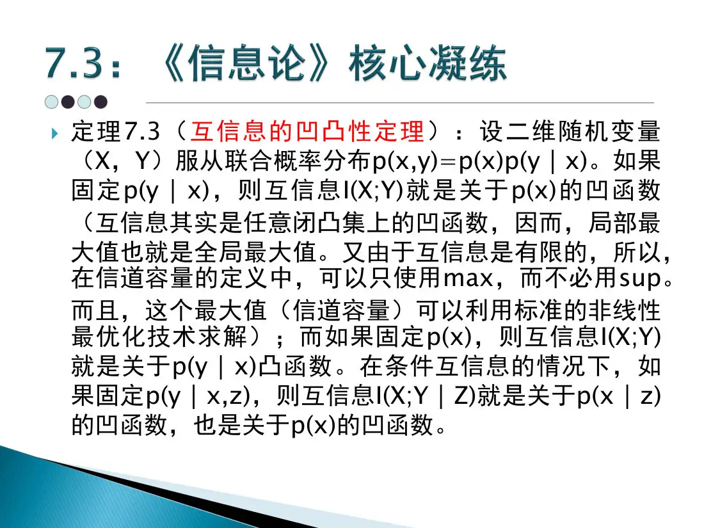

原文：

7.3：《信息论》核心凝练

 定理7.3（互信息的凹凸性定理）：设二维随机变量（X，Y）服从联合概率分布 $\mathsf { p } ( \mathsf { x } , \mathsf { y } ) { = } \mathsf { p } ( \mathsf { x } ) \mathsf { p } ( \mathsf { y } \mid \mathsf { x } )$ 。如果固定p(y│x)，则互信息I(X;Y)就是关于p(x)的凹函数（互信息其实是任意闭凸集上的凹函数，因而，局部最大值也就是全局最大值。又由于互信息是有限的，所以，在信道容量的定义中，可以只使用max，而不必用sup。而且，这个最大值（信道容量）可以利用标准的非线性最优化技术求解）；而如果固定p(x)，则互信息I(X;Y)就是关于p(y│x)凸函数。在条件互信息的情况下，如果固定 $\mathsf { p } ( \mathsf { y } \mid \mathsf { x } , \mathsf { z } )$ 则互信息I(X;Y│Z)就是关于p(x│z)的凹函数，也是关于p(x)的凹函数。

### 7.3：《信息论》核心凝练

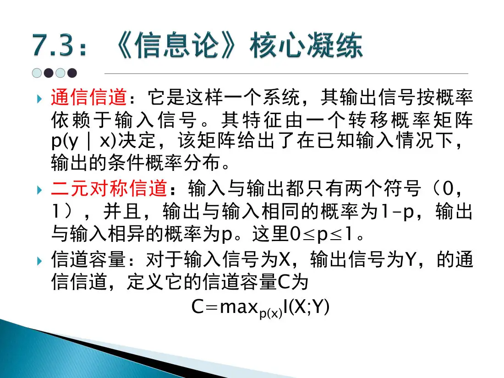

原文：

7.3：《信息论》核心凝练

 通信信道：它是这样一个系统，其输出信号按概率依赖于输入信号。其特征由一个转移概率矩阵p(y│x)决定，该矩阵给出了在已知输入情况下，输出的条件概率分布。

二元对称信道：输入与输出都只有两个符号（0，1），并且，输出与输入相同的概率为1-p，输出与输入相异的概率为p。这里 $0 \leq p \leq 1$ o

 信道容量：对于输入信号为X，输出信号为Y，的通信信道，定义它的信道容量C为

$$
C = \max _ {p (x)} I (X; Y)
$$

### 7.3：《信息论》核心凝练

原文：

7.3：《信息论》核心凝练

 香农信道编码定理：对于离散无记忆信道，小于信道容量C的所有码率都是可达的。或者可以形象地解释为：码率不超过信道容量C的所有信号，都能够被无误差地从发方传输到收方。

### 7.4：三论融合

原文：

7.4：三论融合

 这一节我们将利用《安全通论》，把《博弈论》的核心（纳什均衡）和《信息论》的核心（信道容量）进行充分融合，并顺便给出了网络信息论中存疑数十年的一些难题的解决思路。

### 7.4：三论融合

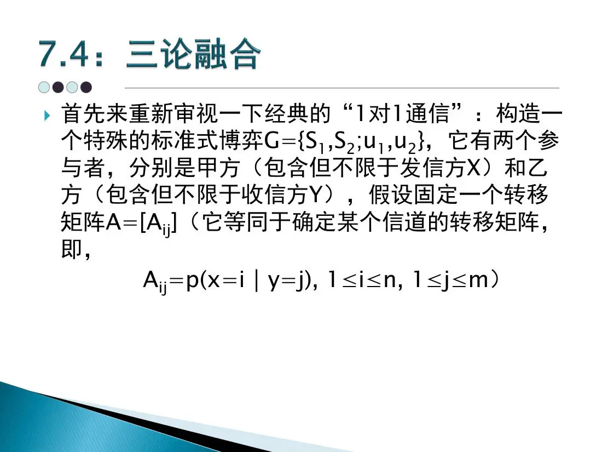

原文：

7.4：三论融合

 首先来重新审视一下经典的“1对1通信”：构造一个特殊的标准式博弈 $\mathsf { G } { = } \{ \mathsf { S } _ { 1 } , \mathsf { S } _ { 2 } ; \mathsf { U } _ { 1 } , \mathsf { u } _ { 2 } \}$ ，它有两个参与者，分别是甲方（包含但不限于发信方X）和乙方（包含但不限于收信方Y），假设固定一个转移矩阵 $\mathsf { A } { = } [ \mathsf { A } _ { \mathrm { i j } } ]$ （它等同于确定某个信道的转移矩阵，即，

$$
A _ {i j} = p (x = i \mid y = j), 1 \leq i \leq n, 1 \leq j \leq m)
$$

### 7.4：三论融合

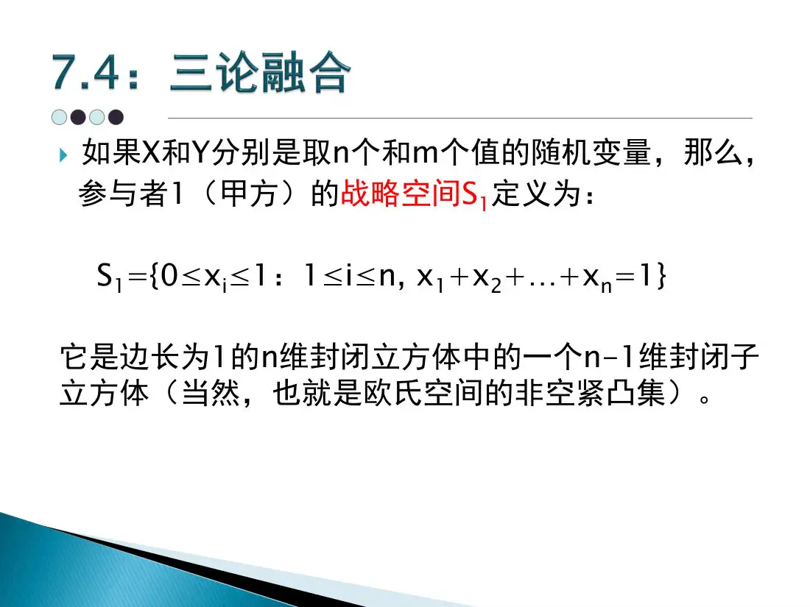

原文：

7.4：三论融合

如果X和Y分别是取n个和m个值的随机变量，那么，参与者1（甲方）的战略空间 $\mathsf { S } _ { \mathsf { l } }$ 定义为：

$$
S _ {1} = \{0 \leq x _ {i} \leq 1: 1 \leq i \leq n, x _ {1} + x _ {2} + \dots + x _ {n} = 1 \}
$$

它是边长为1的n维封闭立方体中的一个n-1维封闭子立方体（当然，也就是欧氏空间的非空紧凸集）。

### 7.4：三论融合

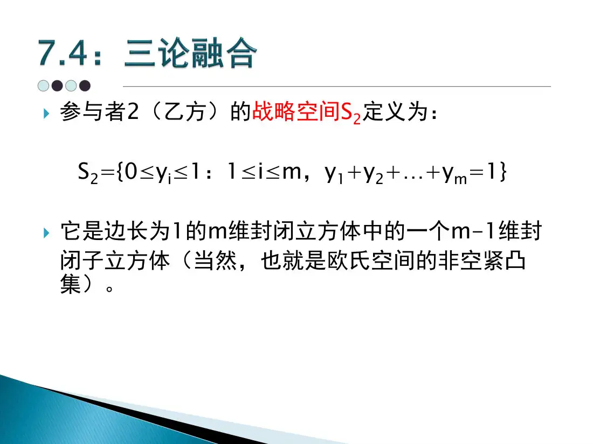

原文：

7.4：三论融合

 参与者2（乙方）的战略空间 $\mathsf { S } _ { 2 }$ 定义为：

$$
S _ {2} = \{0 \leq y _ {i} \leq 1: 1 \leq i \leq m, y _ {1} + y _ {2} + \dots + y _ {m} = 1 \}
$$

 它是边长为1的m维封闭立方体中的一个m-1维封闭子立方体（当然，也就是欧氏空间的非空紧凸集）。

### 7.4：三论融合

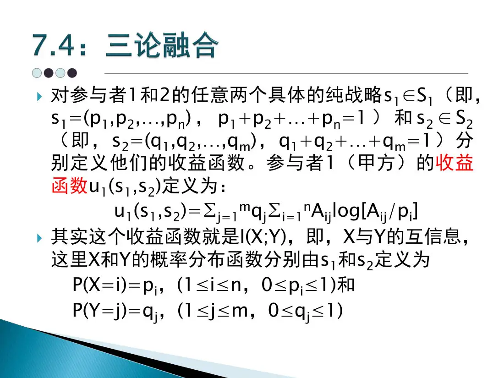

原文：

7.4：三论融合

对参与者1和2的任意两个具体的纯战略 $\mathsf { S } _ { \mathsf { l } } \in \mathsf { S } _ { \mathsf { l } }$ （即，$\mathsf { S } _ { 1 } = ( \mathsf { p } _ { 1 } , \mathsf { p } _ { 2 } , . . . , \mathsf { p } _ { \mathsf { n } } ) , \mathsf { p } _ { 1 } + \mathsf { p } _ { 2 } + . . . + \mathsf { p } _ { \mathsf { n } } = 1 )$ 和 $\mathsf { S } _ { 2 } \in \mathsf { S } _ { 2 }$ （即， $\mathsf { S } _ { 2 } \mathrm { = } ( \mathsf { q } _ { 1 } , \mathsf { q } _ { 2 } , \ldots , \mathsf { q } _ { \mathsf { m } } ) , ~ \mathsf { q } _ { 1 } \mathrm { + } \mathsf { q } _ { 2 } \mathrm { + } \ldots \mathrm { + } \mathsf { q } _ { \mathsf { m } } \mathrm { = } 1 \mathrm { ~ ) }$ 分别定义他们的收益函数。参与者1（甲方）的收益函数 $\mathsf { u } _ { 1 } ( \mathsf { s } _ { 1 } , \mathsf { s } _ { 2 } )$ 定义为：

$$
u _ {1} \left(s _ {1}, s _ {2}\right) = \sum_ {j = 1} ^ {m} q _ {j} \sum_ {i = 1} ^ {n} A _ {i j} \log \left[ A _ {i j} / p _ {i} \right]
$$

 其实这个收益函数就是 $| ( { \sf X } , { \sf Y } )$ ，即，X与Y的互信息，这里X和Y的概率分布函数分别由 $\mathsf { S } _ { \mathsf { l } }$ 和 $\mathsf { S } _ { 2 }$ 定义为

$$
P (X = i) = p _ {i}, \quad (1 \leq i \leq n, 0 \leq p _ {i} \leq 1) \text {和}
$$

$$
P (Y = j) = q _ {j}, \quad (1 \leq j \leq m, \quad 0 \leq q _ {j} \leq 1)
$$

### 7.4：三论融合

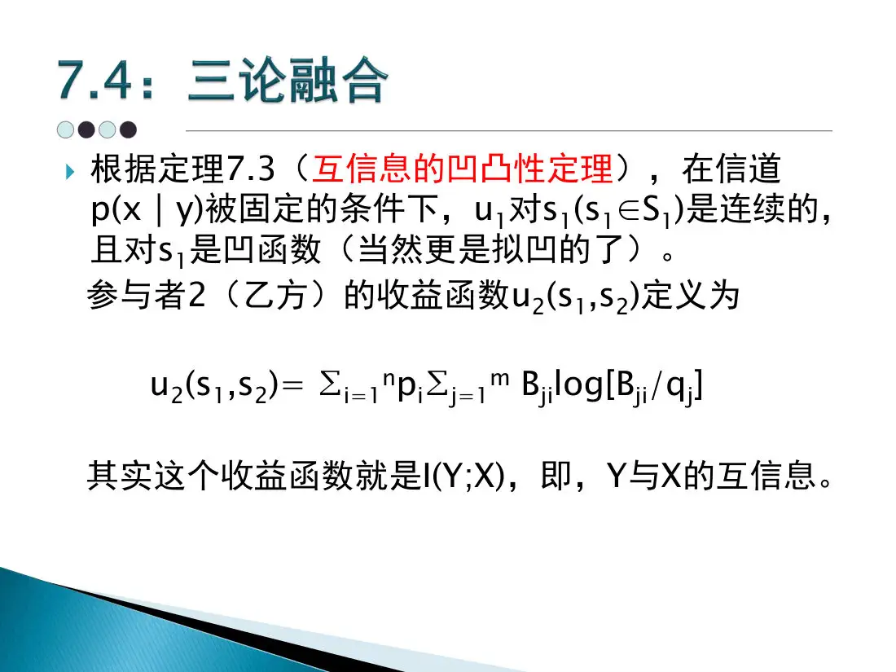

原文：

7.4：三论融合

根据定理7.3（互信息的凹凸性定理），在信道$\mathsf { p } ( \mathsf { x } \mid \mathsf { y } )$ 被固定的条件下， $\mathsf { u } _ { 1 }$ 对 $\mathsf { S } _ { \mathsf { l } } ( \mathsf { s } _ { \mathsf { l } } \in \mathsf { S } _ { \mathsf { l } } )$ 是连续的，且对 $\mathsf { S } _ { \mathsf { l } }$ 是凹函数（当然更是拟凹的了）。

参与者2（乙方）的收益函数 $\mathsf { u } _ { 2 } ( \mathsf { s } _ { 1 } , \mathsf { s } _ { 2 } )$ 定义为

$$
u _ {2} \left(s _ {1}, s _ {2}\right) = \sum_ {i = 1} ^ {n} p _ {i} \sum_ {j = 1} ^ {m} B _ {j i} \log \left[ B _ {j i} / q _ {j} \right]
$$

其实这个收益函数就是I(Y;X)，即，Y与X的互信息。

### 7.4：三论融合

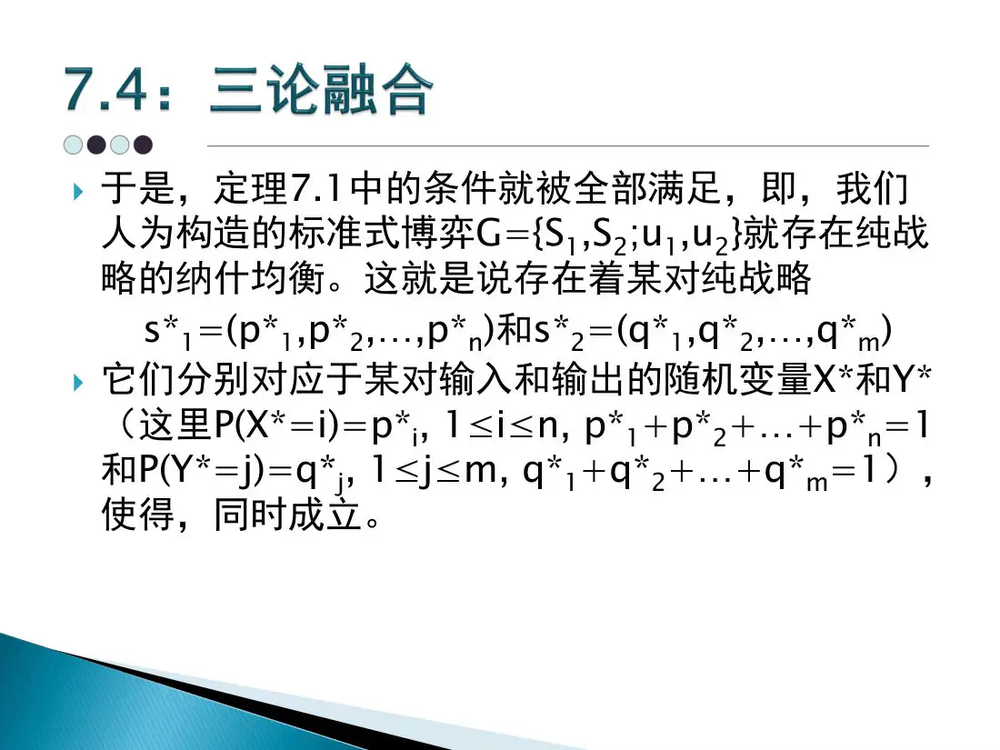

原文：

7.4：三论融合

 于是，定理7.1中的条件就被全部满足，即，我们人为构造的标准式博弈 $\mathsf { G } { = } \{ \mathsf { S } _ { 1 } , \mathsf { S } _ { 2 } ; \mathsf { U } _ { 1 } , \mathsf { U } _ { 2 } \}$ }就存在纯战略的纳什均衡。这就是说存在着某对纯战略

$$
s _ {1} ^ {*} = \left(p _ {1} ^ {*}, p _ {2} ^ {*}, \dots , p _ {n} ^ {*}\right) \text {和} s _ {2} ^ {*} = \left(q _ {1} ^ {*}, q _ {2} ^ {*}, \dots , q _ {m} ^ {*}\right)
$$

它们分别对应于某对输入和输出的随机变量 $X ^ { \ast }$ 和 $Y ^ { \ast }$ （这里 $\mathsf { P } ( \mathsf { X } ^ { * } = \mathsf { i } ) = \mathsf { p } ^ { * } { } _ { \mathrm { i } } , \mathsf { l } \leq \mathsf { i } \leq \mathsf { n } , \mathsf { p } ^ { * } { } _ { \mathrm { i } } + \mathsf { p } ^ { * } { } _ { 2 } + \ldots + \mathsf { p } ^ { * } { } _ { \mathrm { \mathfrak { n } } } = \mathsf { l }$ 和 $\mathsf { P } ( \mathsf { Y } ^ { * } = \mathrm { j } ) { = } \mathsf { q } ^ { * } { } _ { \mathrm { i } } , \mathsf { l } { \le } \mathsf { j } { \le } \mathsf { m } , \mathsf { q } ^ { * } { } _ { \mathrm { i } } { + } \mathsf { q } ^ { * } { } _ { \mathrm { 2 } } { + } \ldots { + } \mathsf { q } ^ { * } { } _ { \mathrm { m } } { = } 1 \ )$ 使得，同时成 $\frac { 3 } { 1 1 }$ 。

### 7.4：三论融合

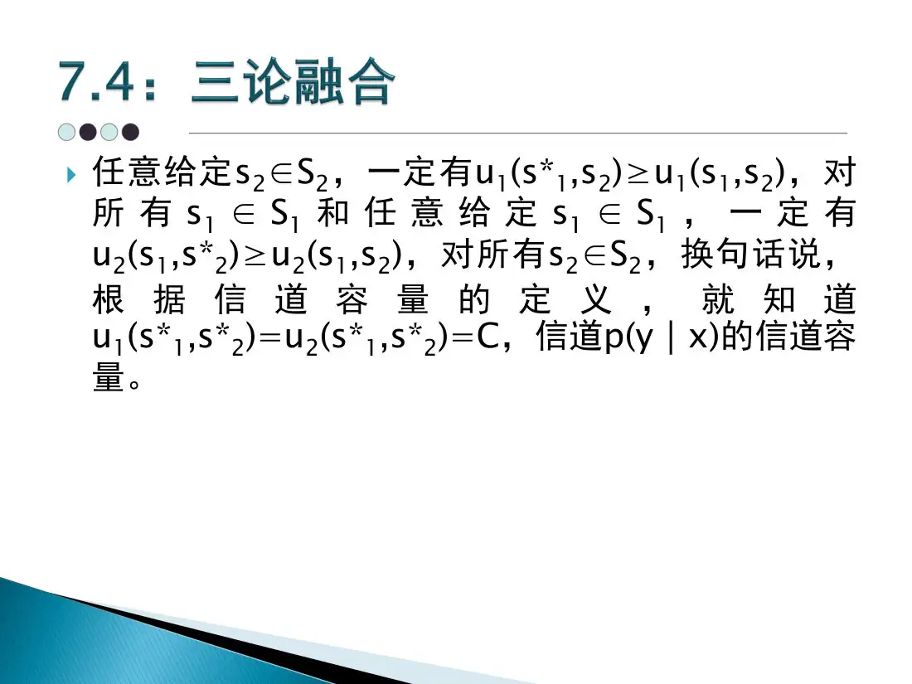

原文：

7.4：三论融合

 任意给定 ${ \sf S } _ { 2 } { \sf \in } { \sf S } _ { 2 }$ ，一定有 $\mathsf { U } _ { 1 } ( \mathsf { S } ^ { \ast } _ { 1 } , \mathsf { S } _ { 2 } ) \geq \mathsf { U } _ { 1 } ( \mathsf { S } _ { 1 } , \mathsf { S } _ { 2 } )$ ，对所 有 $\mathsf { s } _ { 1 } \in \mathsf { S } _ { 1 }$ 和 任 意 给 定 $\mathsf { S } _ { 1 } \in \mathsf { S } _ { 1 }$ 一 定 有$\mathsf { u } _ { 2 } ( \mathsf { s } _ { 1 } , \mathsf { s } ^ { \ast } _ { 2 } ) \geq \mathsf { u } _ { 2 } ( \mathsf { s } _ { 1 } , \mathsf { s } _ { 2 } )$ ，对所有 $\mathsf { S } _ { 2 } \in \mathsf { S } _ { 2 }$ ，换句话说，根 据 信 道 容 量 的 定 义 ， 就 知 道${ \sf u } _ { 1 } ( { \sf s } ^ { * } , { \sf s } ^ { * } { \sf \Phi } _ { 2 } ) = { \sf u } _ { 2 } ( { \sf s } ^ { * } , { \sf s } ^ { * } { \sf \Phi } _ { 2 } ) = { \sf C }$ ，信道 $\mathsf { p } ( \mathsf { y } \mid \mathsf { x } )$ 的信道容量。

### 7.4：三论融合

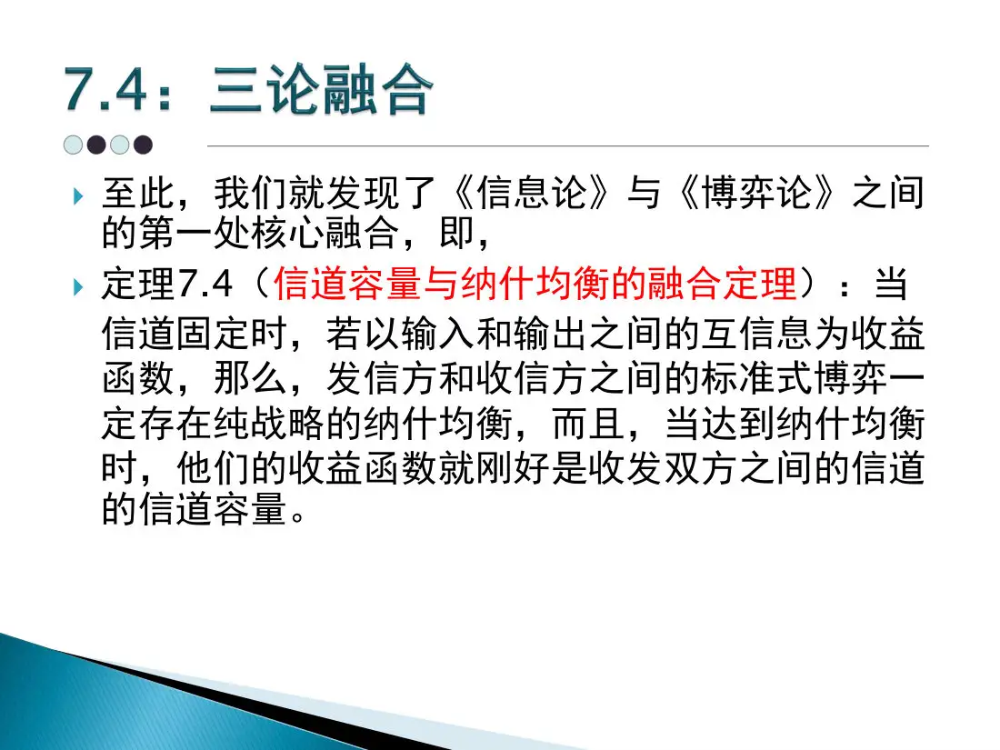

原文：

7.4：三论融合

 至此，我们就发现了《信息论》与《博弈论》之间的第一处核心融合，即，

 定理7.4（信道容量与纳什均衡的融合定理）：当信道固定时，若以输入和输出之间的互信息为收益函数，那么，发信方和收信方之间的标准式博弈一定存在纯战略的纳什均衡，而且，当达到纳什均衡时，他们的收益函数就刚好是收发双方之间的信道的信道容量。

### 7.4：三论融合

原文：

7.4：三论融合

 至此，我们便明白了，为什么过去广播信道的信道容量成为了难题，因为，大家没有博弈概念，没有搞清楚收发各方的优化目标，而是在“鱼和熊掌兼得”的情况下来试图计算所谓的信道容量，当然，就不可能有结果了。自己都不清楚自己想要什么，怎么可能有最佳策略呢！

 下面，我们就在锁定收发各方的利益目标（优化目标）的条件下，给出广播信道相应的“信道容量”（当然，给出的解是博弈论解，即，并不是某个数学解析公式），即，由纳什均衡状态所围成的区域。

### 7.4：三论融合

原文：

7.4：三论融合

最后，再来看全连通网络的信道容量。

 所谓N个用户的全连通网络，就是在该网络中，每个用户既是收信方，同时又是发信方。那么，如何来考虑这种网络中的信道容量呢？其实，若利用上面的博弈思路，只要每个用户自己的目标锁定后，那么，由他们所构成的N个参与者的博弈，就一定存在纳什均衡，而且，他们各自的最大利益也能够在纳什均衡状态下被确定，而且，这些最大值所围成的区域，便是可达的信道容量。非常幸运的是：互信息函数及其线性组合的凹性，保证了纯战略纳什均衡的存在性。

### 7.4：三论融合

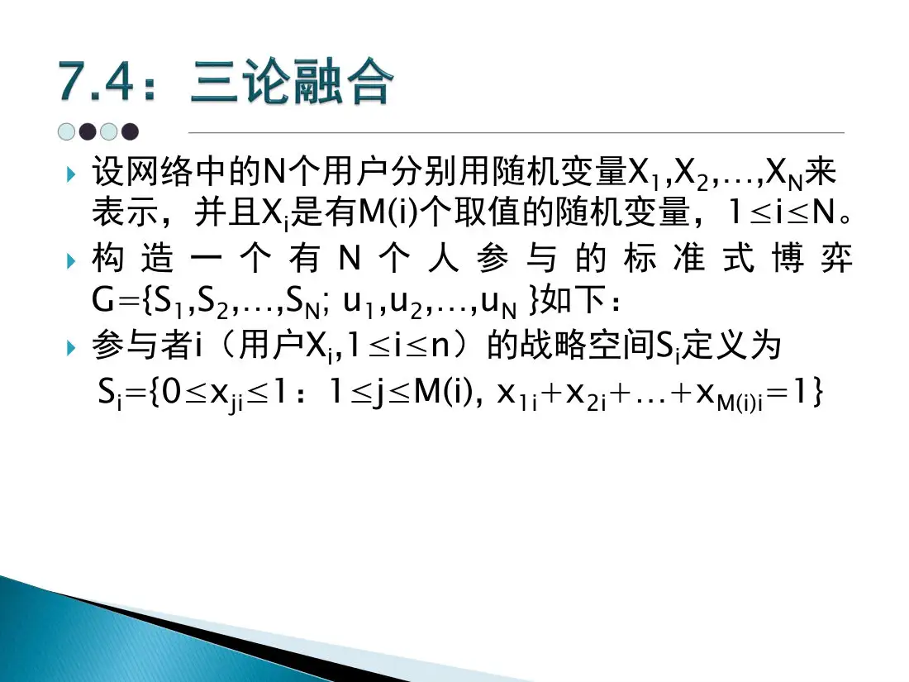

原文：

7.4：三论融合

 设网络中的N个用户分别用随机变量 $\mathsf { X } _ { 1 } , \mathsf { X } _ { 2 } , \ldots , \mathsf { X } _ { \mathsf { N } }$ 来表示，并且 $X _ { \mathrm { i } }$ 是有M(i)个取值的随机变量， $1 \leq i \leq N$ o

构 造 一 个 有 N 个 人 参 与 的 标 准 式 博 弈$\mathsf { G } { = } \{ \mathsf { S } _ { 1 } , \mathsf { S } _ { 2 } , \ldots , \mathsf { S } _ { \mathsf { N } } ; \mathsf { u } _ { 1 } , \mathsf { u } _ { 2 } , \ldots , \mathsf { u } _ { \mathsf { N } }$ }如下：

 参与者i（用户 $x _ { i } , 1 \leq i \leq n )$ 的战略空间 $\mathsf { S } _ { \mathrm { i } }$ 定义为

$$
S _ {i} = \left\{0 \leq x _ {j i} \leq 1: 1 \leq j \leq M (i), x _ {1 i} + x _ {2 i} + \dots + x _ {M (i) i} = 1 \right\}
$$

### 7.5：几点反醒

原文：

7.5：几点反醒

 香农在创立1对1通信的《信息论》时，非常巧妙地利用了转移矩阵来描述信道和互信息等重要概念，以至于后人在研究多用户网络信息论时，首先想到的就是“照猫画虎”，而且，还真的在“多输入单输出信道”中取得了重要成果，求出了（实际上只是部分求出了）所谓的“信道容量”。但遗憾的是，人们误入了歧途，数十年的停滞不前便是最有力的证明。

### 7.5：几点反醒

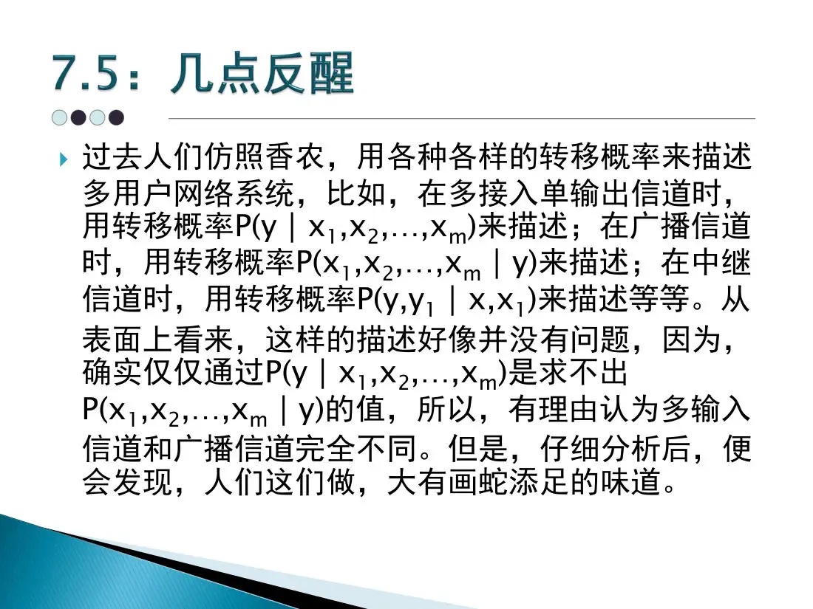

原文：

7.5：几点反醒

 过去人们仿照香农，用各种各样的转移概率来描述多用户网络系统，比如，在多接入单输出信道时，用转移概率P(y $| \times _ { 1 } , \times _ { 2 } , \ldots , \times _ { m } )$ 来描述；在广播信道时，用转移概率 $\mathsf { P } ( \mathsf { x } _ { 1 } , \mathsf { x } _ { 2 } , \ldots , \mathsf { x } _ { \mathsf { m } }$ │y)来描述；在中继信道时，用转移概率 $\mathsf { P } ( \mathsf { y } , \mathsf { y } _ { 1 } \mid \mathsf { x } , \mathsf { x } _ { 1 } )$ 来描述等等。从表面上看来，这样的描述好像并没有问题，因为，确实仅仅通过P(y $| \times _ { 1 } , \times _ { 2 } , \ldots , \times _ { m } )$ 是求不出$\mathsf { P } ( \mathsf { x } _ { 1 } , \mathsf { x } _ { 2 } , \ldots , \mathsf { x } _ { \mathsf { m } } \mid \mathsf { y } )$ 的值，所以，有理由认为多输入信道和广播信道完全不同。但是，仔细分析后，便会发现，人们这们做，大有画蛇添足的味道。

### 7.5：几点反醒

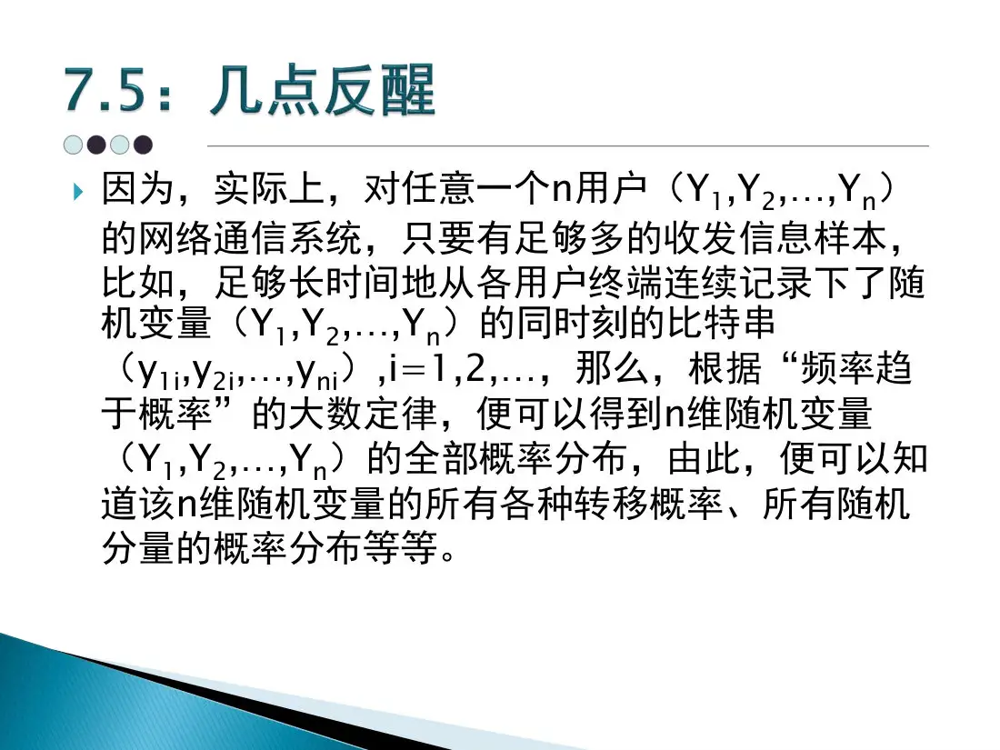

原文：

7.5：几点反醒

 因为，实际上，对任意一个n用户 $( \textsf { Y } _ { 1 } , \textsf { Y } _ { 2 } , \ldots , \textsf { Y } _ { n } )$ 的网络通信系统，只要有足够多的收发信息样本，比如，足够长时间地从各用户终端连续记录下了随机变量 $( \textsf { Y } _ { 1 } , \textsf { Y } _ { 2 } , \ldots , \textsf { Y } _ { n } )$ 的同时刻的比特串$( \mathsf { y } _ { \mathsf { 1 } { \mathsf { i } } } , \mathsf { y } _ { 2 { \mathsf { i } } } , \ldots , \mathsf { y } _ { \mathsf { n } { \mathsf { i } } } ) , \mathsf { i } = \mathsf { l } , 2 , \ldots ,$ 那么，根据“频率趋于概率”的大数定律，便可以得到n维随机变量$( \mathsf { Y } _ { 1 } , \mathsf { Y } _ { 2 } , \ldots , \mathsf { Y } _ { \mathsf { n } } )$ 的全部概率分布，由此，便可以知道该n维随机变量的所有各种转移概率、所有随机分量的概率分布等等。

### 7.5：几点反醒

原文：

7.5：几点反醒

 在多用户情形下，“用转移概率去描述信道”是行不通的，同样，想用一些直线去切割出“信道容量”也更行不通。此时的重点应该是说清楚每个用户的真正通信意图到底是什么，或者说，每个用户的优化目标是什么。否则，如果优化目标都不明确，哪可能有明确的结果呢？

### 7.5：几点反醒

原文：

7.5：几点反醒

 如何才能把每个用户的通信意图，优化目标，说清楚呢？“权重”和“条件互信息”便是最直观的办法。对重要的通信对象，可以将其“权重”提高；对其它用户可以调低权重；对根本不关心的用户，可以将其权重设为0。而“条件互信息”则给出了从所关心的用户群那里，能够获得的信息数量。当然，与《信息论》最核心的香农信道编码定理一样，本章的博弈论方法也只是给出了网络通信中，各用户达到自己企望值的最大可达目标值，并未给出如何达到这个目标，具体的逼近方法仍然是要由编码和译码专家们去挖掘。

### 7.5：几点反醒

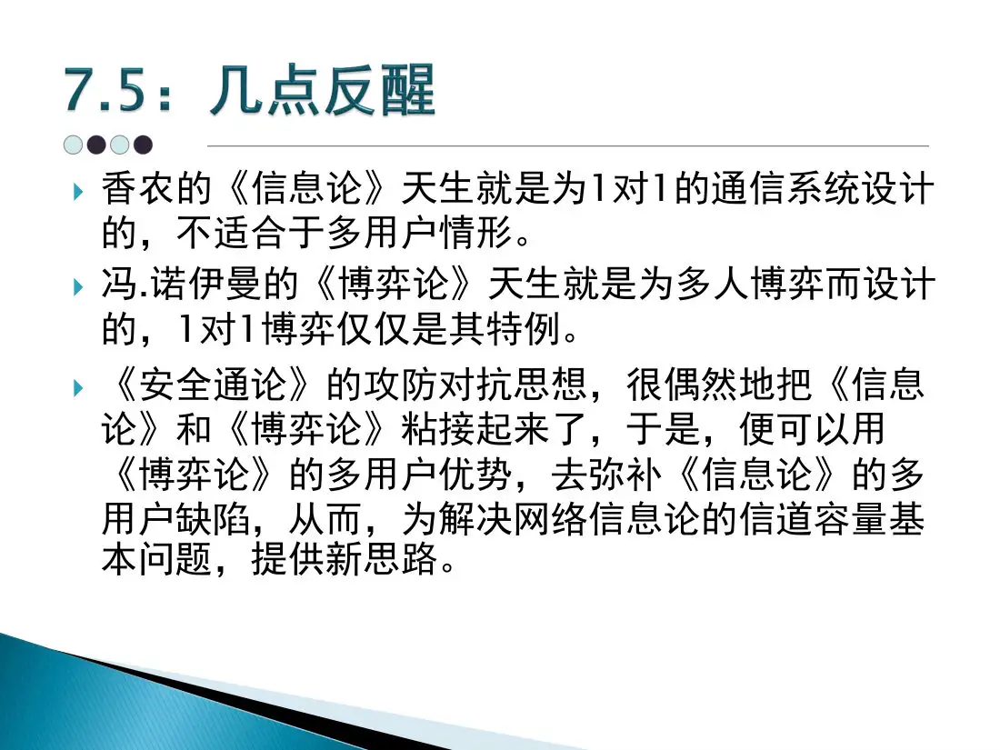

原文：

7.5：几点反醒

 香农的《信息论》天生就是为1对1的通信系统设计的，不适合于多用户情形。

 冯.诺伊曼的《博弈论》天生就是为多人博弈而设计的，1对1博弈仅仅是其特例。

 《安全通论》的攻防对抗思想，很偶然地把《信息论》和《博弈论》粘接起来了，于是，便可以用《博弈论》的多用户优势，去弥补《信息论》的多用户缺陷，从而，为解决网络信息论的信道容量基本问题，提供新思路。

### 本章结束，谢谢

原文：

本章结束，谢谢
