# 《安全通论》第8章 对话的数学理论（课件）

原件的每一页，下面附识别出的文字。

### 第8章---对话的数学理论

原文：

第8章---对话的数学理论

### 第八章对话的数学理论

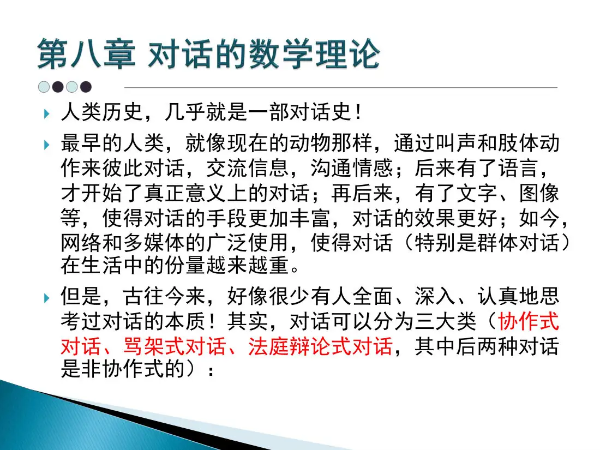

原文：

第八章对话的数学理论

人类历史，几乎就是一部对话史！

 最早的人类，就像现在的动物那样，通过叫声和肢体动作来彼此对话，交流信息，沟通情感；后来有了语言，才开始了真正意义上的对话；再后来，有了文字、图像等，使得对话的手段更加丰富，对话的效果更好；如今，网络和多媒体的广泛使用，使得对话（特别是群体对话）在生活中的份量越来越重。

但是，古往今来，好像很少有人全面、深入、认真地思考过对话的本质！其实，对话可以分为三大类（协作式对话、骂架式对话、法庭辩论式对话，其中后两种对话是非协作式的）：

### 第8章：对话的数学理论

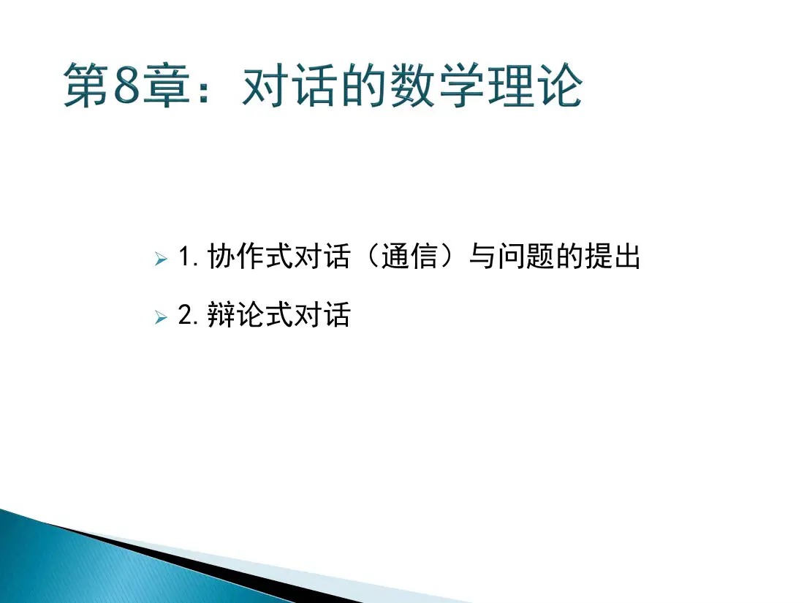

原文：

第8章：对话的数学理论

➢ 1.协作式对话（通信）与问题的提出

2.辩论式对话

### 8.1协作式对话（通信）与问题的提出

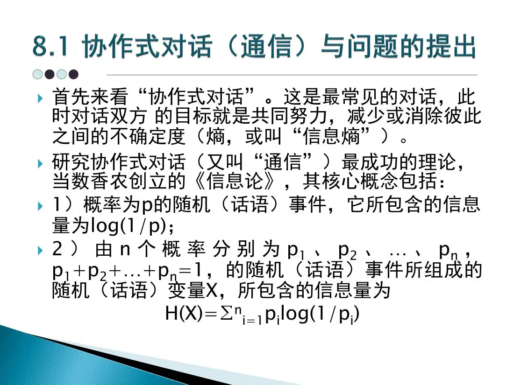

原文：

8.1协作式对话（通信）与问题的提出

 首先来看“协作式对话”。这是最常见的对话，此时对话双方 的目标就是共同努力，减少或消除彼此之间的不确定度（熵，或叫“信息熵”）。

 研究协作式对话（又叫“通信”）最成功的理论，当数香农创立的《信息论》，其核心概念包括：

 1）概率为p的随机（话语）事件，它所包含的信息量为log(1/p)；

2 ） 由 n 个 概 率 分 别 为 $\mathsf { p } _ { 1 } \ldots \mathsf { p } _ { 2 } \ldots \ldots \mathsf { p } _ { n }$ $\mathsf { p } _ { 1 } + \mathsf { p } _ { 2 } + \hdots + \mathsf { p } _ { \mathsf { n } } = 1$ ，的随机（话语）事件所组成的随机（话语）变量X，所包含的信息量为

$$
H (X) = \sum_ {i = 1} ^ {n} p _ {i} \log \left(1 / p _ {i}\right)
$$

### 8.1协作式对话（通信）与问题的提出

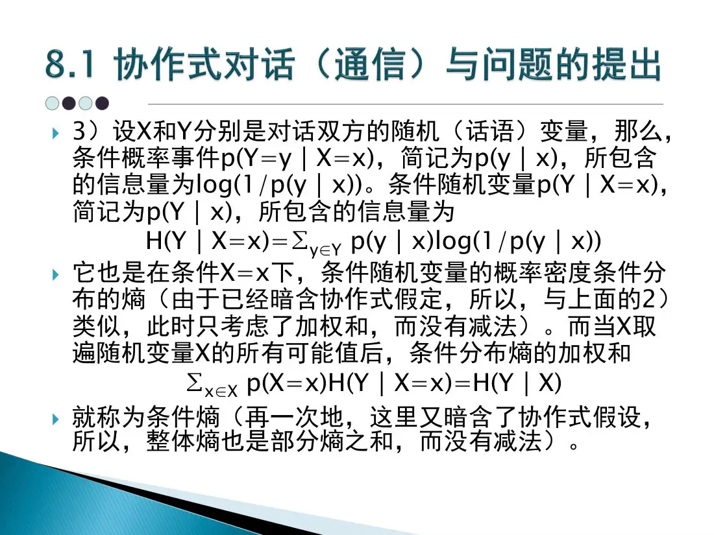

原文：

8.1协作式对话（通信）与问题的提出

 3）设X和Y分别是对话双方的随机（话语）变量，那么，条件概率事件 $\mathsf { p } ( \mathsf { Y } { = } \mathsf { y } \mid \mathsf { X } { = } \mathsf { x } )$ ，简记为 $\mathsf { p } ( \mathsf { y } \mid \mathsf { x } )$ ，所包含的信息量为 $\mathsf { l o g } ( \mathsf { l } / \mathsf { p } ( \mathsf { y } \mid \mathsf { x } ) )$ 。条件随机变量 $\mathsf { p } ( \mathsf { Y } \mid \mathsf { X } { = } \mathsf { x } )$ 简记为 $p ( Y \mid \mathbf { \theta } _ { \mathsf { X } } )$ ，所包含的信息量为

$$
H (Y \mid X = x) = \sum_ {y \in Y} p (y \mid x) \log (1 / p (y \mid x))
$$

 它也是在条件X=x下，条件随机变量的概率密度条件分布的熵（由于已经暗含协作式假定，所以，与上面的2）类似，此时只考虑了加权和，而没有减法）。而当X取遍随机变量X的所有可能值后，条件分布熵的加权和

$$
\Sigma_ {x \in X} p (X = x) H (Y \mid X = x) = H (Y \mid X)
$$

 就称为条件熵（再一次地，这里又暗含了协作式假设，所以，整体熵也是部分熵之和，而没有减法）。

### 8.1协作式对话（通信）与问题的提出

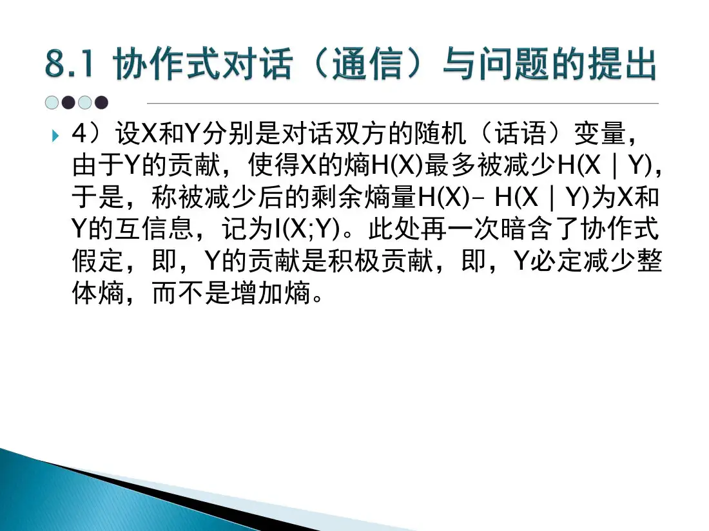

原文：

8.1协作式对话（通信）与问题的提出

 4）设X和Y分别是对话双方的随机（话语）变量，由于Y的贡献，使得X的熵H(X)最多被减少H(X│Y)，于是，称被减少后的剩余熵量H(X)- H(X│Y)为X和Y的互信息，记为I(X;Y)。此处再一次暗含了协作式假定，即，Y的贡献是积极贡献，即，Y必定减少整体熵，而不是增加熵。

### 8.1协作式对话（通信）与问题的提出

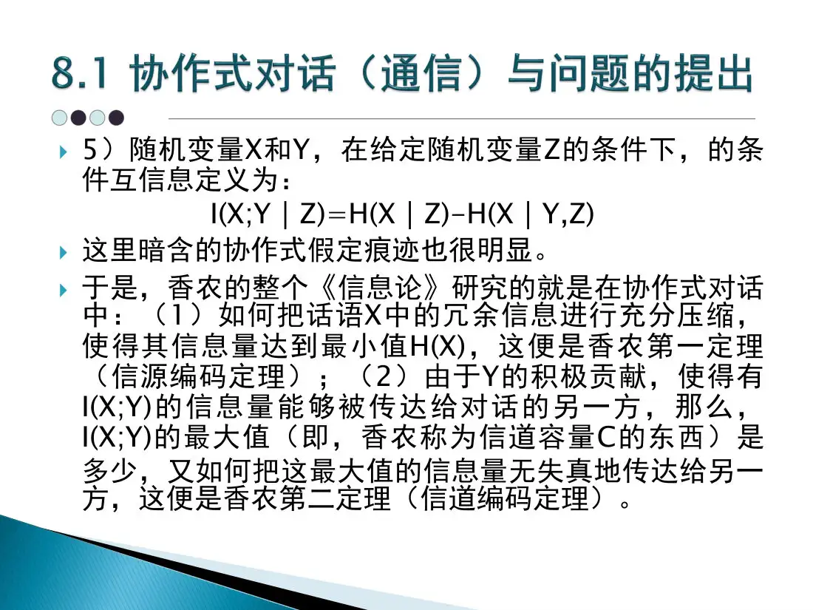

原文：

8.1协作式对话（通信）与问题的提出

 5）随机变量X和Y，在给定随机变量Z的条件下，的条件互信息定义为：

$$
\mathrm{I} (X; Y \mid Z) = H (X \mid Z) - H (X \mid Y, Z)
$$

这里暗含的协作式假定痕迹也很明显。

 于是，香农的整个《信息论》研究的就是在协作式对话中：（1）如何把话语X中的冗余信息进行充分压缩，使得其信息量达到最小值H(X)，这便是香农第一定理（信源编码定理）；（2）由于Y的积极贡献，使得有I(X;Y)的信息量能够被传达给对话的另一方，那么，I(X;Y)的最大值（即，香农称为信道容量C的东西）是多少，又如何把这最大值的信息量无失真地传达给另一方，这便是香农第二定理（信道编码定理）。

### 8.1协作式对话（通信）与问题的提出

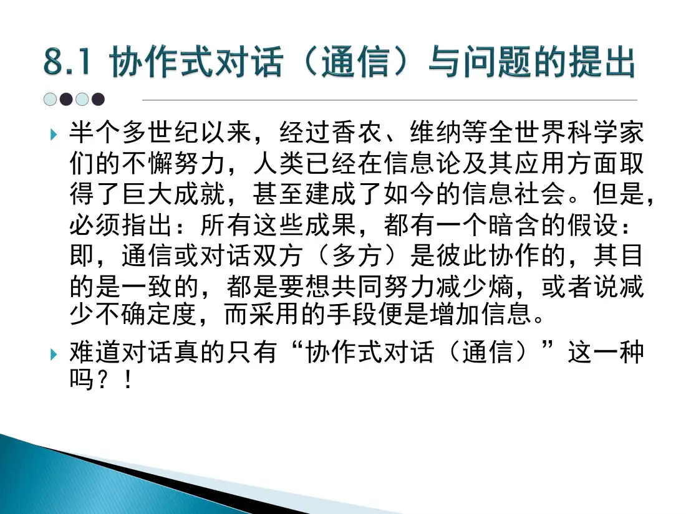

原文：

8.1协作式对话（通信）与问题的提出

 半个多世纪以来，经过香农、维纳等全世界科学家们的不懈努力，人类已经在信息论及其应用方面取得了巨大成就，甚至建成了如今的信息社会。但是，必须指出：所有这些成果，都有一个暗含的假设：即，通信或对话双方（多方）是彼此协作的，其目的是一致的，都是要想共同努力减少熵，或者说减少不确定度，而采用的手段便是增加信息。

 难道对话真的只有“协作式对话（通信）”这一种吗？！

### 8.1 协作式对话（通信）与问题的提出

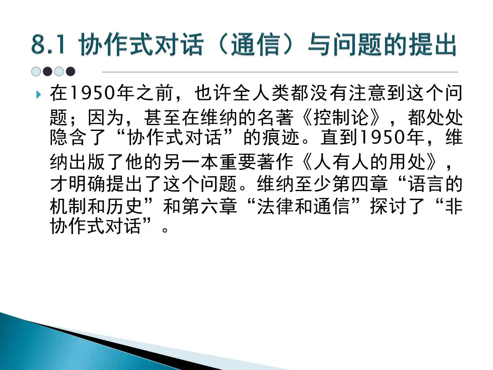

原文：

8.1 协作式对话（通信）与问题的提出

 在1950年之前，也许全人类都没有注意到这个问题；因为，甚至在维纳的名著《控制论》，都处处隐含了“协作式对话”的痕迹。直到1950年，维纳出版了他的另一本重要著作《人有人的用处》，才明确提出了这个问题。维纳至少第四章“语言的机制和历史”和第六章“法律和通信”探讨了“非协作式对话”。

### 8.1协作式对话（通信）与问题的提出

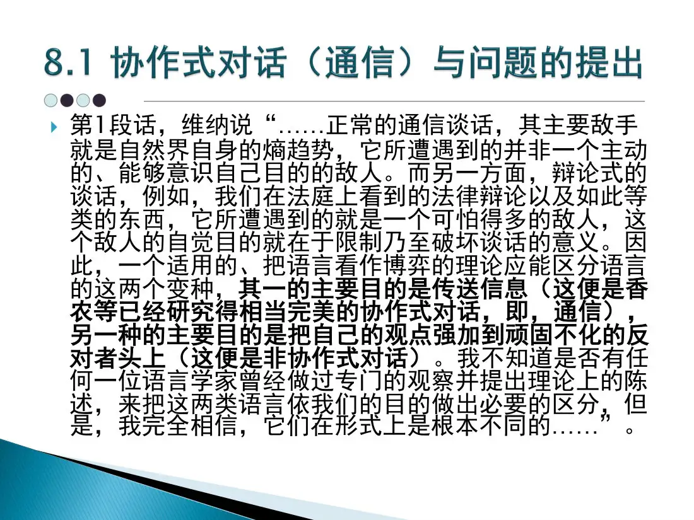

原文：

8.1协作式对话（通信）与问题的提出

 第1段话，维纳说“……正常的通信谈话，其主要敌手就是自然界自身的熵趋势，它所遭遇到的并非一个主动的、能够意识自己目的的敌人。而另一方面，辩论式的的东西，它所遭遇到的就 是 一个可怕得多的敌人，这敌人的自觉目的就在于限制乃至破坏谈话的意义。 因此 ，一 适用的、把语言看作博弈的理论应能区分语言的这两个变种，其一的主要目的是传送信息（这便是香农等已经研究得相当完美的协作式对话，即，另一种的主要目的是把自己的观点强加到顽固不化的反者头上（这便是非协作式对话）。我不知道是否有任述，来把这两类语言依我们的目的做是，我完全相信，它们在形式上是根 我完荃箱套，它们在形式上是粮果不筒的

### 8.1协作式对话（通信）与问题的提出

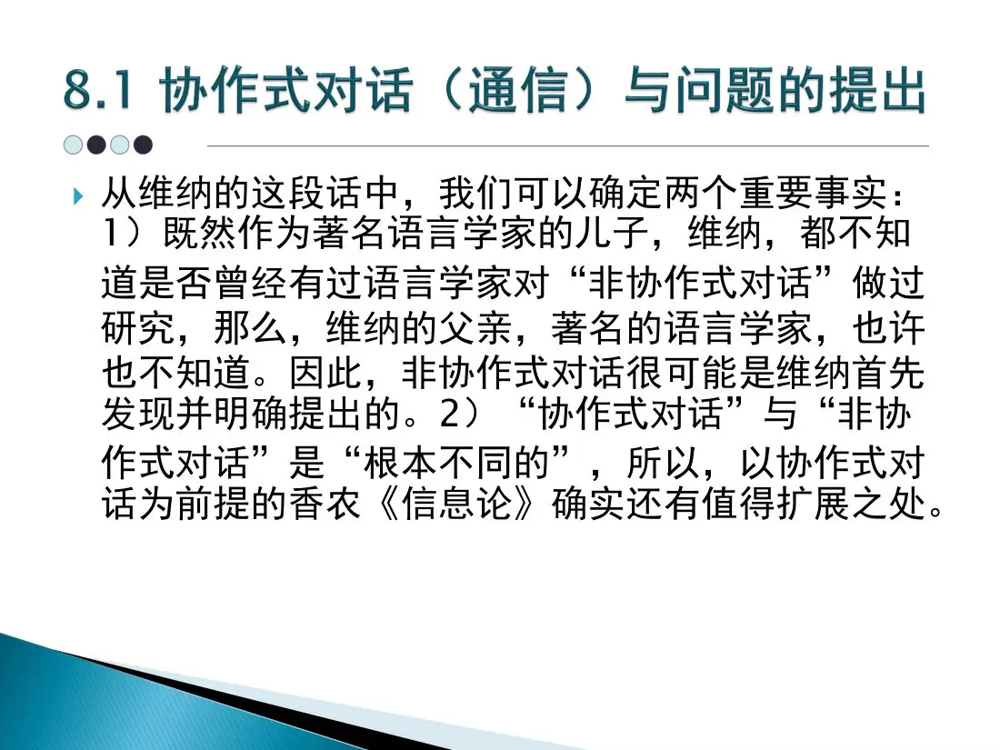

原文：

8.1协作式对话（通信）与问题的提出

 从维纳的这段话中，我们可以确定两个重要事实：1）既然作为著名语言学家的儿子，维纳，都不知道是否曾经有过语言学家对“非协作式对话”做过研究，那么，维纳的父亲，著名的语言学家，也许也不知道。因此，非协作式对话很可能是维纳首先发现并明确提出的。2）“协作式对话”与“非协作式对话”是“根本不同的”，所以，以协作式对话为前提的香农《信息论》确实还有值得扩展之处。

### 8.1协作式对话（通信）与问题的提出

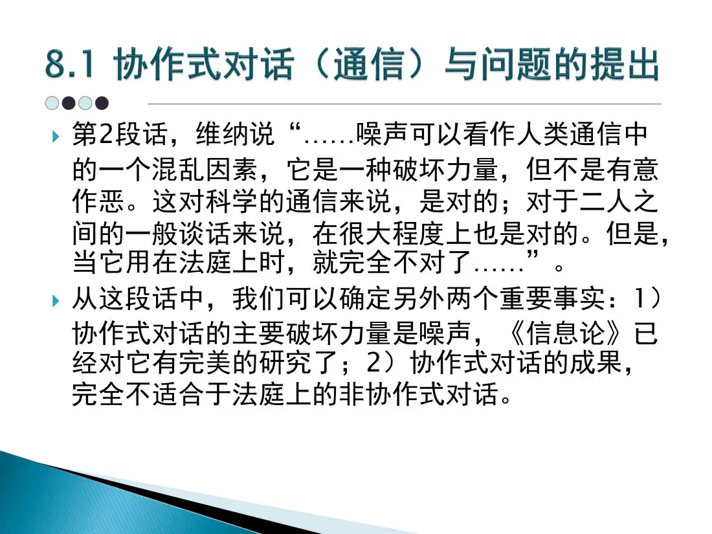

原文：

8.1协作式对话（通信）与问题的提出

 第2段话，维纳说“……噪声可以看作人类通信中的一个混乱因素，它是一种破坏力量，但不是有意作恶。这对科学的通信来说，是对的；对于二人之间的一般谈话来说，在很大程度上也是对的。但是，当它用在法庭上时，就完全不对了……”

 从这段话中，我们可以确定另外两个重要事实：1）协作式对话的主要破坏力量是噪声，《信息论》已经对它有完美的研究了；2）协作式对话的成果，完全不适合于法庭上的非协作式对话。

### 8.2 辩论式对话

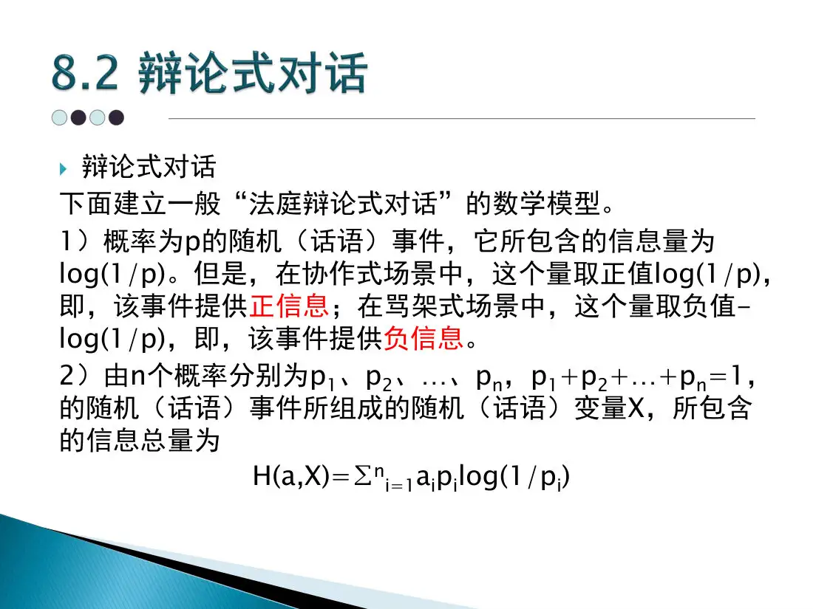

原文：

8.2 辩论式对话

辩论式对话

下面建立一般“法庭辩论式对话”的数学模型。

1）概率为p的随机（话语）事件，它所包含的信息量为log(1/p)。但是，在协作式场景中，这个量取正值log(1/p)，即，该事件提供正信息；在骂架式场景中，这个量取负值-log(1/p)，即，该事件提供负信息。

2）由n个概率分别为 $\mathsf { p } _ { 1 } \bullet \mathsf { p } _ { 2 } \bullet \hdots \mathsf { p } _ { \mathsf { n } } , \mathsf { p } _ { 1 } + \mathsf { p } _ { 2 } + \hdots + \mathsf { p } _ { \mathsf { n } } = 1$ 的随机（话语）事件所组成的随机（话语）变量X，所包含的信息总量为

$$
H (a, X) = \sum_ {i = 1} ^ {n} a _ {i} p _ {i} \log \left(1 / p _ {i}\right)
$$

### 8.2 辩论式对话

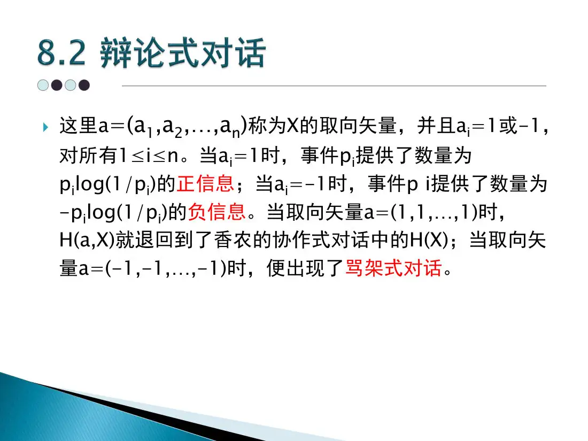

原文：

8.2 辩论式对话

 这里 $\mathsf { a } { = } ( \mathsf { a } _ { 1 } , \mathsf { a } _ { 2 } , \ldots , \mathsf { a } _ { \mathsf { n } } )$ 称为X的取向矢量，并且 $a _ { i } = 1$ 或-1，对所有 $1 \leq i \leq n$ 。当 $\mathtt { a _ { i } } = 1$ 时，事件 $\mathsf { p } _ { \mathsf { i } }$ 提供了数量为${ \mathsf { p } } _ { \mathrm { i } } | { \mathsf { o g } } ( 1 / { \mathsf { p } } _ { \mathrm { i } } )$ 的正信息；当 $\mathtt { a _ { i } } = - 1$ 时，事件p i提供了数量为$- \mathsf { p } _ { \mathrm { i } } | \mathsf { o g } ( \mathsf { l } / \mathsf { p } _ { \mathrm { i } } )$ 的负信息。当取向矢量 $\mathsf { a } { = } ( 1 , 1 , \ldots , 1 ,$ )时，$\mathsf { H } ( \mathsf { a } , \mathsf { X } )$ 就退回到了香农的协作式对话中的H(X)；当取向矢量 $\mathsf { a } { = } ( - 1 , - 1 , \hdots , - 1 ,$ )时，便出现了骂架式对话。

### 8.2 辩论式对话

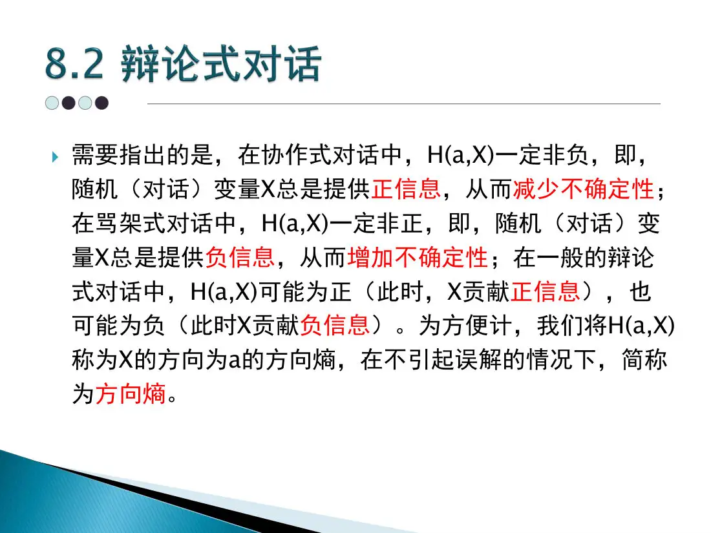

原文：

8.2 辩论式对话

 需要指出的是，在协作式对话中，H(a,X)一定非负，即，随机（对话）变量X总是提供正信息，从而减少不确定性；在骂架式对话中，H(a,X)一定非正，即，随机（对话）变量X总是提供负信息，从而增加不确定性；在一般的辩论式对话中，H(a,X)可能为正（此时，X贡献正信息），也可能为负（此时X贡献负信息）。为方便计，我们将H(a,X)称为X的方向为a的方向熵，在不引起误解的情况下，简称为方向熵。

### 8.2 辩论式对话

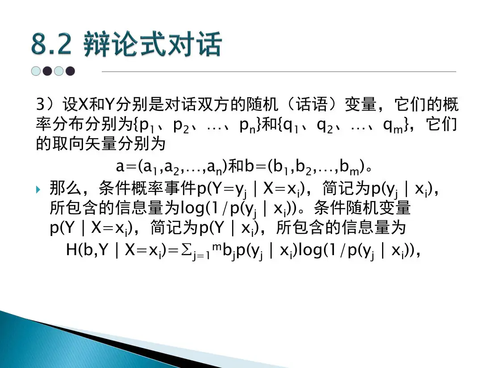

原文：

8.2 辩论式对话

3）设X和Y分别是对话双方的随机（话语）变量，它们的概率分布分别为 $\{ p _ { 1 } \ldots p _ { 2 } \ldots p _ { n } \}$ 和{ $( 9 _ { 1 } \cdot 9 _ { 2 } \cdot \ldots 9 _ { m } )$ ，它们的取向矢量分别为

$$
a = \left(a _ {1}, a _ {2}, \dots , a _ {n}\right) \text {和} b = \left(b _ {1}, b _ {2}, \dots , b _ {m}\right) 。
$$

 那么，条件概率事件 $\mathsf { p } ( \mathsf { Y } = \mathsf { y } _ { \mathrm { i } } \mid \mathsf { X } = \mathsf { x } _ { \mathrm { i } } )$ ，简记为 $\mathsf { p } ( \mathsf { y } _ { \mathrm { i } } \mid \mathsf { x } _ { \mathrm { i } } )$ 所包含的信息量为 $\log ( { \sf 1 } / { \sf p } ( \sf y _ { i } \mid \sf x _ { i } ) )$ 。条件随机变量$\mathsf { p } ( \mathsf { Y } \mid \mathsf { X } = \mathsf { X } _ { \mathrm { i } } )$ ，简记为 $\mathsf { p } ( \mathsf { Y } \mid \mathsf { x } _ { \mathrm { i } } )$ ，所包含的信息量为

$$
H (b, Y \mid X = x _ {i}) = \sum_ {j = 1} ^ {m} b _ {j} p (y _ {j} \mid x _ {i}) \log (1 / p (y _ {j} \mid x _ {i})),
$$

### 8.2 辩论式对话

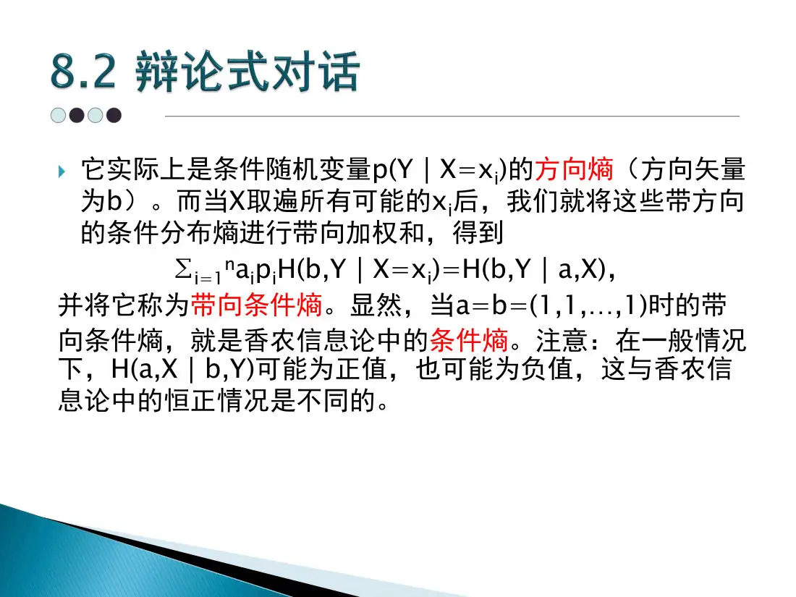

原文：

8.2 辩论式对话

 它实际上是条件随机变量 $\mathsf { p } ( \mathsf { Y } \mid \mathsf { X } = \mathsf { X } _ { \mathrm { i } } )$ 的方向熵（方向矢量为b）。而当X取遍所有可能的 $\mathsf { X } _ { \mathrm { i } }$ 后，我们就将这些带方向的条件分布熵进行带向加权和，得到

$$
\Sigma_ {i = 1} ^ {n} a _ {i} p _ {i} H (b, Y \mid X = x _ {i}) = H (b, Y \mid a, X),
$$

并将它称为带向条件熵。显然，当 $\mathsf { a } { = } \mathsf { b } { = } ( 1 , 1 , \ldots , 1 ,$ )时的带向条件熵，就是香农信息论中的条件熵。注意：在一般情况下， ${ \sf H } ( { \sf a } , { \sf X } \mid { \sf b } , { \sf Y } )$ 可能为正值，也可能为负值，这与香农信息论中的恒正情况是不同的。

### 8.2 辩论式对话

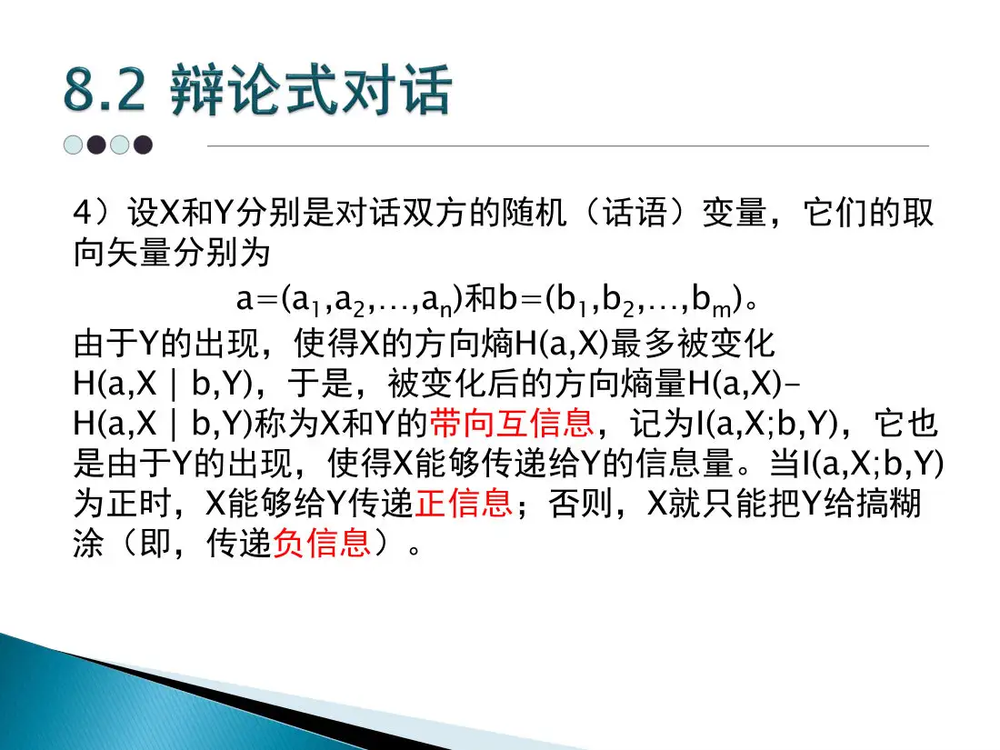

原文：

8.2 辩论式对话

4）设X和Y分别是对话双方的随机（话语）变量，它们的取向矢量分别为

$$
a = \left(a _ {1}, a _ {2}, \dots , a _ {n}\right) \text {和} b = \left(b _ {1}, b _ {2}, \dots , b _ {m}\right) 。
$$

由于Y的出现，使得X的方向熵 $\mathsf { H } ( \mathsf { a } , \mathsf { X } )$ 最多被变化

${ \sf H } ( { \sf a } , { \sf X } \mid { \sf b } , { \sf Y } )$ ，于是，被变化后的方向熵量 ${ \sf H } ( { \sf a } , { \sf X } ) -$

${ \sf H } ( { \sf a } , { \sf X } \mid { \sf b } , { \sf Y } )$ 称为X和Y的带向互信息，记为 $| ( \mathsf { a } , \mathsf { X } , \mathsf { b } , \mathsf { Y } )$ ，它也是由于Y的出现，使得X能够传递给Y的信息量。当 $| ( \mathsf { a } , \mathsf { X } , \mathsf { b } , \mathsf { Y } )$ 为正时，X能够给Y传递正信息；否则，X就只能把Y给搞糊涂（即，传递负信息）。

### 8.2 辩论式对话

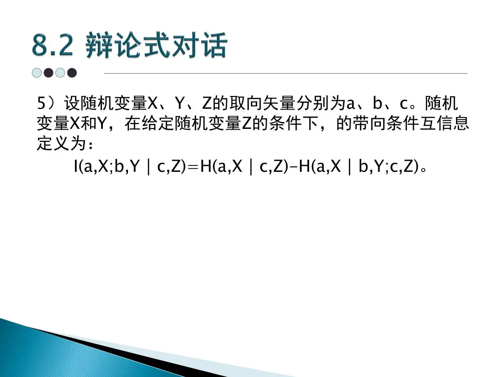

原文：

8.2 辩论式对话

5）设随机变量X、Y、Z的取向矢量分别为a、b、c。随机变量X和Y，在给定随机变量Z的条件下，的带向条件互信息定义为：

$$
\mathrm{I} (\mathrm{a}, \mathrm{X}; \mathrm{b}, \mathrm{Y} \mid \mathrm{c}, \mathrm{Z}) = \mathrm{H} (\mathrm{a}, \mathrm{X} \mid \mathrm{c}, \mathrm{Z}) - \mathrm{H} (\mathrm{a}, \mathrm{X} \mid \mathrm{b}, \mathrm{Y}; \mathrm{c}, \mathrm{Z}) 。
$$

### 8.2 辩论式对话

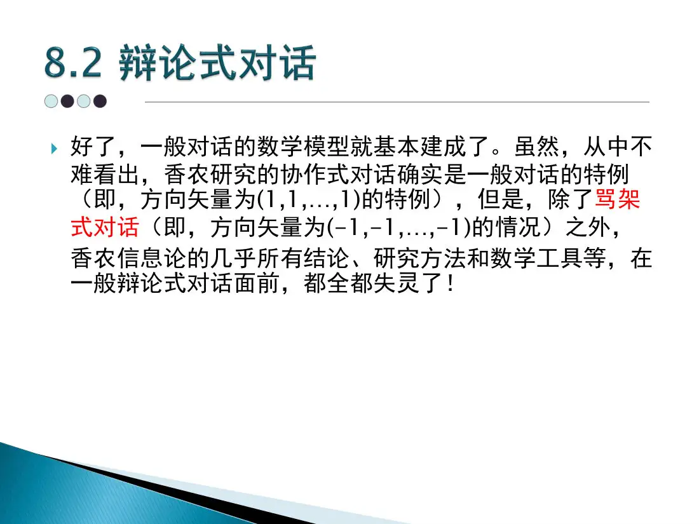

原文：

8.2 辩论式对话

 好了，一般对话的数学模型就基本建成了。虽然，从中不难看出，香农研究的协作式对话确实是一般对话的特例（即，方向矢量为(1,1,…,1)的特例），但是，除了骂架式对话（即，方向矢量为(-1,-1,…,-1)的情况）之外，香农信息论的几乎所有结论、研究方法和数学工具等，在一般辩论式对话面前，都全都失灵了！

### 8.2 辩论式对话

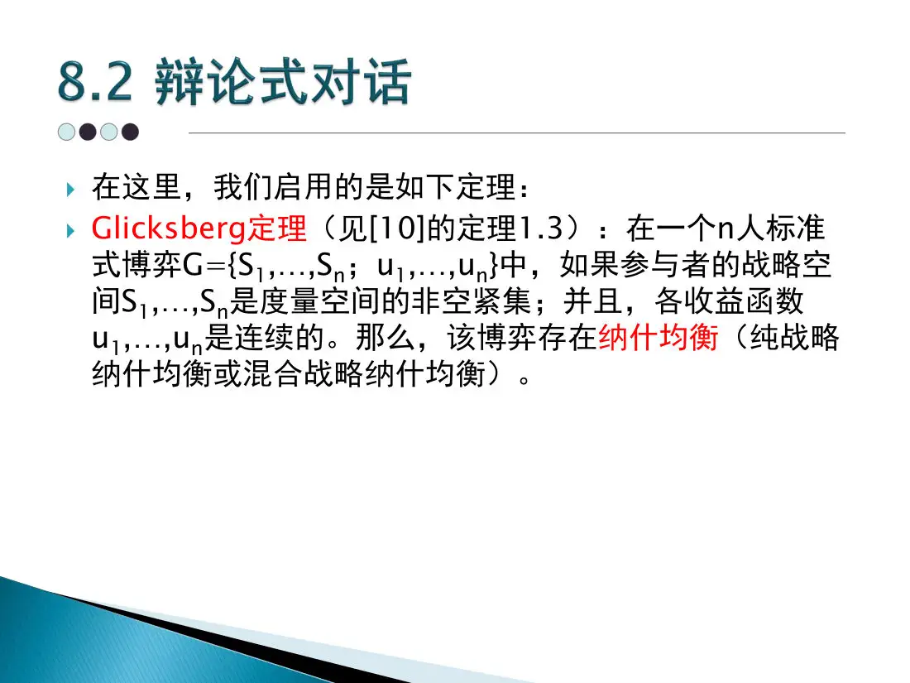

原文：

8.2 辩论式对话

 在这里，我们启用的是如下定理：

 Glicksberg定理（见[10]的定理1.3）：在一个n人标准式博弈 $\mathsf { G } { = } \{ \mathsf { S } _ { 1 } , { \ldots } , \mathsf { S } _ { \mathsf { n } } ; ~ \mathsf { U } _ { 1 } , { \ldots } , \mathsf { U } _ { \mathsf { n } } \}$ 中，如果参与者的战略空间 $S _ { 1 } , \ldots , S _ { n }$ 是度量空间的非空紧集；并且，各收益函数$\mathbf { U } _ { 1 } , \dots , \mathbf { U } _ { \nmid }$ 是连续的。那么，该博弈存在纳什均衡（纯战略纳什均衡或混合战略纳什均衡）。

### 8.2 辩论式对话

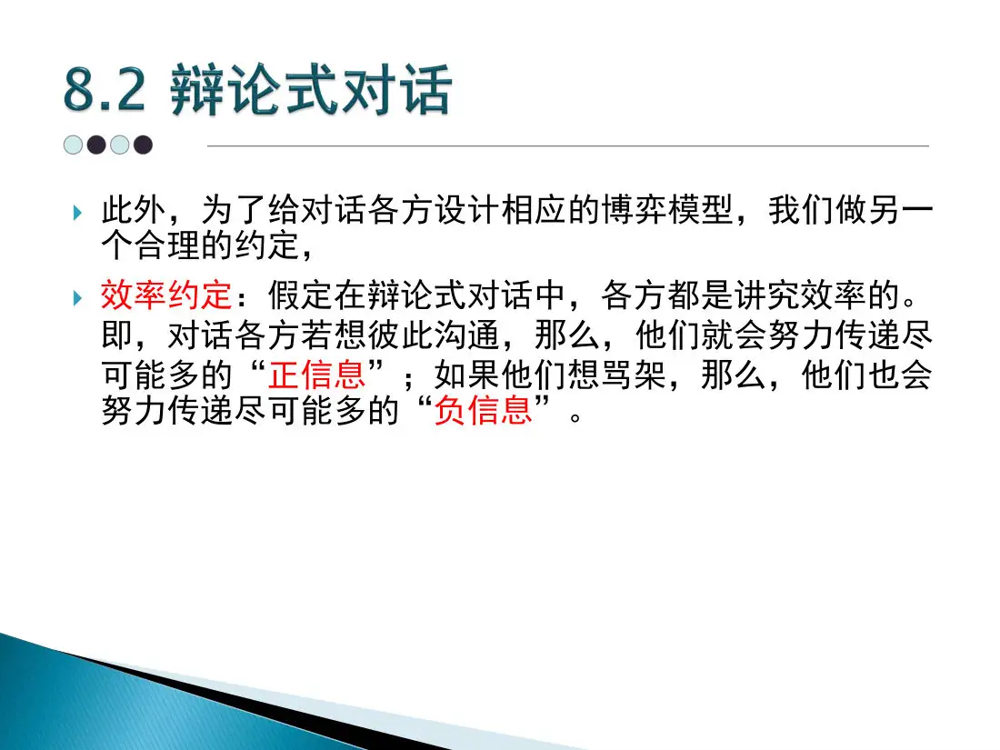

原文：

8.2 辩论式对话

 此外，为了给对话各方设计相应的博弈模型，我们做另一个合理的约定，

效率约定：假定在辩论式对话中，各方都是讲究效率的。即，对话各方若想彼此沟通，那么，他们就会努力传递尽可能多的“正信息”；如果他们想骂架，那么，他们也会努力传递尽可能多的“负信息”。

### 8.2 辩论式对话

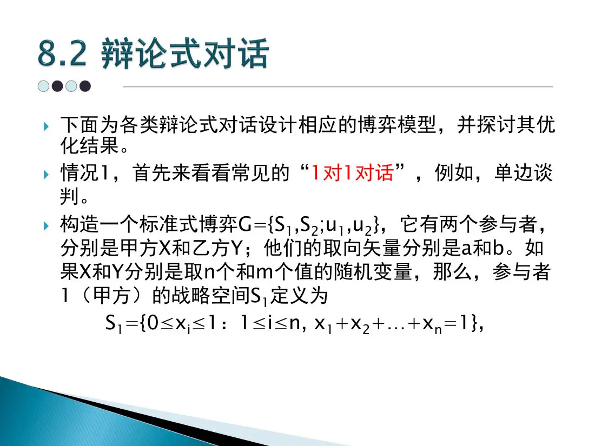

原文：

8.2 辩论式对话

 下面为各类辩论式对话设计相应的博弈模型，并探讨其优化结果。

情况1，首先来看看常见的“1对1对话”，例如，单边谈判。

 构造一个标准式博弈 $\mathsf { G } { = } \{ \mathsf { S } _ { 1 } , \mathsf { S } _ { 2 } ; \mathsf { U } _ { 1 } , \mathsf { u } _ { 2 } \}$ ，它有两个参与者，分别是甲方X和乙方Y；他们的取向矢量分别是a和b。如果X和Y分别是取n个和m个值的随机变量，那么，参与者1（甲方）的战略空间 $\mathsf { S } _ { \mathsf { l } }$ 定义为

$$
S _ {1} = \{0 \leq x _ {i} \leq 1: 1 \leq i \leq n, x _ {1} + x _ {2} + \dots + x _ {n} = 1 \},
$$

### 8.2 辩论式对话

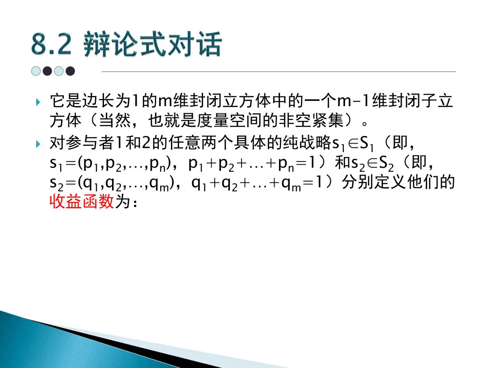

原文：

8.2 辩论式对话

 它是边长为1的m维封闭立方体中的一个m-1维封闭子立方体（当然，也就是度量空间的非空紧集）。

对参与者1和2的任意两个具体的纯战略 $\mathsf { S } _ { \mathsf { l } } \in \mathsf { S } _ { \mathsf { l } }$ （即，$\scriptstyle \mathsf { s } _ { 1 } = ( \mathsf { p } _ { 1 } , \mathsf { p } _ { 2 } , \dotsc , \mathsf { p } _ { \mathsf { n } } ) , \mathsf { p } _ { 1 } + \mathsf { p } _ { 2 } + \dotsc + \mathsf { p } _ { \mathsf { n } } = 1 )$ 和 ${ \sf S } _ { 2 } { \sf \in } { \sf S } _ { 2 }$ （即，$\mathsf { S } _ { 2 } \mathrm { = } ( \mathsf { q } _ { 1 } , \mathsf { q } _ { 2 } , \ldots , \mathsf { q } _ { \mathsf { m } } ) , \mathsf { q } _ { 1 } \mathrm { + } \mathsf { q } _ { 2 } \mathrm { + } \ldots \mathrm { + } \mathsf { q } _ { \mathsf { m } } \mathrm { = } 1 \mathrm { ~ ) }$ 分别定义他们的收益函数为：

### 8.2 辩论式对话

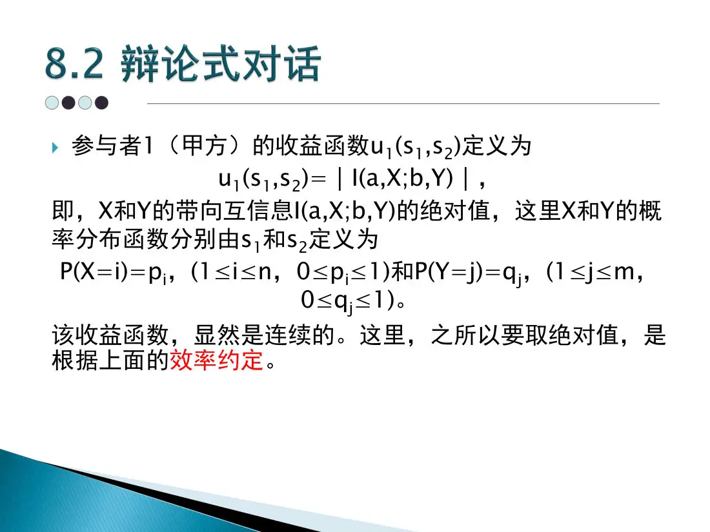

原文：

8.2 辩论式对话

 参与者1（甲方）的收益函数 $\mathsf { u } _ { 1 } ( \mathsf { s } _ { 1 } , \mathsf { s } _ { 2 } )$ 定义为

$$
u _ {1} \left(s _ {1}, s _ {2}\right) = | I (a, X; b, Y) |,
$$

即，X和Y的带向互信息 $| ( \mathsf { a } , \mathsf { X } , \mathsf { b } , \mathsf { Y } )$ 的绝对值，这里X和Y的概率分布函数分别由 $\mathsf { S } _ { \mathsf { l } }$ 和 $\mathsf { S } _ { 2 }$ 定义为

$$
\begin{array}{r l} \mathrm{P} (X = i) = p _ {i}, & (1 \leq i \leq n, 0 \leq p _ {i} \leq 1) \text {和} \mathrm{P} (Y = j) = q _ {j}, (1 \leq j \leq m, \\ & 0 \leq q _ {j} \leq 1) 。 \end{array}
$$

该收益函数，显然是连续的。这里，之所以要取绝对值，是根据上面的效率约定。

### 8.2 辩论式对话

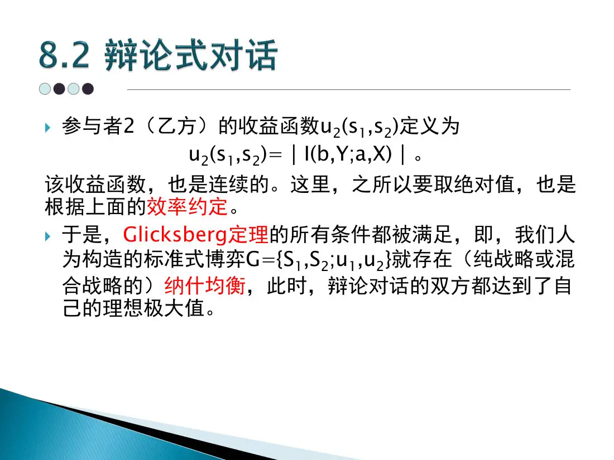

原文：

8.2 辩论式对话

 参与者2（乙方）的收益函数 $\mathsf { u } _ { 2 } ( \mathsf { s } _ { 1 } , \mathsf { s } _ { 2 } )$ 定义为

$$
u _ {2} \left(s _ {1}, s _ {2}\right) = | I (b, Y; a, X) | 。
$$

该收益函数，也是连续的。这里，之所以要取绝对值，也是根据上面的效率约定。

 于是，Glicksberg定理的所有条件都被满足，即，我们人为构造的标准式博弈 $\mathsf { G } { = } \{ \mathsf { S } _ { 1 } , \mathsf { S } _ { 2 } ; \mathsf { u } _ { 1 } , \mathsf { u } _ { 2 } \}$ }就存在（纯战略或混合战略的）纳什均衡，此时，辩论对话的双方都达到了自己的理想极大值。

### 8.2 辩论式对话

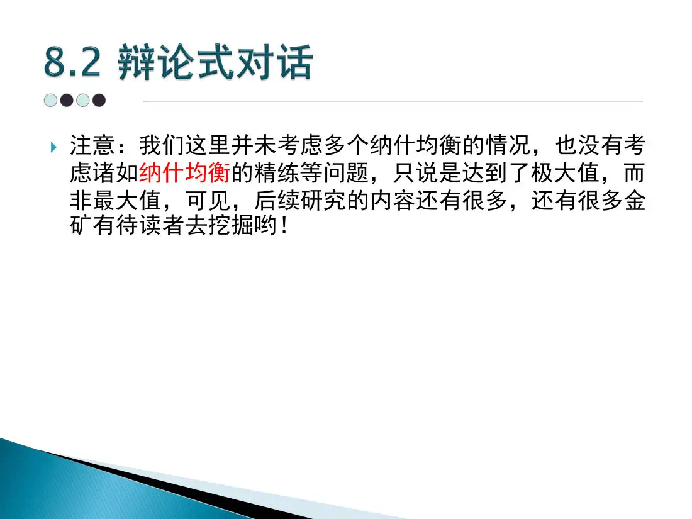

原文：

8.2 辩论式对话

 注意：我们这里并未考虑多个纳什均衡的情况，也没有考虑诸如纳什均衡的精练等问题，只说是达到了极大值，而非最大值，可见，后续研究的内容还有很多，还有很多金矿有待读者去挖掘哟！

### 本章结束，谢谢

原文：

本章结束，谢谢
