# 《安全通论》第9章 沙盘演练的最佳攻防策略（课件）

原件的每一页，下面附识别出的文字。

### 第9章---沙盘演练的最佳攻防策略

原文：

第9章---沙盘演练的最佳攻防策略

### 第9章沙盘演练的最佳攻防策略

原文：

第9章沙盘演练的最佳攻防策略

⚫ 从第7章和第8章，其实我们已经知道：在任何现实的网络空间安全对抗中，无论有多少个红客与黑客参战，无论大家的价值观是多么千差万别（当然一定要事先确定，不能边战边修改价值观），也无论是多么复杂的混战，只要大家以自身利益最大化为目标，那么，就一定存在能够共赢的最佳结局（即，纳什均衡状态）。

### 第9章沙盘演练的最佳攻防策略

原文：

第9章沙盘演练的最佳攻防策略

⚫ 这个结果虽然已被严格的数学证明了，但是，由于它太抽象，以致于对安全界的许多人（特别是决策者们）来说，可能难以理解。又由于“纳什均衡状态”对树立正确的安全观念非常重要，所以，本章将提炼出专门针对网络攻防沙盘演练的，真正能够使矛盾双方都达到最佳结局（纳什均衡状态）的攻防策略计算方法。

### 第9章沙盘演练的最佳攻防策略

原文：

第9章沙盘演练的最佳攻防策略

➢ 1. 最佳攻防策略与武器库的丰富和淘汰原则

➢ 2. 最佳攻防策略的计算

### 9.1 最佳攻防策略与武器库的丰富和淘汰原则

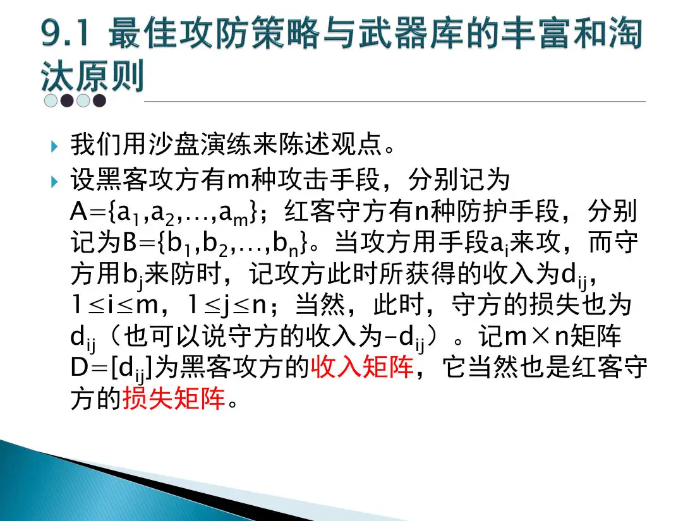

原文：

9.1 最佳攻防策略与武器库的丰富和淘汰原则

我们用沙盘演练来陈述观点。

设黑客攻方有m种攻击手段，分别记为$\mathsf { A } { = } \{ \mathsf { a } _ { 1 } , \mathsf { a } _ { 2 } , \ldots , \mathsf { a } _ { \mathsf { m } } \}$ ；红客守方有n种防护手段，分别记为 $\mathsf { B } { = } \{ \mathsf { b } _ { 1 } , \mathsf { b } _ { 2 } , \ldots , \mathsf { b } _ { \mathsf { n } } \}$ 。当攻方用手段 $\mathsf { a } _ { \mathrm { i } }$ 来攻，而守方用 $b _ { \mathrm { j } }$ 来防时，记攻方此时所获得的收入为 ${ \mathsf { d } } _ { \mathsf { i } } _ { \mathsf { j } }$ $1 \leq i \leq m , 1 \leq j \leq n$ ；当然，此时，守方的损失也为${ \mathsf { d } } _ { \mathsf { i } } _ { \mathsf { j } }$ （也可以说守方的收入为 $- { \mathsf { d } } _ { \mathrm { i j } } )$ 。记 $m \times n$ 矩阵$\dot { \mathrm { D } } \mathrm { = } [ \mathsf { d } _ { \mathrm { i j } } ]$ 为黑客攻方的收入矩阵，它当然也是红客守方的损失矩阵。

### 9.1 最佳攻防策略与武器库的丰富和淘汰原则

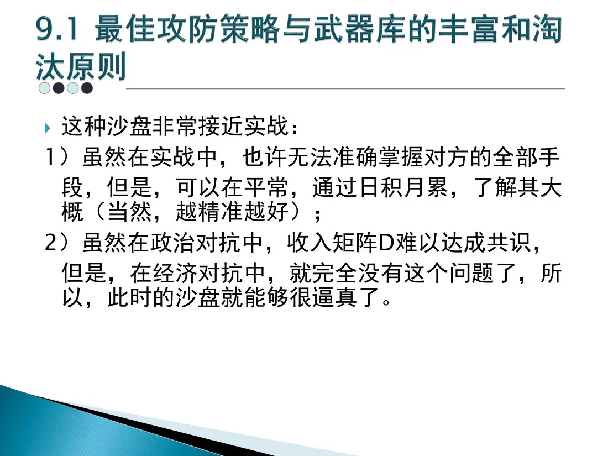

原文：

9.1 最佳攻防策略与武器库的丰富和淘汰原则

这种沙盘非常接近实战：

1）虽然在实战中，也许无法准确掌握对方的全部手段，但是，可以在平常，通过日积月累，了解其大概（当然，越精准越好）；

2）虽然在政治对抗中，收入矩阵D难以达成共识，但是，在经济对抗中，就完全没有这个问题了，所以，此时的沙盘就能够很逼真了。

### 9.1 最佳攻防策略与武器库的丰富和淘汰原则

原文：

9.1 最佳攻防策略与武器库的丰富和淘汰原则

 当攻守双方的收入（损失）矩阵确定后，它们的整体实力就确定了，余下的问题就是在如此实力的条件下，各方如何为自己争得最大的利益，即，攻方要想获得尽可能多的收入，而守方则想尽可能地减少损失。

 下面，就来给出相关的攻防策略（称为最优策略），使得能够同时满足攻守双方的愿望。

 在平时，攻守双方应该努力提高自己的本领，使得自己在收入（损失）矩阵中占据优势；在战时，攻守双方一定要理智，要以自己利益最大化为目标，而不做损人不利己的事情。

### 9.1 最佳攻防策略与武器库的丰富和淘汰原则

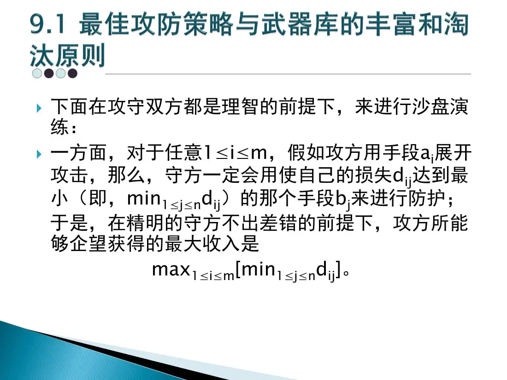

原文：

9.1 最佳攻防策略与武器库的丰富和淘汰原则

 下面在攻守双方都是理智的前提下，来进行沙盘演练：

 一方面，对于任意 $1 \leq i \leq m$ 假如攻方用手段 $\mathsf { a } _ { \mathsf { i } }$ 展开攻击，那么，守方一定会用使自己的损失 ${ \mathsf { d } } _ { \mathrm { i j } }$ 达到最小（即， $\mathsf { m i n } _ { \mathsf { l } \leq j \leq n } \mathsf { d } _ { \mathsf { i j } } )$ 的那个手段 $\mathsf { b } _ { \mathrm { j } }$ 来进行防护；于是，在精明的守方不出差错的前提下，攻方所能够企望获得的最大收入是

$$
\max _ {1 \leq i \leq m} [ \min _ {1 \leq j \leq n} d _ {i j} ] 。
$$

### 9.1 最佳攻防策略与武器库的丰富和淘汰原则

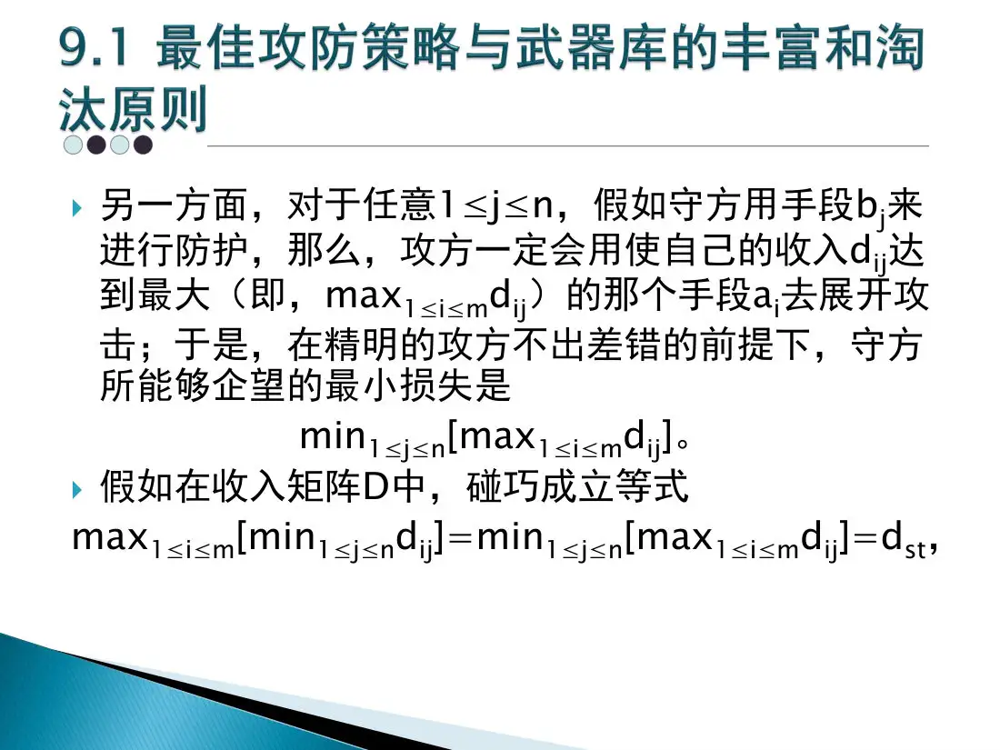

原文：

9.1 最佳攻防策略与武器库的丰富和淘汰原则

 另一方面，对于任意 $\mathsf { l } \le \mathsf { j } \le \mathsf { n }$ ，假如守方用手段 $\mathsf { b } _ { \mathrm { j } }$ 来进行防护，那么，攻方一定会用使自己的收入 $d _ { i j }$ 达到最大（即， $\mathsf { m a x } _ { 1 \leq i \leq m } \mathsf { d } _ { \mathsf { i j } } )$ 的那个手段 $\mathtt { a } _ { \mathrm { i } }$ 去展开攻击；于是，在精明的攻方不出差错的前提下，守方所能够企望的最小损失是

$$
\min _ {1 \leq j \leq n} [ \max _ {1 \leq i \leq m} d _ {i j} ] 。
$$

假如在收入矩阵D中，碰巧成立等式

$$
\max _ {1 \leq i \leq m} [ \min _ {1 \leq j \leq n} d _ {i j} ] = \min _ {1 \leq j \leq n} [ \max _ {1 \leq i \leq m} d _ {i j} ] = d _ {s t},
$$

### 9.1 最佳攻防策略与武器库的丰富和淘汰原则

原文：

9.1 最佳攻防策略与武器库的丰富和淘汰原则

 这时就意味着，“攻方所企望的最大收入 $\begin{array} { r l r } { ^ { 9 9 } } & { { } = } & { ^ { 6 6 } } \\ { . } & { { } = } & { ^ { } } \end{array}$ 守方所企望的最小损失”，即攻守双方都达到了自己的目的，这时攻击手段 $\mathtt { a } _ { s }$ 和防护手段 $\mathsf { b } _ { \mathsf { t } }$ 当然就是各自的最佳手段了，因为，这些手段使他们的利益都最大化了，此时，称该对抗存在最佳纯策略 $( a _ { s }$ $\mathsf { b } _ { \mathsf { t } } )$ 。当然，最佳攻防手段可能会有多组，但是，他们在收入矩阵中所对应的最佳收入值是相等的。

### 9.1 最佳攻防策略与武器库的丰富和淘汰原则

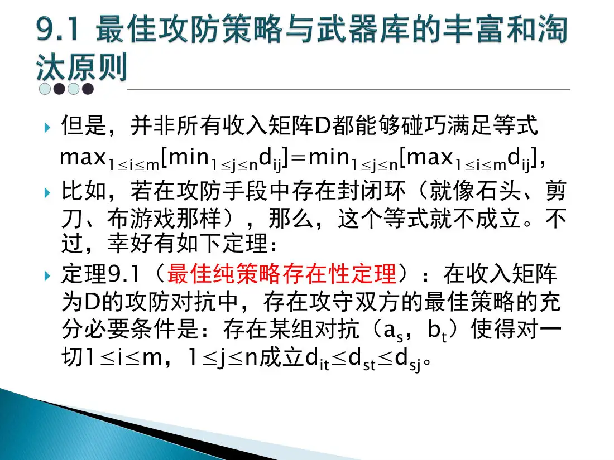

原文：

9.1 最佳攻防策略与武器库的丰富和淘汰原则

 但是，并非所有收入矩阵D都能够碰巧满足等式$\mathsf { m a x } _ { 1 \leq i \leq m } [ \mathsf { m i n } _ { 1 \leq j \leq n } \mathsf { d } _ { \mathsf { i j } } ] = \mathsf { m i n } _ { 1 \leq j \leq n } [ \mathsf { m a x } _ { 1 \leq i \leq m } \mathsf { d } _ { \mathsf { i j } } ]$

 比如，若在攻防手段中存在封闭环（就像石头、剪刀、布游戏那样），那么，这个等式就不成立。不过，幸好有如下定理：

 定理9.1（最佳纯策略存在性定理）：在收入矩阵为D的攻防对抗中，存在攻守双方的最佳策略的充分必要条件是：存在某组对抗 $( a _ { s } , b _ { t } )$ 使得对一切 $1 \leq i \leq m$ $1 \leq j \leq n$ 成立 $\mathsf { d } _ { \mathsf { i } \mathsf { t } } { \leq } \mathsf { d } _ { \mathsf { s } \mathsf { t } } { \leq } \mathsf { d } _ { \mathsf { s } } \mathsf { j }$

### 9.1 最佳攻防策略与武器库的丰富和淘汰原则

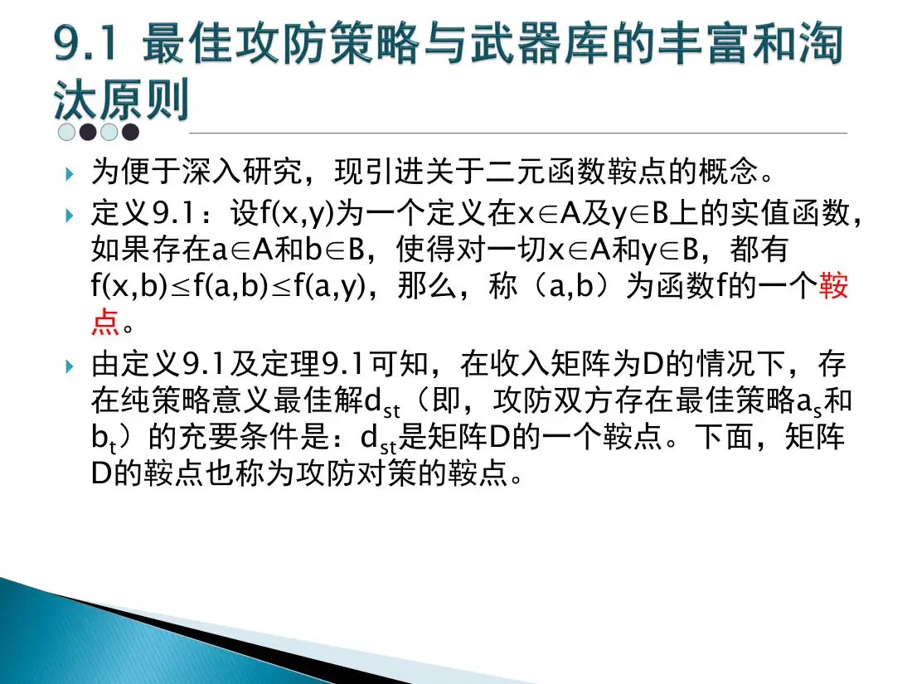

原文：

9.1 最佳攻防策略与武器库的丰富和淘汰原则

 为便于深入研究，现引进关于二元函数鞍点的概念。

 定义9.1：设 $\mathsf { f } ( { \mathsf { x } } , { \mathsf { y } } )$ 为一个定义在 $\mathsf { x } \in \mathsf { A }$ 及 $\tt y \in B$ 上的实值函数，如果存在 $\mathsf { a } \in \mathsf { A }$ 和 $\boldsymbol { \mathrm { b } } \in \boldsymbol { \mathrm { B } }$ ，使得对一切 $\mathsf { x } \in \mathsf { A }$ 和 ${ \mathsf { y } } { \in } { \mathsf { B } }$ ，都有$\mathsf { f } ( \mathsf { x } , \mathsf { b } ) { \leq } \mathsf { f } ( \mathsf { a } , \mathsf { b } ) { \leq } \mathsf { f } ( \mathsf { a } , \mathsf { y } )$ ，那么，称（a,b）为函数f的一个鞍点。

 由定义9.1及定理9.1可知，在收入矩阵为D的情况下，存在纯策略意义最佳解 ${ \mathsf { d } } _ { \mathsf { s t } }$ （即，攻防双方存在最佳策略 $\mathtt { a } _ { s }$ 和$\mathsf { b } _ { \mathsf { t } } )$ 的充要条件是： ${ \mathsf { d } } _ { \mathsf { s t } }$ 是矩阵D的一个鞍点。下面，矩阵D的鞍点也称为攻防对策的鞍点。

### 9.1 最佳攻防策略与武器库的丰富和淘汰原则

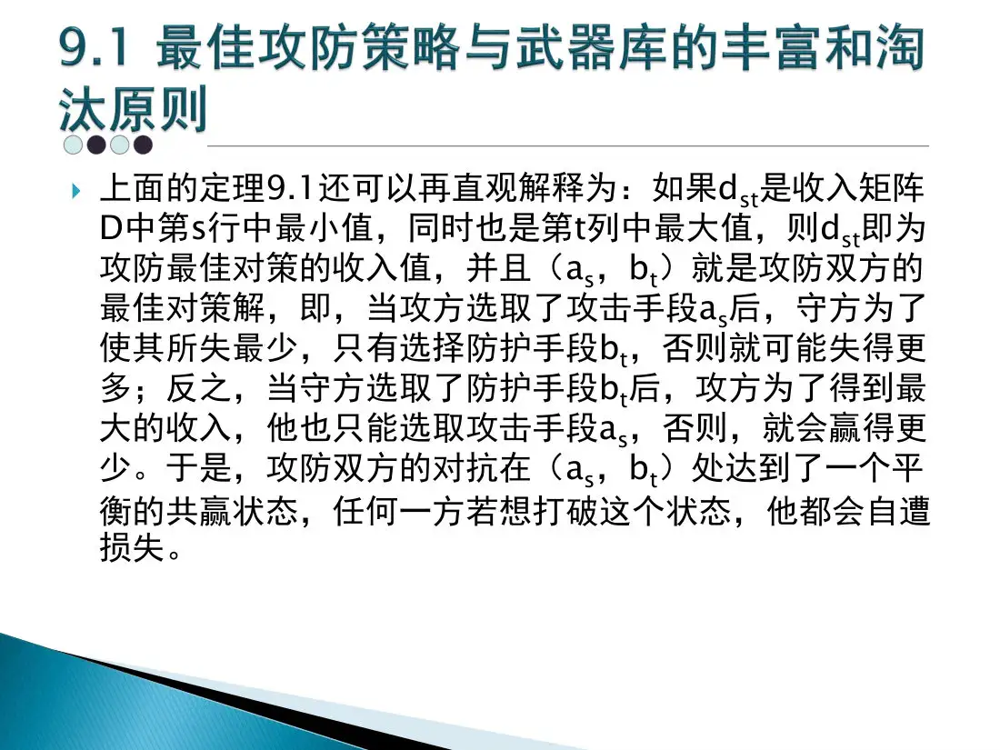

原文：

9.1 最佳攻防策略与武器库的丰富和淘汰原则

 上面的定理9.1还可以再直观解释为：如果 ${ \mathsf { d } } _ { \mathsf { s t } }$ 是收入矩阵D中第s行中最小值，同时也是第t列中最大值，则 ${ \mathsf { d } } _ { \mathsf { s t } }$ 即为攻防最佳对策的收入值，并且 $( a _ { s } , b _ { t } )$ 就是攻防双方的最佳对策解，即，当攻方选取了攻击手段 $\mathtt { a } _ { s }$ 后，守方为了使其所失最少，只有选择防护手段 $\mathsf { b } _ { \mathsf { t } } ,$ ，否则就可能失得更多；反之，当守方选取了防护手段 $\mathsf { b } _ { \mathsf { t } }$ 后，攻方为了得到最大的收入，他也只能选取攻击手段 $\mathtt { a } _ { s }$ ，否则，就会赢得更少。于是，攻防双方的对抗在 $( a _ { s } , b _ { t } )$ 处达到了一个平衡的共赢状态，任何一方若想打破这个状态，他都会自遭损失。

### 9.1 最佳攻防策略与武器库的丰富和淘汰原则

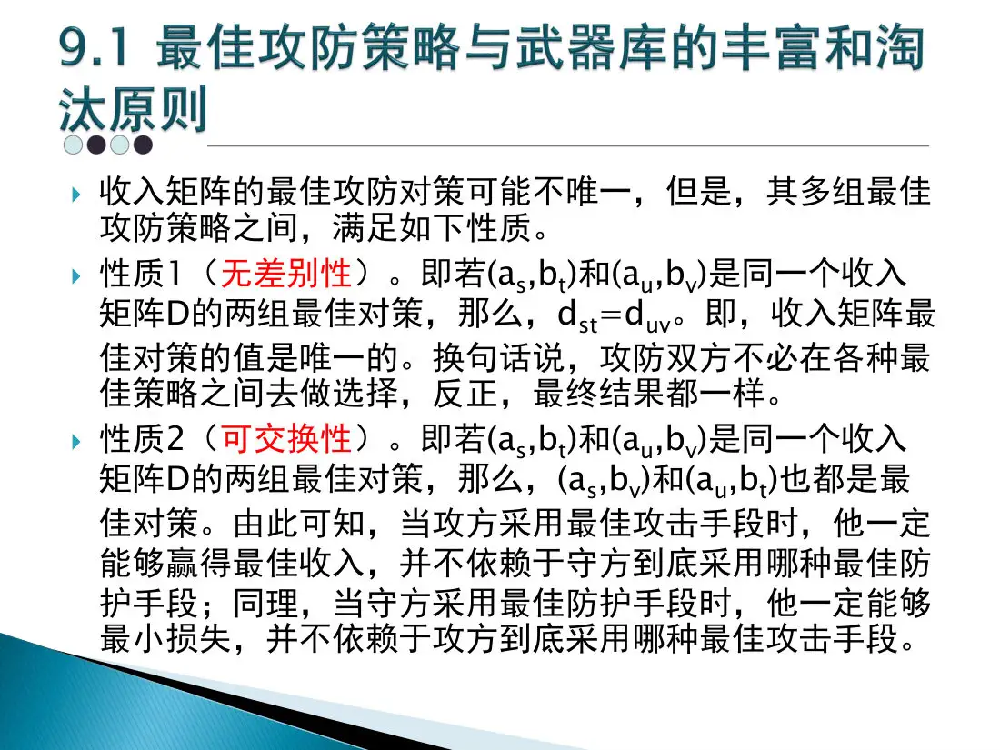

原文：

9.1 最佳攻防策略与武器库的丰富和淘汰原则

 收入矩阵的最佳攻防对策可能不唯一，但是，其多组最佳攻防策略之间，满足如下性质。

性质1（无差别性）。即若 $( a _ { s } , b _ { t } )$ 和 $( a _ { \mathsf { u } } , b _ { \mathsf { v } } )$ 是同一个收入矩阵D的两组最佳对策，那么， ${ \mathsf { d } } _ { \mathsf { s t } } { = } { \mathsf { d } } _ { { \mathsf { u v } } ^ { \circ } }$ 即，收入矩阵最佳对策的值是唯一的。换句话说，攻防双方不必在各种最佳策略之间去做选择，反正，最终结果都一样。

 性质2（可交换性）。即若 $( a _ { s } , b _ { t } )$ 和 $( a _ { \mathsf { u } } , b _ { \mathsf { v } } )$ 是同一个收入矩阵D的两组最佳对策，那么， $( \mathsf { a } _ { \mathsf { s } } , \mathsf { b } _ { \mathsf { v } } )$ 和 $( a _ { \mathrm { u } } , b _ { \mathrm { t } } )$ 也都是最佳对策。由此可知，当攻方采用最佳攻击手段时，他一定能够赢得最佳收入，并不依赖于守方到底采用哪种最佳防护手段；同理，当守方采用最佳防护手段时，他一定能够最小损失，并不依赖于攻方到底采用哪种最佳攻击手段。

### 9.1 最佳攻防策略与武器库的丰富和淘汰原则

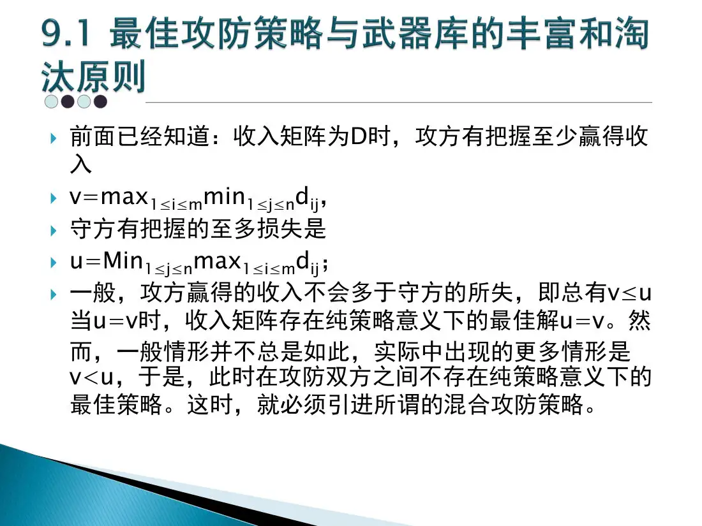

原文：

9.1 最佳攻防策略与武器库的丰富和淘汰原则

前面已经知道：收入矩阵为D时，攻方有把握至少赢得收入

 $\mathsf { v } { = } \mathsf { m a x } _ { 1 \leq i \leq m } \mathsf { m i n } _ { 1 \leq j \leq n } \mathsf { d } _ { \mathsf { i j } }$ 7

守方有把握的至多损失是

$\mathsf { u } { = } \mathsf { M i n } _ { 1 \leq j \leq \mathsf { n } } \mathsf { m a x } _ { 1 \leq \mathsf { i } \leq \mathsf { m } } \mathsf { d } _ { \mathsf { i } j }$ ；

 一般，攻方赢得的收入不会多于守方的所失，即总有 $\mathbf { \check { v } } \leq \mathbf { u }$ 当u=v时，收入矩阵存在纯策略意义下的最佳解u=v。然而，一般情形并不总是如此，实际中出现的更多情形是v<u，于是，此时在攻防双方之间不存在纯策略意义下的最佳策略。这时，就必须引进所谓的混合攻防策略。

### 9.1 最佳攻防策略与武器库的丰富和淘汰原则

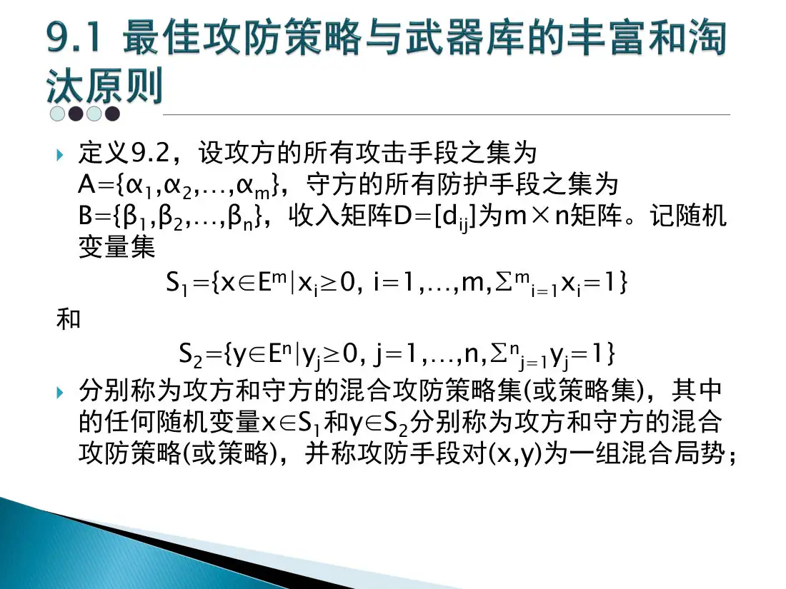

原文：

9.1 最佳攻防策略与武器库的丰富和淘汰原则

 定义9.2，设攻方的所有攻击手段之集为

$\mathsf { A } { = } \{ \alpha _ { 1 } , \alpha _ { 2 } , \ldots , \alpha _ { \mathrm { m } } \}$ ，守方的所有防护手段之集为

$\mathsf { B } { = } \{ \mathsf { \beta } _ { 1 } , \mathsf { \beta } _ { 2 } , \ldots , \mathsf { \beta } _ { \mathsf { n } } \} ,$ ，收入矩阵 $\mathsf { D } { = } [ \mathsf { d } _ { \mathrm { i j } } ]$ 为 $m \times n$ 矩阵。记随机变量集

$$
S _ {1} = \left\{\mathbf {x} \in E ^ {m} \mid \mathbf {x} _ {i} \geq 0, i = 1, \dots , m, \Sigma_ {i = 1} ^ {m} \mathbf {x} _ {i} = 1 \right\}
$$

和

$$
S _ {2} = \left\{\mathbf {y} \in E ^ {n} \mid \mathbf {y} _ {j} \geq 0, j = 1, \dots , n, \Sigma_ {j = 1} ^ {n} \mathbf {y} _ {j} = 1 \right\}
$$

 分别称为攻方和守方的混合攻防策略集(或策略集)，其中的任何随机变量 $\mathsf { x } \in \mathsf { S } _ { \mathsf { l } }$ 和 $\mathsf { y } \in \mathsf { S } _ { 2 }$ 分别称为攻方和守方的混合攻防策略(或策略)，并称攻防手段对(x,y)为一组混合局势；

### 9.1 最佳攻防策略与武器库的丰富和淘汰原则

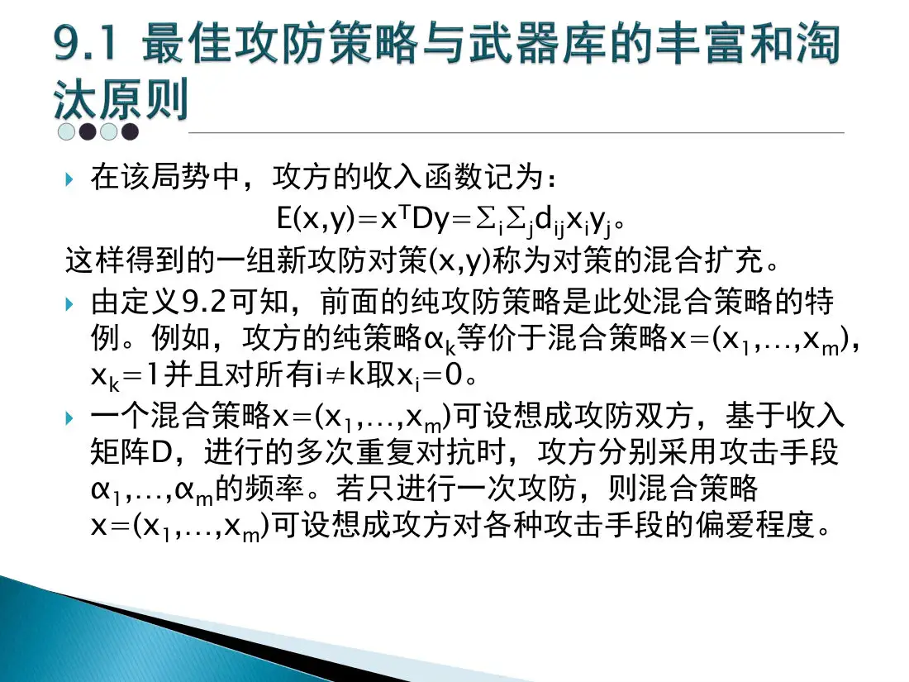

原文：

9.1 最佳攻防策略与武器库的丰富和淘汰原则

在该局势中，攻方的收入函数记为：

$$
E (x, y) = x ^ {T} D y = \sum_ {i} \sum_ {j} d _ {i j} x _ {i} y _ {j} 。
$$

这样得到的一组新攻防对策 $( \mathsf { x } , \mathsf { y } )$ 称为对策的混合扩充。

 由定义9.2可知，前面的纯攻防策略是此处混合策略的特例。例如，攻方的纯策略 $\alpha _ { \mathrm { k } }$ 等价于混合策略 $\mathsf { x } { = } ( \mathsf { x } _ { 1 } , \ldots , \mathsf { x } _ { \mathsf { m } } )$ $\mathsf { x } _ { \mathsf { k } } { = } \mathsf { l }$ 并且对所有i≠k取 ${ \sf x _ { i } } = 0$

 一个混合策略 $\mathbf { x } { = } ( \mathsf { x } _ { 1 } , \ldots , \mathsf { x } _ { \mathsf { m } } )$ 可设想成攻防双方，基于收入矩阵D，进行的多次重复对抗时，攻方分别采用攻击手段$\alpha _ { 1 } , \ldots , \alpha _ { m }$ 的频率。若只进行一次攻防，则混合策略$\mathsf { x } { = } ( \mathsf { x } _ { 1 } , \ldots , \mathsf { x } _ { \mathsf { m } } )$ 可设想成攻方对各种攻击手段的偏爱程度。

### 9.1 最佳攻防策略与武器库的丰富和淘汰原则

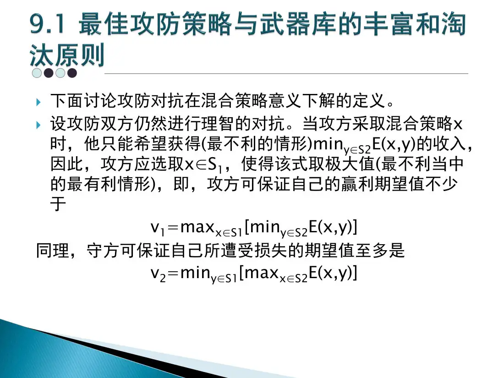

原文：

9.1 最佳攻防策略与武器库的丰富和淘汰原则

 下面讨论攻防对抗在混合策略意义下解的定义。

 设攻防双方仍然进行理智的对抗。当攻方采取混合策略x时，他只能希望获得(最不利的情形) $\mathsf { m i n } _ { \mathsf { y } \in \mathsf { S } 2 } \mathsf { E } ( \mathsf { x } , \mathsf { y } )$ 的收入，因此，攻方应选取 $\mathsf { x } \in \mathsf { S } _ { \mathsf { l } }$ ，使得该式取极大值(最不利当中的最有利情形)，即，攻方可保证自己的赢利期望值不少于

$$
\mathrm{v} _ {1} = \max _ {\mathrm{x} \in S 1} [ \min _ {\mathrm{y} \in S 2} \mathrm{E} (\mathrm{x}, \mathrm{y}) ]
$$

同理，守方可保证自己所遭受损失的期望值至多是

$$
\mathrm{v} _ {2} = \min _ {\mathrm{y} \in S 1} [ \max _ {\mathrm{x} \in S 2} \mathrm{E} (\mathrm{x}, \mathrm{y}) ]
$$

### 9.1 最佳攻防策略与武器库的丰富和淘汰原则

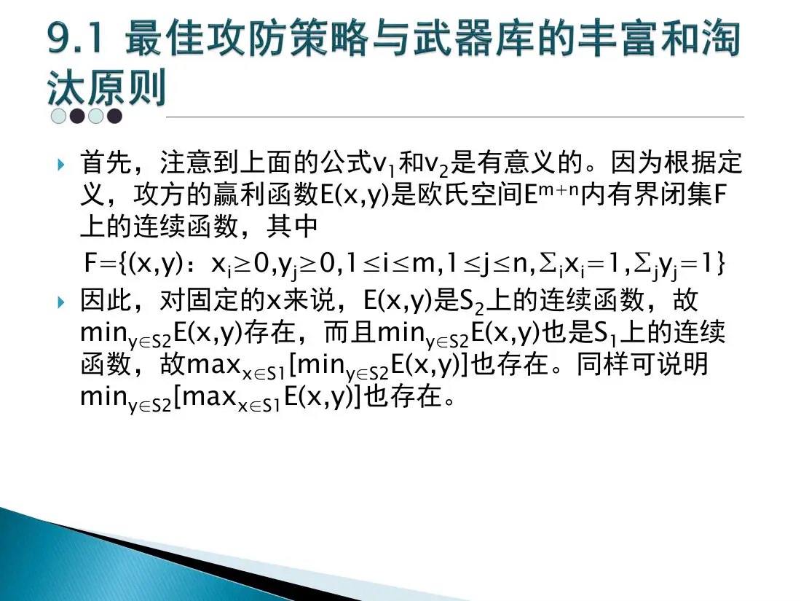

原文：

9.1 最佳攻防策略与武器库的丰富和淘汰原则

 首先，注意到上面的公式 $\mathsf { v } _ { \mathrm { l } }$ 和 $\mathsf { v } _ { 2 }$ 是有意义的。因为根据定义，攻方的赢利函数E(x,y)是欧氏空间 $E ^ { m + n }$ 内有界闭集F上的连续函数，其中

$$
F = \{(x, y): x _ {i} \geq 0, y _ {j} \geq 0, 1 \leq i \leq m, 1 \leq j \leq n, \Sigma_ {i} x _ {i} = 1, \Sigma_ {j} y _ {j} = 1 \}
$$

 因此，对固定的x来说，E(x,y)是 $S _ { 2 }$ 上的连续函数，故$\mathsf { m i n } _ { \mathsf { y } \in \mathsf { S } 2 } \mathsf { E } ( \mathsf { x } , \mathsf { y } )$ 存在，而且 $\mathsf { m i n } _ { \mathsf { y } \in \mathsf { S } 2 } \mathsf { E } ( \mathsf { x } , \mathsf { y } )$ 也是 $S _ { \ l _ { 1 } }$ 上的连续函数，故 $\mathsf { m a x } _ { \mathsf { x e s l } } \mathsf { I m i n } _ { \mathsf { v e s 2 } } \mathsf { E } ( \mathsf { x } , \mathsf { y } ) ]$ 也存在。同样可说明$\mathsf { m i n } _ { \mathsf { y } \in \mathsf { S } 2 } [ \mathsf { m a x } _ { \mathsf { x } \in \mathsf { S } 1 } \mathsf { E } ( \mathsf { x } , \mathsf { y } ) ]$ 也存在。

### 9.1 最佳攻防策略与武器库的丰富和淘汰原则

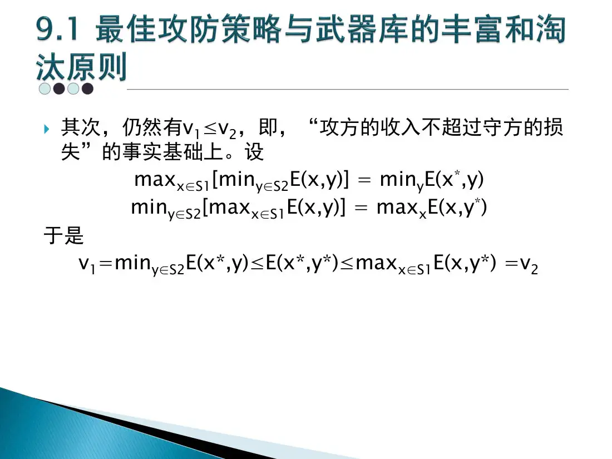

原文：

9.1 最佳攻防策略与武器库的丰富和淘汰原则

 其次，仍然有 $\mathsf { v } _ { 1 } \leq \mathsf { v } _ { 2 }$ ，即，“攻方的收入不超过守方的损失”的事实基础上。设

$$
\begin{array}{l} \max _ {x \in S 1} [ \min _ {y \in S 2} E (x, y) ] = \min _ {y} E (x ^ {*}, y) \\ \min _ {y \in S 2} [ \max _ {x \in S 1} E (x, y) ] = \max _ {x} E (x, y ^ {*}) \end{array}
$$

于是

$$
\mathsf {v} _ {1} = \min _ {\mathsf {y} \in S 2} \mathsf {E} (\mathsf {x} ^ {*}, \mathsf {y}) \leq \mathsf {E} (\mathsf {x} ^ {*}, \mathsf {y} ^ {*}) \leq \max _ {\mathsf {x} \in S 1} \mathsf {E} (\mathsf {x}, \mathsf {y} ^ {*}) = \mathsf {v} _ {2}
$$

### 9.1 最佳攻防策略与武器库的丰富和淘汰原则

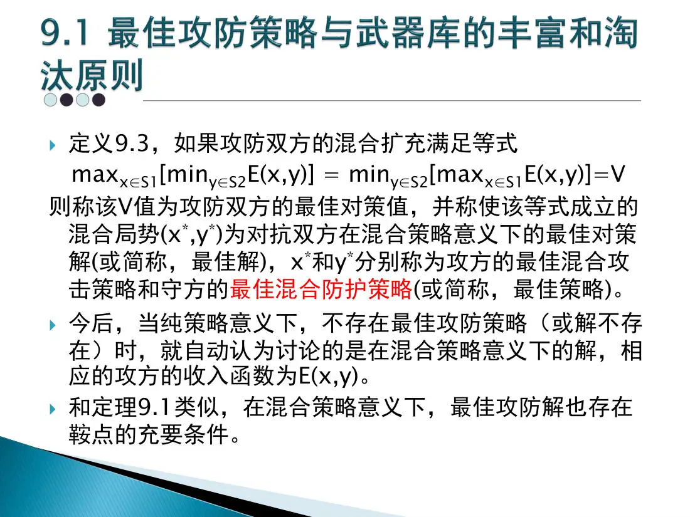

原文：

9.1 最佳攻防策略与武器库的丰富和淘汰原则

定义9.3，如果攻防双方的混合扩充满足等式

$\begin{array} { r } { \mathsf { m a x } _ { \mathsf { x } \in \mathsf { S } \mathrm { 1 } } [ \mathsf { m i n } _ { \mathsf { y } \in \mathsf { S } \mathrm { 2 } } \mathsf { E } ( \mathsf { x } , \mathsf { y } ) ] = \mathsf { m i n } _ { \mathsf { y } \in \mathsf { S } \mathrm { 2 } } [ \mathsf { m a x } _ { \mathsf { x } \in \mathsf { S } \mathrm { 1 } } \mathsf { E } ( \mathsf { x } , \mathsf { y } ) ] = \mathsf { V } } \end{array}$ 则称该V值为攻防双方的最佳对策值，并称使该等式成立的混合局势 $( \mathsf { x } ^ { \ast } , \mathsf { y } ^ { \ast } )$ 为对抗双方在混合策略意义下的最佳对策解(或简称，最佳解)，x\*和y\*分别称为攻方的最佳混合攻击策略和守方的最佳混合防护策略(或简称，最佳策略)。

 今后，当纯策略意义下，不存在最佳攻防策略（或解不存在）时，就自动认为讨论的是在混合策略意义下的解，相应的攻方的收入函数为 $\mathsf { E } ( \mathsf { x } , \mathsf { y } )$

 和定理9.1类似，在混合策略意义下，最佳攻防解也存在鞍点的充要条件。

### 9.1 最佳攻防策略与武器库的丰富和淘汰原则

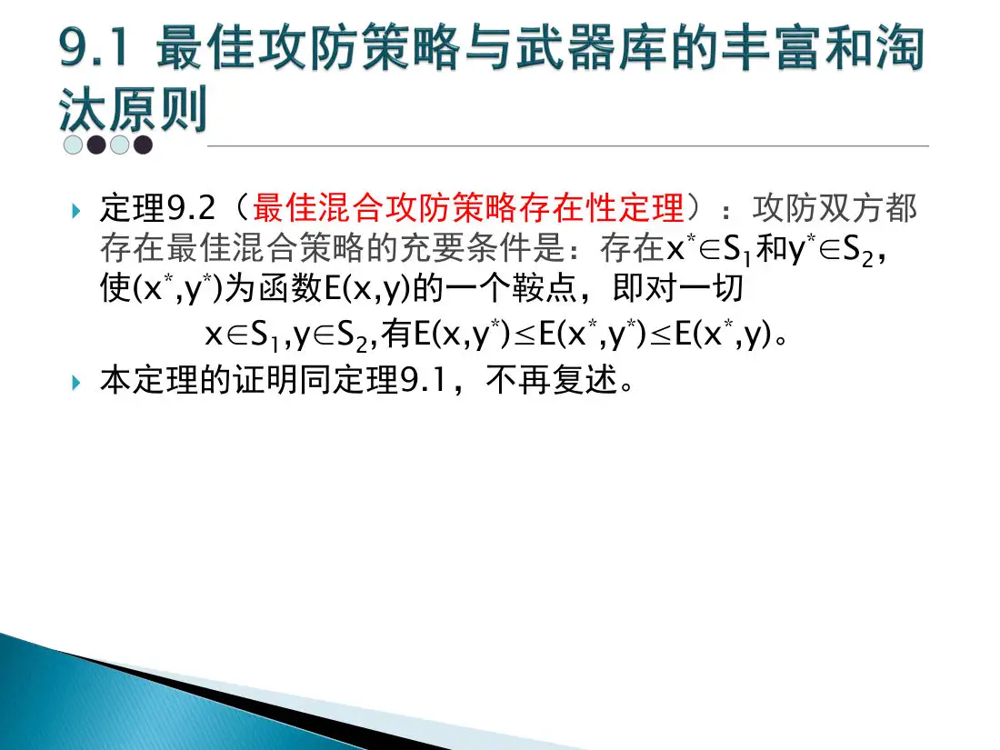

原文：

9.1 最佳攻防策略与武器库的丰富和淘汰原则

 定理9.2（最佳混合攻防策略存在性定理）：攻防双方都存在最佳混合策略的充要条件是：存在 $\mathsf { x } ^ { \ast } \in \mathsf { S } _ { \mathsf { l } }$ 和 $\mathsf { y } ^ { \ast } \in \mathsf { S } _ { 2 }$ 使 $( \mathsf { x } ^ { \ast } , \mathsf { y } ^ { \ast } )$ 为函数 $\mathsf { E } ( \mathsf { x } , \mathsf { y } )$ 的一个鞍点，即对一切

$$
\mathbf {x} \in S _ {1}, \mathbf {y} \in S _ {2} \text {, 有} E (\mathbf {x}, \mathbf {y} ^ {*}) \leq E (\mathbf {x} ^ {*}, \mathbf {y} ^ {*}) \leq E (\mathbf {x} ^ {*}, \mathbf {y}) 。
$$

 本定理的证明同定理9.1，不再复述。

### 9.2 最佳攻防策略的计算

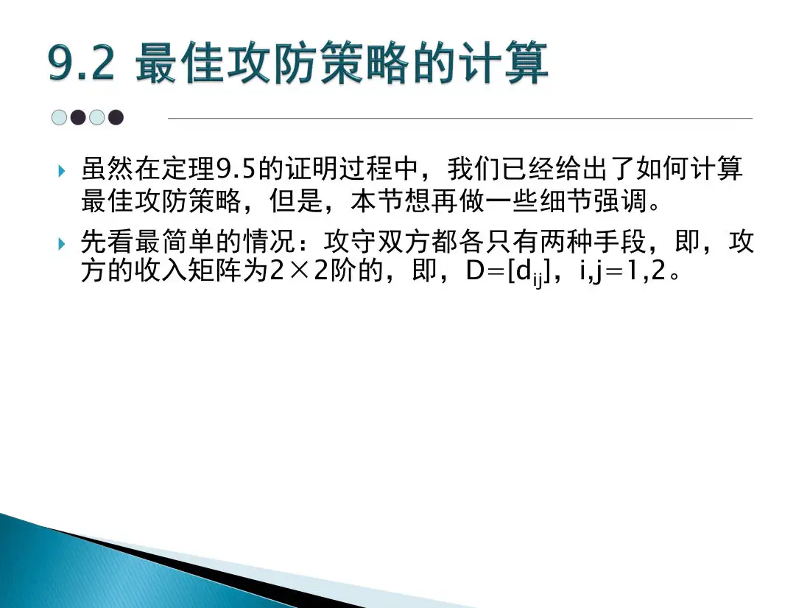

原文：

9.2 最佳攻防策略的计算

 虽然在定理9.5的证明过程中，我们已经给出了如何计算最佳攻防策略，但是，本节想再做一些细节强调。

 先看最简单的情况：攻守双方都各只有两种手段，即，攻方的收入矩阵为 $2 \times 2$ 阶的，即， $\mathrm { D } { = } [ \mathsf { d } _ { \mathrm { i j } } ] , \mathsf { i } , \mathsf { j } { = } 7 , 2$

### 9.2 最佳攻防策略的计算

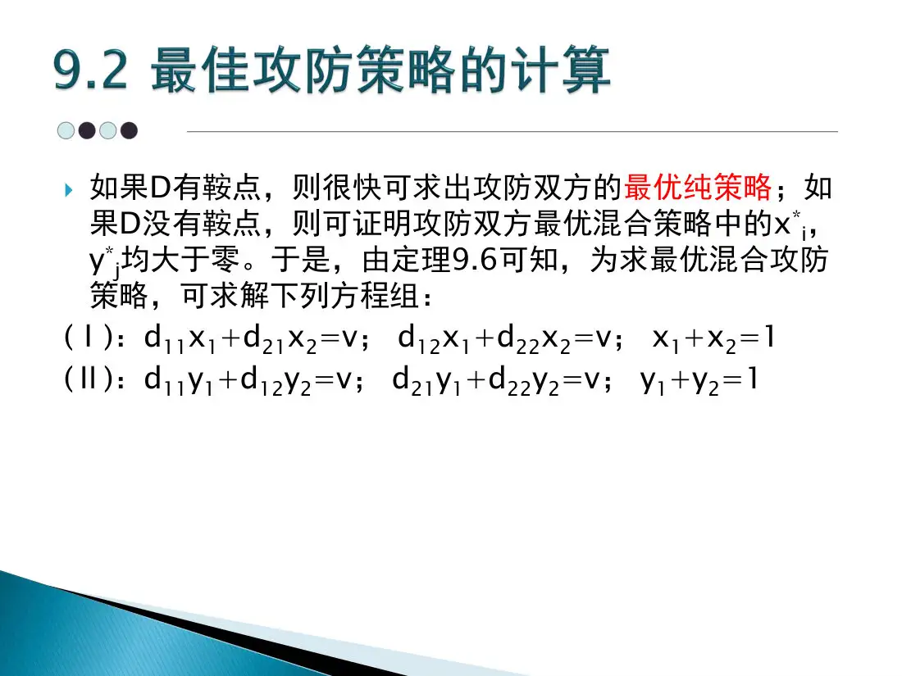

原文：

9.2 最佳攻防策略的计算

 如果D有鞍点，则很快可求出攻防双方的最优纯策略；如果D没有鞍点，则可证明攻防双方最优混合策略中的 $\ v { x } _ { \mathrm { ~ i ~ } } ^ { * }$ $\gamma _ { \mathrm { ~ i ~ } } ^ { * }$ 均大于零。于是，由定理9.6可知，为求最优混合攻防策略，可求解下列方程组：

$$
(I): d _ {1 1} x _ {1} + d _ {2 1} x _ {2} = v; \quad d _ {1 2} x _ {1} + d _ {2 2} x _ {2} = v; \quad x _ {1} + x _ {2} = 1
$$

$$
(\text {II}): \mathsf {d} _ {1 1} \mathsf {y} _ {1} + \mathsf {d} _ {1 2} \mathsf {y} _ {2} = \mathsf {v}; \quad \mathsf {d} _ {2 1} \mathsf {y} _ {1} + \mathsf {d} _ {2 2} \mathsf {y} _ {2} = \mathsf {v}; \quad \mathsf {y} _ {1} + \mathsf {y} _ {2} = 1
$$

### 9.2 最佳攻防策略的计算

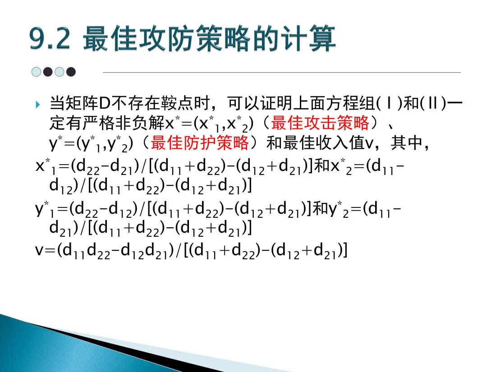

原文：

9.2 最佳攻防策略的计算

 当矩阵D不存在鞍点时，可以证明上面方程组(Ⅰ)和(Ⅱ)一定有严格非负解 $\mathbf { \boldsymbol { x } } ^ { * } { = } ( \mathbf { \boldsymbol { x } } _ { \mathrm { ~ 1 ~ } } ^ { * } { \times } \mathbf { \boldsymbol { \Sigma } } _ { 2 } ^ { * } )$ （最佳攻击策略）、$\mathsf { y } ^ { \ast } { = } ( \mathsf { y } _ { \mathrm { ~ l ~ } } ^ { \ast } \mathsf { y } _ { \mathrm { ~ 2 ~ } } ^ { \ast } )$ （最佳防护策略）和最佳收入值v，其中，x\* =(d -d )/[(d +d )-(d +d )]和 $\times _ { 2 } ^ { * } = ( \mathsf { d } _ { 1 1 } -$ d12)/[(d11+d22)-(d12+d21)]$\mathsf { y } ^ { \star } { } _ { 1 } = ( \mathsf { d } _ { 2 2 } - \mathsf { d } _ { 1 2 } ) / [ ( \mathsf { d } _ { 1 1 } + \mathsf { d } _ { 2 2 } ) - ( \mathsf { d } _ { 1 2 } + \mathsf { d } _ { 2 1 } ) ] .$ ]和 $v ^ { * } { } _ { 2 } { = } ( { \mathsf { d } } _ { 1 } { } _ { 1 } { = }$ d21)/[(d11+d22)-(d12+d21)]$\mathsf { v } = ( \mathsf { d } _ { 1 1 } \mathsf { d } _ { 2 2 } - \mathsf { d } _ { 1 2 } \mathsf { d } _ { 2 1 } ) / [ ( \mathsf { d } _ { 1 1 } + \mathsf { d } _ { 2 2 } ) - ( \mathsf { d } _ { 1 2 } + \mathsf { d } _ { 2 1 } ) ]$

### 9.2 最佳攻防策略的计算

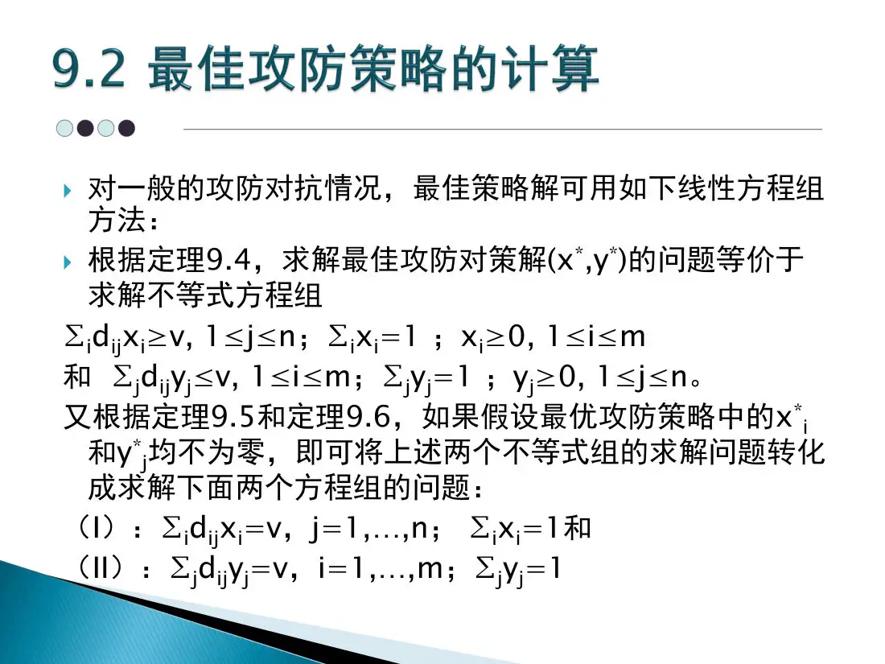

原文：

9.2 最佳攻防策略的计算

对一般的攻防对抗情况，最佳策略解可用如下线性方程组方法：

 根据定理9.4，求解最佳攻防对策解 $( \mathsf { x } ^ { \ast } , \mathsf { y } ^ { \ast } )$ 的问题等价于求解不等式方程组

$$
\Sigma_ {i} d _ {i j} x _ {i} \geq v, 1 \leq j \leq n; \Sigma_ {i} x _ {i} = 1; x _ {i} \geq 0, 1 \leq i \leq m
$$

和 $\Sigma _ { \mathrm { j } } \mathrm { d _ { i j } \mathrm { y _ { \mathrm { j } } \mathrm { \leq v , ~ \ l \leq i \leq m ; ~ \ \Sigma _ { \mathrm { j } } \mathrm { y _ { \mathrm { j } } = \mathrm { l ~ \mu ~ ; ~ \forall _ { j } \geq 0 , ~ \ l \leq j \leq n } } } } }$

又根据定理9.5和定理9.6，如果假设最优攻防策略中的 $\textsf { x } _ { 1 } ^ { * }$ 和 $\mathsf { y } _ { \mathrm { ~ j ~ } } ^ { \ast }$ 均不为零，即可将上述两个不等式组的求解问题转化成求解下面两个方程组的问题：

（I）： $\Sigma _ { \mathrm { i } } { \mathsf { d } } _ { \mathsf { i } \mathsf { i } } { \mathsf { x } } _ { \mathrm { i } } { = } { \mathsf { v } } , \ \mathsf { j } { = } { \mathsf { l } } , \ldots , { \mathsf { n } } ; \quad \Sigma _ { \mathrm { i } } { \mathsf { x } } _ { \mathrm { i } } { = } { \mathsf { I } }$ 和

（II）： $\Sigma _ { \mathrm { j } } { \bf d } _ { \mathrm { i j } } { \bf y } _ { \mathrm { j } } { = } { \bf v } , \ { \sf i } { = } { \sf 1 } , \ldots , { \sf m } ; \ \Sigma _ { \mathrm { j } } { \bf y } _ { \mathrm { j } } { = } { \sf 1 }$

### 9.2 最佳攻防策略的计算

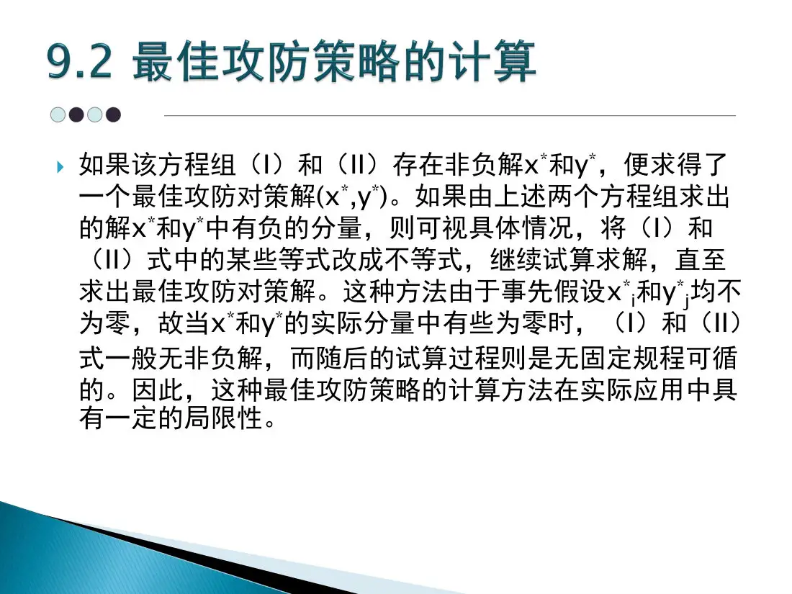

原文：

9.2 最佳攻防策略的计算

 如果该方程组（I）和（II）存在非负解x\*和y\*，便求得了一个最佳攻防对策解 $( \mathsf { x } ^ { \ast } , \mathsf { y } ^ { \ast } )$ 。如果由上述两个方程组求出的解 $\bigstar ^ { * }$ 和 $| \boldsymbol { \mathsf { y } } ^ { * }$ 中有负的分量，则可视具体情况，将（I）和（II）式中的某些等式改成不等式，继续试算求解，直至求出最佳攻防对策解。这种方法由于事先假设 $x ^ { * }$ 和 $\gamma _ { \mathrm { ~ i ~ } } ^ { * }$ 均不为零，故当 $\bigstar ^ { * }$ 和 $| \boldsymbol { \mathsf { y } } ^ { * }$ 的实际分量中有些为零时，（I）和（II）式一般无非负解，而随后的试算过程则是无固定规程可循的。因此，这种最佳攻防策略的计算方法在实际应用中具有一定的局限性。

### 9.2 最佳攻防策略的计算

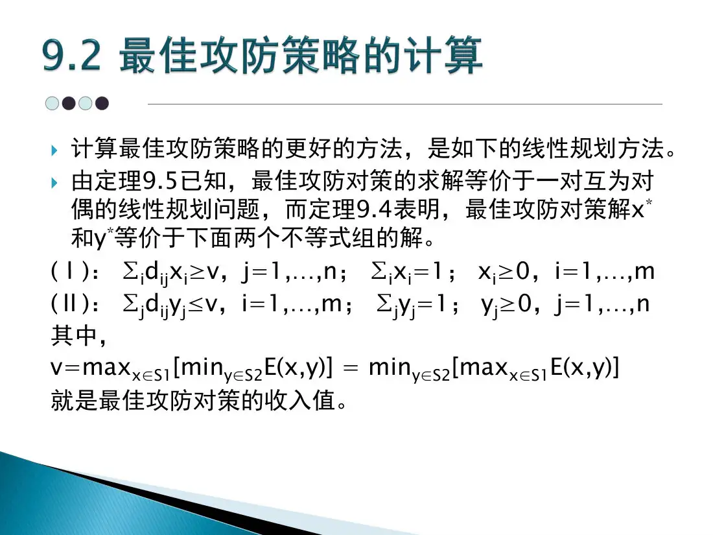

原文：

9.2 最佳攻防策略的计算

计算最佳攻防策略的更好的方法，是如下的线性规划方法。

 由定理9.5已知，最佳攻防对策的求解等价于一对互为对偶的线性规划问题，而定理9.4表明，最佳攻防对策解 $x ^ { * }$ 和 $| \boldsymbol { \mathsf { y } } ^ { * }$ 等价于下面两个不等式组的解。

$$
(I): \quad \Sigma_ {i} d _ {i j} x _ {i} \geq v, j = 1, \dots , n; \quad \Sigma_ {i} x _ {i} = 1; \quad x _ {i} \geq 0, i = 1, \dots , m
$$

(Ⅱ)： $\Sigma _ { \mathrm { j } } { \mathsf { d } } _ { \mathsf { i } \mathrm { j } } { \mathsf { y } } _ { \mathrm { j } } { \mathsf { \le v } } , \ \mathsf { i } = 1 , . . . , \mathsf { m } ; \quad \Sigma _ { \mathrm { j } } { \mathsf { y } } _ { \mathrm { j } } { \mathsf { = 1 } } \ ; \quad \mathsf { y } _ { \mathrm { j } } { \mathsf { \ge 0 } } , \ \mathsf { j } { \mathsf { = 1 } } , . . . , \mathsf { n }$ 其中，

$\mathsf { v } = \mathsf { m a x } _ { \mathsf { x } \in \mathsf { S } 1 } [ \mathsf { m i n } _ { \mathsf { v } \in \mathsf { S } 2 } \mathsf { E } ( \mathsf { x } , \mathsf { y } ) ] = \mathsf { m i n } _ { \mathsf { y } \in \mathsf { S } 2 } [ \mathsf { m a x } _ { \mathsf { x } \in \mathsf { S } 1 } \mathsf { E } ( \mathsf { x } , \mathsf { y } ) ]$ 就是最佳攻防对策的收入值。

### 9.2 最佳攻防策略的计算

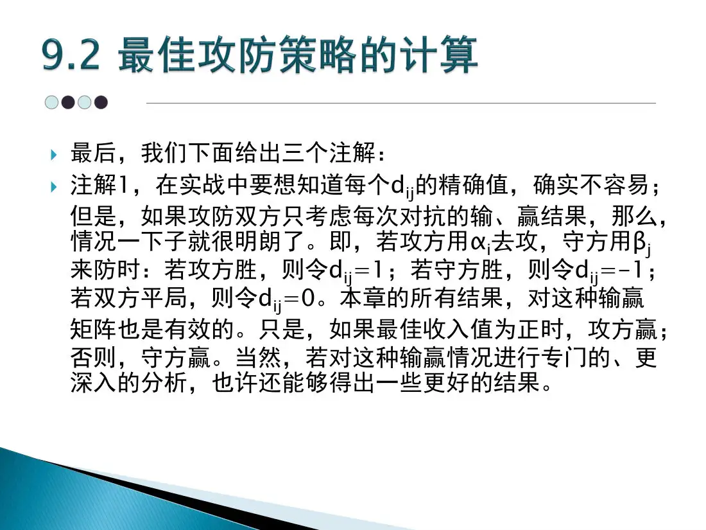

原文：

9.2 最佳攻防策略的计算

最后，我们下面给出三个注解：

 注解1，在实战中要想知道每个 ${ \bf d } _ { \mathrm { i j } }$ 的精确值，确实不容易；但是，如果攻防双方只考虑每次对抗的输、赢结果，那么，情况一下子就很明朗了。即，若攻方用 ${ \alpha } _ { \mathrm { i } }$ 去攻，守方用 $\beta _ { \mathrm { j } }$ 来防时：若攻方胜，则令 ${ \bf d } _ { \mathrm { i j } } = ]$ ；若守方胜，则令 ${ \mathsf { d } } _ { \mathsf { i } \mathsf { i } } { = } { - } \mathsf { l }$ 若双方平局，则令 ${ \mathsf { d } } _ { \mathsf { i j } } { = } 0$ 。本章的所有结果，对这种输赢矩阵也是有效的。只是，如果最佳收入值为正时，攻方赢；否则，守方赢。当然，若对这种输赢情况进行专门的、更深入的分析，也许还能够得出一些更好的结果。

### 9.2 最佳攻防策略的计算

原文：

9.2 最佳攻防策略的计算

 注解2，当然，本章所演示的沙盘攻防，并不包含网络安全攻防的所有情况，但是，它确实是网络安全攻防的主流，因此，本章具体给出的最佳攻防策略的计算方案，对完善安全观念是很有帮助的。希望攻防双方理智行动，在实现自身利益最大化的同时，最终共赢。

### 9.2 最佳攻防策略的计算

原文：

9.2 最佳攻防策略的计算

注解3，本章结果的价值至少体现在如下几个方面：

 首先，在知己知彼的沙盘演练场景下，以实际可行的算法和步骤，给出了达到攻防双方共赢，各自利益都最大化的、具体的最佳攻防策略（纳什均衡状态）。

 其次，沙盘演练与实战虽然有一定的区别，但是，在随时关注对方实力情况下，就可在平常预备好最佳的攻防策略，从而，在战时有助于稳准狠地出招。

 还有，充分掌握最佳攻防策略，可以使现有的手段发挥其最大的效用，避免不必要的争斗和牺牲。

 最后，也是最重要的，有助于全民树立正确的网络空间安全观念，让大家一起努力，实现共赢的纳什均衡。

### 本章结束，谢谢

原文：

本章结束，谢谢
