# 《信息安全技术》第1章 网络安全概述（课件）

原件的每一页，下面附识别出的文字。

### 第1章 网络安全概述

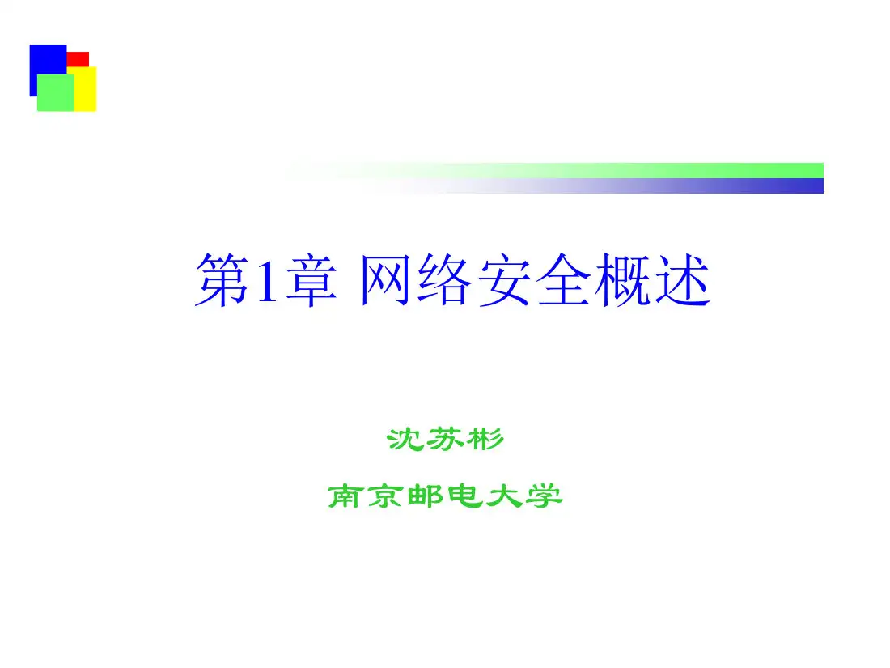

原文：

第1章 网络安全概述

沈苏彬

南京邮电大学

1

### 本课程的开场白

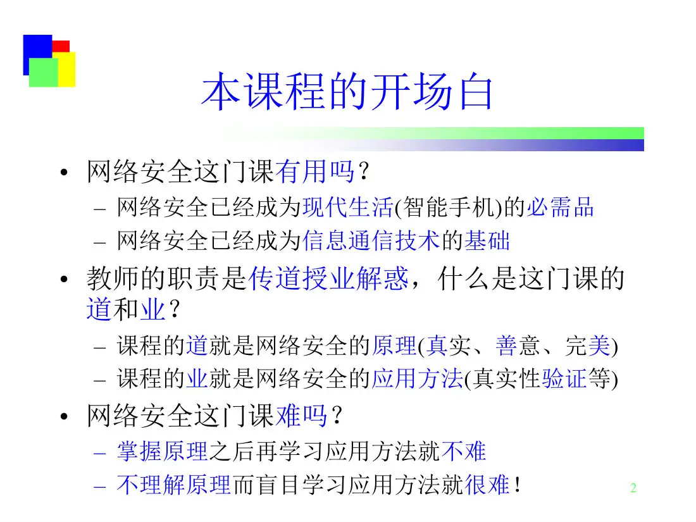

原文：

本课程的开场白

• 网络安全这门课有用吗？

– 网络安全已经成为现代生活(智能手机)的必需品

– 网络安全已经成为信息通信技术的基础

• 教师的职责是传道授业解惑，什么是这门课的道和业？

– 课程的道就是网络安全的原理(真实、善意、完美)

– 课程的业就是网络安全的应用方法(真实性验证等)

• 网络安全这门课难吗？

– 掌握原理之后再学习应用方法就不难

– 不理解原理而盲目学习应用方法就很难！

2

### 本章主要内容

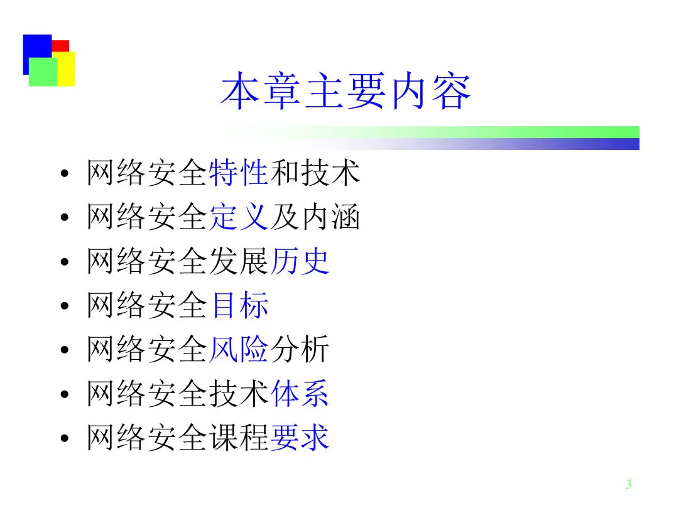

原文：

本章主要内容

• 网络安全特性和技术

• 网络安全定义及内涵

• 网络安全发展历史

• 网络安全目标

• 网络安全风险分析

• 网络安全技术体系

• 网络安全课程要求

7

3

### 本章要点

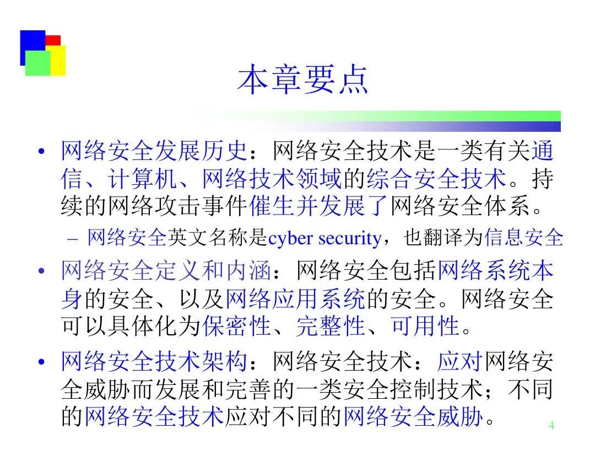

原文：

本章要点

• 网络安全发展历史：网络安全技术是一类有关通信、计算机、网络技术领域的综合安全技术。持续的网络攻击事件催生并发展了网络安全体系。– 网络安全英文名称是cyber security，也翻译为信息安全

网络安全定义和内涵：网络安全包括网络系统本身的安全、以及网络应用系统的安全。网络安全可以具体化为保密性、完整性、可用性。

• 网络安全技术架构：网络安全技术：应对网络安全威胁而发展和完善的一类安全控制技术；不同的网络安全技术应对不同的网络安全威胁。 4

1

### 网络安全的特性和技术

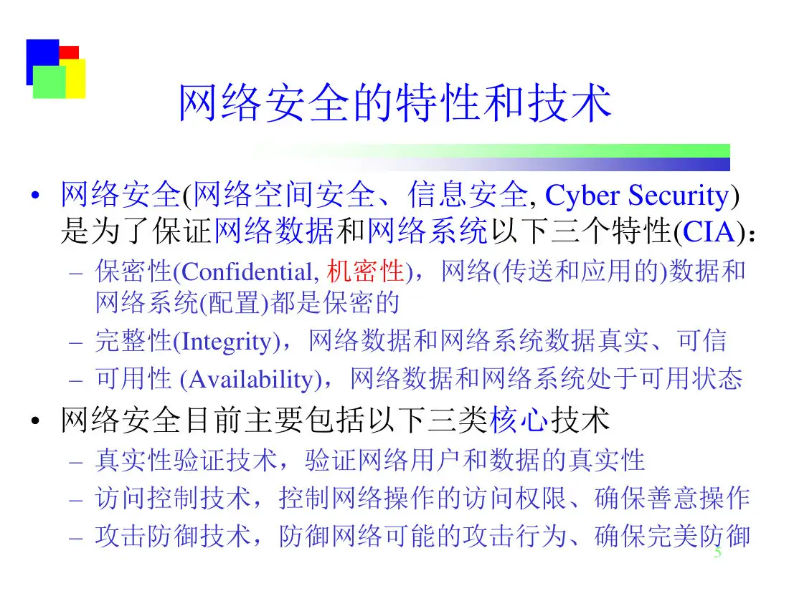

原文：

网络安全的特性和技术

• 网络安全(网络空间安全、信息安全, Cyber Security)是为了保证网络数据和网络系统以下三个特性(CIA)：

– 保密性(Confidential, 机密性)，网络(传送和应用的)数据和网络系统(配置)都是保密的

– 完整性(Integrity)，网络数据和网络系统数据真实、可信

– 可用性 (Availability)，网络数据和网络系统处于可用状态

• 网络安全目前主要包括以下三类核心技术

– 真实性验证技术，验证网络用户和数据的真实性

– 访问控制技术，控制网络操作的访问权限、确保善意操作

– 攻击防御技术，防御网络可能的攻击行为、确保完美防御

5

1

### 什么是网络安全？

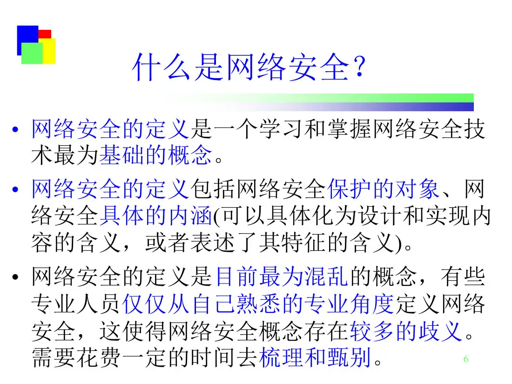

原文：

什么是网络安全？

• 网络安全的定义是一个学习和掌握网络安全技术最为基础的概念。

• 网络安全的定义包括网络安全保护的对象、网络安全具体的内涵(可以具体化为设计和实现内容的含义，或者表述了其特征的含义)。

• 网络安全的定义是目前最为混乱的概念，有些专业人员仅仅从自己熟悉的专业角度定义网络安全，这使得网络安全概念存在较多的歧义。需要花费一定的时间去梳理和甄别。 6

1

### 国际电信联盟的网络安全定义

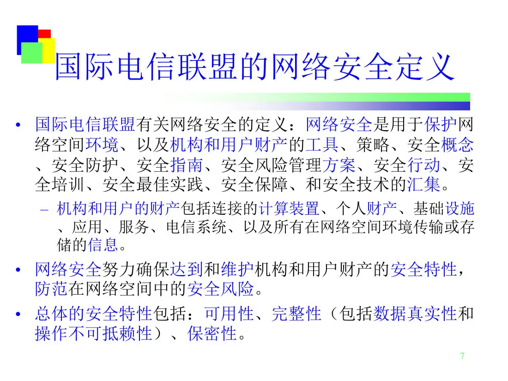

原文：

国际电信联盟的网络安全定义

国际电信联盟有关网络安全的定义：网络安全是用于保护网络空间环境、以及机构和用户财产的工具、策略、安全概念、安全防护、安全指南、安全风险管理方案、安全行动、安全培训、安全最佳实践、安全保障、和安全技术的汇集。

– 机构和用户的财产包括连接的计算装置、个人财产、基础设施、应用、服务、电信系统、以及所有在网络空间环境传输或存储的信息。

网络安全努力确保达到和维护机构和用户财产的安全特性，防范在网络空间中的安全风险。

• 总体的安全特性包括：可用性、完整性（包括数据真实性和操作不可抵赖性）、保密性。

7

### 本课程的网络安全定义

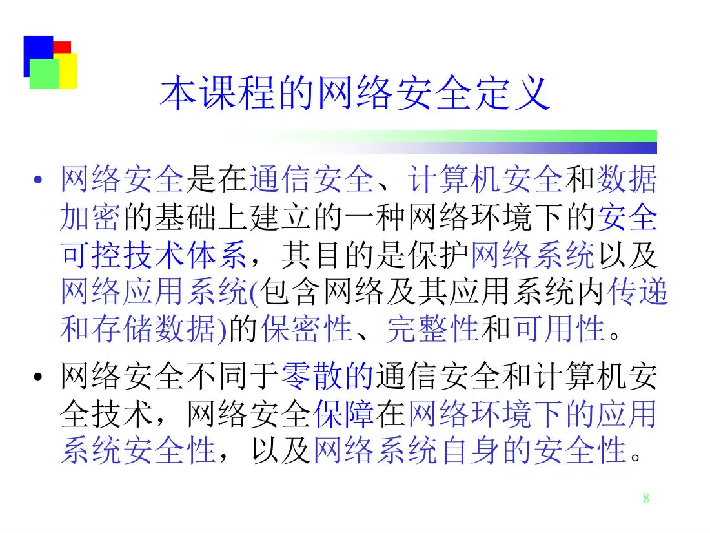

原文：

本课程的网络安全定义

• 网络安全是在通信安全、计算机安全和数据加密的基础上建立的一种网络环境下的安全可控技术体系，其目的是保护网络系统以及网络应用系统(包含网络及其应用系统内传递和存储数据)的保密性、完整性和可用性。

• 网络安全不同于零散的通信安全和计算机安全技术，网络安全保障在网络环境下的应用系统安全性，以及网络系统自身的安全性。

7

8

### “Cyber”的概念性说明

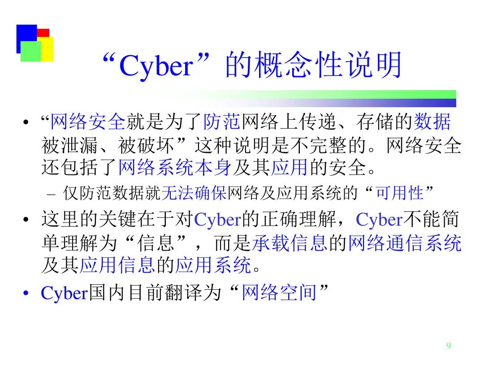

原文：

“Cyber”的概念性说明

• “网络安全就是为了防范网络上传递、存储的数据被泄漏、被破坏”这种说明是不完整的。网络安全还包括了网络系统本身及其应用的安全。

– 仅防范数据就无法确保网络及应用系统的“可用性”

• 这里的关键在于对Cyber的正确理解，Cyber不能简单理解为“信息”，而是承载信息的网络通信系统及其应用信息的应用系统。

• Cyber国内目前翻译为“网络空间”

7

9

### 网络安全发展历史

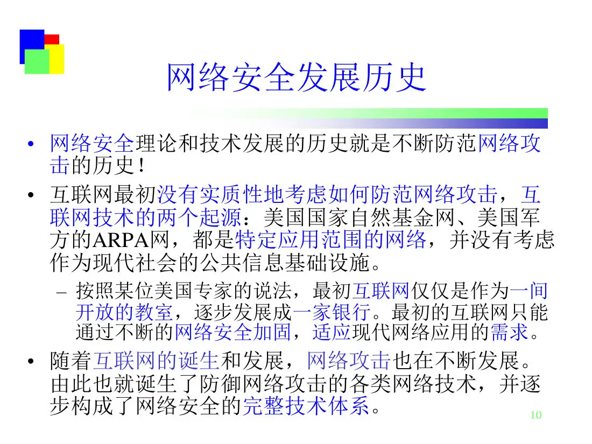

原文：

网络安全发展历史

• 网络安全理论和技术发展的历史就是不断防范网络攻击的历史！

• 互联网最初没有实质性地考虑如何防范网络攻击，互联网技术的两个起源：美国国家自然基金网、美国军方的ARPA网，都是特定应用范围的网络，并没有考虑作为现代社会的公共信息基础设施。

按照某位美国专家的说法，最初互联网仅仅是作为一间开放的教室，逐步发展成一家银行。最初的互联网只能通过不断的网络安全加固，适应现代网络应用的需求。

• 随着互联网的诞生和发展，网络攻击也在不断发展。由此也就诞生了防御网络攻击的各类网络技术，并逐步构成了网络安全的完整技术体系。 10

7

### 发展初期的网络攻击历史

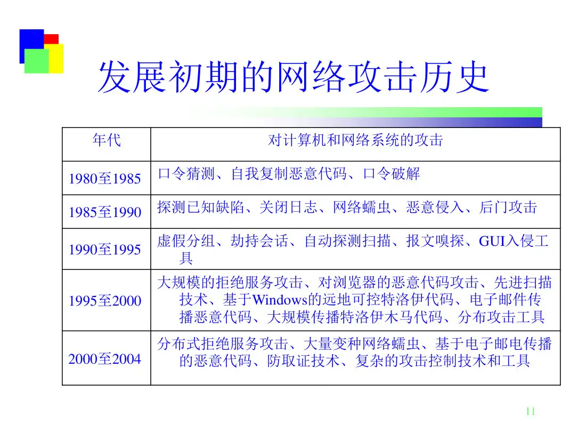

原文：

发展初期的网络攻击历史

<table><tr><td>年代</td><td>对计算机和网络系统的攻击</td></tr><tr><td>1980至1985</td><td>口令猜测、自我复制恶意代码、口令破解</td></tr><tr><td>1985至1990</td><td>探测已知缺陷、关闭日志、网络蠕虫、恶意侵入、后门攻击</td></tr><tr><td>1990至1995</td><td>虚假分组、劫持会话、自动探测扫描、报文嗅探、GUI入侵工具</td></tr><tr><td>1995至2000</td><td>大规模的拒绝服务攻击、对浏览器的恶意代码攻击、先进扫描技术、基于Windows的远地可控特洛伊代码、电子邮件传播恶意代码、大规模传播特洛伊木马代码、分布攻击工具</td></tr><tr><td>2000至2004</td><td>分布式拒绝服务攻击、大量变种网络蠕虫、基于电子邮电传播的恶意代码、防取证技术、复杂的攻击控制技术和工具</td></tr></table>

11

### 网络安全技术的诞生

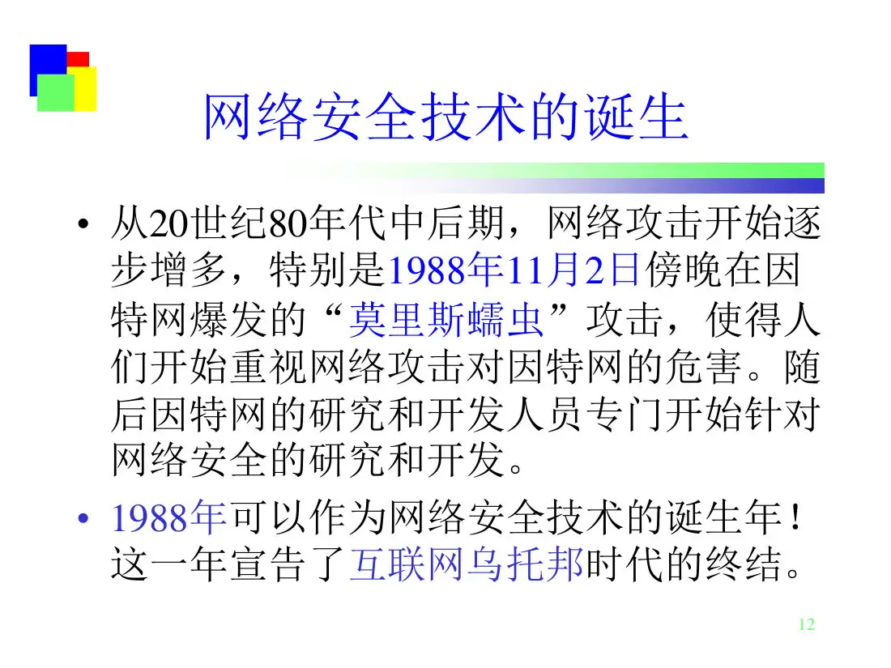

原文：

网络安全技术的诞生

• 从20世纪80年代中后期，网络攻击开始逐步增多，特别是1988年11月2日傍晚在因特网爆发的“莫里斯蠕虫”攻击，使得人们开始重视网络攻击对因特网的危害。随后因特网的研究和开发人员专门开始针对网络安全的研究和开发。

• 1988年可以作为网络安全技术的诞生年！这一年宣告了互联网乌托邦时代的终结。

1

12

### 莫里斯病毒与网络安全

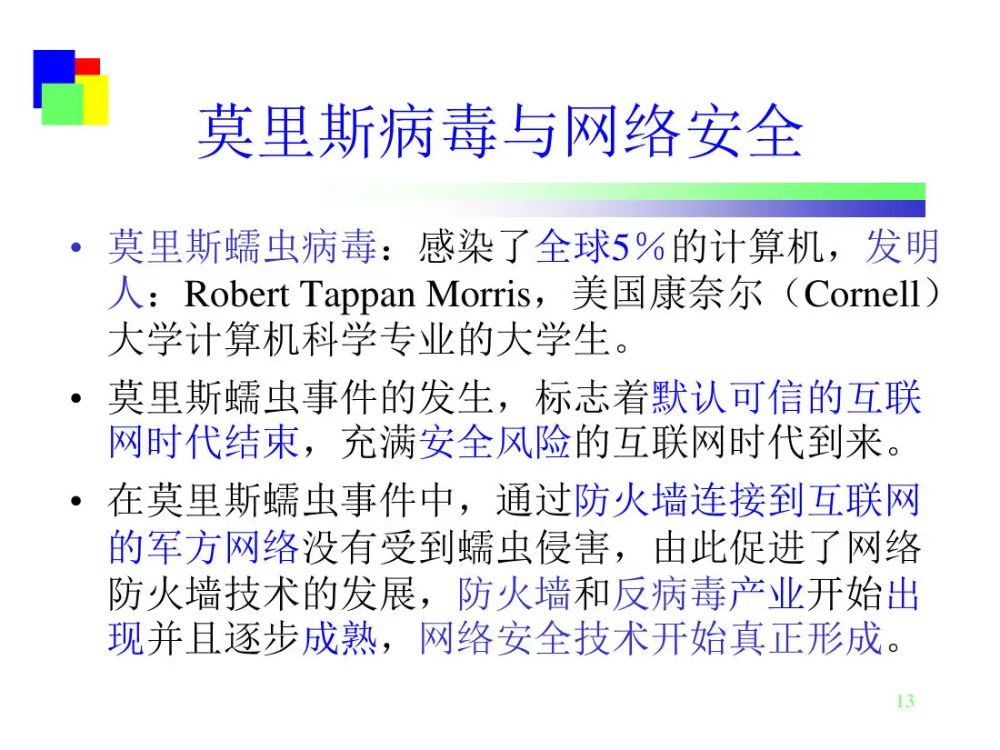

原文：

莫里斯病毒与网络安全

莫里斯蠕虫病毒：感染了全球5％的计算机，发明人：Robert Tappan Morris，美国康奈尔（Cornell）大学计算机科学专业的大学生。

• 莫里斯蠕虫事件的发生，标志着默认可信的互联网时代结束，充满安全风险的互联网时代到来。

• 在莫里斯蠕虫事件中，通过防火墙连接到互联网的军方网络没有受到蠕虫侵害，由此促进了网络防火墙技术的发展，防火墙和反病毒产业开始出现并且逐步成熟，网络安全技术开始真正形成。

13

### 网络攻击现状

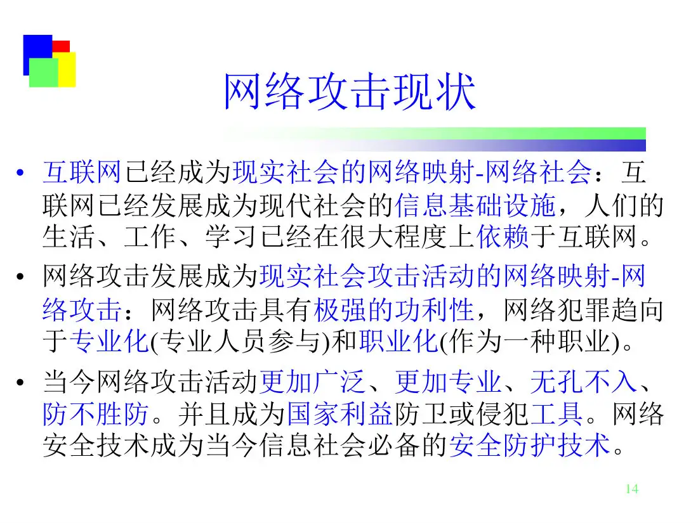

原文：

网络攻击现状

• 互联网已经成为现实社会的网络映射-网络社会：互联网已经发展成为现代社会的信息基础设施，人们的生活、工作、学习已经在很大程度上依赖于互联网。

• 网络攻击发展成为现实社会攻击活动的网络映射-网络攻击：网络攻击具有极强的功利性，网络犯罪趋向于专业化(专业人员参与)和职业化(作为一种职业)。

• 当今网络攻击活动更加广泛、更加专业、无孔不入、防不胜防。并且成为国家利益防卫或侵犯工具。网络安全技术成为当今信息社会必备的安全防护技术。

1

14

### 网络安全相关技术

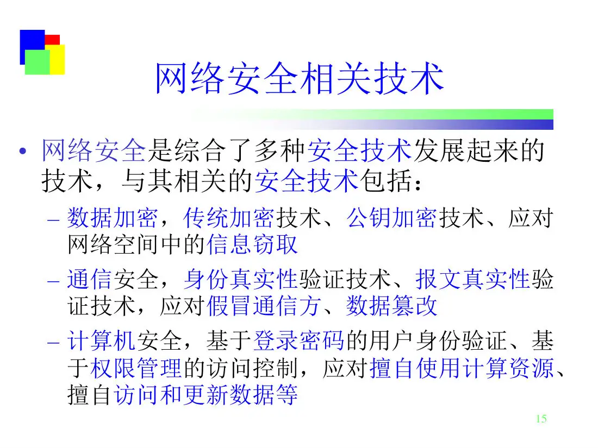

原文：

网络安全相关技术

• 网络安全是综合了多种安全技术发展起来的技术，与其相关的安全技术包括：

– 数据加密，传统加密技术、公钥加密技术、应对网络空间中的信息窃取

– 通信安全，身份真实性验证技术、报文真实性验证技术，应对假冒通信方、数据篡改

– 计算机安全，基于登录密码的用户身份验证、基于权限管理的访问控制，应对擅自使用计算资源、擅自访问和更新数据等

7

15

### 数据加密

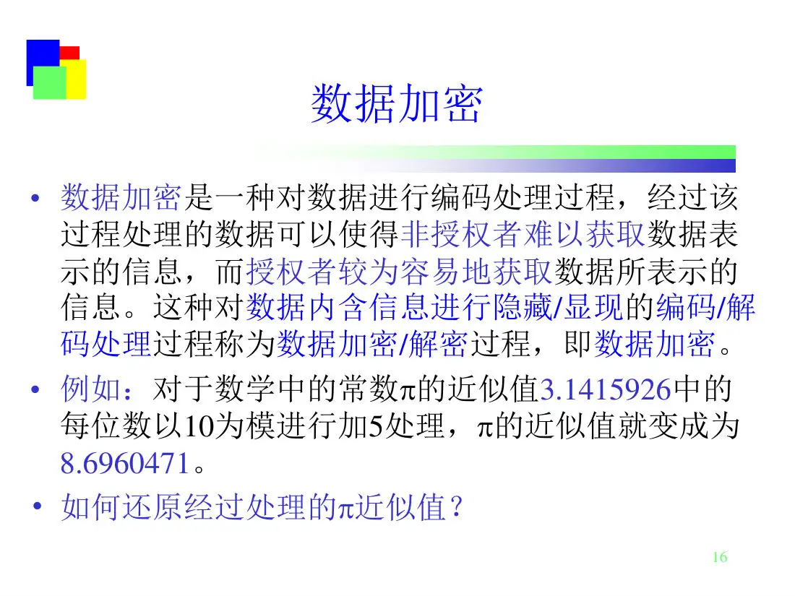

原文：

数据加密

数据加密是一种对数据进行编码处理过程，经过该过程处理的数据可以使得非授权者难以获取数据表示的信息，而授权者较为容易地获取数据所表示的信息。这种对数据内含信息进行隐藏/显现的编码/解码处理过程称为数据加密/解密过程，即数据加密。

例如：对于数学中的常数的近似值3.1415926中的每位数以10为模进行加5处理，的近似值就变成为8.6960471。

• 如何还原经过处理的近似值？

16

### 数据加密与密码学

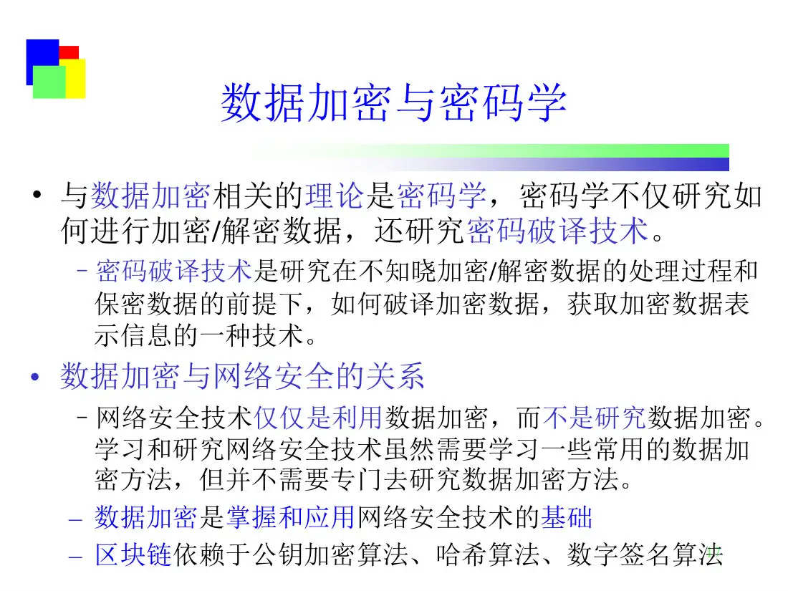

原文：

数据加密与密码学

• 与数据加密相关的理论是密码学，密码学不仅研究如何进行加密/解密数据，还研究密码破译技术。

–密码破译技术是研究在不知晓加密/解密数据的处理过程和保密数据的前提下，如何破译加密数据，获取加密数据表示信息的一种技术。

• 数据加密与网络安全的关系

–网络安全技术仅仅是利用数据加密，而不是研究数据加密。学习和研究网络安全技术虽然需要学习一些常用的数据加密方法，但并不需要专门去研究数据加密方法。

– 数据加密是掌握和应用网络安全技术的基础

17– 区块链依赖于公钥加密算法、哈希算法、数字签名算法

7

### 通信安全

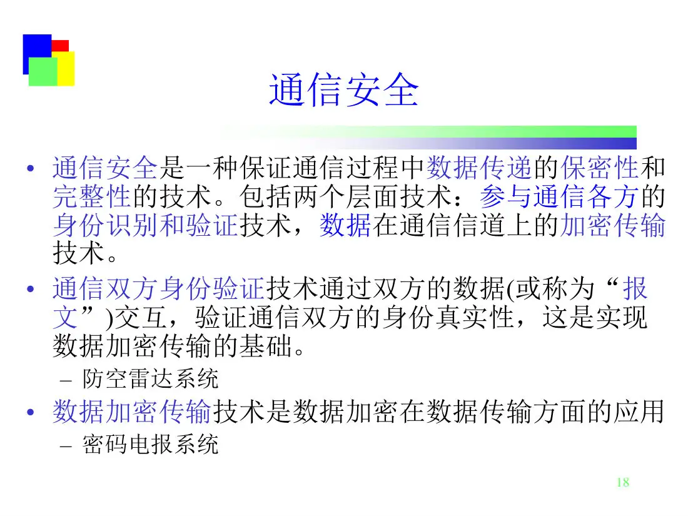

原文：

通信安全

通信安全是一种保证通信过程中数据传递的保密性和完整性的技术。包括两个层面技术：参与通信各方的身份识别和验证技术，数据在通信信道上的加密传输技术。

• 通信双方身份验证技术通过双方的数据(或称为“报文”)交互，验证通信双方的身份真实性，这是实现数据加密传输的基础。

– 防空雷达系统

• 数据加密传输技术是数据加密在数据传输方面的应用– 密码电报系统

18

### 通信安全与身份真实性验证

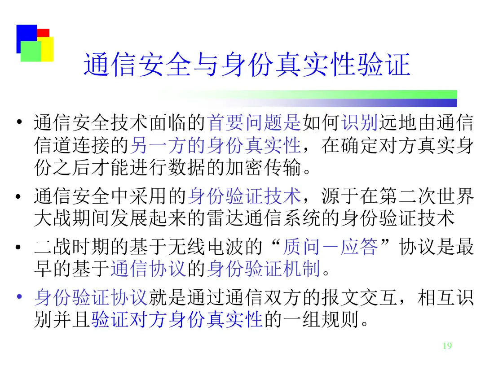

原文：

通信安全与身份真实性验证

• 通信安全技术面临的首要问题是如何识别远地由通信信道连接的另一方的身份真实性，在确定对方真实身份之后才能进行数据的加密传输。

• 通信安全中采用的身份验证技术，源于在第二次世界大战期间发展起来的雷达通信系统的身份验证技术

• 二战时期的基于无线电波的“质问－应答”协议是最早的基于通信协议的身份验证机制。

• 身份验证协议就是通过通信双方的报文交互，相互识别并且验证对方身份真实性的一组规则。

19

### 计算机安全

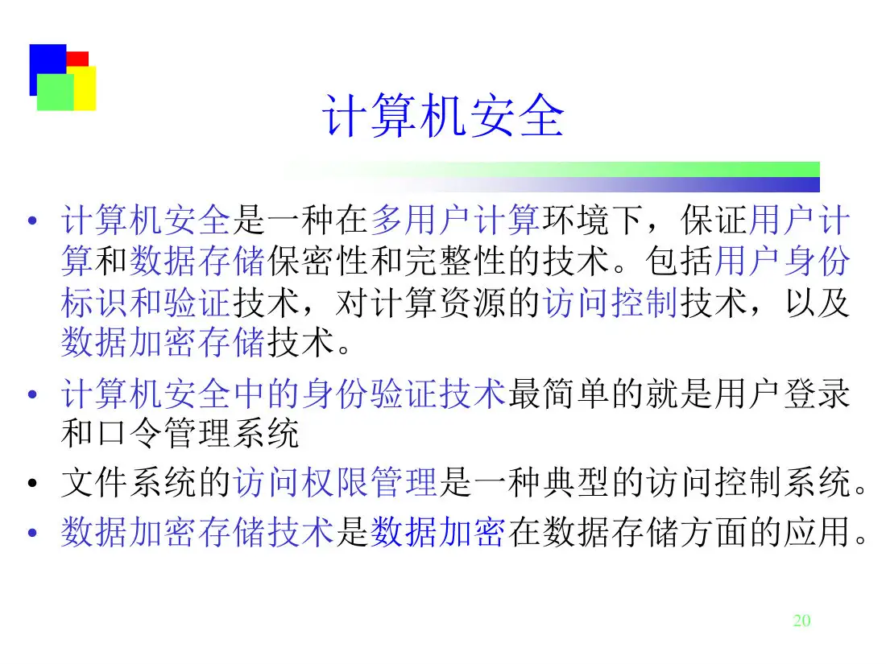

原文：

计算机安全

• 计算机安全是一种在多用户计算环境下，保证用户计算和数据存储保密性和完整性的技术。包括用户身份标识和验证技术，对计算资源的访问控制技术，以及数据加密存储技术。

• 计算机安全中的身份验证技术最简单的就是用户登录和口令管理系统

• 文件系统的访问权限管理是一种典型的访问控制系统。

• 数据加密存储技术是数据加密在数据存储方面的应用。

20

### 网络安全

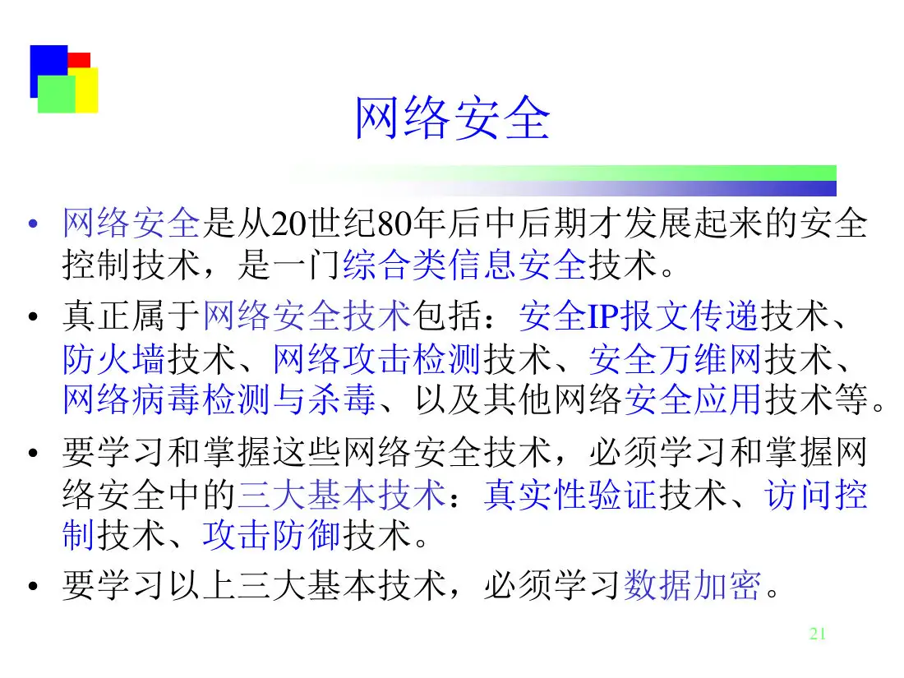

原文：

网络安全

• 网络安全是从20世纪80年后中后期才发展起来的安全控制技术，是一门综合类信息安全技术。

• 真正属于网络安全技术包括：安全IP报文传递技术、防火墙技术、网络攻击检测技术、安全万维网技术、网络病毒检测与杀毒、以及其他网络安全应用技术等。

• 要学习和掌握这些网络安全技术，必须学习和掌握网络安全中的三大基本技术：真实性验证技术、访问控制技术、攻击防御技术。

• 要学习以上三大基本技术，必须学习数据加密。

1

21

### 网络安全的目标和技术

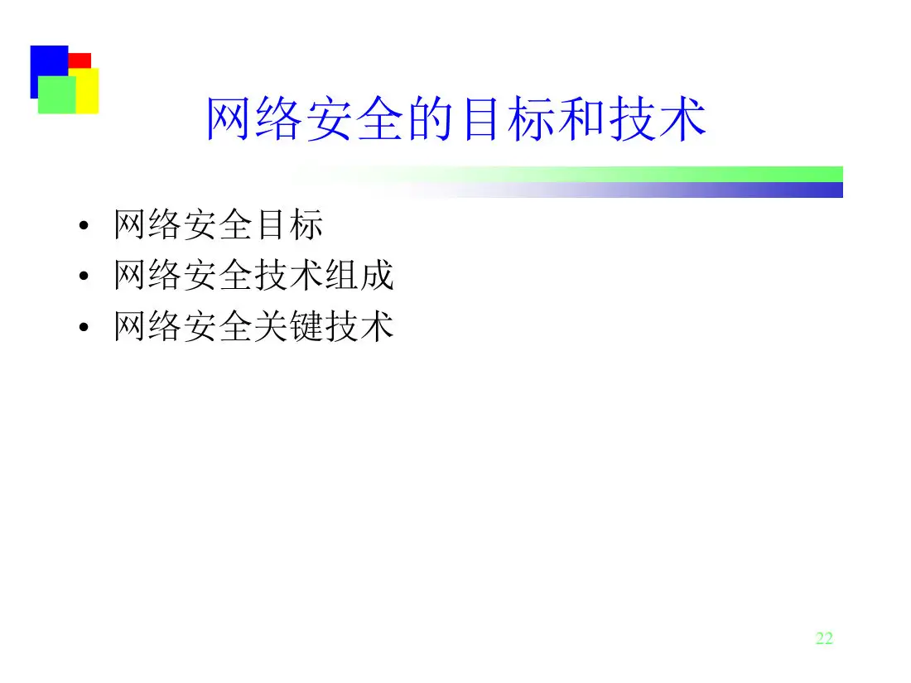

原文：

网络安全的目标和技术

• 网络安全目标

• 网络安全技术组成

• 网络安全关键技术

22

### 网络安全目标

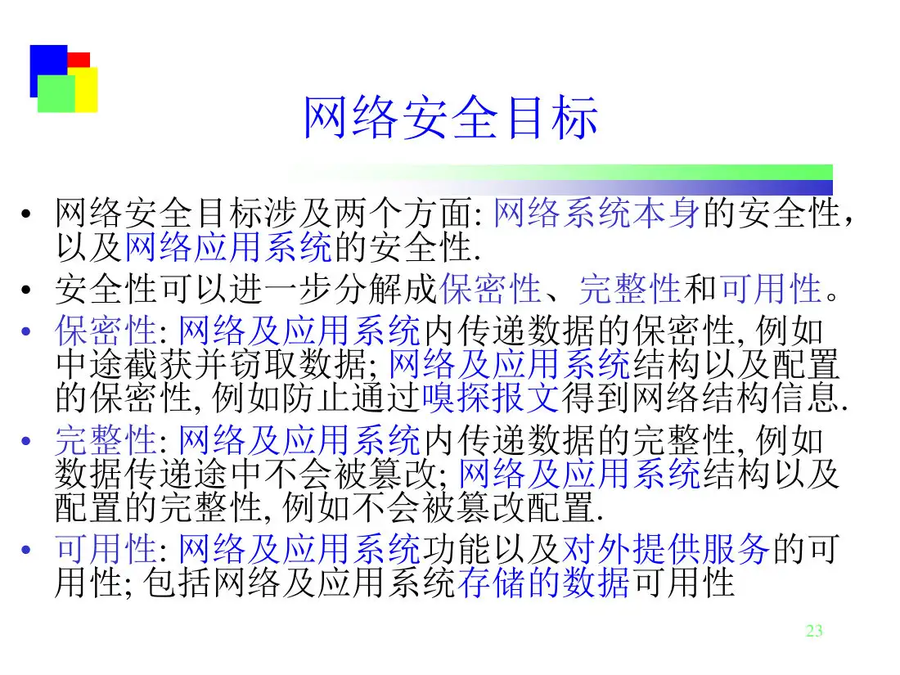

原文：

网络安全目标

• 网络安全目标涉及两个方面: 网络系统本身的安全性，以及网络应用系统的安全性.

• 安全性可以进一步分解成保密性、完整性和可用性。

保密性: 网络及应用系统内传递数据的保密性, 例如中途截获并窃取数据; 网络及应用系统结构以及配置的保密性, 例如防止通过嗅探报文得到网络结构信息.

完整性: 网络及应用系统内传递数据的完整性, 例如数据传递途中不会被篡改; 网络及应用系统结构以及配置的完整性, 例如不会被篡改配置.

• 可用性: 网络及应用系统功能以及对外提供服务的可用性; 包括网络及应用系统存储的数据可用性

1

23

### 网络安全技术组成

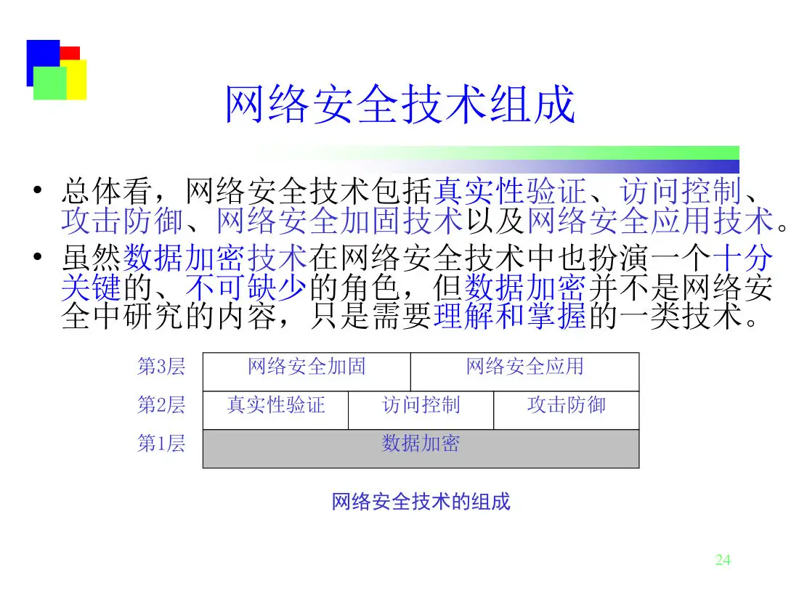

原文：

网络安全技术组成

• 总体看，网络安全技术包括真实性验证、访问控制、攻击防御、网络安全加固技术以及网络安全应用技术。

虽然数据加密技术在网络安全技术中也扮演一个十分关键的、不可缺少的角色，但数据加密并不是网络安全中研究的内容，只是需要理解和掌握的一类技术。

网络安全技术的组成
<table><tr><td>第3层</td><td colspan="2">网络安全加固</td><td colspan="2">网络安全应用</td></tr><tr><td>第2层</td><td>真实性验证</td><td colspan="2">访问控制</td><td>攻击防御</td></tr><tr><td>第1层</td><td colspan="4">数据加密</td></tr></table>

7

24

### 网络安全的几种风险形式

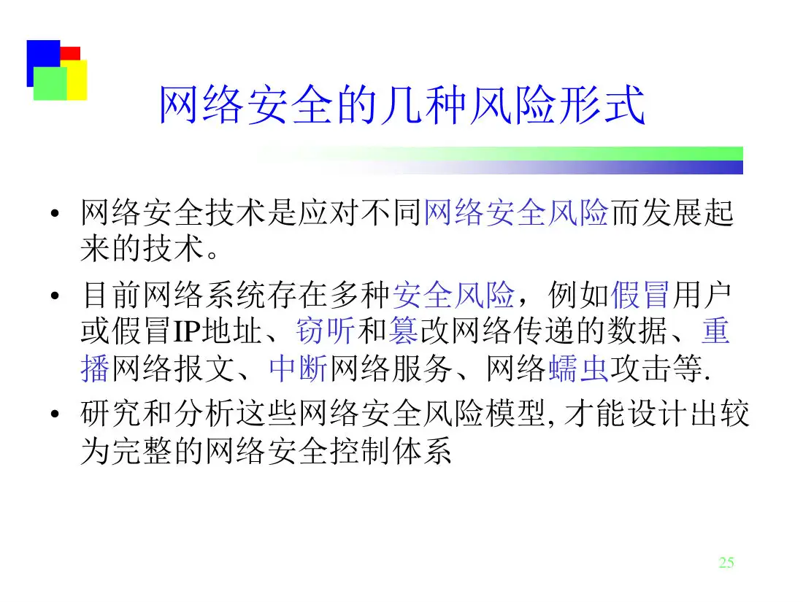

原文：

网络安全的几种风险形式

• 网络安全技术是应对不同网络安全风险而发展起来的技术。

• 目前网络系统存在多种安全风险，例如假冒用户或假冒IP地址、窃听和篡改网络传递的数据、重播网络报文、中断网络服务、网络蠕虫攻击等.

• 研究和分析这些网络安全风险模型, 才能设计出较为完整的网络安全控制体系

25

### 网络安全风险一: 假冒数据

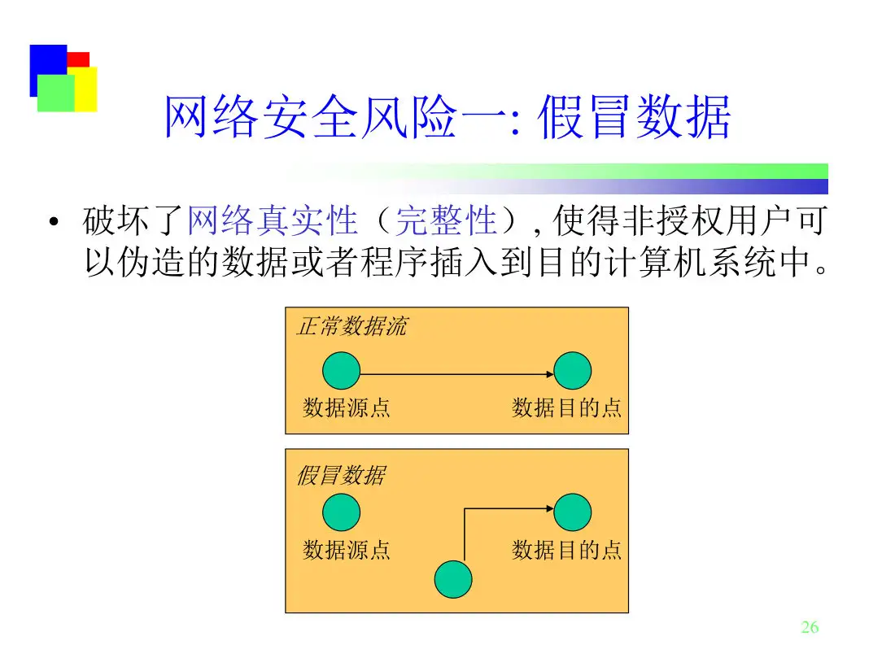

原文：

网络安全风险一: 假冒数据

• 破坏了网络真实性（完整性）, 使得非授权用户可以伪造的数据或者程序插入到目的计算机系统中。

26

### 网络安全风险二: 窃听数据

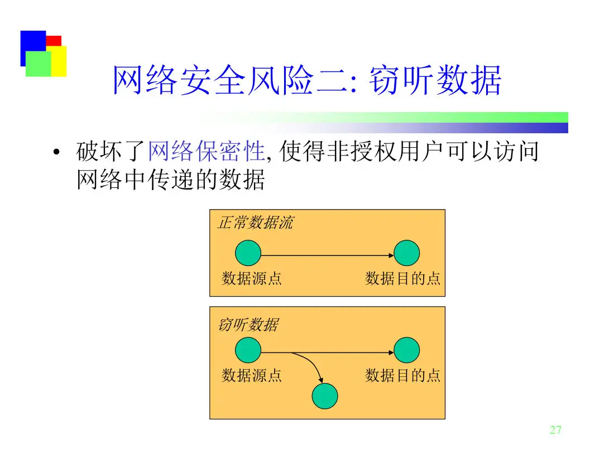

原文：

网络安全风险二: 窃听数据

• 破坏了网络保密性, 使得非授权用户可以访问网络中传递的数据

27

### 网络安全风险三: 篡改数据

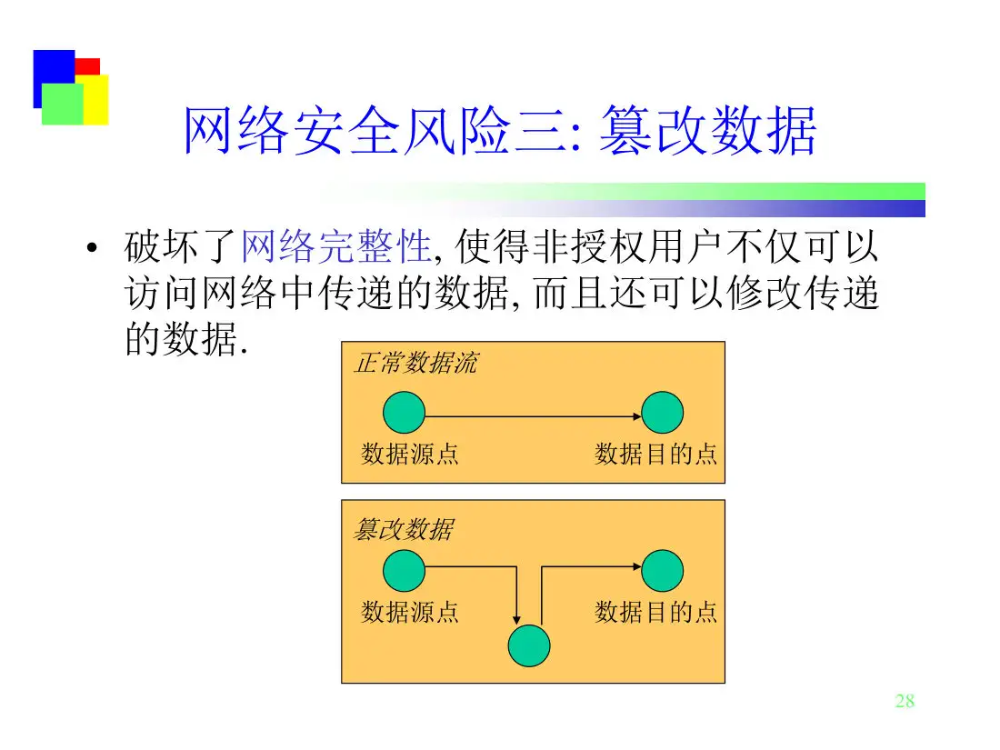

原文：

网络安全风险三: 篡改数据

• 破坏了网络完整性, 使得非授权用户不仅可以访问网络中传递的数据, 而且还可以修改传递的数据. 正党数据流

28

### 网络安全风险四: 重播报文

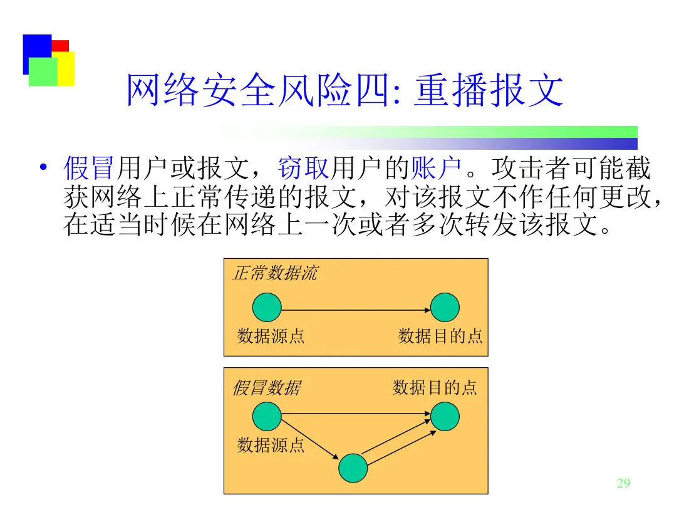

原文：

网络安全风险四: 重播报文

• 假冒用户或报文，窃取用户的账户。攻击者可能截获网络上正常传递的报文，对该报文不作任何更改，在适当时候在网络上一次或者多次转发该报文。

29

### 网络安全风险五: 中断服务

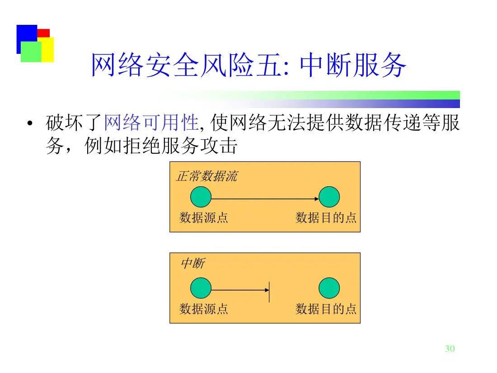

原文：

网络安全风险五: 中断服务

• 破坏了网络可用性, 使网络无法提供数据传递等服务，例如拒绝服务攻击

30

### 网络安全风险六：网络蠕虫攻击

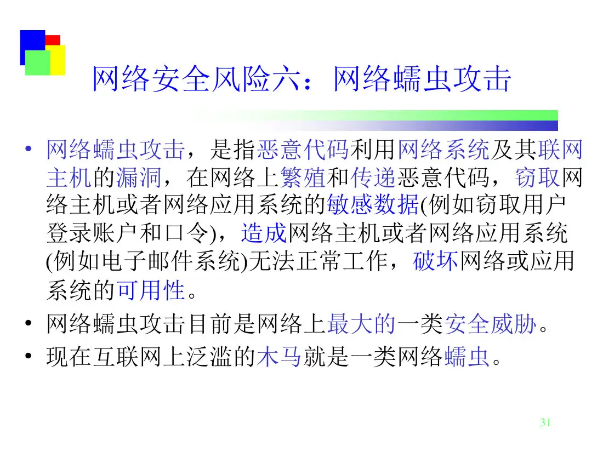

原文：

网络安全风险六：网络蠕虫攻击

网络蠕虫攻击，是指恶意代码利用网络系统及其联网主机的漏洞，在网络上繁殖和传递恶意代码，窃取网络主机或者网络应用系统的敏感数据(例如窃取用户登录账户和口令)，造成网络主机或者网络应用系统(例如电子邮件系统)无法正常工作，破坏网络或应用系统的可用性。

• 网络蠕虫攻击目前是网络上最大的一类安全威胁。

• 现在互联网上泛滥的木马就是一类网络蠕虫。

31

### 网络安全威胁的原因

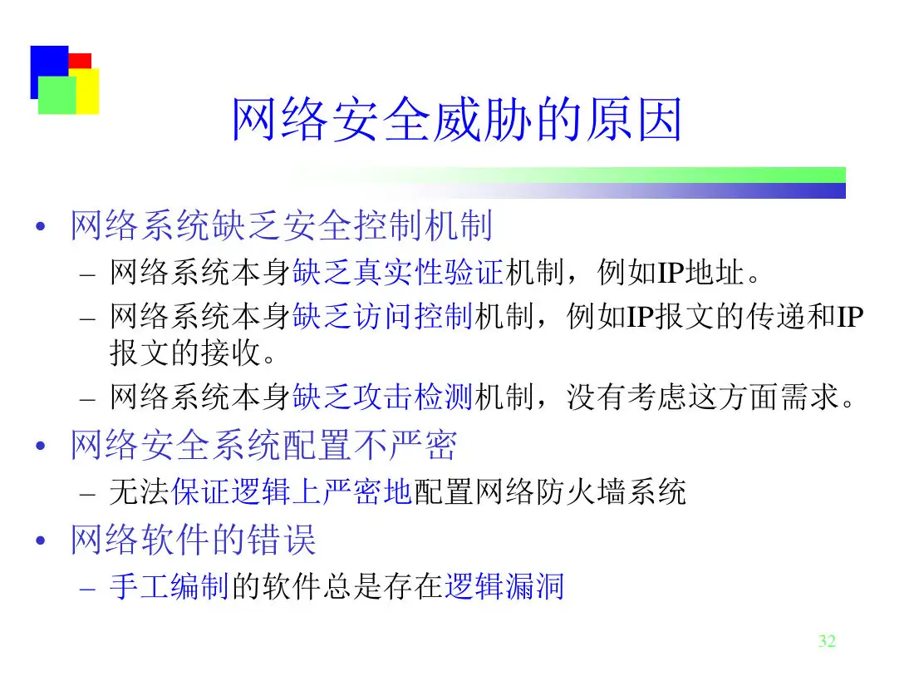

原文：

网络安全威胁的原因

• 网络系统缺乏安全控制机制

– 网络系统本身缺乏真实性验证机制，例如IP地址。

– 网络系统本身缺乏访问控制机制，例如IP报文的传递和IP报文的接收。

– 网络系统本身缺乏攻击检测机制，没有考虑这方面需求。

• 网络安全系统配置不严密

– 无法保证逻辑上严密地配置网络防火墙系统

• 网络软件的错误

– 手工编制的软件总是存在逻辑漏洞

32

### 应对网络威胁的网络安全技术

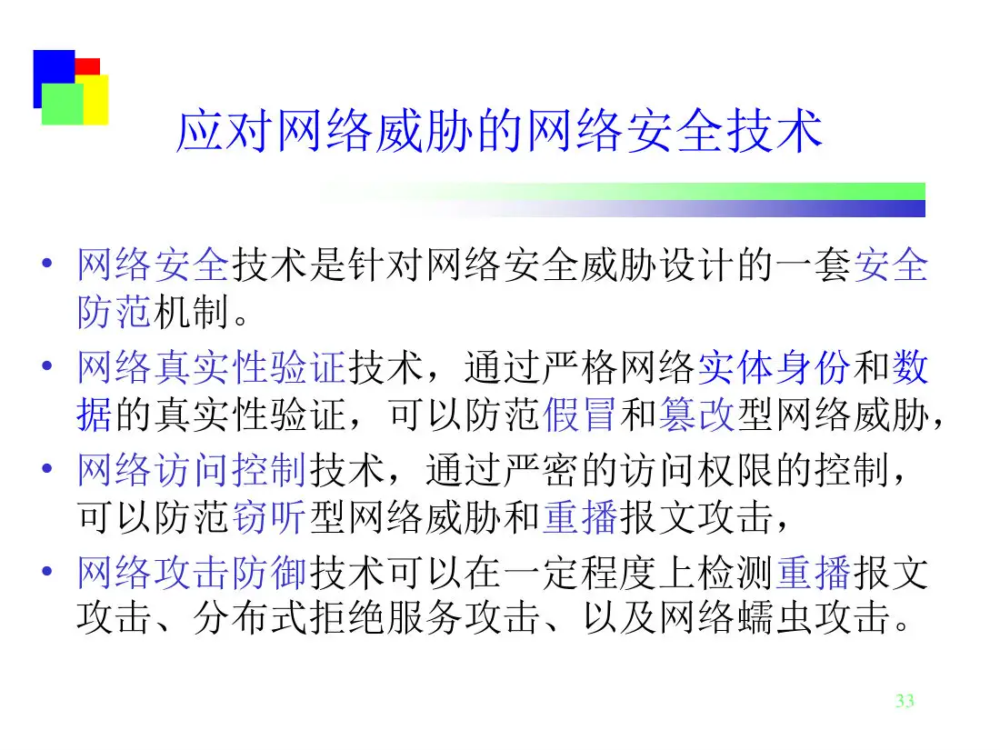

原文：

应对网络威胁的网络安全技术

• 网络安全技术是针对网络安全威胁设计的一套安全防范机制。

网络真实性验证技术，通过严格网络实体身份和数据的真实性验证，可以防范假冒和篡改型网络威胁，

• 网络访问控制技术，通过严密的访问权限的控制，可以防范窃听型网络威胁和重播报文攻击，

• 网络攻击防御技术可以在一定程度上检测重播报文攻击、分布式拒绝服务攻击、以及网络蠕虫攻击。

33

### 真实性验证技术

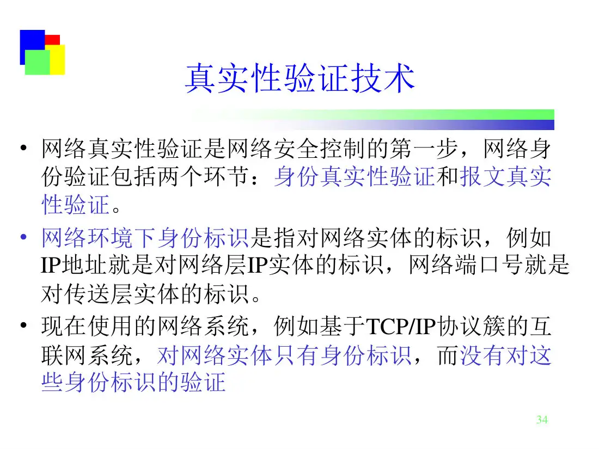

原文：

真实性验证技术

• 网络真实性验证是网络安全控制的第一步，网络身份验证包括两个环节：身份真实性验证和报文真实性验证。

• 网络环境下身份标识是指对网络实体的标识，例如IP地址就是对网络层IP实体的标识，网络端口号就是对传送层实体的标识。

• 现在使用的网络系统，例如基于TCP/IP协议簇的互联网系统，对网络实体只有身份标识，而没有对这些身份标识的验证

7

34

### 访问控制技术

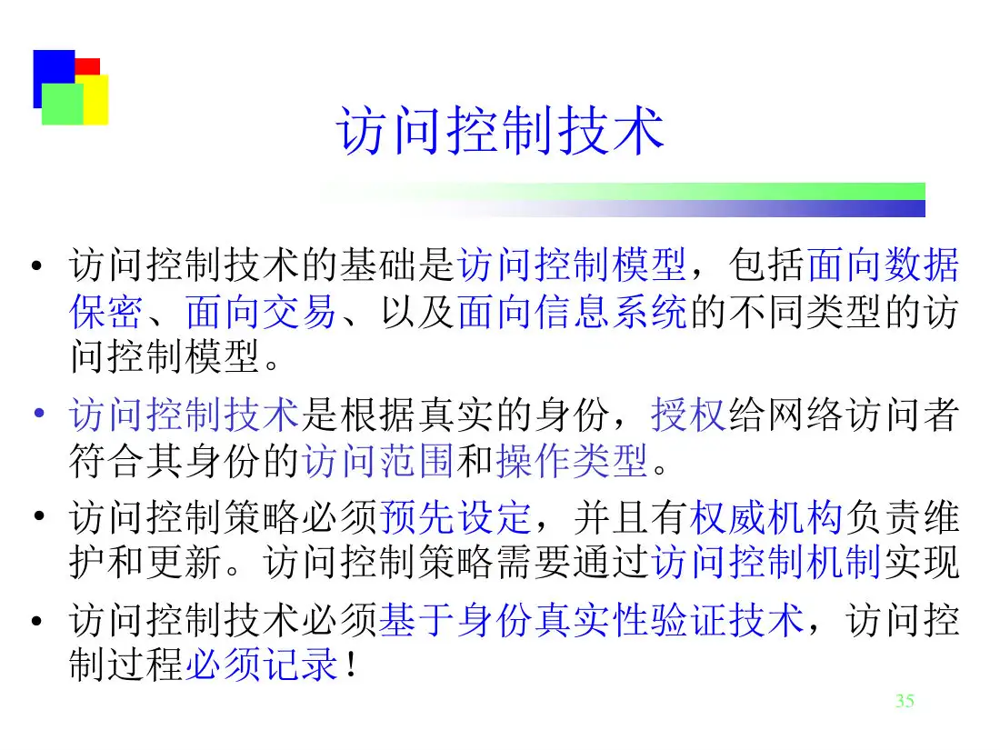

原文：

访问控制技术

• 访问控制技术的基础是访问控制模型，包括面向数据保密、面向交易、以及面向信息系统的不同类型的访问控制模型。

访问控制技术是根据真实的身份，授权给网络访问者符合其身份的访问范围和操作类型。

• 访问控制策略必须预先设定，并且有权威机构负责维护和更新。访问控制策略需要通过访问控制机制实现

• 访问控制技术必须基于身份真实性验证技术，访问控制过程必须记录！

7

35

### 访问控制的应用：网络防火墙

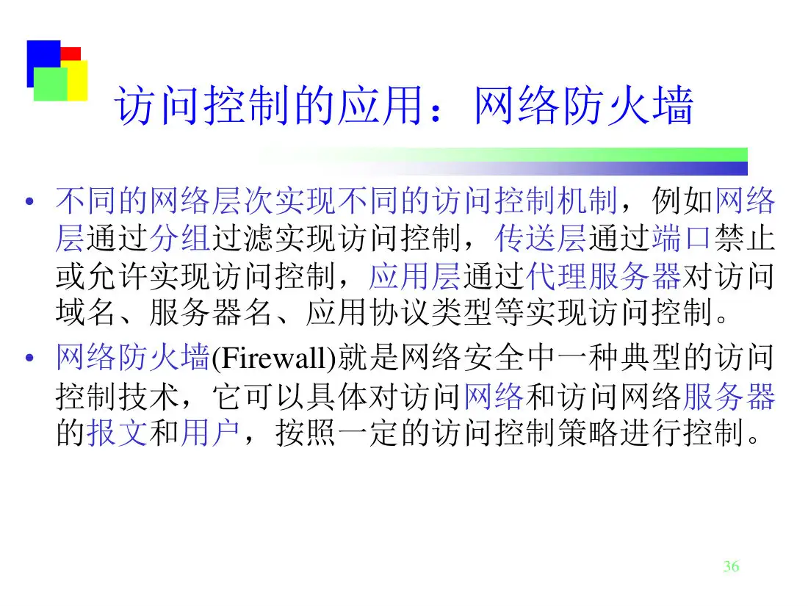

原文：

访问控制的应用：网络防火墙

• 不同的网络层次实现不同的访问控制机制，例如网络层通过分组过滤实现访问控制，传送层通过端口禁止或允许实现访问控制，应用层通过代理服务器对访问域名、服务器名、应用协议类型等实现访问控制。

网络防火墙(Firewall)就是网络安全中一种典型的访问控制技术，它可以具体对访问网络和访问网络服务器的报文和用户，按照一定的访问控制策略进行控制。

36

### 网络攻击防御

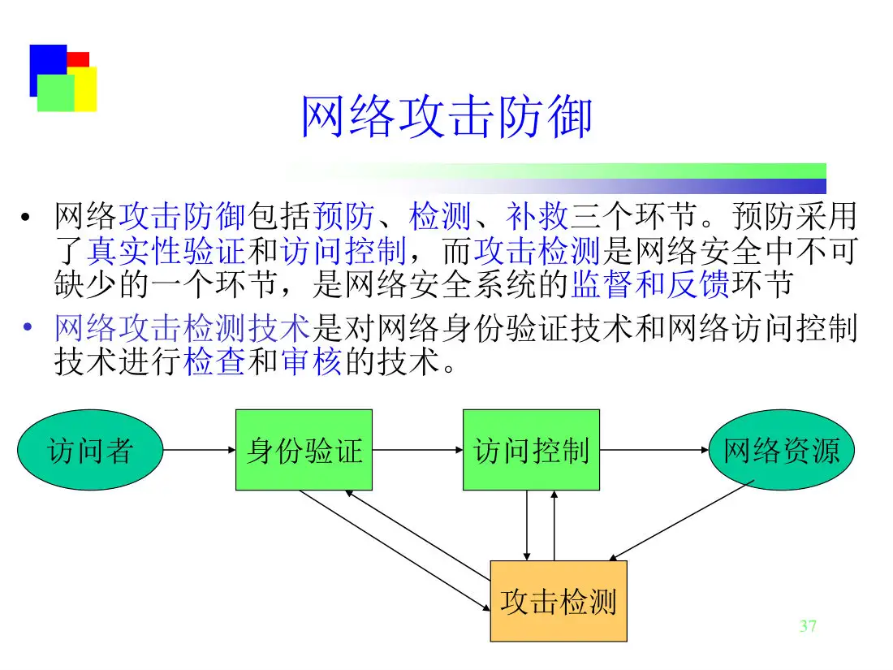

原文：

网络攻击防御

网络攻击防御包括预防、检测、补救三个环节。预防采用了真实性验证和访问控制，而攻击检测是网络安全中不可缺少的一个环节，是网络安全系统的监督和反馈环节

• 网络攻击检测技术是对网络身份验证技术和网络访问控制技术进行检查和审核的技术。

访问者

身份验证

访问控制

网络资源

37

### 网络恶意代码

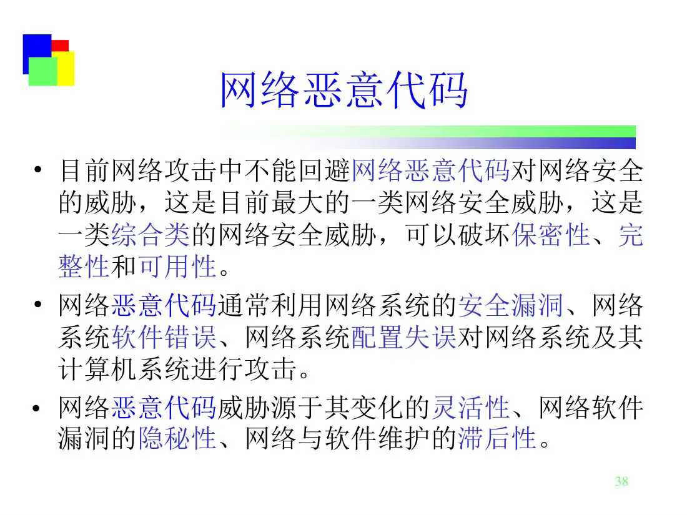

原文：

网络恶意代码

• 目前网络攻击中不能回避网络恶意代码对网络安全的威胁，这是目前最大的一类网络安全威胁，这是一类综合类的网络安全威胁，可以破坏保密性、完整性和可用性。

• 网络恶意代码通常利用网络系统的安全漏洞、网络系统软件错误、网络系统配置失误对网络系统及其计算机系统进行攻击。

• 网络恶意代码威胁源于其变化的灵活性、网络软件漏洞的隐秘性、网络与软件维护的滞后性。

7

38

### 网络安全加固技术

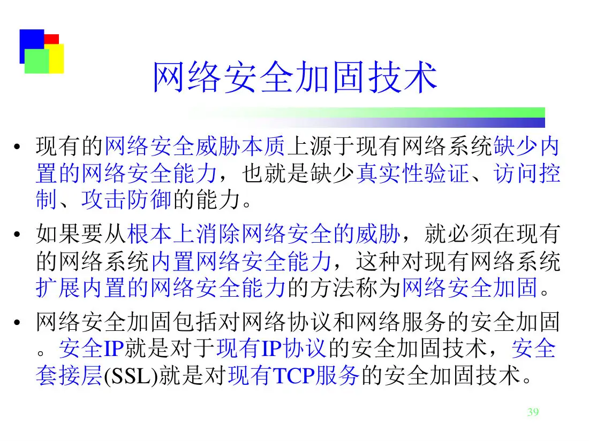

原文：

网络安全加固技术

• 现有的网络安全威胁本质上源于现有网络系统缺少内置的网络安全能力，也就是缺少真实性验证、访问控制、攻击防御的能力。

• 如果要从根本上消除网络安全的威胁，就必须在现有的网络系统内置网络安全能力，这种对现有网络系统扩展内置的网络安全能力的方法称为网络安全加固。

• 网络安全加固包括对网络协议和网络服务的安全加固。安全IP就是对于现有IP协议的安全加固技术，安全套接层(SSL)就是对现有TCP服务的安全加固技术。

7

39

### 网络安全应用技术

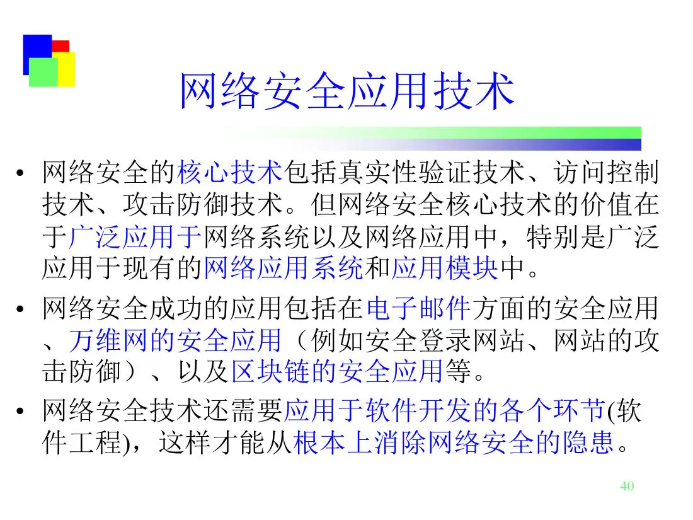

原文：

网络安全应用技术

• 网络安全的核心技术包括真实性验证技术、访问控制技术、攻击防御技术。但网络安全核心技术的价值在于广泛应用于网络系统以及网络应用中，特别是广泛应用于现有的网络应用系统和应用模块中。

• 网络安全成功的应用包括在电子邮件方面的安全应用、万维网的安全应用（例如安全登录网站、网站的攻击防御）、以及区块链的安全应用等。

• 网络安全技术还需要应用于软件开发的各个环节(软件工程)，这样才能从根本上消除网络安全的隐患。

7

40

### 网络安全课程的目的

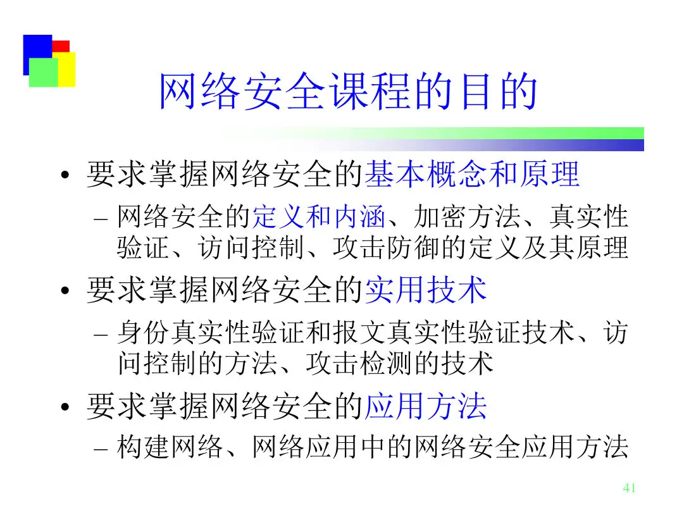

原文：

网络安全课程的目的

• 要求掌握网络安全的基本概念和原理

– 网络安全的定义和内涵、加密方法、真实性验证、访问控制、攻击防御的定义及其原理

• 要求掌握网络安全的实用技术

– 身份真实性验证和报文真实性验证技术、访问控制的方法、攻击检测的技术

• 要求掌握网络安全的应用方法

– 构建网络、网络应用中的网络安全应用方法

7

41

### 网络安全课程的重点

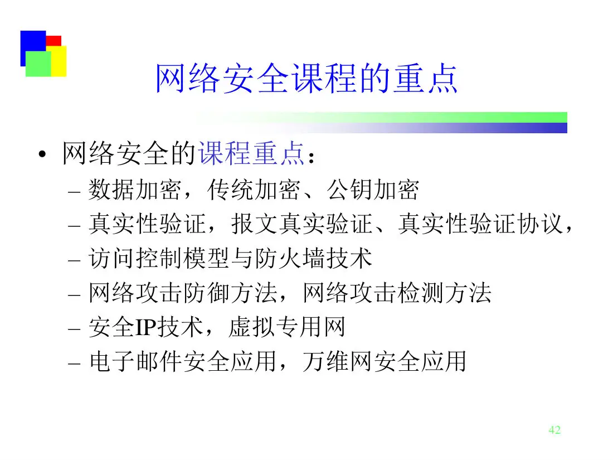

原文：

网络安全课程的重点

• 网络安全的课程重点：

– 数据加密，传统加密、公钥加密

– 真实性验证，报文真实验证、真实性验证协议，

– 访问控制模型与防火墙技术

– 网络攻击防御方法，网络攻击检测方法

– 安全IP技术，虚拟专用网

– 电子邮件安全应用，万维网安全应用

42

### 网络安全课程的难点

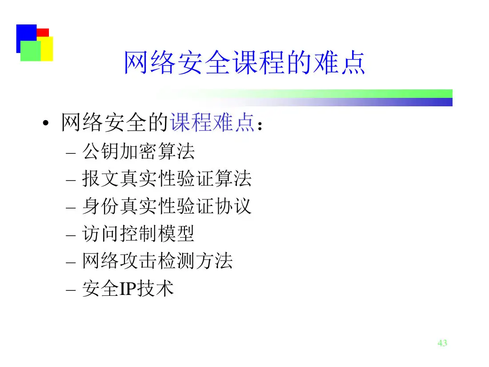

原文：

网络安全课程的难点

• 网络安全的课程难点：

– 公钥加密算法

– 报文真实性验证算法

– 身份真实性验证协议

– 访问控制模型

– 网络攻击检测方法

– 安全IP技术

7

43

### 课程学习的几点说明

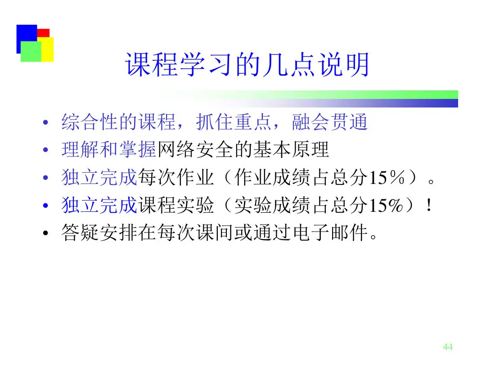

原文：

课程学习的几点说明

• 综合性的课程，抓住重点，融会贯通

• 理解和掌握网络安全的基本原理

• 独立完成每次作业（作业成绩占总分15％）。

• 独立完成课程实验（实验成绩占总分15%）！

• 答疑安排在每次课间或通过电子邮件。

44

### 内容小结

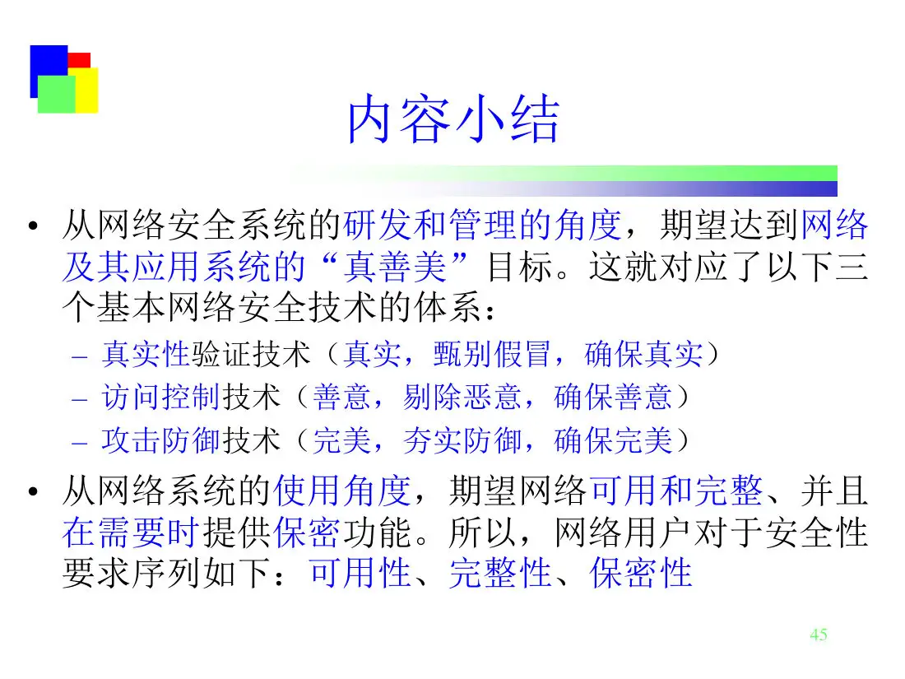

原文：

内容小结

• 从网络安全系统的研发和管理的角度，期望达到网络及其应用系统的“真善美”目标。这就对应了以下三个基本网络安全技术的体系：

– 真实性验证技术（真实，甄别假冒，确保真实）

– 访问控制技术（善意，剔除恶意，确保善意）

– 攻击防御技术（完美，夯实防御，确保完美）

• 从网络系统的使用角度，期望网络可用和完整、并且在需要时提供保密功能。所以，网络用户对于安全性要求序列如下：可用性、完整性、保密性

1

45
