# 《信息安全技术》第2章 数据加密导论（2）传统数据加密方法（课件）

原件的每一页，下面附识别出的文字。

### 第2章 数据加密导论(2)传统数据加密方法

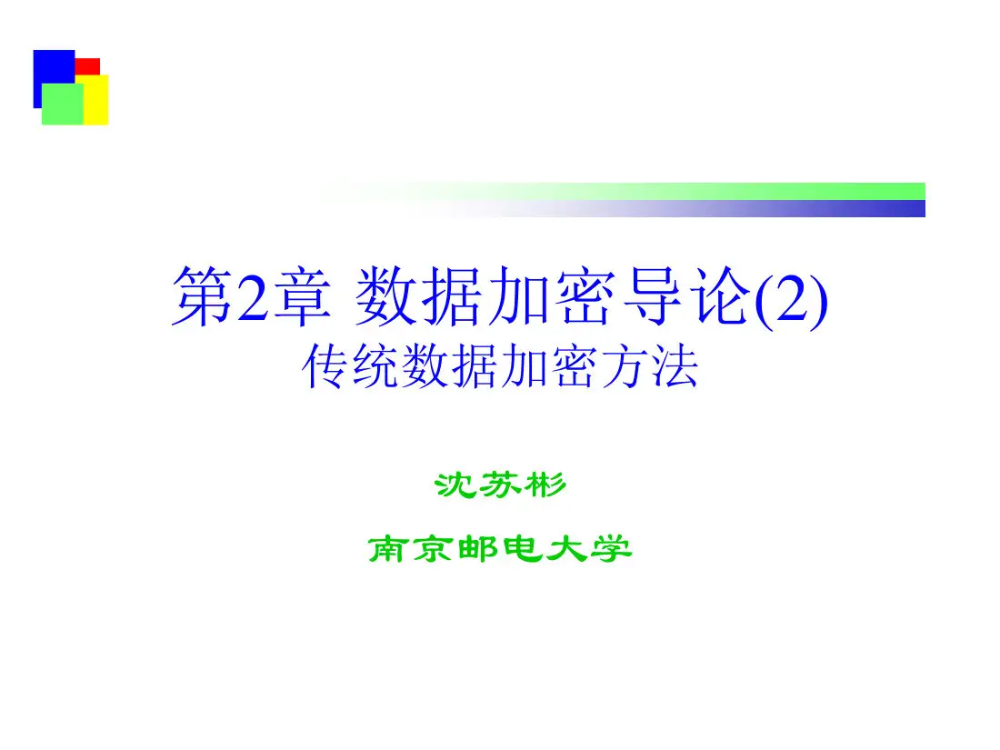

原文：

第2章 数据加密导论(2)传统数据加密方法

沈苏彬

南京邮电大学

### 本节主要讨论的问题\

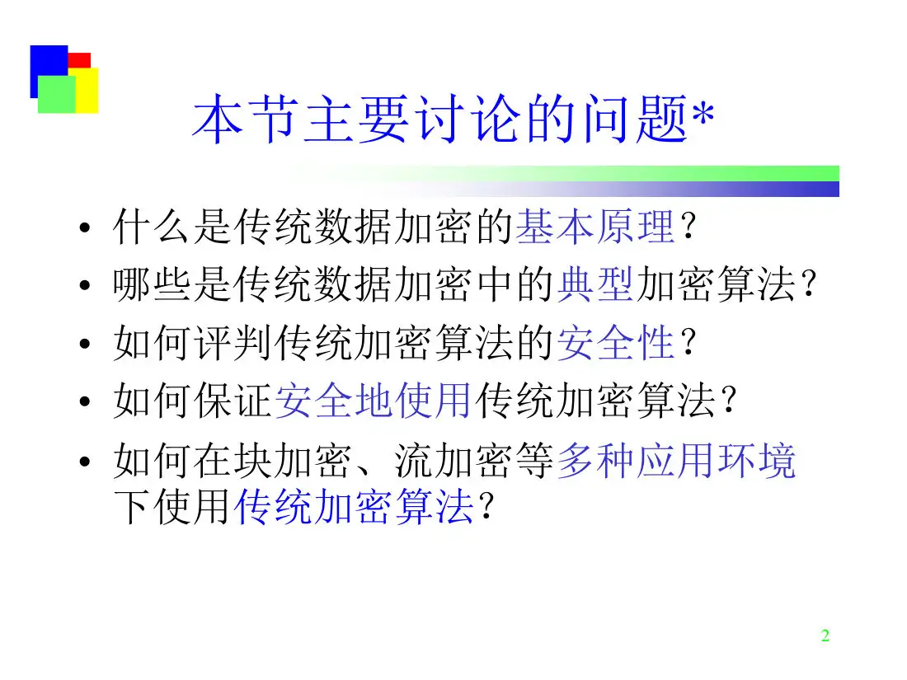

原文：

本节主要讨论的问题\*

• 什么是传统数据加密的基本原理？

• 哪些是传统数据加密中的典型加密算法？

• 如何评判传统加密算法的安全性？

• 如何保证安全地使用传统加密算法？

• 如何在块加密、流加密等多种应用环境下使用传统加密算法？

2

### 关键知识点\

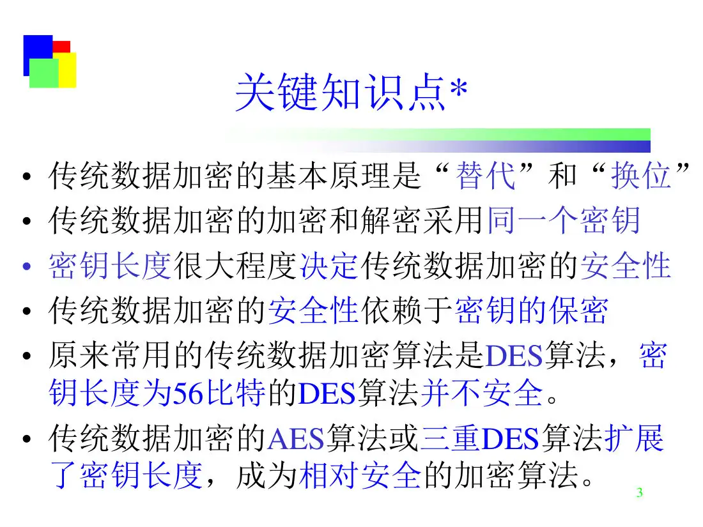

原文：

关键知识点\*

• 传统数据加密的基本原理是“替代”和“换位”

• 传统数据加密的加密和解密采用同一个密钥

• 密钥长度很大程度决定传统数据加密的安全性

• 传统数据加密的安全性依赖于密钥的保密

• 原来常用的传统数据加密算法是DES算法，密钥长度为56比特的DES算法并不安全。

• 传统数据加密的AES算法或三重DES算法扩展了密钥长度，成为相对安全的加密算法。3

1

### 主要内容

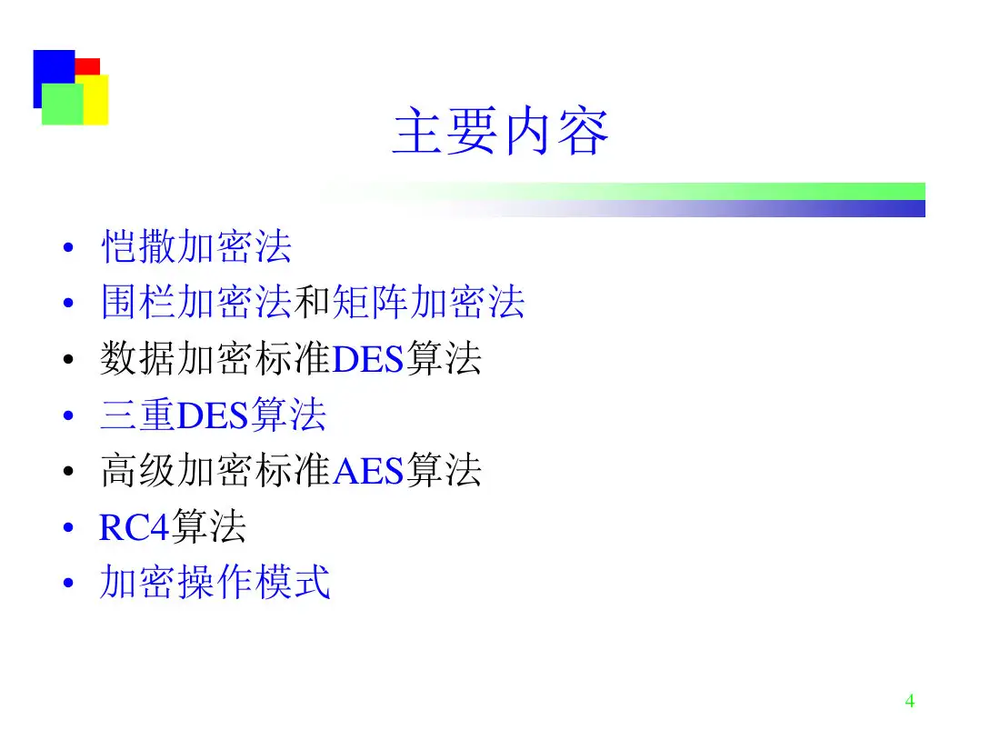

原文：

主要内容

• 恺撒加密法

• 围栏加密法和矩阵加密法

• 数据加密标准DES算法

• 三重DES算法

• 高级加密标准AES算法

• RC4算法

• 加密操作模式

4

### 传统数据加密历史\

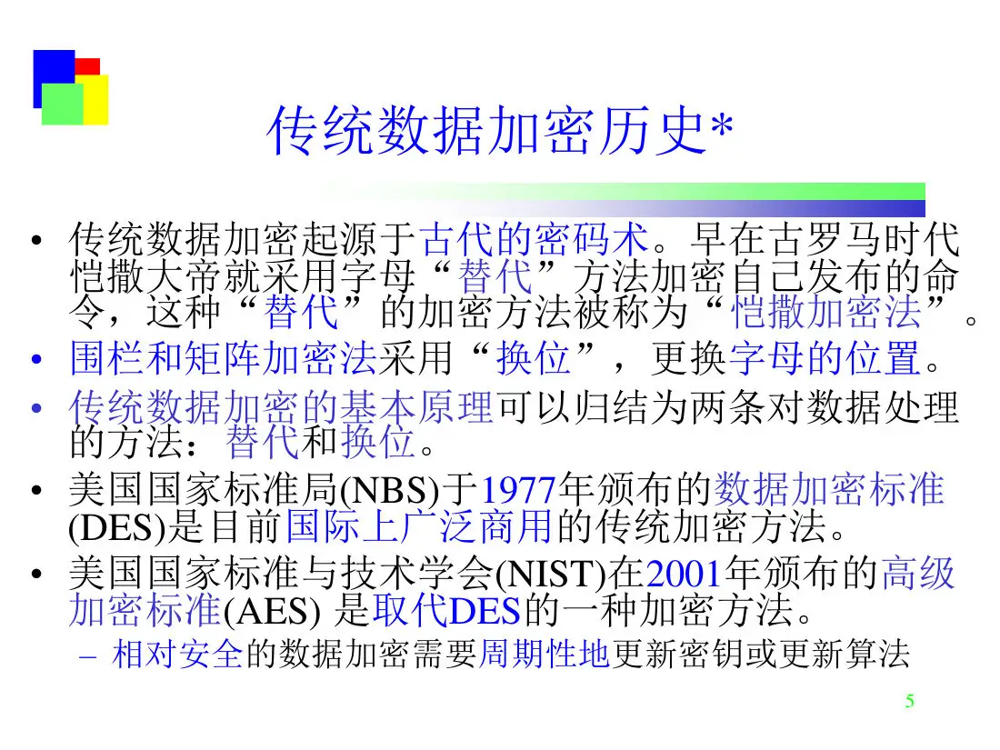

原文：

传统数据加密历史\*

传统数据加密起源于古代的密码术。早在古罗马时代恺撒大帝就采用字母“替代”方法加密自己发布的命99O

• 围栏和矩阵加密法采用“换位”，更换字母的位置。

• 传统数据加密的基本原理可以归结为两条对数据处理的方法：替代和换位。

• 美国国家标准局(NBS)于1977年颁布的数据加密标准(DES)是目前国际上广泛商用的传统加密方法。

• 美国国家标准与技术学会(NIST)在2001年颁布的高级加密标准(AES) 是取代DES的一种加密方法。

– 相对安全的数据加密需要周期性地更新密钥或更新算法

7

5

### 凯撒密码\

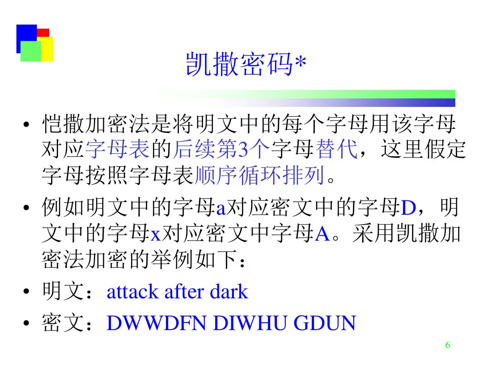

原文：

凯撒密码\*

• 恺撒加密法是将明文中的每个字母用该字母对应字母表的后续第3个字母替代，这里假定字母按照字母表顺序循环排列。

• 例如明文中的字母a对应密文中的字母D，明文中的字母x对应密文中字母A。采用凯撒加密法加密的举例如下：

• 明文：attack after dark

• 密文：DWWDFN DIWHU GDUN

6

### 凯撒加密法原理分析\

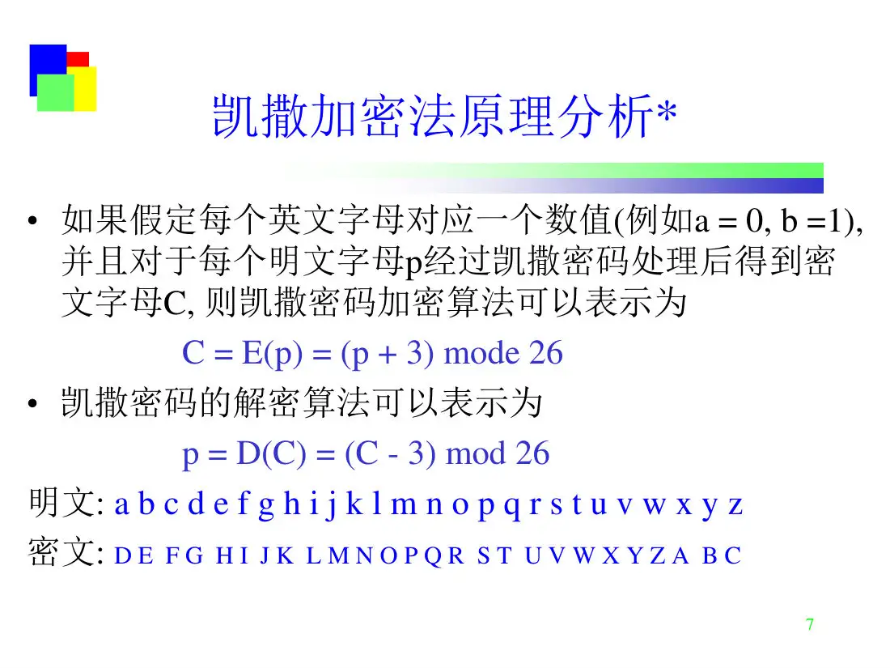

原文：

凯撒加密法原理分析\*

• 如果假定每个英文字母对应一个数值(例如 $\mathbf { a } = 0 , \mathbf { b } = 1 )$ ,并且对于每个明文字母p经过凯撒密码处理后得到密文字母C, 则凯撒密码加密算法可以表示为

$$
\mathrm{C} = \mathrm{E} (\mathrm{p}) = (\mathrm{p} + 3) \text {mode 26}
$$

• 凯撒密码的解密算法可以表示为

$$
\mathrm{p} = \mathrm{D} (\mathrm{C}) = (\mathrm{C} - 3) \bmod 2 6
$$

明文: a b c d e f g h i j k l m n o p q r s t u v w x y z

密文: D E F G H I J K L M N O P Q R S T U V W X Y Z A B C

7

7

### 通用凯撒加密法\

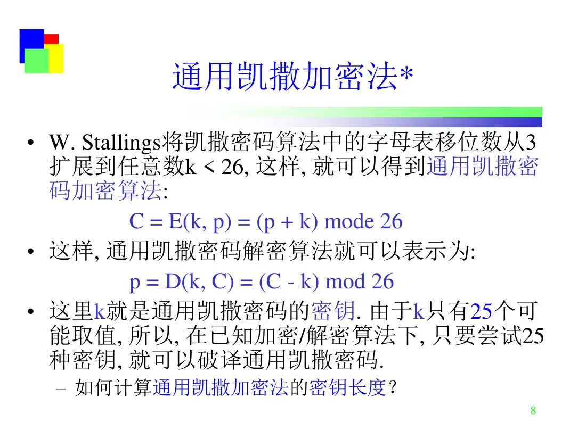

原文：

通用凯撒加密法\*

• W. Stallings将凯撒密码算法中的字母表移位数从3扩展到任意数k < 26, 这样, 就可以得到通用凯撒密码加密算法:

$$
\mathrm{C} = \mathrm{E} (\mathrm{k}, \mathrm{p}) = (\mathrm{p} + \mathrm{k}) \text {mode 26}
$$

• 这样, 通用凯撒密码解密算法就可以表示为:

$$
\mathrm{p} = \mathrm{D} (\mathrm{k}, \mathrm{C}) = (\mathrm{C} - \mathrm{k}) \bmod 2 6
$$

• 这里k就是通用凯撒密码的密钥. 由于k只有25个可能取值, 所以, 在已知加密/解密算法下, 只要尝试25种密钥, 就可以破译通用凯撒密码.

– 如何计算通用凯撒加密法的密钥长度？

8

### 通用恺撒加密法的启示\

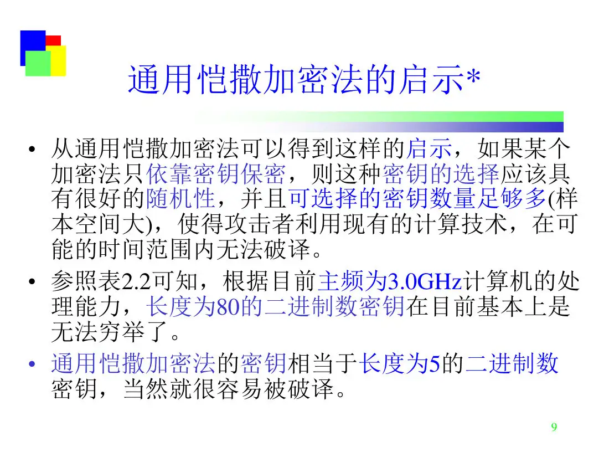

原文：

通用恺撒加密法的启示\*

• 从通用恺撒加密法可以得到这样的启示，如果某个加密法只依靠密钥保密，则这种密钥的选择应该具有很好的随机性，并且可选择的密钥数量足够多(样本空间大)，使得攻击者利用现有的计算技术，在可能的时间范围内无法破译。

• 参照表2.2可知，根据目前主频为3.0GHz计算机的处理能力，长度为80的二进制数密钥在目前基本上是无法穷举了。

通用恺撒加密法的密钥相当于长度为5的二进制数密钥，当然就很容易被破译。

9

### 为何需要公开加密/解密算法?\

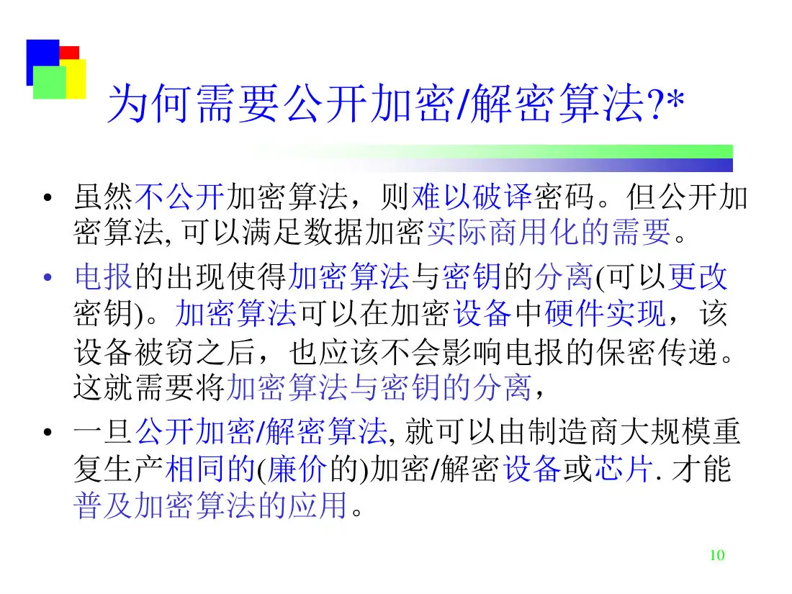

原文：

为何需要公开加密/解密算法?\*

• 虽然不公开加密算法，则难以破译密码。但公开加密算法, 可以满足数据加密实际商用化的需要。

• 电报的出现使得加密算法与密钥的分离(可以更改密钥)。加密算法可以在加密设备中硬件实现，该设备被窃之后，也应该不会影响电报的保密传递。这就需要将加密算法与密钥的分离，

• 一旦公开加密/解密算法, 就可以由制造商大规模重复生产相同的(廉价的)加密/解密设备或芯片. 才能普及加密算法的应用。

10

### 传统数据加密原理\

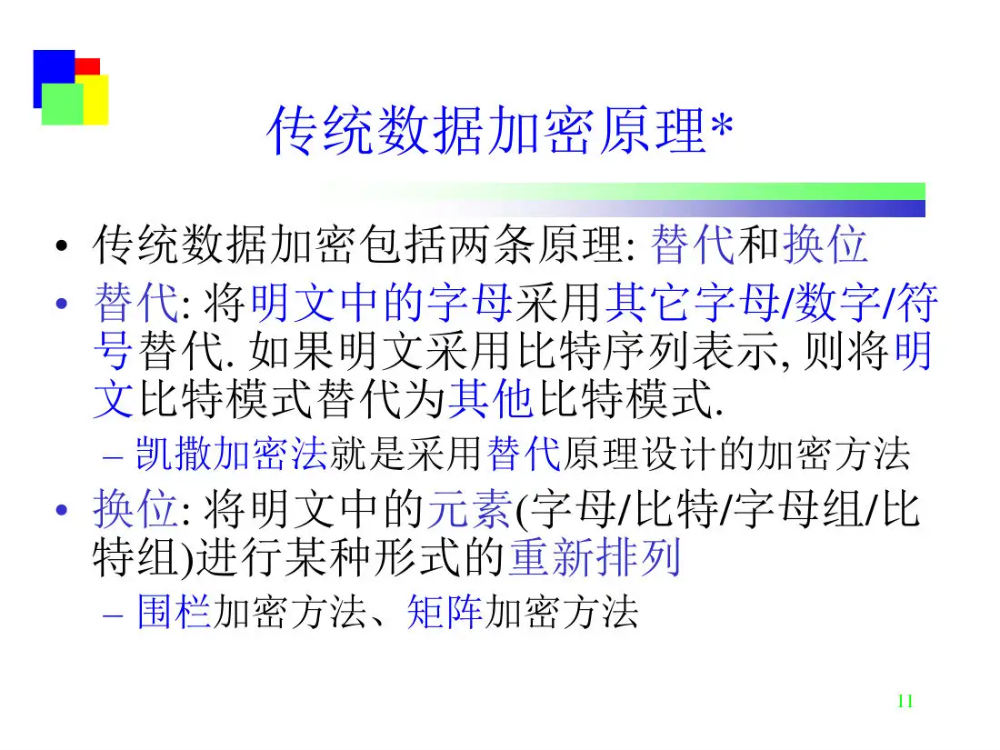

原文：

传统数据加密原理\*

• 传统数据加密包括两条原理: 替代和换位

替代: 将明文中的字母采用其它字母/数字/符号替代. 如果明文采用比特序列表示, 则将明文比特模式替代为其他比特模式.

– 凯撒加密法就是采用替代原理设计的加密方法

• 换位: 将明文中的元素(字母/比特/字母组/比特组)进行某种形式的重新排列

– 围栏加密方法、矩阵加密方法

7

11

### 围栏加密方法\

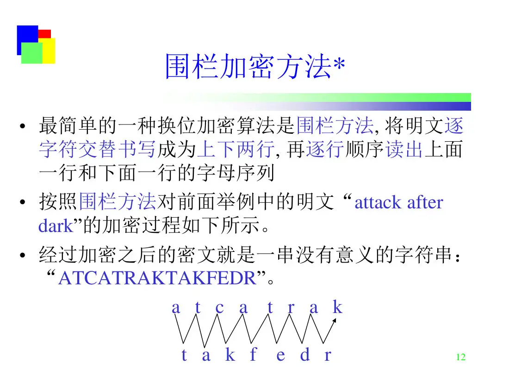

原文：

围栏加密方法\*

• 最简单的一种换位加密算法是围栏方法, 将明文逐字符交替书写成为上下两行, 再逐行顺序读出上面一行和下面一行的字母序列

• 按照围栏方法对前面举例中的明文“attack afterdark”的加密过程如下所示。

• 经过加密之后的密文就是一串没有意义的字符串：“ATCATRAKTAKFEDR”。

7

12

### 矩阵加密方法\

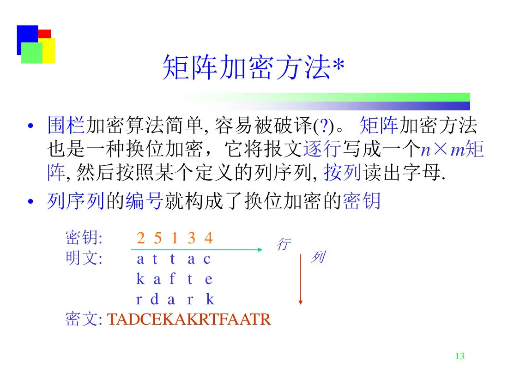

原文：

矩阵加密方法\*

围栏加密算法简单, 容易被破译(?)。 矩阵加密方法也是一种换位加密，它将报文逐行写成一个 $n \times m$ 矩阵, 然后按照某个定义的列序列, 按列读出字母.

• 列序列的编号就构成了换位加密的密钥

密钥:

明文:

$$
\begin{array}{c c c c c} 2 & 5 & 1 & 3 & 4 \\ \hline \text {a t t a c} \\ \text {k a f t e} \\ \text {r d a r k} \end{array} \quad \text {行}
$$

密文: TADCEKAKRTFAATR

13

### 矩阵加密方法(续1)\

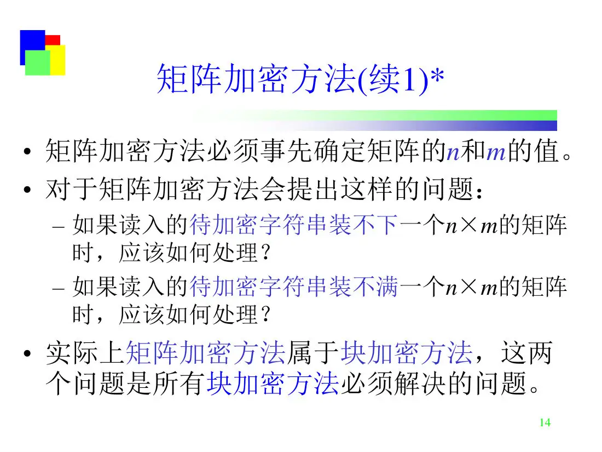

原文：

矩阵加密方法(续1)\*

• 矩阵加密方法必须事先确定矩阵的n和m的值。

• 对于矩阵加密方法会提出这样的问题：

– 如果读入的待加密字符串装不下一个n×m的矩阵时，应该如何处理？

– 如果读入的待加密字符串装不满一个n×m的矩阵时，应该如何处理？

• 实际上矩阵加密方法属于块加密方法，这两个问题是所有块加密方法必须解决的问题。

7

14

### 传统数据加密的标准算法\

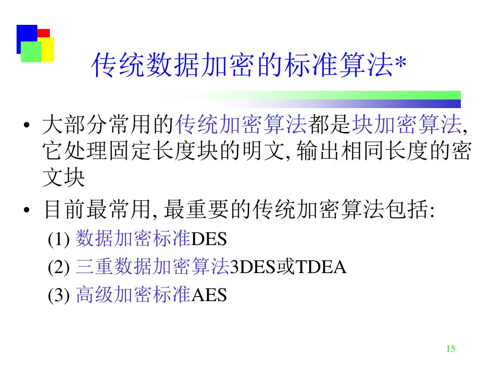

原文：

传统数据加密的标准算法\*

• 大部分常用的传统加密算法都是块加密算法,它处理固定长度块的明文, 输出相同长度的密文块

• 目前最常用, 最重要的传统加密算法包括:

(1) 数据加密标准DES

(2) 三重数据加密算法3DES或TDEA

(3) 高级加密标准AES

7

15

### 数据加密标准DES\

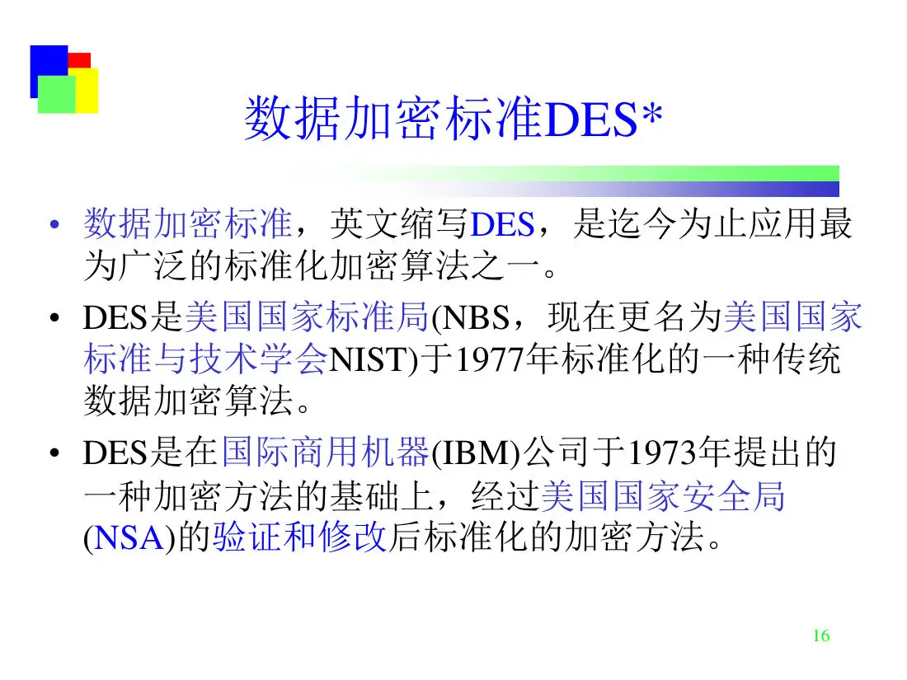

原文：

数据加密标准DES\*

• 数据加密标准，英文缩写DES，是迄今为止应用最为广泛的标准化加密算法之一。

• DES是美国国家标准局(NBS，现在更名为美国国家标准与技术学会NIST)于1977年标准化的一种传统数据加密算法。

• DES是在国际商用机器(IBM)公司于1973年提出的一种加密方法的基础上，经过美国国家安全局(NSA)的验证和修改后标准化的加密方法。

7

16

### 设计DES的要求\

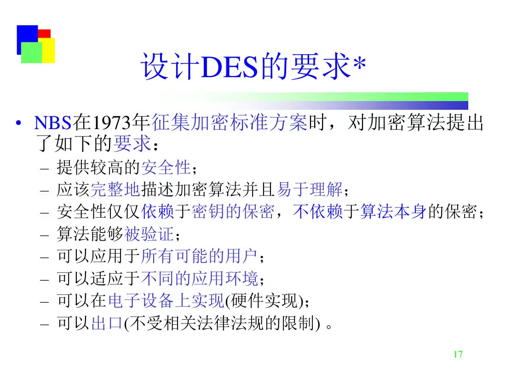

原文：

设计DES的要求\*

• NBS在1973年征集加密标准方案时，对加密算法提出了如下的要求：

– 提供较高的安全性；

– 应该完整地描述加密算法并且易于理解；

– 安全性仅仅依赖于密钥的保密，不依赖于算法本身的保密；

– 算法能够被验证；

– 可以应用于所有可能的用户；

– 可以适应于不同的应用环境；

– 可以在电子设备上实现(硬件实现)；

– 可以出口(不受相关法律法规的限制) 。

1

17

### 数据加密标准DES特征\

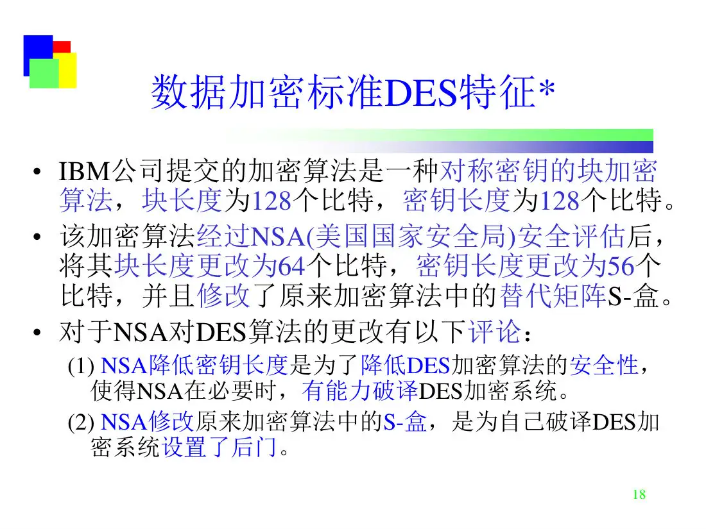

原文：

数据加密标准DES特征\*

• IBM公司提交的加密算法是一种对称密钥的块加密算法，块长度为128个比特，密钥长度为128个比特。

• 该加密算法经过NSA(美国国家安全局)安全评估后，将其块长度更改为64个比特，密钥长度更改为56个比特，并且修改了原来加密算法中的替代矩阵S-盒。

• 对于NSA对DES算法的更改有以下评论：

(1) NSA降低密钥长度是为了降低DES加密算法的安全性，使得NSA在必要时，有能力破译DES加密系统。

(2) NSA修改原来加密算法中的S-盒，是为自己破译DES加密系统设置了后门。

18

### 数据加密标准DES的效果\

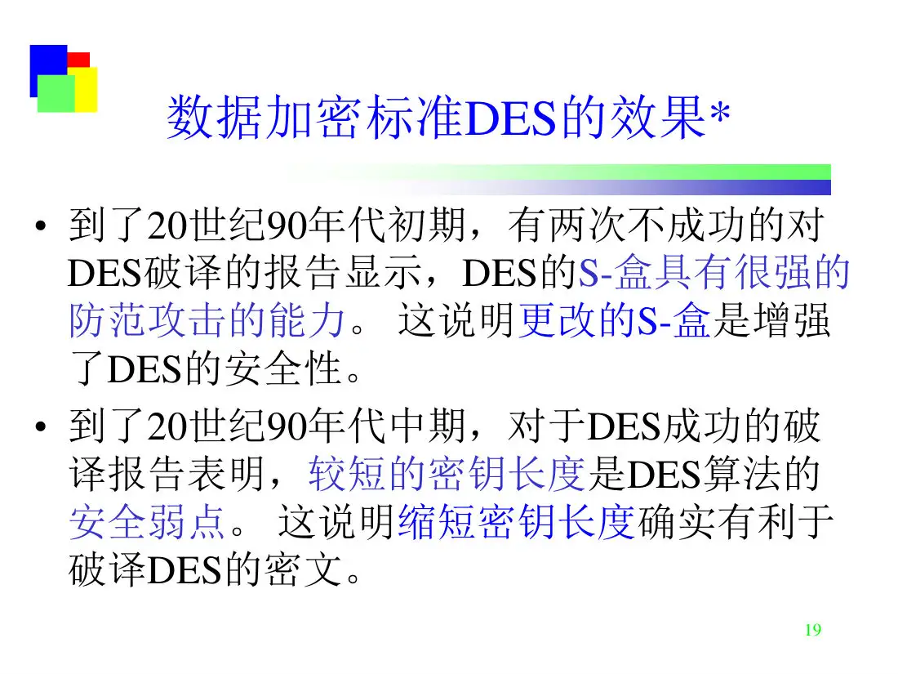

原文：

数据加密标准DES的效果\*

• 到了20世纪90年代初期，有两次不成功的对DES破译的报告显示，DES的S-盒具有很强的防范攻击的能力。这说明更改的S-盒是增强了DES的安全性。

• 到了20世纪90年代中期，对于DES成功的破译报告表明，较短的密钥长度是DES算法的安全弱点。这说明缩短密钥长度确实有利于破译DES的密文。

7

19

### DES算法概述

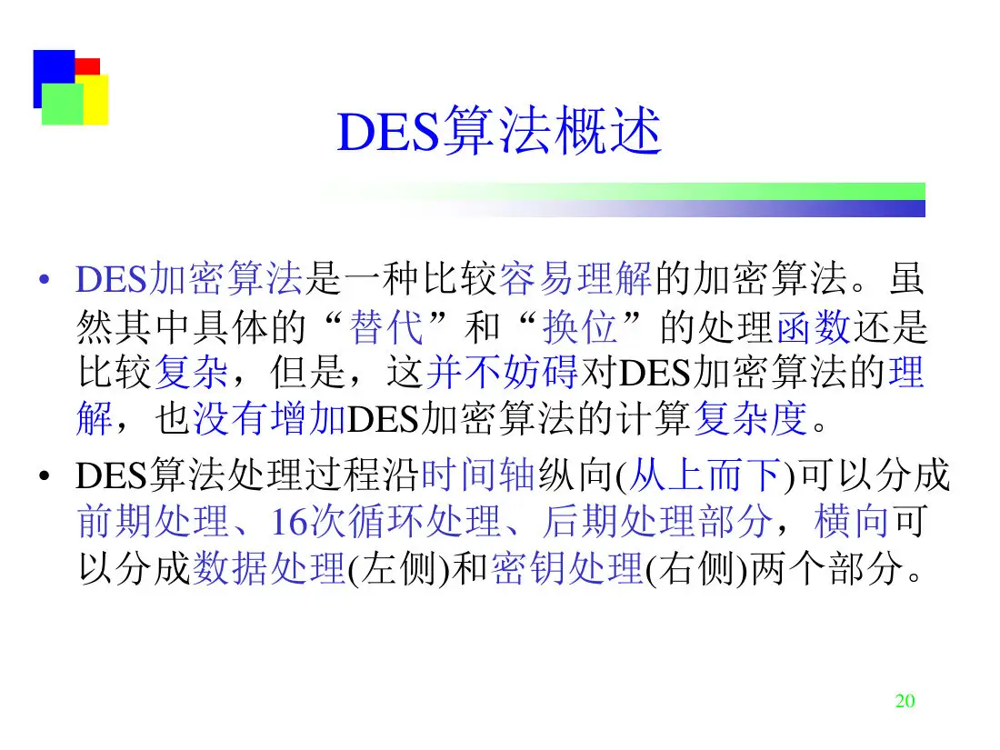

原文：

DES算法概述

DES加密算法是一种比较容易理解的加密算法。虽然其中具体的“替代”和“换位”的处理函数还是比较复杂，但是，这并不妨碍对DES加密算法的理解，也没有增加DES加密算法的计算复杂度。

• DES算法处理过程沿时间轴纵向(从上而下)可以分成前期处理、16次循环处理、后期处理部分，横向可以分成数据处理(左侧)和密钥处理(右侧)两个部分。

1

20

### DES算法概述(续1)

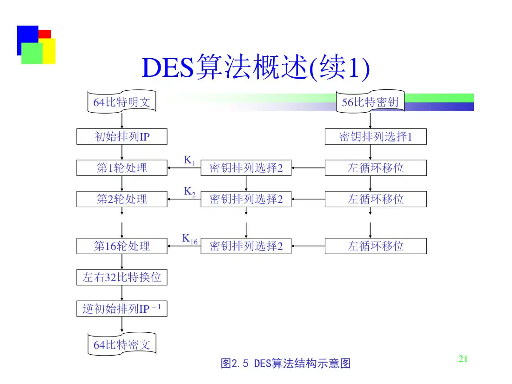

原文：

DES算法概述(续1)

21

### DES算法概述(续2)

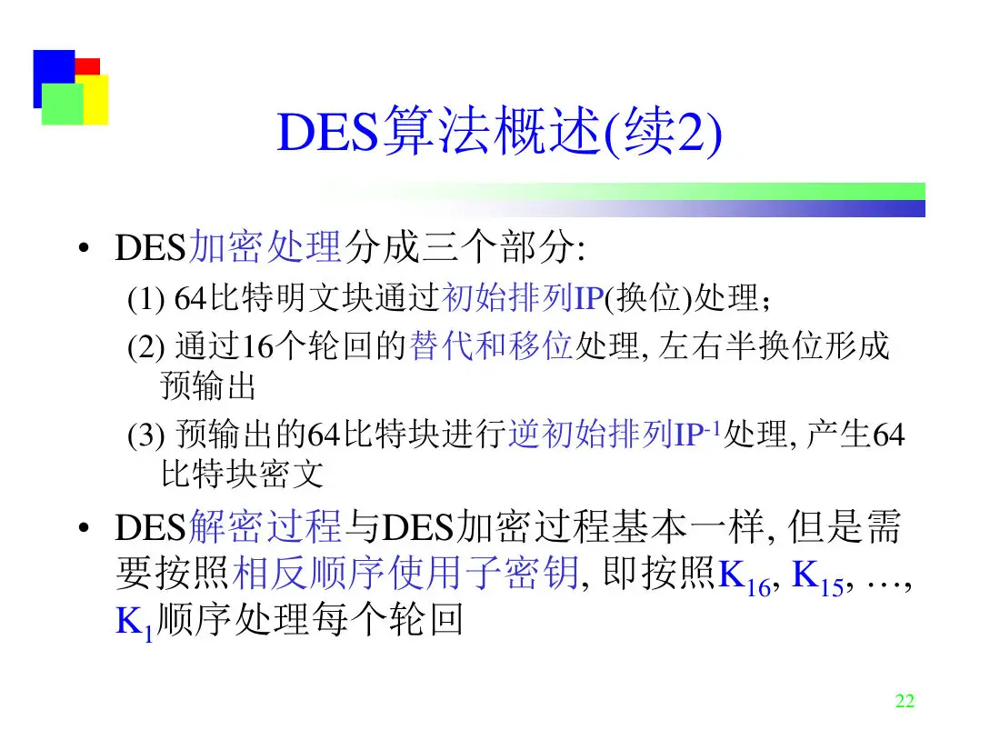

原文：

DES算法概述(续2)

• DES加密处理分成三个部分:

(1) 64比特明文块通过初始排列IP(换位)处理；

(2) 通过16个轮回的替代和移位处理, 左右半换位形成预输出

(3) 预输出的64比特块进行逆初始排列 $\mathrm { I P ^ { - 1 } }$ 处理, 产生64比特块密文

• DES解密过程与DES加密过程基本一样, 但是需要按照相反顺序使用子密钥, 即按照 $\mathrm { K } _ { 1 6 } , \mathrm { K } _ { 1 5 } , . . . ,$ $\mathrm { K } _ { 1 }$ 顺序处理每个轮回

7

22

### DES算法每轮处理过程

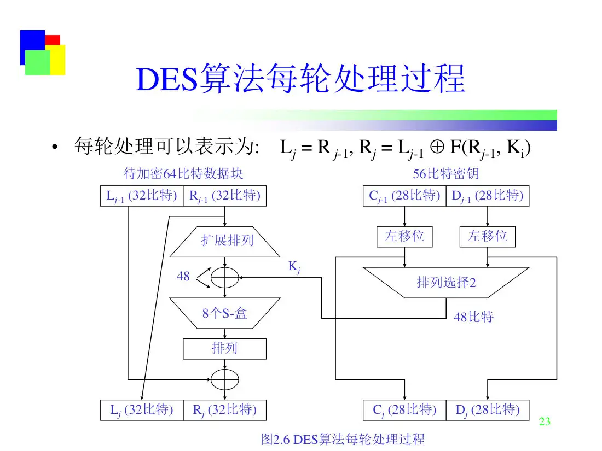

原文：

DES算法每轮处理过程

• 每轮处理可以表示为: $\mathrm { L } _ { j } = \mathrm { R } _ { j - 1 } , \mathrm { R } _ { j } = \mathrm { L } _ { j - 1 } \oplus \mathrm { F } ( \mathrm { R } _ { j - 1 } , \mathrm { K } _ { \mathrm { i } } )$

待加密64比特数据块

1

图2.6 DES算法每轮处理过程

23

### DES算法的解密过程(1)

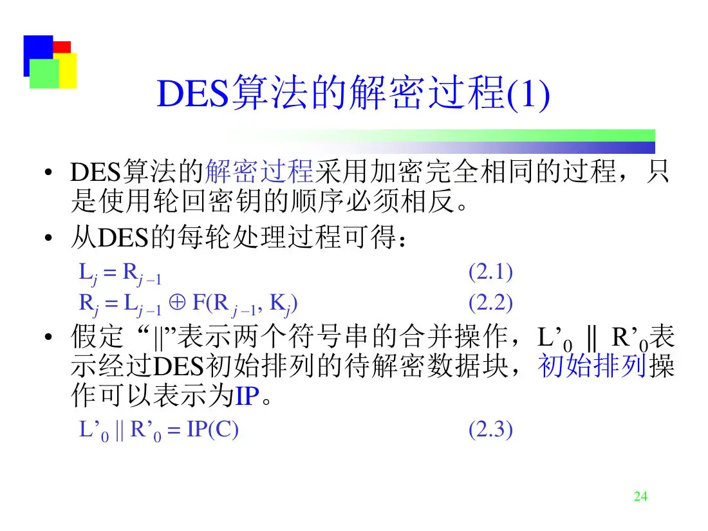

原文：

DES算法的解密过程(1)

• DES算法的解密过程采用加密完全相同的过程，只是使用轮回密钥的顺序必须相反。

• 从DES的每轮处理过程可得：

$$
\mathrm{L} _ {j} = \mathrm{R} _ {j - 1}\tag{2.1}
$$

$$
\mathrm{R} _ {j} = \mathrm{L} _ {j - 1} \oplus \mathrm{F} (\mathrm{R} _ {j - 1}, \mathrm{K} _ {j})\tag{2.2}
$$

• 假定 $^ { 6 6 } \parallel ^ { 9 9 }$ 表示两个符号串的合并操作， $\mathrm { ~  ~ { ~ L ~ } ~ } _ { 0 } \parallel \mathrm { ~  ~ { ~ R ~ } ~ } _ { 0 } ^ { , }$ 表示经过DES初始排列的待解密数据块，初始排列操作可以表示为IP。

$$
\mathrm{L} _ {0} ^ {\prime} \mid \mid \mathrm{R} _ {0} ^ {\prime} = \mathrm{IP} (\mathrm{C})\tag{2.3}
$$

24

### DES算法的解密过程(2)

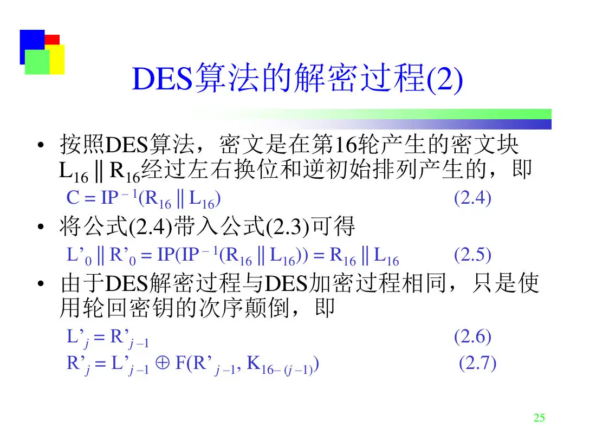

原文：

DES算法的解密过程(2)

• 按照DES算法，密文是在第16轮产生的密文块$\mathrm { L } _ { 1 6 } \parallel \mathrm { R } _ { 1 6 }$ 经过左右换位和逆初始排列产生的，即$\mathrm { C } = \mathrm { I P } ^ { - 1 } ( \mathrm { R } _ { 1 6 } \parallel \mathrm { L } _ { 1 6 } )$ (2.4)

• 将公式(2.4)带入公式(2.3)可得

$$
\mathrm{L} _ {0} ^ {\prime} \parallel \mathrm{R} _ {0} ^ {\prime} = \mathrm{IP} (\mathrm{IP} ^ {- 1} (\mathrm{R} _ {1 6} \parallel \mathrm{L} _ {1 6})) = \mathrm{R} _ {1 6} \parallel \mathrm{L} _ {1 6}\tag{2.5}
$$

• 由于DES解密过程与DES加密过程相同，只是使用轮回密钥的次序颠倒，即

$$
\mathrm{L} _ {j} ^ {\prime} = \mathrm{R} _ {j - 1} ^ {\prime}\tag{2.6}
$$

$$
\mathrm{R} _ {j} ^ {\prime} = \mathrm{L} _ {j - 1} ^ {\prime} \oplus \mathrm{F} (\mathrm{R} _ {j - 1} ^ {\prime}, \mathrm{K} _ {1 6 - (j - 1)})\tag{2.7}
$$

25

### DES算法的解密过程(3)

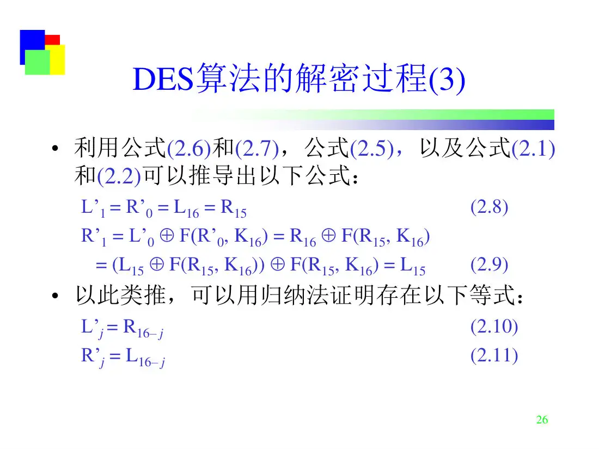

原文：

DES算法的解密过程(3)

• 利用公式(2.6)和(2.7)，公式(2.5)，以及公式(2.1)和(2.2)可以推导出以下公式：

$$
\begin{array}{r l} & {\mathrm {L^ {\prime}} _ {1} = \mathrm {R^ {\prime}} _ {0} = \mathrm {L_ {16}} = \mathrm {R_ {15}}} \\ & {\mathrm {R^ {\prime}} _ {1} = \mathrm {L^ {\prime}} _ {0} \oplus \mathrm{F} (\mathrm {R^ {\prime}} _ {0}, \mathrm {K_ {16}}) = \mathrm {R_ {16}} \oplus \mathrm{F} (\mathrm {R_ {15}}, \mathrm {K_ {16}})} \\ & {\qquad = (\mathrm {L_ {15}} \oplus \mathrm{F} (\mathrm {R_ {15}}, \mathrm {K_ {16}})) \oplus \mathrm{F} (\mathrm {R_ {15}}, \mathrm {K_ {16}}) = \mathrm {L_ {15}}} \end{array}\tag{2.8}
$$

(2.9)

• 以此类推，可以用归纳法证明存在以下等式：

$$
\mathrm{L} _ {j} ^ {\prime} = \mathrm{R} _ {1 6 - j}\tag{2.10}
$$

$$
\mathrm{R} _ {j} ^ {\prime} = \mathrm{L} _ {1 6 - j}\tag{2.11}
$$

26

### DES算法的解密过程(4)

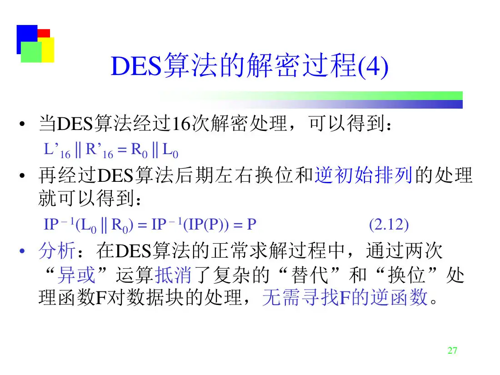

原文：

DES算法的解密过程(4)

• 当DES算法经过16次解密处理，可以得到：

$$
\mathrm{L} _ {1 6} ^ {\prime} \left\| \mathrm{R} _ {1 6} ^ {\prime} = \mathrm{R} _ {0} \right\| \mathrm{L} _ {0}
$$

• 再经过DES算法后期左右换位和逆初始排列的处理就可以得到：

$$
\mathrm{IP} ^ {- 1} \left(\mathrm{L} _ {0} \mid \mid \mathrm{R} _ {0}\right) = \mathrm{IP} ^ {- 1} (\mathrm{IP} (\mathrm{P})) = \mathrm{P}\tag{2.12}
$$

分析：在DES算法的正常求解过程中，通过两次“异或”运算抵消了复杂的“替代”和“换位”处理函数F对数据块的处理，无需寻找F的逆函数。

7

27

### 三重DES算法\

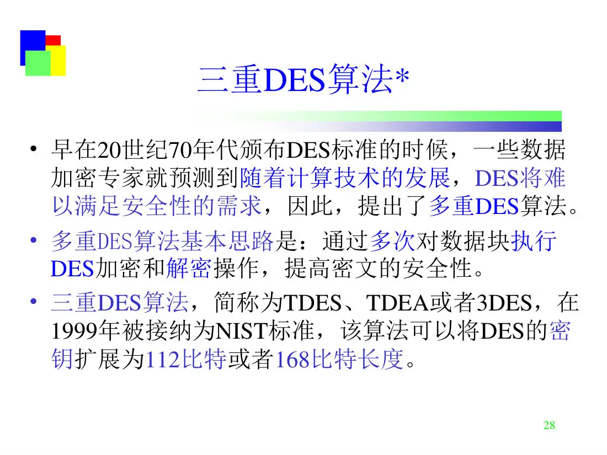

原文：

三重DES算法\*

• 早在20世纪70年代颁布DES标准的时候，一些数据加密专家就预测到随着计算技术的发展，DES将难以满足安全性的需求，因此，提出了多重DES算法。

• 多重DES算法基本思路是：通过多次对数据块执行DES加密和解密操作，提高密文的安全性。

• 三重DES算法，简称为TDES、TDEA或者3DES，在1999年被接纳为NIST标准，该算法可以将DES的密钥扩展为112比特或者168比特长度。

7

28

### 三重DES算法(续)\

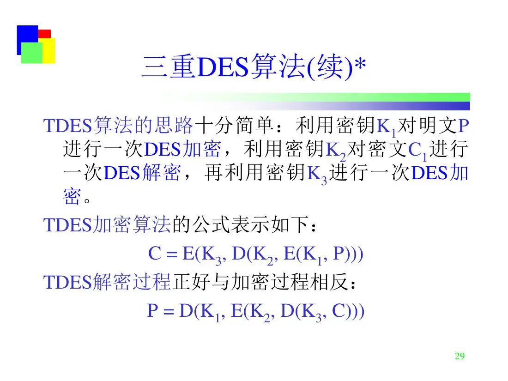

原文：

三重DES算法(续)\*

TDES算法的思路十分简单：利用密钥 $\mathrm { K } _ { 1 }$ 对明文P进行一次DES加密，利用密钥 $\mathrm { K } _ { 2 }$ 对密文 $\mathrm { C } _ { 1 }$ 进行一次DES解密，再利用密钥 $\mathrm { K } _ { 3 }$ 进行一次DES加密。

TDES加密算法的公式表示如下：

$$
\mathrm{C} = \mathrm{E} (\mathrm{K} _ {3}, \mathrm{D} (\mathrm{K} _ {2}, \mathrm{E} (\mathrm{K} _ {1}, \mathrm{P})))
$$

TDES解密过程正好与加密过程相反：

$$
\mathrm{P} = \mathrm{D} (\mathrm{K} _ {1}, \mathrm{E} (\mathrm{K} _ {2}, \mathrm{D} (\mathrm{K} _ {3}, \mathrm{C})))
$$

29

### DES算法分析\

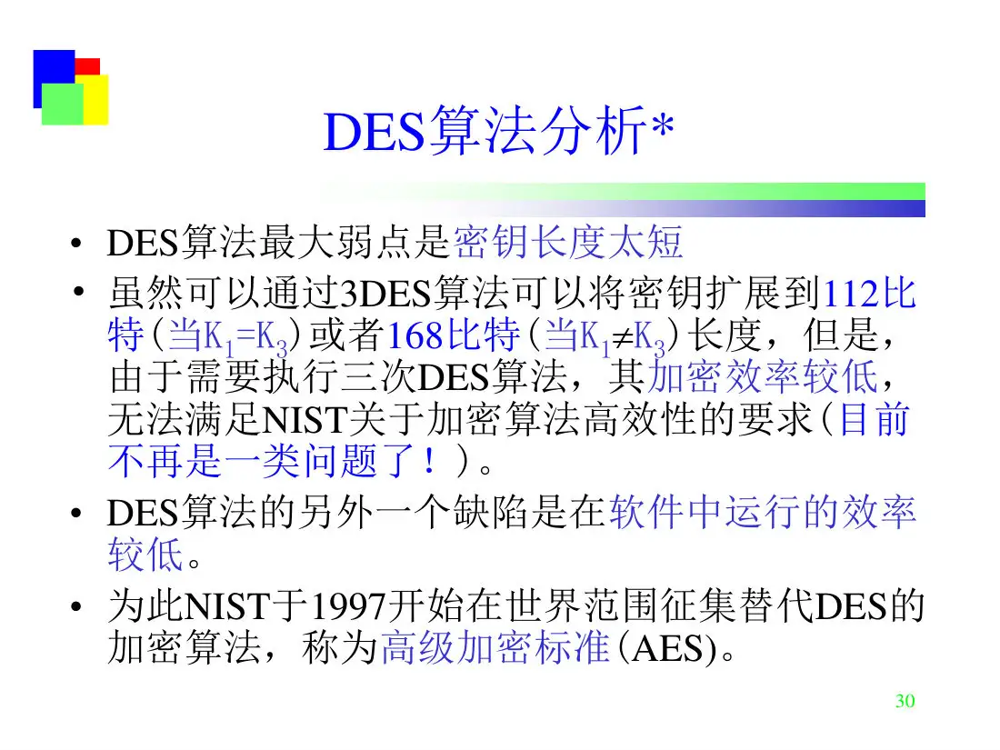

原文：

DES算法分析\*

• DES算法最大弱点是密钥长度太短

• 虽然可以通过3DES算法可以将密钥扩展到112比特(当 $\mathrm { K _ { 1 } { = } K _ { 3 } } )$ 或者168比特(当 $\mathrm { K _ { 1 } { \neq } K _ { 3 } } )$ 长度，但是，由于需要执行三次DES算法，其加密效率较低，无法满足NIST关于加密算法高效性的要求(目前不再是一类问题了！)。

• DES算法的另外一个缺陷是在软件中运行的效率较低。

• 为此NIST于1997开始在世界范围征集替代DES的加密算法，称为高级加密标准(AES)。

7

30

### 高级加密标准AES\

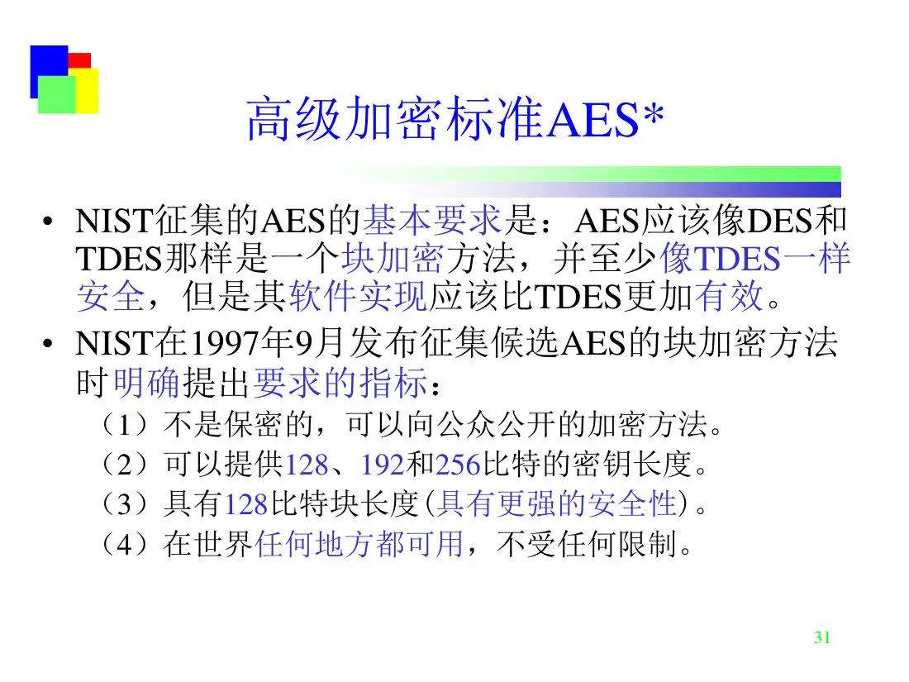

原文：

高级加密标准AES\*

• NIST征集的AES的基本要求是：AES应该像DES和TDES那样是一个块加密方法，并至少像TDES一样安全，但是其软件实现应该比TDES更加有效。

• NIST在1997年9月发布征集候选AES的块加密方法时明确提出要求的指标：

（1）不是保密的，可以向公众公开的加密方法。

（2）可以提供128、192和256比特的密钥长度。

（3）具有128比特块长度(具有更强的安全性)。

（4）在世界任何地方都可用，不受任何限制。

1

31

### 高级加密标准AES(续)\

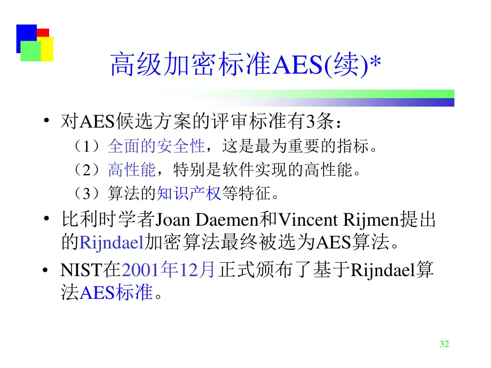

原文：

高级加密标准AES(续)\*

• 对AES候选方案的评审标准有3条：

（1）全面的安全性，这是最为重要的指标。

（2）高性能，特别是软件实现的高性能。

（3）算法的知识产权等特征。

• 比利时学者Joan Daemen和Vincent Rijmen提出的Rijndael加密算法最终被选为AES算法。

• NIST在2001年12月正式颁布了基于Rijndael算法AES标准。

1

32

### AES算法参数

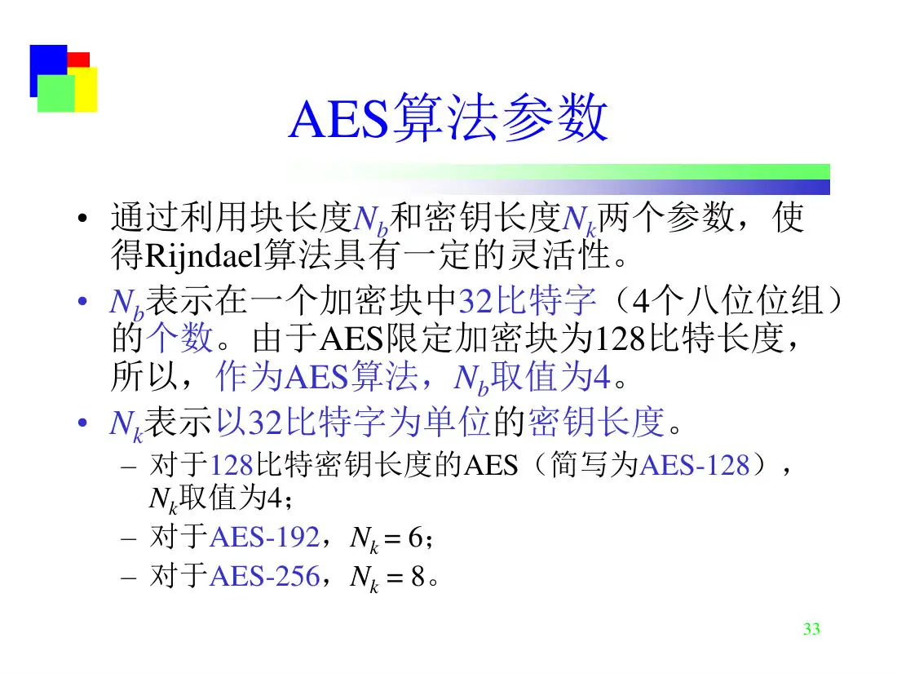

原文：

AES算法参数

• 通过利用块长度 $N _ { b }$ 和密钥长度 $N _ { k }$ 两个参数，使得Rijndael算法具有一定的灵活性。

● $N _ { b }$ 表示在一个加密块中32比特字（4个八位位组）的个数。由于AES限定加密块为128比特长度，所以，作为AES算法， $N _ { b }$ 取值为4。

$N _ { k }$ 表示以32比特字为单位的密钥长度。

– 对于128比特密钥长度的AES（简写为AES-128），$N _ { k }$ 取值为4；

– 对于AES-192， $N _ { k } ^ { } = 6$ ；

– 对于AES-256， $N _ { k } = 8$ O

7

33

### AES算法参数(续)

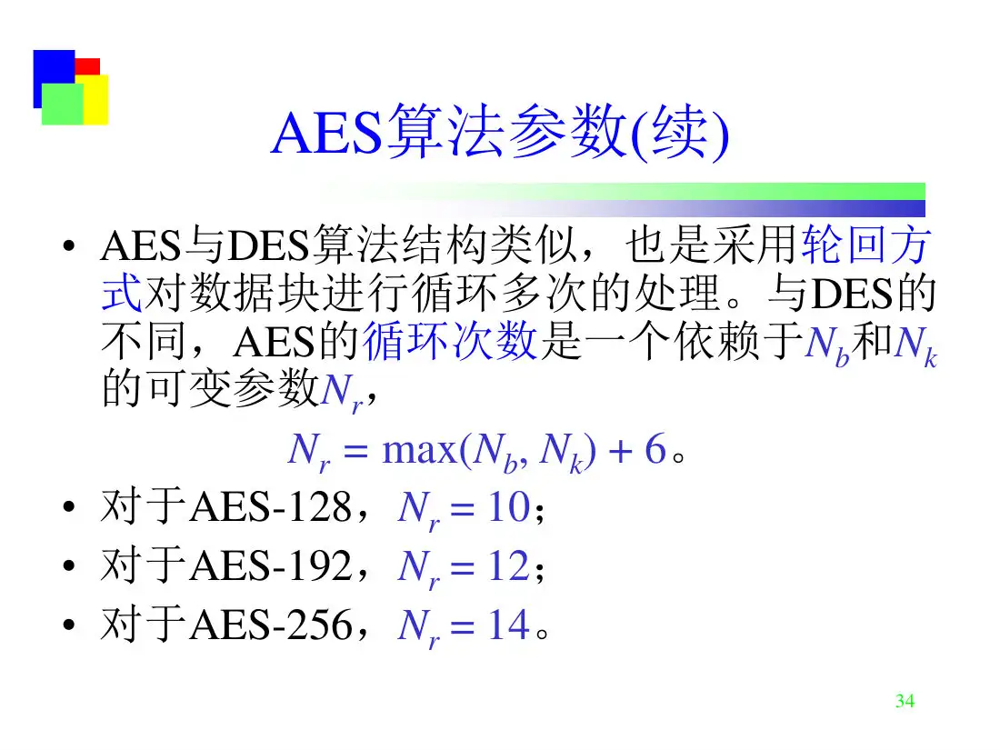

原文：

AES算法参数(续)

• AES与DES算法结构类似，也是采用轮回方式对数据块进行循环多次的处理。与DES的不同，AES的循环次数是一个依赖于 $N _ { b }$ 和 $N _ { k }$ 的可变参数 $N _ { r }$ ，

$$
N _ {r} = \max (N _ {b}, N _ {k}) + 6 。
$$

• 对于AES-128， $N _ { r } = 1 0$

• 对于AES-192， $N _ { r } = 1 2$

• 对于AES-256， $N _ { r } = 1 4$ O

1

34

### AES加密过程

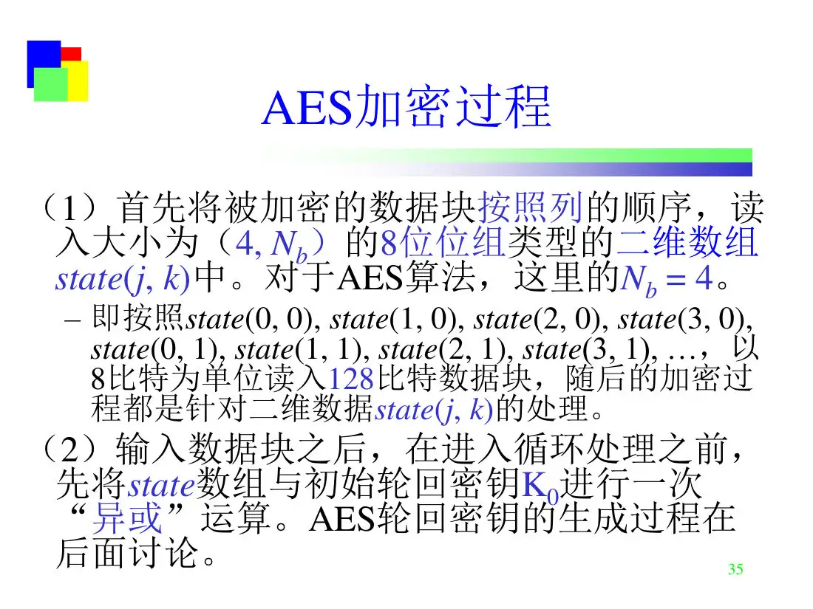

原文：

AES加密过程

（1）首先将被加密的数据块按照列的顺序，读入大小为 $( 4 , N _ { b } )$ 的8位位组类型的二维数组state(j, k)中。对于AES算法，这里的 $N _ { b } = 4$ o即按照state(0, 0), state(1, 0), state(2, 0), state(3, 0),state(0, 1), state(1, 1), state(2, 1), state(3, 1), …，以8比特为单位读入128比特数据块，随后的加密过程都是针对二维数据state(j, k)的处理。

（2）输入数据块之后，在进入循环处理之前，先将state数组与初始轮回密钥 $\mathrm { K } _ { 0 }$ 进行一次“异或”运算。AES轮回密钥的生成过程在后面讨论。35

1

### AES加密过程(续1)

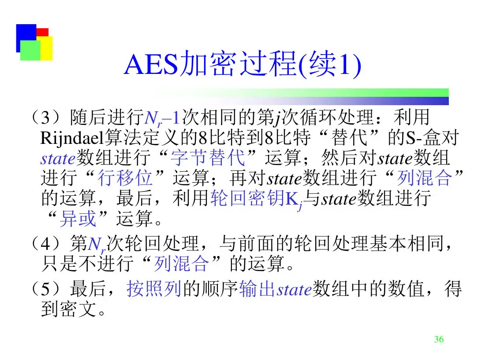

原文：

AES加密过程(续1)

（3）随后进行N–1次相同的第j次循环处理：利用Rijndael算法定义的8比特到8比特“替代”的S-盒对state数组进行“字节替代”运算；然后对state数组进行“行移位”运算；再对state数组进行“列混合”的运算，最后，利用轮回密钥K与state数组进行“异或”运算。

（4）第N次轮回处理，与前面的轮回处理基本相同，只是不进行“列混合”的运算。

（5）最后，按照列的顺序输出state数组中的数值，得到密文。

1

36

### AES加密过程(续2)

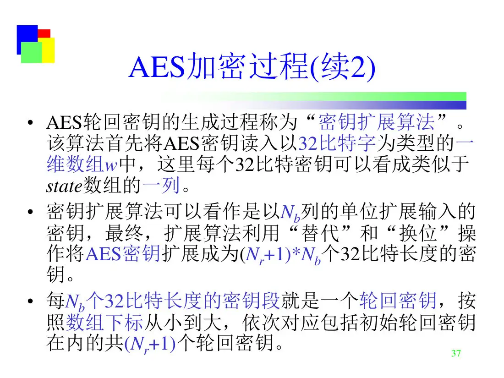

原文：

AES加密过程(续2)

• AES轮回密钥的生成过程称为“密钥扩展算法”。该算法首先将AES密钥读入以32比特字为类型的一维数组 $w$ 中，这里每个32比特密钥可以看成类似于state数组的一列。

• 密钥扩展算法可以看作是以 $N _ { b }$ 列的单位扩展输入的密钥，最终，扩展算法利用“替代”和“换位”操作将AES密钥扩展成为 $( N _ { r } { + } 1 ) ^ { * } N _ { b }$ 个32比特长度的密钥。

• 每 $N _ { b }$ 个32比特长度的密钥段就是一个轮回密钥，按照数组下标从小到大，依次对应包括初始轮回密钥在内的共 $( N _ { r } { + } 1 )$ 个轮回密钥。 37

1

### AES加密过程示意图

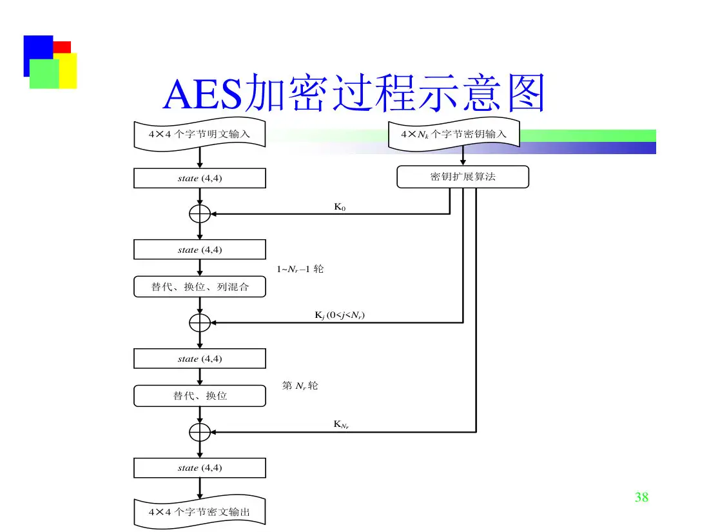

原文：

AES加密过程示意图

38

### RC4加密算法\

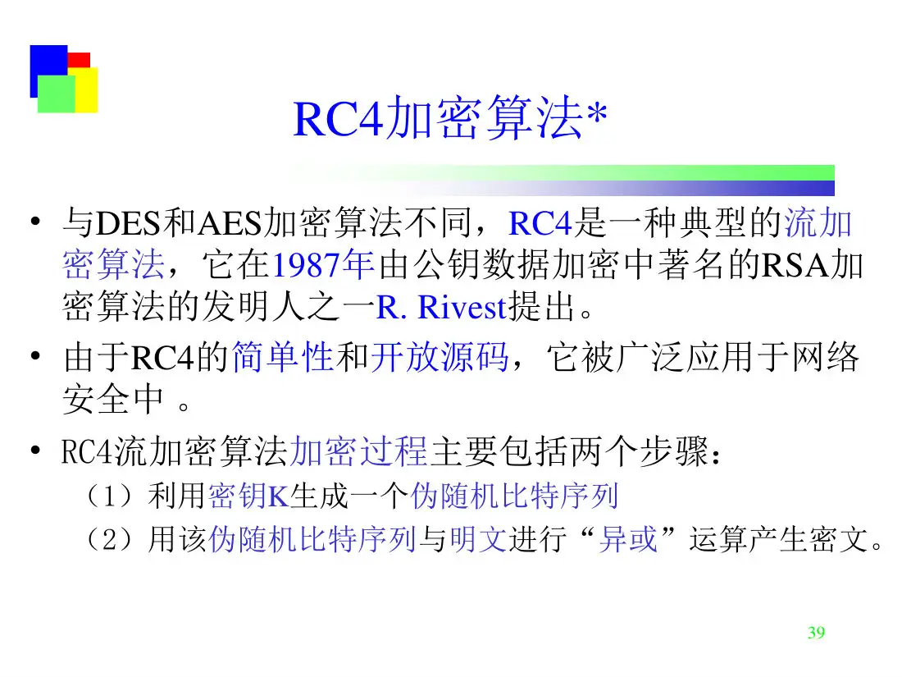

原文：

RC4加密算法\*

• 与DES和AES加密算法不同，RC4是一种典型的流加密算法，它在1987年由公钥数据加密中著名的RSA加密算法的发明人之一R. Rivest提出。

• 由于RC4的简单性和开放源码，它被广泛应用于网络安全中 。

• RC4流加密算法加密过程主要包括两个步骤：

（1）利用密钥K生成一个伪随机比特序列

（2）用该伪随机比特序列与明文进行“异或”运算产生密文。

1

39

### RC4加密算法的原理\

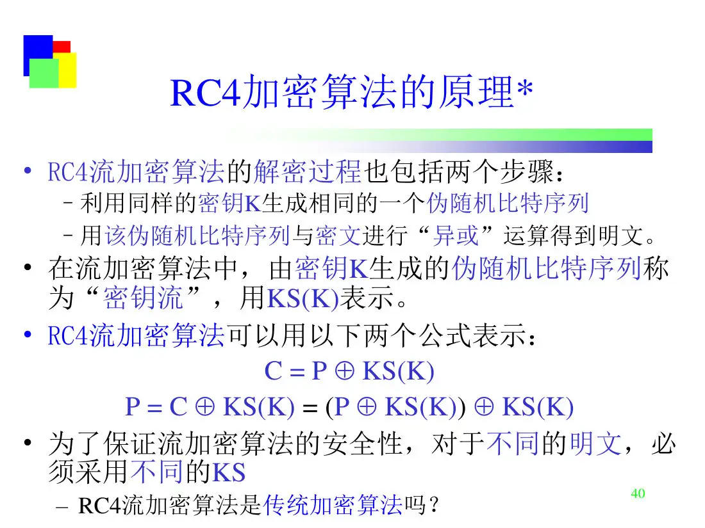

原文：

RC4加密算法的原理\*

• RC4流加密算法的解密过程也包括两个步骤：

–利用同样的密钥K生成相同的一个伪随机比特序列

–用该伪随机比特序列与密文进行“异或”运算得到明文。

• 在流加密算法中，由密钥K生成的伪随机比特序列称为“密钥流”，用KS(K)表示。

• RC4流加密算法可以用以下两个公式表示：

$$
\mathrm{C} = \mathrm{P} \oplus \mathrm{KS} (\mathrm{K})
$$

$$
\mathrm{P} = \mathrm{C} \oplus \mathrm{KS} (\mathrm{K}) = (\mathrm{P} \oplus \mathrm{KS} (\mathrm{K})) \oplus \mathrm{KS} (\mathrm{K})
$$

• 为了保证流加密算法的安全性，对于不同的明文，必须采用不同的KS

– RC4流加密算法是传统加密算法吗？

7

40

### RC4加密算法的具体实现\

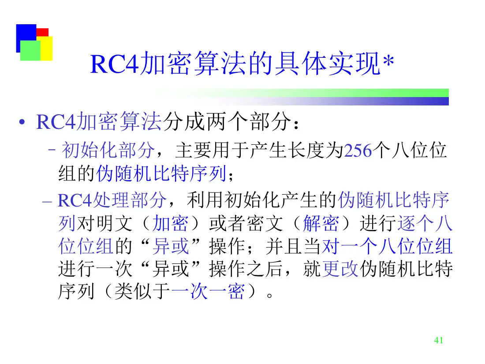

原文：

RC4加密算法的具体实现\*

• RC4加密算法分成两个部分：

–初始化部分，主要用于产生长度为256个八位位组的伪随机比特序列；

– RC4处理部分，利用初始化产生的伪随机比特序列对明文（加密）或者密文（解密）进行逐个八位位组的“异或”操作；并且当对一个八位位组进行一次“异或”操作之后，就更改伪随机比特序列（类似于一次一密）。

7

41

### RC4初始化程序

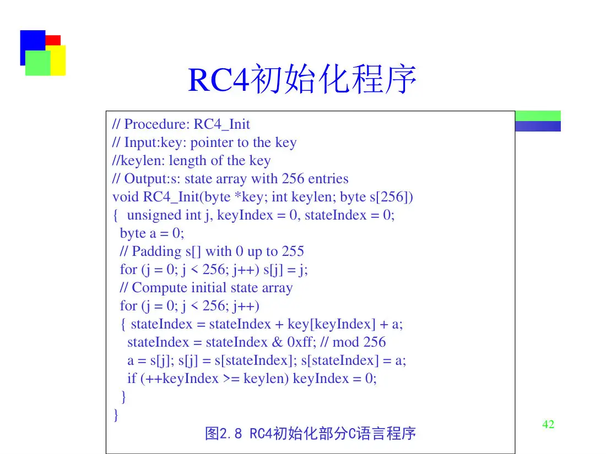

原文：

RC4初始化程序

### RC4加密/解密程序

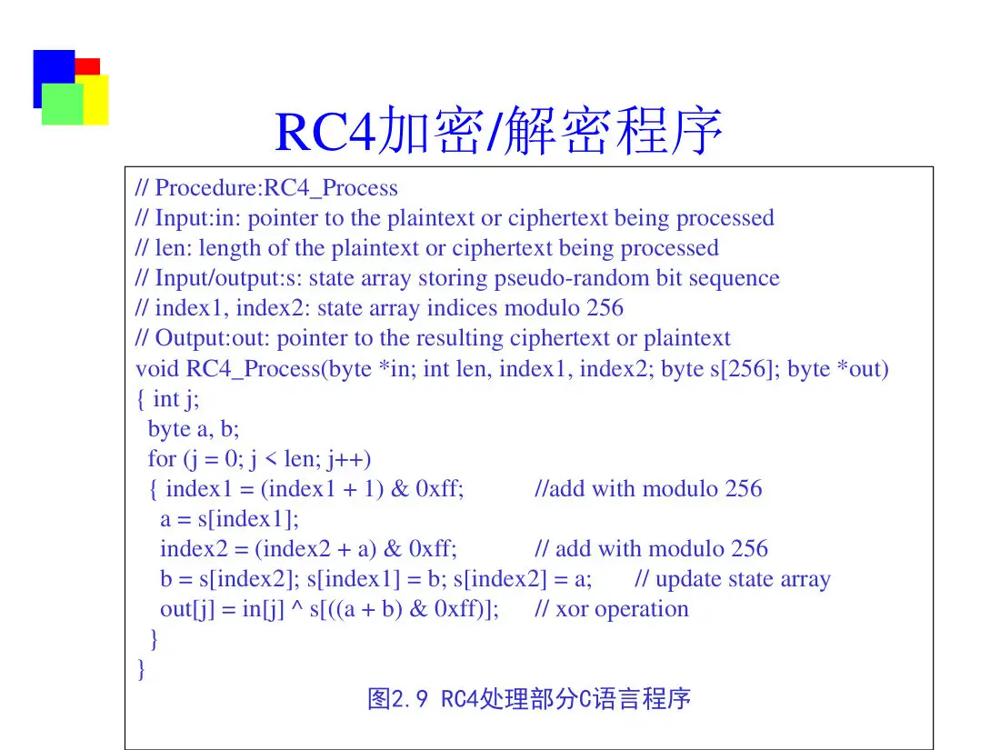

原文：

RC4加密/解密程序

### RC4加密算法的分析\

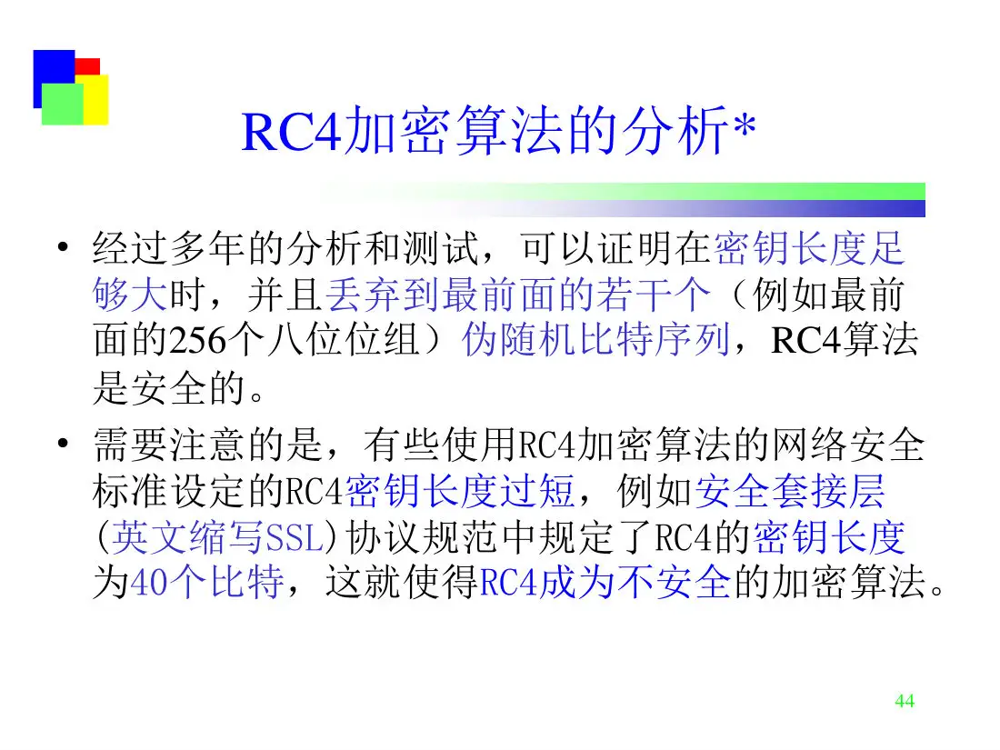

原文：

RC4加密算法的分析\*

• 经过多年的分析和测试，可以证明在密钥长度足够大时，并且丢弃到最前面的若干个（例如最前面的256个八位位组）伪随机比特序列，RC4算法是安全的。

• 需要注意的是，有些使用RC4加密算法的网络安全标准设定的RC4密钥长度过短，例如安全套接层(英文缩写SSL)协议规范中规定了RC4的密钥长度为40个比特，这就使得RC4成为不安全的加密算法。

7

44

### 加密操作模式\

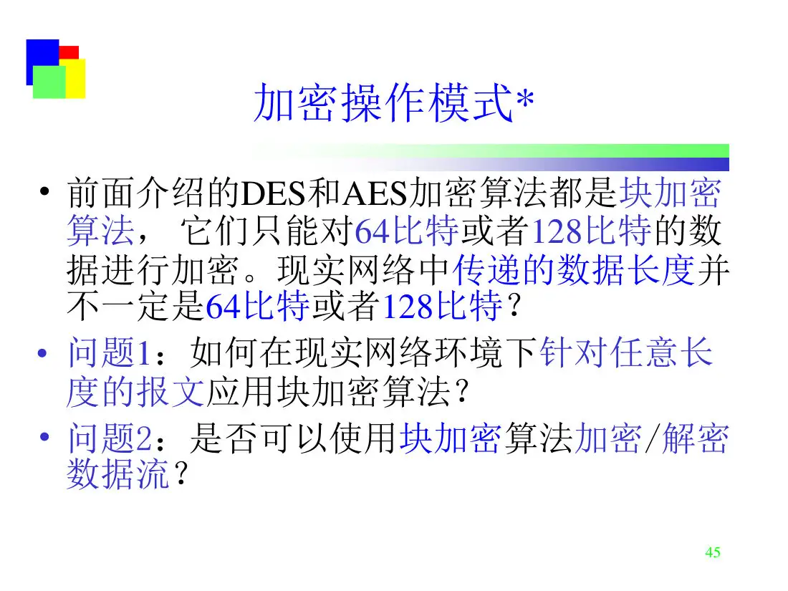

原文：

加密操作模式\*

• 前面介绍的DES和AES加密算法都是块加密算法，它们只能对64比特或者128比特的数据进行加密。现实网络中传递的数据长度并不一定是64比特或者128比特？

• 问题1：如何在现实网络环境下针对任意长度的报文应用块加密算法？

• 问题2：是否可以使用块加密算法加密/解密数据流？

7

45

### 加密操作模式(续)\

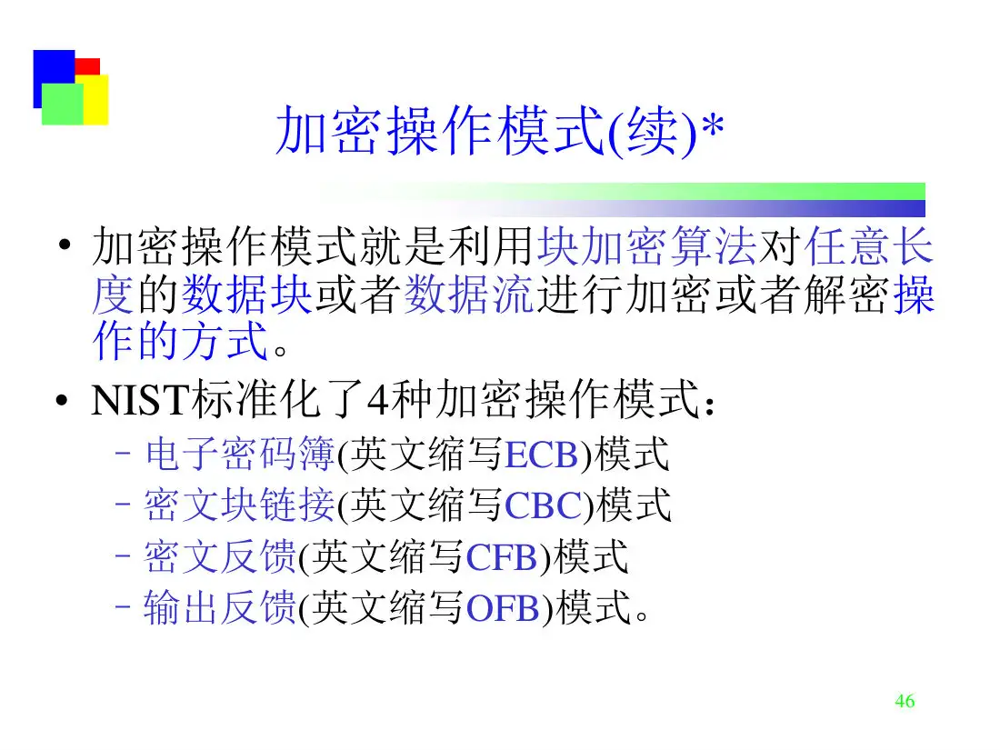

原文：

加密操作模式(续)\*

• 加密操作模式就是利用块加密算法对任意长度的数据块或者数据流进行加密或者解密操作的方式。

• NIST标准化了4种加密操作模式：

–电子密码簿(英文缩写ECB)模式

–密文块链接(英文缩写CBC)模式

–密文反馈(英文缩写CFB)模式

–输出反馈(英文缩写OFB)模式。

7

46

### 任意长度报文的分块和填充\

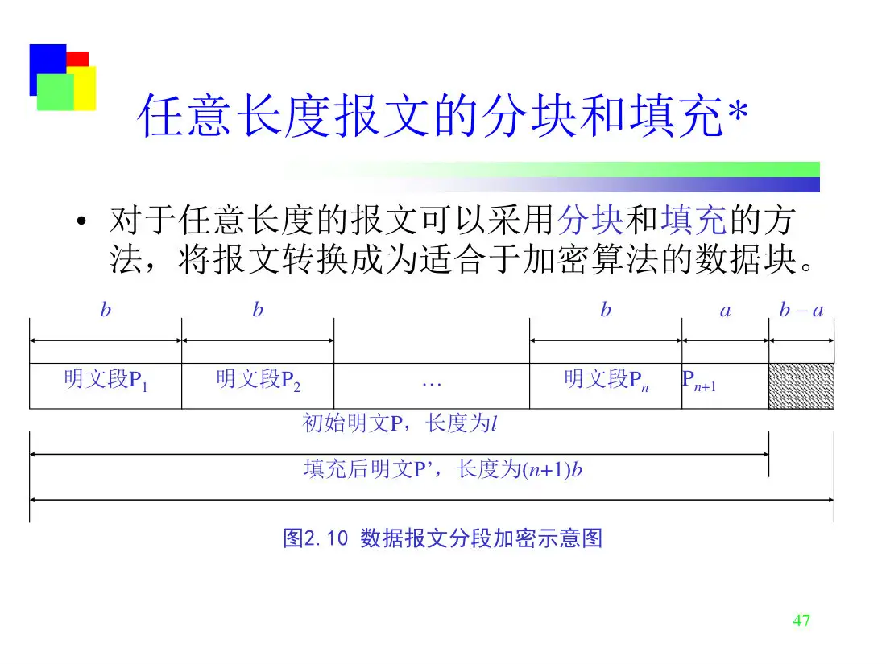

原文：

任意长度报文的分块和填充\*

• 对于任意长度的报文可以采用分块和填充的方法，将报文转换成为适合于加密算法的数据块。

47

### 电子密码簿(ECB)模式\

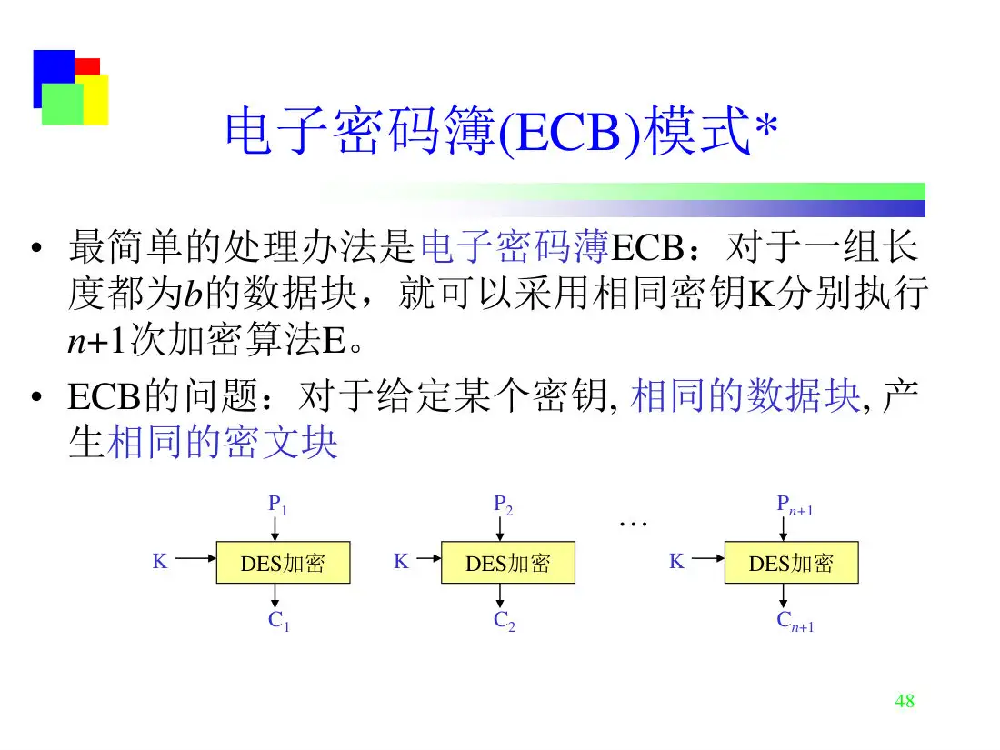

原文：

电子密码簿(ECB)模式\*

• 最简单的处理办法是电子密码薄ECB：对于一组长度都为b的数据块，就可以采用相同密钥K分别执行n+1次加密算法E。

• ECB的问题：对于给定某个密钥, 相同的数据块, 产生相同的密文块

7

48

### 密文块链接(CBC)模式\

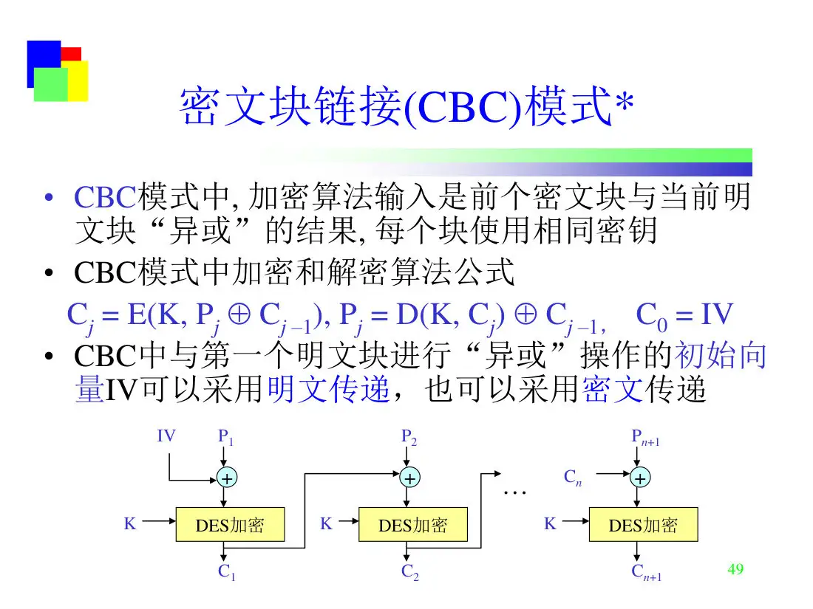

原文：

密文块链接(CBC)模式\*

● CBC模式中, 加密算法输入是前个密文块与当前明文块“异或”的结果, 每个块使用相同密钥

• CBC模式中加密和解密算法公式

$$
\mathbf {C} _ {j} = \operatorname{E} (\mathbf {K}, \mathbf {P} _ {j} \oplus \mathbf {C} _ {j - 1}), \mathbf {P} _ {j} = \operatorname{D} (\mathbf {K}, \mathbf {C} _ {j}) \oplus \mathbf {C} _ {j - 1}, \quad \mathbf {C} _ {0} = \mathbf {I V}
$$

• CBC中与第一个明文块进行“异或”操作的初始向量IV可以采用明文传递，也可以采用密文传递

### 密文反馈(CFB)模式\

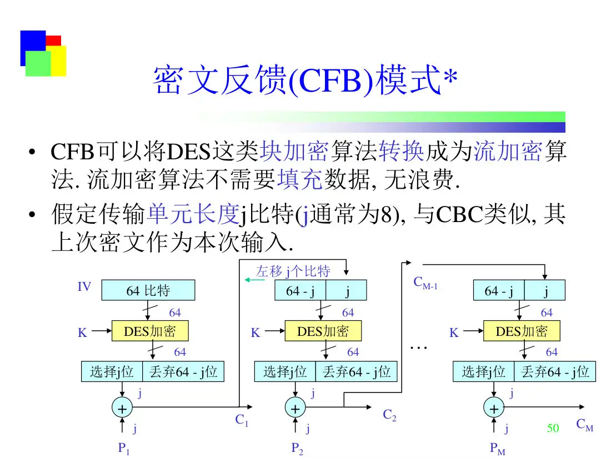

原文：

密文反馈(CFB)模式\*

• CFB可以将DES这类块加密算法转换成为流加密算法. 流加密算法不需要填充数据, 无浪费.

• 假定传输单元长度j比特(j通常为8), 与CBC类似, 其上次密文作为本次输入.

1

### 密文反馈(CFB)模式(续)\

原文：

密文反馈(CFB)模式(续)\*

• 与CBC不同, CFB仅仅对初始向量或初始向量与反馈的密文的合并形成的数据(R)加密后获得的伪随机序列(流密钥), 再与明文“异或”得到密文。

• 以上加密/解密过程可以采用公式表示如下, 其中：S(l, s) 表示选择串s中的左l个比特。

$$
\begin{array}{c} \mathbf {R} _ {j} = (\mathbf {R} _ {j - 1} * 2 ^ {l} \bmod 2 ^ {b}) + \mathbf {C} _ {j - 1} \\ \mathbf {C} _ {j} = \mathbf {S} (l, \operatorname{E} (\mathbf {K}, \mathbf {R} _ {j})) \oplus \mathbf {P} _ {j} \\ \mathbf {P} _ {j} = \mathbf {S} (l, \operatorname{E} (\mathbf {K}, \mathbf {R} _ {j})) \oplus \mathbf {C} _ {j} \\ \mathbf {R} _ {0} = \mathbf {I V} \end{array}
$$

51

### 输出反馈(OFB)模式

原文：

输出反馈(OFB)模式

• 输出反馈(OFB)加密操作模式也是一种流加密操作模式。与CFB模式类似，但却利用块加密算法输出的反馈生成随机比特序列(流密钥)，然后，利用该流密钥与明文数据流进行“异或”运算，得到密文数据流。

1

### 加密操作模式的分析\

原文：

加密操作模式的分析\*

• OFB和CFB是属于流加密模式，而ECB和CBC属于块加密模式。流加密模式可以应用于数据流加密，块加密模式适用于数据块加密。

• 采用OFB和CFB这类流加密模式，只是采用块加密算法产生一个伪随机序列(流密钥)，然后利用该流密钥对明文数据流进行“异或”运算，完成对数据流的加密或解密工作。

• 现有加密模式的最大不足是除了ECB模式之外都采用了“反馈”或者“链接”操作，这样，无法采用并行处理机制提高加密/解密处理的性能。

7

53

### 传统数据加密应用

原文：

传统数据加密应用

• 传统密钥学广泛应用于计算机安全和网络安全, 例如网络用户注册名和口令的加密、用户敏感数据的加密等。

• 网络数据传输中, 传统数据加密可以用于数据传送的加密和网络应用的加密

• 网络安全系统中, 通常采用传统数据加密方法加密大容量的数据. 因为目前还是传统数据加密的加密/解密算法效率最高.

7

54

### 本章重点内容

原文：

本章重点内容

• 恺撒加密法

• 传统密钥学基本原理: 替代和移位

• 数据加密标准 DES

• 高级加密标准 AES

• RC4加密算法

• 加密操作模式

55
