# 《信息安全技术》第2章 数据加密导论(3)公钥数据加密方法（课件）

原件的每一页，下面附识别出的文字。

### 第2章 数据加密导论(3)公钥数据加密方法

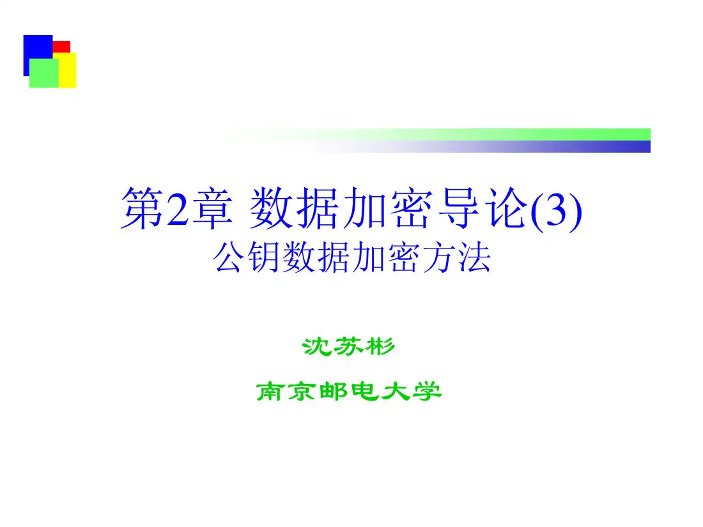

原文：

第2章 数据加密导论(3)公钥数据加密方法

沈苏彬

南京邮电大学

### 关键知识点\

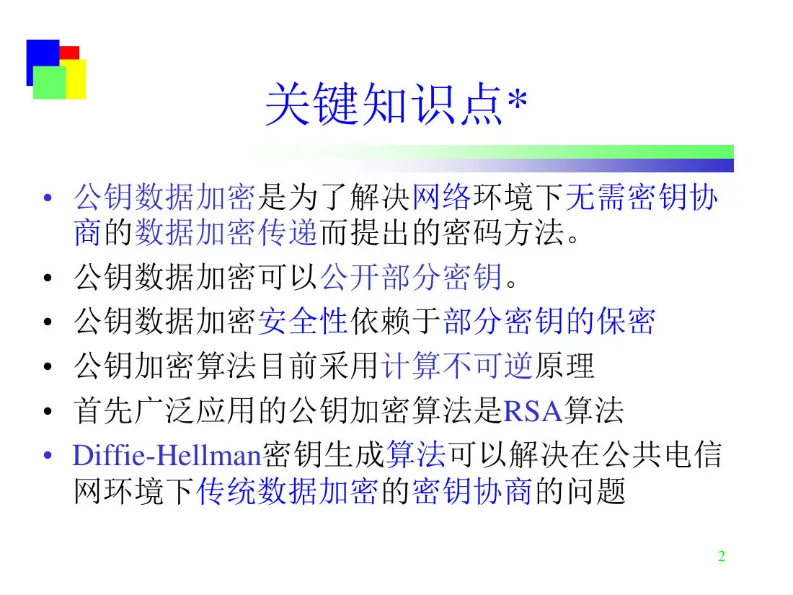

原文：

关键知识点\*

• 公钥数据加密是为了解决网络环境下无需密钥协商的数据加密传递而提出的密码方法。

• 公钥数据加密可以公开部分密钥。

• 公钥数据加密安全性依赖于部分密钥的保密

• 公钥加密算法目前采用计算不可逆原理

• 首先广泛应用的公钥加密算法是RSA算法

• Diffie-Hellman密钥生成算法可以解决在公共电信网环境下传统数据加密的密钥协商的问题

7

2

### 主要内容

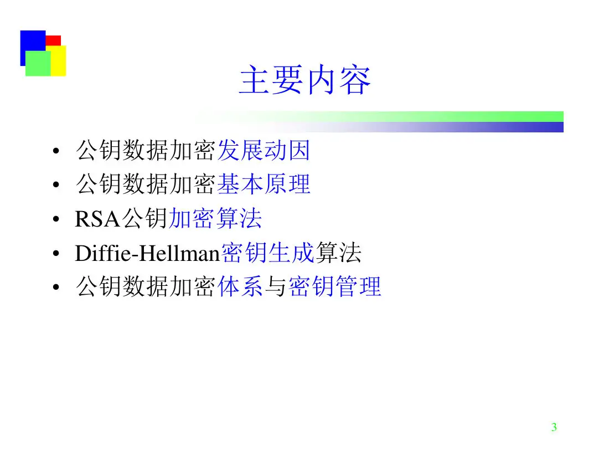

原文：

主要内容

• 公钥数据加密发展动因

• 公钥数据加密基本原理

• RSA公钥加密算法

• Diffie-Hellman密钥生成算法

• 公钥数据加密体系与密钥管理

3

### 公钥数据加密历史\

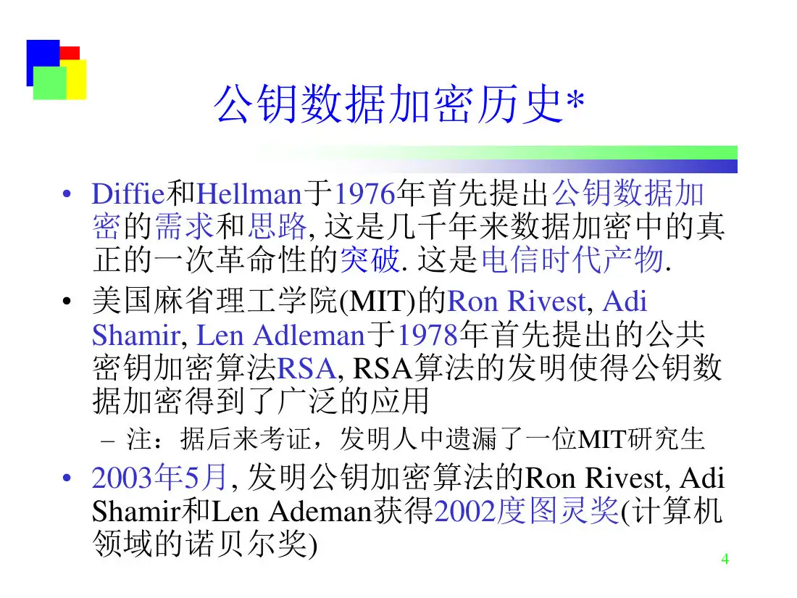

原文：

公钥数据加密历史\*

• Diffie和Hellman于1976年首先提出公钥数据加密的需求和思路, 这是几千年来数据加密中的真正的一次革命性的突破. 这是电信时代产物.

• 美国麻省理工学院(MIT)的Ron Rivest, AdiShamir, Len Adleman于1978年首先提出的公共密钥加密算法RSA, RSA算法的发明使得公钥数据加密得到了广泛的应用

– 注：据后来考证，发明人中遗漏了一位MIT研究生

2003年5月, 发明公钥加密算法的Ron Rivest, AdiShamir和Len Ademan获得2002度图灵奖(计算机领域的诺贝尔奖) 4

7

### 公钥数据加密发展动因\

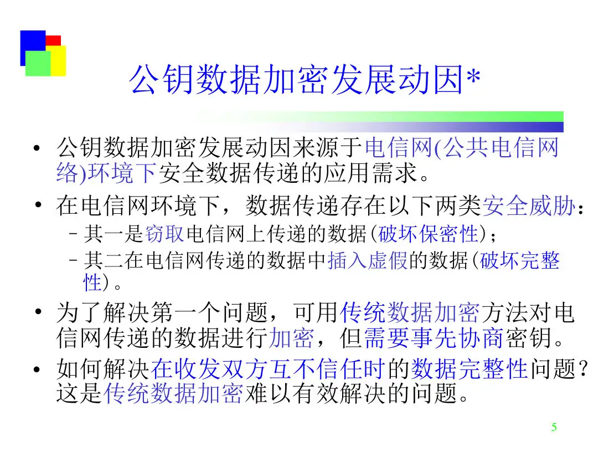

原文：

公钥数据加密发展动因\*

• 公钥数据加密发展动因来源于电信网(公共电信网络)环境下安全数据传递的应用需求。

• 在电信网环境下，数据传递存在以下两类安全威胁：–其一是窃取电信网上传递的数据(破坏保密性)；

–其二在电信网传递的数据中插入虚假的数据(破坏完整性)。

• 为了解决第一个问题，可用传统数据加密方法对电信网传递的数据进行加密，但需要事先协商密钥。

• 如何解决在收发双方互不信任时的数据完整性问题？这是传统数据加密难以有效解决的问题。

5

### 传统数据加密的问题\

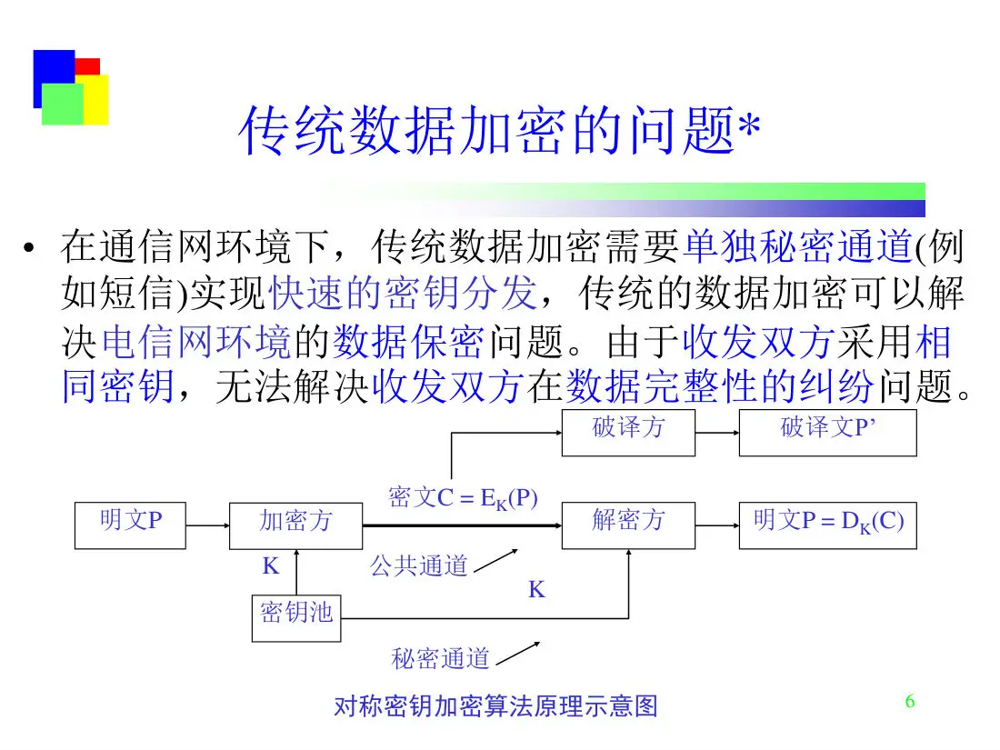

原文：

传统数据加密的问题\*

• 在通信网环境下，传统数据加密需要单独秘密通道(例如短信)实现快速的密钥分发，传统的数据加密可以解决电信网环境的数据保密问题。由于收发双方采用相同密钥，无法解决收发双方在数据完整性的纠纷问题。

7

对称密钥加密算法原理示意图

6

### 电信网数据加密的解决方案\

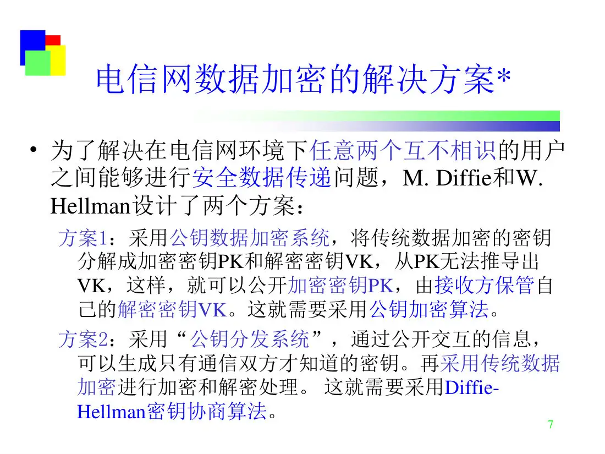

原文：

电信网数据加密的解决方案\*

• 为了解决在电信网环境下任意两个互不相识的用户之间能够进行安全数据传递问题，M. Diffie和W.Hellman设计了两个方案：

方案1：采用公钥数据加密系统，将传统数据加密的密钥分解成加密密钥PK和解密密钥VK，从PK无法推导出VK，这样，就可以公开加密密钥PK，由接收方保管自己的解密密钥VK。这就需要采用公钥加密算法。

方案2：采用“公钥分发系统”，通过公开交互的信息，可以生成只有通信双方才知道的密钥。再采用传统数据加密进行加密和解密处理。 这就需要采用Diffie-Hellman密钥协商算法。

7

### 电信网数据完整性解决方案\

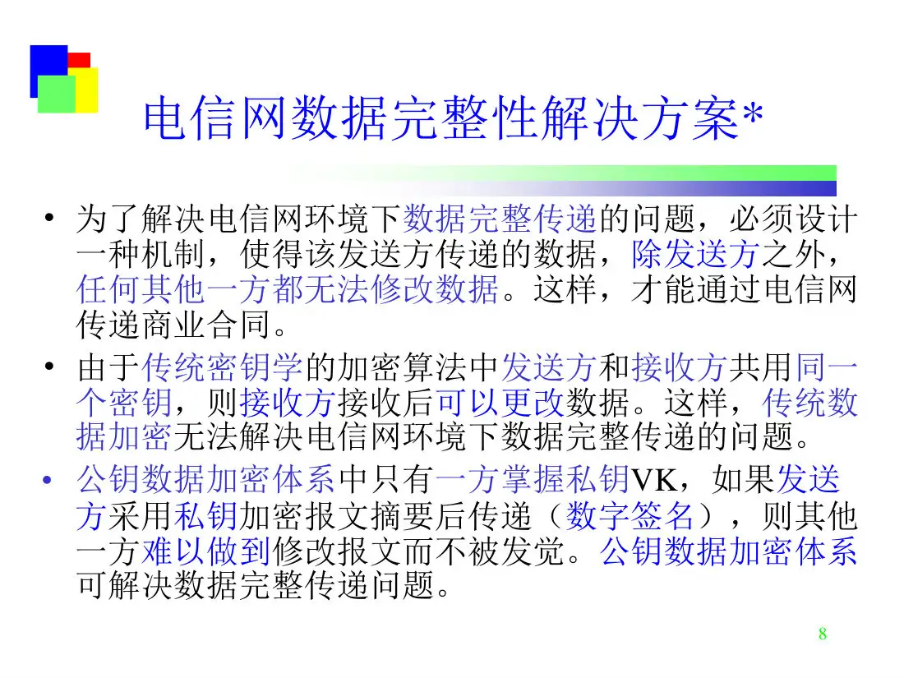

原文：

电信网数据完整性解决方案\*

• 为了解决电信网环境下数据完整传递的问题，必须设计一种机制，使得该发送方传递的数据，除发送方之外，任何其他一方都无法修改数据。这样，才能通过电信网传递商业合同。

• 由于传统密钥学的加密算法中发送方和接收方共用同一个密钥，则接收方接收后可以更改数据。这样，传统数据加密无法解决电信网环境下数据完整传递的问题。

公钥数据加密体系中只有一方掌握私钥VK，如果发送方采用私钥加密报文摘要后传递（数字签名），则其他一方难以做到修改报文而不被发觉。公钥数据加密体系可解决数据完整传递问题。

8

### 公钥数据加密系统定义\

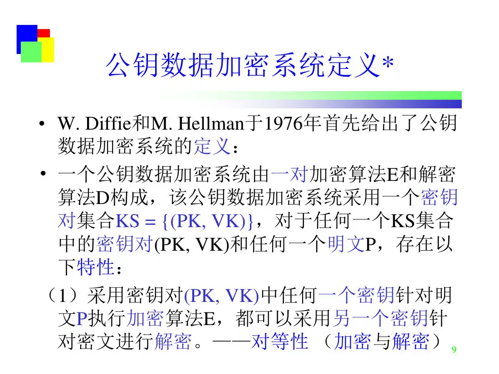

原文：

公钥数据加密系统定义\*

• W. Diffie和M. Hellman于1976年首先给出了公钥数据加密系统的定义：

• 一个公钥数据加密系统由一对加密算法E和解密算法D构成，该公钥数据加密系统采用一个密钥对集合KS = {(PK, VK)}，对于任何一个KS集合中的密钥对(PK, VK)和任何一个明文P，存在以下特性：

（1）采用密钥对(PK, VK)中任何一个密钥针对明文P执行加密算法E，都可以采用另一个密钥针对密文进行解密。——对等性 （加密与解密） 9

7

### 公钥数据加密系统定义(续1)\

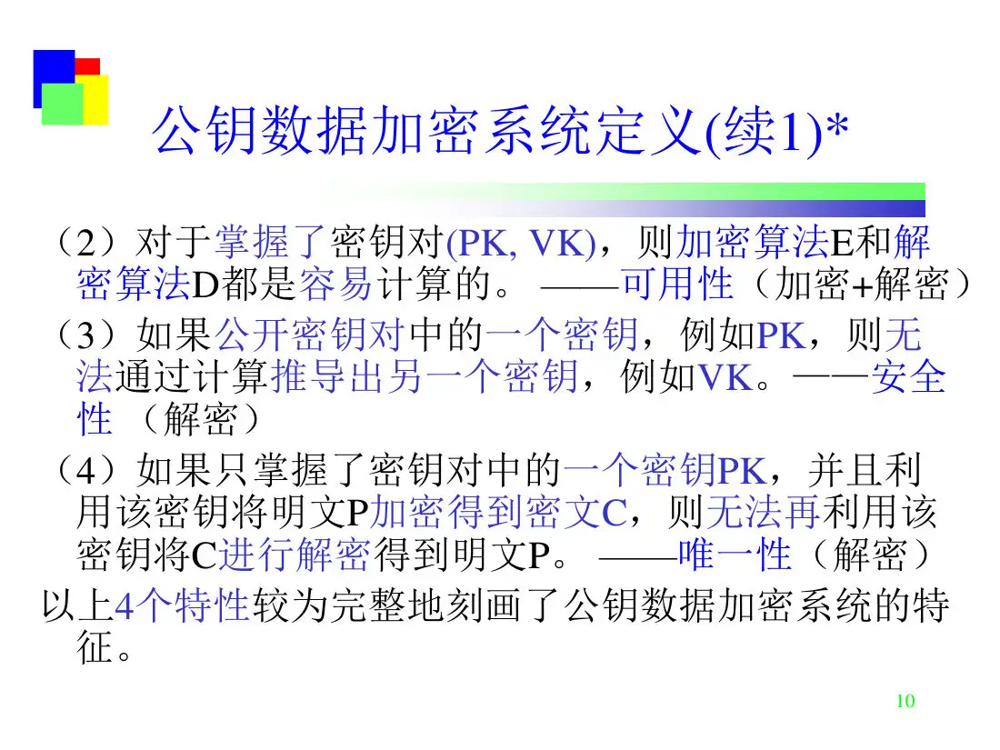

原文：

公钥数据加密系统定义(续1)\*

（2）对于掌握了密钥对(PK, VK)，则加密算法E和解密算法D都是容易计算的。 可用性（加密+解密）

（3）如果公开密钥对中的一个密钥，例如PK，则无法通过计算推导出另一个密钥，例如VK。——安全性 （解密）

（4）如果只掌握了密钥对中的一个密钥PK，并且利用该密钥将明文P加密得到密文C，则无法再利用该密钥将C进行解密得到明文P。 ——唯一性（解密）以上4个特性较为完整地刻画了公钥数据加密系统的特征。

7

10

### 公钥数据加密系统示意图\

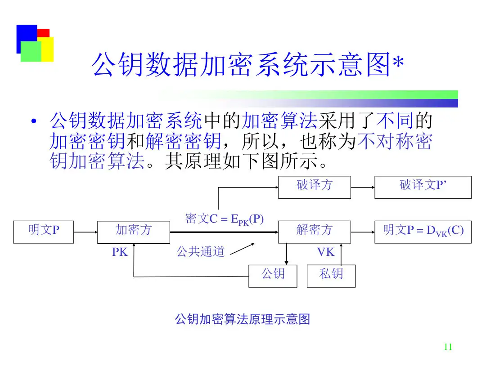

原文：

公钥数据加密系统示意图\*

• 公钥数据加密系统中的加密算法采用了不同的加密密钥和解密密钥，所以，也称为不对称密钥加密算法。其原理如下图所示。

11

### RSA公钥加密算法\

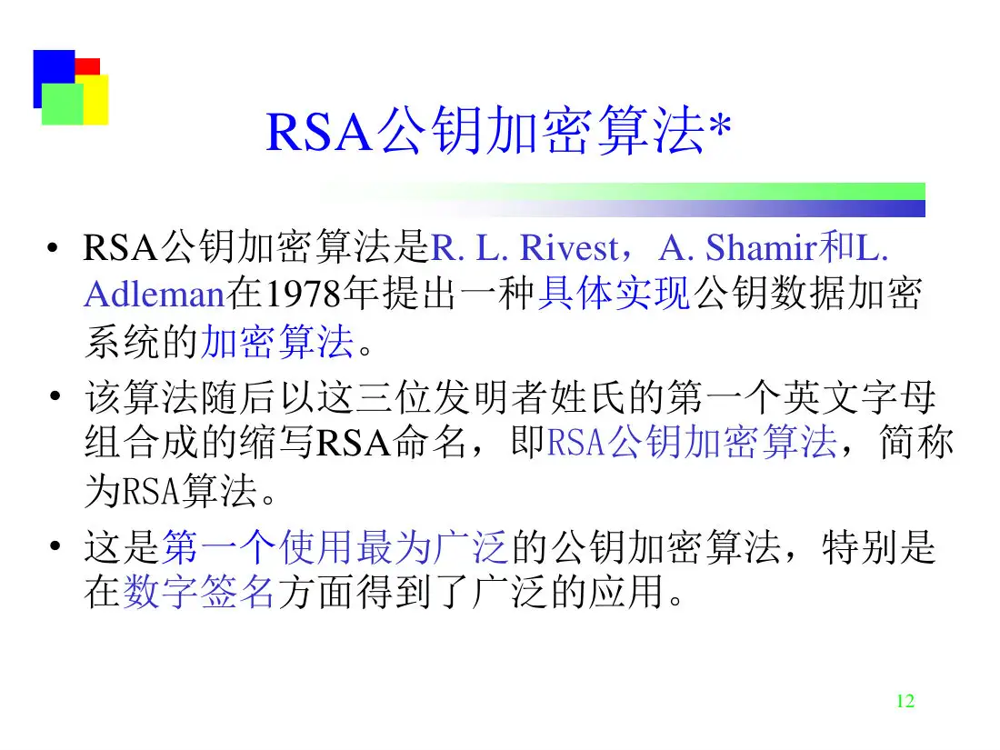

原文：

RSA公钥加密算法\*

• RSA公钥加密算法是R. L. Rivest，A. Shamir和L.Adleman在1978年提出一种具体实现公钥数据加密系统的加密算法。

• 该算法随后以这三位发明者姓氏的第一个英文字母组合成的缩写RSA命名，即RSA公钥加密算法，简称为RSA算法。

• 这是第一个使用最为广泛的公钥加密算法，特别是在数字签名方面得到了广泛的应用。

7

12

### RSA公钥加密算法(续)\

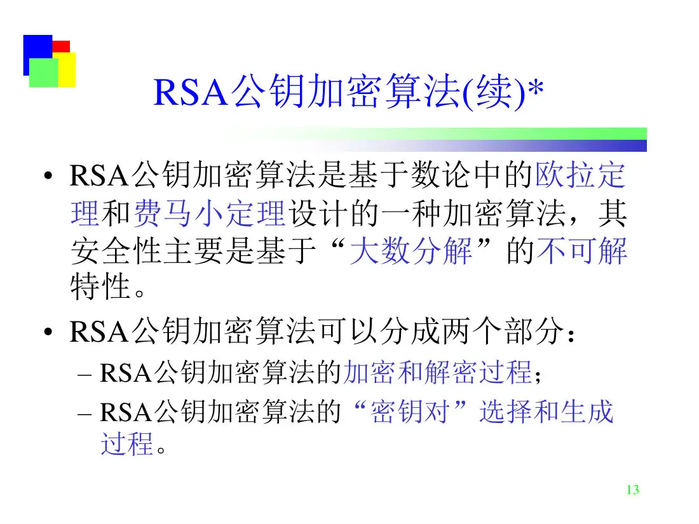

原文：

RSA公钥加密算法(续)\*

• RSA公钥加密算法是基于数论中的欧拉定理和费马小定理设计的一种加密算法，其安全性主要是基于“大数分解”的不可解特性。

• RSA公钥加密算法可以分成两个部分：

– RSA公钥加密算法的加密和解密过程；

– RSA公钥加密算法的“密钥对”选择和生成过程。

7

13

### RSA依赖的数论概念和定理

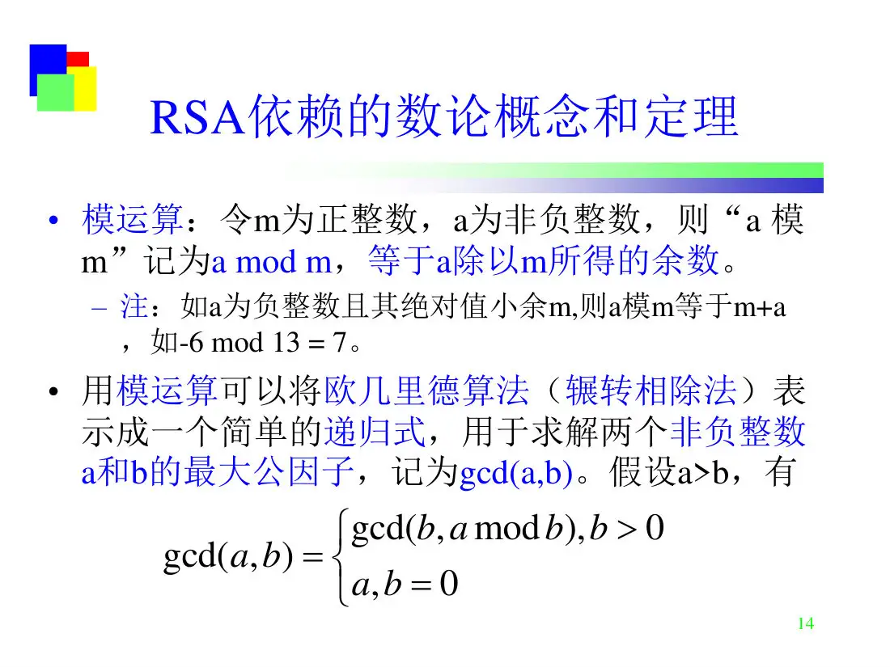

原文：

RSA依赖的数论概念和定理

• 模运算：令m为正整数，a为非负整数，则 $^ { 6 6 } \mathrm { a }$ 模m”记为a mod m，等于a除以m所得的余数。

– 注：如a为负整数且其绝对值小余m,则a模m等于m+a ，如-6 mod 13 = 7。

• 用模运算可以将欧几里德算法（辗转相除法）表示成一个简单的递归式，用于求解两个非负整数a和b的最大公因子，记为gcd(a,b)。假设a>b，有

$$
\operatorname * {g c d} (a, b) = \left\{ \begin{array}{l} \operatorname * {g c d} (b, a \bmod b), b > 0 \\ a, b = 0 \end{array} \right.
$$

14

### RSA依赖的数论概念和定理(续1)

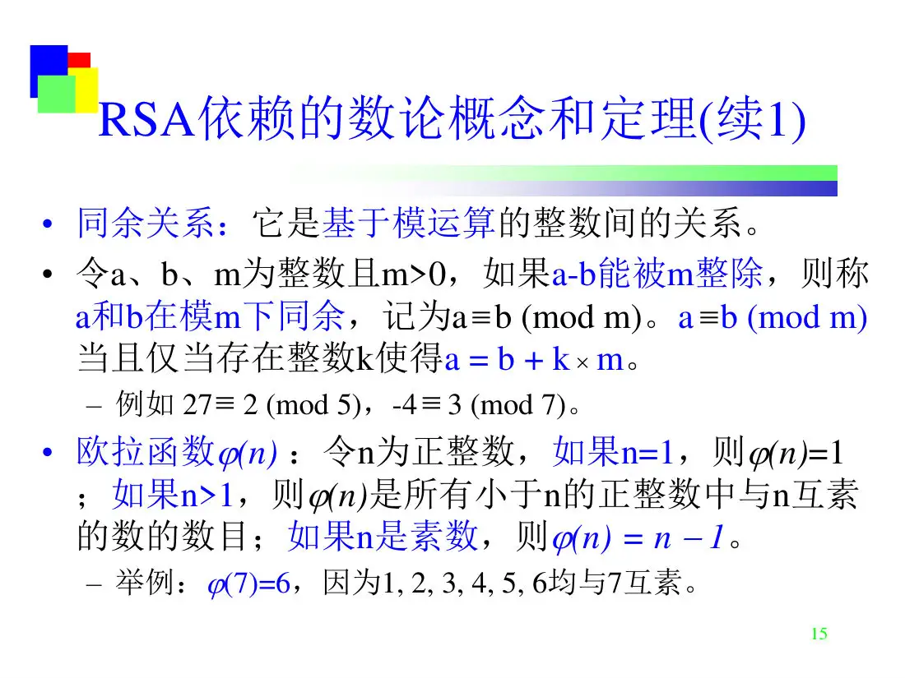

原文：

RSA依赖的数论概念和定理(续1)

• 同余关系：它是基于模运算的整数间的关系。

• 令a、b、m为整数且m>0，如果a-b能被m整除，则称a和b在模m下同余，记为 $\mathrm { a } \equiv \mathrm { b } ( \mathrm { m o d } \mathrm { m } )$ $\mathrm { a } \equiv \mathrm { b } ( \mathrm { m o d } \mathrm { m } )$ 当且仅当存在整数k使得 $\mathbf { a } = \mathbf { b } + \mathbf { k } \times \mathbf { m }$ o– 例如 $2 7 \equiv 2 { \pmod { 5 } } , \ - 4 \equiv 3 { \pmod { 7 } }$ O

• 欧拉函数 $\varphi ( n )$ ：令n为正整数，如果n=1，则 $\varphi ( n ) { = } 1$ ；如果n>1，则 $\varphi ( n )$ 是所有小于n的正整数中与n互素的数的数目；如果n是素数，则 $\varphi ( n ) = n - I$ o

– 举例：(7)=6，因为1, 2, 3, 4, 5, 6均与7互素。

15

### RSA依赖的数论概念和定理(续2)

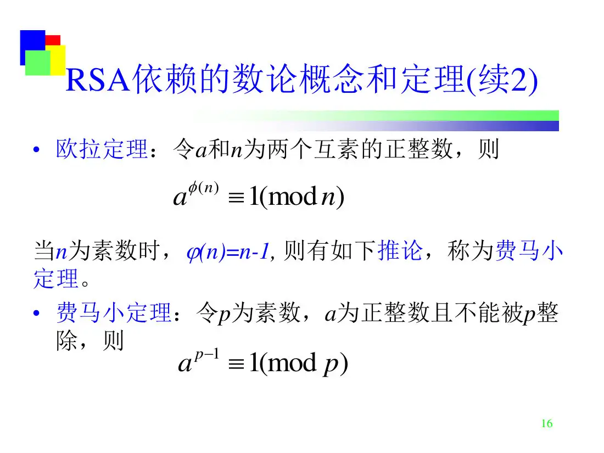

原文：

RSA依赖的数论概念和定理(续2)

• 欧拉定理：令 $a$ 和 $\mathbf { \xi } _ { n }$ 为两个互素的正整数，则

$$
a ^ {\phi (n)} \equiv 1 (\mathrm{mod} n)
$$

当n为素数时， $\scriptstyle { \varphi ( n ) = n - l }$ , 则有如下推论，称为费马小定理。

• 费马小定理：令 $p$ 为素数， $a _ { \scriptscriptstyle  { i } }$ 为正整数且不能被 $p$ 整除，则

$$
a ^ {p - 1} \equiv 1 (\mathrm{mod} p)
$$

16

### RSA算法加密/解密过程\

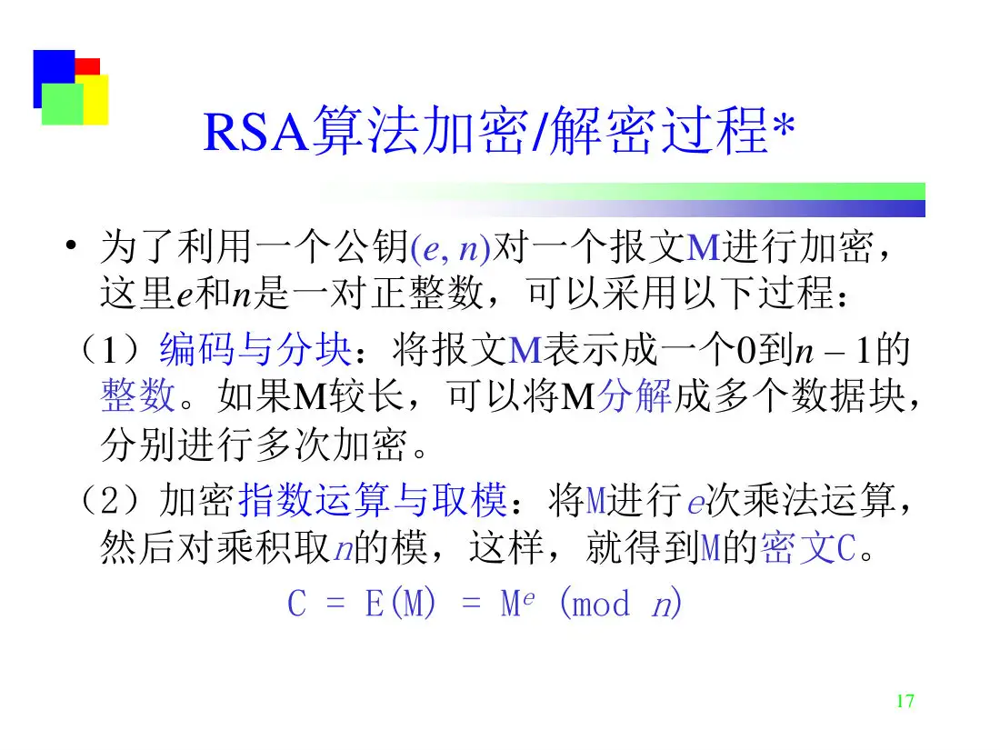

原文：

RSA算法加密/解密过程\*

• 为了利用一个公钥(e, n)对一个报文M进行加密，这里e和n是一对正整数，可以采用以下过程：

（1）编码与分块：将报文M表示成一个0到n –1的整数。如果M较长，可以将M分解成多个数据块，分别进行多次加密。

（2）加密指数运算与取模：将M进行e次乘法运算，然后对乘积取n的模，这样，就得到M的密文C。

$$
\mathrm{C} = \mathrm{E(M)} = \mathrm {M^ {e}} (\mathrm{mod} n)
$$

1

17

### RSA算法加密/解密过程(续)\

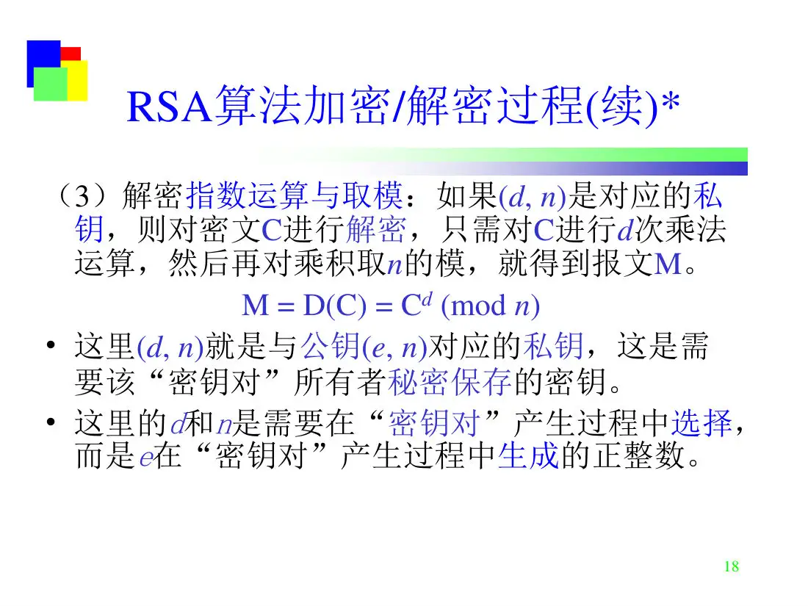

原文：

RSA算法加密/解密过程(续)\*

（3）解密指数运算与取模：如果(d, n)是对应的私钥，则对密文C进行解密，只需对C进行d次乘法运算，然后再对乘积取n的模，就得到报文M。

$$
\mathbf {M} = \mathbf {D} (\mathbf {C}) = \mathbf {C} ^ {d} (\mathrm{mod} n)
$$

• 这里(d, n)就是与公钥(e, n)对应的私钥，这是需要该“密钥对”所有者秘密保存的密钥。

• 这里的d和n是需要在“密钥对”产生过程中选择，而是e在“密钥对”产生过程中生成的正整数。

18

### RSA算法的密钥产生\

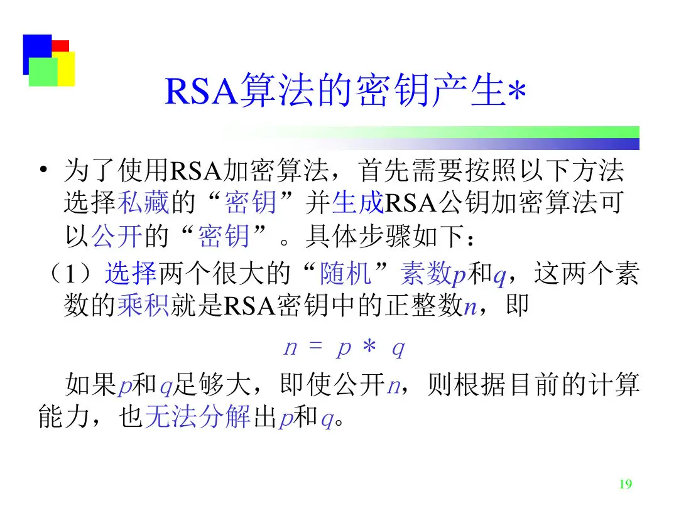

原文：

RSA算法的密钥产生\*

• 为了使用RSA加密算法，首先需要按照以下方法选择私藏的“密钥”并生成RSA公钥加密算法可以公开的“密钥”。具体步骤如下：

（1）选择两个很大的“随机”素数 $\dot { p }$ 和 $q$ ，这两个素数的乘积就是RSA密钥中的正整数n，即

$$
n = p * q
$$

如果 $p \mathrm { i }$ 和 $q$ 足够大，即使公开 $\boldsymbol { \mathit { \Pi } } _ { \mathit { \Pi } }$ ，则根据目前的计算能力，也无法分解出 $p$ 和 $q$ 。

1

19

### RSA算法的密钥产生(续)\

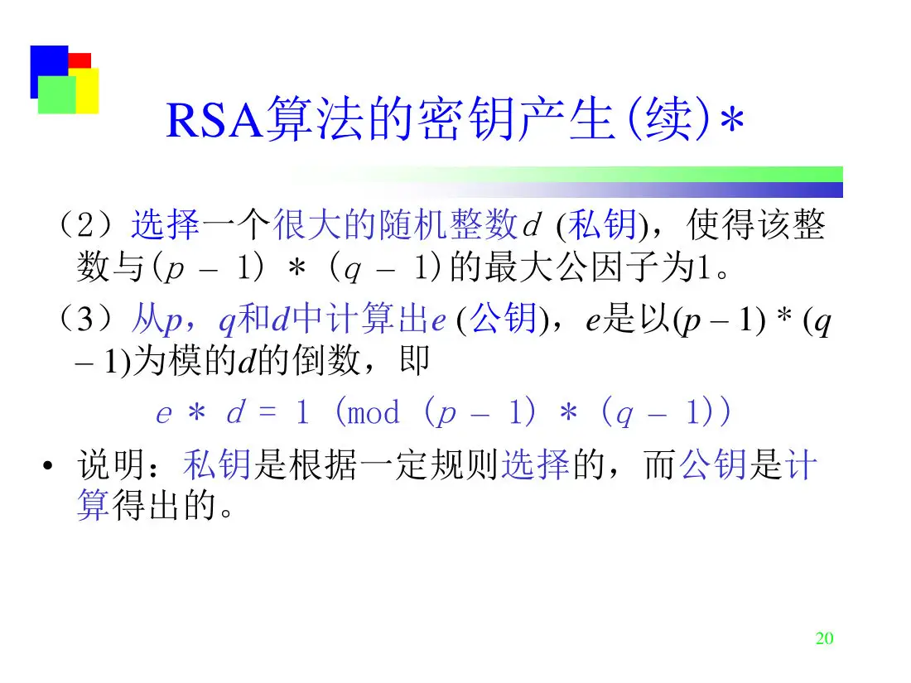

原文：

RSA算法的密钥产生(续)\*

（2）选择一个很大的随机整数 $d$ (私钥)，使得该整数与 $( p \mathrm { ~ - ~ } 1 ) \ast ( q \mathrm { ~ - ~ } 1 )$ 的最大公因子为1。

（3）从 $\mathbf { \psi } _ { \mathbf { \psi } } \circ \mathbf { \psi } _ { \mathbf { \psi } } q \mathbf { \psi } _ { \mathbf { \psi } }$ 和 $d$ 中计算出 $e$ (公钥)，e是以 $( p - 1 ) ^ { * } ( q$ – 1)为模的 $d$ 的倒数，即

$$
e * d = 1 (\mathrm{mod} (p - 1) * (q - 1))
$$

• 说明：私钥是根据一定规则选择的，而公钥是计算得出的。

1

20

### RSA算法的证明

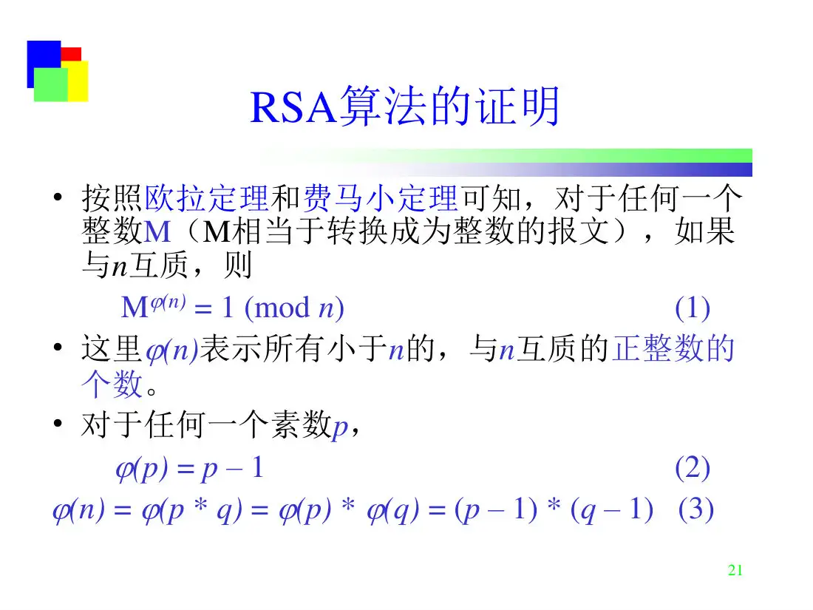

原文：

RSA算法的证明

• 按照欧拉定理和费马小定理可知，对于任何一个整数M（M相当于转换成为整数的报文），如果与n互质，则

$$
\mathbf {M} ^ {\varphi (n)} = 1 \pmod {n}\tag{1}
$$

• 这里 $\varphi ( n )$ 表示所有小于n的，与n互质的正整数的个数。

• 对于任何一个素数 $\dot { \boldsymbol { p } }$

$$
\varphi (p) = p - 1\tag{2}
$$

$$
\varphi (n) = \varphi (p * q) = \varphi (p) * \varphi (q) = (p - 1) * (q - 1)\tag{3}
$$

21

### RSA算法的证明(续1)

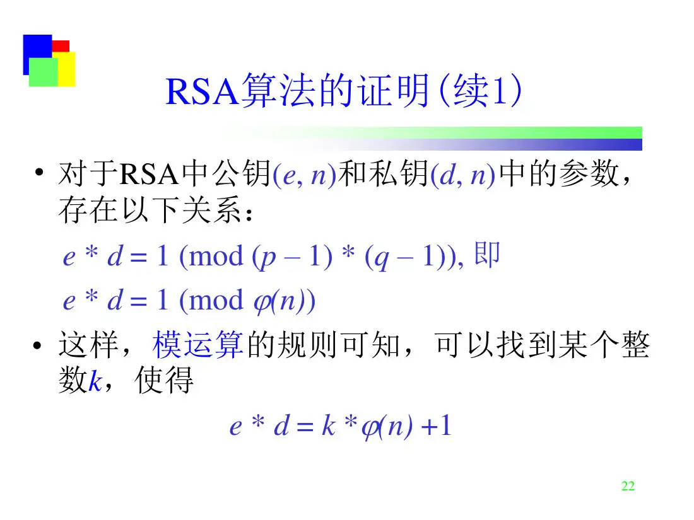

原文：

RSA算法的证明(续1)

• 对于RSA中公钥(e, n)和私钥 $( d , n )$ 中的参数，存在以下关系：

$e ^ { \ast } d = 1 ( { \bmod { \left( p - 1 \right) } } ^ { \ast } ( q - 1 ) )$ , 即 $e ^ { * } d = 1 ( { \bmod { \varphi ( n ) } } )$

• 这样，模运算的规则可知，可以找到某个整数k，使得

$$
e ^ {*} d = k ^ {*} \varphi (n) + 1
$$

1

22

### RSA算法的证明(续2)

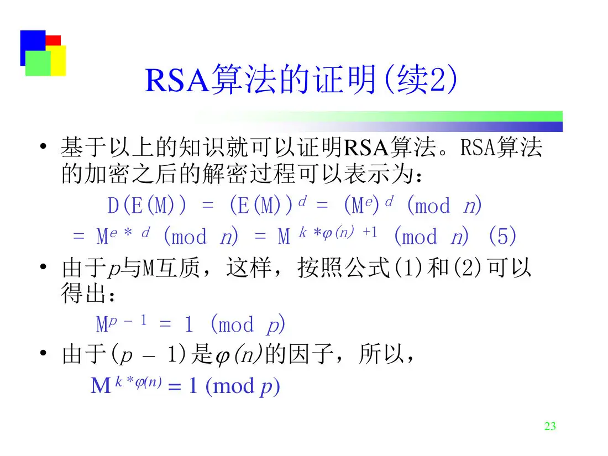

原文：

RSA算法的证明(续2)

• 基于以上的知识就可以证明RSA算法。RSA算法的加密之后的解密过程可以表示为：

$$
\begin{array}{r l} \mathrm{D(E(M))} & = (\mathrm{E(M)}) ^ {d} = (\mathrm{M} ^ {e}) ^ {d} (\mathrm{mod} n) \\ & = \mathrm{M} ^ {e * d} (\mathrm{mod} n) = \mathrm{M} ^ {k * \varphi (n) + 1} (\mathrm{mod} n) \end{array} \tag {5}
$$

• 由于 $p$ 与M互质，这样，按照公式(1)和(2)可以得出：

$$
\mathrm{M} ^ {p - 1} = 1 \pmod {p}
$$

• 由于 $( p \ : - \ : 1 )$ 是 $\varphi \left( n \right)$ 的因子，所以，

$$
\mathbf {M} ^ {k * \varphi (n)} = 1 (\mathrm{mod} p)
$$

1

23

### RSA算法的证明(续2)

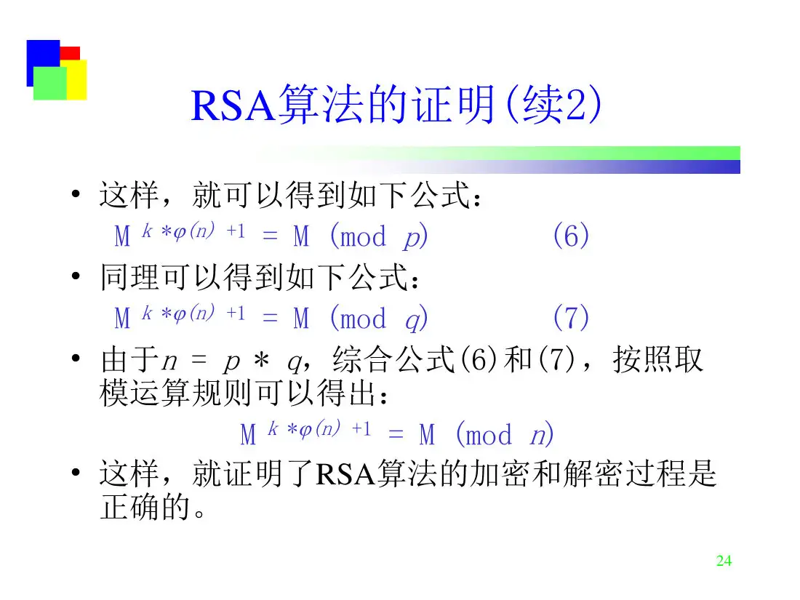

原文：

RSA算法的证明(续2)

• 这样，就可以得到如下公式：

$\mathbb { M } \ ^ { k } \ast \varphi \left( n \right) \ + 1 \ = \ \mathbb { M } \ \left( \mathrm { m o d } \ p \right)$ (6)

• 同理可以得到如下公式：

$$
M ^ {k} * \varphi (n) + 1 = M (\mathrm{mod} q)\tag{7}
$$

• 由于 $n = p * q$ ，综合公式(6)和(7)，按照取模运算规则可以得出：

$$
M ^ {k} * \varphi (n) + 1 = M (\mathrm{mod} n)
$$

• 这样，就证明了RSA算法的加密和解密过程是正确的。

1

24

### RSA加密和解密算法的软件实现\

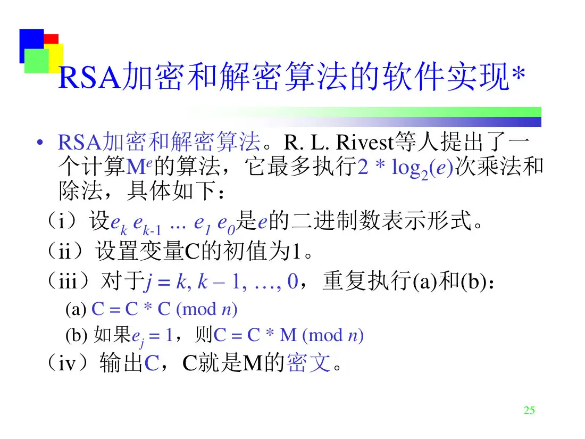

原文：

RSA加密和解密算法的软件实现\*

• RSA加密和解密算法。R. L. Rivest等人提出了一个计算 $\mathbf { M } ^ { e }$ 的算法，它最多执行 $2 \ ^ { * } \log _ { 2 } ( e )$ 次乘法和除法，具体如下：

（i）设 $e _ { k } e _ { k - 1 } \ldots e _ { I } e _ { O }$ 是 $e$ 的二进制数表示形式。

（ii）设置变量C的初值为1。

（iii）对于 $j = k , k - 1 , . . . , 0$ ，重复执行(a)和(b)：

(a) ${ \mathrm { C } } = { \mathrm { C } } * { \mathrm { C } } \left( { \mathrm { m o d } } n \right)$

(b) 如果 $e _ { j } = 1$ ，则 $\mathbf { C } = \mathbf { C } * \mathbf { M } ( \mathbf { m o d } n )$

（iv）输出C，C就是M的密文。

25

### RSA密钥的选择要求\

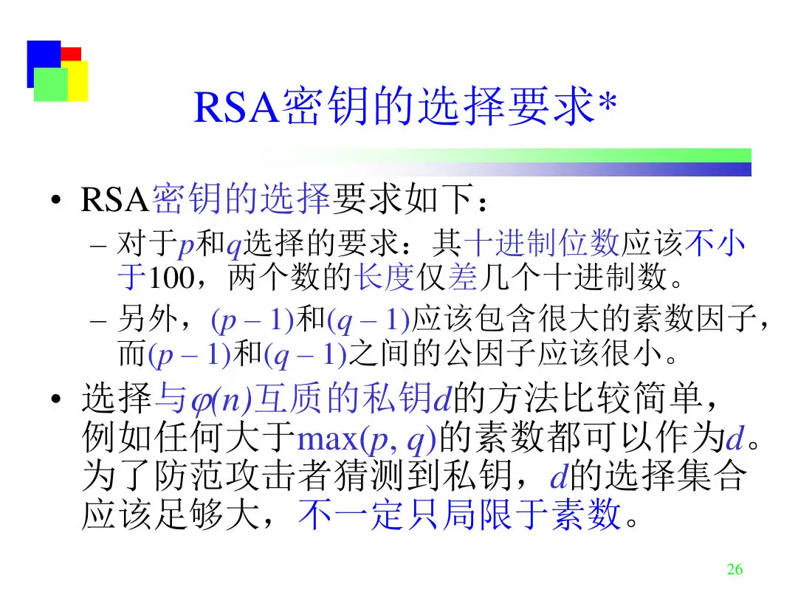

原文：

RSA密钥的选择要求\*

• RSA密钥的选择要求如下：

– 对于p和q选择的要求：其十进制位数应该不小于100，两个数的长度仅差几个十进制数。

– 另外，(p – 1)和(q – 1)应该包含很大的素数因子，而(p – 1)和(q – 1)之间的公因子应该很小。

• 选择与(n)互质的私钥d的方法比较简单，例如任何大于max(p, q)的素数都可以作为d。为了防范攻击者猜测到私钥，d的选择集合应该足够大，不一定只局限于素数。

1

26

### RSA公钥的计算\

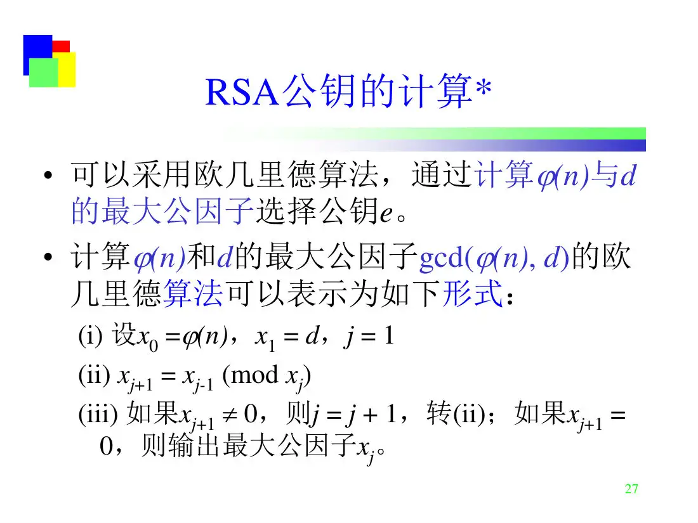

原文：

RSA公钥的计算\*

• 可以采用欧几里德算法，通过计算 $\varphi ( n )$ 与d的最大公因子选择公钥e。

• 计算 $\varphi ( n )$ 和d的最大公因子gcd((n), d)的欧几里德算法可以表示为如下形式：

(i) 设 $x _ { 0 } = \varphi ( n ) , x _ { 1 } = d , j = 1$

(ii) $x _ { j + 1 } = x _ { j - 1 } { \mathrm { ~ ( m o d ~ } } x _ { j } { \mathrm { ) } }$

(iii) 如果 $x _ { j + 1 } \neq 0$ ，则 $j = j + 1$ ，转(ii)；如果 $x _ { j + 1 } =$ 0，则输出最大公因子x。 $x _ { j }$

1

27

### RSA公钥的计算(续1) \

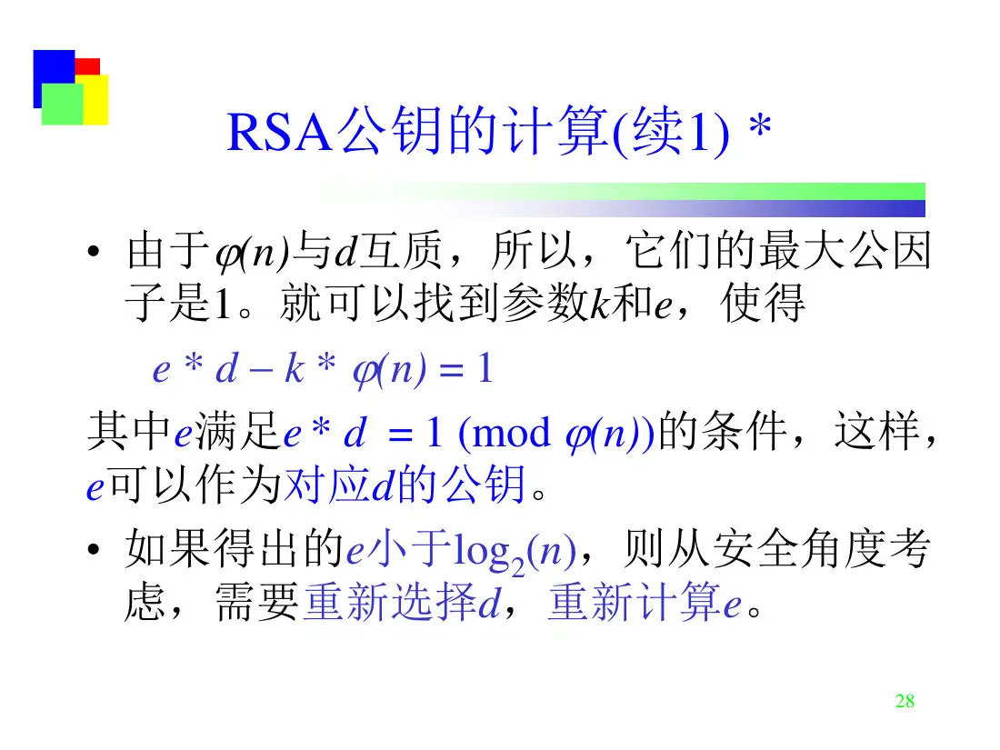

原文：

RSA公钥的计算(续1) \*

• 由于 $\varphi ( n )$ 与d互质，所以，它们的最大公因子是1。就可以找到参数k和e，使得

$$
e ^ {*} d - k ^ {*} \varphi (n) = 1
$$

其中e满足 $e ^ { * } d = 1 ( { \bmod { \varphi ( n ) } } )$ 的条件，这样，e可以作为对应d的公钥。

• 如果得出的e小于 $\log _ { 2 } ( n )$ ，则从安全角度考虑，需要重新选择d，重新计算 $\mathbf { \nabla } _ { Q }$ 。

1

28

### RSA算法举例 (1-1)\

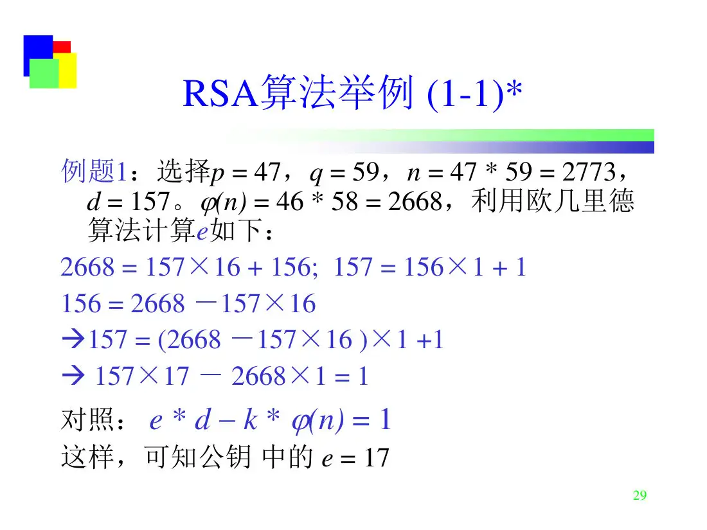

原文：

RSA算法举例 (1-1)\*

1

29

### RSA算法举例 (1-2)\

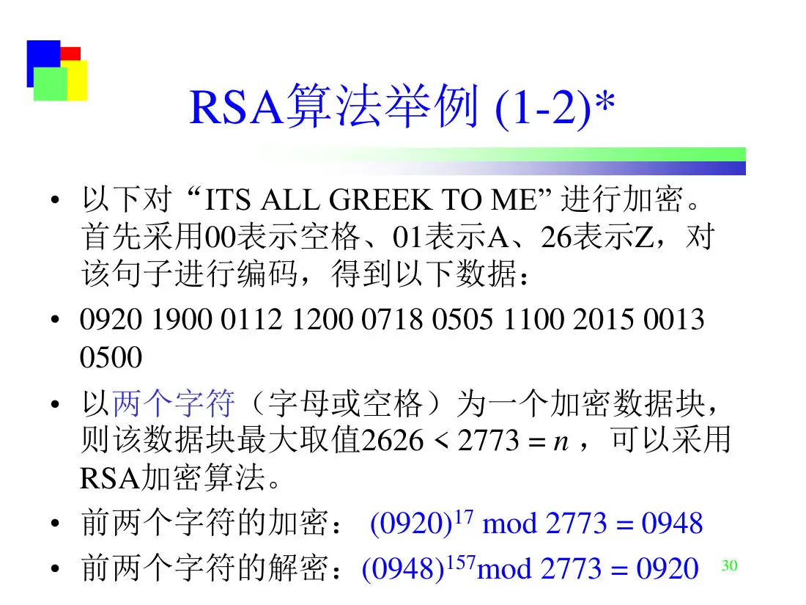

原文：

RSA算法举例 (1-2)\*

• 以下对“ITS ALL GREEK TO ME” 进行加密。首先采用00表示空格、01表示A、26表示Z，对该句子进行编码，得到以下数据：

• 0920 1900 0112 1200 0718 0505 1100 2015 00130500

• 以两个字符（字母或空格）为一个加密数据块，则该数据块最大取值2626 < 2773 = n ，可以采用RSA加密算法。

• 前两个字符的加密： (0920)17 mod 2773 = 0948

30• 前两个字符的解密：(0948)157mod 2773 = 0920

### RSA加密算法举例(2-1)\

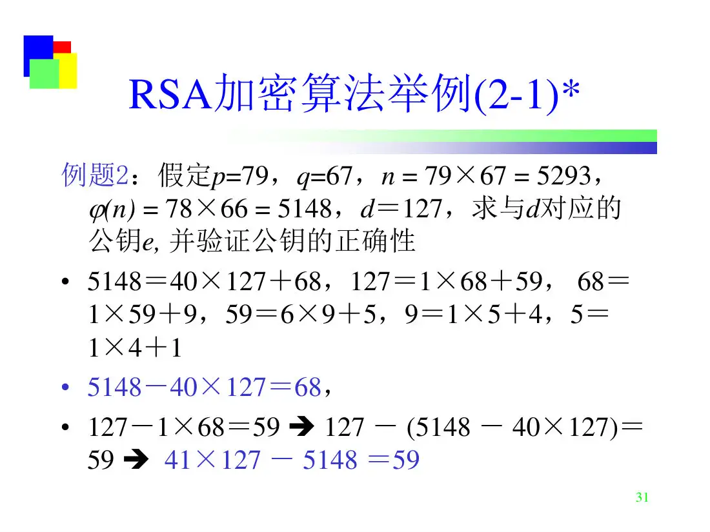

原文：

RSA加密算法举例(2-1)\*

例题2：假定 $p { = } 7 9$ $q \mathbf { = } 6 7 , n = 7 9 \times 6 7 = 5 2 9 3$ $\varphi ( n ) = 7 8 \times 6 6 = 5 1 4 8 , d = 1 2 7$ ，求与 $d \mathbb { X }$ 对应的公钥 $e ,$ 并验证公钥的正确性

$5 1 4 8 = 4 0 \times 1 2 7 + 6 8 , 1 2 7 = 1 \times 6 8 + 5 9 , 6 8 =$ $1 \times 5 9 + 9 , 5 9 = 6 \times 9 + 5 , 9 = 1 \times 5 + 4 , 5 =$ 1×4＋1

• $5 1 4 8 - 4 0 \times 1 2 7 = 6 8$ 7

$1 2 7 - 1 \times 6 8 = 5 9  1 2 7 - ( 5 1 4 8 - 4 0 \times 1 2 7 ) =$ $5 9  4 1 \times 1 2 7 - 5 1 4 8 = 5 9$

31

### RSA加密算法举例(2-2)\

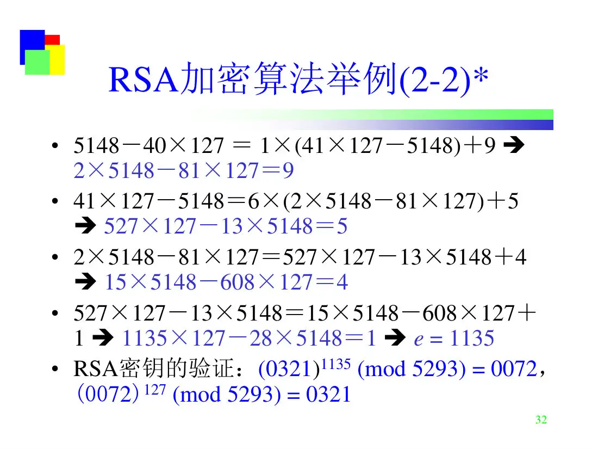

原文：

RSA加密算法举例(2-2)\*

• 5148－40×127 ＝ 1×(41×127－5148)＋9 ➔2×5148－81×127＝9

$4 1 \times 1 2 7 - 5 1 4 8 = 6 \times ( 2 \times 5 1 4 8 - 8 1 \times 1 2 7 ) + 5$ ➔ 527×127－13×5148＝5

• 2×5148－81×127＝527×127－13×5148＋4 ➔ 15×5148－608×127＝4

• 527×127－13×5148＝15×5148－608×127＋ 1 ➔ 1135×127－28×5148＝1 ➔ e = 1135

• RSA密钥的验证：(0321)1135 (mod 5293) = 0072， (0072)127 (mod 5293) = 0321

32

### RSA加密算法举例(3-1)

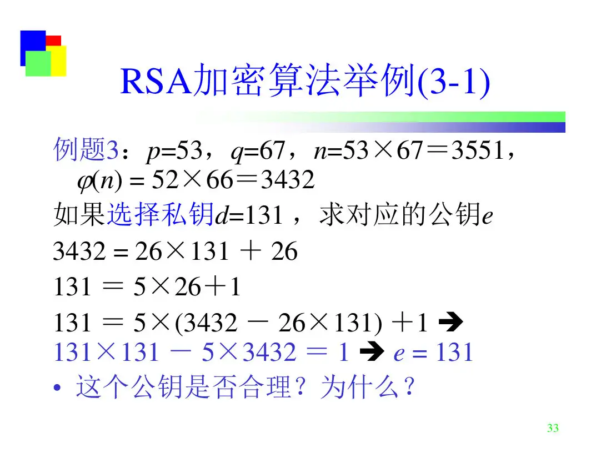

原文：

RSA加密算法举例(3-1)

例题3： $p { = } 5 3 , q { = } 6 7 , n { = } 5 3 { \times } 6 7 { = } 3 5 5 1$ 9

$$
\varphi (n) = 5 2 \times 6 6 = 3 4 3 2
$$

如果选择私钥 $d { = } 1 3 1$ ，求对应的公钥 $e$

$$
3 4 3 2 = 2 6 \times 1 3 1 + 2 6
$$

$$
1 3 1 = 5 \times 2 6 + 1
$$

$$
1 3 1 = 5 \times (3 4 3 2 - 2 6 \times 1 3 1) + 1 \rightarrow
$$

$$
1 3 1 \times 1 3 1 - 5 \times 3 4 3 2 = 1 \rightarrow e = 1 3 1
$$

• 这个公钥是否合理？为什么？

33

### RSA加密算法举例(3-2)

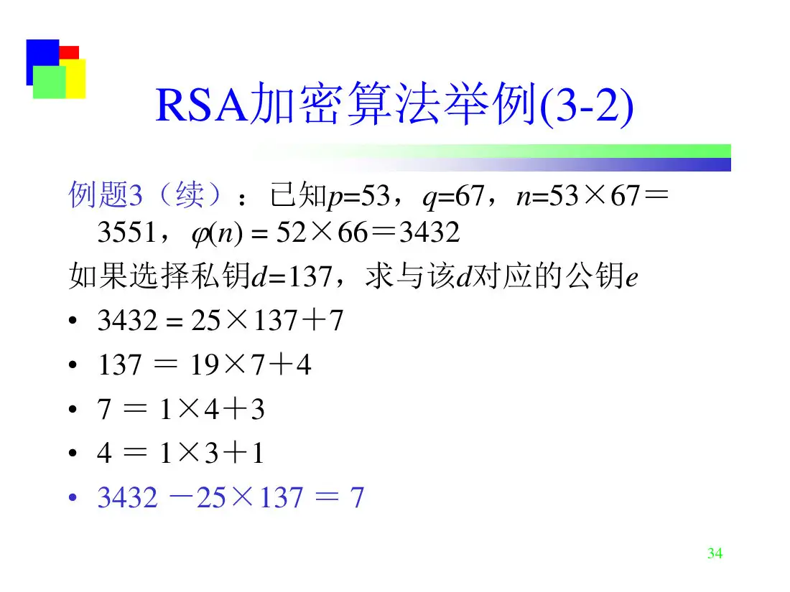

原文：

RSA加密算法举例(3-2)

例题3（续）：已知 $\scriptstyle { p = 5 3 }$ $q { = } 6 7$ $n { = } 5 3 \times 6 7 { = }$

3551， $\varphi ( n ) = 5 2 \times 6 6 { = } 3 4 3 2$

如果选择私钥d=137，求与该d对应的公钥 $e$

$3 4 3 2 = 2 5 \times 1 3 7 + 7$

• $1 3 7 = 1 9 \times 7 + 4$

• $7 = 1 \times 4 + 3$

• $4 = 1 \times 3 + 1$

● $3 4 3 2 - 2 5 \times 1 3 7 = 7$

7

34

### RSA加密算法举例(3-3)

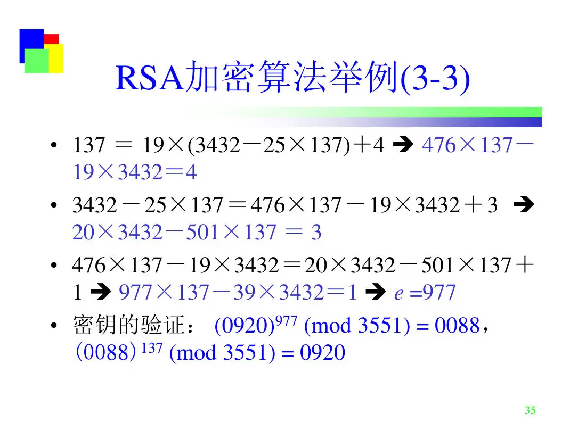

原文：

RSA加密算法举例(3-3)

• 137 ＝ 19×(3432－25×137)＋4 ➔ 476×137－19×3432＝4

• 3432－25×137＝476×137－19×3432＋3 ➔20×3432－501×137 ＝ 3

• 476×137－19×3432＝20×3432－501×137＋ 1 ➔ 977×137－39×3432＝1 ➔ e =977

密钥的验证： (0920)977 (mod 3551) = 0088， (0088)137 (mod 3551) = 0920

35

### RSA算法分析\

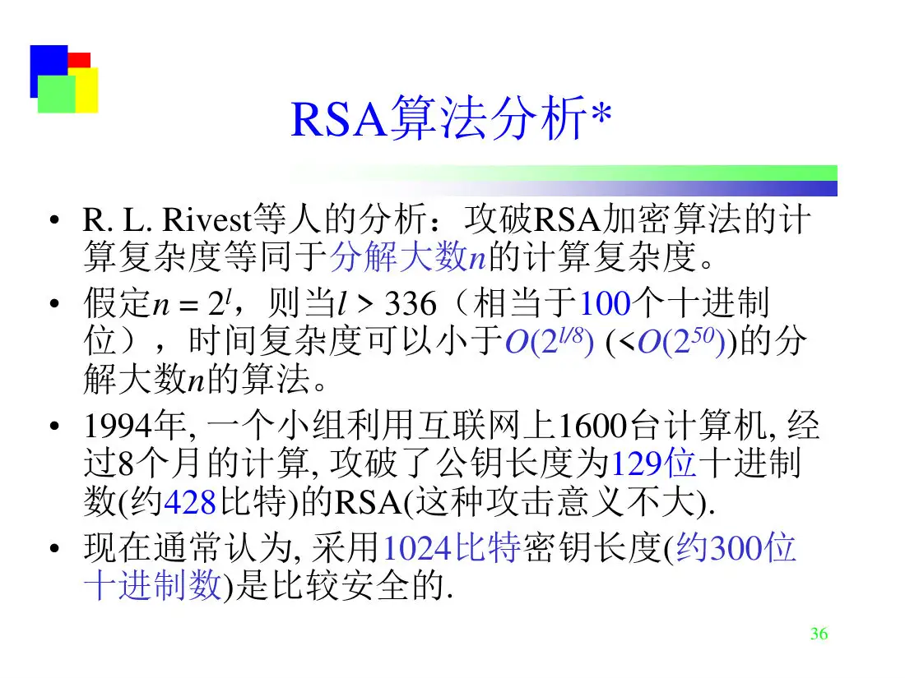

原文：

RSA算法分析\*

• R. L. Rivest等人的分析：攻破RSA加密算法的计算复杂度等同于分解大数n的计算复杂度。

• 假定n = 2l，则当l > 336（相当于100个十进制位），时间复杂度可以小于O(2l/8) (<O(250))的分解大数n的算法。

• 1994年, 一个小组利用互联网上1600台计算机, 经过8个月的计算, 攻破了公钥长度为129位十进制数(约428比特)的RSA(这种攻击意义不大).

• 现在通常认为, 采用1024比特密钥长度(约300位十进制数)是比较安全的.

7

36

### Diffie-Hellman密钥生成算法\

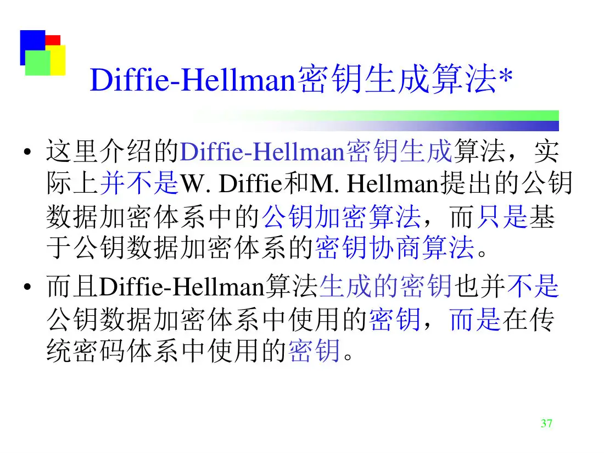

原文：

Diffie-Hellman密钥生成算法\*

• 这里介绍的Diffie-Hellman密钥生成算法，实际上并不是W. Diffie和M. Hellman提出的公钥数据加密体系中的公钥加密算法，而只是基于公钥数据加密体系的密钥协商算法。

• 而且Diffie-Hellman算法生成的密钥也并不是公钥数据加密体系中使用的密钥，而是在传统密码体系中使用的密钥。

37

### Diffie-Hellman密钥生成算法(续)\

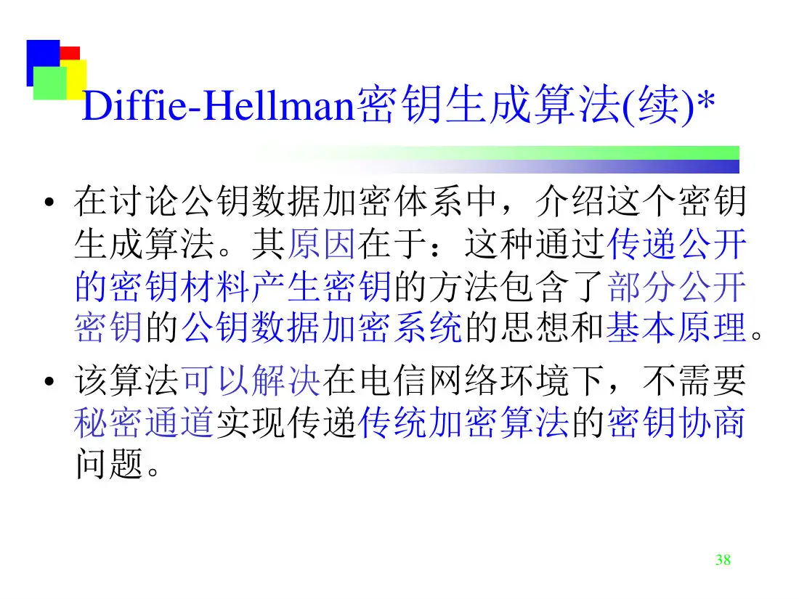

原文：

Diffie-Hellman密钥生成算法(续)\*

• 在讨论公钥数据加密体系中，介绍这个密钥生成算法。其原因在于：这种通过传递公开的密钥材料产生密钥的方法包含了部分公开密钥的公钥数据加密系统的思想和基本原理。

• 该算法可以解决在电信网络环境下，不需要秘密通道实现传递传统加密算法的密钥协商问题。

38

### Diffie-Hellman算法的加密过程\

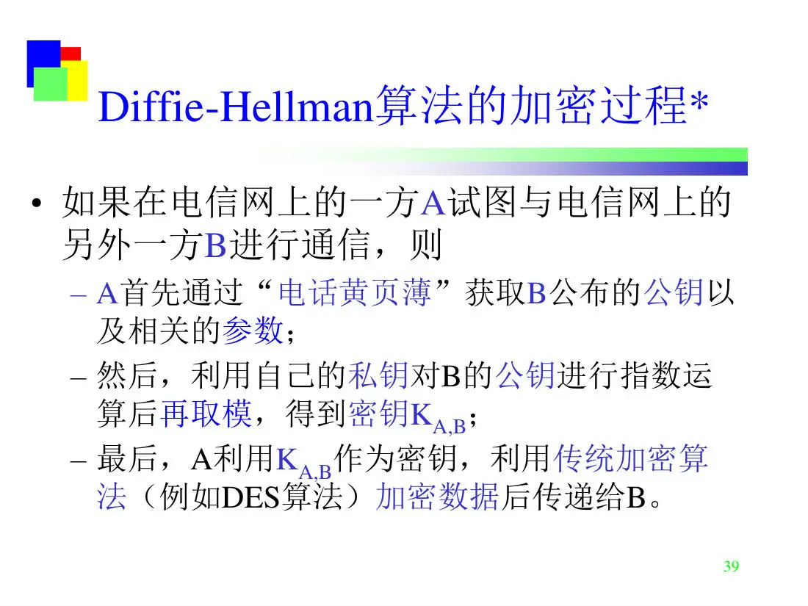

原文：

Diffie-Hellman算法的加密过程\*

• 如果在电信网上的一方A试图与电信网上的另外一方B进行通信，则

– A首先通过“电话黄页薄”获取B公布的公钥以及相关的参数；

– 然后，利用自己的私钥对B的公钥进行指数运算后再取模，得到密钥 $\mathrm { K } _ { \mathrm { A , B } }$

– 最后，A利用 $\mathrm { K } _ { \mathrm { A . B } }$ 作为密钥，利用传统加密算法（例如DES算法）加密数据后传递给B。

7

39

### Diffie-Hellman算法的解密过程\

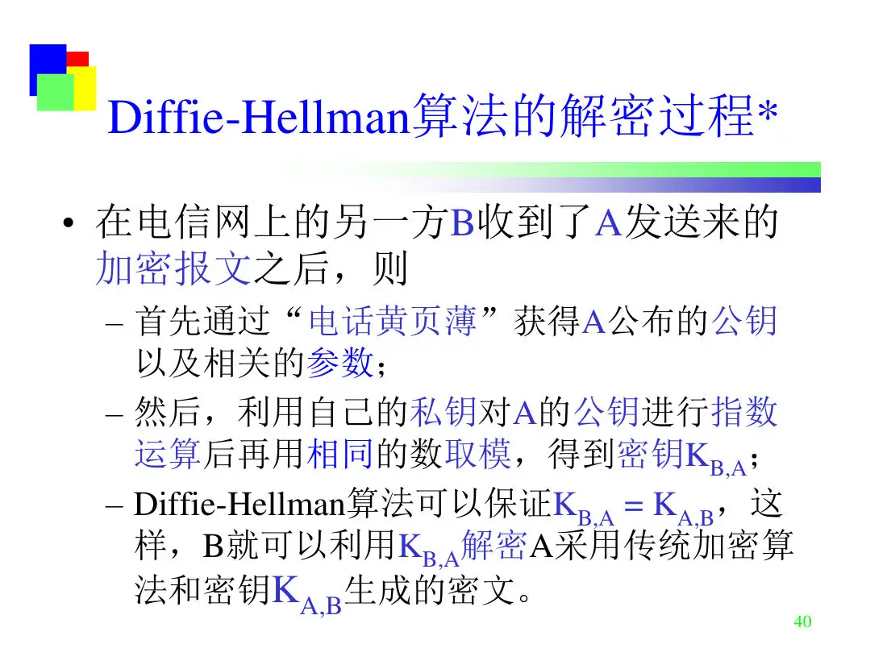

原文：

Diffie-Hellman算法的解密过程\*

• 在电信网上的另一方B收到了A发送来的加密报文之后，则

– 首先通过“电话黄页薄”获得A公布的公钥以及相关的参数；

– 然后，利用自己的私钥对A的公钥进行指数运算后再用相同的数取模，得到密钥 $\mathrm { K } _ { \mathrm { B } , \mathrm { A } } ;$

– Diffie-Hellman算法可以保证 ${ \mathrm { K } } _ { \mathrm { B , A } } = { \mathrm { K } } _ { \mathrm { A , B } } ,$ 这样，B就可以利用 $\mathrm { K } _ { \mathrm { B , A } }$ 解密A采用传统加密算法和密钥 $\mathrm { K } _ { \mathrm { A , B } }$ 生成的密文。

1

40

### Diffie-Hellman算法基本过程\

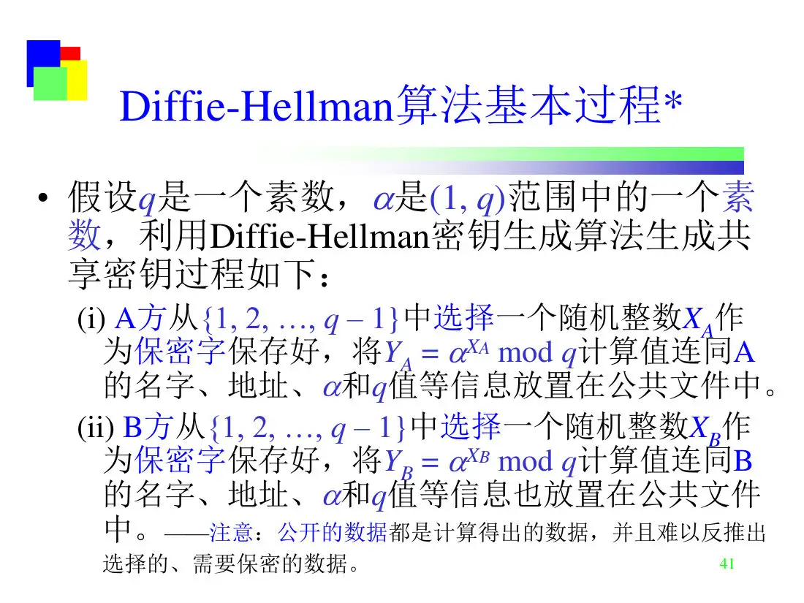

原文：

Diffie-Hellman算法基本过程\*

• 假设 $q$ 是一个素数， $\alpha$ 是 $( 1 , q )$ 范围中的一个素数，利用Diffie-Hellman密钥生成算法生成共享密钥过程如下：

(i) A方从 $\{ 1 , 2 , . . . , q - 1 \}$ 中选择一个随机整数 $X _ { A }$ 作为保密字保存好，将 $Y _ { \scriptscriptstyle A } = \alpha ^ { X _ { A } } \mathrm { m o d } q$ 计算值连同A的名字、地址、和 $q \prime$ 值等信息放置在公共文件中。

(ii) B方从 $\{ 1 , 2 , . . . , q - 1 \}$ 中选择一个随机整数 $X _ { B }$ 作为保密字保存好，将 $Y _ { B } = \alpha ^ { X B } \mathrm { m o d } q$ 计算值连同B的名字、地址、 $\alpha$ 和 $q \prime$ 值等信息也放置在公共文件中。——注意：公开的数据都是计算得出的数据，并且难以反推出选择的、需要保密的数据。 41

### Diffie-Hellman算法基本过程(续)\

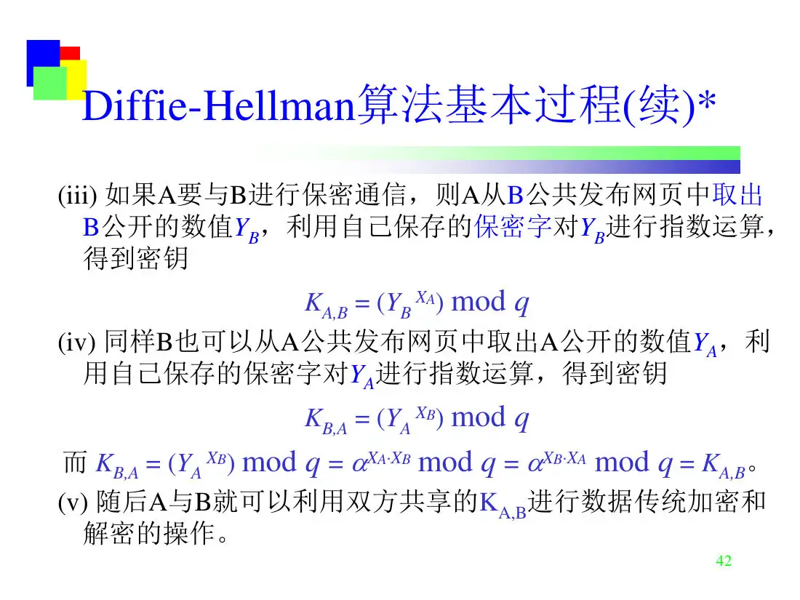

原文：

Diffie-Hellman算法基本过程(续)\*

(iii) 如果A要与B进行保密通信，则A从B公共发布网页中取出B公开的数值 $Y _ { B } ,$ ，利用自己保存的保密字对 $Y _ { B }$ 进行指数运算，得到密钥

$$
K _ {A, B} = (Y _ {B} ^ {X _ {A}}) \bmod q
$$

(iv) 同样B也可以从A公共发布网页中取出A公开的数值 $Y _ { A }$ ，利用自己保存的保密字对 $Y _ { A }$ 进行指数运算，得到密钥

$$
K _ {B, A} = (Y _ {A} ^ {X _ {B}}) \bmod q
$$

而 $K _ { B , A } = ( Y _ { A } { } ^ { X B } )$ mod $q = \alpha ^ { X A \cdot X _ { B } }$ mod $q = \alpha ^ { X B \cdot X _ { A } }$ mod $q = K _ { A , B ^ { \circ } }$

(v) 随后A与B就可以利用双方共享的 ${ \mathrm { K } } _ { \mathrm { A , B } }$ 进行数据传统加密和解密的操作。

42

### Diffie-Hellman算法举例\

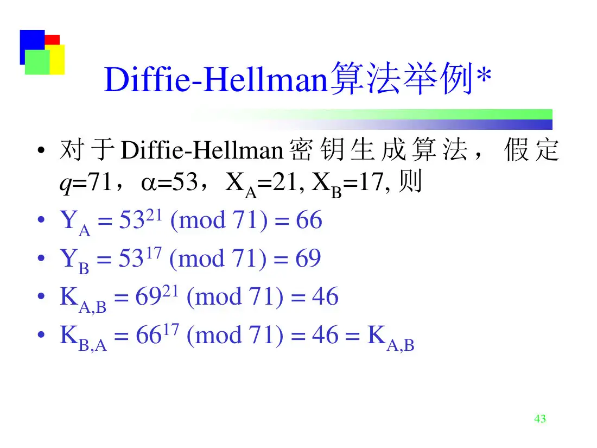

原文：

Diffie-Hellman算法举例\*

• 对于Diffie-Hellman密钥生成算法，假定$q { = } 7 1$ ，=53， $\mathrm { X _ { A } } { = } 2 1 , \mathrm { X _ { B } } { = } 1 7$ , 则

$\mathrm { Y _ { A } } = 5 3 ^ { 2 1 }$ (mod 71) = 66

$\mathrm { Y } _ { \mathrm { B } } = 5 3 ^ { 1 7 }$ (mod 71) = 69

$\mathrm { K _ { A , B } } = 6 9 ^ { 2 1 }$ (mod 71) = 46

$\mathrm { K _ { B , A } } = 6 6 ^ { 1 7 }$ (mod $7 1 ) = 4 6 = \mathrm { K } _ { \mathrm { A , B } }$

43

### Diffie-Hellman算法安全性分析

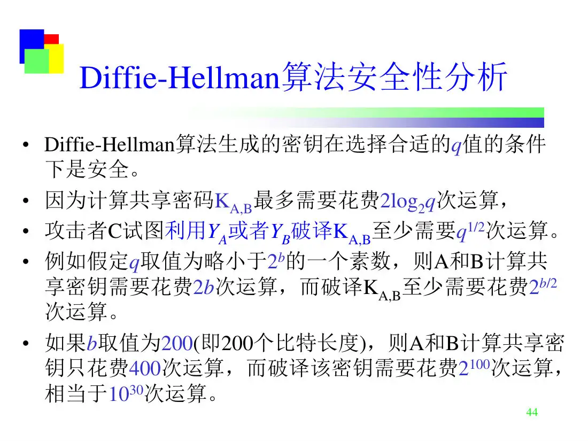

原文：

Diffie-Hellman算法安全性分析

• Diffie-Hellman算法生成的密钥在选择合适的 $q \prime$ 值的条件 下是安全。

• 因为计算共享密码 $\mathrm { K } _ { \mathrm { A , B } }$ 最多需要花费 $2 \mathrm { l o g } _ { 2 } q$ 次运算，

• 攻击者C试图利用 $Y _ { A }$ 或者 $Y _ { B }$ 破译 $\mathrm { K } _ { \mathrm { A , B } }$ 至少需要 $q ^ { 1 / 2 }$ 次运算。

• 例如假定 $q$ 取值为略小于2b的一个素数，则A和B计算共享密钥需要花费2b次运算，而破译 ${ \mathrm { K } } _ { \mathrm { A , B } }$ 至少需要花费 $2 ^ { b / 2 }$ 次运算。

• 如果b取值为200(即200个比特长度)，则A和B计算共享密钥只花费400次运算，而破译该密钥需要花费2100次运算，相当于 $1 0 ^ { 3 0 }$ 次运算。

44

### 公钥数据加密体系与密钥管理

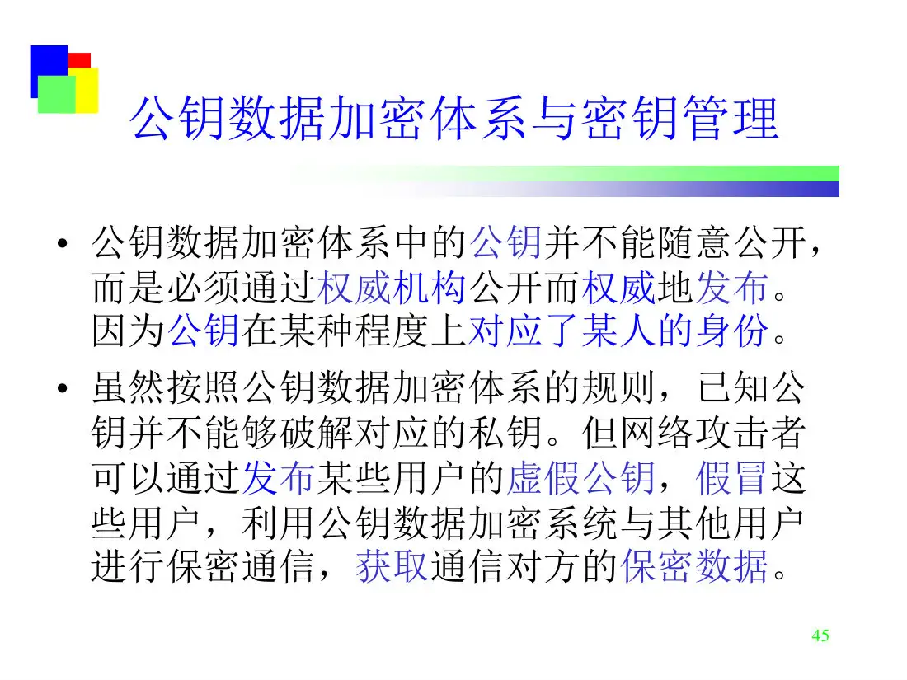

原文：

公钥数据加密体系与密钥管理

• 公钥数据加密体系中的公钥并不能随意公开，而是必须通过权威机构公开而权威地发布。因为公钥在某种程度上对应了某人的身份。

• 虽然按照公钥数据加密体系的规则，已知公钥并不能够破解对应的私钥。但网络攻击者可以通过发布某些用户的虚假公钥，假冒这些用户，利用公钥数据加密系统与其他用户进行保密通信，获取通信对方的保密数据。

45

### 公钥数据加密体系与密钥管理(续)

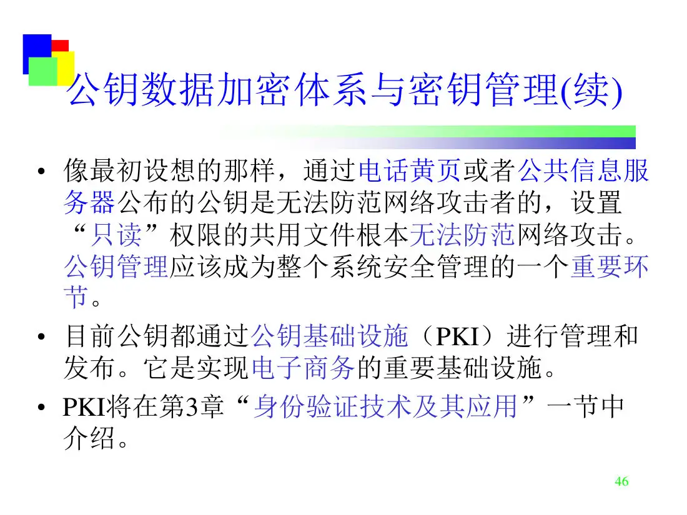

原文：

公钥数据加密体系与密钥管理(续)

• 像最初设想的那样，通过电话黄页或者公共信息服务器公布的公钥是无法防范网络攻击者的，设置“只读”权限的共用文件根本无法防范网络攻击。公钥管理应该成为整个系统安全管理的一个重要环节。

• 目前公钥都通过公钥基础设施（PKI）进行管理和发布。它是实现电子商务的重要基础设施。

• PKI将在第3章“身份验证技术及其应用”一节中介绍。

46

### 本章重点内容

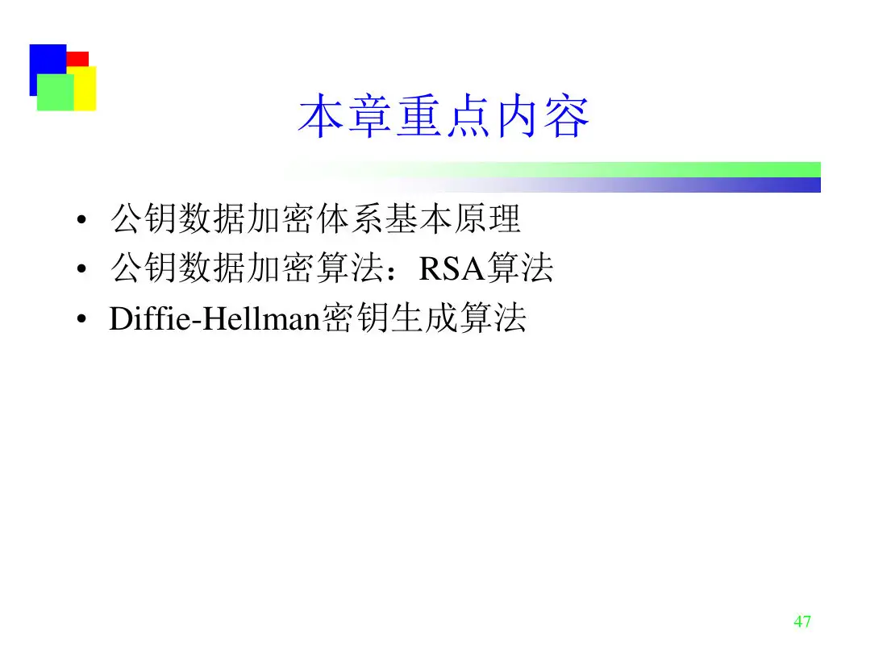

原文：

本章重点内容

• 公钥数据加密体系基本原理

• 公钥数据加密算法：RSA算法

• Diffie-Hellman密钥生成算法

47

### 第二章作业-传统数据加密

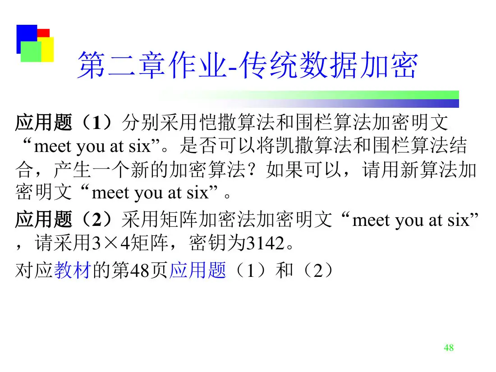

原文：

第二章作业-传统数据加密

应用题（1）分别采用恺撒算法和围栏算法加密明文“meet you at six”。是否可以将凯撒算法和围栏算法结合，产生一个新的加密算法？如果可以，请用新算法加密明文“meet you at six” 。

应用题（2）采用矩阵加密法加密明文“meet you at six” ，请采用3×4矩阵，密钥为3142。

对应教材的第48页应用题（1）和（2）

48

### 第二章作业-公钥数据加密

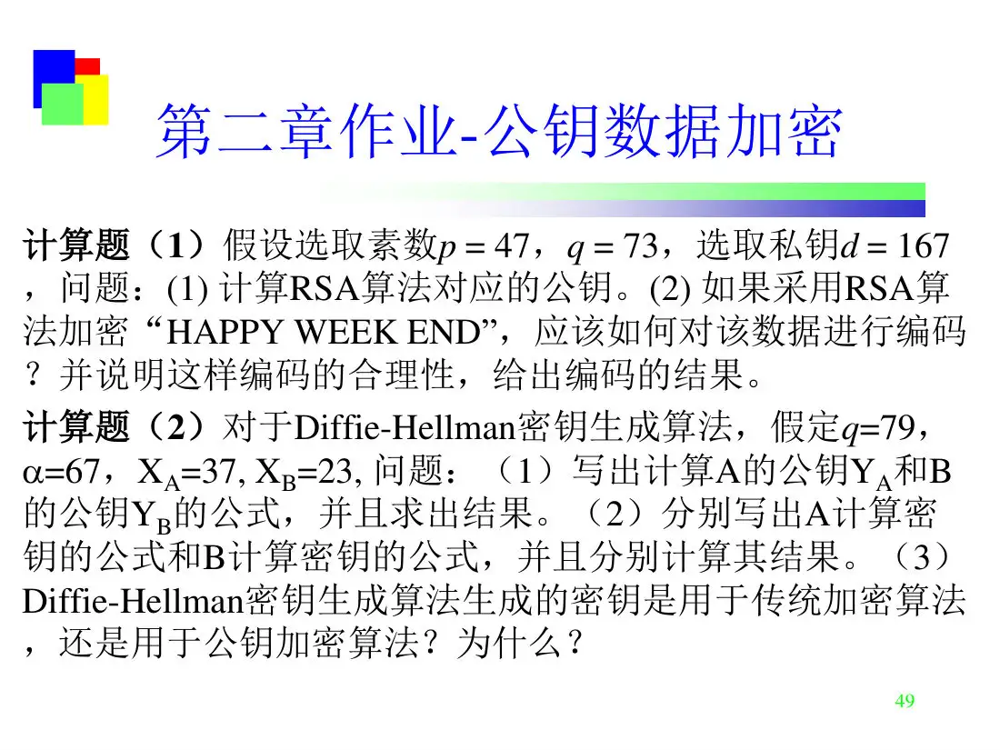

原文：

第二章作业-公钥数据加密

计算题（1）假设选取素数 $p = 4 7$ $q = 7 3$ ，选取私钥 $d = 1 6 7$ ，问题：(1) 计算RSA算法对应的公钥。(2) 如果采用RSA算法加密“HAPPY WEEK END”，应该如何对该数据进行编码？并说明这样编码的合理性，给出编码的结果。

计算题（2）对于Diffie-Hellman密钥生成算法，假定 $q { = } 7 9$ $\mathtt { { Q = 6 7 } }$ $\mathrm { X _ { A } } { = } 3 7 , \mathrm { X _ { B } } { = } 2 3$ , 问题：（1）写出计算A的公钥 $\mathrm { Y _ { A } }$ 和B的公钥 ${ \mathrm { Y } } _ { \mathrm { B } }$ 的公式，并且求出结果。（2）分别写出A计算密钥的公式和B计算密钥的公式，并且分别计算其结果。（3）Diffie-Hellman密钥生成算法生成的密钥是用于传统加密算法，还是用于公钥加密算法？为什么？

1-

49
