# 《信息安全技术》第2章 数据加密导论（课件）

原件的每一页，下面附识别出的文字。

### 第2章 数据加密导论(1)数据加密与密码学

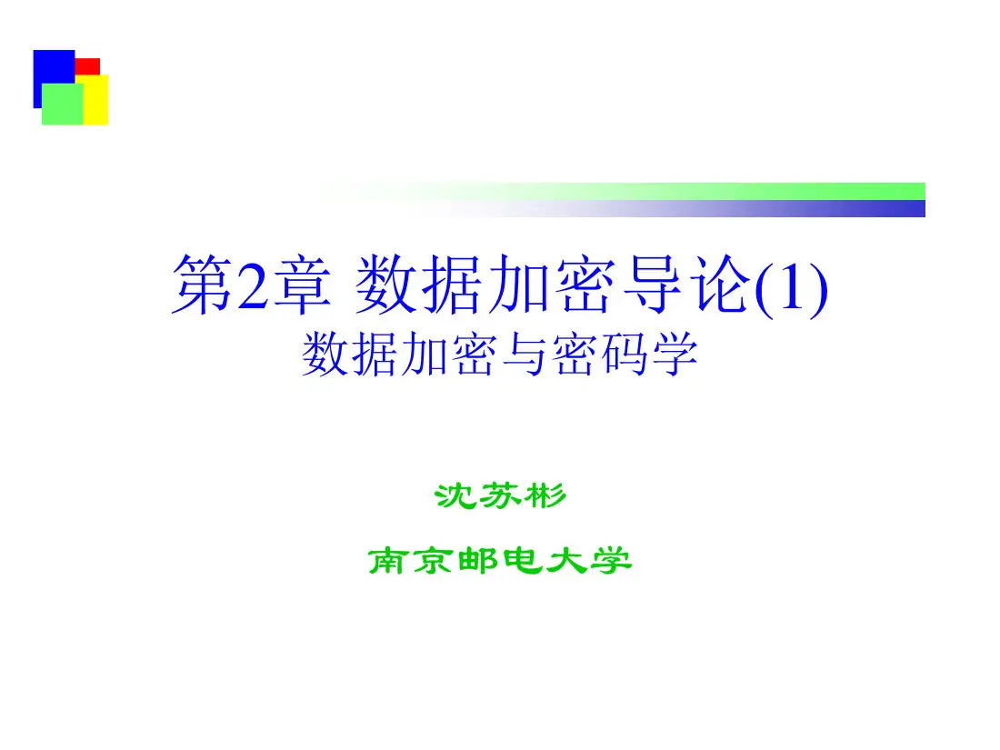

原文：

第2章 数据加密导论(1)数据加密与密码学

沈苏彬

南京邮电大学

### 本章的开场白

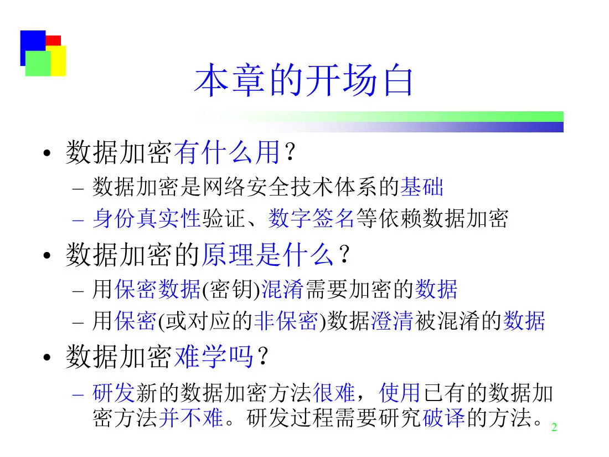

原文：

本章的开场白

• 数据加密有什么用？

– 数据加密是网络安全技术体系的基础

– 身份真实性验证、数字签名等依赖数据加密

• 数据加密的原理是什么？

– 用保密数据(密钥)混淆需要加密的数据

– 用保密(或对应的非保密)数据澄清被混淆的数据

• 数据加密难学吗？

– 研发新的数据加密方法很难，使用已有的数据加密方法并不难。研发过程需要研究破译的方法。

7

### 本节主要讨论的问题

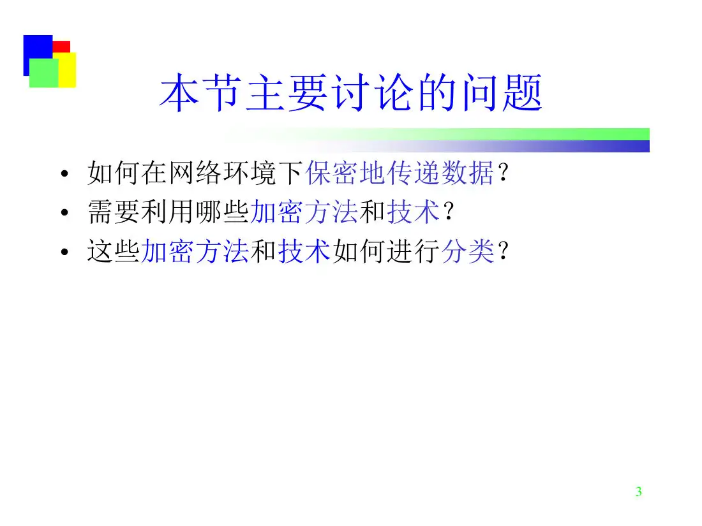

原文：

本节主要讨论的问题

• 如何在网络环境下保密地传递数据？

• 需要利用哪些加密方法和技术？

• 这些加密方法和技术如何进行分类？

3

### 关键知识点\

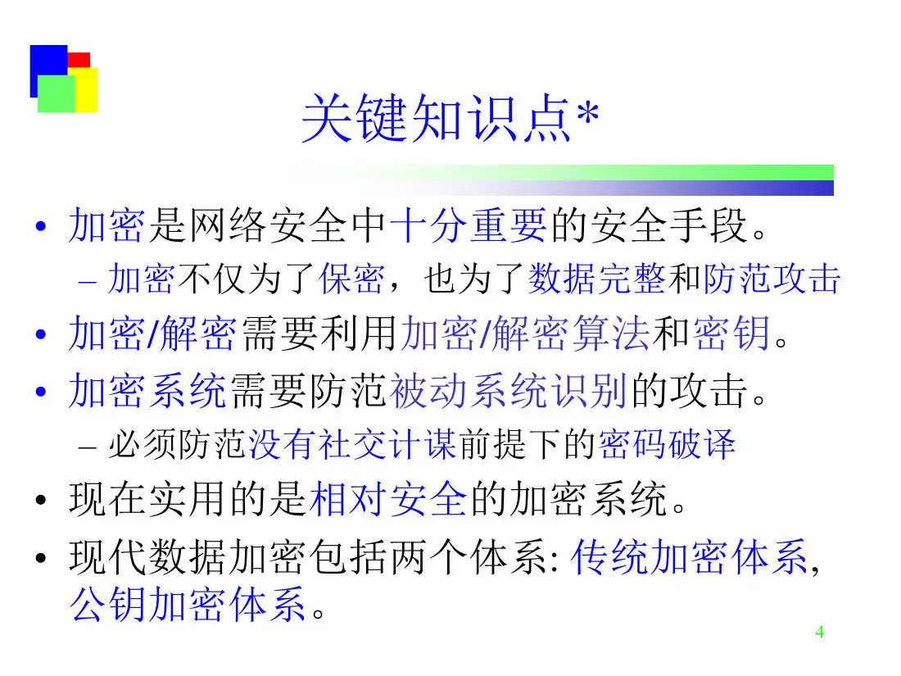

原文：

关键知识点\*

• 加密是网络安全中十分重要的安全手段。– 加密不仅为了保密，也为了数据完整和防范攻击

• 加密/解密需要利用加密/解密算法和密钥。

• 加密系统需要防范被动系统识别的攻击。– 必须防范没有社交计谋前提下的密码破译

• 现在实用的是相对安全的加密系统。

• 现代数据加密包括两个体系: 传统加密体系,公钥加密体系。

7

4

### 主要内容

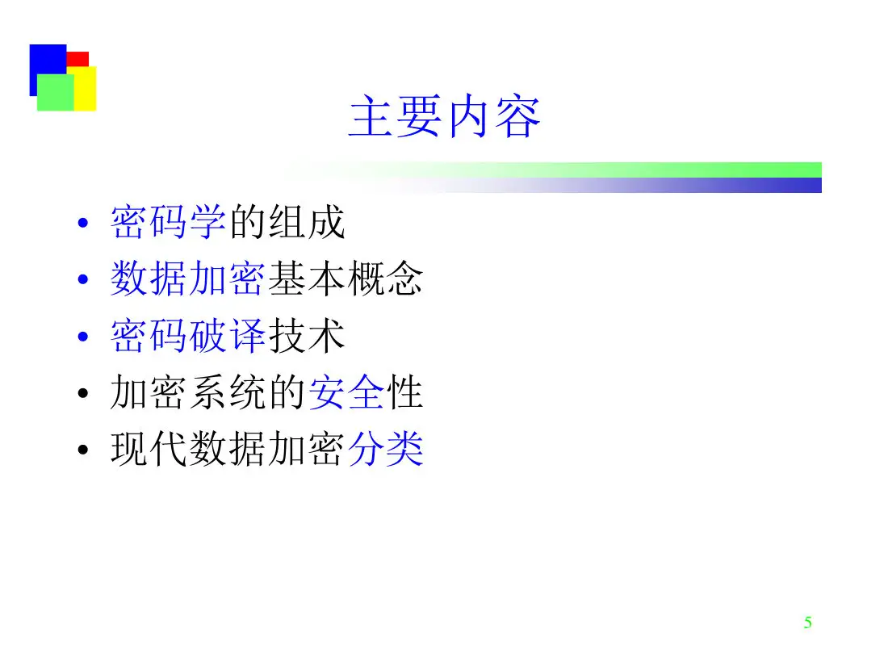

原文：

主要内容

• 密码学的组成

• 数据加密基本概念

• 密码破译技术

• 加密系统的安全性

• 现代数据加密分类

5

### 密码学的组成\

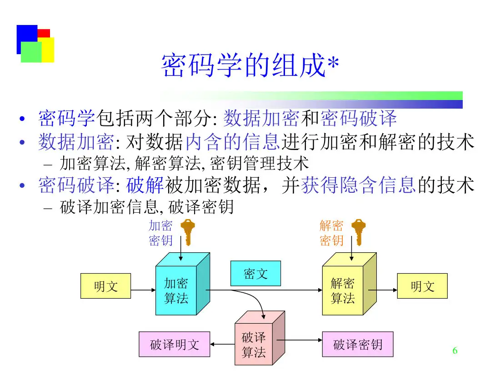

原文：

密码学的组成\*

• 密码学包括两个部分: 数据加密和密码破译

• 数据加密: 对数据内含的信息进行加密和解密的技术– 加密算法, 解密算法, 密钥管理技术

• 密码破译: 破解被加密数据，并获得隐含信息的技术– 破译加密信息, 破译密钥

6

### 密码破译可验证加密的严密性

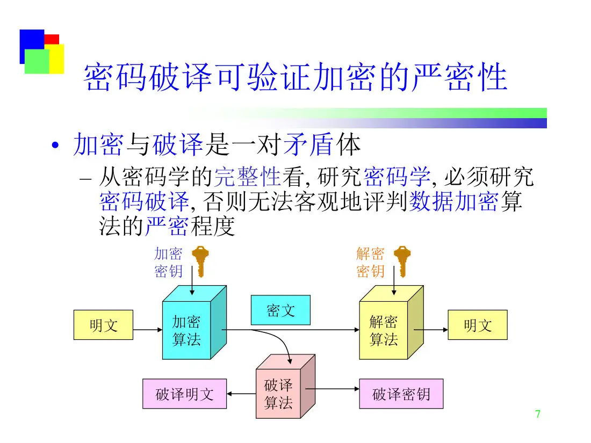

原文：

密码破译可验证加密的严密性

• 加密与破译是一对矛盾体

从密码学的完整性看, 研究密码学, 必须研究密码破译, 否则无法客观地评判数据加密算法的严密程度

7

### 数据加密基本概念\

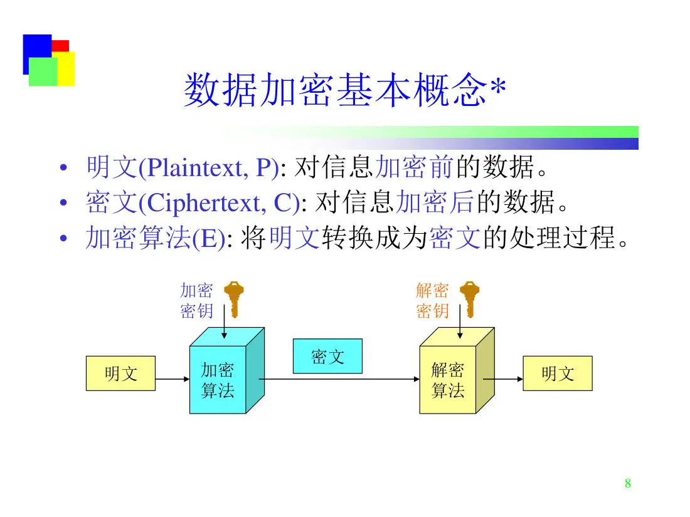

原文：

数据加密基本概念\*

• 明文(Plaintext, P): 对信息加密前的数据。

密文(Ciphertext, C): 对信息加密后的数据。

• 加密算法(E): 将明文转换成为密文的处理过程。

8

### 密码学基本概念(续2)\

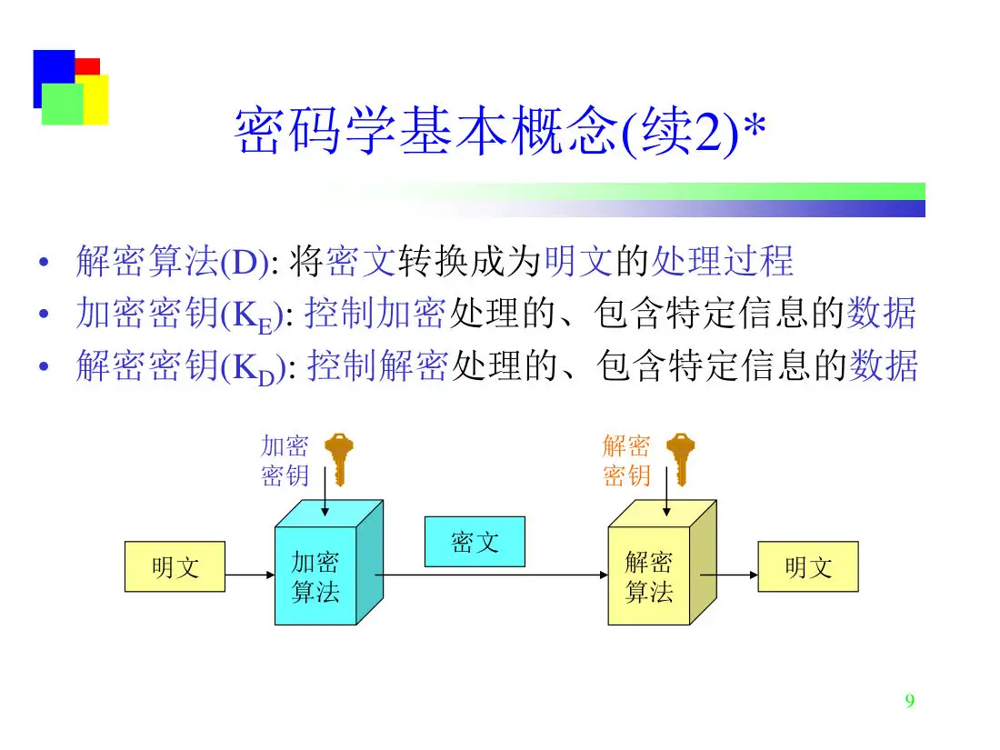

原文：

密码学基本概念(续2)\*

• 解密算法(D): 将密文转换成为明文的处理过程

加密密钥 $( \mathrm { K _ { E } } )$ : 控制加密处理的、包含特定信息的数据

• 解密密钥 $( \mathrm { K _ { D } } )$ : 控制解密处理的、包含特定信息的数据

9

### 密码学中符号表示\

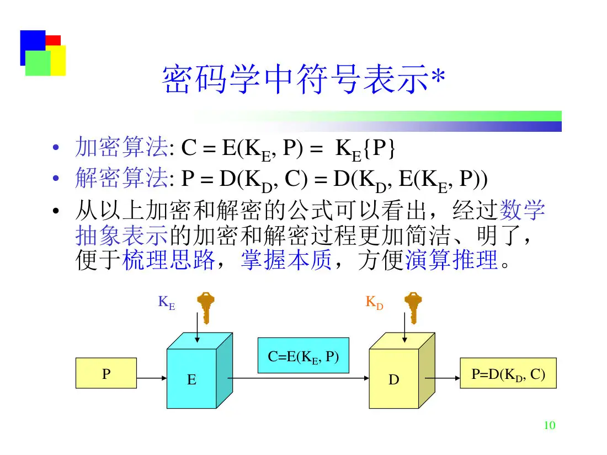

原文：

密码学中符号表示\*

• 加密算法: $C = \mathrm { E ( K _ { E } , P ) = \ K _ { E } \{ P \} }$

• 解密算法: $\mathrm { P } = \mathrm { D } ( \mathrm { K } _ { \mathrm { D } } , \mathrm { C } ) = \mathrm { D } ( \mathrm { K } _ { \mathrm { D } } , \mathrm { E } ( \mathrm { K } _ { \mathrm { E } } , \mathrm { P } ) )$

• 从以上加密和解密的公式可以看出，经过数学抽象表示的加密和解密过程更加简洁、明了，便于梳理思路，掌握本质，方便演算推理。

10

### 密码破译技术\

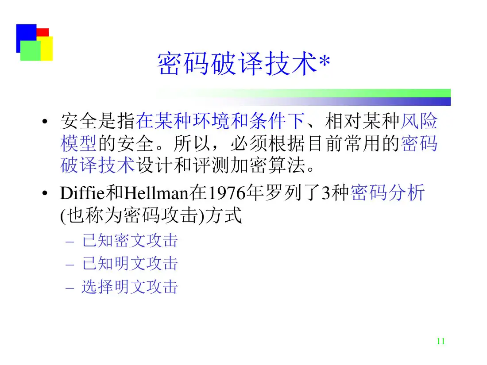

原文：

密码破译技术\*

• 安全是指在某种环境和条件下、相对某种风险模型的安全。所以，必须根据目前常用的密码破译技术设计和评测加密算法。

• Diffie和Hellman在1976年罗列了3种密码分析(也称为密码攻击)方式

– 已知密文攻击

– 已知明文攻击

– 选择明文攻击

11

### 已知密文攻击\

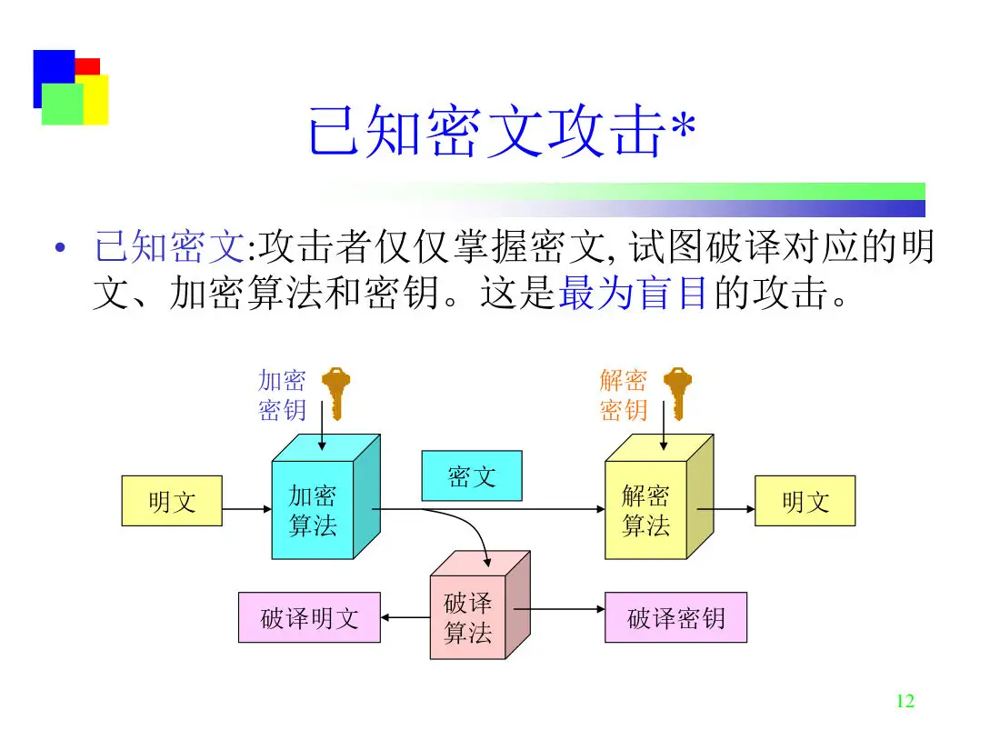

原文：

已知密文攻击\*

• 已知密文:攻击者仅仅掌握密文, 试图破译对应的明文、加密算法和密钥。这是最为盲目的攻击。

12

### 已知明文攻击\

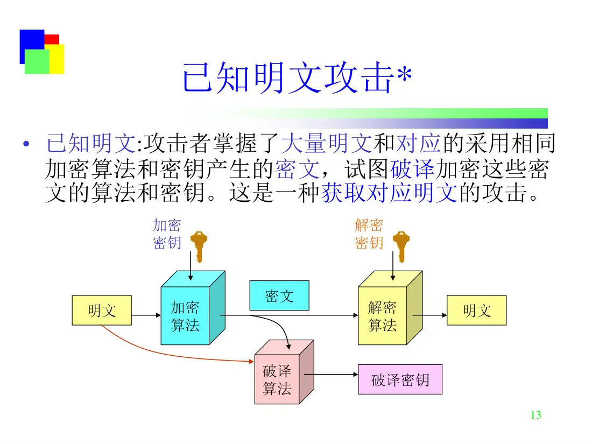

原文：

已知明文攻击\*

• 已知明文:攻击者掌握了大量明文和对应的采用相同加密算法和密钥产生的密文，试图破译加密这些密文的算法和密钥。这是一种获取对应明文的攻击。

13

### 选择明文攻击\

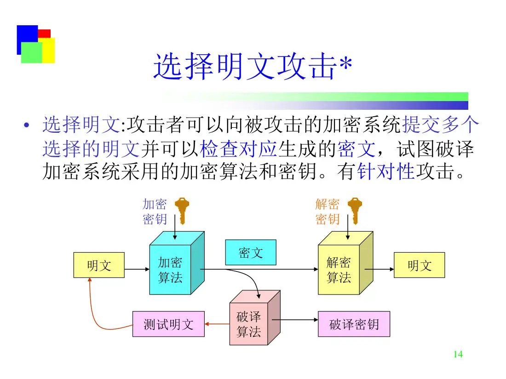

原文：

选择明文攻击\*

• 选择明文:攻击者可以向被攻击的加密系统提交多个选择的明文并可以检查对应生成的密文，试图破译加密系统采用的加密算法和密钥。有针对性攻击。

14

### 什么是安全的加密系统？\

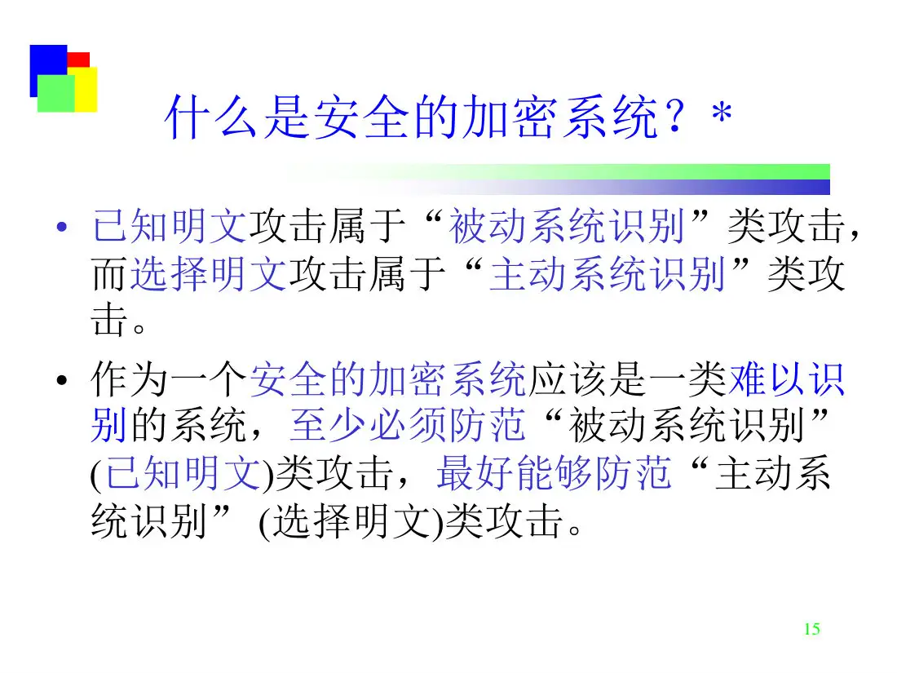

原文：

什么是安全的加密系统？\*

• 已知明文攻击属于“被动系统识别”类攻击，而选择明文攻击属于“主动系统识别”类攻击。

• 作为一个安全的加密系统应该是一类难以识别的系统，至少必须防范“被动系统识别”(已知明文)类攻击，最好能够防范“主动系统识别”(选择明文)类攻击。

7

15

### 非技术性密码分析

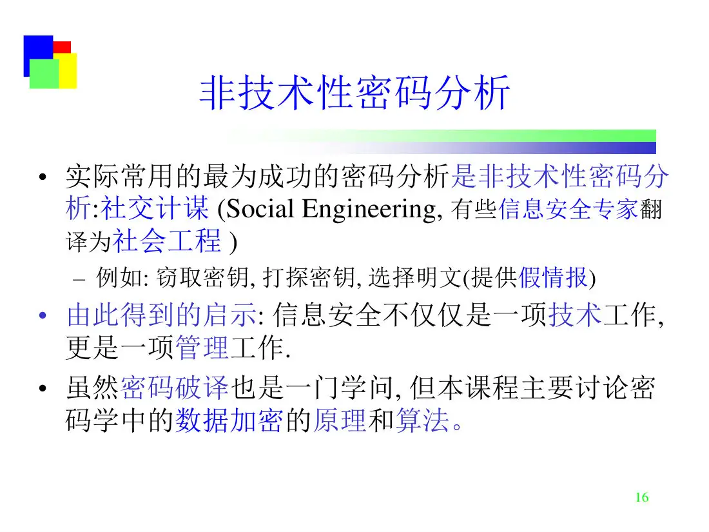

原文：

非技术性密码分析

• 实际常用的最为成功的密码分析是非技术性密码分析:社交计谋 (Social Engineering, 有些信息安全专家翻译为社会工程 )

– 例如: 窃取密钥, 打探密钥, 选择明文(提供假情报)

• 由此得到的启示: 信息安全不仅仅是一项技术工作,更是一项管理工作.

• 虽然密码破译也是一门学问, 但本课程主要讨论密码学中的数据加密的原理和算法。

7

16

### 加密系统的安全性\

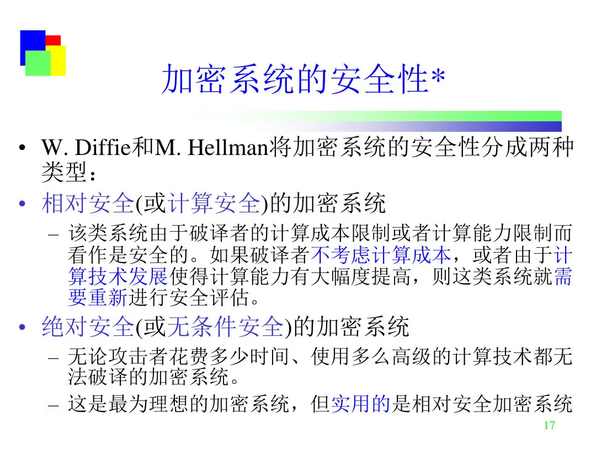

原文：

加密系统的安全性\*

• W. Diffie和M. Hellman将加密系统的安全性分成两种类型：

• 相对安全(或计算安全)的加密系统

该类系统由于破译者的计算成本限制或者计算能力限制而看作是安全的。如果破译者不考虑计算成本，或者由于计算技术发展使得计算能力有大幅度提高，则这类系统就需要重新进行安全评估。

• 绝对安全(或无条件安全)的加密系统

– 无论攻击者花费多少时间、使用多么高级的计算技术都无法破译的加密系统。

– 这是最为理想的加密系统，但实用的是相对安全加密系统

7

17

### 加密系统的安全性(续1)\

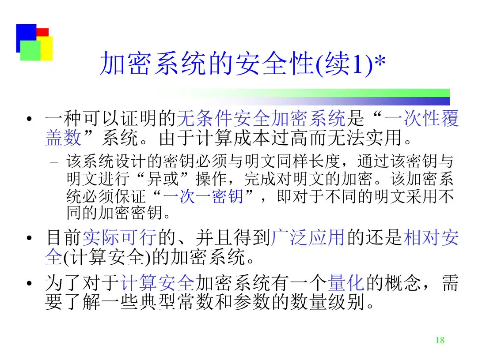

原文：

加密系统的安全性(续1)\*

• 一种可以证明的无条件安全加密系统是“一次性覆盖数”系统。由于计算成本过高而无法实用。

– 该系统设计的密钥必须与明文同样长度，通过该密钥与明文进行“异或”操作，完成对明文的加密。该加密系统必须保证“一次一密钥”，即对于不同的明文采用不同的加密密钥。

• 目前实际可行的、并且得到广泛应用的还是相对安全(计算安全)的加密系统。

• 为了对于计算安全加密系统有一个量化的概念，需要了解一些典型常数和参数的数量级别。

18

### 加密系统的安全性(续3)\

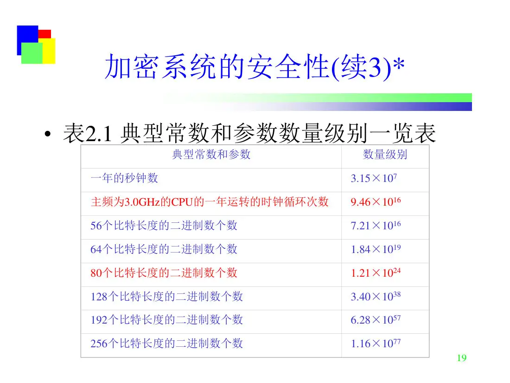

原文：

加密系统的安全性(续3)\*

• 表2.1 典型常数和参数数量级别一览表

<table><tr><td>典型常数和参数</td><td>数量级别</td></tr><tr><td>一年的秒钟数</td><td> $3.15 \times 10^{7}$ </td></tr><tr><td>主频为3.0GHz的CPU的一年运转的时钟循环次数</td><td> $9.46 \times 10^{16}$ </td></tr><tr><td>56个比特长度的二进制数个数</td><td> $7.21 \times 10^{16}$ </td></tr><tr><td>64个比特长度的二进制数个数</td><td> $1.84 \times 10^{19}$ </td></tr><tr><td>80个比特长度的二进制数个数</td><td> $1.21 \times 10^{24}$ </td></tr><tr><td>128个比特长度的二进制数个数</td><td> $3.40 \times 10^{38}$ </td></tr><tr><td>192个比特长度的二进制数个数</td><td> $6.28 \times 10^{57}$ </td></tr><tr><td>256个比特长度的二进制数个数</td><td> $1.16 \times 10^{77}$ </td></tr></table>

1

19

### 加密算法的公开

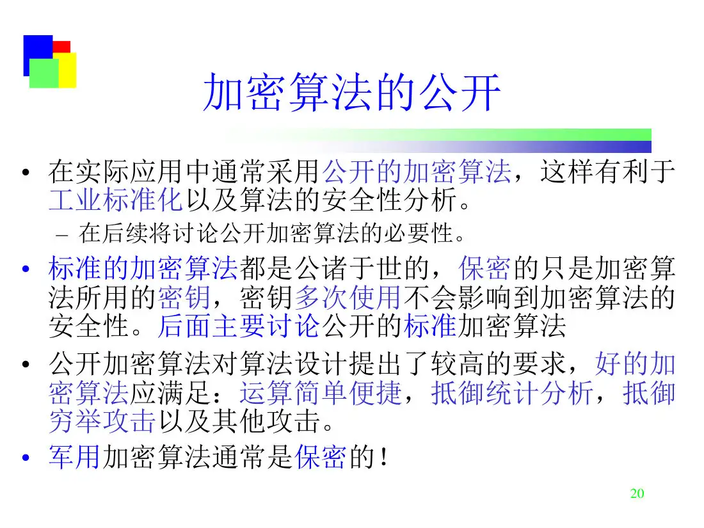

原文：

加密算法的公开

• 在实际应用中通常采用公开的加密算法，这样有利于工业标准化以及算法的安全性分析。– 在后续将讨论公开加密算法的必要性。

• 标准的加密算法都是公诸于世的，保密的只是加密算法所用的密钥，密钥多次使用不会影响到加密算法的安全性。后面主要讨论公开的标准加密算法

• 公开加密算法对算法设计提出了较高的要求，好的加密算法应满足：运算简单便捷，抵御统计分析，抵御穷举攻击以及其他攻击。

• 军用加密算法通常是保密的！

7

20

### 数据加密分类\

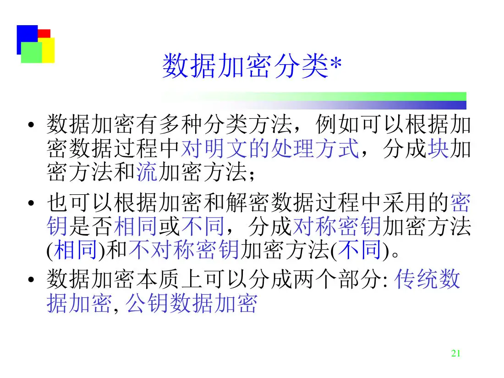

原文：

数据加密分类\*

• 数据加密有多种分类方法，例如可以根据加密数据过程中对明文的处理方式，分成块加密方法和流加密方法；

• 也可以根据加密和解密数据过程中采用的密钥是否相同或不同，分成对称密钥加密方法(相同)和不对称密钥加密方法(不同)。

• 数据加密本质上可以分成两个部分: 传统数据加密, 公钥数据加密

7

21

### 流加密方法与块加密方法\

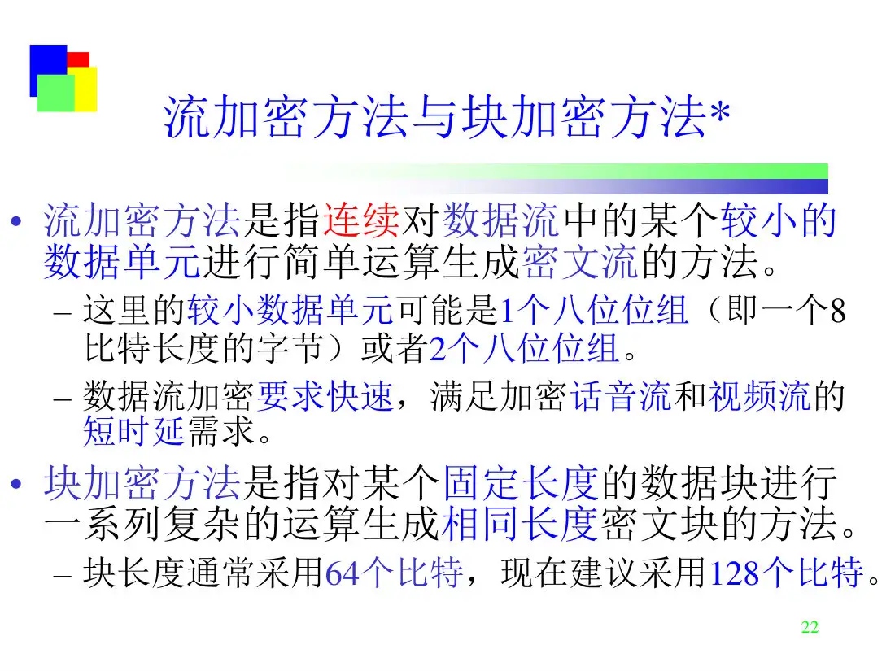

原文：

流加密方法与块加密方法\*

流加密方法是指连续对数据流中的某个较小的数据单元进行简单运算生成密文流的方法。

– 这里的较小数据单元可能是1个八位位组（即一个8比特长度的字节）或者2个八位位组。

– 数据流加密要求快速，满足加密话音流和视频流的短时延需求。

• 块加密方法是指对某个固定长度的数据块进行一系列复杂的运算生成相同长度密文块的方法。

– 块长度通常采用64个比特，现在建议采用128个比特。

7

22

### 对称密钥与不对称密钥加密方法\

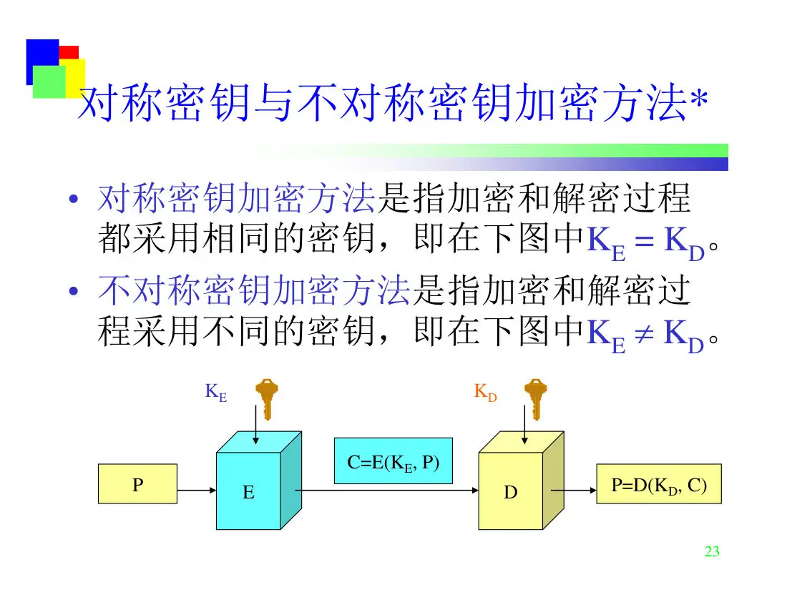

原文：

对称密钥与不对称密钥加密方法\*

• 对称密钥加密方法是指加密和解密过程都采用相同的密钥，即在下图中 $\mathrm { K _ { E } } = \mathrm { K _ { D } } \circ$

• 不对称密钥加密方法是指加密和解密过程采用不同的密钥，即在下图中 $\mathrm { K } _ { \mathrm { E } } \neq \mathrm { K } _ { \mathrm { D } }$ O

23

### 传统数据加密\

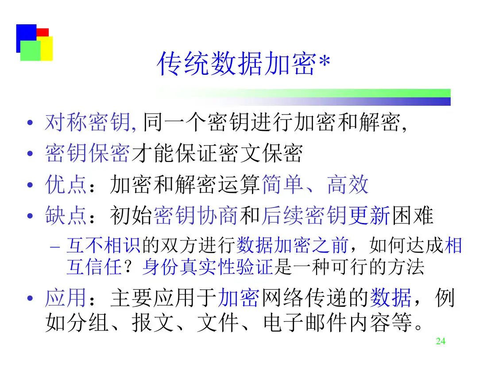

原文：

传统数据加密\*

• 对称密钥,同一个密钥进行加密和解密,

• 密钥保密才能保证密文保密

• 优点：加密和解密运算简单、高效

• 缺点：初始密钥协商和后续密钥更新困难– 互不相识的双方进行数据加密之前，如何达成相互信任？身份真实性验证是一种可行的方法

• 应用：主要应用于加密网络传递的数据，例如分组、报文、文件、电子邮件内容等。

7

24

### 公钥数据加密\

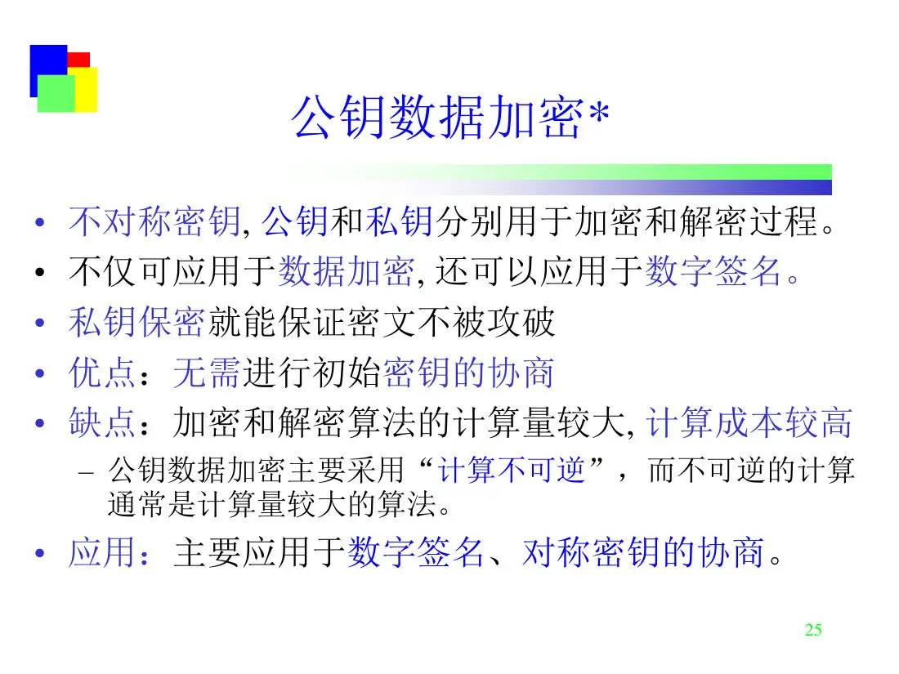

原文：

公钥数据加密\*

• 不对称密钥, 公钥和私钥分别用于加密和解密过程。

• 不仅可应用于数据加密, 还可以应用于数字签名。

• 私钥保密就能保证密文不被攻破

• 优点：无需进行初始密钥的协商

• 缺点：加密和解密算法的计算量较大, 计算成本较高– 公钥数据加密主要采用“计算不可逆”，而不可逆的计算通常是计算量较大的算法。

• 应用：主要应用于数字签名、对称密钥的协商。

7

25

### 本讲重点内容

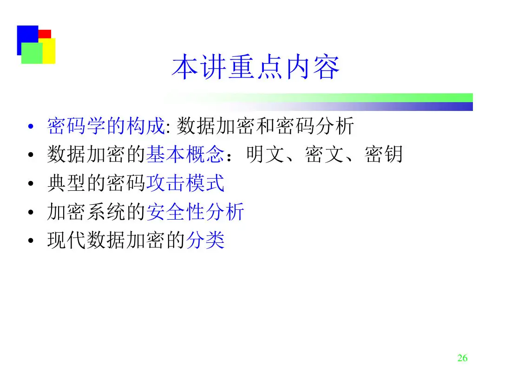

原文：

本讲重点内容

• 密码学的构成: 数据加密和密码分析

• 数据加密的基本概念：明文、密文、密钥

• 典型的密码攻击模式

• 加密系统的安全性分析

• 现代数据加密的分类

26

### 思考题

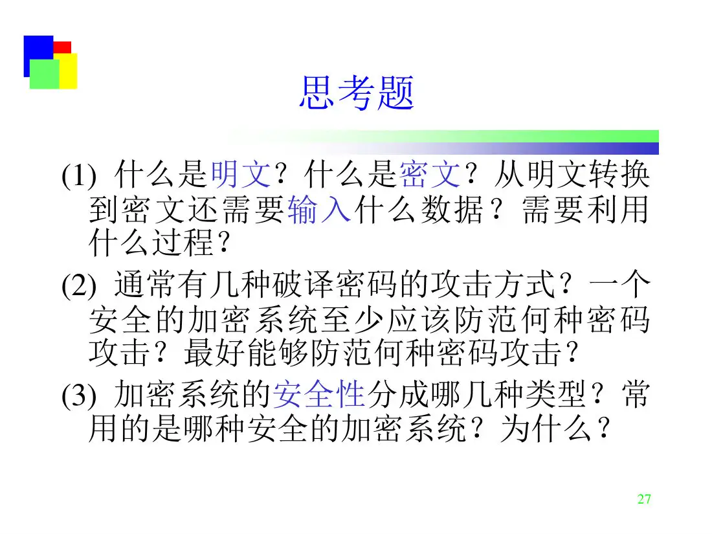

原文：

思考题

(1) 什么是明文？什么是密文？从明文转换到密文还需要输入什么数据？需要利用什么过程？

(2) 通常有几种破译密码的攻击方式？一个安全的加密系统至少应该防范何种密码攻击？最好能够防范何种密码攻击？

(3) 加密系统的安全性分成哪几种类型？常用的是哪种安全的加密系统？为什么？

27

### 思考题(续)

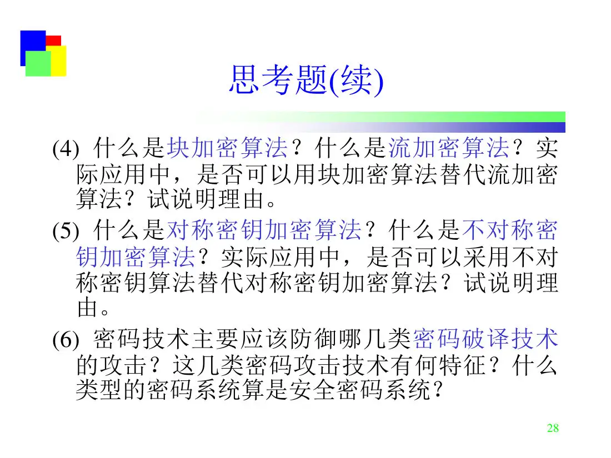

原文：

思考题(续)

(4) 什么是块加密算法？什么是流加密算法？实际应用中，是否可以用块加密算法替代流加密算法？试说明理由。

(5) 什么是对称密钥加密算法？什么是不对称密钥加密算法？实际应用中，是否可以采用不对称密钥算法替代对称密钥加密算法？试说明理由。

(6) 密码技术主要应该防御哪几类密码破译技术的攻击？这几类密码攻击技术有何特征？什么类型的密码系统算是安全密码系统？

1

28
