# 《信息安全技术》第3章 网络真实性验证公钥基础设施PKI与X.509建议（课件）

原件的每一页，下面附识别出的文字。

### 第3章网络真实性验证公钥基础设施PKI与X.509建议

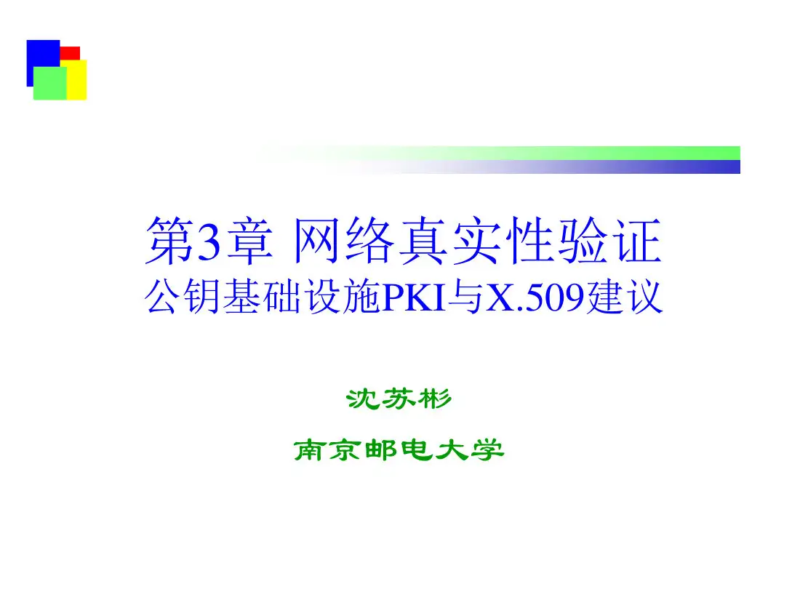

原文：

第3章网络真实性验证公钥基础设施PKI与X.509建议

沈苏彬

南京邮电大学

### 主要解决的问题

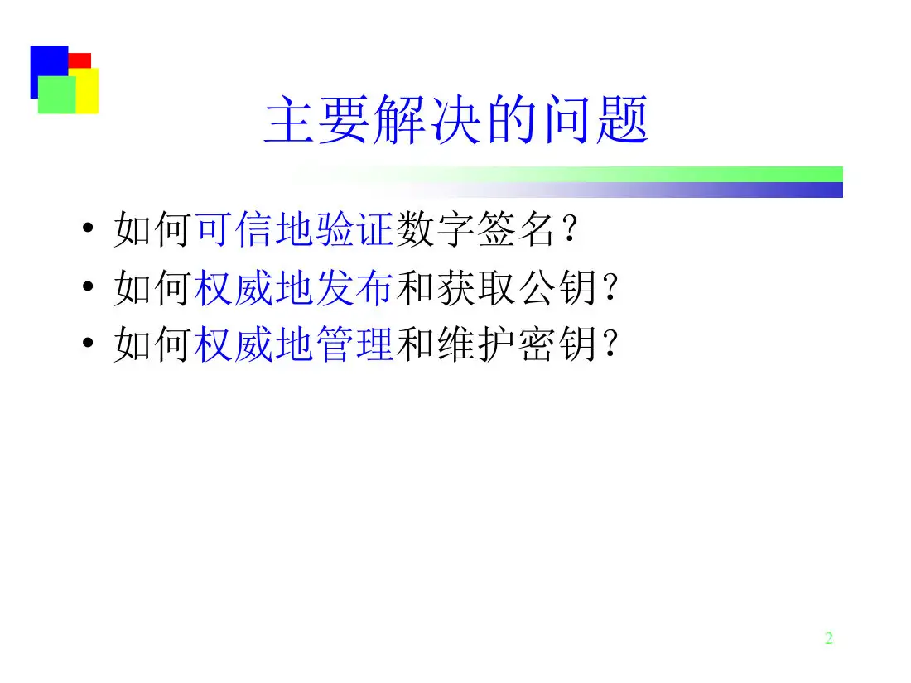

原文：

主要解决的问题

• 如何可信地验证数字签名？

• 如何权威地发布和获取公钥？

• 如何权威地管理和维护密钥？

2

### 关键知识点\

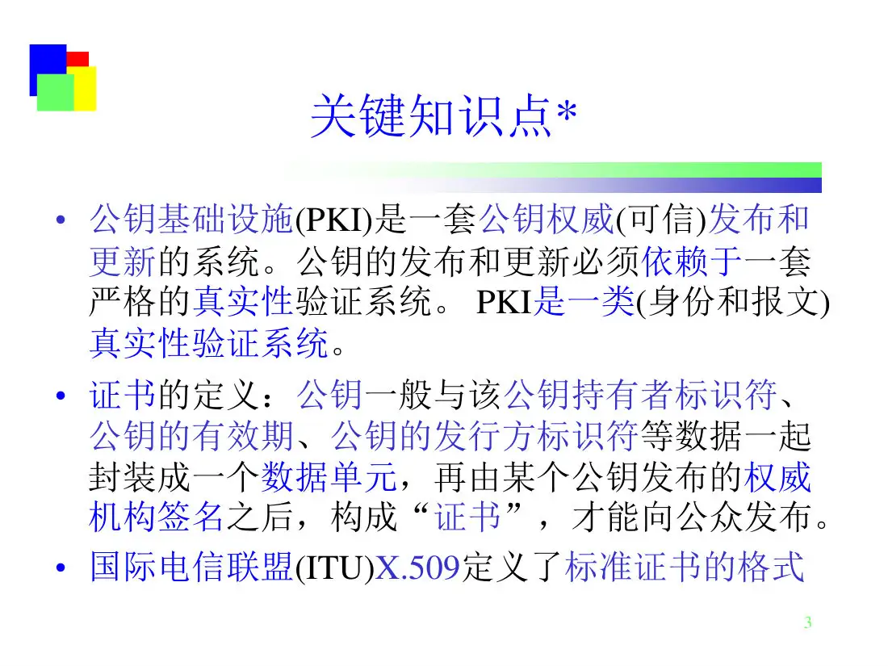

原文：

关键知识点\*

• 公钥基础设施(PKI)是一套公钥权威(可信)发布和更新的系统。公钥的发布和更新必须依赖于一套严格的真实性验证系统。 PKI是一类(身份和报文)真实性验证系统。

• 证书的定义：公钥一般与该公钥持有者标识符、公钥的有效期、公钥的发行方标识符等数据一起封装成一个数据单元，再由某个公钥发布的权威机构签名之后，构成“证书”，才能向公众发布。

• 国际电信联盟(ITU)X.509定义了标准证书的格式

3

### 主要内容

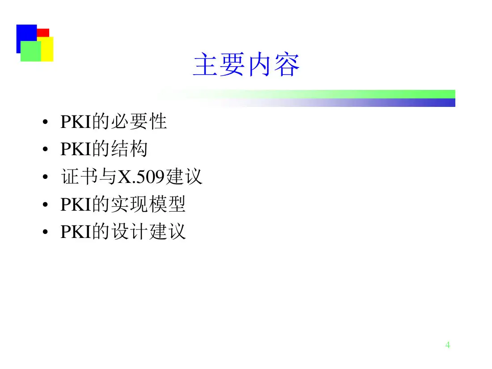

原文：

主要内容

• PKI的必要性

• PKI的结构

• 证书与X.509建议

• PKI的实现模型

• PKI的设计建议

7

4

### PKI的必要性\

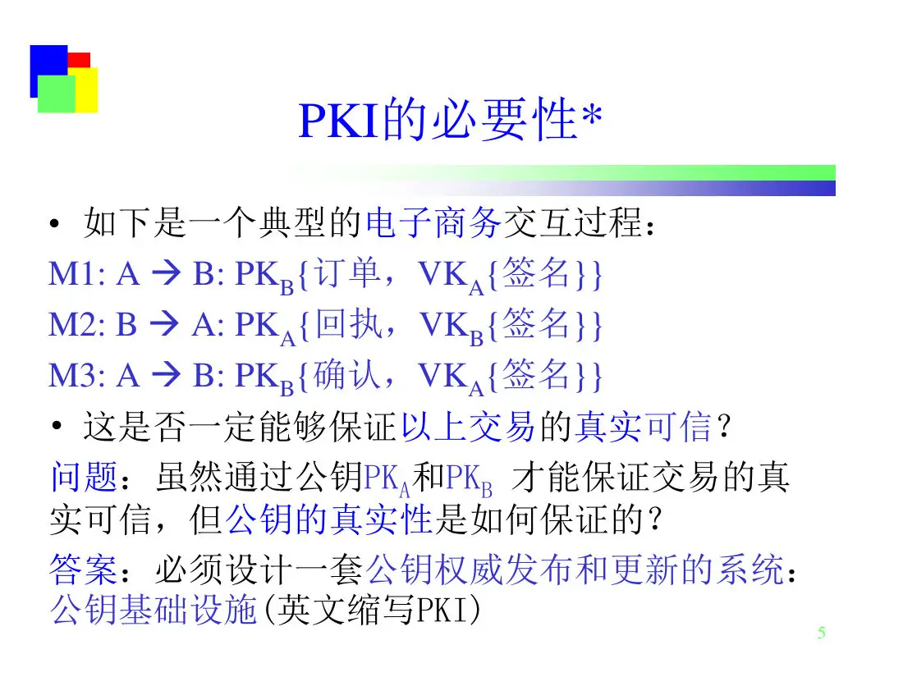

原文：

PKI的必要性\*

• 如下是一个典型的电子商务交互过程：

M1: $\mathrm { A \to B \colon P K _ { B } }$ {订单， $\mathrm { V K _ { A } }$ {签名}}

M2: $\mathrm { B \to A \colon P K _ { A } }$ {回执， $\mathrm { V K _ { B } }$ {签名}}

M3: $\mathrm { A \to B \colon P K _ { B } }$ {确认， $\mathrm { V K _ { A } }$ {签名}}

• 这是否一定能够保证以上交易的真实可信？

问题：虽然通过公钥 $\mathrm { P K _ { A } }$ 和 $\mathrm { P K _ { B } }$ 才能保证交易的真实可信，但公钥的真实性是如何保证的？

答案：必须设计一套公钥权威发布和更新的系统：公钥基础设施(英文缩写PKI)

7

5

### PKI的结构\

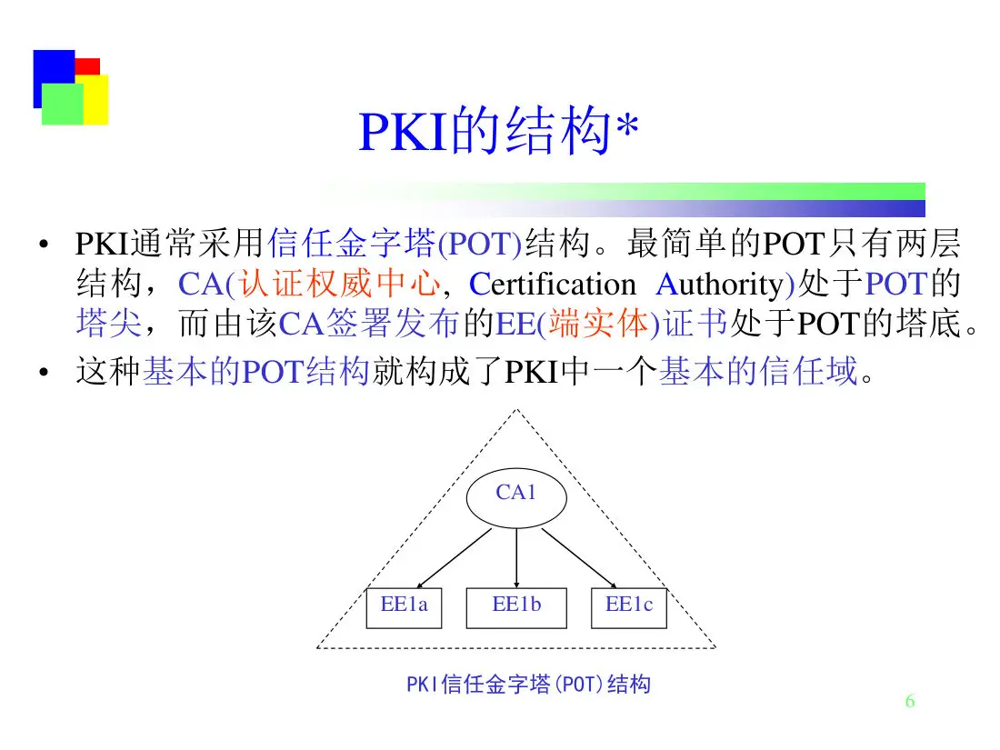

原文：

PKI的结构\*

• PKI通常采用信任金字塔(POT)结构。最简单的POT只有两层结构，CA(认证权威中心, Certification Authority)处于POT的塔尖，而由该CA签署发布的EE(端实体)证书处于POT的塔底。

• 这种基本的POT结构就构成了PKI中一个基本的信任域。

1

6

### PKI的结构(续1)\

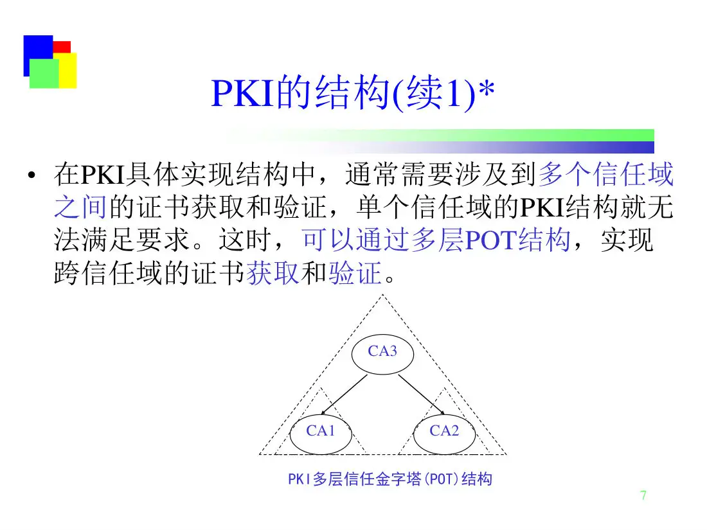

原文：

PKI的结构(续1)\*

• 在PKI具体实现结构中，通常需要涉及到多个信任域之间的证书获取和验证，单个信任域的PKI结构就无法满足要求。这时，可以通过多层POT结构，实现跨信任域的证书获取和验证。

7

7

### 证书的定义与逻辑结构\

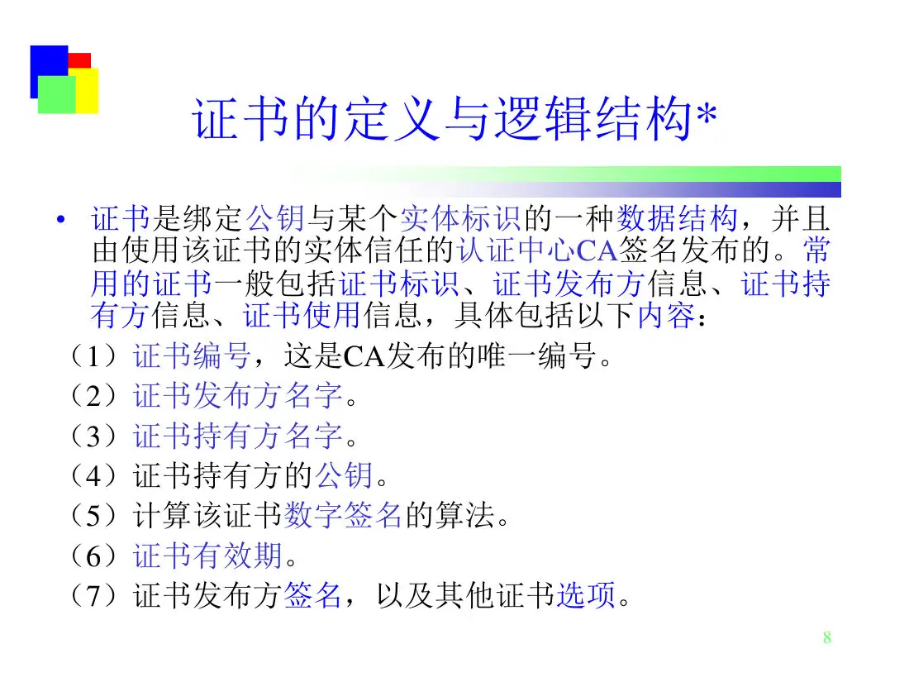

原文：

证书的定义与逻辑结构\*

证书是绑定公钥与某个实体标识的一种数据结构，并且由使用该证书的实体信任的认证中心CA签名发布的。常用的证书一般包括证书标识、证书发布方信息、证书持有方信息、证书使用信息，具体包括以下内容：

（1）证书编号，这是CA发布的唯一编号。

（2）证书发布方名字。

（3）证书持有方名字。

（4）证书持有方的公钥。

（5）计算该证书数字签名的算法。

（6）证书有效期。

（7）证书发布方签名，以及其他证书选项。

8

### 证书与X.509建议\

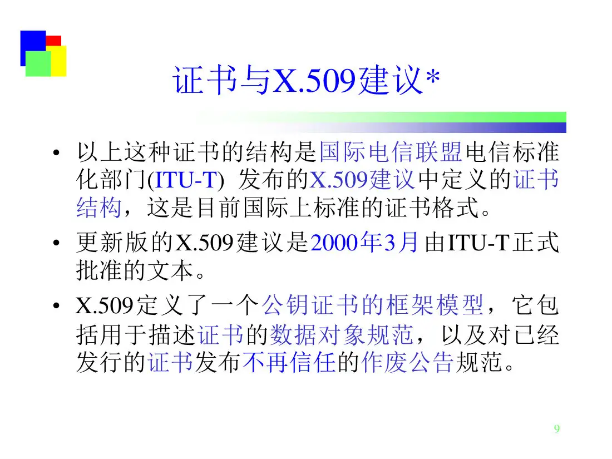

原文：

证书与X.509建议\*

• 以上这种证书的结构是国际电信联盟电信标准化部门(ITU-T) 发布的X.509建议中定义的证书结构，这是目前国际上标准的证书格式。

• 更新版的X.509建议是2000年3月由ITU-T正式批准的文本。

• X.509定义了一个公钥证书的框架模型，它包括用于描述证书的数据对象规范，以及对已经发行的证书发布不再信任的作废公告规范。

1

9

### X.509建议证书的特征\

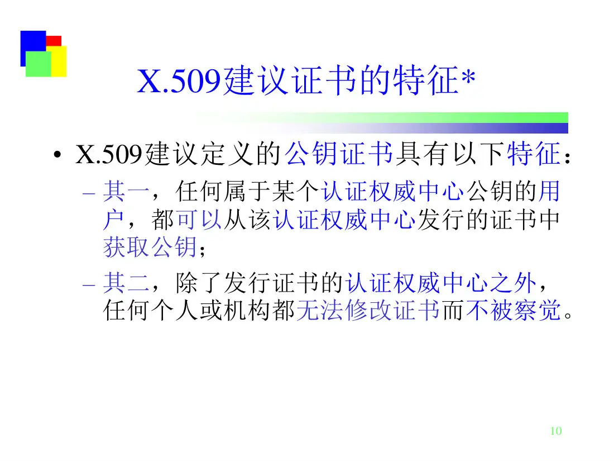

原文：

X.509建议证书的特征\*

• X.509建议定义的公钥证书具有以下特征：– 其一，任何属于某个认证权威中心公钥的用户，都可以从该认证权威中心发行的证书中获取公钥；

– 其二，除了发行证书的认证权威中心之外，任何个人或机构都无法修改证书而不被察觉。

1

10

### X.509建议证书的格式\

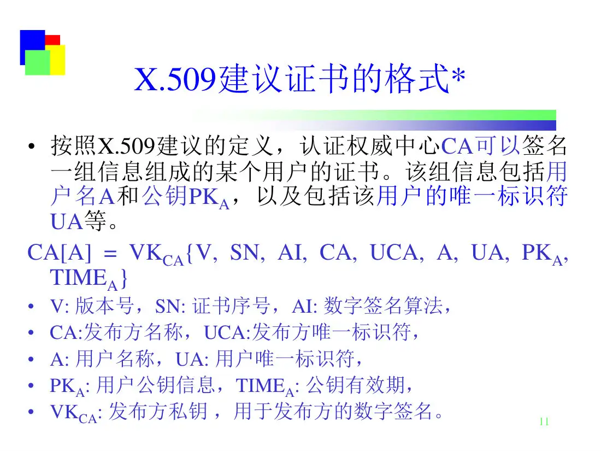

原文：

X.509建议证书的格式\*

• 按照X.509建议的定义，认证权威中心CA可以签名一组信息组成的某个用户的证书。该组信息包括用户名A和公钥 $\mathrm { P K _ { A } }$ ，以及包括该用户的唯一标识符UA等。

C $\mathrm { \Delta A [ A ] ~ = ~ V K _ { C A } \{ V } $ , SN, AI, CA, UCA, A, UA, $\mathrm { P K _ { A } }$ $\mathrm { T I M E } _ { \mathrm { A } } \}$

• V: 版本号，SN: 证书序号，AI: 数字签名算法，

• CA:发布方名称，UCA:发布方唯一标识符，

• A: 用户名称，UA: 用户唯一标识符，

$\mathrm { P K _ { A } }$ : 用户公钥信息， $\mathrm { T I M E } _ { \mathrm { A } } { \mathrm { : } }$ :公钥有效期，

$\mathrm { V K } _ { \mathrm { C A } }$ : 发布方私钥，用于发布方的数字签名。

1

11

### PKI的实现模型\

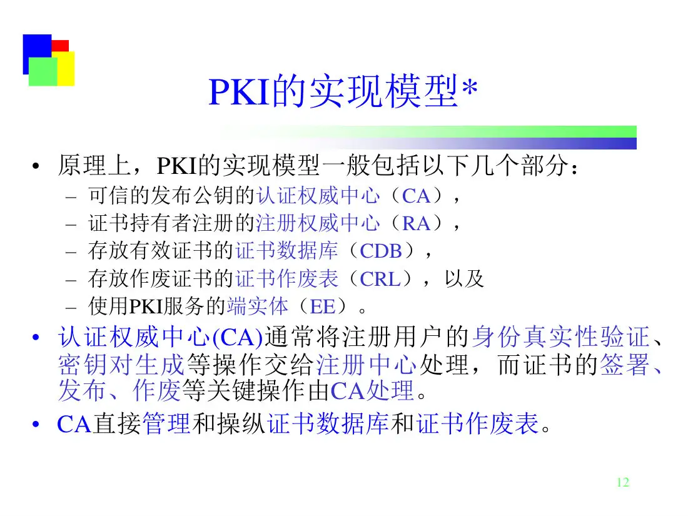

原文：

PKI的实现模型\*

• 原理上，PKI的实现模型一般包括以下几个部分：

– 可信的发布公钥的认证权威中心（CA），

– 证书持有者注册的注册权威中心（RA），

– 存放有效证书的证书数据库（CDB），

– 存放作废证书的证书作废表（CRL），以及

– 使用PKI服务的端实体（EE）。

认证权威中心(CA)通常将注册用户的身份真实性验证、密钥对生成等操作交给注册中心处理，而证书的签署、发布、作废等关键操作由CA处理。

• CA直接管理和操纵证书数据库和证书作废表。

7

12

### PKI的实现模型(续)\

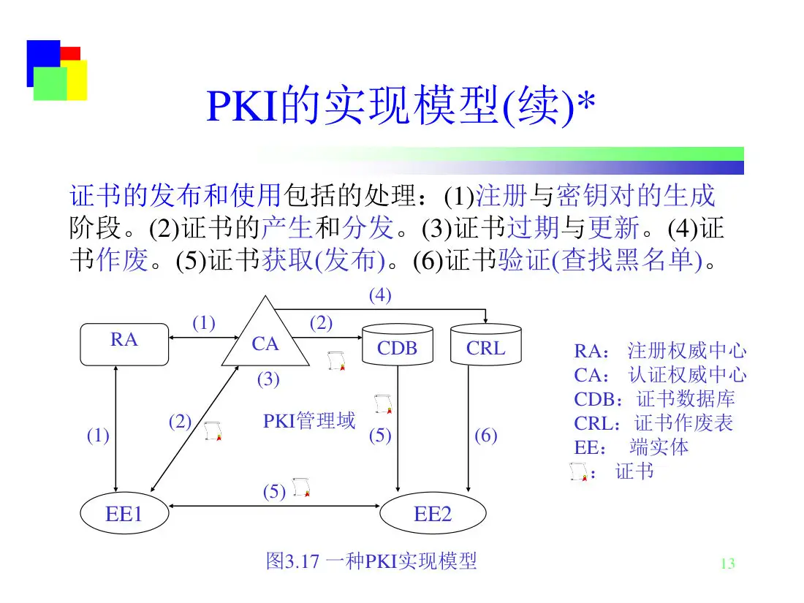

原文：

PKI的实现模型(续)\*

证书的发布和使用包括的处理：(1)注册与密钥对的生成阶段。(2)证书的产生和分发。(3)证书过期与更新。(4)证书作废。(5)证书获取(发布)。(6)证书验证(查找黑名单)。

RA： 注册权威中心CA： 认证权威中心CDB：证书数据库CRL：证书作废表EE： 端实体： 证书

1

13

### PKI设计建议

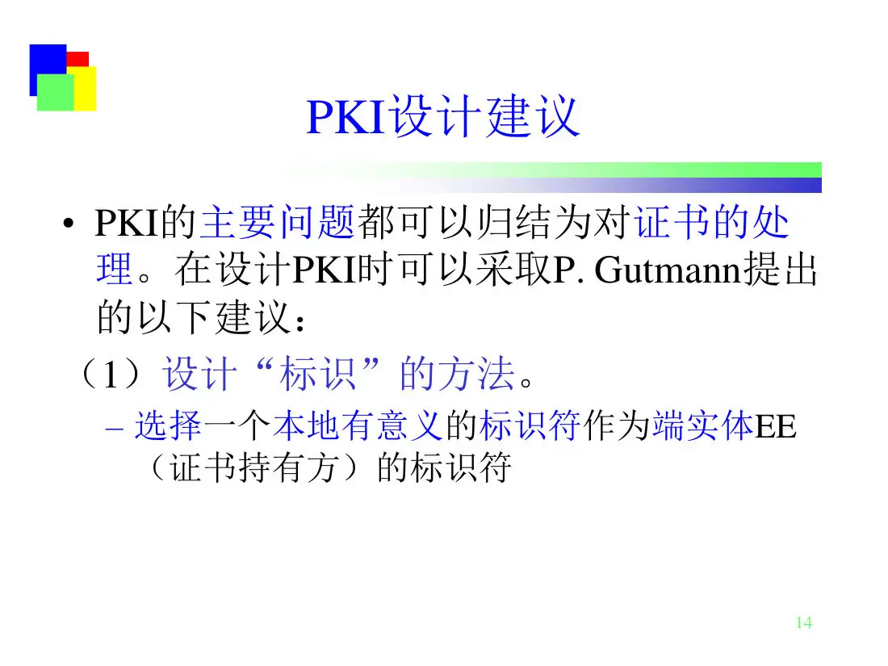

原文：

PKI设计建议

• PKI的主要问题都可以归结为对证书的处理。在设计PKI时可以采取P. Gutmann提出的以下建议：

（1）设计“标识”的方法。

– 选择一个本地有意义的标识符作为端实体EE（证书持有方）的标识符

1

14

### PKI设计建议(续)

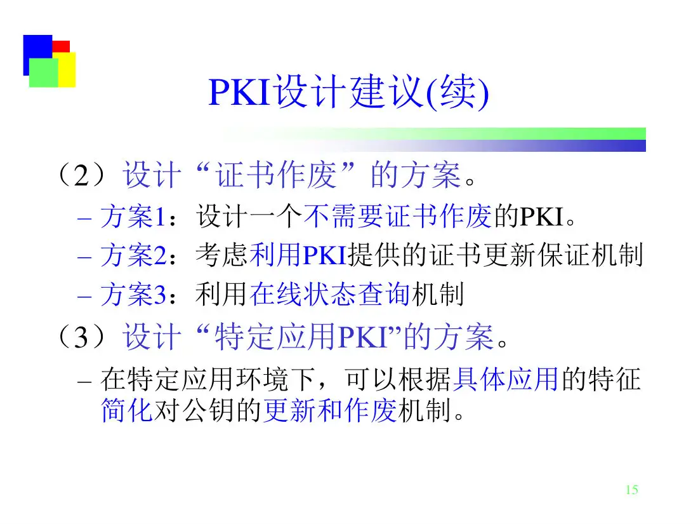

原文：

PKI设计建议(续)

（2）设计“证书作废”的方案。

– 方案1：设计一个不需要证书作废的PKI。

– 方案2：考虑利用PKI提供的证书更新保证机制

– 方案3：利用在线状态查询机制

（3）设计“特定应用PKI”的方案。

– 在特定应用环境下，可以根据具体应用的特征简化对公钥的更新和作废机制。

1

15

### 本节重点内容回顾

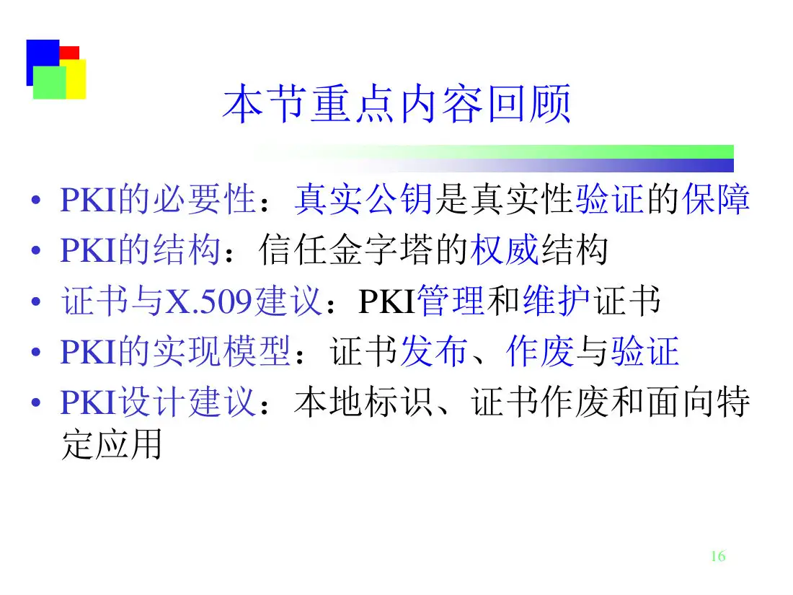

原文：

本节重点内容回顾

• PKI的必要性：真实公钥是真实性验证的保障

• PKI的结构：信任金字塔的权威结构

• 证书与X.509建议：PKI管理和维护证书

• PKI的实现模型：证书发布、作废与验证

• PKI设计建议：本地标识、证书作废和面向特定应用

7

16

### 思考题

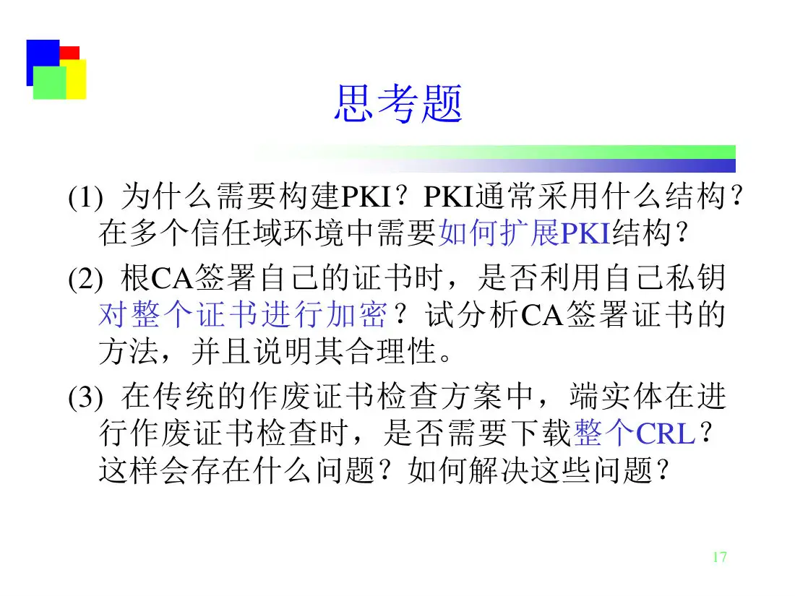

原文：

思考题

(1) 为什么需要构建PKI？PKI通常采用什么结构？在多个信任域环境中需要如何扩展PKI结构？

(2) 根CA签署自己的证书时，是否利用自己私钥对整个证书进行加密？试分析CA签署证书的方法，并且说明其合理性。

(3) 在传统的作废证书检查方案中，端实体在进行作废证书检查时，是否需要下载整个CRL？这样会存在什么问题？如何解决这些问题？

17
