# 《信息安全技术》第3章 网络真实性验证基本概念（课件）

原件的每一页，下面附识别出的文字。

### 第3章 网络真实性验证基本概念

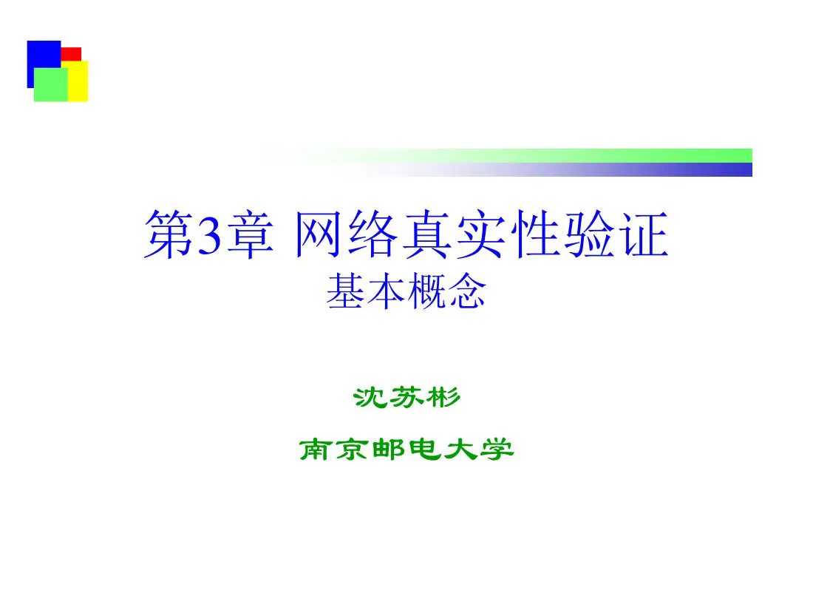

原文：

第3章 网络真实性验证基本概念

沈苏彬

南京邮电大学

### 本章的开场白

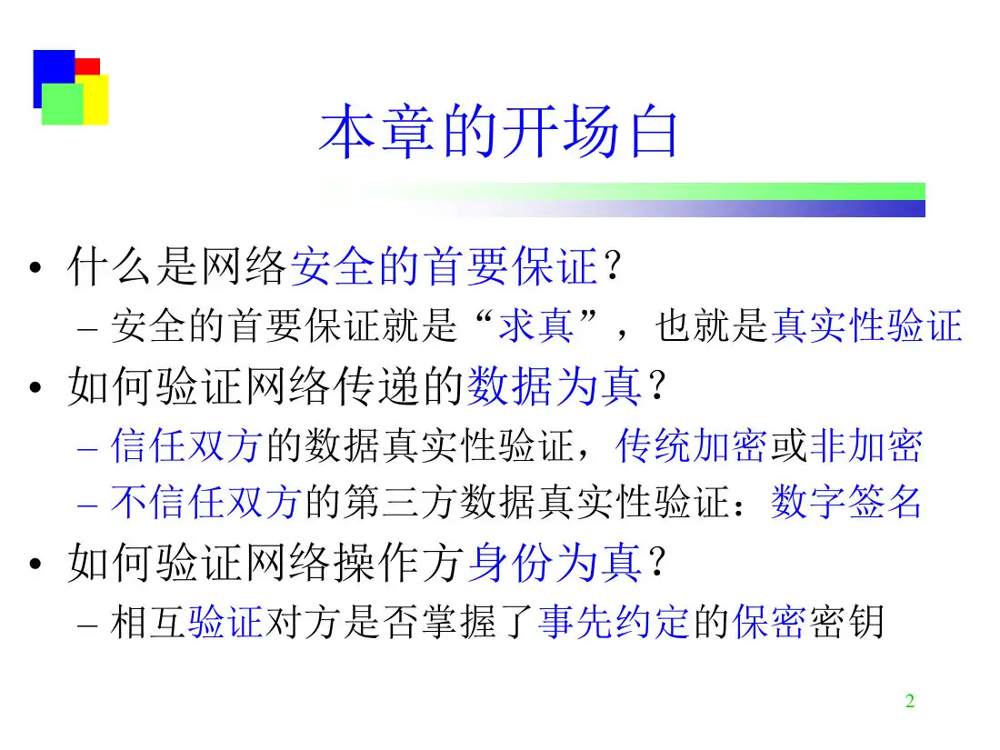

原文：

本章的开场白

• 什么是网络安全的首要保证？

– 安全的首要保证就是“求真”，也就是真实性验证

• 如何验证网络传递的数据为真？

– 信任双方的数据真实性验证，传统加密或非加密

– 不信任双方的第三方数据真实性验证：数字签名

• 如何验证网络操作方身份为真？

– 相互验证对方是否掌握了事先约定的保密密钥

7

2

### 本章的关键知识点\

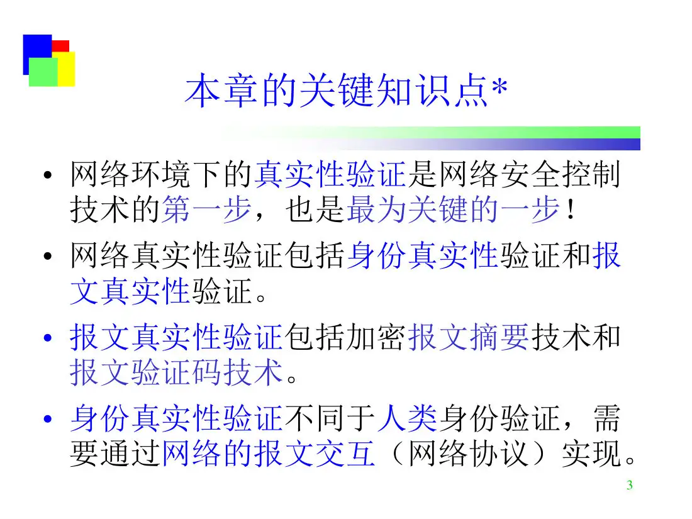

原文：

本章的关键知识点\*

• 网络环境下的真实性验证是网络安全控制技术的第一步，也是最为关键的一步！

• 网络真实性验证包括身份真实性验证和报文真实性验证。

• 报文真实性验证包括加密报文摘要技术和报文验证码技术。

• 身份真实性验证不同于人类身份验证，需要通过网络的报文交互（网络协议）实现。

7

3

### 本章主要内容

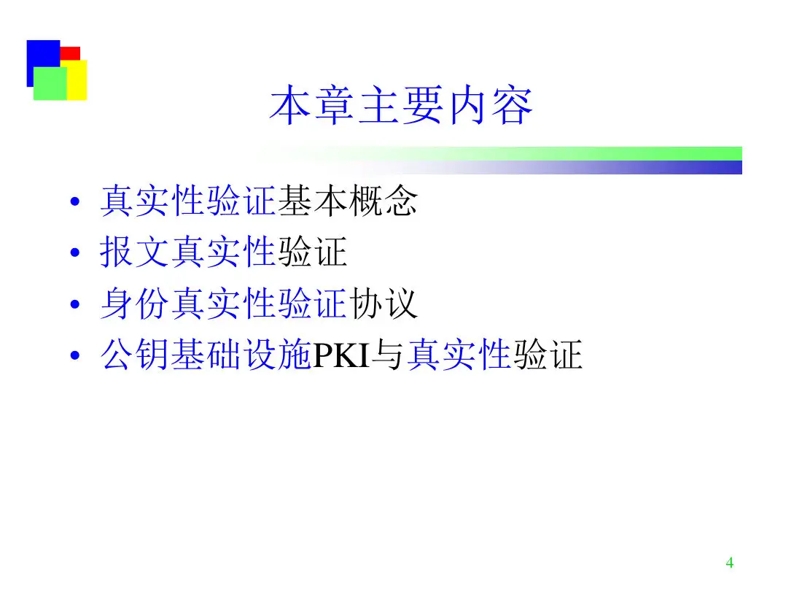

原文：

本章主要内容

• 真实性验证基本概念

• 报文真实性验证

• 身份真实性验证协议

• 公钥基础设施PKI与真实性验证

4

### 真实性验证基本概念

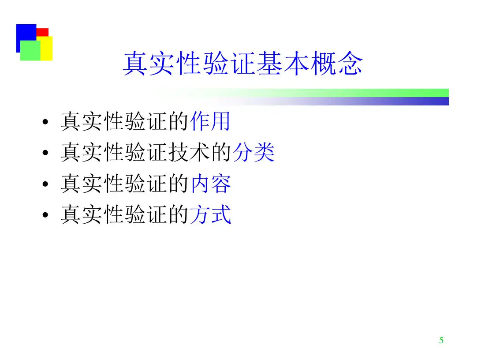

原文：

真实性验证基本概念

• 真实性验证的作用

• 真实性验证技术的分类

• 真实性验证的内容

• 真实性验证的方式

5

### 真实性验证的作用和必要性\

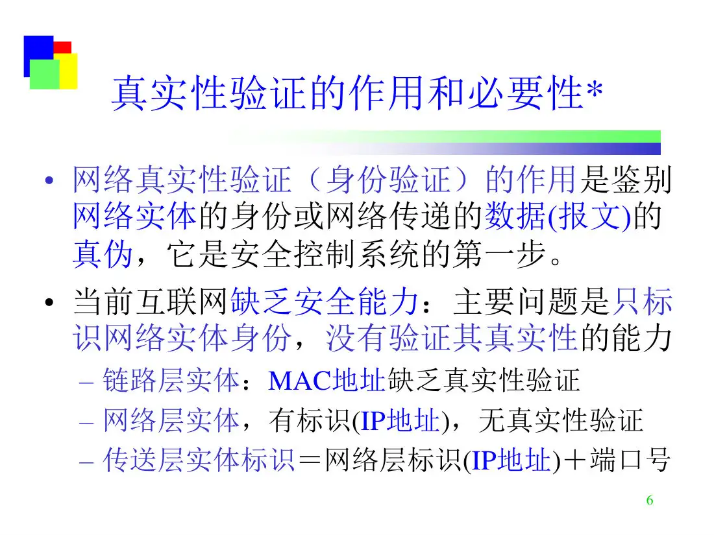

原文：

真实性验证的作用和必要性\*

网络真实性验证（身份验证）的作用是鉴别网络实体的身份或网络传递的数据(报文)的真伪，它是安全控制系统的第一步。

• 当前互联网缺乏安全能力：主要问题是只标识网络实体身份，没有验证其真实性的能力– 链路层实体：MAC地址缺乏真实性验证– 网络层实体，有标识(IP地址)，无真实性验证– 传送层实体标识＝网络层标识(IP地址)＋端口号

6

### 真实性验证发展历史\

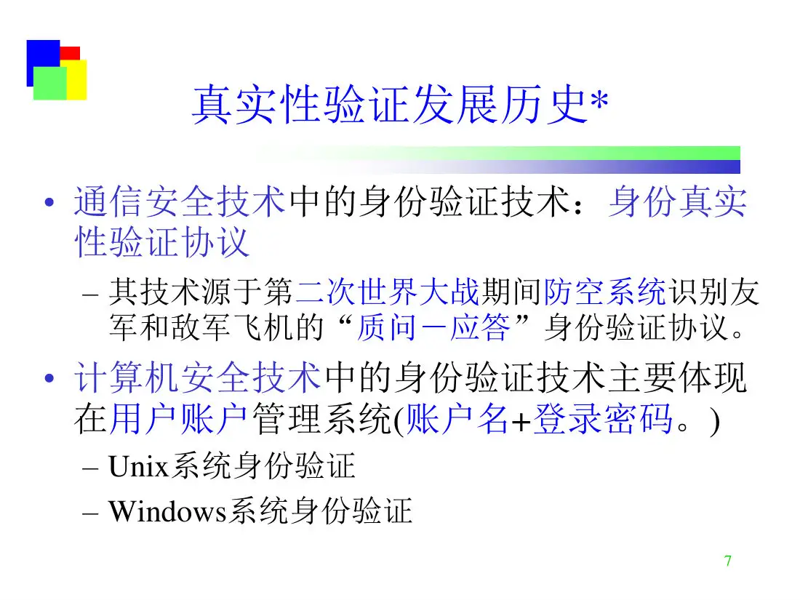

原文：

真实性验证发展历史\*

• 通信安全技术中的身份验证技术：身份真实性验证协议

– 其技术源于第二次世界大战期间防空系统识别友军和敌军飞机的“质问－应答”身份验证协议。

• 计算机安全技术中的身份验证技术主要体现在用户账户管理系统(账户名+登录密码。)

– Unix系统身份验证

– Windows系统身份验证

7

7

### 网络身份真实性验证\

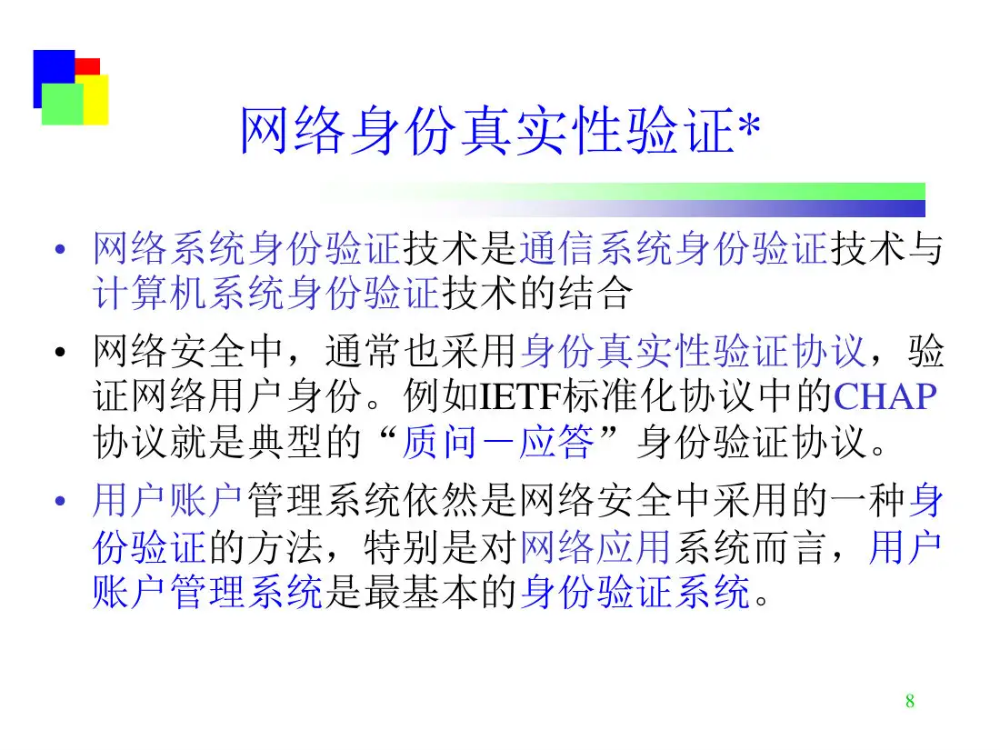

原文：

网络身份真实性验证\*

网络系统身份验证技术是通信系统身份验证技术与计算机系统身份验证技术的结合

• 网络安全中，通常也采用身份真实性验证协议，验证网络用户身份。例如IETF标准化协议中的CHAP协议就是典型的“质问－应答”身份验证协议。

• 用户账户管理系统依然是网络安全中采用的一种身份验证的方法，特别是对网络应用系统而言，用户账户管理系统是最基本的身份验证系统。

8

### 真实性验证技术分类\

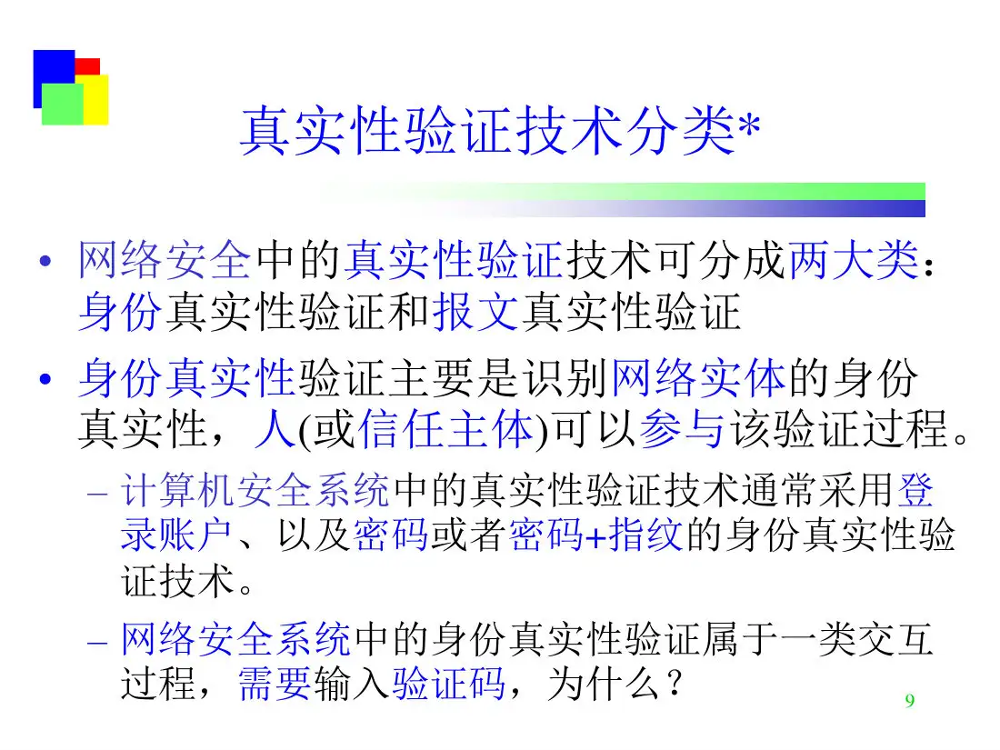

原文：

真实性验证技术分类\*

• 网络安全中的真实性验证技术可分成两大类：身份真实性验证和报文真实性验证

• 身份真实性验证主要是识别网络实体的身份真实性，人(或信任主体)可以参与该验证过程。

– 计算机安全系统中的真实性验证技术通常采用登录账户、以及密码或者密码+指纹的身份真实性验证技术。

– 网络安全系统中的身份真实性验证属于一类交互过程，需要输入验证码，为什么？ 9

1

### 身份验证技术分类(续)\

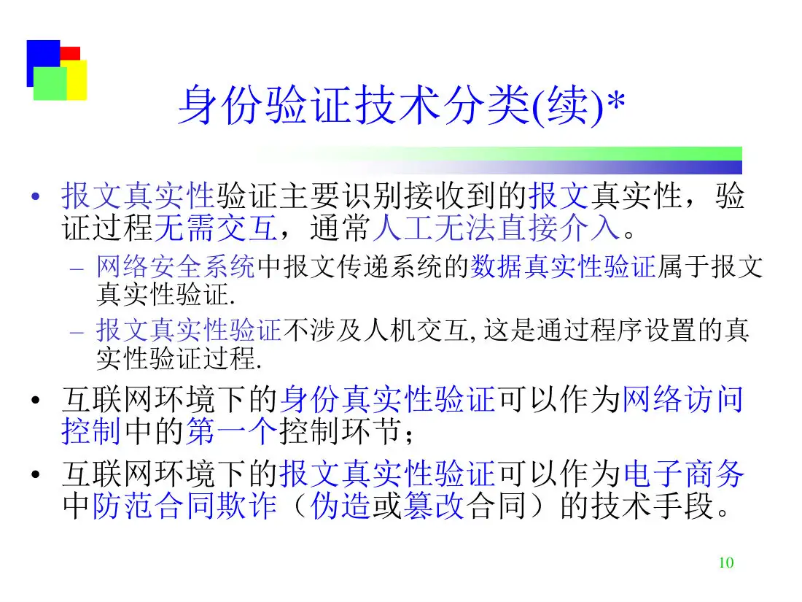

原文：

身份验证技术分类(续)\*

• 报文真实性验证主要识别接收到的报文真实性，验证过程无需交互，通常人工无法直接介入。

– 网络安全系统中报文传递系统的数据真实性验证属于报文真实性验证.

– 报文真实性验证不涉及人机交互, 这是通过程序设置的真实性验证过程.

• 互联网环境下的身份真实性验证可以作为网络访问控制中的第一个控制环节；

• 互联网环境下的报文真实性验证可以作为电子商务中防范合同欺诈（伪造或篡改合同）的技术手段。

10

### 身份真实性验证方法\

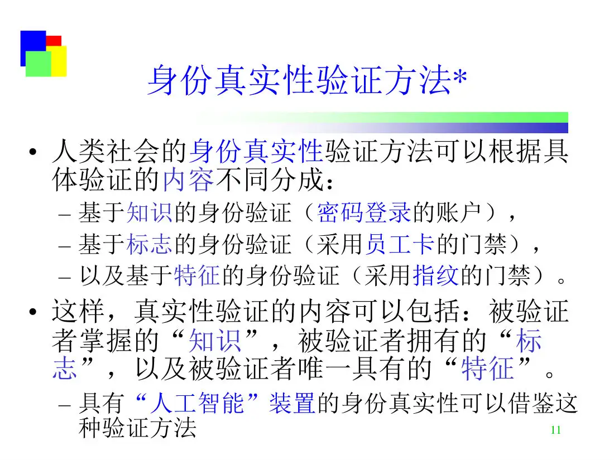

原文：

身份真实性验证方法\*

• 人类社会的身份真实性验证方法可以根据具体验证的内容不同分成：

– 基于知识的身份验证（密码登录的账户），

– 基于标志的身份验证（采用员工卡的门禁），

– 以及基于特征的身份验证（采用指纹的门禁）。

• 这样，真实性验证的内容可以包括：被验证者掌握的“知识”，被验证者拥有的“标志”，以及被验证者唯一具有的“特征”。– 具有“人工智能”装置的身份真实性可以借鉴这种验证方法 11

1

### 真实性验证内容通俗说法

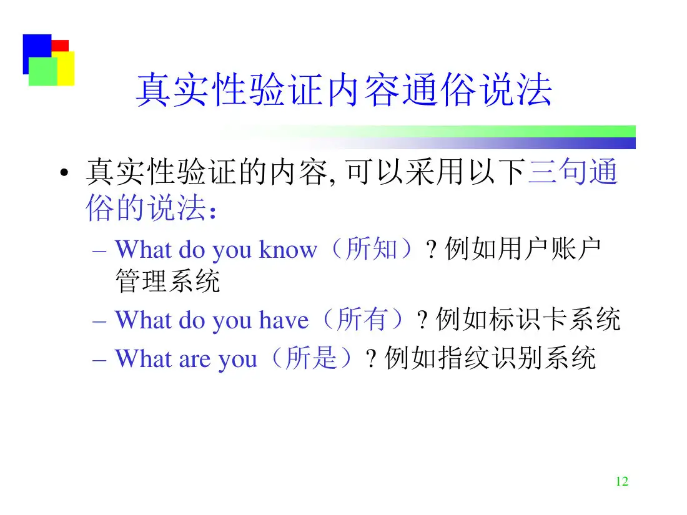

原文：

真实性验证内容通俗说法

• 真实性验证的内容, 可以采用以下三句通俗的说法：

– What do you know（所知）? 例如用户账户管理系统

– What do you have（所有）? 例如标识卡系统

– What are you（所是）? 例如指纹识别系统

12

### 基于知识的真实性验证\

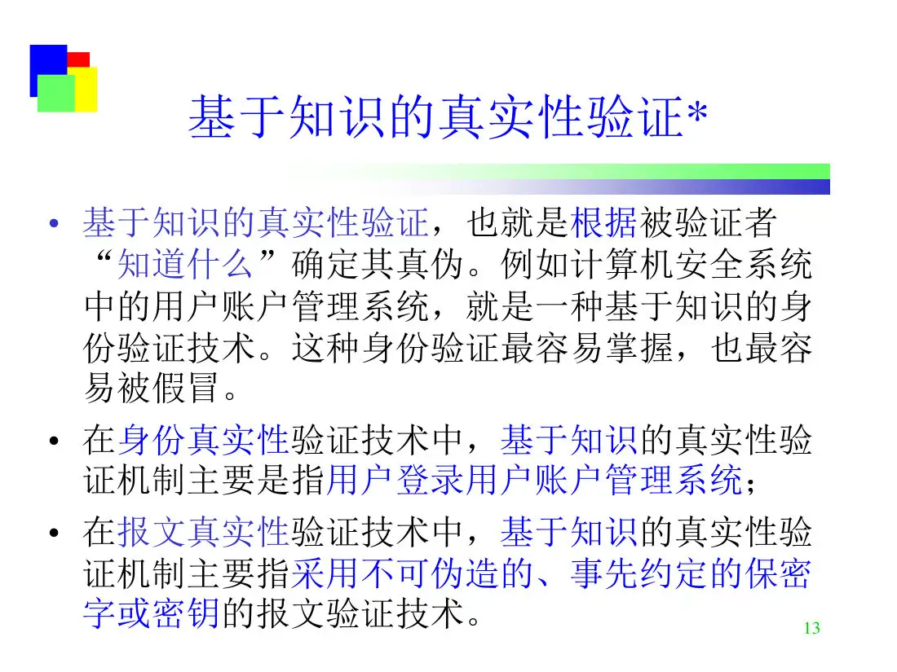

原文：

基于知识的真实性验证\*

• 基于知识的真实性验证，也就是根据被验证者“知道什么”确定其真伪。例如计算机安全系统中的用户账户管理系统，就是一种基于知识的身份验证技术。这种身份验证最容易掌握，也最容易被假冒。

• 在身份真实性验证技术中，基于知识的真实性验证机制主要是指用户登录用户账户管理系统；

• 在报文真实性验证技术中，基于知识的真实性验证机制主要指采用不可伪造的、事先约定的保密字或密钥的报文验证技术。 13

7

### 基于标志的真实性验证\

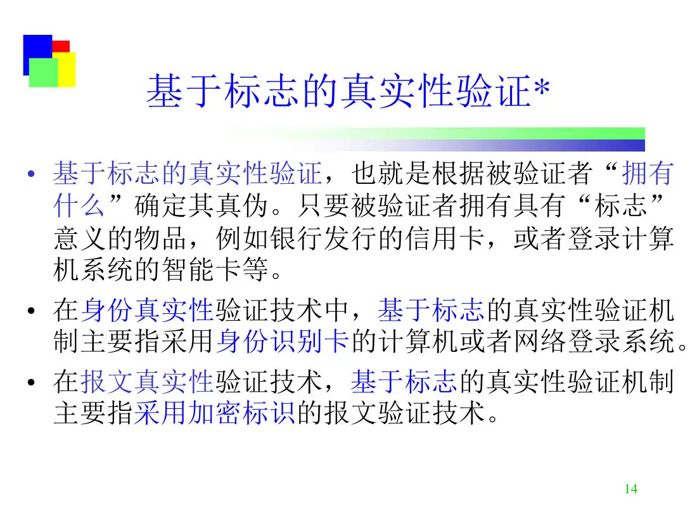

原文：

基于标志的真实性验证\*

• 基于标志的真实性验证，也就是根据被验证者“拥有什么”确定其真伪。只要被验证者拥有具有“标志”意义的物品，例如银行发行的信用卡，或者登录计算机系统的智能卡等。

• 在身份真实性验证技术中，基于标志的真实性验证机制主要指采用身份识别卡的计算机或者网络登录系统。

• 在报文真实性验证技术，基于标志的真实性验证机制主要指采用加密标识的报文验证技术。

7

14

### 基于特征的真实性验证\

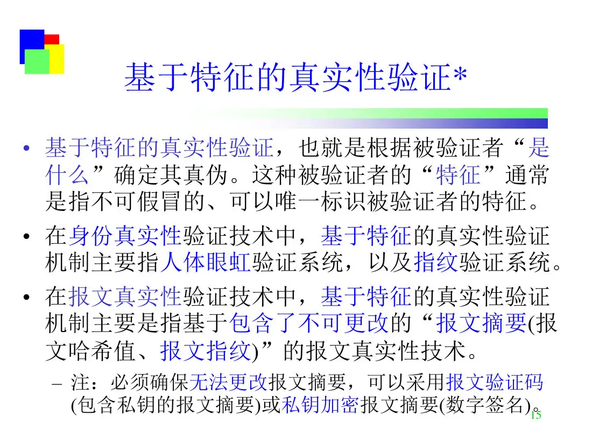

原文：

基于特征的真实性验证\*

基于特征的真实性验证，也就是根据被验证者“是什么”确定其真伪。这种被验证者的“特征”通常是指不可假冒的、可以唯一标识被验证者的特征。

• 在身份真实性验证技术中，基于特征的真实性验证机制主要指人体眼虹验证系统，以及指纹验证系统。

• 在报文真实性验证技术中，基于特征的真实性验证机制主要是指基于包含了不可更改的“报文摘要(报文哈希值、报文指纹)”的报文真实性技术。

– 注：必须确保无法更改报文摘要，可以采用报文验证码(包含私钥的报文摘要)或私钥加密报文摘要(数字签名)。

1

### 真实性验证内容的组合

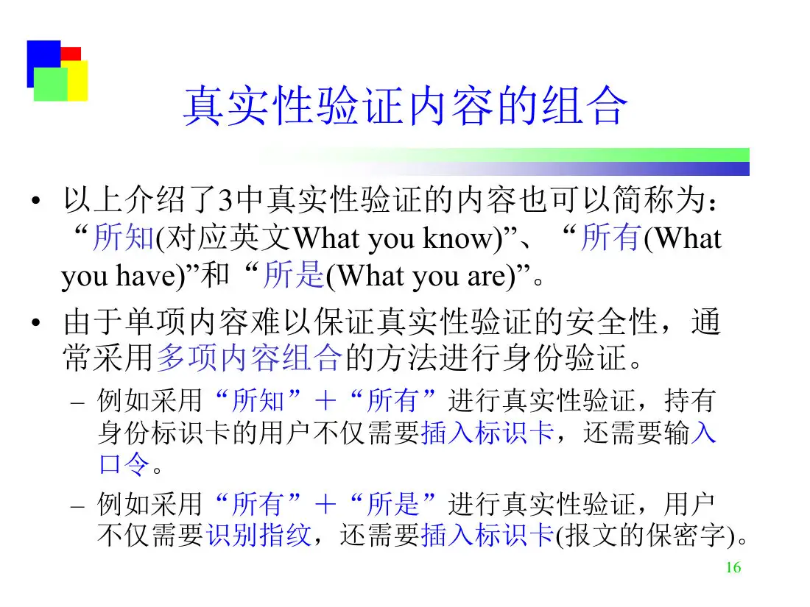

原文：

真实性验证内容的组合

• 以上介绍了3中真实性验证的内容也可以简称为：“所知(对应英文What you know)”、“所有(Whatyou have)”和“所是(What you are)”。

• 由于单项内容难以保证真实性验证的安全性，通常采用多项内容组合的方法进行身份验证。

– 例如采用“所知”＋“所有”进行真实性验证，持有身份标识卡的用户不仅需要插入标识卡，还需要输入口令。

– 例如采用“所有”＋“所是”进行真实性验证，用户不仅需要识别指纹，还需要插入标识卡(报文的保密字)。

1

16

### 真实性验证的交互方式

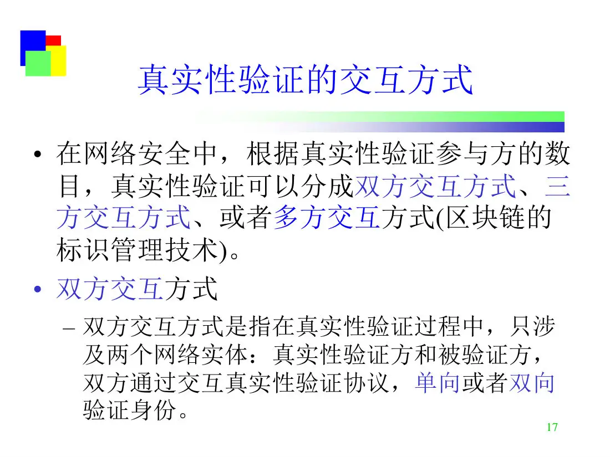

原文：

真实性验证的交互方式

• 在网络安全中，根据真实性验证参与方的数目，真实性验证可以分成双方交互方式、三方交互方式、或者多方交互方式(区块链的标识管理技术)。

• 双方交互方式

– 双方交互方式是指在真实性验证过程中，只涉及两个网络实体：真实性验证方和被验证方，双方通过交互真实性验证协议，单向或者双向验证身份。

7

17

### 双方交互的方式

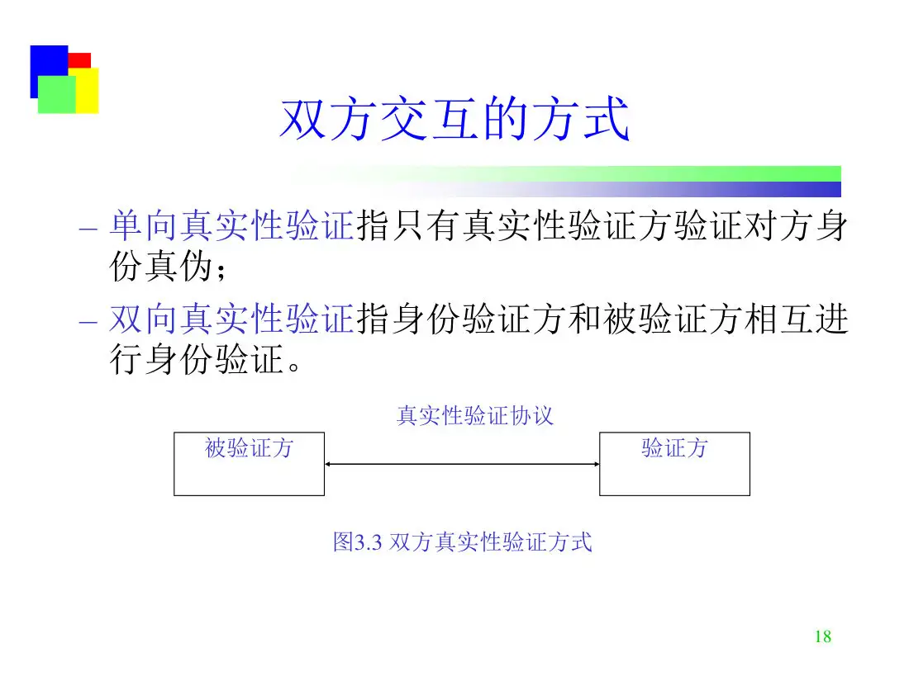

原文：

双方交互的方式

– 单向真实性验证指只有真实性验证方验证对方身份真伪；

– 双向真实性验证指身份验证方和被验证方相互进行身份验证。

18

### 三方交互方式

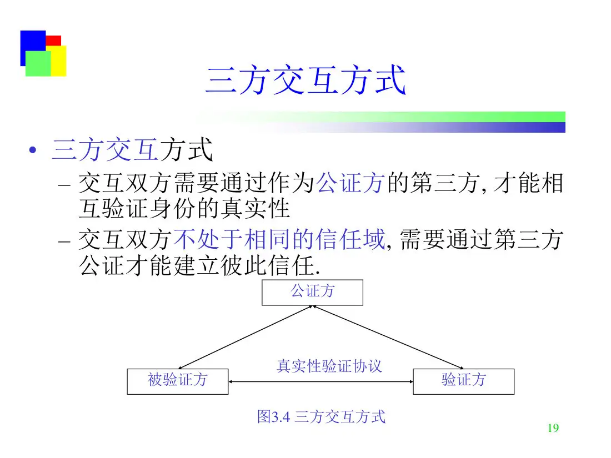

原文：

三方交互方式

• 三方交互方式

– 交互双方需要通过作为公证方的第三方, 才能相互验证身份的真实性

– 交互双方不处于相同的信任域, 需要通过第三方公证才能建立彼此信任.

19

### 报文真实性验证的方法

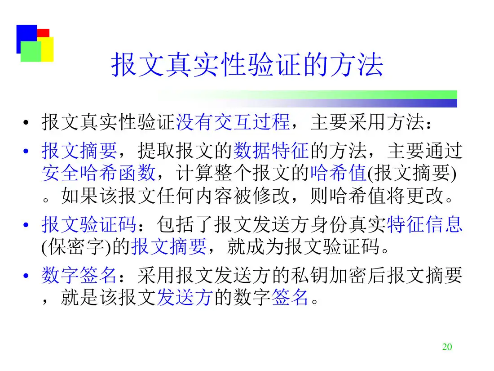

原文：

报文真实性验证的方法

• 报文真实性验证没有交互过程，主要采用方法：

报文摘要，提取报文的数据特征的方法，主要通过安全哈希函数，计算整个报文的哈希值(报文摘要)。如果该报文任何内容被修改，则哈希值将更改。

• 报文验证码：包括了报文发送方身份真实特征信息(保密字)的报文摘要，就成为报文验证码。

• 数字签名：采用报文发送方的私钥加密后报文摘要，就是该报文发送方的数字签名。

20

### 三方参与的报文真实性仲裁\

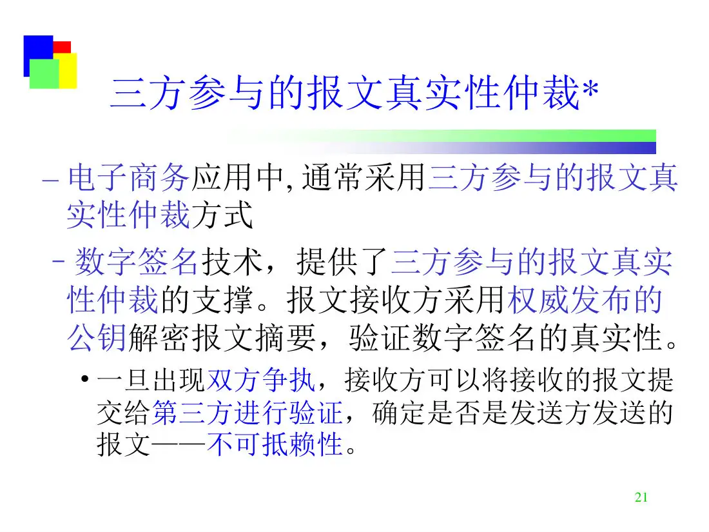

原文：

三方参与的报文真实性仲裁\*

–电子商务应用中, 通常采用三方参与的报文真实性仲裁方式

–数字签名技术，提供了三方参与的报文真实性仲裁的支撑。报文接收方采用权威发布的公钥解密报文摘要，验证数字签名的真实性。

•一旦出现双方争执，接收方可以将接收的报文提交给第三方进行验证，确定是否是发送方发送的报文——不可抵赖性。

21

### 重点内容回顾

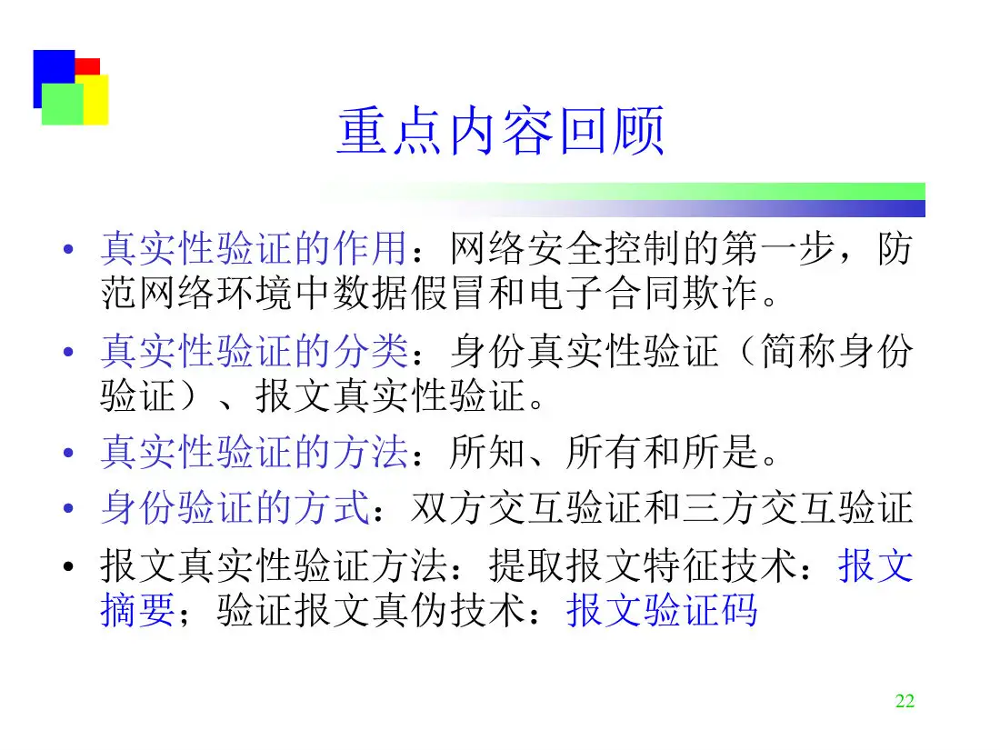

原文：

重点内容回顾

• 真实性验证的作用：网络安全控制的第一步，防范网络环境中数据假冒和电子合同欺诈。

• 真实性验证的分类：身份真实性验证（简称身份验证）、报文真实性验证。

• 真实性验证的方法：所知、所有和所是。

• 身份验证的方式：双方交互验证和三方交互验证

• 报文真实性验证方法：提取报文特征技术：报文摘要；验证报文真伪技术：报文验证码

22

### 思考题

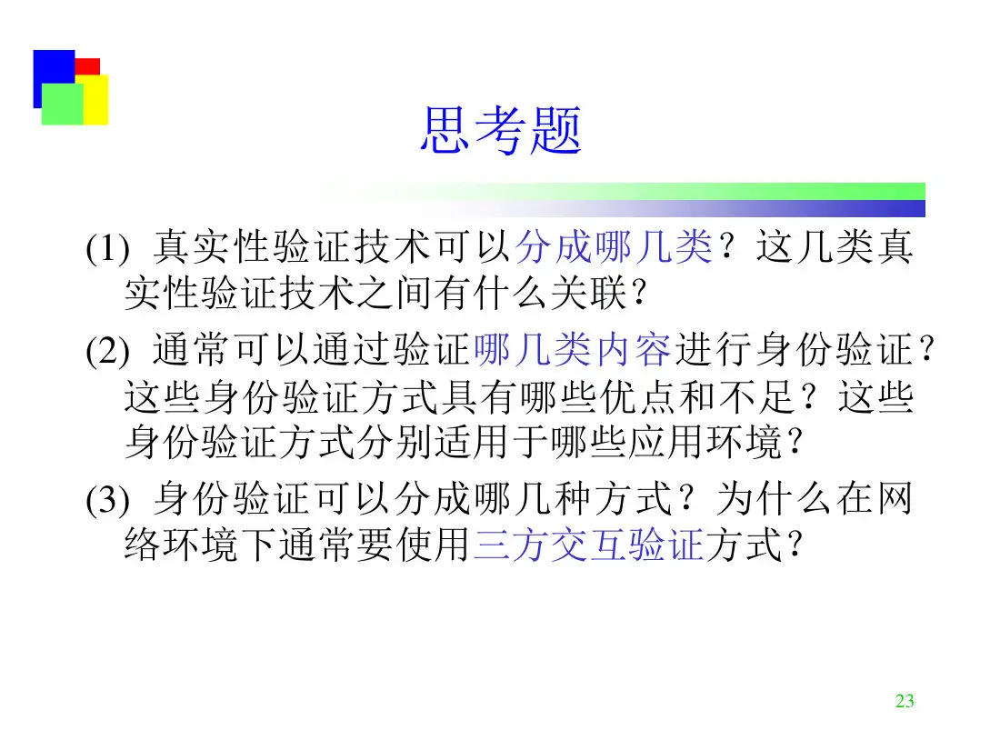

原文：

思考题

(1) 真实性验证技术可以分成哪几类？这几类真实性验证技术之间有什么关联？

(2) 通常可以通过验证哪几类内容进行身份验证？这些身份验证方式具有哪些优点和不足？这些身份验证方式分别适用于哪些应用环境？

(3) 身份验证可以分成哪几种方式？为什么在网络环境下通常要使用三方交互验证方式？

1

23
