# 《信息安全技术》第3章 网络真实性验证：报文真实性验证（课件）

原件的每一页，下面附识别出的文字。

### 第3章网络真实性验证报文真实性验证

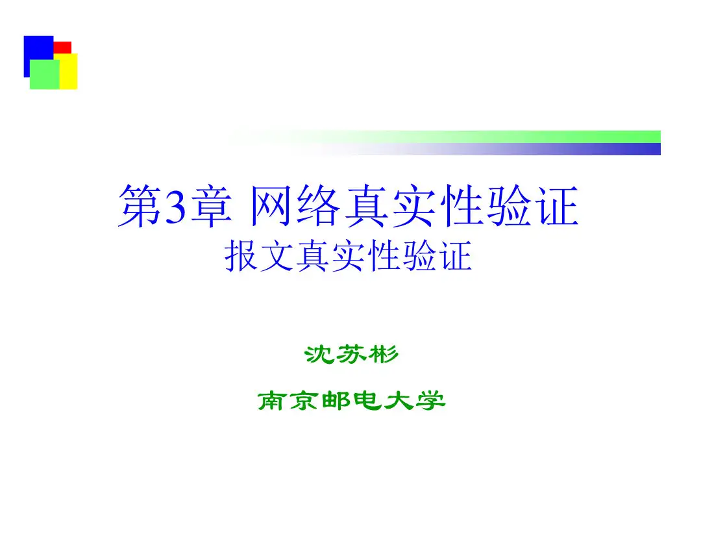

原文：

第3章网络真实性验证报文真实性验证

沈苏彬

南京邮电大学

### 关键知识点

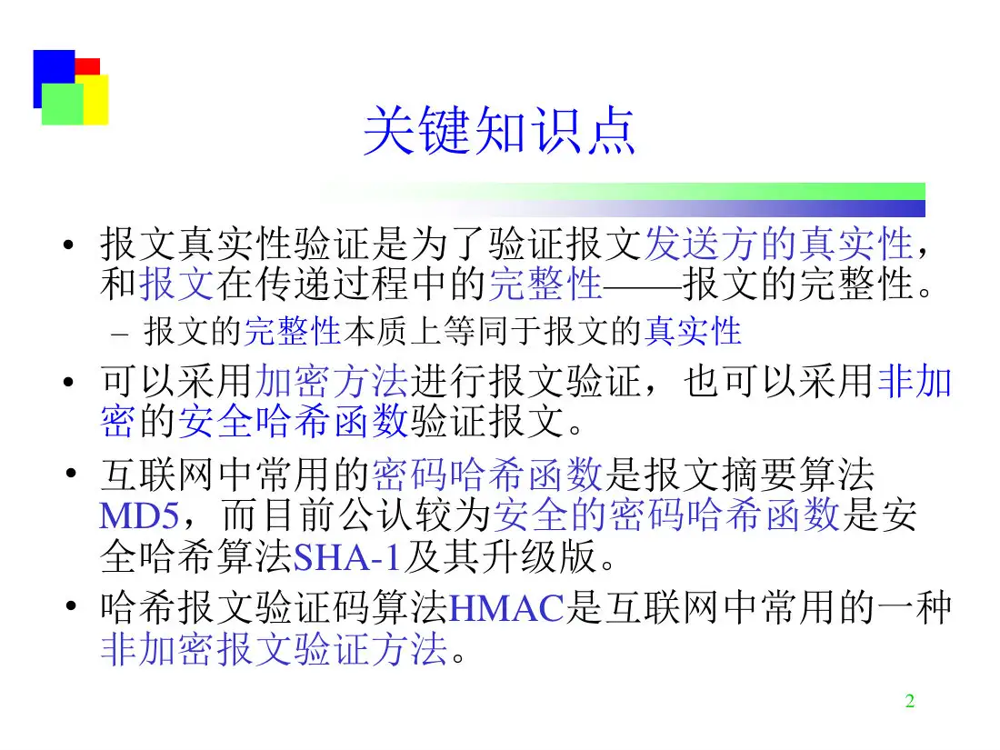

原文：

关键知识点

• 报文真实性验证是为了验证报文发送方的真实性，和报文在传递过程中的完整性——报文的完整性。– 报文的完整性本质上等同于报文的真实性

• 可以采用加密方法进行报文验证，也可以采用非加密的安全哈希函数验证报文。

• 互联网中常用的密码哈希函数是报文摘要算法MD5，而目前公认较为安全的密码哈希函数是安全哈希算法SHA-1及其升级版。

• 哈希报文验证码算法HMAC是互联网中常用的一种非加密报文验证方法。

7

2

### 主要内容

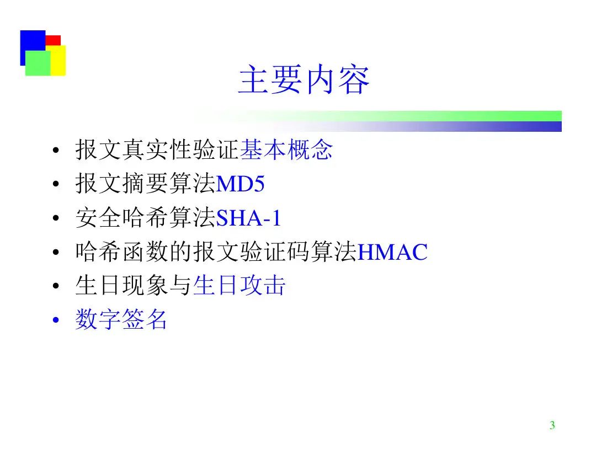

原文：

主要内容

• 报文真实性验证基本概念

• 报文摘要算法MD5

• 安全哈希算法SHA-1

• 哈希函数的报文验证码算法HMAC

• 生日现象与生日攻击

• 数字签名

7

3

### 报文真实性验证基本概念

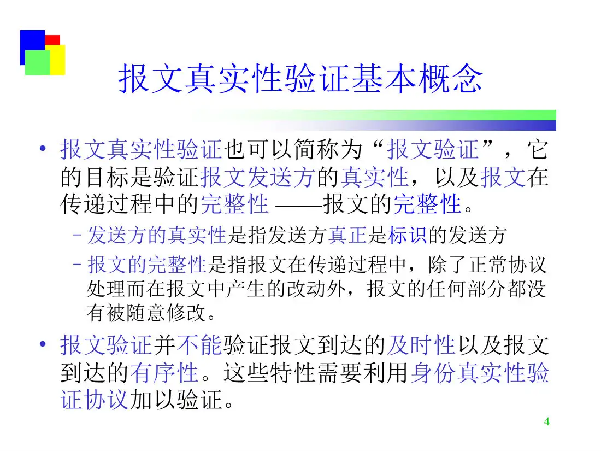

原文：

报文真实性验证基本概念

• 报文真实性验证也可以简称为“报文验证”，它的目标是验证报文发送方的真实性，以及报文在传递过程中的完整性 报文的完整性。

–发送方的真实性是指发送方真正是标识的发送方

–报文的完整性是指报文在传递过程中，除了正常协议处理而在报文中产生的改动外，报文的任何部分都没有被随意修改。

• 报文验证并不能验证报文到达的及时性以及报文到达的有序性。这些特性需要利用身份真实性验证协议加以验证。

4

### 采用加密的报文验证方法

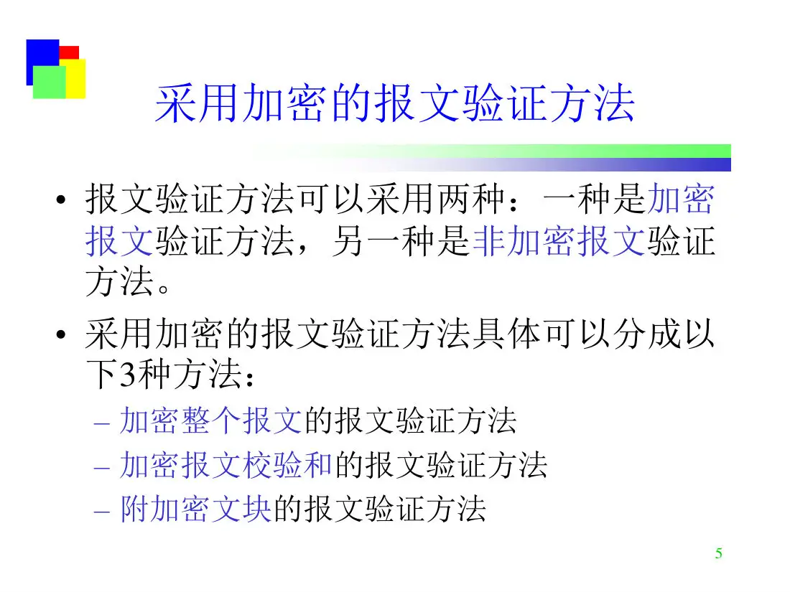

原文：

采用加密的报文验证方法

• 报文验证方法可以采用两种：一种是加密报文验证方法，另一种是非加密报文验证方法。

• 采用加密的报文验证方法具体可以分成以下3种方法：

– 加密整个报文的报文验证方法

– 加密报文校验和的报文验证方法

– 附加密文块的报文验证方法

5

### 加密整个报文的方法

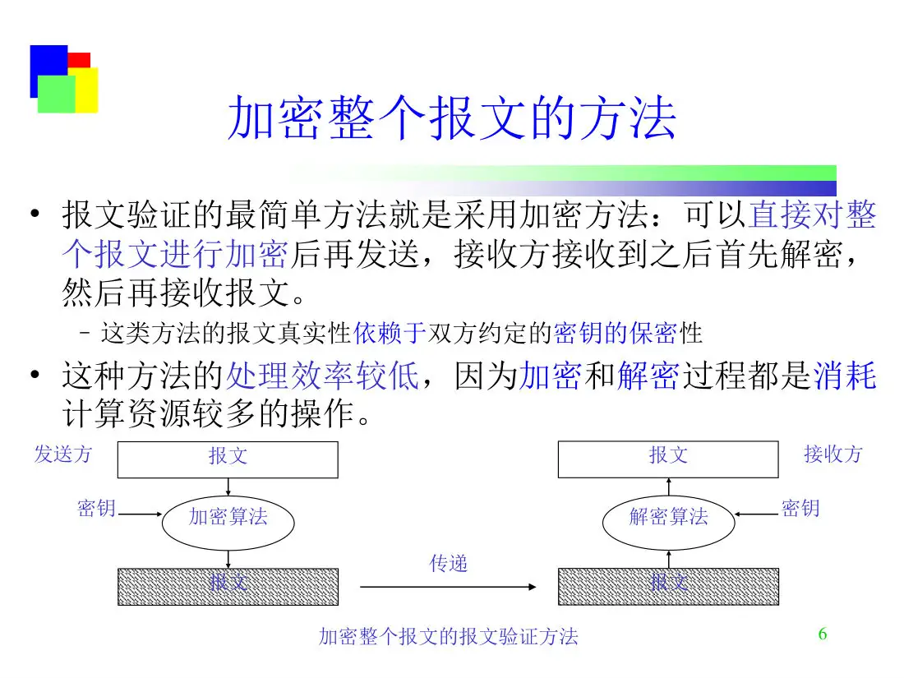

原文：

加密整个报文的方法

• 报文验证的最简单方法就是采用加密方法：可以直接对整个报文进行加密后再发送，接收方接收到之后首先解密，然后再接收报文。

–这类方法的报文真实性依赖于双方约定的密钥的保密性

• 这种方法的处理效率较低，因为加密和解密过程都是消耗计算资源较多的操作。

发送方

7

加密整个报文的报文验证方法

6

### 加密报文校验和的方法

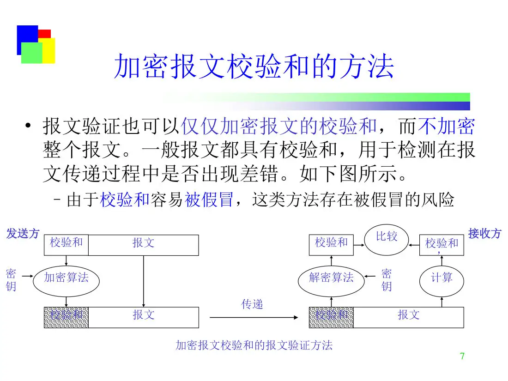

原文：

加密报文校验和的方法

• 报文验证也可以仅仅加密报文的校验和，而不加密整个报文。一般报文都具有校验和，用于检测在报文传递过程中是否出现差错。如下图所示。

–由于校验和容易被假冒，这类方法存在被假冒的风险

7

7

### 加密报文校验和的方法(续)

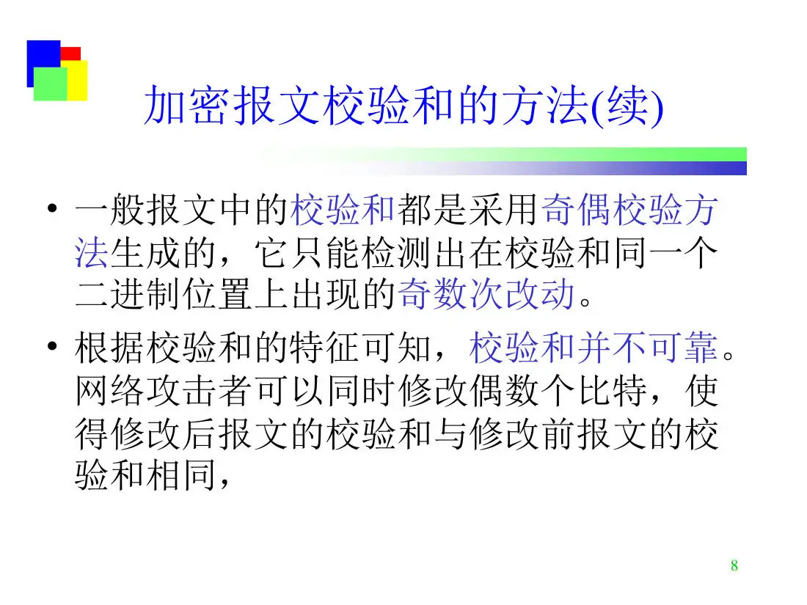

原文：

加密报文校验和的方法(续)

• 一般报文中的校验和都是采用奇偶校验方法生成的，它只能检测出在校验和同一个二进制位置上出现的奇数次改动。

• 根据校验和的特征可知，校验和并不可靠。网络攻击者可以同时修改偶数个比特，使得修改后报文的校验和与修改前报文的校验和相同，

7

8

### 附加密文块的方法

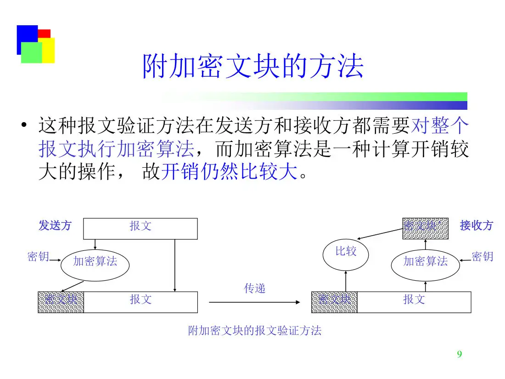

原文：

附加密文块的方法

• 这种报文验证方法在发送方和接收方都需要对整个报文执行加密算法，而加密算法是一种计算开销较大的操作， 故开销仍然比较大。

1

9

### 附加密文块的方法(续)

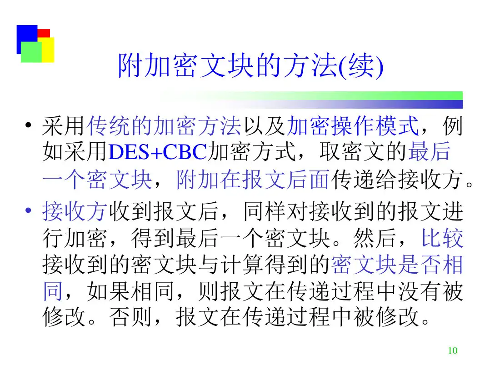

原文：

附加密文块的方法(续)

• 采用传统的加密方法以及加密操作模式，例如采用DES+CBC加密方式，取密文的最后一个密文块，附加在报文后面传递给接收方。

接收方收到报文后，同样对接收到的报文进行加密，得到最后一个密文块。然后，比较接收到的密文块与计算得到的密文块是否相同，如果相同，则报文在传递过程中没有被修改。否则，报文在传递过程中被修改。

1

10

### 报文摘要与密码哈希函数

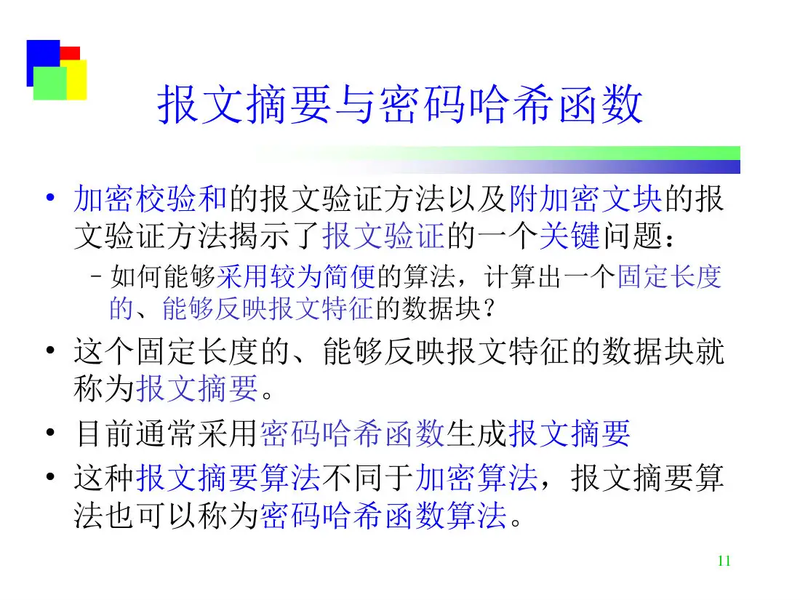

原文：

报文摘要与密码哈希函数

• 加密校验和的报文验证方法以及附加密文块的报文验证方法揭示了报文验证的一个关键问题：

–如何能够采用较为简便的算法，计算出一个固定长度的、能够反映报文特征的数据块？

• 这个固定长度的、能够反映报文特征的数据块就称为报文摘要。

• 目前通常采用密码哈希函数生成报文摘要

• 这种报文摘要算法不同于加密算法，报文摘要算法也可以称为密码哈希函数算法。

11

### 密码哈希函数的特征

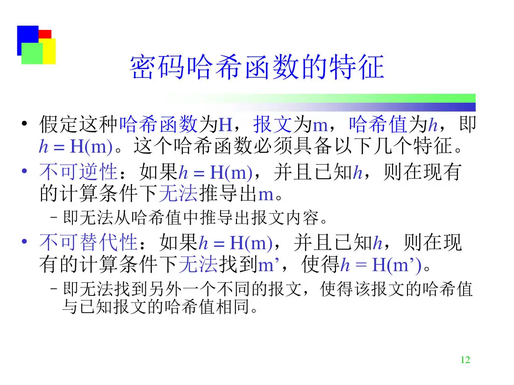

原文：

密码哈希函数的特征

• 假定这种哈希函数为H，报文为m，哈希值为h，即$h = \mathrm { H } ( \mathrm { m } )$ 。这个哈希函数必须具备以下几个特征。

• 不可逆性：如果 $h = \mathrm { H } ( \mathrm { m } )$ ，并且已知h，则在现有的计算条件下无法推导出m。

–即无法从哈希值中推导出报文内容。

不可替代性：如果 $h = \mathrm { H } ( \mathrm { m } )$ ，并且已知h，则在现有的计算条件下无法找到m’，使得 $h = \mathrm { H } ( \mathrm { m } ^ { \prime } )$ 。

–即无法找到另外一个不同的报文，使得该报文的哈希值与已知报文的哈希值相同。

7

12

### 密码哈希函数的特征(续)

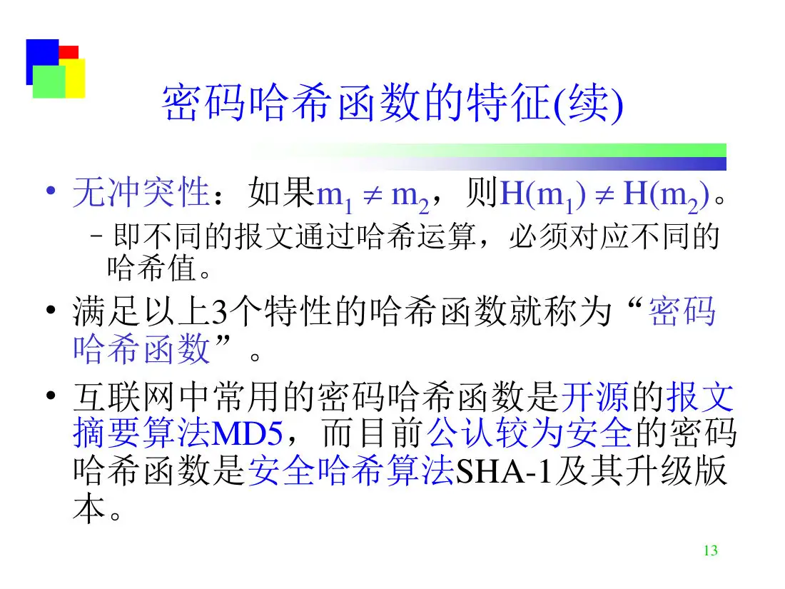

原文：

密码哈希函数的特征(续)

• 无冲突性：如果 $\mathbf { m } _ { 1 } \neq \mathbf { m } _ { 2 }$ ，则 $\mathrm { H } ( \mathrm { m } _ { 1 } ) \neq \mathrm { H } ( \mathrm { m } _ { 2 } )$ o–即不同的报文通过哈希运算，必须对应不同的哈希值。

• 满足以上3个特性的哈希函数就称为“密码哈希函数”。

• 互联网中常用的密码哈希函数是开源的报文摘要算法MD5，而目前公认较为安全的密码哈希函数是安全哈希算法SHA-1及其升级版本。

7

13

### 报文验证码

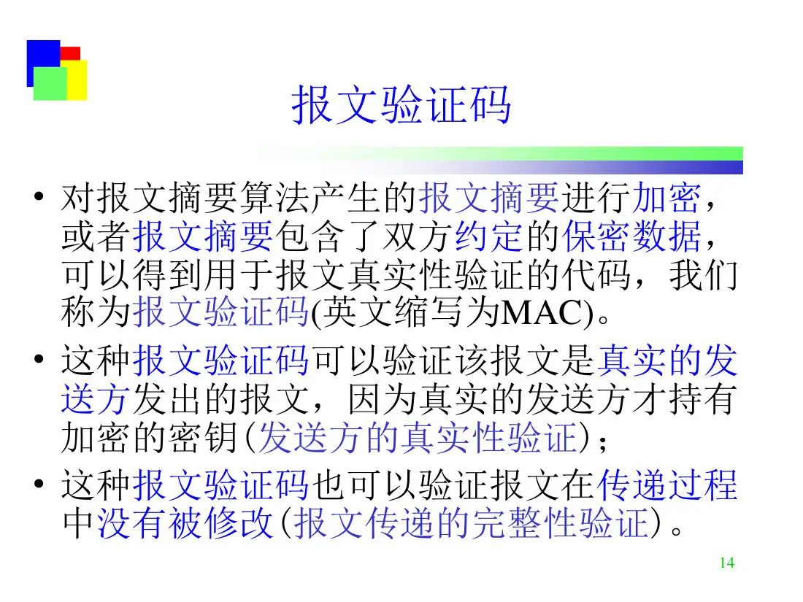

原文：

报文验证码

• 对报文摘要算法产生的报文摘要进行加密，或者报文摘要包含了双方约定的保密数据，可以得到用于报文真实性验证的代码，我们称为报文验证码(英文缩写为MAC)。

• 这种报文验证码可以验证该报文是真实的发送方发出的报文，因为真实的发送方才持有加密的密钥(发送方的真实性验证)；

• 这种报文验证码也可以验证报文在传递过程中没有被修改(报文传递的完整性验证)。

7

14

### 非加密报文验证方法

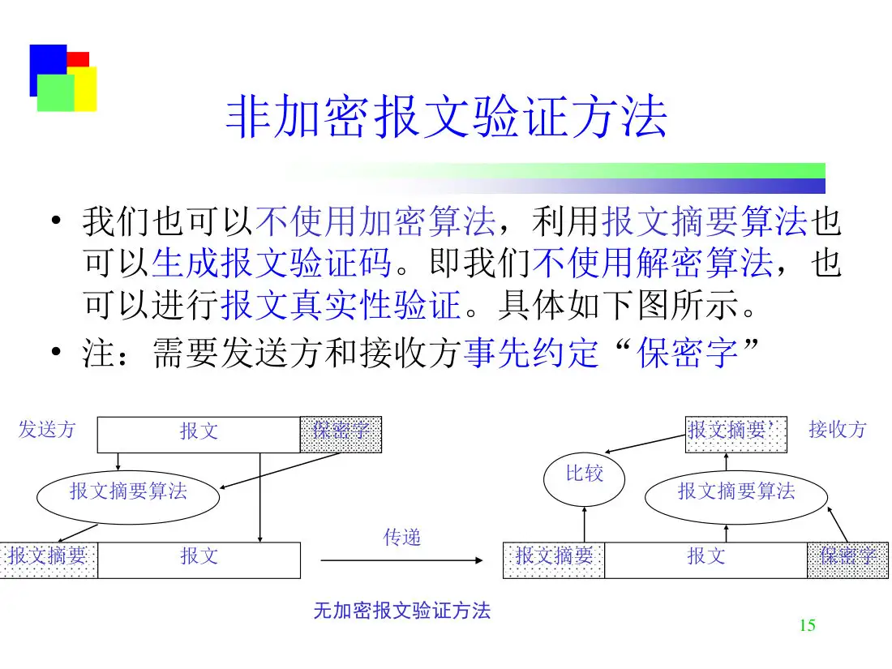

原文：

非加密报文验证方法

• 我们也可以不使用加密算法，利用报文摘要算法也可以生成报文验证码。即我们不使用解密算法，也可以进行报文真实性验证。具体如下图所示。

• 注：需要发送方和接收方事先约定“保密字”

1

15

### 非加密报文验证方法(续)

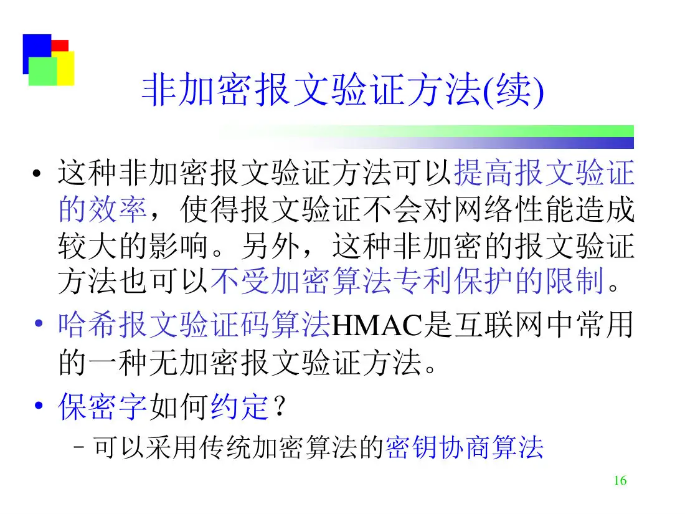

原文：

非加密报文验证方法(续)

• 这种非加密报文验证方法可以提高报文验证的效率，使得报文验证不会对网络性能造成较大的影响。另外，这种非加密的报文验证方法也可以不受加密算法专利保护的限制。

• 哈希报文验证码算法HMAC是互联网中常用的一种无加密报文验证方法。

• 保密字如何约定？

–可以采用传统加密算法的密钥协商算法

16

### 报文摘要算法MD5

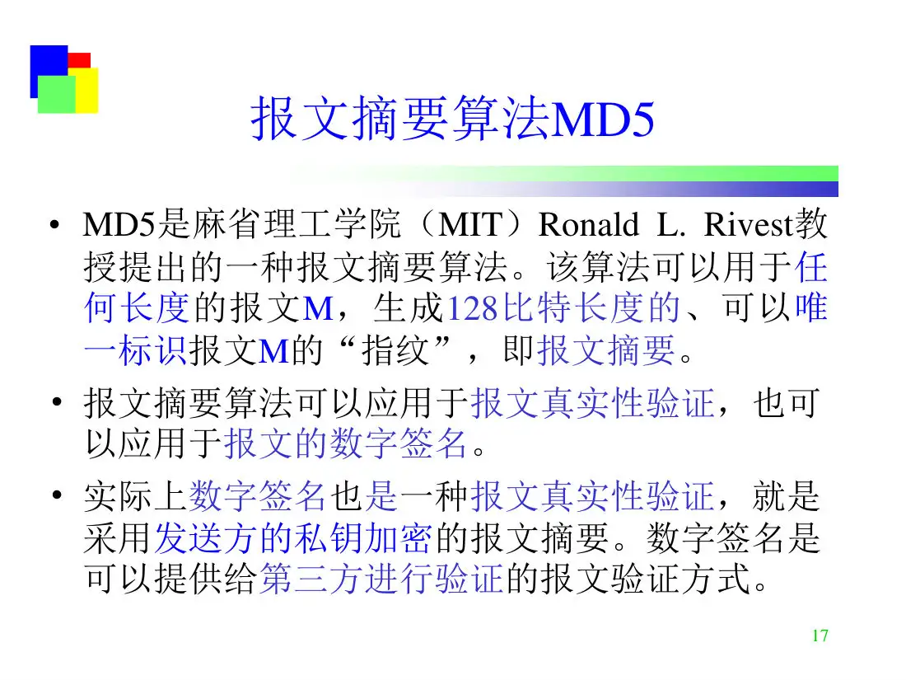

原文：

报文摘要算法MD5

• MD5是麻省理工学院（MIT）Ronald L. Rivest教授提出的一种报文摘要算法。该算法可以用于任何长度的报文M，生成128比特长度的、可以唯一标识报文M的“指纹”，即报文摘要。

• 报文摘要算法可以应用于报文真实性验证，也可以应用于报文的数字签名。

• 实际上数字签名也是一种报文真实性验证，就是采用发送方的私钥加密的报文摘要。数字签名是可以提供给第三方进行验证的报文验证方式。

7

17

### 报文摘要算法MD5(续1)

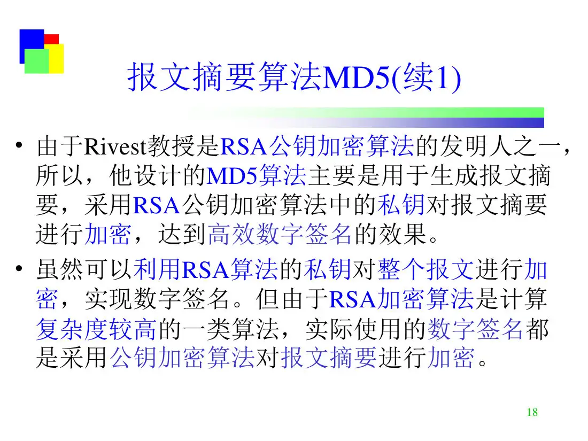

原文：

报文摘要算法MD5(续1)

• 由于Rivest教授是RSA公钥加密算法的发明人之一，所以，他设计的MD5算法主要是用于生成报文摘要，采用RSA公钥加密算法中的私钥对报文摘要进行加密，达到高效数字签名的效果。

• 虽然可以利用RSA算法的私钥对整个报文进行加密，实现数字签名。但由于RSA加密算法是计算复杂度较高的一类算法，实际使用的数字签名都是采用公钥加密算法对报文摘要进行加密。

7

18

### MD5算法基本处理步骤

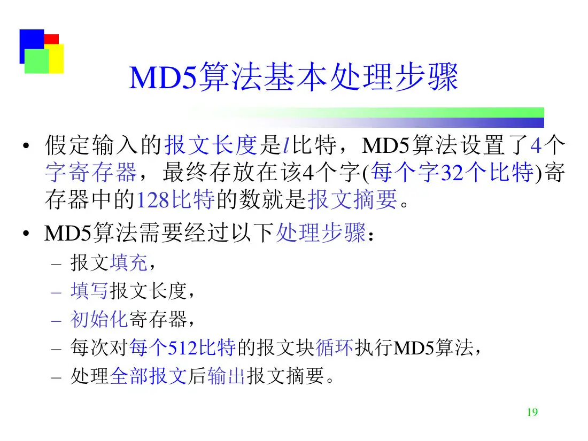

原文：

MD5算法基本处理步骤

• 假定输入的报文长度是l比特，MD5算法设置了4个字寄存器，最终存放在该4个字(每个字32个比特)寄存器中的128比特的数就是报文摘要。

• MD5算法需要经过以下处理步骤：

– 报文填充，

– 填写报文长度，

– 初始化寄存器，

– 每次对每个512比特的报文块循环执行MD5算法，

– 处理全部报文后输出报文摘要。

7

19

### MD5算法的报文填充

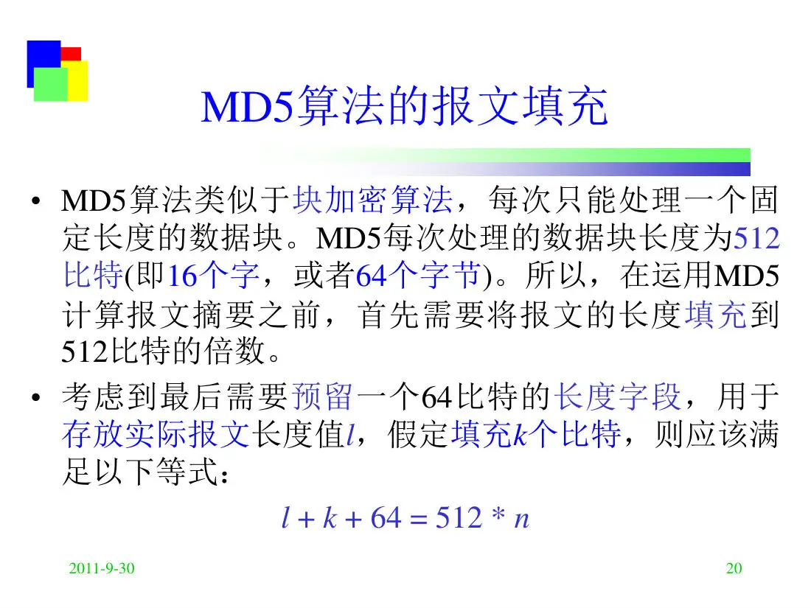

原文：

MD5算法的报文填充

• MD5算法类似于块加密算法，每次只能处理一个固定长度的数据块。MD5每次处理的数据块长度为512比特(即16个字，或者64个字节)。所以，在运用MD5计算报文摘要之前，首先需要将报文的长度填充到512比特的倍数。

• 考虑到最后需要预留一个64比特的长度字段，用于存放实际报文长度值l，假定填充k个比特，则应该满足以下等式：

$$
l + k + 6 4 = 5 1 2 * n
$$

7

2011-9-30

20

### MD5算法的报文填充(续)

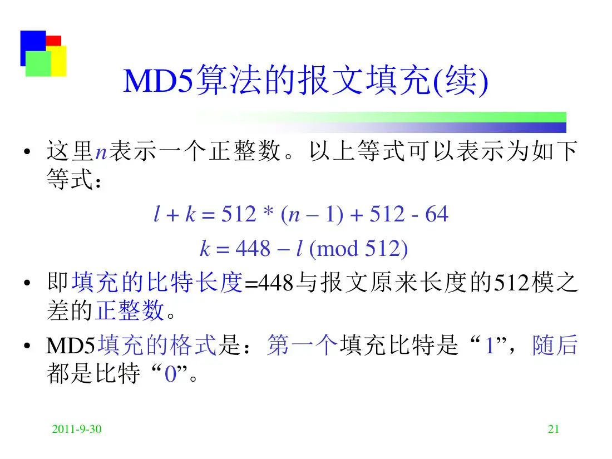

原文：

MD5算法的报文填充(续)

• 这里n表示一个正整数。以上等式可以表示为如下等式：

$$
\begin{array}{c} {l + k = 5 1 2 * (n - 1) + 5 1 2 - 6 4} \\ {k = 4 4 8 - l (\mathrm{mod} 5 1 2)} \end{array}
$$

• 即填充的比特长度=448与报文原来长度的512模之差的正整数。

• MD5填充的格式是：第一个填充比特是“1”，随后都是比特“0”。

1

2011-9-30

21

### MD5算法填写报文长度

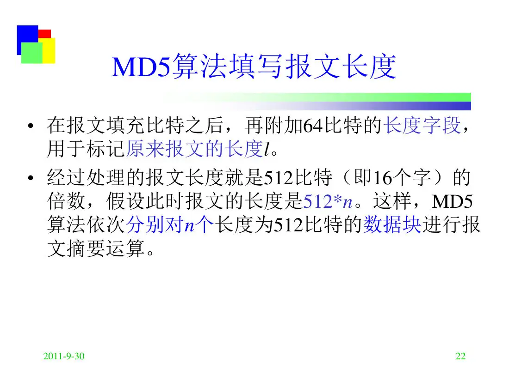

原文：

MD5算法填写报文长度

• 在报文填充比特之后，再附加64比特的长度字段，用于标记原来报文的长度l。

• 经过处理的报文长度就是512比特（即16个字）的倍数，假设此时报文的长度是512\*n。这样，MD5算法依次分别对n个长度为512比特的数据块进行报文摘要运算。

7

2011-9-30

22

### MD5算法填写报文长度(续)

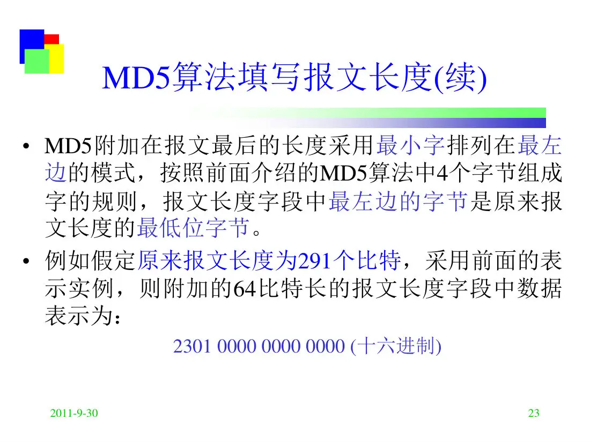

原文：

MD5算法填写报文长度(续)

• MD5附加在报文最后的长度采用最小字排列在最左边的模式，按照前面介绍的MD5算法中4个字节组成字的规则，报文长度字段中最左边的字节是原来报文长度的最低位字节。

• 例如假定原来报文长度为291个比特，采用前面的表示实例，则附加的64比特长的报文长度字段中数据表示为：

2301 0000 0000 0000 (十六进制)

7

2011-9-30

23

### 初始化MD5寄存器

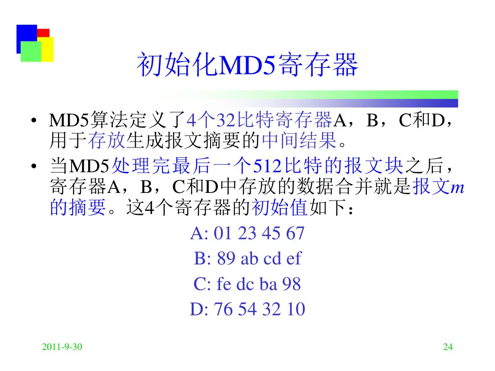

原文：

初始化MD5寄存器

• MD5算法定义了4个32比特寄存器A，B，C和D，用于存放生成报文摘要的中间结果。

• 当MD5处理完最后一个512比特的报文块之后，寄存器A，B，C和D中存放的数据合并就是报文m的摘要。这4个寄存器的初始值如下：

A: 01 23 45 67 B: 89 ab cd ef C: fe dc ba 98 D: 76 54 32 10

7

2011-9-30

24

### MD5算法循环处理报文块

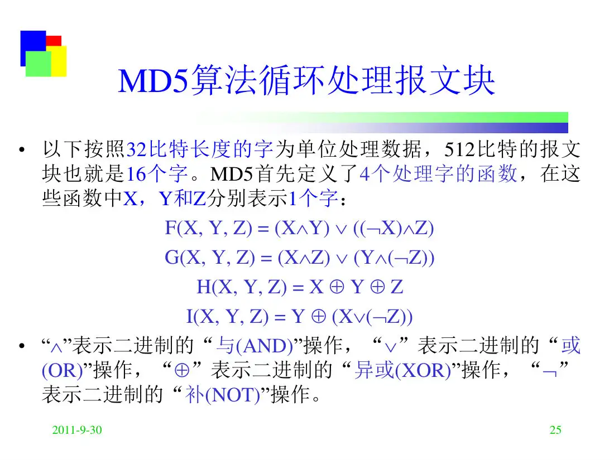

原文：

MD5算法循环处理报文块

• 以下按照32比特长度的字为单位处理数据，512比特的报文块也就是16个字。MD5首先定义了4个处理字的函数，在这些函数中X，Y和Z分别表示1个字：

$$
\begin{array}{r l} & {\mathrm{F(X,Y,Z)} = (\mathrm {X\wedge Y}) \vee ((\neg \mathrm{X}) \wedge \mathrm{Z})} \\ & {\mathrm{G(X,Y,Z)} = (\mathrm {X\wedge Z}) \vee (\mathrm {Y\wedge(\neg Z)})} \\ & {\qquad \mathrm{H(X,Y,Z)} = \mathrm{X} \oplus \mathrm{Y} \oplus \mathrm{Z}} \\ & {\qquad \mathrm{I(X,Y,Z)} = \mathrm{Y} \oplus (\mathrm {X\vee(\neg Z)})} \end{array}
$$

•“”表示二进制的“与(AND)”操作，“√”表示二进制的“或(OR)”操作，“⊕”表示二进制的“异或(XOR)”操作，“”表示二进制的“补(NOT)”操作。

1

2011-9-30

25

### MD5算法循环处理报文块(续1)

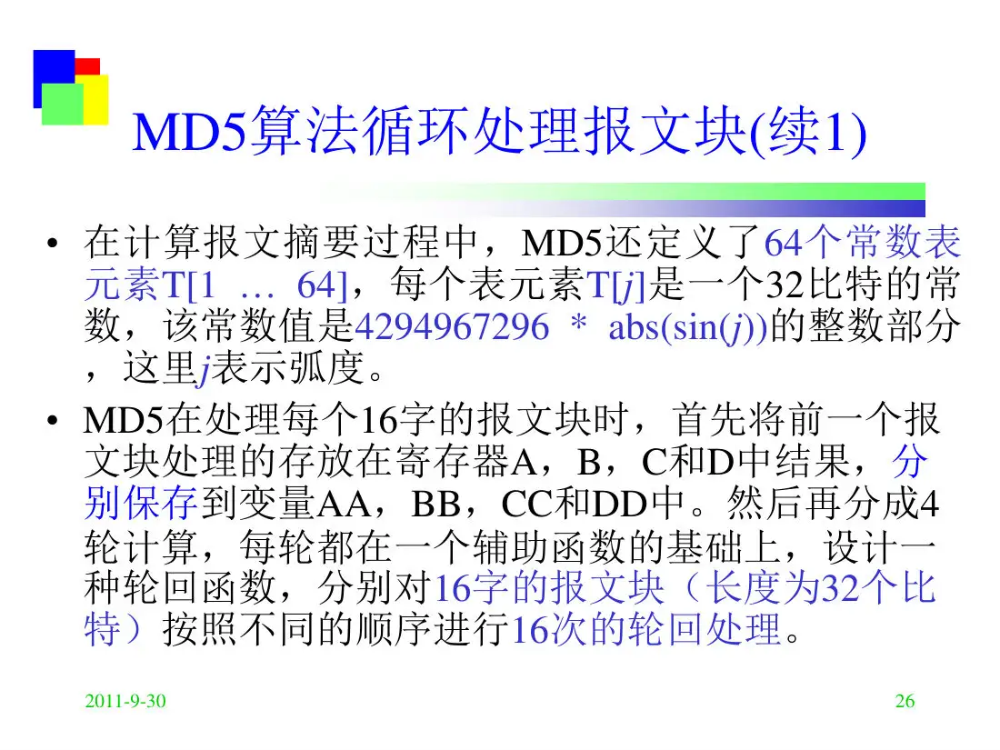

原文：

MD5算法循环处理报文块(续1)

• 在计算报文摘要过程中，MD5还定义了64个常数表元素T[1 … 64]，每个表元素T[j]是一个32比特的常数，该常数值是4294967296 \* abs(sin(j))的整数部分，这里j表示弧度。

• MD5在处理每个16字的报文块时，首先将前一个报文块处理的存放在寄存器A，B，C和D中结果，分别保存到变量AA，BB，CC和DD中。然后再分成4轮计算，每轮都在一个辅助函数的基础上，设计一种轮回函数，分别对16字的报文块（长度为32个比特）按照不同的顺序进行16次的轮回处理。

2011-9-30

26

### MD5算法循环处理报文块(续2)

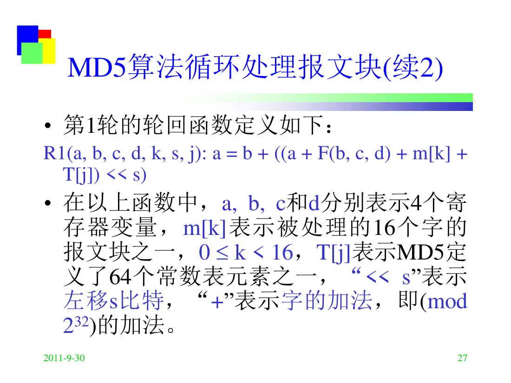

原文：

MD5算法循环处理报文块(续2)

• 第1轮的轮回函数定义如下：

R1(a, b, c, d, k, s, j): a = b + ((a + F(b, c, d) + m[k] + $\mathrm { T } [ \mathrm { j } ] ) < < \mathrm { s } )$

• 在以上函数中，a, b, c和d分别表示4个寄存器变量，m[k]表示被处理的16个字的报文块之一， $0 \leq \mathrm { k } < 1 6$ ，T[j]表示MD5定义了64个常数表元素之一， $^ { 6 6 } < < \mathrm { ~ s ~ } ^ { 9 9 }$ 表示左移s比特，“+”表示字的加法，即(mod$2 ^ { 3 2 } )$ 的加法。

2011-9-30

27

### MD5算法循环处理报文块(续3)

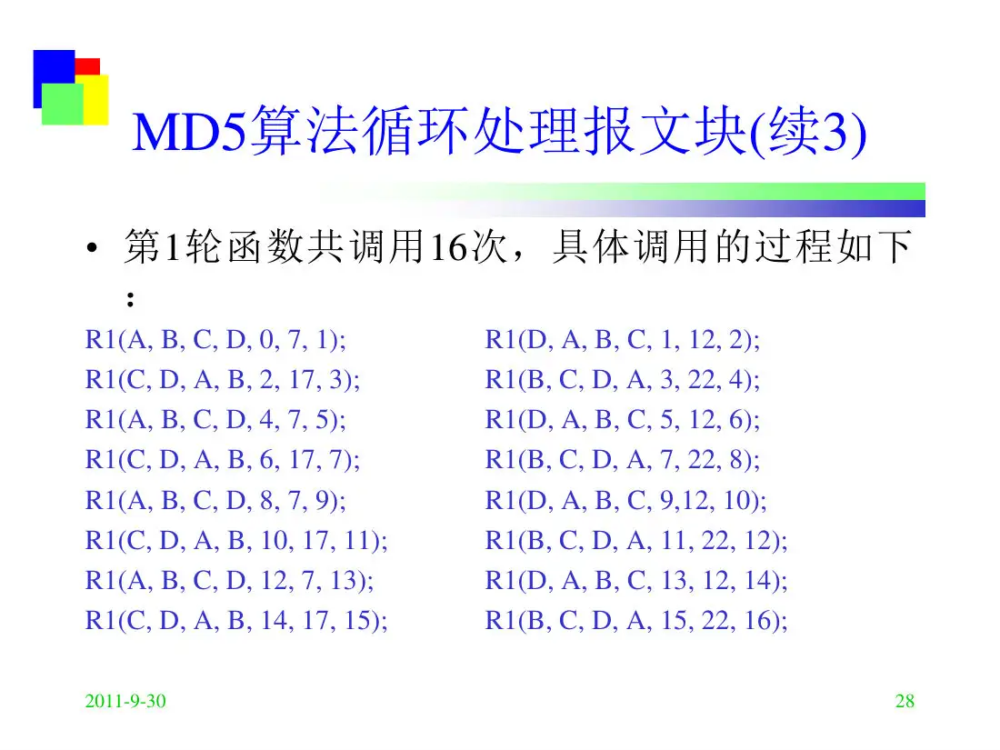

原文：

MD5算法循环处理报文块(续3)

• 第1轮函数共调用16次，具体调用的过程如下

<table><tr><td>R1(A, B, C, D, 0, 7, 1);</td><td>R1(D, A, B, C, 1, 12, 2);</td></tr><tr><td>R1(C, D, A, B, 2, 17, 3);</td><td>R1(B, C, D, A, 3, 22, 4);</td></tr><tr><td>R1(A, B, C, D, 4, 7, 5);</td><td>R1(D, A, B, C, 5, 12, 6);</td></tr><tr><td>R1(C, D, A, B, 6, 17, 7);</td><td>R1(B, C, D, A, 7, 22, 8);</td></tr><tr><td>R1(A, B, C, D, 8, 7, 9);</td><td>R1(D, A, B, C, 9,12, 10);</td></tr><tr><td>R1(C, D, A, B, 10, 17, 11);</td><td>R1(B, C, D, A, 11, 22, 12);</td></tr><tr><td>R1(A, B, C, D, 12, 7, 13);</td><td>R1(D, A, B, C, 13, 12, 14);</td></tr><tr><td>R1(C, D, A, B, 14, 17, 15);</td><td>R1(B, C, D, A, 15, 22, 16);</td></tr></table>

2011-9-30

28

### MD5算法循环处理报文块(续4)

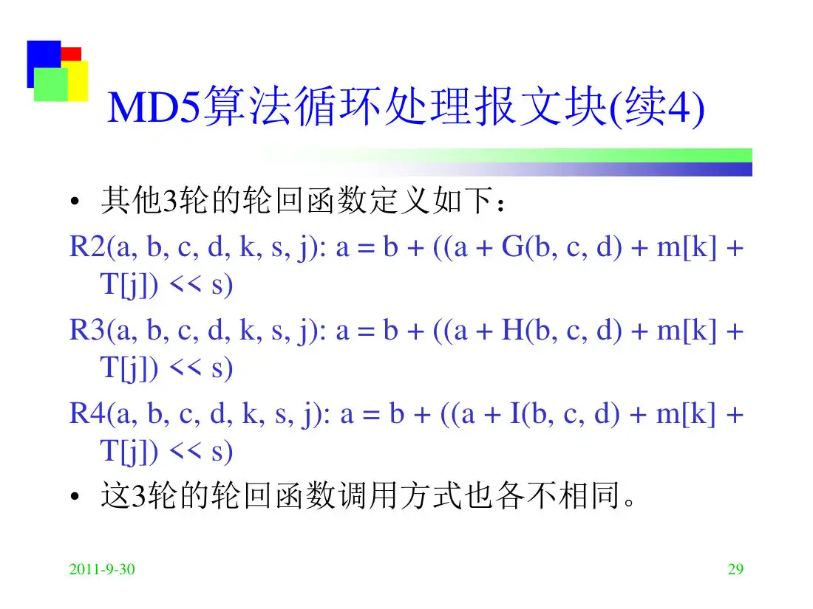

原文：

MD5算法循环处理报文块(续4)

• 其他3轮的轮回函数定义如下：

R2(a, b, c, d, k, s, j): a = b + ((a + G(b, c, d) + m[k] + T[j]) << s) R3(a, b, c, d, k, s, j): a = b + ((a + H(b, c, d) + m[k] + T[j]) << s) R4(a, b, c, d, k, s, j): a = b + ((a + I(b, c, d) + m[k] + T[j]) << s)

• 这3轮的轮回函数调用方式也各不相同。

2011-9-30

29

### MD5算法循环处理报文块(续5)

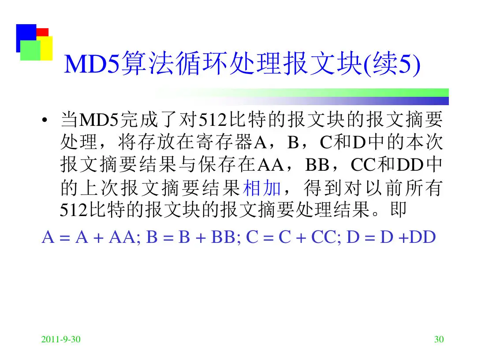

原文：

MD5算法循环处理报文块(续5)

• 当MD5完成了对512比特的报文块的报文摘要处理，将存放在寄存器A，B，C和D中的本次报文摘要结果与保存在AA，BB，CC和DD中的上次报文摘要结果相加，得到对以前所有512比特的报文块的报文摘要处理结果。即

$$
\mathrm{A} = \mathrm{A} + \mathrm{AA}; \mathrm{B} = \mathrm{B} + \mathrm{BB}; \mathrm{C} = \mathrm{C} + \mathrm{CC}; \mathrm{D} = \mathrm{D} + \mathrm{DD}
$$

2011-9-30

30

### MD5算法输出报文摘要

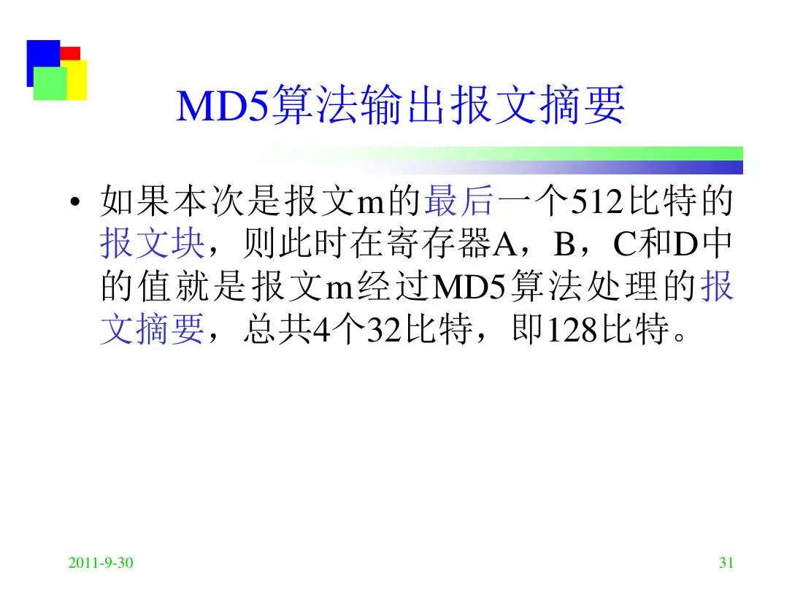

原文：

MD5算法输出报文摘要

• 如果本次是报文m的最后一个512比特的报文块，则此时在寄存器A，B，C和D中的值就是报文m经过MD5算法处理的报文摘要，总共4个32比特，即128比特。

7

2011-9-30

31

### MD5算法分析

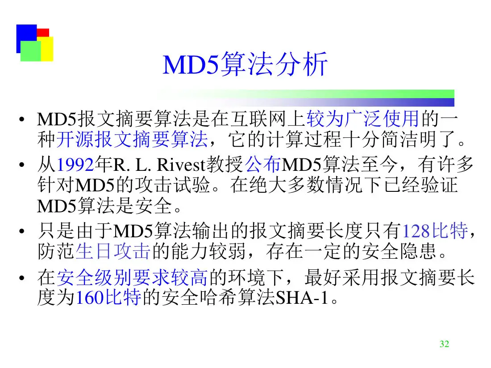

原文：

MD5算法分析

• MD5报文摘要算法是在互联网上较为广泛使用的一种开源报文摘要算法，它的计算过程十分简洁明了。

• 从1992年R. L. Rivest教授公布MD5算法至今，有许多针对MD5的攻击试验。在绝大多数情况下已经验证MD5算法是安全。

• 只是由于MD5算法输出的报文摘要长度只有128比特，防范生日攻击的能力较弱，存在一定的安全隐患。

• 在安全级别要求较高的环境下，最好采用报文摘要长度为160比特的安全哈希算法SHA-1。

1

32

### 安全哈希算法SHA-1

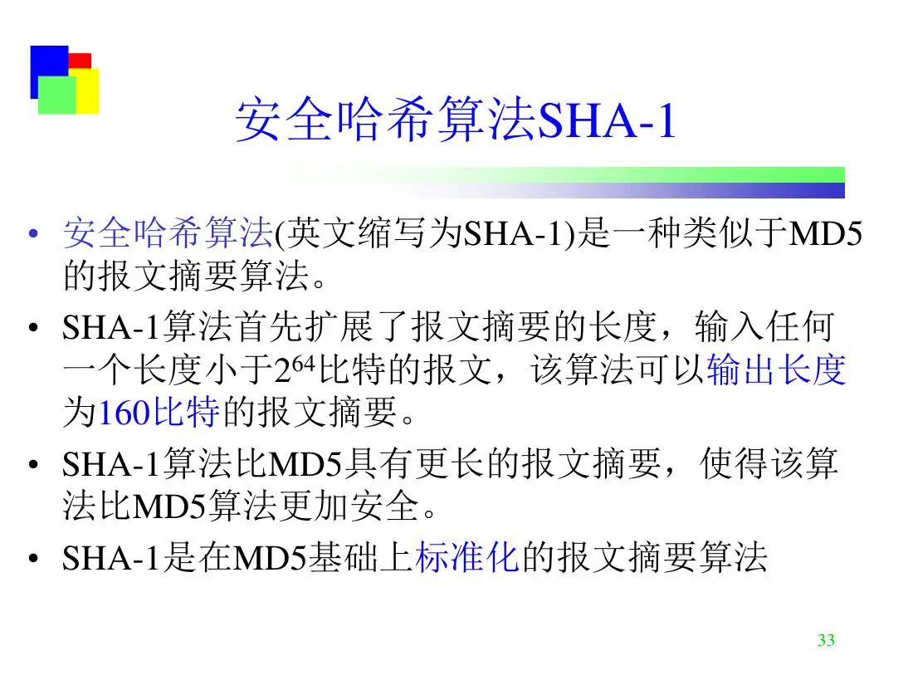

原文：

安全哈希算法SHA-1

• 安全哈希算法(英文缩写为SHA-1)是一种类似于MD5的报文摘要算法。

• SHA-1算法首先扩展了报文摘要的长度，输入任何一个长度小于264比特的报文，该算法可以输出长度为160比特的报文摘要。

• SHA-1算法比MD5具有更长的报文摘要，使得该算法比MD5算法更加安全。

• SHA-1是在MD5基础上标准化的报文摘要算法

7

33

### 安全哈希算法SHA-1(续)

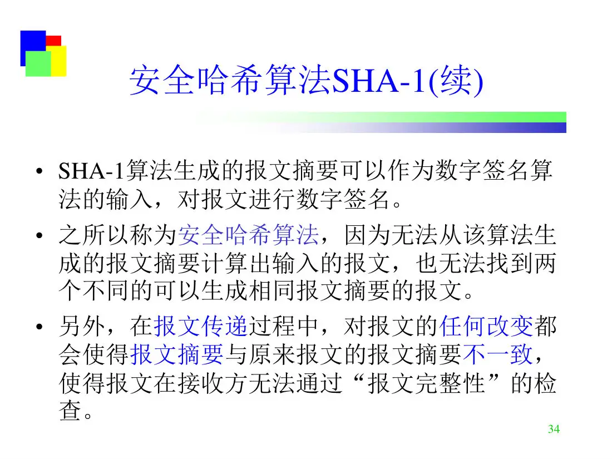

原文：

安全哈希算法SHA-1(续)

• SHA-1算法生成的报文摘要可以作为数字签名算法的输入，对报文进行数字签名。

• 之所以称为安全哈希算法，因为无法从该算法生成的报文摘要计算出输入的报文，也无法找到两个不同的可以生成相同报文摘要的报文。

• 另外，在报文传递过程中，对报文的任何改变都会使得报文摘要与原来报文的报文摘要不一致，使得报文在接收方无法通过“报文完整性”的检查。

7

34

### SHA-1算法的执行过程

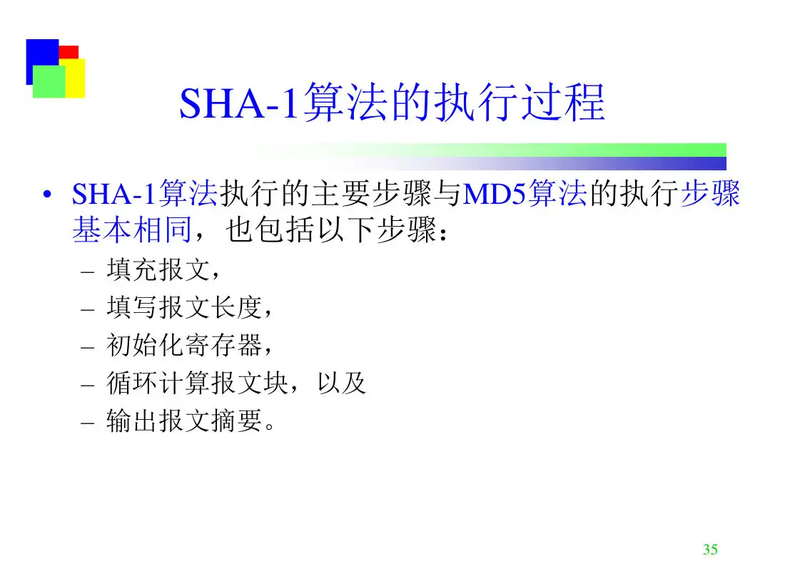

原文：

SHA-1算法的执行过程

• SHA-1算法执行的主要步骤与MD5算法的执行步骤基本相同，也包括以下步骤：

– 填充报文，

– 填写报文长度，

– 初始化寄存器，

– 循环计算报文块，以及

– 输出报文摘要。

7

35

### 填充报文

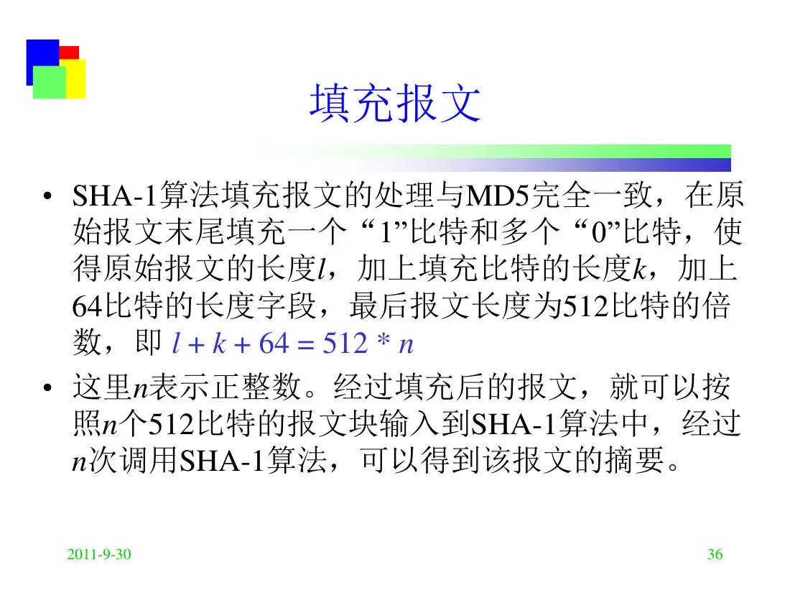

原文：

填充报文

• SHA-1算法填充报文的处理与MD5完全一致，在原始报文末尾填充一个“1”比特和多个“0”比特，使得原始报文的长度l，加上填充比特的长度k，加上64比特的长度字段，最后报文长度为512比特的倍数，即 $l + k + 6 4 = 5 1 2 * n$

• 这里n表示正整数。经过填充后的报文，就可以按照n个512比特的报文块输入到SHA-1算法中，经过n次调用SHA-1算法，可以得到该报文的摘要。

2011-9-30

36

### 填写报文长度

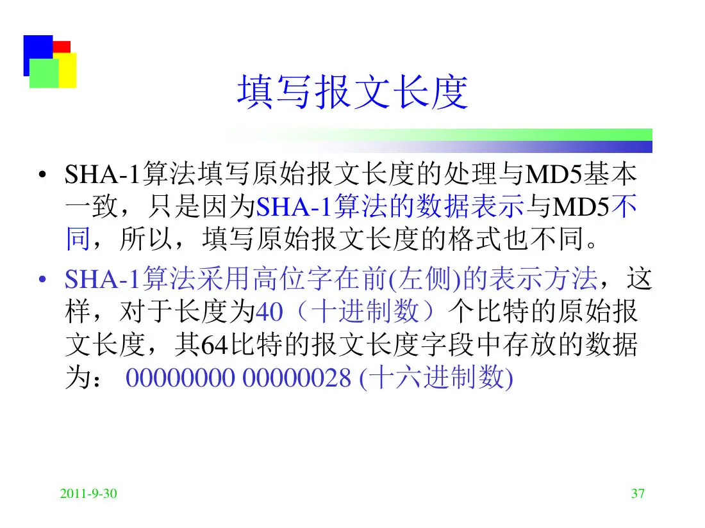

原文：

填写报文长度

• SHA-1算法填写原始报文长度的处理与MD5基本一致，只是因为SHA-1算法的数据表示与MD5不同，所以，填写原始报文长度的格式也不同。

• SHA-1算法采用高位字在前(左侧)的表示方法，这样，对于长度为40（十进制数）个比特的原始报文长度，其64比特的报文长度字段中存放的数据为： 00000000 00000028 (十六进制数)

2011-9-30

37

### 初始化寄存器

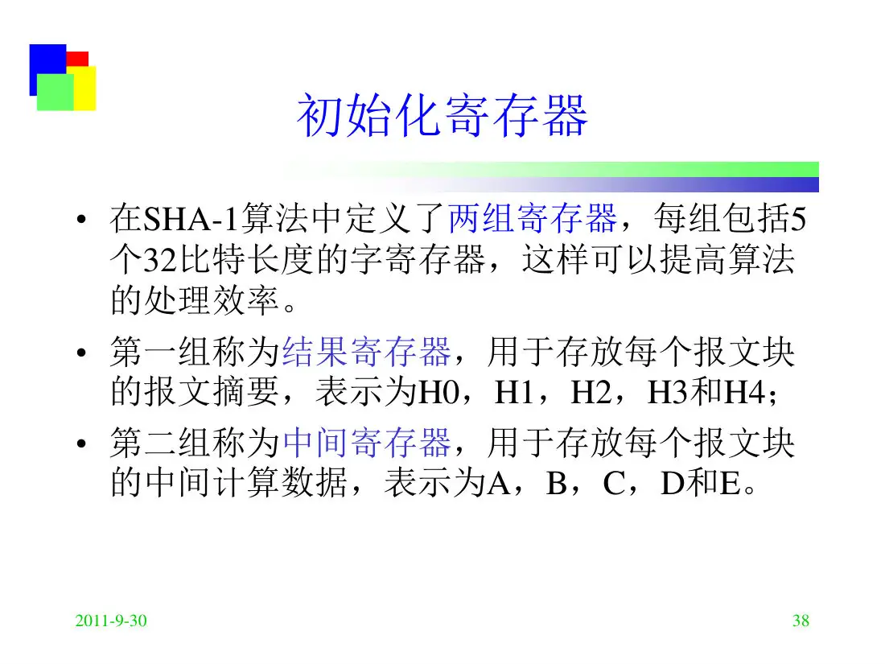

原文：

初始化寄存器

• 在SHA-1算法中定义了两组寄存器，每组包括5个32比特长度的字寄存器，这样可以提高算法的处理效率。

• 第一组称为结果寄存器，用于存放每个报文块的报文摘要，表示为H0，H1，H2，H3和H4；

• 第二组称为中间寄存器，用于存放每个报文块的中间计算数据，表示为A，B，C，D和E。

7

2011-9-30

38

### 初始化寄存器(续)

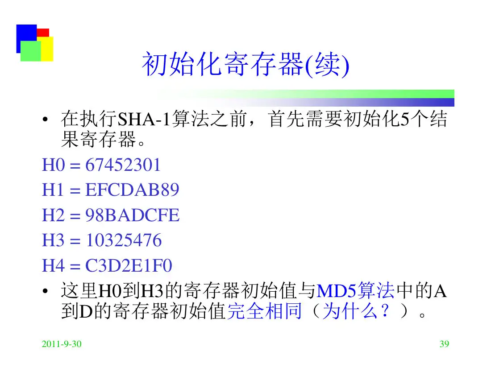

原文：

初始化寄存器(续)

• 在执行SHA-1算法之前，首先需要初始化5个结果寄存器。

$$
\mathrm{H1} = \text { EFCDAB89 }
$$

$$
\mathrm{H2} = 9 8 \mathrm{BADCFE}
$$

$$
\mathrm{H} 3 = 1 0 3 2 5 4 7 6
$$

$$
\mathrm{H} 4 = \mathrm{C} 3 \mathrm{D} 2 \mathrm{E} 1 \mathrm{F} 0
$$

• 这里H0到H3的寄存器初始值与MD5算法中的A到D的寄存器初始值完全相同（为什么？）。

2011-9-30

39

### 循环计算报文块

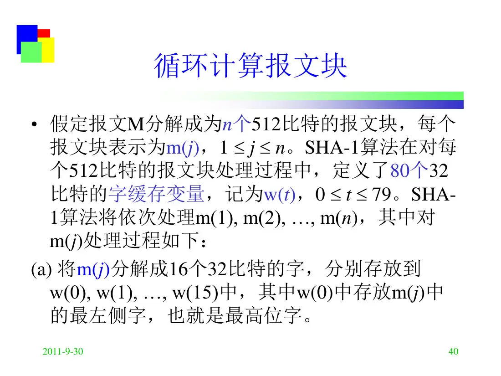

原文：

循环计算报文块

• 假定报文M分解成为n个512比特的报文块，每个报文块表示为m(j)， $1 \leq j \leq n$ 。SHA-1算法在对每个512比特的报文块处理过程中，定义了80个32比特的字缓存变量，记为w(t)， $0 \leq t \leq 7 9$ 。SHA-1算法将依次处理m(1), m(2), …, m(n)，其中对m(j)处理过程如下：

(a) 将m(j)分解成16个32比特的字，分别存放到w(0), w(1), …, w(15)中，其中w(0)中存放m(j)中的最左侧字，也就是最高位字。

7

2011-9-30

40

### 循环计算报文块(续1)

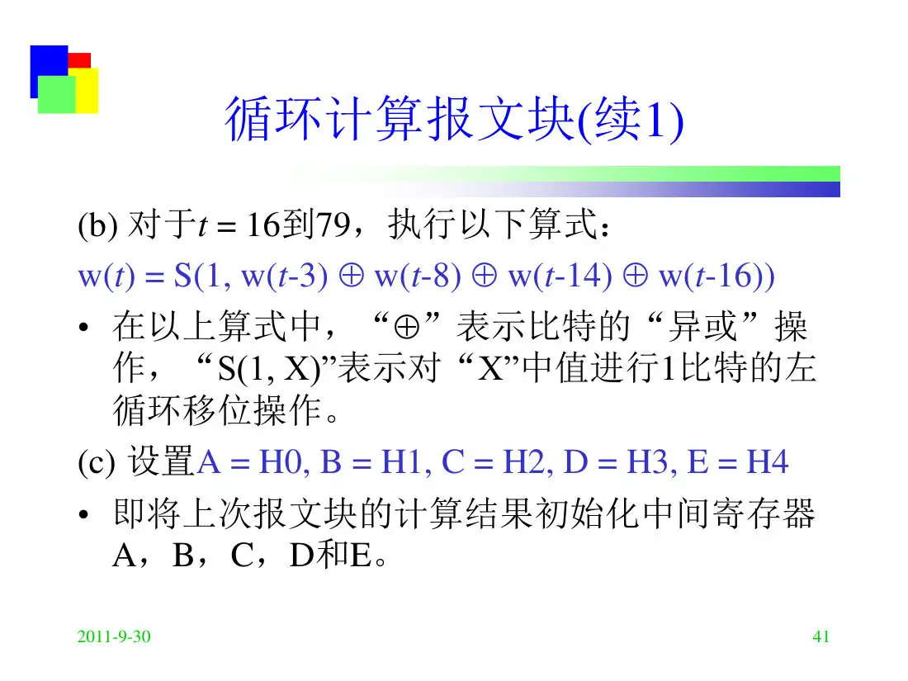

原文：

循环计算报文块(续1)

(b) 对于t = 16到79，执行以下算式：

w(t) = S(1, w(t-3) ⊕ w(t-8) ⊕ w(t-14) ⊕ w(t-16))

• 在以上算式中，“”表示比特的“异或”操作，“S(1, X)”表示对“X”中值进行1比特的左循环移位操作。

(c) 设置 $\mathrm { A } = \mathrm { H } 0 , \mathrm { B } = \mathrm { H } 1 , \mathrm { C } = \mathrm { H } 2 , \mathrm { D } = \mathrm { H } 3 , \mathrm { E } = \mathrm { H } 4$

• 即将上次报文块的计算结果初始化中间寄存器A，B，C，D和E。

2011-9-30

41

### 循环计算报文块(续2)

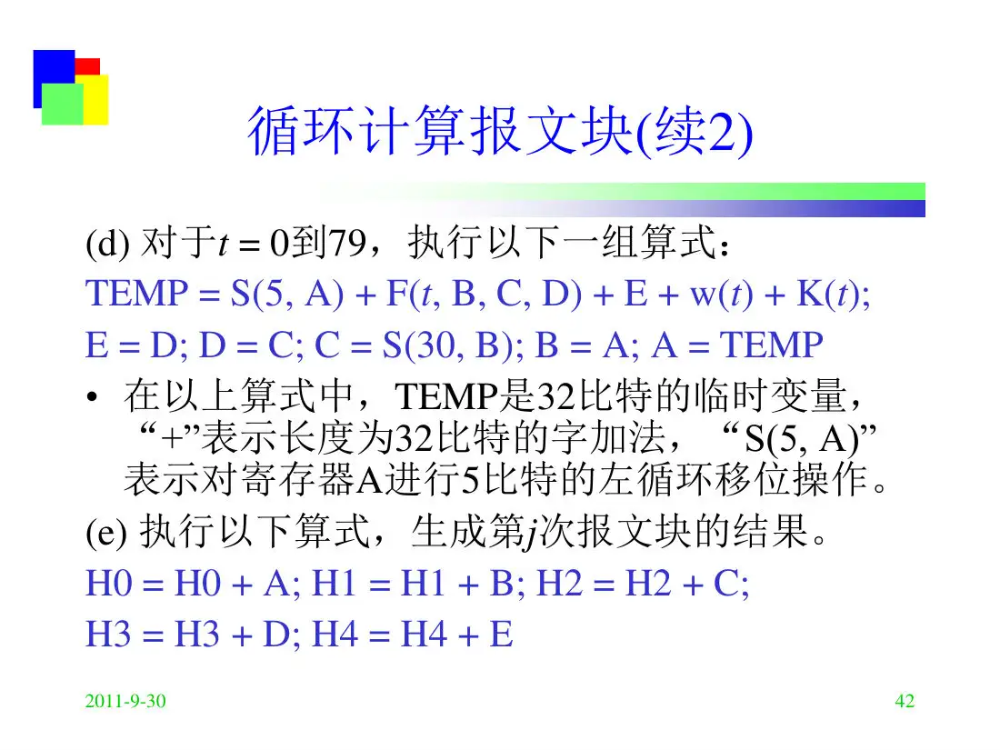

原文：

循环计算报文块(续2)

(d) 对于t= 0到79，执行以下一组算式：

$$
\mathrm{TEMP} = \mathrm{S} (5, \mathrm{A}) + \mathrm{F} (t, \mathrm{B}, \mathrm{C}, \mathrm{D}) + \mathrm{E} + \mathrm{w} (t) + \mathrm{K} (t);
$$

$$
\mathrm{E} = \mathrm{D}; \mathrm{D} = \mathrm{C}; \mathrm{C} = \mathrm{S} (3 0, \mathrm{B}); \mathrm{B} = \mathrm{A}; \mathrm{A} = \mathrm{TEMP}
$$

• 在以上算式中，TEMP是32比特的临时变量，$^ { 6 6 } + ^ { , 9 }$ 表示长度为32比特的字加法， $^ { 6 6 } \mathrm { S } ( 5 , \mathrm { A } ) ^ { , 9 }$ 表示对寄存器A进行5比特的左循环移位操作。

(e) 执行以下算式，生成第j次报文块的结果。

$$
\mathrm{H0} = \mathrm{H0} + \mathrm{A}; \mathrm{H1} = \mathrm{H1} + \mathrm{B}; \mathrm{H2} = \mathrm{H2} + \mathrm{C};
$$

$$
\mathrm{H} 3 = \mathrm{H} 3 + \mathrm{D}; \mathrm{H} 4 = \mathrm{H} 4 + \mathrm{E}
$$

2011-9-30

42

### 输出报文摘要

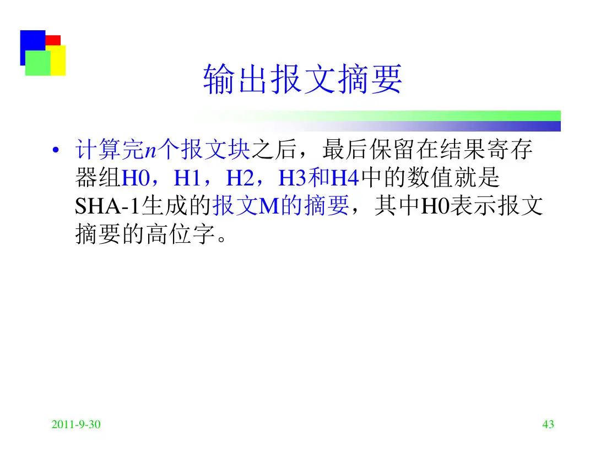

原文：

输出报文摘要

• 计算完n个报文块之后，最后保留在结果寄存器组H0，H1，H2，H3和H4中的数值就是SHA-1生成的报文M的摘要，其中H0表示报文摘要的高位字。

7

2011-9-30

43

### 哈希报文验证码算法HMAC

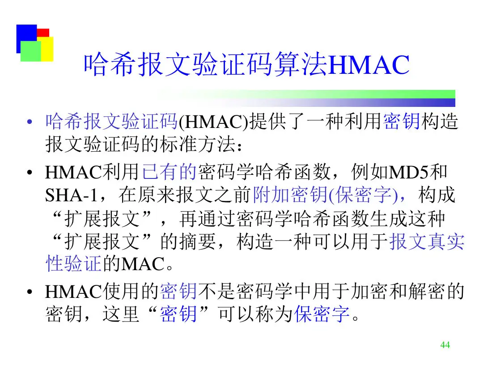

原文：

哈希报文验证码算法HMAC

• 哈希报文验证码(HMAC)提供了一种利用密钥构造报文验证码的标准方法：

• HMAC利用已有的密码学哈希函数，例如MD5和SHA-1，在原来报文之前附加密钥(保密字)，构成“扩展报文”，再通过密码学哈希函数生成这种“扩展报文”的摘要，构造一种可以用于报文真实性验证的MAC。

• HMAC使用的密钥不是密码学中用于加密和解密的密钥，这里“密钥”可以称为保密字。

44

### HMAC算法

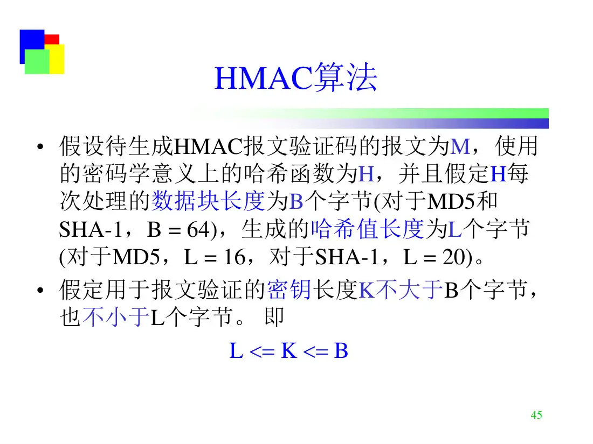

原文：

HMAC算法

• 假设待生成HMAC报文验证码的报文为M，使用的密码学意义上的哈希函数为H，并且假定H每次处理的数据块长度为B个字节(对于MD5和SHA-1，B = 64)，生成的哈希值长度为L个字节(对于MD5，L = 16，对于SHA-1，L = 20)。

• 假定用于报文验证的密钥长度K不大于B个字节，也不小于L个字节。 即

$$
\mathrm{L} <   = \mathrm{K} <   = \mathrm{B}
$$

1

45

### HMAC算法(续)

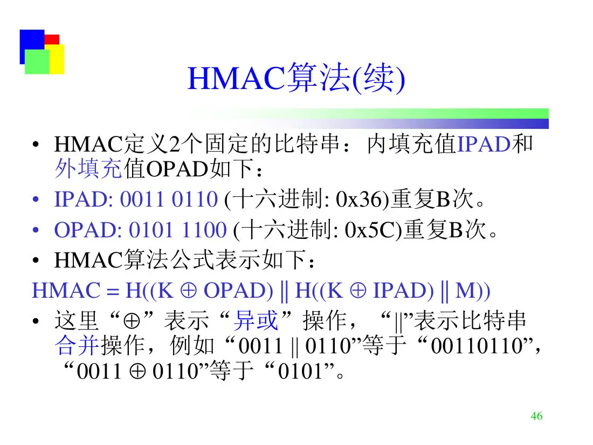

原文：

HMAC算法(续)

• HMAC定义2个固定的比特串：内填充值IPAD和外填充值OPAD如下：

IPAD: 0011 0110 (十六进制: 0x36)重复B次。

● OPAD: 0101 1100 (十六进制: 0x5C)重复B次。

• HMAC算法公式表示如下：

HMAC = H((K ⊕ OPAD) ∥ H((K ⊕ IPAD) ∥ M))

• 这里“”表示“异或”操作，“||”表示比特串合并操作，例如 $^ { 6 6 } 0 0 1 1 \parallel 0 1 1 0 ^ { 3 }$ 等于 $^ { 6 6 } 0 0 1 1 0 1 1 0 ^ { 9 }$ “0011  0110”等于“0101”。

46

### HMAC的报文验证过程

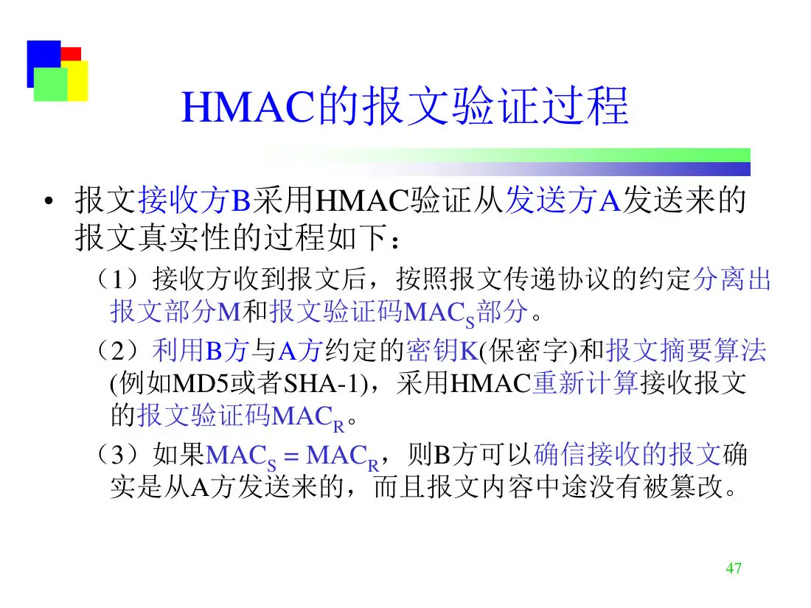

原文：

HMAC的报文验证过程

• 报文接收方B采用HMAC验证从发送方A发送来的报文真实性的过程如下：

（1）接收方收到报文后，按照报文传递协议的约定分离出报文部分M和报文验证码 $\mathrm { { M A C } _ { \mathrm { { S } } } }$ 部分。

（2）利用B方与A方约定的密钥K(保密字)和报文摘要算法(例如MD5或者SHA-1)，采用HMAC重新计算接收报文的报文验证码 $\mathbf { M A C } _ { \mathrm { R } }$ o

（3）如果 $\mathrm { M A C } _ { \mathrm { S } } = \mathrm { M A C } _ { \mathrm { R } }$ ，则B方可以确信接收的报文确实是从A方发送来的，而且报文内容中途没有被篡改。

1

47

### 生日现象与生日攻击

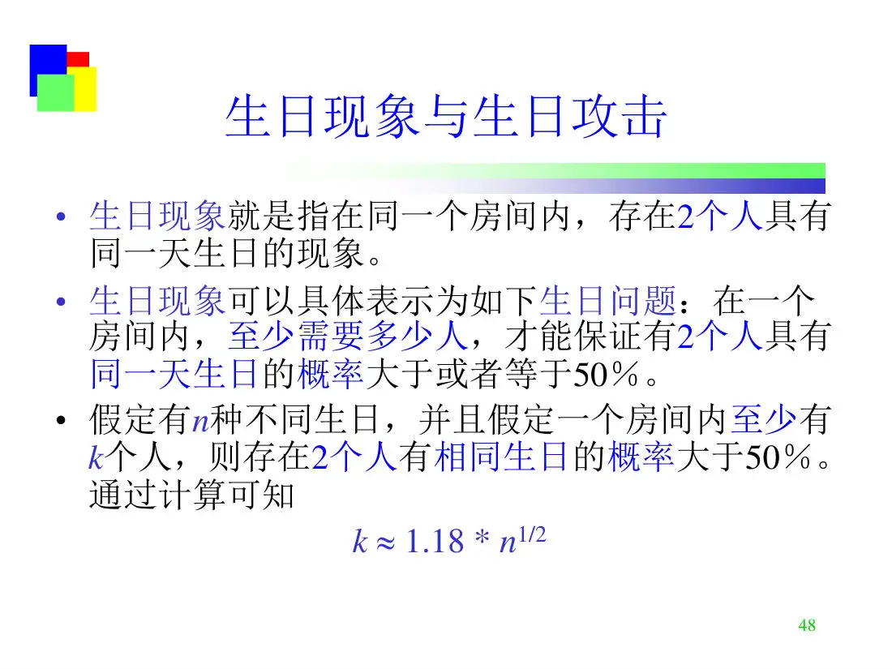

原文：

生日现象与生日攻击

• 生日现象就是指在同一个房间内，存在2个人具有同一天生日的现象。

• 生日现象可以具体表示为如下生日问题：在一个房间内，至少需要多少人，才能保证有2个人具有同一天生日的概率大于或者等于50％。

• 假定有n种不同生日，并且假定一个房间内至少有k个人，则存在2个人有相同生日的概率大于50％。通过计算可知

$$
k \approx 1. 1 8 * n ^ {1 / 2}
$$

7

48

### 生日现象与生日攻击(续)

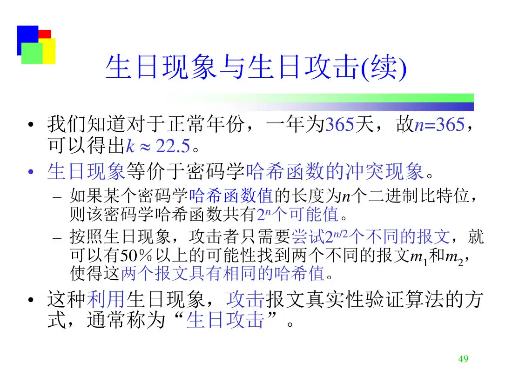

原文：

生日现象与生日攻击(续)

• 我们知道对于正常年份，一年为365天，故n=365，可以得出k  22.5。

• 生日现象等价于密码学哈希函数的冲突现象。

– 如果某个密码学哈希函数值的长度为n个二进制比特位，则该密码学哈希函数共有2n个可能值。

– 按照生日现象，攻击者只需要尝试2n/2个不同的报文，就可以有50％以上的可能性找到两个不同的报文 $m _ { 1 }$ 和 $m _ { 2 }$ ，使得这两个报文具有相同的哈希值。

• 这种利用生日现象，攻击报文真实性验证算法的方式，通常称为“生日攻击”。

7

49

### 生日攻击与安全哈希函数

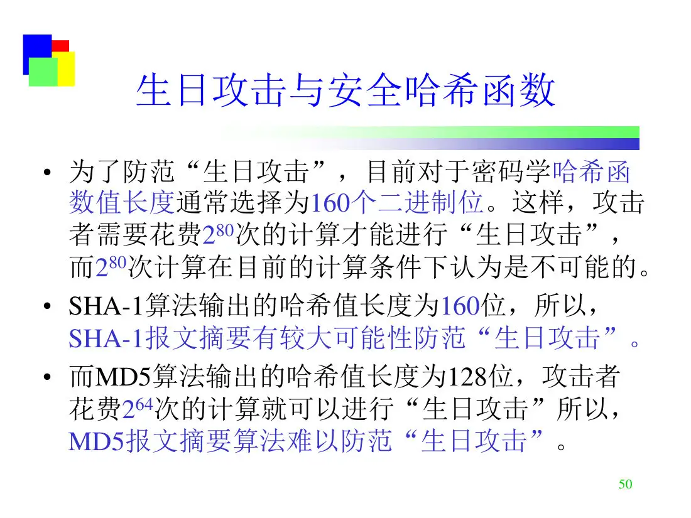

原文：

生日攻击与安全哈希函数

• 为了防范“生日攻击”，目前对于密码学哈希函数值长度通常选择为160个二进制位。这样，攻击者需要花费280次的计算才能进行“生日攻击”，而280次计算在目前的计算条件下认为是不可能的。

• SHA-1算法输出的哈希值长度为160位，所以，SHA-1报文摘要有较大可能性防范“生日攻击”。

• 而MD5算法输出的哈希值长度为128位，攻击者花费264次的计算就可以进行“生日攻击”所以，MD5报文摘要算法难以防范“生日攻击”。

7

50

### 数字签名

原文：

数字签名

• 数字签名是采用公钥加密算法中签名方的私钥，对电子文件的报文摘要加密生成的密文。

数字签名技术 = 公钥加密技术 + 报文摘要技术

• 数字签名是公钥加密算法在报文验证技术中的具体应用。公钥加密算法最为成功的应用就是数字签名。

• 问题：能否采用传统加密算法进行数字签名？

• 采用传统加密算法的报文验证技术不能进行数字签名，这是因为传统加密算法的密钥是报文发送方A和接收方B共有的。

51

### 数字签名(续)

原文：

数字签名(续)

• 公钥密码体系有2种特性，使得它可以应用于这类彼此不信任的报文验证环境：

– 其一：公钥密码体系将密钥分解成公钥和私钥两个部分，只有密钥所有者才持有私钥，其他人只可以获得公钥。

– 其二：只要用公钥和私钥中任意一种密钥加密，就可以用另外一种密钥解密。

• 与手工签名相比，数字签名的优点在于签名与文件的内容相关。

• 数字签名的缺点在于：一旦私钥丢失或者泄漏，可能会被他人冒用而造成很大的损失。

1

52

### 本讲重点回顾

原文：

本讲重点回顾

• 报文真实性验证基本概念

– 采用加密方法的报文验证,

– 基于安全哈希函数的报文验证,

– 报文验证码。

• 哈希报文验证码算法HMAC

– HMAC可以利用已经的报文摘要算法

– HMAC引入了密钥。

• 数字签名

– 公钥加密算法加密报文摘要的技术

7

53

### 思考题

原文：

思考题

(1) 报文真实性验证的目的是什么？目前有哪几种报文真实性验证的方法？这些报文真实性验证方法具有什么优点和不足？

(2) 报文摘要是否等价于报文验证码？如果不等价，如何将报文摘要转换成为报文验证码？

(3) 是否可以不使用加密算法生成报文验证码？如果可以，如何生成？

1

54

### 思考题(续1)

原文：

思考题(续1)

(4) 什么是MD5算法？为什么说MD5算法仍然会遭受“生日现象”攻击？

(5) SHA-1报文摘要算法与MD5算法相比有哪些相同之处，有哪些不同之处？为什么说SHA-1算法比MD5算法安全？

(6) HMAC算法有何用途？它与MD5和SHA-1算法有什么关联？为什么说HMAC算法中使用的密钥不是通常意义上的密钥？这种密钥有什么作用？

1

55

### 思考题(续2)

原文：

思考题(续2)

(7) 什么是“生日现象”？什么是“生日攻击”？为什么说MD5算法不能防范“生日攻击”？

(8) 什么是数字签名？为什么需要数字签名？通常所说的报文真实性验证技术是否就是数字签名技术？

1

56
