# 《信息安全技术》第3章 身份真实性验证协议（课件）

原件的每一页，下面附识别出的文字。

### 第3章真实性验证技术身份真实性验证协议

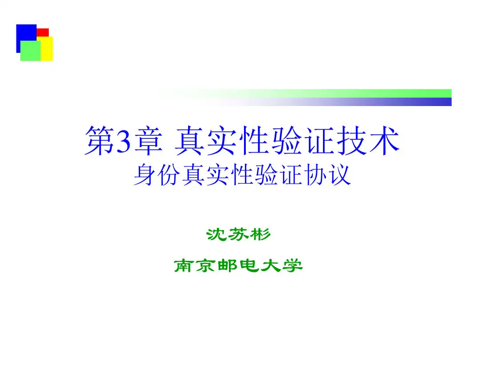

原文：

第3章真实性验证技术身份真实性验证协议

沈苏彬

南京邮电大学

### 主要解决的问题\

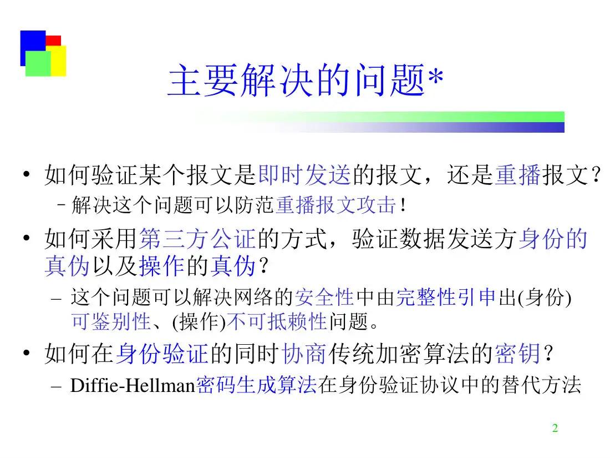

原文：

主要解决的问题\*

• 如何验证某个报文是即时发送的报文，还是重播报文？–解决这个问题可以防范重播报文攻击！

• 如何采用第三方公证的方式，验证数据发送方身份的真伪以及操作的真伪？

– 这个问题可以解决网络的安全性中由完整性引申出(身份)可鉴别性、(操作)不可抵赖性问题。

• 如何在身份验证的同时协商传统加密算法的密钥？– Diffie-Hellman密码生成算法在身份验证协议中的替代方法

2

### 关键知识点\

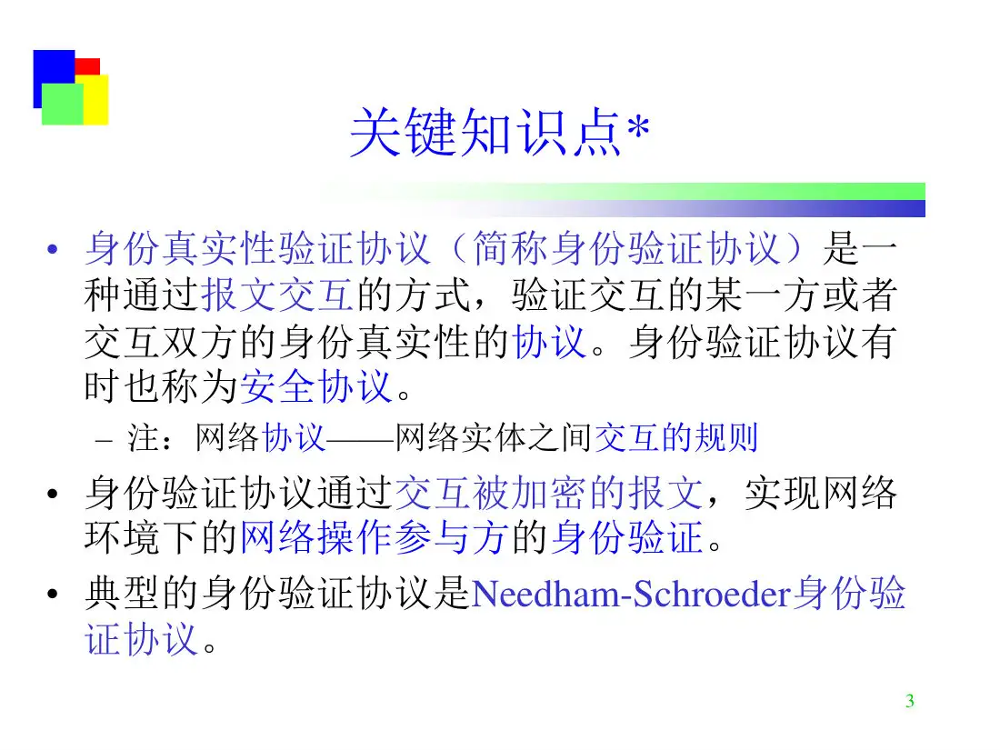

原文：

关键知识点\*

身份真实性验证协议（简称身份验证协议）是一种通过报文交互的方式，验证交互的某一方或者交互双方的身份真实性的协议。身份验证协议有时也称为安全协议。

– 注：网络协议——网络实体之间交互的规则

• 身份验证协议通过交互被加密的报文，实现网络环境下的网络操作参与方的身份验证。

• 典型的身份验证协议是Needham-Schroeder身份验证协议。

7

3

### 主要内容

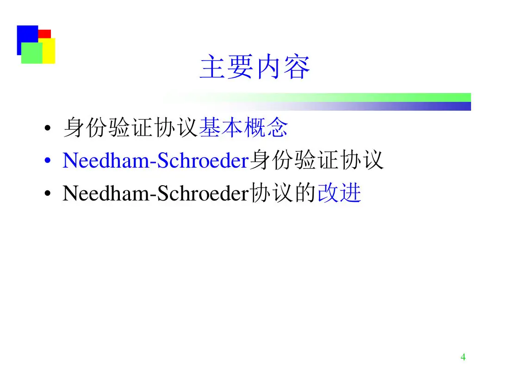

原文：

主要内容

• 身份验证协议基本概念

• Needham-Schroeder身份验证协议

• Needham-Schroeder协议的改进

4

### 身份验证协议的定义和作用

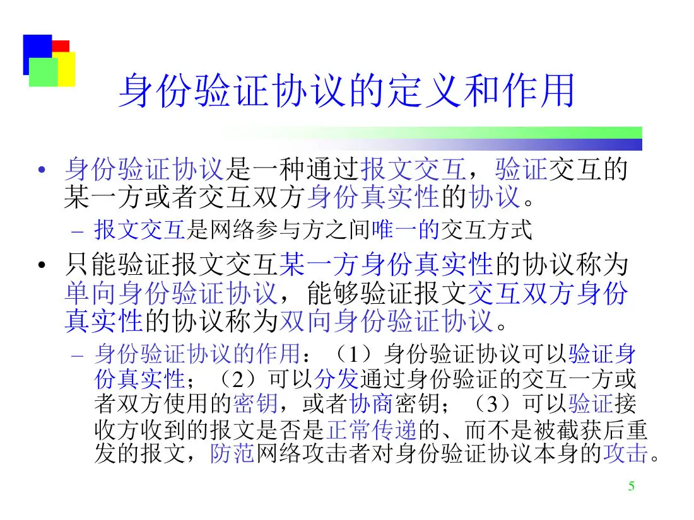

原文：

身份验证协议的定义和作用

身份验证协议是一种通过报文交互，验证交互的某一方或者交互双方身份真实性的协议。– 报文交互是网络参与方之间唯一的交互方式

• 只能验证报文交互某一方身份真实性的协议称为单向身份验证协议，能够验证报文交互双方身份真实性的协议称为双向身份验证协议。

– 身份验证协议的作用：（1）身份验证协议可以验证身份真实性；（2）可以分发通过身份验证的交互一方或者双方使用的密钥，或者协商密钥；（3）可以验证接收方收到的报文是否是正常传递的、而不是被截获后重发的报文，防范网络攻击者对身份验证协议本身的攻击。

5

### 身份验证协议基本方法和分类

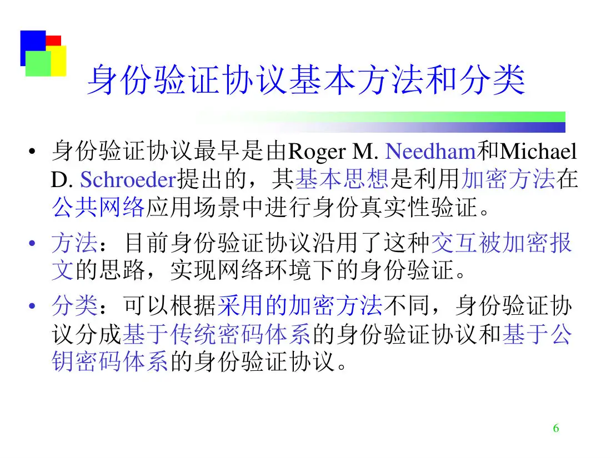

原文：

身份验证协议基本方法和分类

• 身份验证协议最早是由Roger M. Needham和MichaelD. Schroeder提出的，其基本思想是利用加密方法在公共网络应用场景中进行身份真实性验证。

方法：目前身份验证协议沿用了这种交互被加密报文的思路，实现网络环境下的身份验证。

分类：可以根据采用的加密方法不同，身份验证协议分成基于传统密码体系的身份验证协议和基于公钥密码体系的身份验证协议。

6

### 身份验证协议的表示方式\

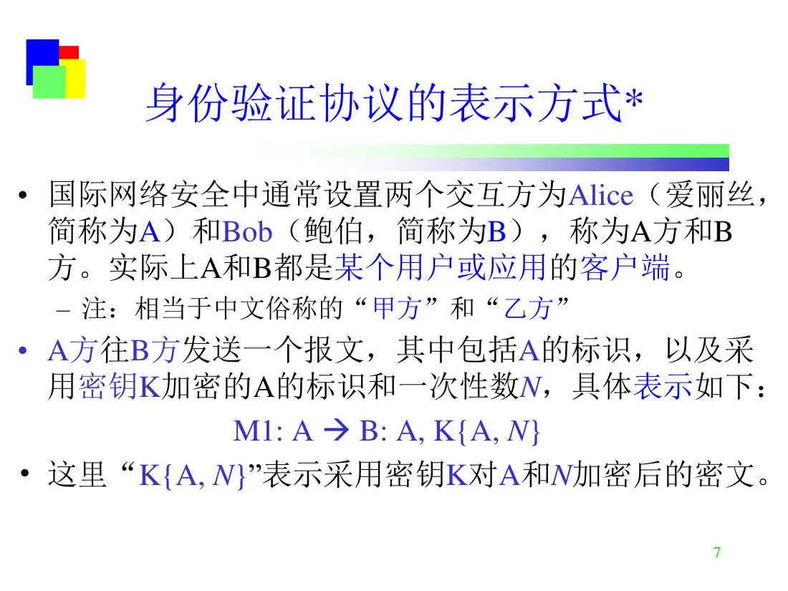

原文：

身份验证协议的表示方式\*

• 国际网络安全中通常设置两个交互方为Alice（爱丽丝，简称为A）和Bob（鲍伯，简称为B），称为A方和B方。实际上A和B都是某个用户或应用的客户端。

– 注：相当于中文俗称的“甲方”和“乙方”

• A方往B方发送一个报文，其中包括A的标识，以及采用密钥K加密的A的标识和一次性数N，具体表示如下：

$$
\mathrm{M1:A} \rightarrow \mathrm{B:A,K} \{\mathrm{A}, N \}
$$

• 这里 $^ { 6 6 } \mathrm { K } \{ \mathrm { A } , N \} ^ { 5 }$ 表示采用密钥K对A和N加密后的密文。

7

7

### 当事方与验证方\

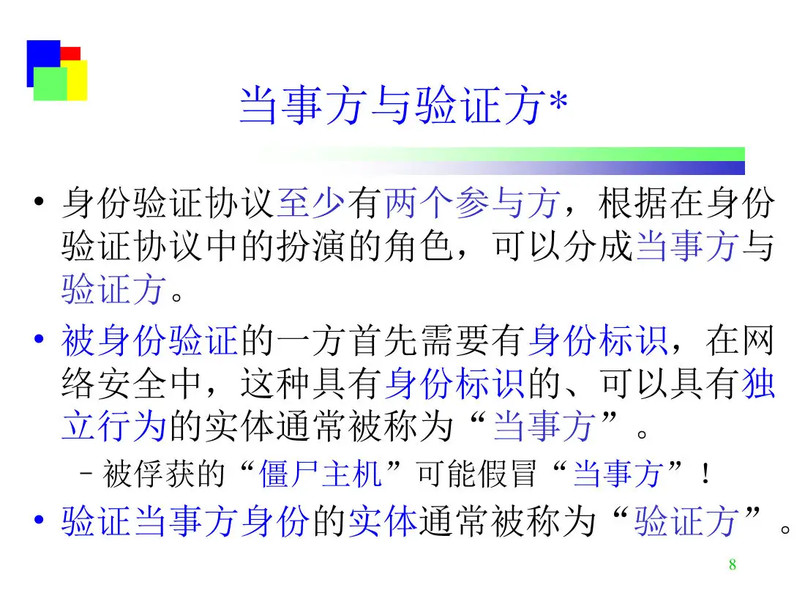

原文：

当事方与验证方\*

• 身份验证协议至少有两个参与方，根据在身份验证协议中的扮演的角色，可以分成当事方与验证方。

• 被身份验证的一方首先需要有身份标识，在网络安全中，这种具有身份标识的、可以具有独立行为的实体通常被称为“当事方”。

–被俘获的“僵尸主机”可能假冒“当事方”！

• 验证当事方身份的实体通常被称为“验证方”。

1

8

### 传统密码体系身份验证协议\

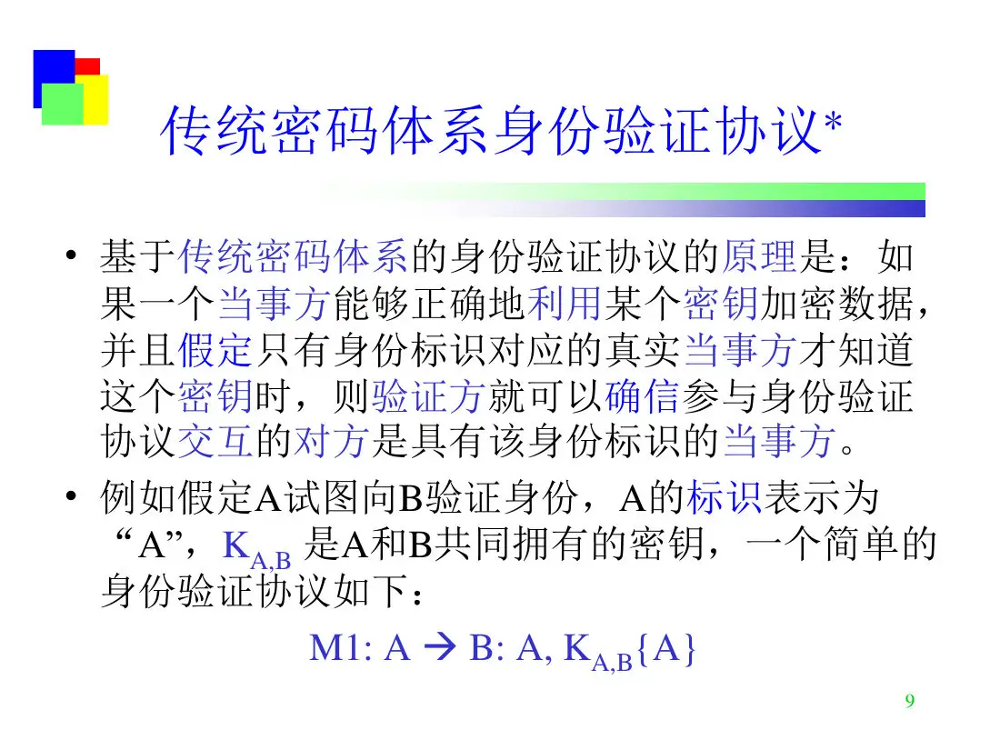

原文：

传统密码体系身份验证协议\*

• 基于传统密码体系的身份验证协议的原理是：如果一个当事方能够正确地利用某个密钥加密数据，并且假定只有身份标识对应的真实当事方才知道这个密钥时，则验证方就可以确信参与身份验证协议交互的对方是具有该身份标识的当事方。

• 例如假定A试图向B验证身份，A的标识表示为$^ { 6 6 } \mathrm { A } ^ { 9 9 } , \mathrm { K } _ { \mathrm { A , B } }$ 是A和B共同拥有的密钥，一个简单的身份验证协议如下：

$$
\mathrm{M1:A} \rightarrow \mathrm{B:A,K} _ {\mathrm{A,B}} \{\mathrm{A} \}
$$

9

### 传统密码体系身份验证协议(续1)

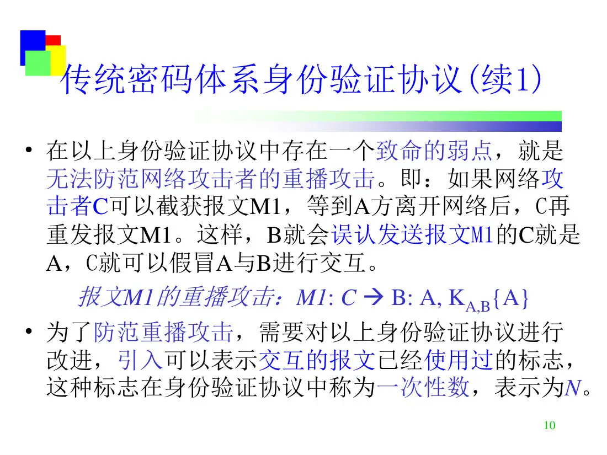

原文：

传统密码体系身份验证协议(续1)

• 在以上身份验证协议中存在一个致命的弱点，就是无法防范网络攻击者的重播攻击。即：如果网络攻击者C可以截获报文M1，等到A方离开网络后，C再重发报文M1。这样，B就会误认发送报文M1的C就是A，C就可以假冒A与B进行交互。

报文M1的重播攻击： $M I \colon C \to \mathrm { B } \colon \mathrm { A } , \mathrm { K } _ { \mathrm { A , B } } \{ \mathrm { A } \}$

• 为了防范重播攻击，需要对以上身份验证协议进行改进，引入可以表示交互的报文已经使用过的标志，这种标志在身份验证协议中称为一次性数，表示为N。

10

### 基于一次性数身份验证协议\

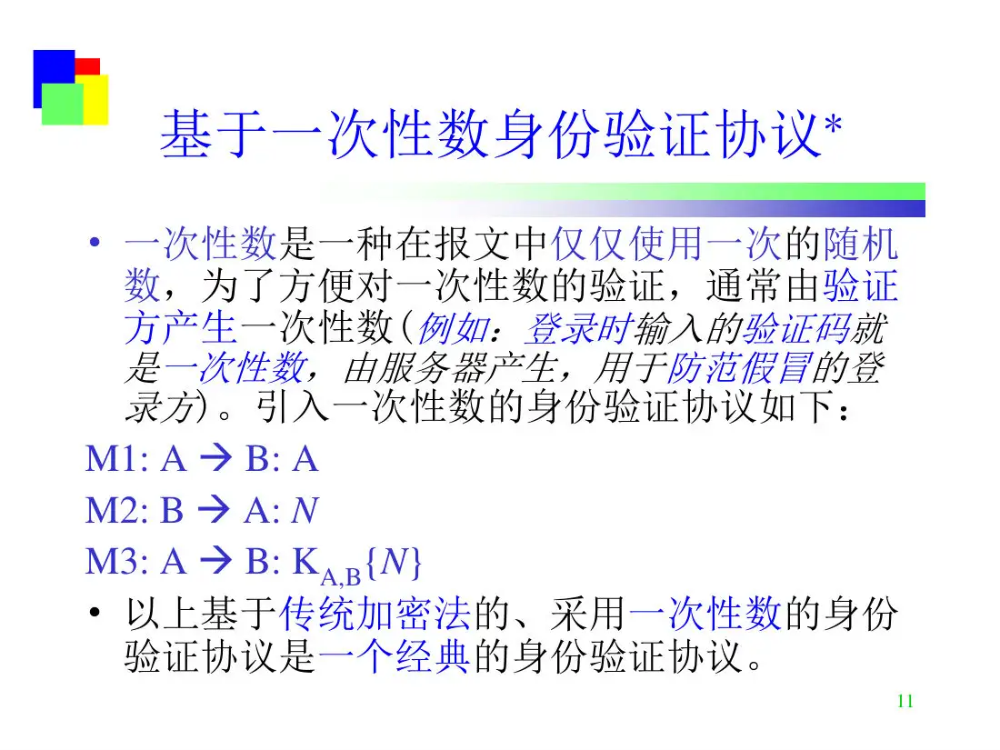

原文：

基于一次性数身份验证协议\*

• 一次性数是一种在报文中仅仅使用一次的随机数，为了方便对一次性数的验证，通常由验证方产生一次性数(例如： 登录时输入的验证码就是一次性数，由服务器产生，用于防范假冒的登)。引入一次性数的身份验证协议如下：

M1: A → B: A

M2: B → A: N

M3: $\mathrm { A } \to \mathrm { B } \colon \mathrm { K } _ { \mathrm { A , B } } \{ N \}$

• 以上基于传统加密法的、采用一次性数的身份验证协议是一个经典的身份验证协议。

11

### 三方参与的身份验证协议

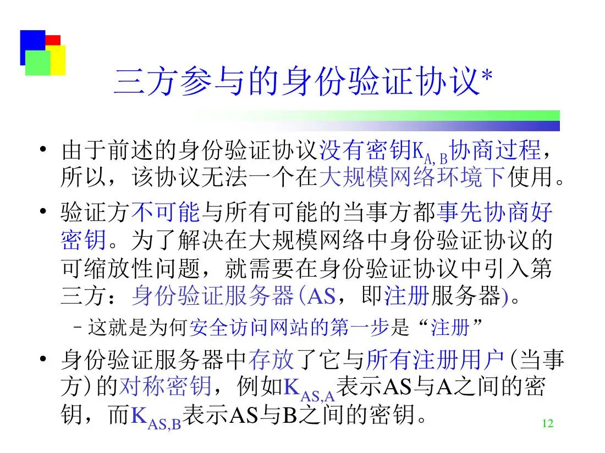

原文：

三方参与的身份验证协议

• 由于前述的身份验证协议没有密钥 ${ \mathrm { K } } _ { \mathrm { A } , \textrm { B } }$ 协商过程，所以，该协议无法一个在大规模网络环境下使用。

• 验证方不可能与所有可能的当事方都事先协商好密钥。为了解决在大规模网络中身份验证协议的可缩放性问题，就需要在身份验证协议中引入第三方：身份验证服务器(AS，即注册服务器)。

–这就是为何安全访问网站的第一步是“注册”

• 身份验证服务器中存放了它与所有注册用户(当事方)的对称密钥，例如 $\mathrm { K _ { A S , A } }$ 表示AS与A之间的密钥，而 $\mathrm { K _ { A S , B } }$ 表示AS与B之间的密钥。 12

7

### 三方参与的身份验证协议(续1)\

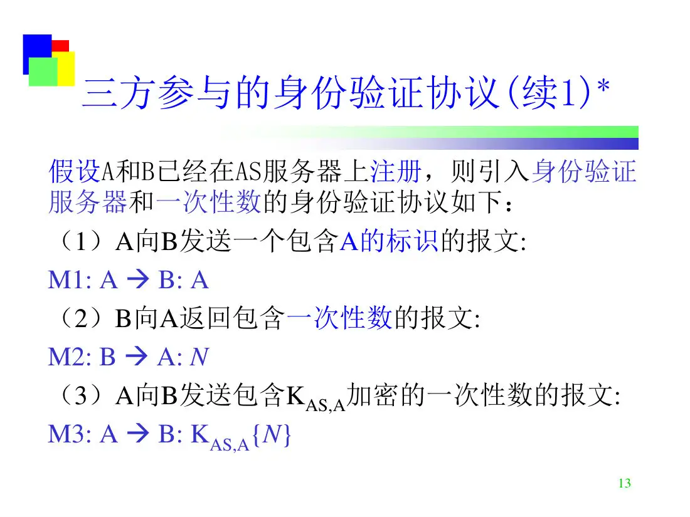

原文：

三方参与的身份验证协议(续1)\*

假设A和B已经在AS服务器上注册，则引入身份验证服务器和一次性数的身份验证协议如下：

（1）A向B发送一个包含A的标识的报文:

M1: A → B: A

（2）B向A返回包含一次性数的报文:

M2: $\mathrm { B }  \mathrm { A } \colon N$

（3）A向B发送包含 $\mathrm { K _ { A S , A } }$ 加密的一次性数的报文:

M3: $\mathrm { A } \to \mathrm { B } { : \mathrm { K } _ { \mathrm { A S , A } } \{ N \} }$

13

### 三方参与的身份验证协议(续2)\

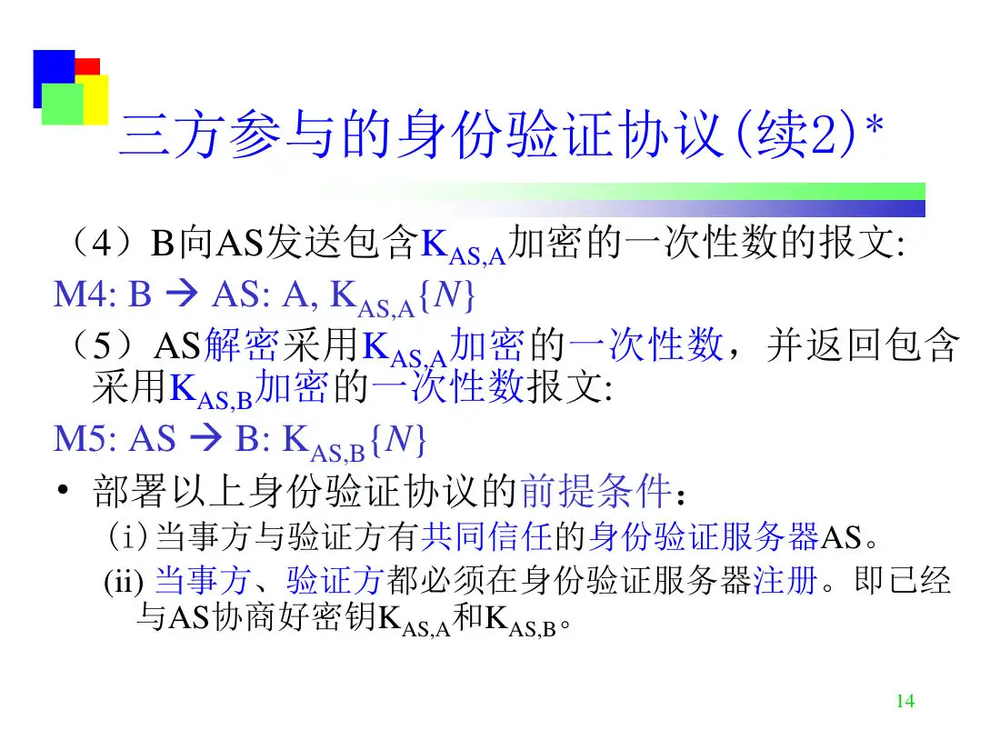

原文：

三方参与的身份验证协议(续2)\*

（4）B向AS发送包含 $\mathrm { K _ { A S , A } }$ 加密的一次性数的报文:M4: B → AS: A, $\mathrm { K } _ { \mathrm { A S , A } } \{ N \}$

（5）AS解密采用 $\mathrm { K _ { A S , A } }$ 加密的一次性数，并返回包含采用 $\mathrm { K } _ { \mathrm { A S , B } }$ 加密的一次性数报文:

M5: $\mathrm { A S } \to \mathrm { B } { \mathrm { : K } } _ { \mathrm { A S , B } } \{ N \}$

• 部署以上身份验证协议的前提条件：

(i)当事方与验证方有共同信任的身份验证服务器AS。

(ii) 当事方、验证方都必须在身份验证服务器注册。即已经与AS协商好密钥 $\mathrm { K _ { A S , A } }$ 和 $\mathrm { K _ { A S , B } } { \circ }$

14

### 公钥密码体系身份验证协议\

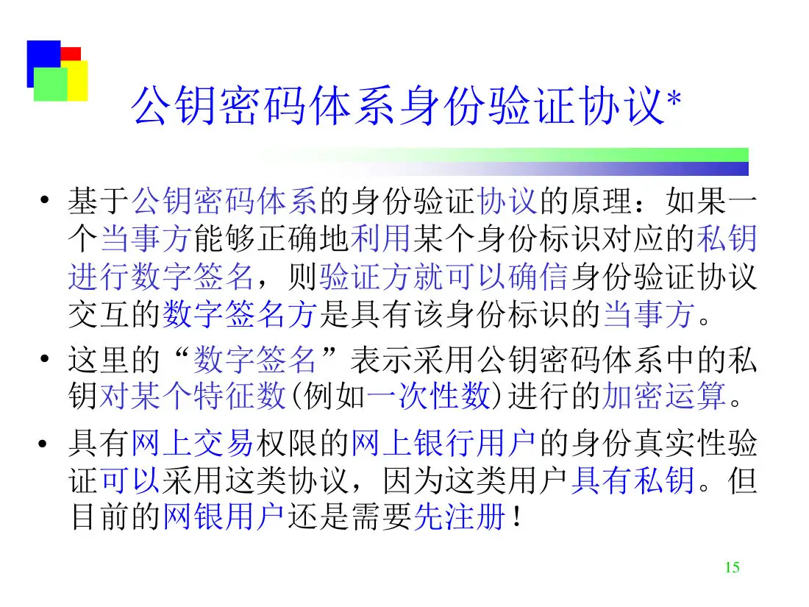

原文：

公钥密码体系身份验证协议\*

• 基于公钥密码体系的身份验证协议的原理：如果一个当事方能够正确地利用某个身份标识对应的私钥进行数字签名，则验证方就可以确信身份验证协议交互的数字签名方是具有该身份标识的当事方。

• 这里的“数字签名”表示采用公钥密码体系中的私钥对某个特征数(例如一次性数)进行的加密运算。

• 具有网上交易权限的网上银行用户的身份真实性验证可以采用这类协议，因为这类用户具有私钥。但目前的网银用户还是需要先注册！

15

### 公钥密码体系两方身份验证协议\

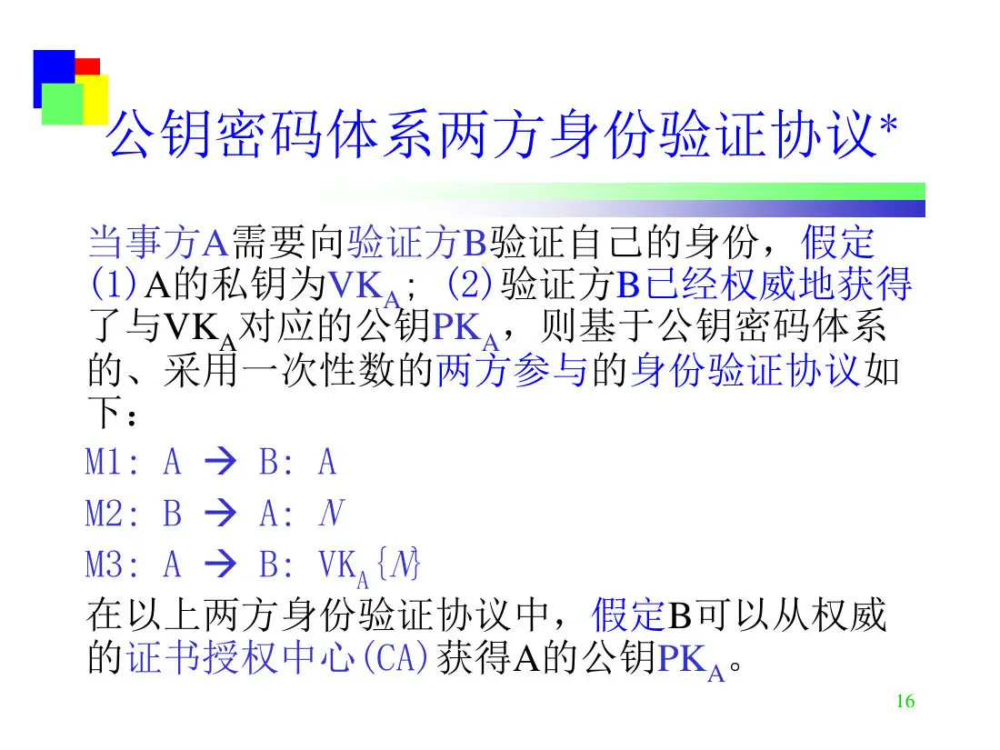

原文：

公钥密码体系两方身份验证协议\*

当事方A需要向验证方B验证自己的身份，假定(1)A的私钥为 $\mathrm { V K _ { A } }$ ; (2)验证方B已经权威地获得了与 $\mathrm { V K _ { A } }$ 对应的 $\bigstar \bigstar$ 钥 $\mathrm { P K _ { A } }$ ，则基于公钥密码体系的、采用一次性数的两方参与的身份验证协议如下：

$$
\mathrm{M1:A} \rightarrow \mathrm{B:A}
$$

$$
\mathrm{M2:B} \rightarrow \mathrm{A:N}
$$

$$
\mathrm{M3:A} \rightarrow \mathrm{B:VK} _ {\mathrm{A}} \{\mathcal {N} \}
$$

在以上两方身份验证协议中，假定B可以从权威的证书授权中心(CA)获得A的公钥 $\mathrm { P K _ { A } }$

16

### 公钥密码体系三方身份验证协议\

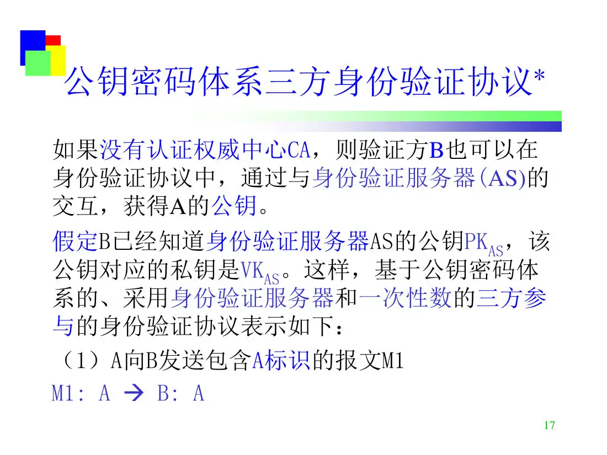

原文：

公钥密码体系三方身份验证协议\*

如果没有认证权威中心CA，则验证方B也可以在身份验证协议中，通过与身份验证服务器(AS)的交互，获得A的公钥。

假定B已经知道身份验证服务器AS的公钥P $\mathrm { \Delta K _ { A S } } .$ ，该公钥对应的私钥是 $\mathrm { V K } _ { \mathrm { A S } }$ 。这样，基于公钥密码体系的、采用身份验证服务器和一次性数的三方参与的身份验证协议表示如下：

（1）A向B发送包含A标识的报文M1

M1: $\mathrm { ~ A ~ }  \mathrm { ~ B ~ }$ : A

17

### 公钥密码体系三方身份验证协议(续1)

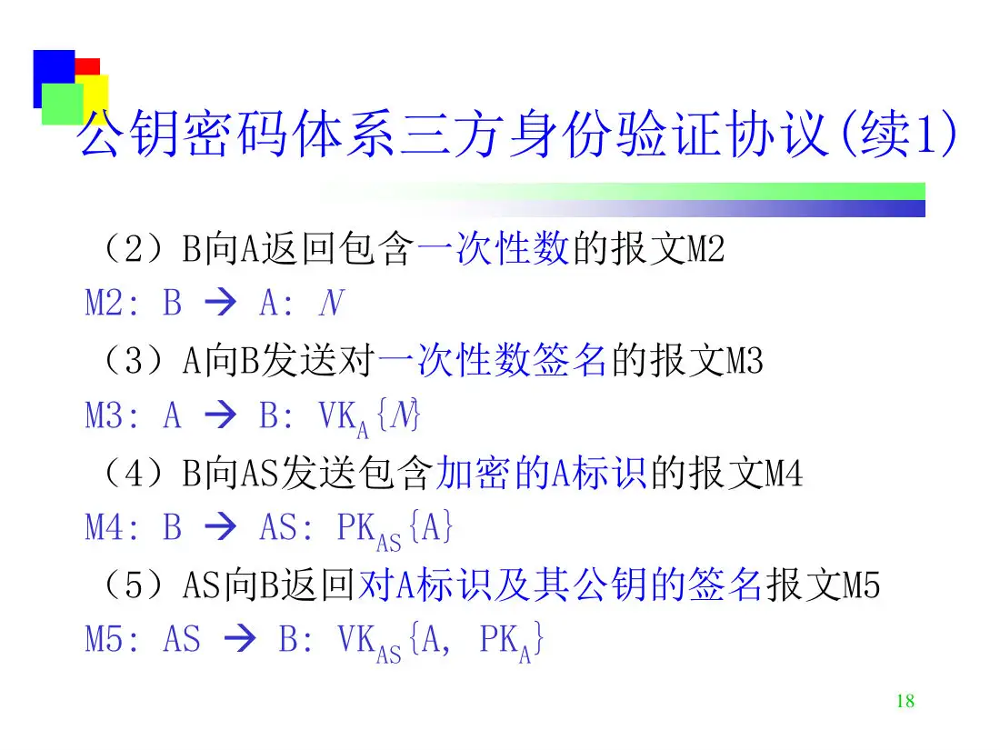

原文：

公钥密码体系三方身份验证协议(续1)

（2）B向A返回包含一次性数的报文M2$\mathbb { M } 2 \colon \mathrm { ~ B ~ } \to \mathrm { ~ A } \colon \mathrm { ~ } N$

（3）A向B发送对一次性数签名的报文M3M3: $\mathrm { A } \ \to \ \mathrm { B } \colon \ \mathrm { V K } _ { \mathrm { A } } \left\{ \mathcal { N } \right\}$

（4）B向AS发送包含加密的A标识的报文M4$\mathrm { M 4 \colon ~ B ~  ~ A S \colon ~ P K } _ { \mathrm { A S } } \{ \mathrm { A } \}$

（5）AS向B返回对A标识及其公钥的签名报文M5M5: $\mathrm { A S \ \to \ \mathrm { B } \colon \ V K _ { \mathrm { A S } } \{ A , \Delta \ P K _ { A } \} }$

18

### 公钥密码体系三方身份验证协议(续2)

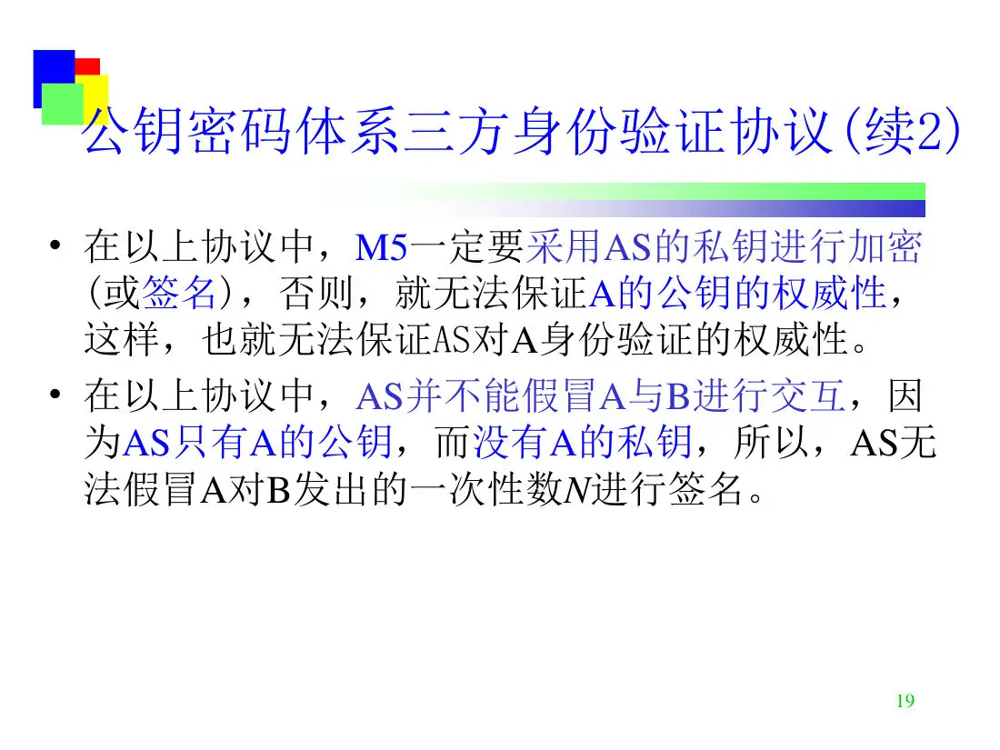

原文：

公钥密码体系三方身份验证协议(续2)

• 在以上协议中，M5一定要采用AS的私钥进行加密(或签名)，否则，就无法保证A的公钥的权威性，这样，也就无法保证AS对A身份验证的权威性。

• 在以上协议中，AS并不能假冒A与B进行交互，因为AS只有A的公钥，而没有A的私钥，所以，AS无法假冒A对B发出的一次性数N进行签名。

19

### Needham-Schroeder身份验证协议

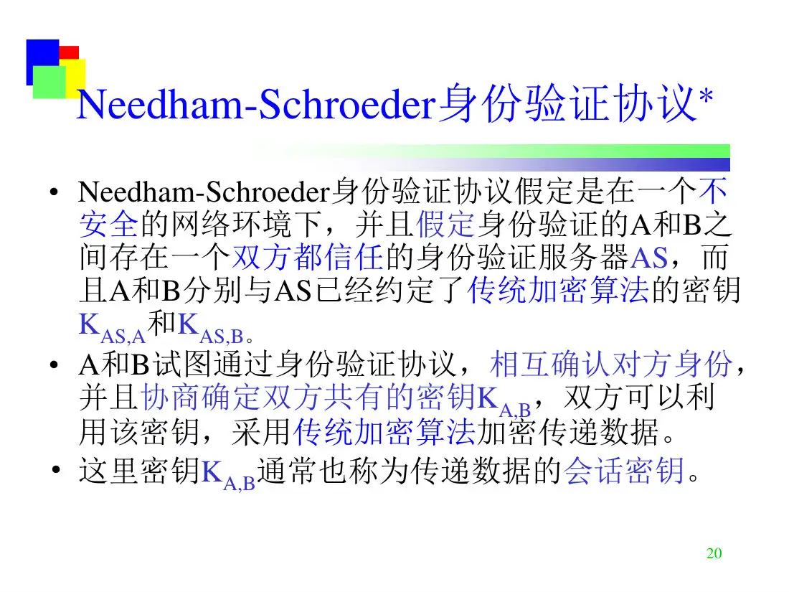

原文：

Needham-Schroeder身份验证协议

• Needham-Schroeder身份验证协议假定是在一个不安全的网络环境下，并且假定身份验证的A和B之间存在一个双方都信任的身份验证服务器AS，而且A和B分别与AS已经约定了传统加密算法的密钥$\mathrm { K _ { A S , A } }$ 和 $\mathrm { K _ { A S , B } }$

• A和B试图通过身份验证协议，相互确认对方身份，并且协商确定双方共有的密钥 $\mathrm { K } _ { \mathrm { A . B } }$ ，双方可以利用该密钥，采用传统加密算法加密传递数据。

• 这里密钥 $\mathrm { K } _ { \mathrm { A , B } }$ 通常也称为传递数据的会话密钥。

20

### N-S身份验证协议交互过程

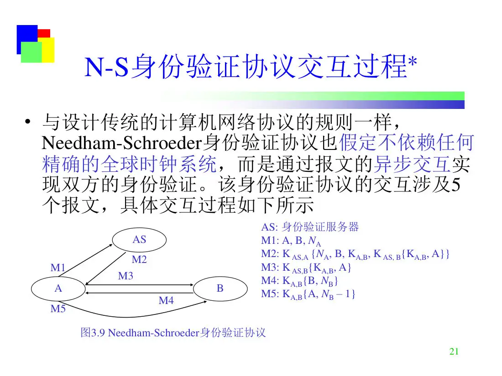

原文：

N-S身份验证协议交互过程

• 与设计传统的计算机网络协议的规则一样，Needham-Schroeder身份验证协议也假定不依赖任何精确的全球时钟系统，而是通过报文的异步交互实现双方的身份验证。该身份验证协议的交互涉及5个报文，具体交互过程如下所示

$$
\mathrm{M1:A,B,} N _ {\mathrm{A}}
$$

$$
\mathrm{M2:} \mathrm{K} _ {\mathrm{AS,A}} \left\{N _ {\mathrm{A}}, \mathrm{B}, \mathrm{K} _ {\mathrm{A,B}}, \mathrm{K} _ {\mathrm{AS,B}} \{\mathrm{K} _ {\mathrm{A,B}}, \mathrm{A} \} \right\}
$$

$$
\mathrm{M3:} \mathrm{K} _ {\mathrm{AS,B}} \{\mathrm{K} _ {\mathrm{A,B}}, \mathrm{A} \}
$$

$$
\mathrm{M} 4: \mathrm{K} _ {\mathrm{A}, \mathrm{B}} \{\mathrm{B}, N _ {\mathrm{B}} \}
$$

$$
\mathrm{M5:} \mathrm {K_ {A,B} \{A, N_ {B} - 1\}}
$$

7

21

### N-S身份验证协议交互过程(续1)

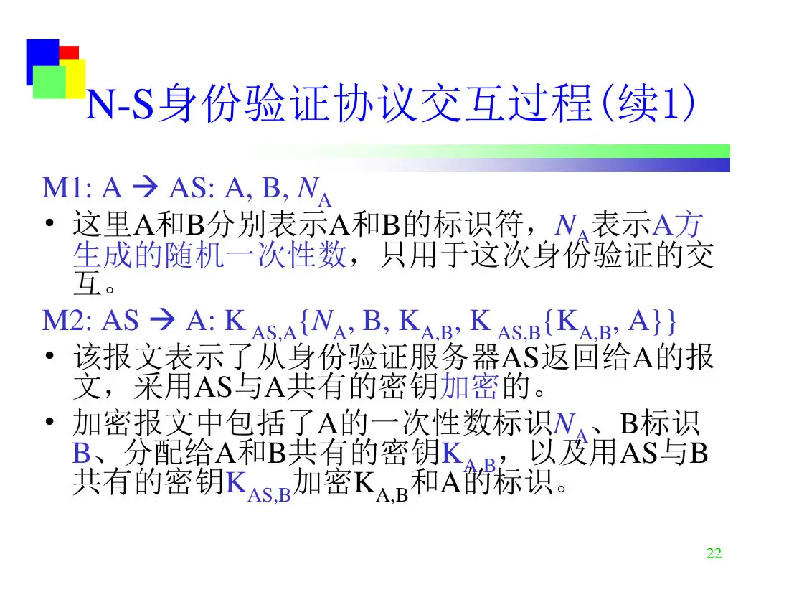

原文：

N-S身份验证协议交互过程(续1)

M1: A → AS: A, B, $N _ { \mathrm { A } }$

• 这里A和B分别表示A和B的标识符， $N _ { \Delta }$ 表示A方生成的随机一次性数，只用于这次身份验证的交互。

M2: AS → A: K AS,A{NA, B, KA,B, K AS,B{KA,B, A}}• 该报文表示了从身份验证服务器AS返回给A的报文，采用AS与A共有的密钥加密的。

• 加密报文中包括了A的一次性数标识 $N _ { \wedge }$ 、B标识B、分配给A和B共有的密钥 $\mathrm { K } _ { \Delta . \mathrm { R } } ,$ 以及用AS与B共有的密钥 $\mathrm { K _ { A S , B } }$ 加密 ${ \mathrm { K } } _ { \mathrm { A , B } }$ 和A的标识。

22

### N-S身份验证协议交互过程(续2)

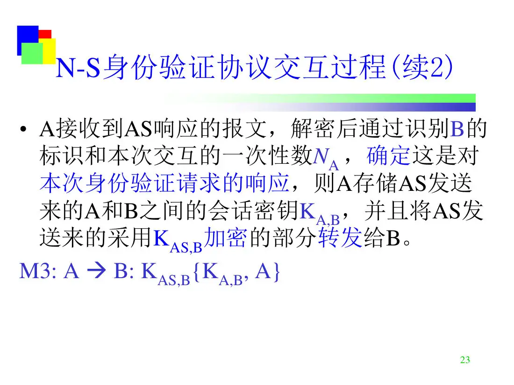

原文：

N-S身份验证协议交互过程(续2)

• A接收到AS响应的报文，解密后通过识别B的标识和本次交互的一次性数 $N _ { \mathrm { A } }$ ，确定这是对本次身份验证请求的响应，则A存储AS发送来的A和B之间的会话密钥 $\mathrm { K _ { A , B } } ,$ 并且将AS发送来的采用 $\mathrm { K _ { A S , B } }$ 加密的部分转发给B。

M3: A → B: $\mathrm { K } _ { \mathrm { A S , B } } \{ \mathrm { K } _ { \mathrm { A , B } } , \mathrm { A } \}$

23

### N-S身份验证协议交互过程(续3)

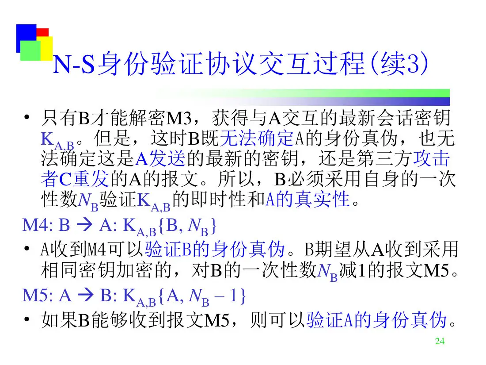

原文：

N-S身份验证协议交互过程(续3)

• 只有B才能解密M3，获得与A交互的最新会话密钥$\mathrm { K _ { A . B } } \circ$ 但是，这时B既无法确定A的身份真伪，也无法确定这是A发送的最新的密钥，还是第三方攻击者C重发的A的报文。所以，B必须采用自身的一次性数 $N _ { \mathrm { B } }$ 验证 $\mathrm { K } _ { \mathrm { A , B } }$ 的即时性和A的真实性。

M4: B → A: KA,B{B, NB}

• A收到M4可以验证B的身份真伪。B期望从A收到采用相同密钥加密的，对B的一次性数 $N _ { \mathrm { B } }$ 减1的报文M5。

M5: $\mathrm { A \to B \colon K _ { A , B } \{ A , N _ { B } - 1 \} }$

• 如果B能够收到报文M5，则可以验证A的身份真伪。

24

### N-S身份验证协议的讨论

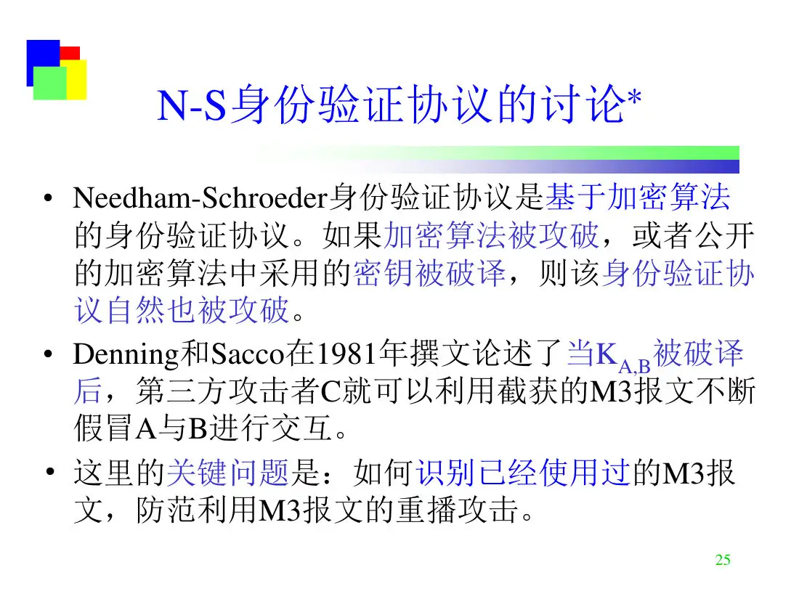

原文：

N-S身份验证协议的讨论

• Needham-Schroeder身份验证协议是基于加密算法的身份验证协议。如果加密算法被攻破，或者公开的加密算法中采用的密钥被破译，则该身份验证协议自然也被攻破。

• Denning和Sacco在1981年撰文论述了当 $\mathrm { K } _ { \mathrm { A , B } }$ 被破译后，第三方攻击者C就可以利用截获的M3报文不断假冒A与B进行交互。

• 这里的关键问题是：如何识别已经使用过的M3报文，防范利用M3报文的重播攻击。

7

25

### Needham-Schroeder协议的问题\

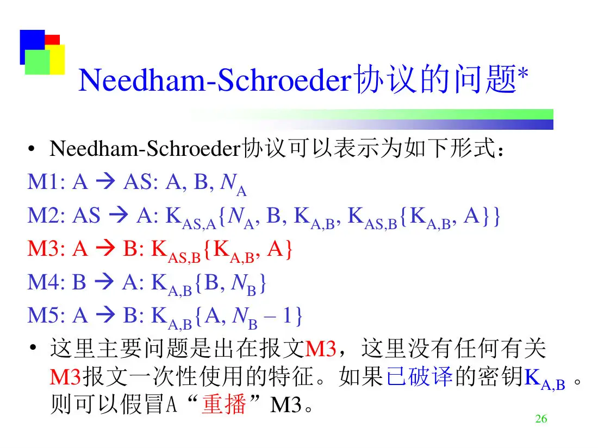

原文：

Needham-Schroeder协议的问题\*

• Needham-Schroeder协议可以表示为如下形式：

M1: $\mathrm { A } \to \mathrm { A S } \colon \mathrm { A } , \mathrm { B } , N _ { \mathrm { A } }$

M2: $\mathrm { A S } \to \mathrm { A } { \colon } \mathrm { K } _ { \mathrm { A S , A } } \{ N _ { \mathrm { A } } , \mathrm { B } , \mathrm { K } _ { \mathrm { A , B } } , \mathrm { K } _ { \mathrm { A S , B } } \{ \mathrm { K } _ { \mathrm { A , B } } , \mathrm { A } \} \}$

M3: $\mathrm { A \to B { : } K _ { A S , B } \{ K _ { A , B } , A \} }$

M4: B → A: KA,B{B, NB}

M5: $\mathrm { A \to B \colon K _ { A , B } \{ A , N _ { B } - 1 \} }$

• 这里主要问题是出在报文M3，这里没有任何有关M3报文一次性使用的特征。如果已破译的密钥 $\mathrm { K } _ { \mathrm { A , B } }$ 则可以假冒A“重播”M3。

26

### Needham-Schroeder协议的改进

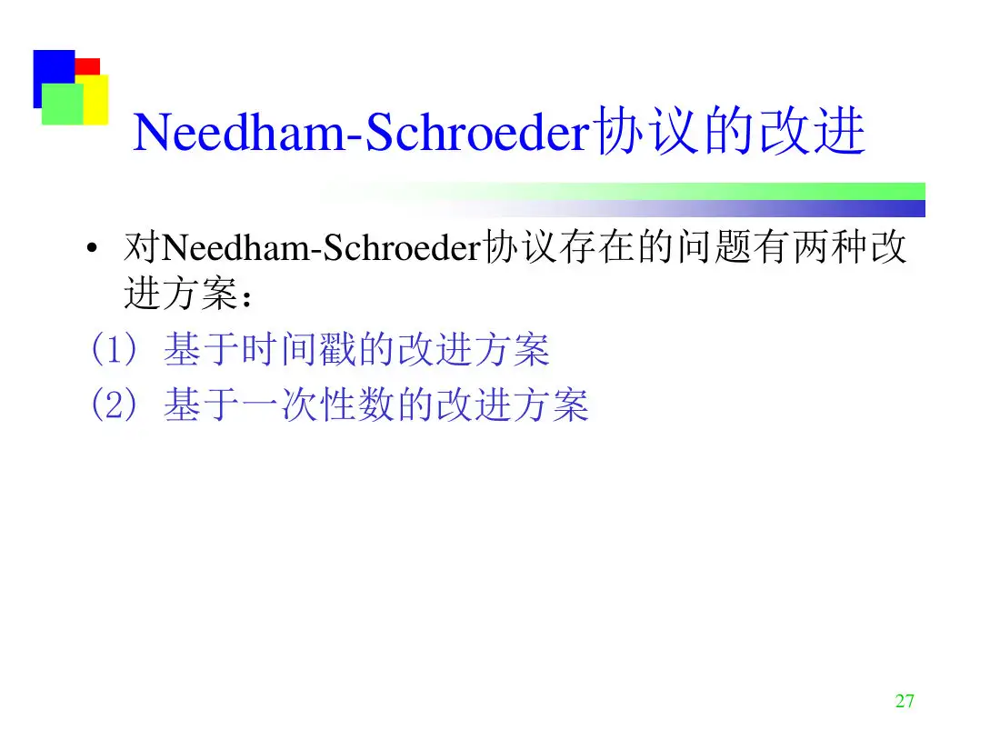

原文：

Needham-Schroeder协议的改进

• 对Needham-Schroeder协议存在的问题有两种改进方案：

(1) 基于时间戳的改进方案

(2) 基于一次性数的改进方案

27

### 基于时间戳的改进方案\

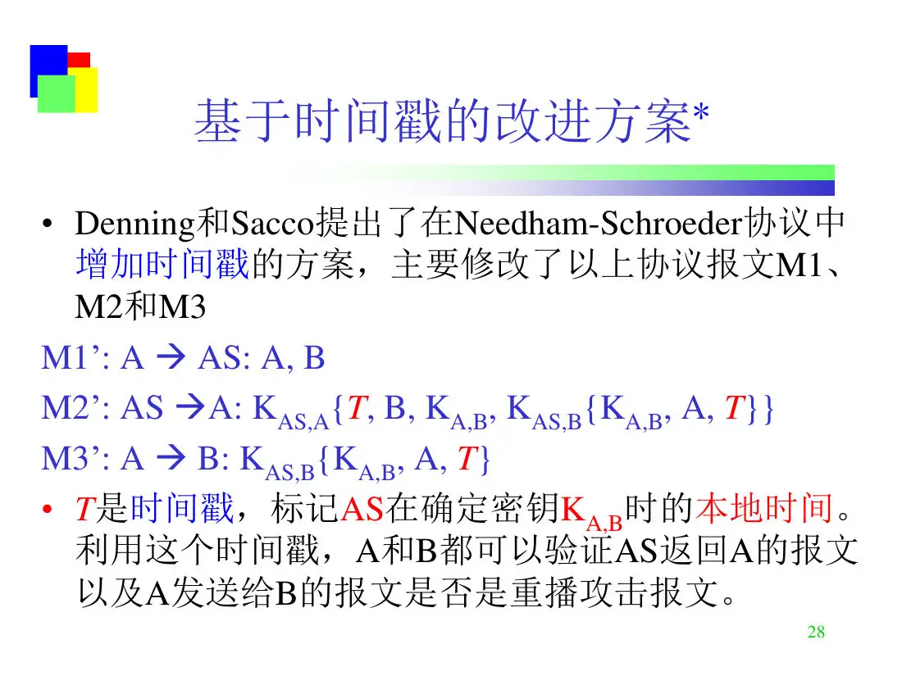

原文：

基于时间戳的改进方案\*

• Denning和Sacco提出了在Needham-Schroeder协议中增加时间戳的方案，主要修改了以上协议报文M1、M2和M3

M1’: A → AS: A, B

M2’: $\mathrm { A S }  \mathrm { A : K _ { A S , A } \{ } \it T , B , K _ { A , B } , K _ { A S , B } \{ K _ { A , B } , A , T \} \}$

$$
\mathrm{M} 3 ^ {\prime}: \mathrm{A} \rightarrow \mathrm{B}: \mathrm{K} _ {\mathrm{AS}, \mathrm{B}} \{\mathrm{K} _ {\mathrm{A}, \mathrm{B}}, \mathrm{A}, T \}
$$

• T是时间戳，标记AS在确定密钥 $\mathrm { K } _ { \mathrm { A , B } }$ 时的本地时间。利用这个时间戳，A和B都可以验证AS返回A的报文以及A发送给B的报文是否是重播攻击报文。

28

### 基于时间戳的改进方案(续)

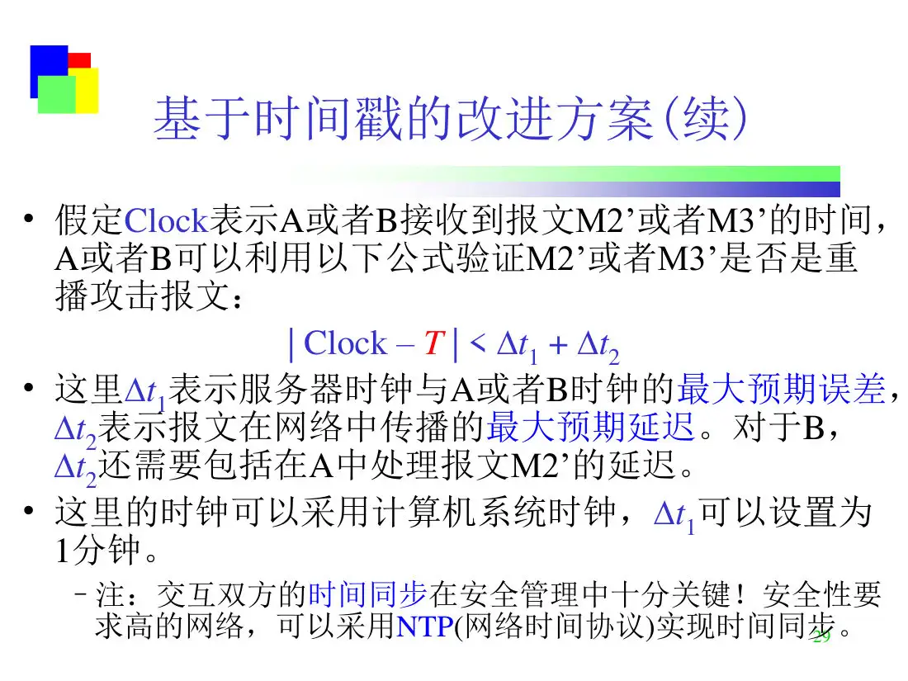

原文：

基于时间戳的改进方案(续)

• 假定Clock表示A或者B接收到报文 ${ \bf M } 2 ^ { \bf \theta }$ 或者 $_ { \mathrm { M } 3 } ,$ 的时间，A或者B可以利用以下公式验证 $\mathbf { M } 2 ^ { \prime }$ 或者 $_ { \mathrm { M } 3 } ,$ 是否是重播攻击报文：

$$
\mid \operatorname{Clock} - T \mid <   \Delta t _ {1} + \Delta t _ {2}
$$

• 这里 $\Delta t _ { 1 }$ 表示服务器时钟与A或者B时钟的最大预期误差，$\Delta t _ { 2 }$ 表示报文在网络中传播的最大预期延迟。对于B，$\Delta \bar { t _ { 2 } }$ 还需要包括在A中处理报文 $. \mathbf { M } 2 ^ { \prime }$ 的延迟。

• 这里的时钟可以采用计算机系统时钟， $\Delta t _ { 1 }$ 可以设置为1分钟。

–注：交互双方的时间同步在安全管理中十分关键！安全性要求高的网络，可以采用NTP(网络时间协议)实现时间同步。

### 基于一次性数的改进方案

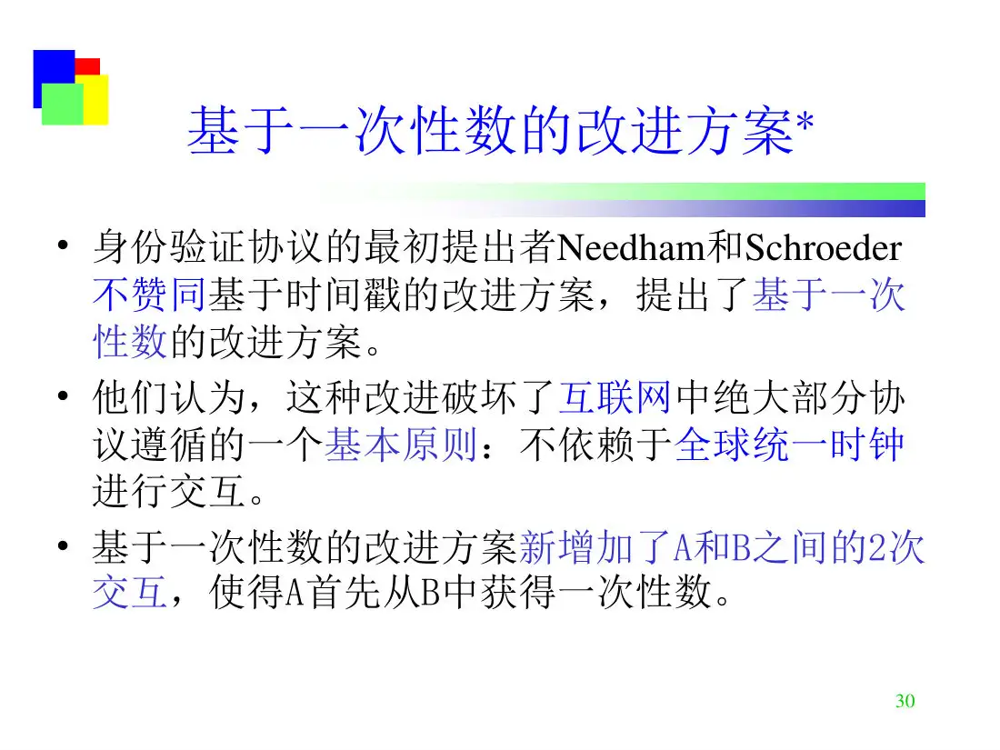

原文：

基于一次性数的改进方案

• 身份验证协议的最初提出者Needham和Schroeder不赞同基于时间戳的改进方案，提出了基于一次性数的改进方案。

• 他们认为，这种改进破坏了互联网中绝大部分协议遵循的一个基本原则：不依赖于全球统一时钟进行交互。

• 基于一次性数的改进方案新增加了A和B之间的2次交互，使得A首先从B中获得一次性数。

30

### 基于一次性数的改进方案(续)

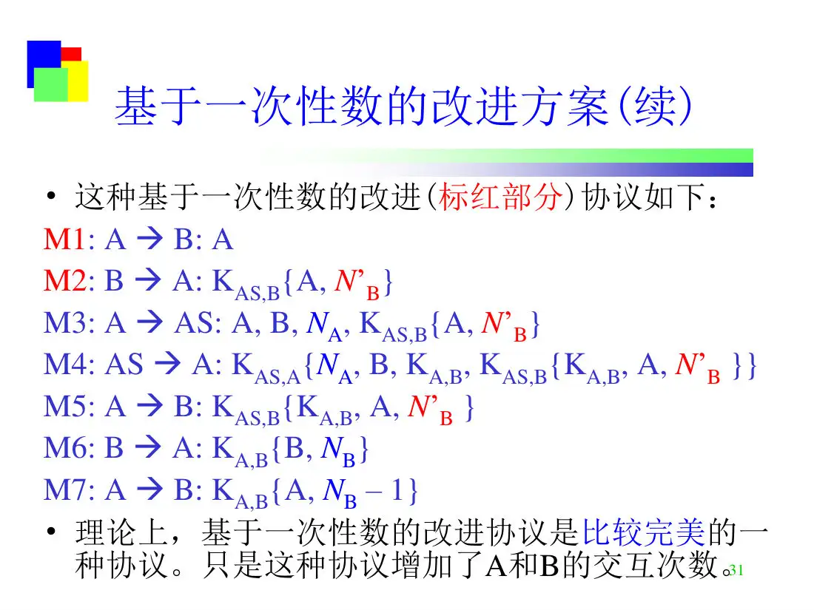

原文：

基于一次性数的改进方案(续)

• 这种基于一次性数的改进(标红部分)协议如下：

M1: A → B: A M2: B → A: KAS,B{A, N’B} $\mathrm { M 3 \mathrm { : } A \to A S \mathrm { : } A , B , } N _ { \mathrm { A } } , { \mathrm { } K _ { \mathrm { A S , } B } \{ A , N _ { \mathrm { \scriptsize ~ B } } ^ { \ast } \} }$ $\mathrm  M 4 \mathrm { : ~ A S }  A \mathrm { : ~ K _ { A S , A } \mathrm { : ~ } W _ { A } , B , K _ { A , B } , K _ { A S , B } \mathrm { : ~ K _ { A , B } , A , \it N _ { \mathrm { ~ B } } \mathrm { : ~ } \} ~ } }$ $\mathrm { M } 5 \mathrm { a }  \mathrm { B } \mathrm { : K } _ { \mathrm { A S , B } } \{ \mathrm { K } _ { \mathrm { A , B } } , \mathrm { A } , N _ { \mathrm { ~ B ~ } } ^ { \circ } \}$ M6: B → A: KA,B{B, NB} M7: A → B: KA,B{A, NB – 1}

• 理论上，基于一次性数的改进协议是比较完美的一31种协议。只是这种协议增加了A和B的交互次数。

### 重点回顾

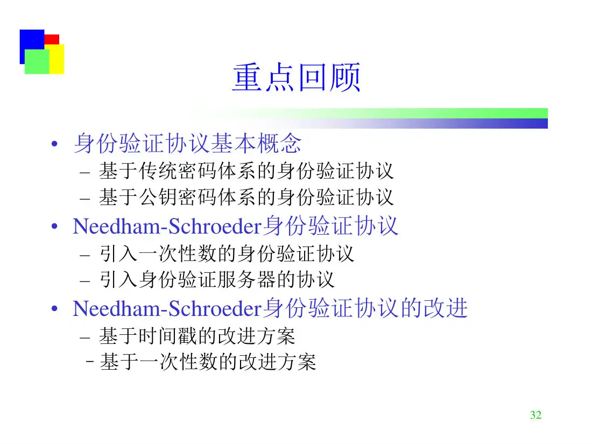

原文：

重点回顾

• 身份验证协议基本概念

– 基于传统密码体系的身份验证协议

– 基于公钥密码体系的身份验证协议

• Needham-Schroeder身份验证协议

– 引入一次性数的身份验证协议

– 引入身份验证服务器的协议

• Needham-Schroeder身份验证协议的改进

– 基于时间戳的改进方案

–基于一次性数的改进方案

7

32

### 本章作业

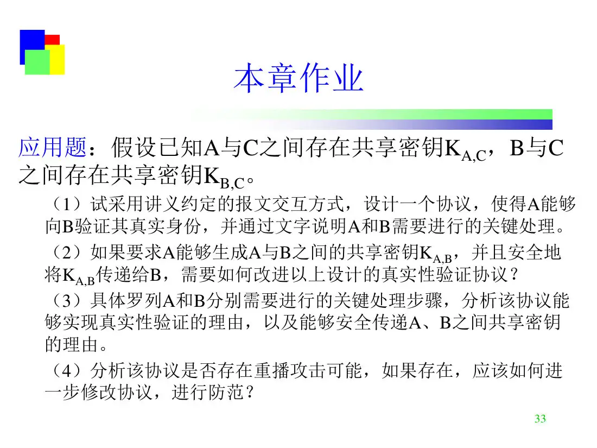

原文：

本章作业

应用题：假设已知A与C之间存在共享密钥 ${ \mathrm { K } } _ { \mathrm { A , C } } .$ ，B与C之间存在共享密钥 $\mathrm { K } _ { \mathrm { B } , \mathrm { C } ^ { \circ } }$

（1）试采用讲义约定的报文交互方式，设计一个协议，使得A能够向B验证其真实身份，并通过文字说明A和B需要进行的关键处理。

（2）如果要求A能够生成A与B之间的共享密钥 ${ \mathrm { K } } _ { \mathrm { A , B } }$ ，并且安全地将 ${ \mathrm { K } } _ { \mathrm { A , B } }$ 传递给B，需要如何改进以上设计的真实性验证协议？

（3）具体罗列A和B分别需要进行的关键处理步骤，分析该协议能够实现真实性验证的理由，以及能够安全传递A、B之间共享密钥的理由。

（4）分析该协议是否存在重播攻击可能，如果存在，应该如何进一步修改协议，进行防范？

33
