# 《信息安全技术》第4章 访问控制技术及应用（课件）

原件的每一页，下面附识别出的文字。

### 第4章访问控制技术及应用访问控制策略与模型

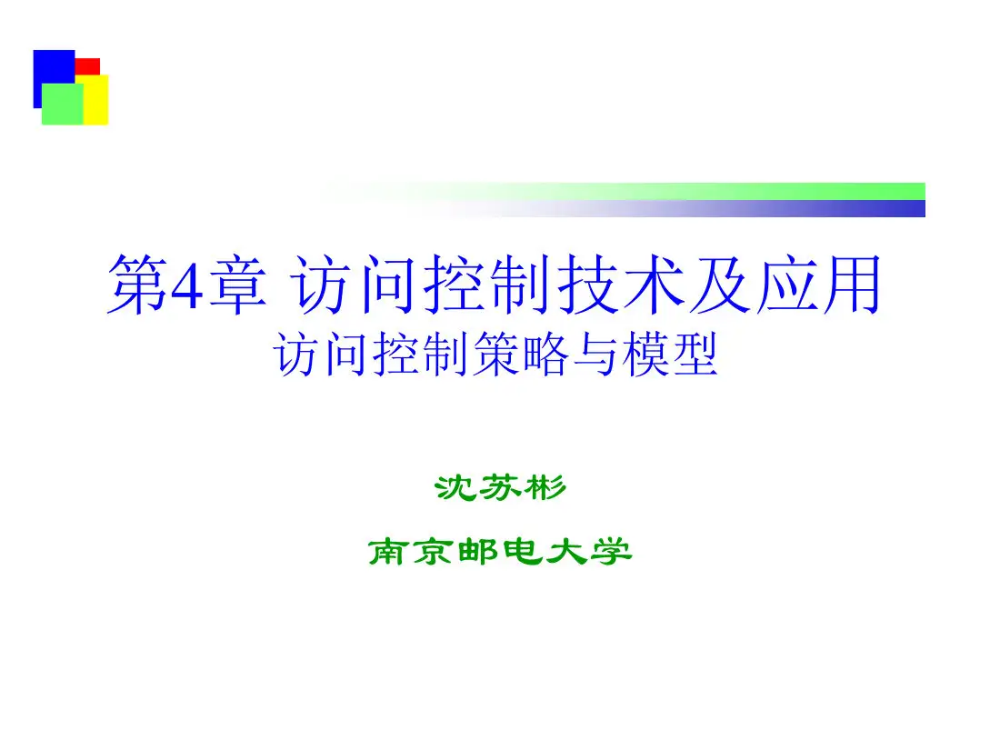

原文：

第4章访问控制技术及应用访问控制策略与模型

沈苏彬

南京邮电大学

### 本章的开场白

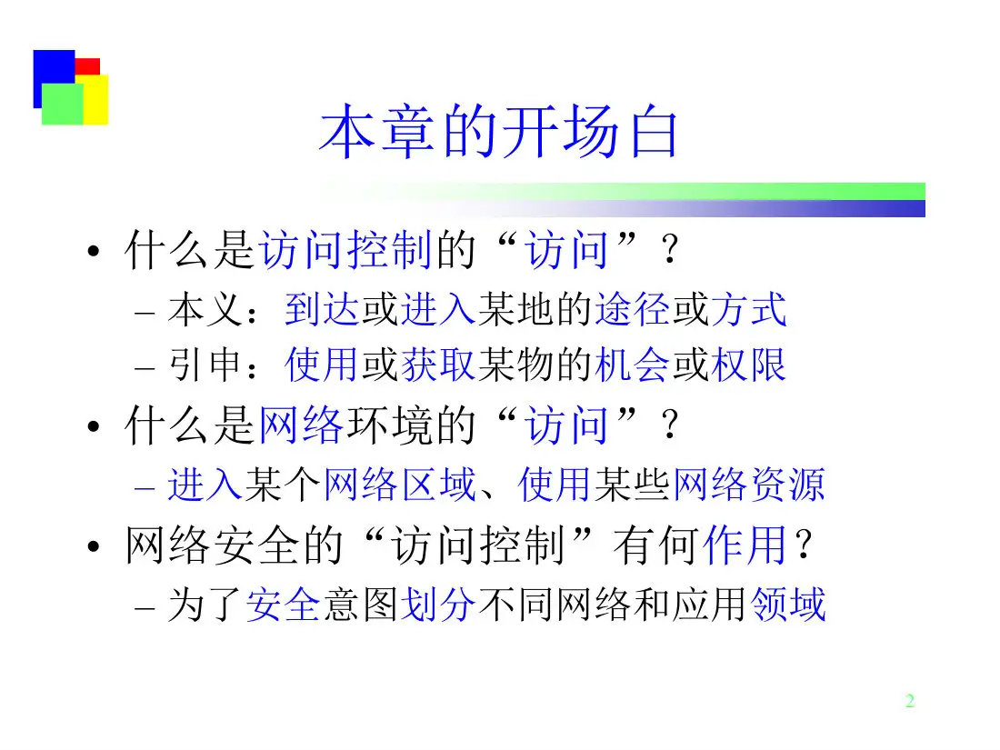

原文：

本章的开场白

• 什么是访问控制的“访问”？

– 本义：到达或进入某地的途径或方式

– 引申：使用或获取某物的机会或权限

• 什么是网络环境的“访问”？– 进入某个网络区域、使用某些网络资源

• 网络安全的“访问控制”有何作用？– 为了安全意图划分不同网络和应用领域

2

### 关键知识点\

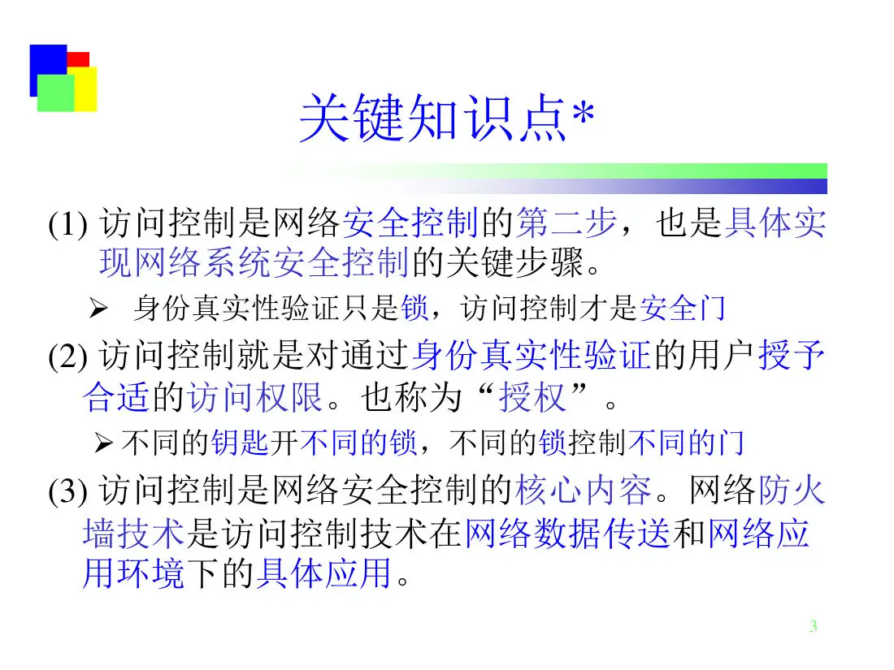

原文：

关键知识点\*

(1) 访问控制是网络安全控制的第二步，也是具体实现网络系统安全控制的关键步骤。

➢ 身份真实性验证只是锁，访问控制才是安全门

(2) 访问控制就是对通过身份真实性验证的用户授予合适的访问权限。也称为“授权”。

➢不同的钥匙开不同的锁，不同的锁控制不同的门

(3) 访问控制是网络安全控制的核心内容。网络防火墙技术是访问控制技术在网络数据传送和网络应用环境下的具体应用。

3

### 主要内容

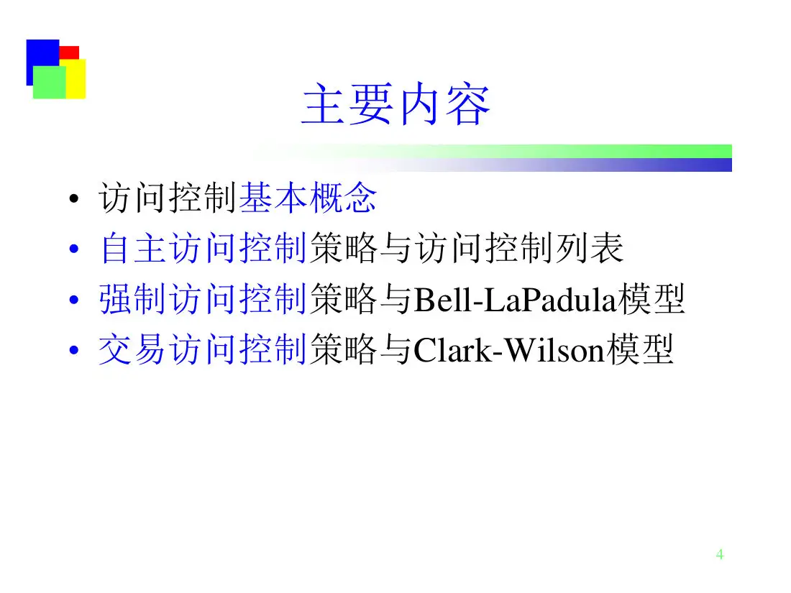

原文：

主要内容

• 访问控制基本概念

• 自主访问控制策略与访问控制列表

• 强制访问控制策略与Bell-LaPadula模型

• 交易访问控制策略与Clark-Wilson模型

7

4

### 访问控制基本概念\

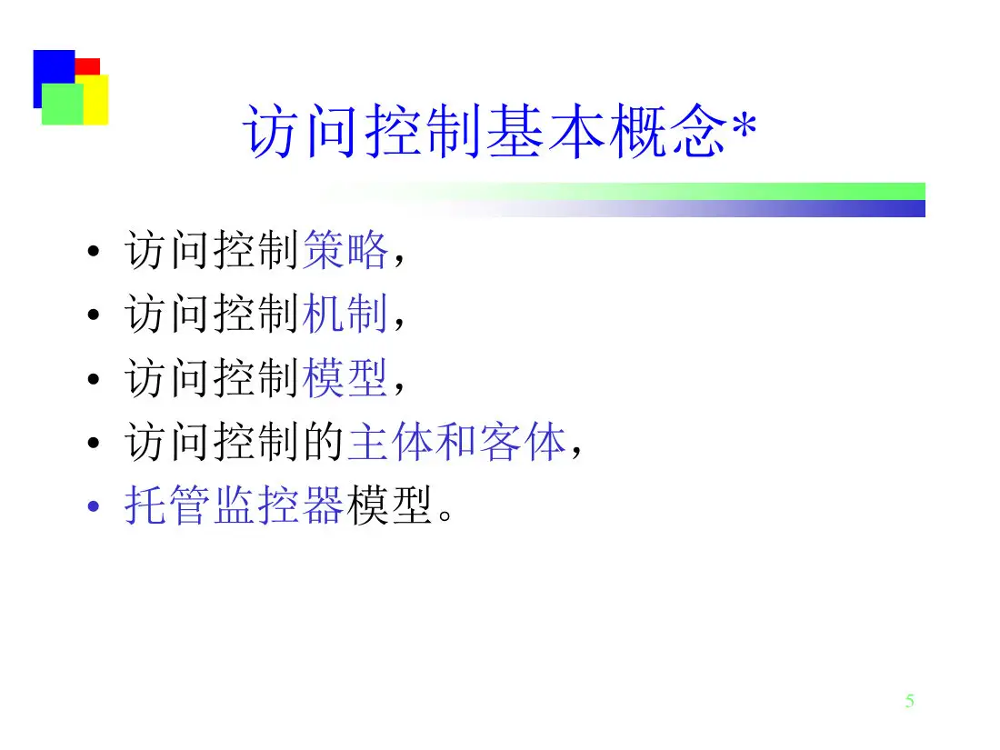

原文：

访问控制基本概念\*

• 访问控制策略，

• 访问控制机制，

• 访问控制模型，

• 访问控制的主体和客体，

• 托管监控器模型。

5

### 访问控制策略\

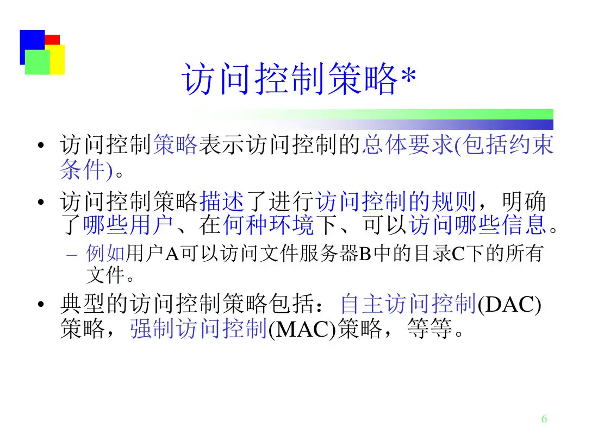

原文：

访问控制策略\*

• 访问控制策略表示访问控制的总体要求(包括约束条件)。

• 访问控制策略描述了进行访问控制的规则，明确了哪些用户、在何种环境下、可以访问哪些信息。– 例如用户A可以访问文件服务器B中的目录C下的所有文件。

• 典型的访问控制策略包括：自主访问控制(DAC)策略，强制访问控制(MAC)策略，等等。

7

6

### 访问控制机制\

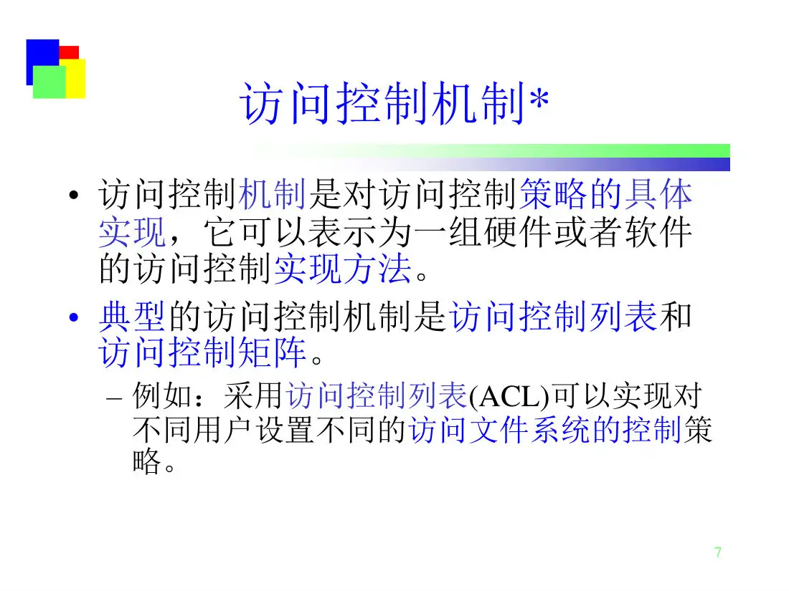

原文：

访问控制机制\*

• 访问控制机制是对访问控制策略的具体实现，它可以表示为一组硬件或者软件的访问控制实现方法。

• 典型的访问控制机制是访问控制列表和访问控制矩阵。

例如：采用访问控制列表(ACL)可以实现对不同用户设置不同的访问文件系统的控制策略。

7

7

### 访问控制模型\

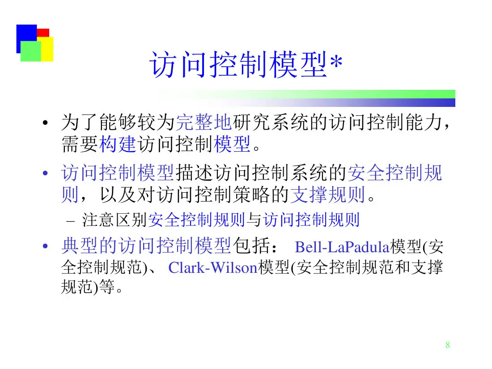

原文：

访问控制模型\*

• 为了能够较为完整地研究系统的访问控制能力，需要构建访问控制模型。

• 访问控制模型描述访问控制系统的安全控制规则，以及对访问控制策略的支撑规则。

– 注意区别安全控制规则与访问控制规则

典型的访问控制模型包括： Bell-LaPadula模型(安全控制规范)、Clark-Wilson模型(安全控制规范和支撑规范)等。

7

8

### 主体\

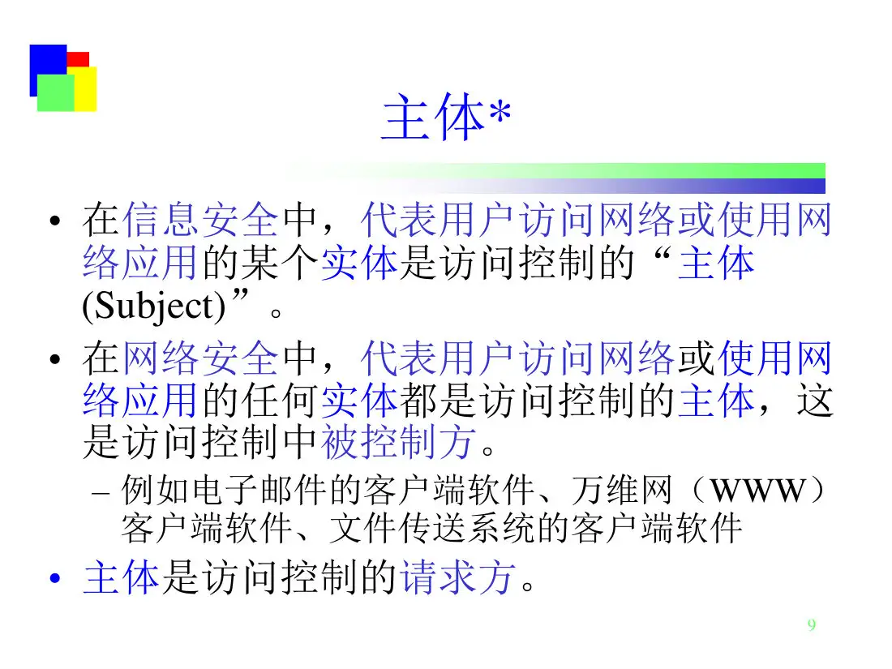

原文：

主体\*

• 在信息安全中，代表用户访问网络或使用网络应用的某个实体是访问控制的“主体(Subject)”。

• 在网络安全中，代表用户访问网络或使用网络应用的任何实体都是访问控制的主体，这是访问控制中被控制方。

– 例如电子邮件的客户端软件、万维网（WWW）客户端软件、文件传送系统的客户端软件

• 主体是访问控制的请求方。

9

### 客体\

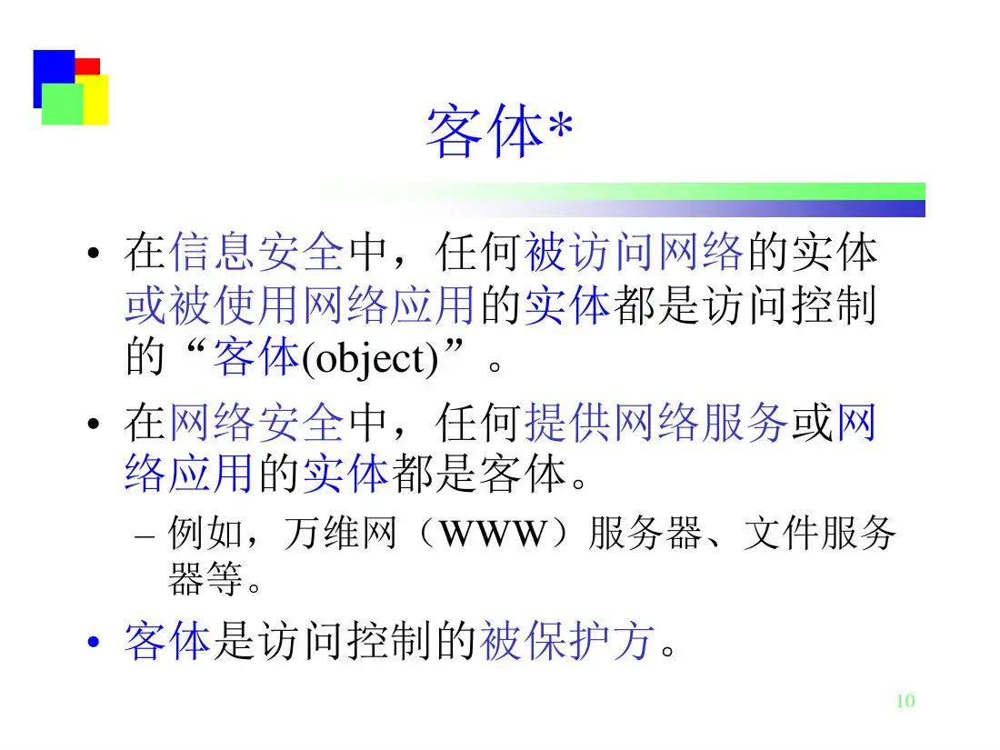

原文：

客体\*

• 在信息安全中，任何被访问网络的实体或被使用网络应用的实体都是访问控制的“客体(object)”。

• 在网络安全中，任何提供网络服务或网络应用的实体都是客体。

– 例如，万维网（WWW）服务器、文件服务器等。

• 客体是访问控制的被保护方。

10

### 托管监控器模型\

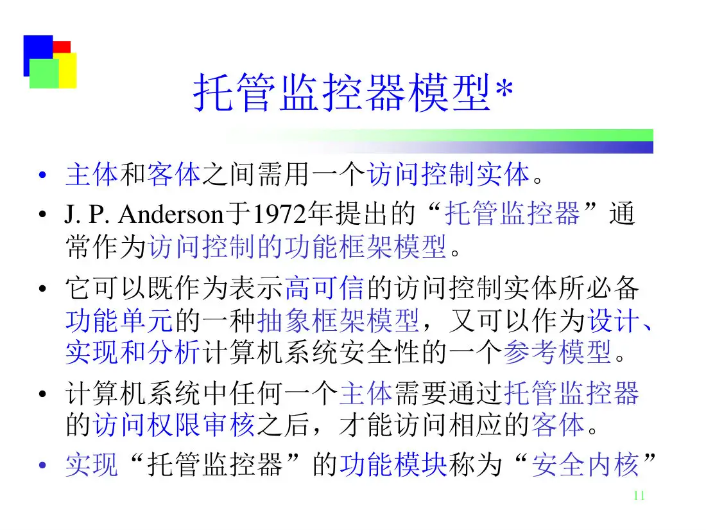

原文：

托管监控器模型\*

• 主体和客体之间需用一个访问控制实体。

• J. P. Anderson于1972年提出的“托管监控器”通常作为访问控制的功能框架模型。

• 它可以既作为表示高可信的访问控制实体所必备功能单元的一种抽象框架模型，又可以作为设计、实现和分析计算机系统安全性的一个参考模型。

• 计算机系统中任何一个主体需要通过托管监控器的访问权限审核之后，才能访问相应的客体。

• 实现“托管监控器”的功能模块称为“安全内核”

7

11

### 托管监控器模型的特性

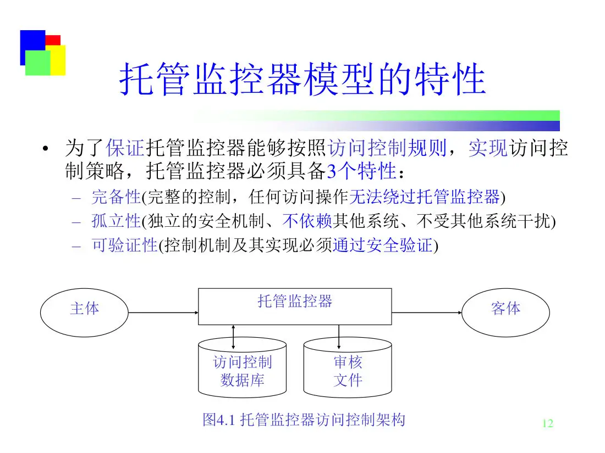

原文：

托管监控器模型的特性

• 为了保证托管监控器能够按照访问控制规则，实现访问控制策略，托管监控器必须具备3个特性：

– 完备性(完整的控制，任何访问操作无法绕过托管监控器)

– 孤立性(独立的安全机制、不依赖其他系统、不受其他系统干扰)

– 可验证性(控制机制及其实现必须通过安全验证)

12

### 托管监控器模型的应用

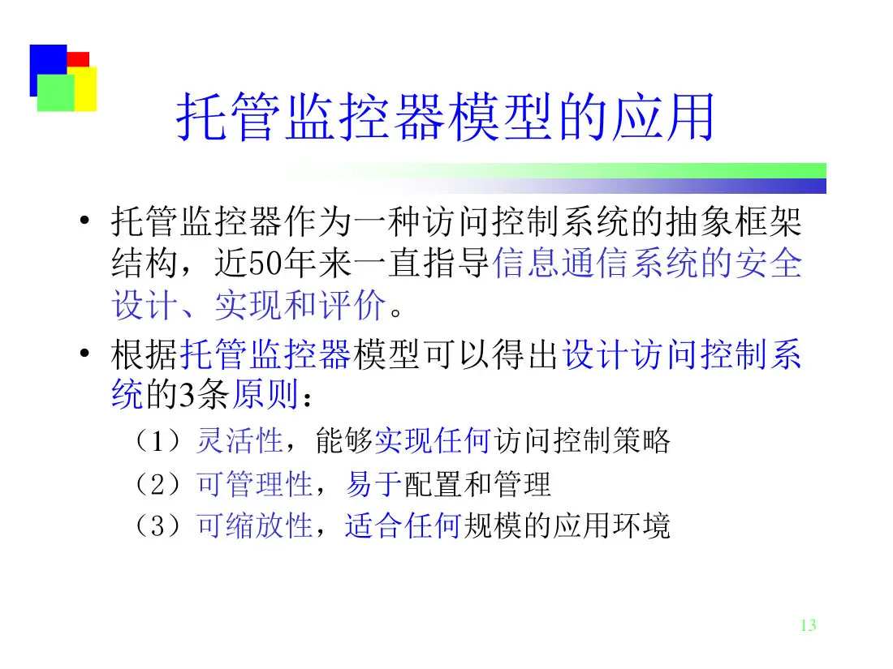

原文：

托管监控器模型的应用

• 托管监控器作为一种访问控制系统的抽象框架结构，近50年来一直指导信息通信系统的安全设计、实现和评价。

• 根据托管监控器模型可以得出设计访问控制系统的3条原则：

（1）灵活性，能够实现任何访问控制策略

（2）可管理性，易于配置和管理

（3）可缩放性，适合任何规模的应用环境

13

### 军用安全策略与Bell-LaPadula模型\

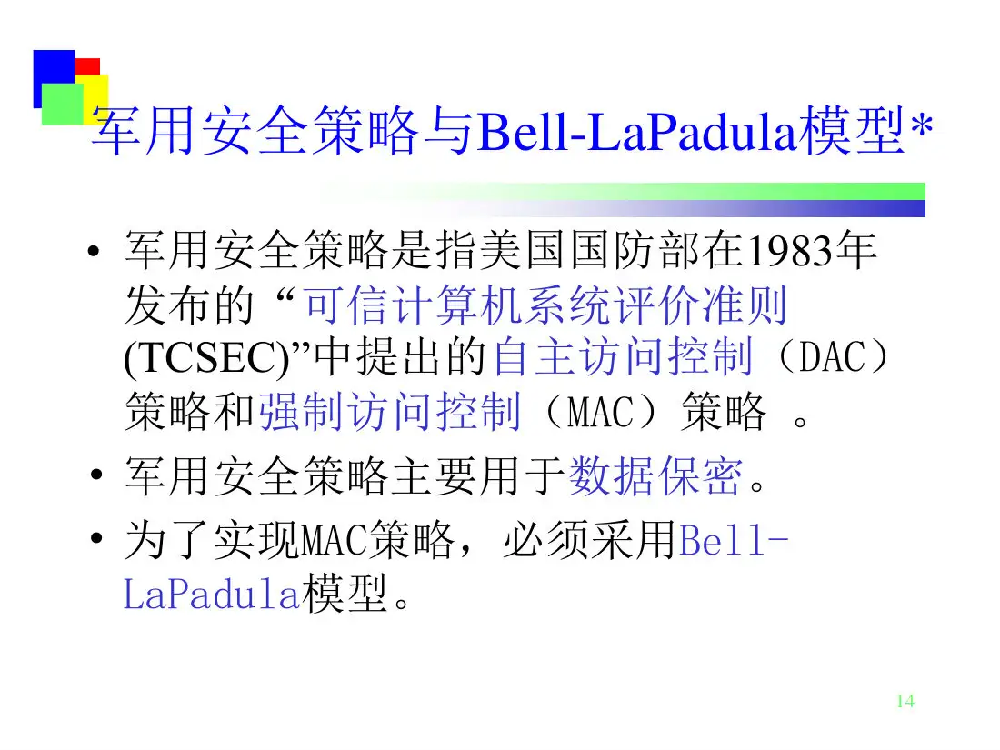

原文：

军用安全策略与Bell-LaPadula模型\*

• 军用安全策略是指美国国防部在1983年发布的“可信计算机系统评价准则(TCSEC)”中提出的自主访问控制（DAC）策略和强制访问控制（MAC）策略 。

• 军用安全策略主要用于数据保密。

• 为了实现MAC策略，必须采用Bell-LaPadula模型。

14

### 自主访问控制策略\

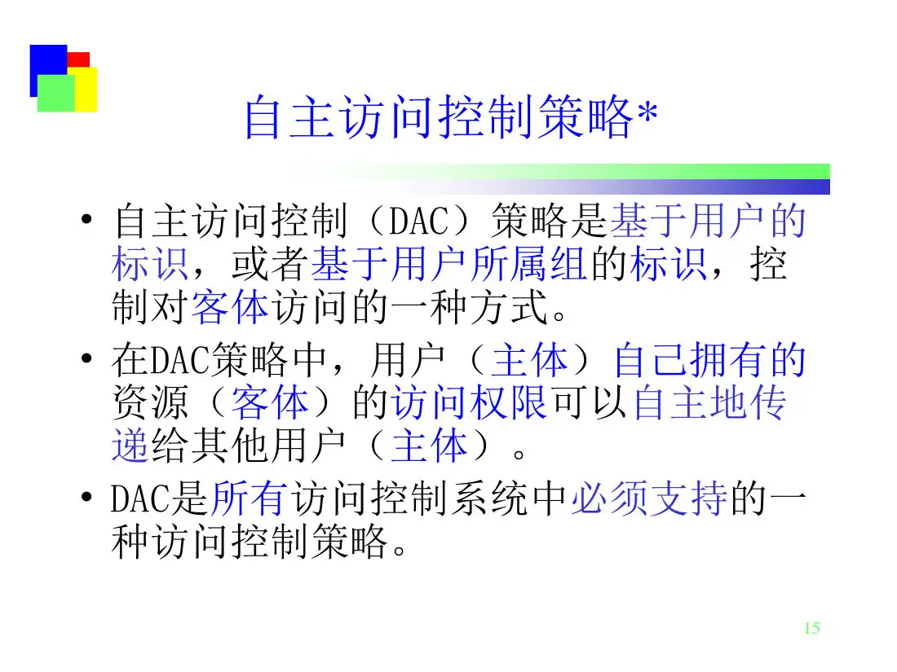

原文：

自主访问控制策略\*

• 自主访问控制（DAC）策略是基于用户的标识，或者基于用户所属组的标识，控制对客体访问的一种方式。

• 在DAC策略中，用户（主体）自己拥有的资源（客体）的访问权限可以自主地传递给其他用户（主体）。

• DAC是所有访问控制系统中必须支持的一种访问控制策略。

1

15

### 自主访问控制策略的实现\

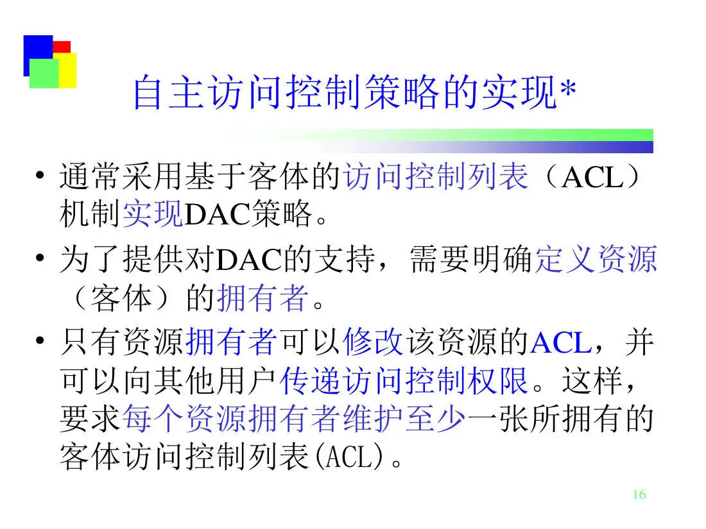

原文：

自主访问控制策略的实现\*

• 通常采用基于客体的访问控制列表（ACL）机制实现DAC策略。

• 为了提供对DAC的支持，需要明确定义资源（客体）的拥有者。

• 只有资源拥有者可以修改该资源的ACL，并可以向其他用户传递访问控制权限。这样，要求每个资源拥有者维护至少一张所拥有的客体访问控制列表(ACL)。

7

16

### 自主访问控制策略的实现举例1

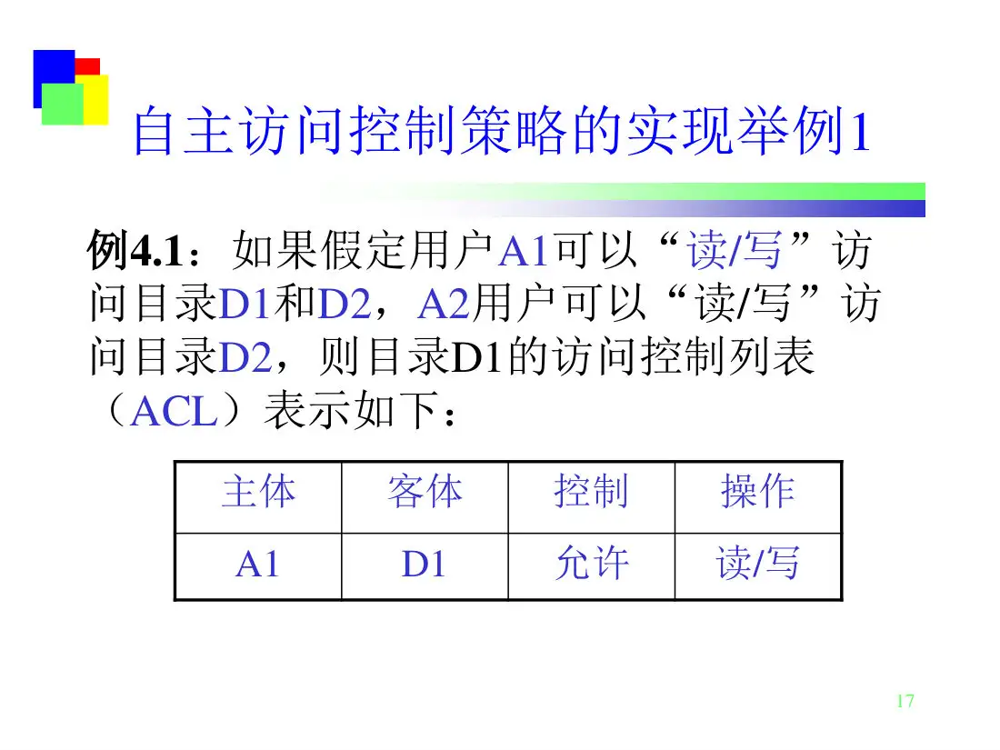

原文：

自主访问控制策略的实现举例1

例4.1：如果假定用户A1可以“读/写”访问目录D1和D2，A2用户可以“读/写”访问目录D2，则目录D1的访问控制列表（ACL）表示如下：

<table><tr><td>主体</td><td>客体</td><td>控制</td><td>操作</td></tr><tr><td>A1</td><td>D1</td><td>允许</td><td>读/写</td></tr></table>

17

### 自主访问控制策略的实现举例2

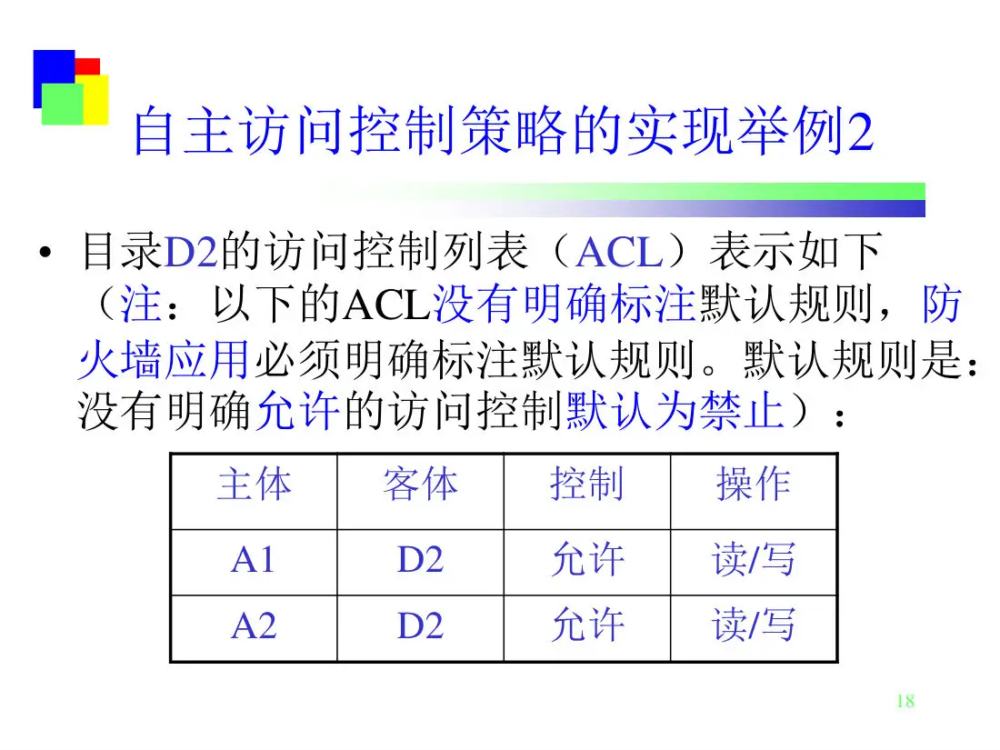

原文：

自主访问控制策略的实现举例2

• 目录D2的访问控制列表（ACL）表示如下（注：以下的ACL没有明确标注默认规则，防火墙应用必须明确标注默认规则。默认规则是：没有明确允许的访问控制默认为禁止）：

<table><tr><td>主体</td><td>客体</td><td>控制</td><td>操作</td></tr><tr><td>A1</td><td>D2</td><td>允许</td><td>读/写</td></tr><tr><td>A2</td><td>D2</td><td>允许</td><td>读/写</td></tr></table>

18

### 自主访问控制策略的潜在威胁\

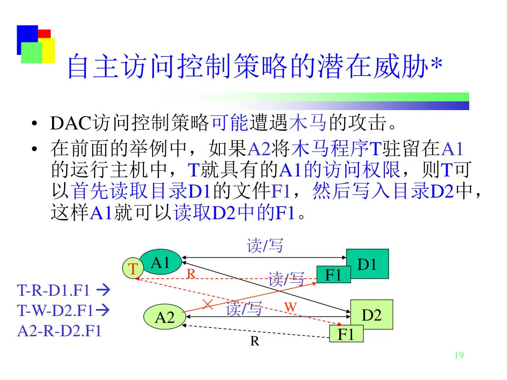

原文：

自主访问控制策略的潜在威胁\*

• DAC访问控制策略可能遭遇木马的攻击。

• 在前面的举例中，如果A2将木马程序T驻留在A1的运行主机中，T就具有的A1的访问权限，则T可以首先读取目录D1的文件F1，然后写入目录D2中，这样A1就可以读取D2中的F1。

19

### 自主访问控制策略的弱点\

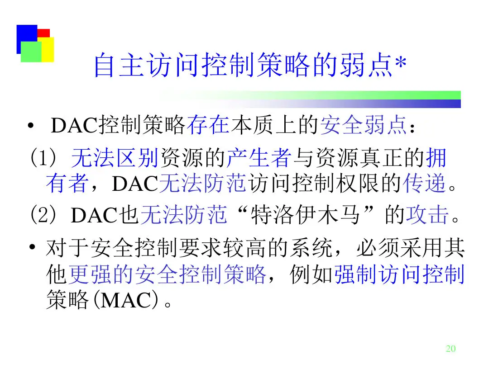

原文：

自主访问控制策略的弱点\*

• DAC控制策略存在本质上的安全弱点：

(1) 无法区别资源的产生者与资源真正的拥有者，DAC无法防范访问控制权限的传递。

(2) DAC也无法防范“特洛伊木马”的攻击。

• 对于安全控制要求较高的系统，必须采用其他更强的安全控制策略，例如强制访问控制策略(MAC)。

7

20

### 强制访问控制策略\

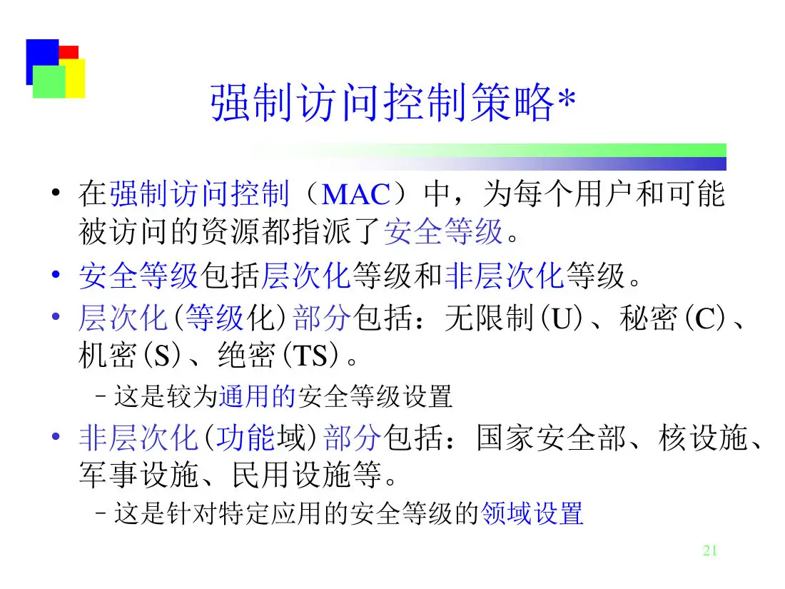

原文：

强制访问控制策略\*

• 在强制访问控制（MAC）中，为每个用户和可能被访问的资源都指派了安全等级。

• 安全等级包括层次化等级和非层次化等级。

• 层次化(等级化)部分包括：无限制(U)、秘密(C)、机密(S)、绝密(TS)。

–这是较为通用的安全等级设置

• 非层次化(功能域)部分包括：国家安全部、核设施、军事设施、民用设施等。

–这是针对特定应用的安全等级的领域设置

21

### 强制访问控制策略(续)\

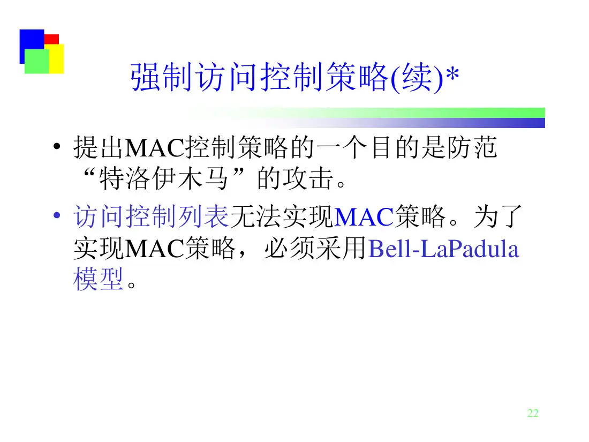

原文：

强制访问控制策略(续)\*

• 提出MAC控制策略的一个目的是防范“特洛伊木马”的攻击。

• 访问控制列表无法实现MAC策略。为了实现MAC策略，必须采用Bell-LaPadula模型。

22

### Bell-LaPadula模型\

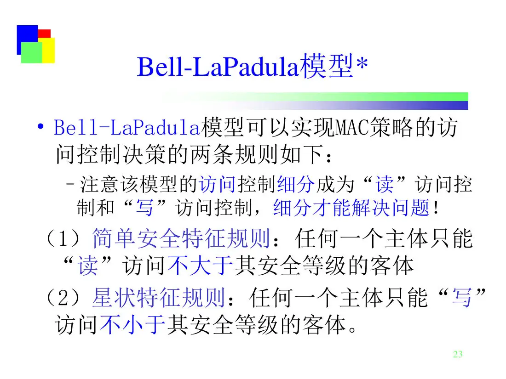

原文：

Bell-LaPadula模型\*

• Bell-LaPadula模型可以实现MAC策略的访问控制决策的两条规则如下：

–注意该模型的访问控制细分成为“读”访问控制和“写”访问控制，细分才能解决问题！

（1）简单安全特征规则：任何一个主体只能“读”访问不大于其安全等级的客体

（2）星状特征规则：任何一个主体只能“写”访问不小于其安全等级的客体。

1

23

### Bell-LaPadula模型优点\

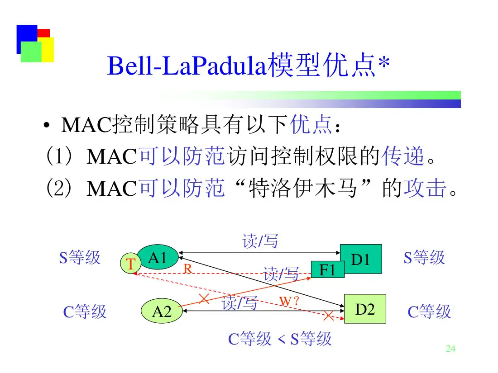

原文：

Bell-LaPadula模型优点\*

• MAC控制策略具有以下优点：

(1) MAC可以防范访问控制权限的传递。

(2) MAC可以防范“特洛伊木马”的攻击。

S等级

C等级

S等级

C等级

1

24

### 访问控制模型举例2\

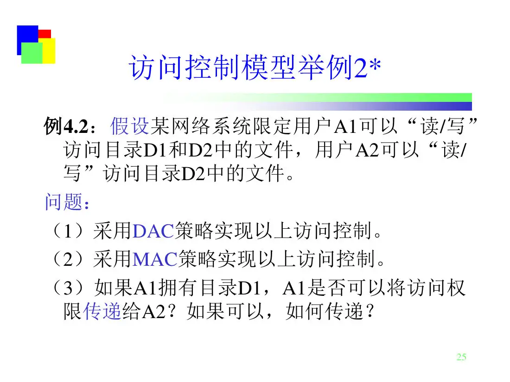

原文：

访问控制模型举例2\*

例4.2：假设某网络系统限定用户A1可以“读/写”访问目录D1和D2中的文件，用户A2可以“读/写”访问目录D2中的文件。

问题：

（1）采用DAC策略实现以上访问控制。

（2）采用MAC策略实现以上访问控制。

（3）如果A1拥有目录D1，A1是否可以将访问权限传递给A2？如果可以，如何传递？

1

25

### 访问控制模型举例(续1)\

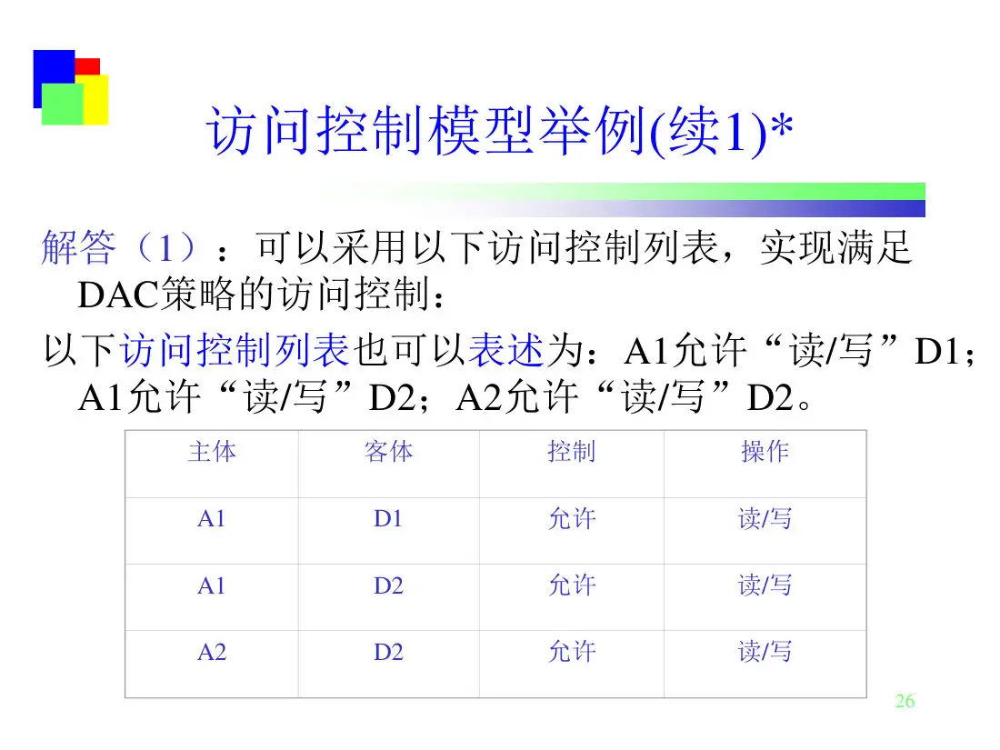

原文：

访问控制模型举例(续1)\*

解答（1）：可以采用以下访问控制列表，实现满足DAC策略的访问控制：

以下访问控制列表也可以表述为：A1允许“读/写”D1；A1允许“读/写”D2；A2允许“读/写”D2。

<table><tr><td>主体</td><td>客体</td><td>控制</td><td>操作</td></tr><tr><td>A1</td><td>D1</td><td>允许</td><td>读/写</td></tr><tr><td>A1</td><td>D2</td><td>允许</td><td>读/写</td></tr><tr><td>A2</td><td>D2</td><td>允许</td><td>读/写</td></tr></table>

26

### 访问控制模型举例(续2)

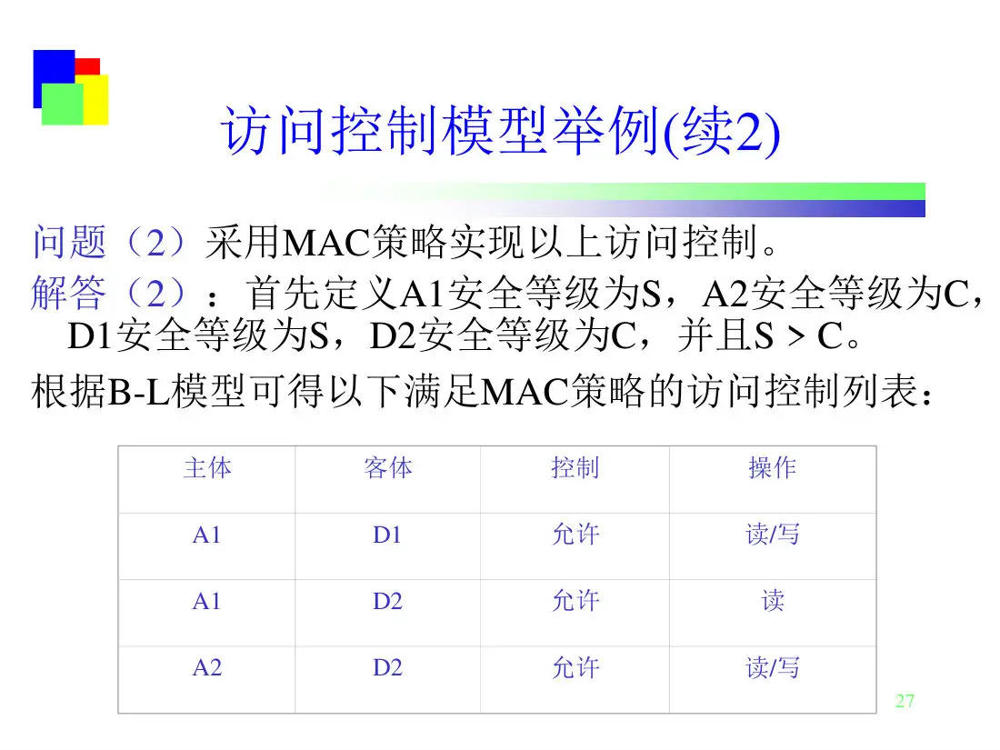

原文：

访问控制模型举例(续2)

问题（2）采用MAC策略实现以上访问控制。

解答（2）：首先定义A1安全等级为S，A2安全等级为C，D1安全等级为S，D2安全等级为C，并且S > C。

根据B-L模型可得以下满足MAC策略的访问控制列表：

<table><tr><td>主体</td><td>客体</td><td>控制</td><td>操作</td></tr><tr><td>A1</td><td>D1</td><td>允许</td><td>读/写</td></tr><tr><td>A1</td><td>D2</td><td>允许</td><td>读</td></tr><tr><td>A2</td><td>D2</td><td>允许</td><td>读/写</td></tr></table>

1

27

### 访问控制模型举例(续3)

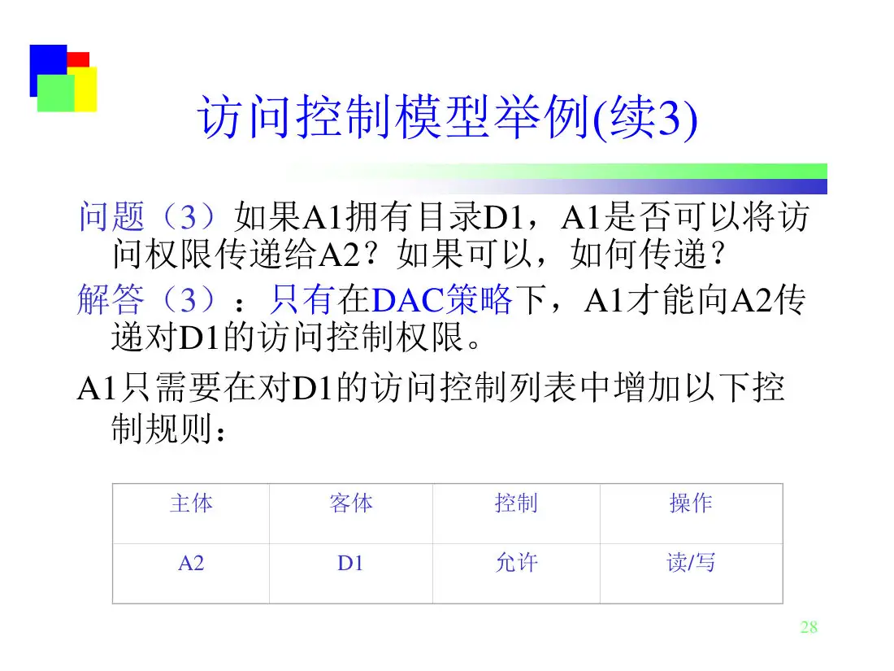

原文：

访问控制模型举例(续3)

问题（3）如果A1拥有目录D1，A1是否可以将访问权限传递给A2？如果可以，如何传递？解答（3）：只有在DAC策略下，A1才能向A2传递对D1的访问控制权限。

A1只需要在对D1的访问控制列表中增加以下控制规则：

<table><tr><td>主体</td><td>客体</td><td>控制</td><td>操作</td></tr><tr><td>A2</td><td>D1</td><td>允许</td><td>读/写</td></tr></table>

28

### 商用安全策略与Clark-Wilson模型

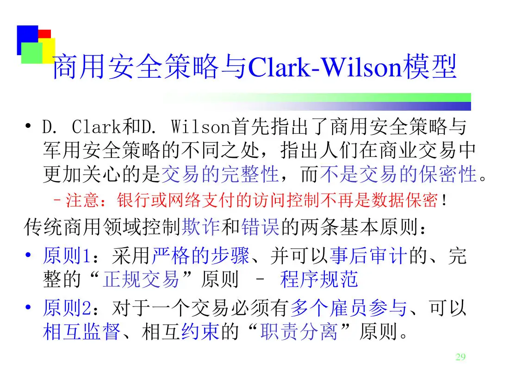

原文：

商用安全策略与Clark-Wilson模型

• D. Clark和D. Wilson首先指出了商用安全策略与军用安全策略的不同之处，指出人们在商业交易中更加关心的是交易的完整性，而不是交易的保密性。

–注意：银行或网络支付的访问控制不再是数据保密！传统商用领域控制欺诈和错误的两条基本原则：

• 原则1：采用严格的步骤、并可以事后审计的、完整的“正规交易”原则 – 程序规范

• 原则2：对于一个交易必须有多个雇员参与、可以相互监督、相互约束的“职责分离”原则。

29

### Clark-Wilson模型

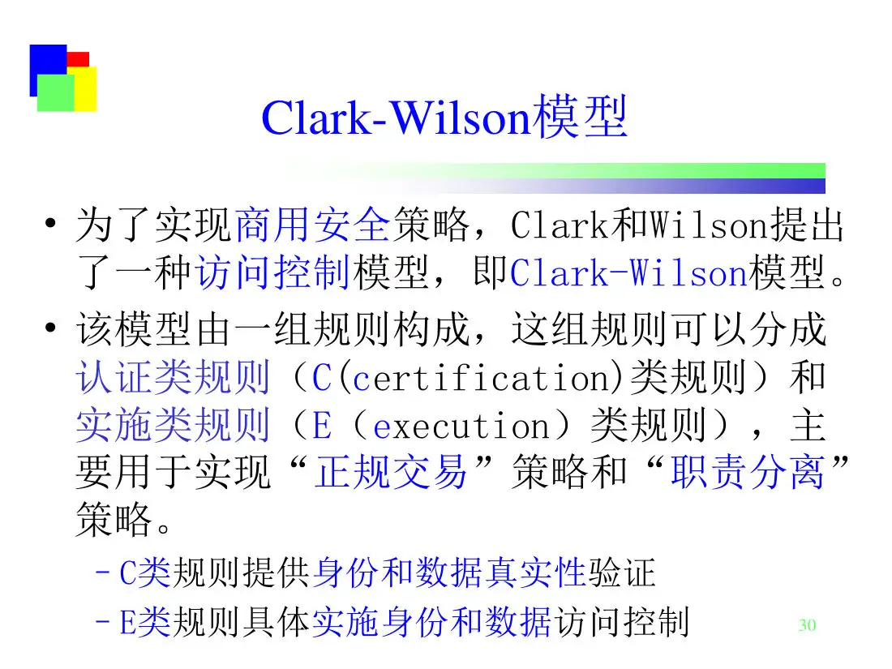

原文：

Clark-Wilson模型

• 为了实现商用安全策略，Clark和Wilson提出了一种访问控制模型，即Clark-Wilson模型。

• 该模型由一组规则构成，这组规则可以分成认证类规则（C(certification)类规则）和实施类规则（E（execution）类规则），主要用于实现“正规交易”策略和“职责分离”策略。

–C类规则提供身份和数据真实性验证

–E类规则具体实施身份和数据访问控制

1

30

### Clark-Wilson模型(续1)

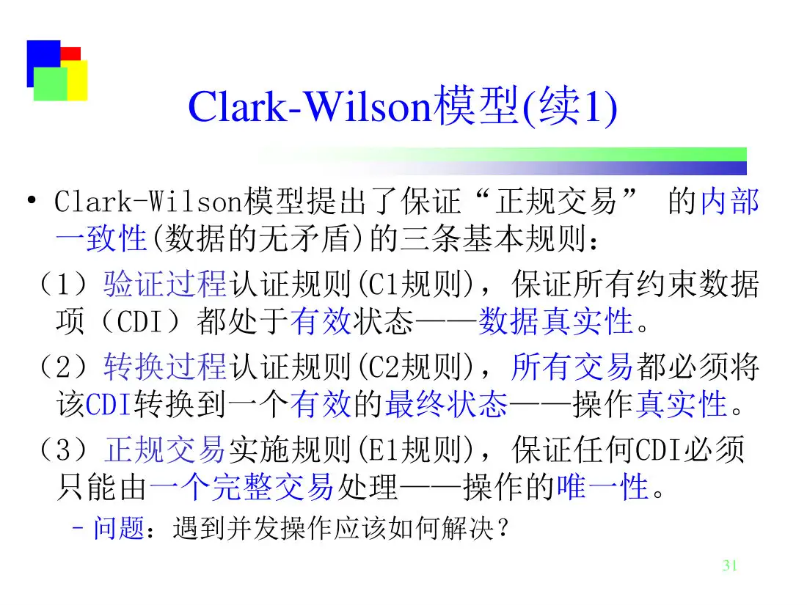

原文：

Clark-Wilson模型(续1)

• Clark-Wilson模型提出了保证“正规交易” 的内部一致性(数据的无矛盾)的三条基本规则：

（1）验证过程认证规则(C1规则)，保证所有约束数据项（CDI）都处于有效状态——数据真实性。

（2）转换过程认证规则(C2规则)，所有交易都必须将该CDI转换到一个有效的最终状态——操作真实性。

（3）正规交易实施规则(E1规则)，保证任何CDI必须只能由一个完整交易处理——操作的唯一性。

–问题：遇到并发操作应该如何解决？

1

31

### Clark-Wilson模型(续2)

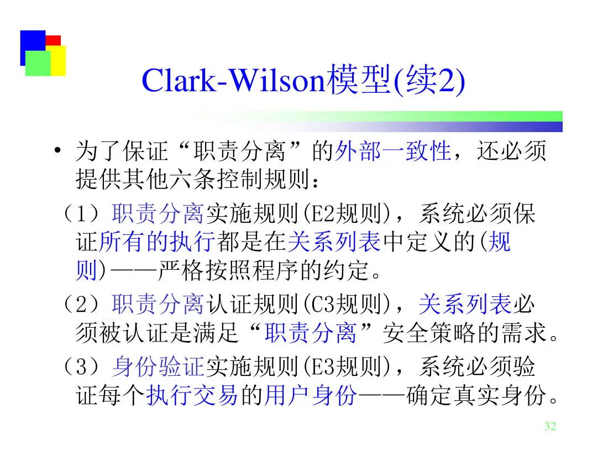

原文：

Clark-Wilson模型(续2)

• 为了保证“职责分离”的外部一致性，还必须提供其他六条控制规则：

（1）职责分离实施规则(E2规则)，系统必须保证所有的执行都是在关系列表中定义的(规则)——严格按照程序的约定。

（2）职责分离认证规则(C3规则)，关系列表必须被认证是满足“职责分离”安全策略的需求。

（3）身份验证实施规则(E3规则)，系统必须验证每个执行交易的用户身份——确定真实身份。

1

32

### Clark-Wilson模型(续3)

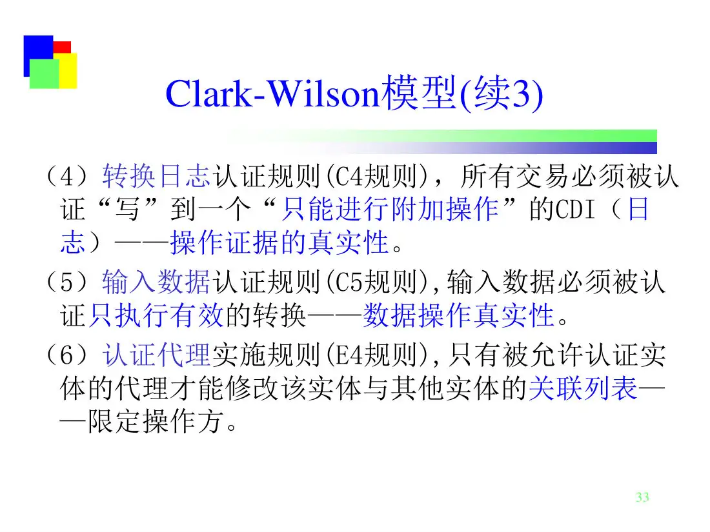

原文：

Clark-Wilson模型(续3)

（4）转换日志认证规则(C4规则)，所有交易必须被认证“写”到一个“只能进行附加操作”的CDI（日志）——操作证据的真实性。

（5）输入数据认证规则(C5规则),输入数据必须被认证只执行有效的转换——数据操作真实性。

（6）认证代理实施规则(E4规则),只有被允许认证实体的代理才能修改该实体与其他实体的关联列表——限定操作方。

1

33

### 重点回顾

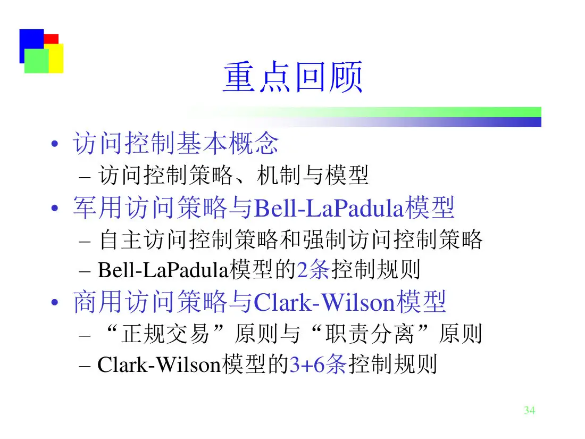

原文：

重点回顾

• 访问控制基本概念

– 访问控制策略、机制与模型

• 军用访问策略与Bell-LaPadula模型– 自主访问控制策略和强制访问控制策略– Bell-LaPadula模型的2条控制规则

• 商用访问策略与Clark-Wilson模型– “正规交易”原则与“职责分离”原则– Clark-Wilson模型的3+6条控制规则

7

34

### 思考题

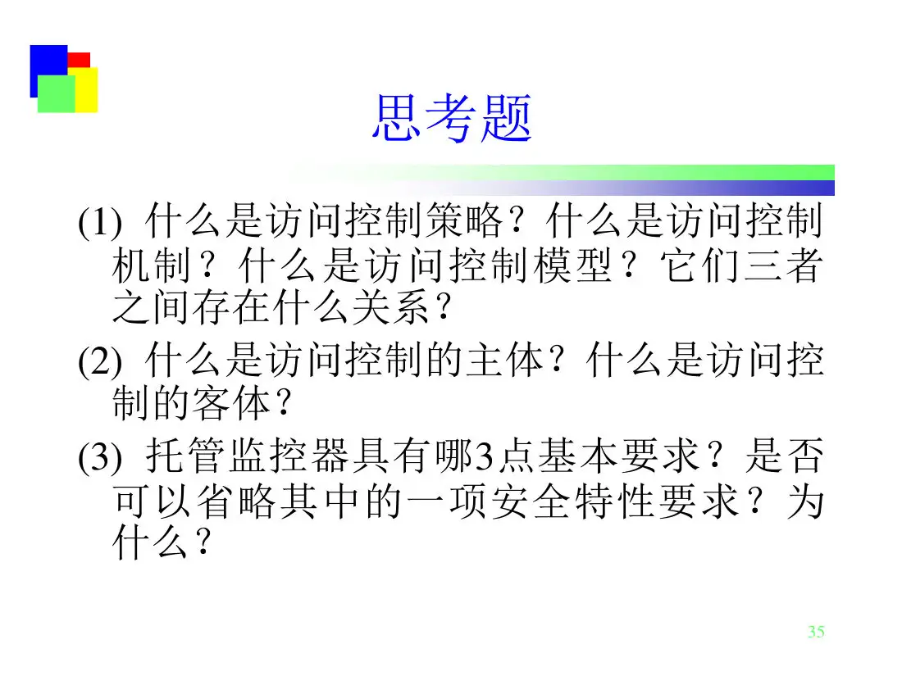

原文：

思考题

(1) 什么是访问控制策略？什么是访问控制机制？什么是访问控制模型？它们三者之间存在什么关系？

(2) 什么是访问控制的主体？什么是访问控制的客体？

(3) 托管监控器具有哪3点基本要求？是否可以省略其中的一项安全特性要求？为什么？

35

### 思考题(续)

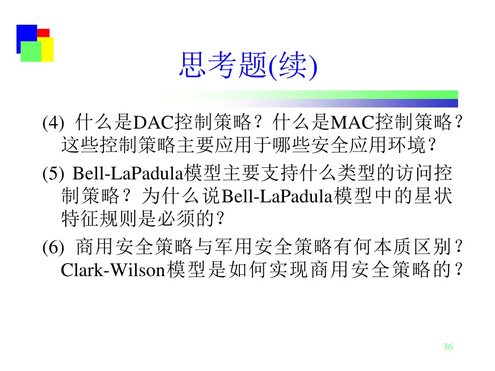

原文：

思考题(续)

(4) 什么是DAC控制策略？什么是MAC控制策略？这些控制策略主要应用于哪些安全应用环境？

(5) Bell-LaPadula模型主要支持什么类型的访问控制策略？为什么说Bell-LaPadula模型中的星状特征规则是必须的？

(6) 商用安全策略与军用安全策略有何本质区别？Clark-Wilson模型是如何实现商用安全策略的？

1

36
