# 《信息安全技术》第4章 访问控制技术及应用：基于角色的访问控制（课件）

原件的每一页，下面附识别出的文字。

### 第4章访问控制技术及应用基于角色的访问控制

原文：

第4章访问控制技术及应用基于角色的访问控制

沈苏彬

南京邮电大学

### 关键知识点\

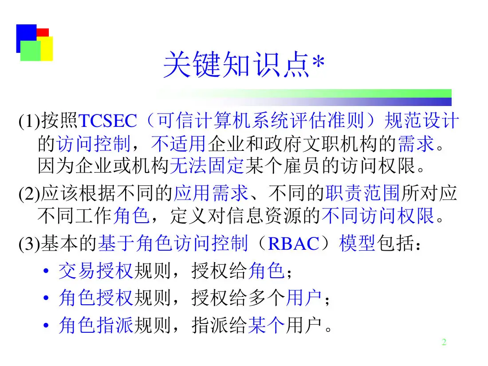

原文：

关键知识点\*

(1)按照TCSEC（可信计算机系统评估准则）规范设计的访问控制，不适用企业和政府文职机构的需求。因为企业或机构无法固定某个雇员的访问权限。

(2)应该根据不同的应用需求、不同的职责范围所对应不同工作角色，定义对信息资源的不同访问权限。

(3)基本的基于角色访问控制（RBAC）模型包括：

• 交易授权规则，授权给角色；

• 角色授权规则，授权给多个用户；

• 角色指派规则，指派给某个用户。

1

2

### 主要内容

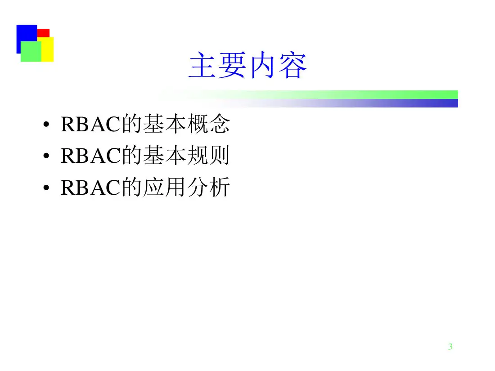

原文：

主要内容

• RBAC的基本概念

• RBAC的基本规则

• RBAC的应用分析

3

### 引入RBAC的必要性\

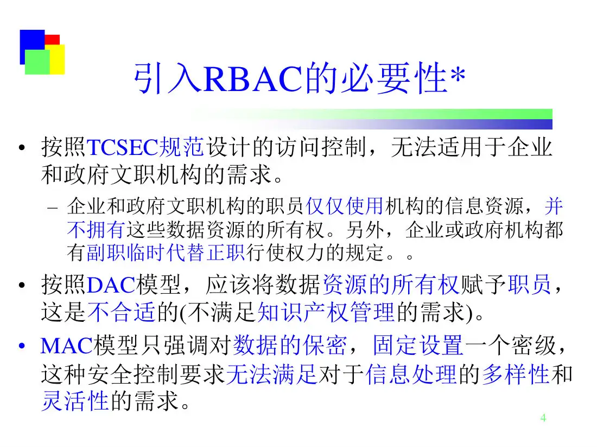

原文：

引入RBAC的必要性\*

• 按照TCSEC规范设计的访问控制，无法适用于企业和政府文职机构的需求。

– 企业和政府文职机构的职员仅仅使用机构的信息资源，并不拥有这些数据资源的所有权。另外，企业或政府机构都有副职临时代替正职行使权力的规定。。

• 按照DAC模型，应该将数据资源的所有权赋予职员，这是不合适的(不满足知识产权管理的需求)。

• MAC模型只强调对数据的保密，固定设置一个密级，这种安全控制要求无法满足对于信息处理的多样性和灵活性的需求。

1

4

### RBAC的基本原理\

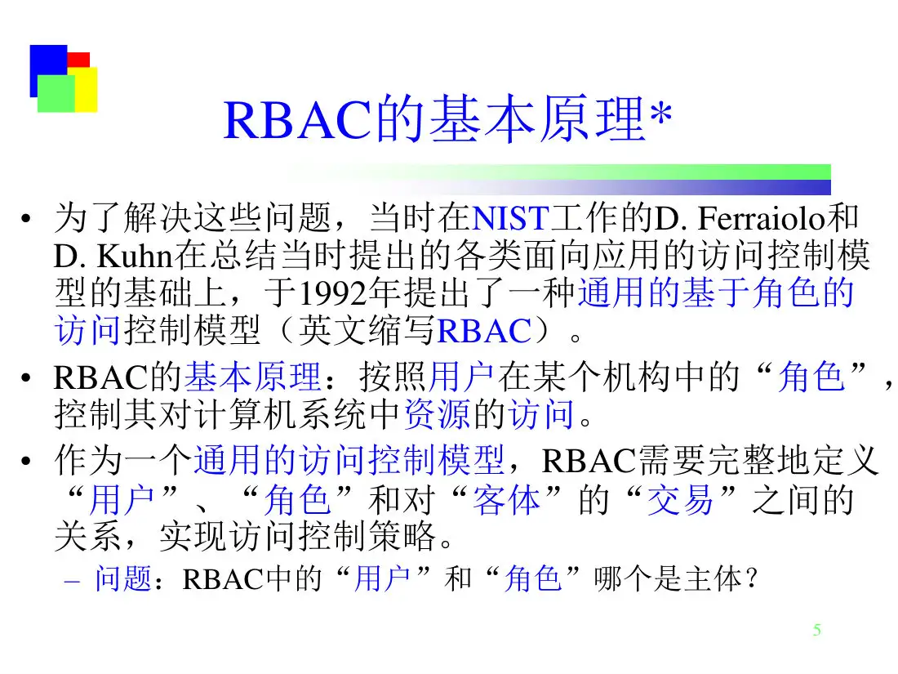

原文：

RBAC的基本原理\*

• 为了解决这些问题，当时在NIST工作的D. Ferraiolo和D. Kuhn在总结当时提出的各类面向应用的访问控制模型的基础上，于1992年提出了一种通用的基于角色的访问控制模型（英文缩写RBAC）。

• RBAC的基本原理：按照用户在某个机构中的“角色”，控制其对计算机系统中资源的访问。

• 作为一个通用的访问控制模型，RBAC需要完整地定义“用户”、“角色”和对“客体”的“交易”之间的关系，实现访问控制策略。

– 问题：RBAC中的“用户”和“角色”哪个是主体？

1

5

### RBAC原理分析\

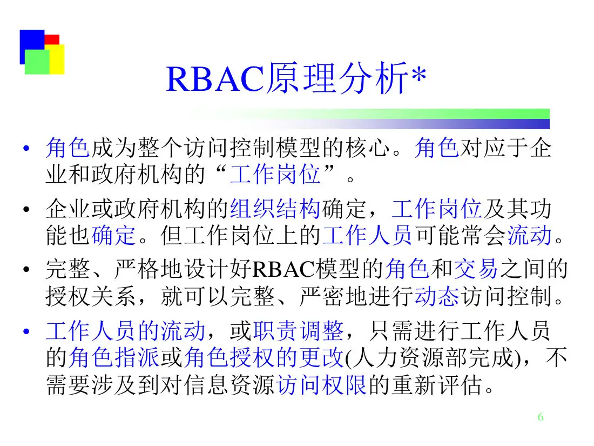

原文：

RBAC原理分析\*

• 角色成为整个访问控制模型的核心。角色对应于企业和政府机构的“工作岗位”。

• 企业或政府机构的组织结构确定，工作岗位及其功能也确定。但工作岗位上的工作人员可能常会流动。

• 完整、严格地设计好RBAC模型的角色和交易之间的授权关系，就可以完整、严密地进行动态访问控制。

工作人员的流动，或职责调整，只需进行工作人员的角色指派或角色授权的更改(人力资源部完成)，不需要涉及到对信息资源访问权限的重新评估。

1

6

### RBAC基本规则\

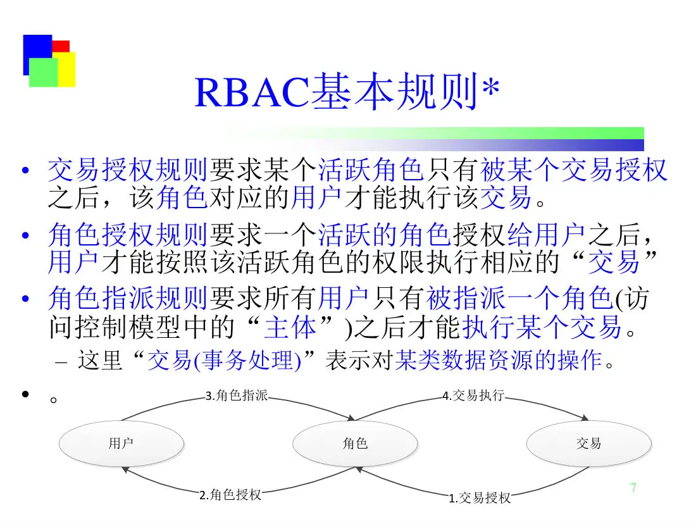

原文：

RBAC基本规则\*

• 交易授权规则要求某个活跃角色只有被某个交易授权之后，该角色对应的用户才能执行该交易。

• 角色授权规则要求一个活跃的角色授权给用户之后，用户才能按照该活跃角色的权限执行相应的“交易”

• 角色指派规则要求所有用户只有被指派一个角色(访问控制模型中的“主体”)之后才能执行某个交易。– 这里“交易(事务处理)”表示对某类数据资源的操作。

1

### RBAC的概念形式化描述-1\

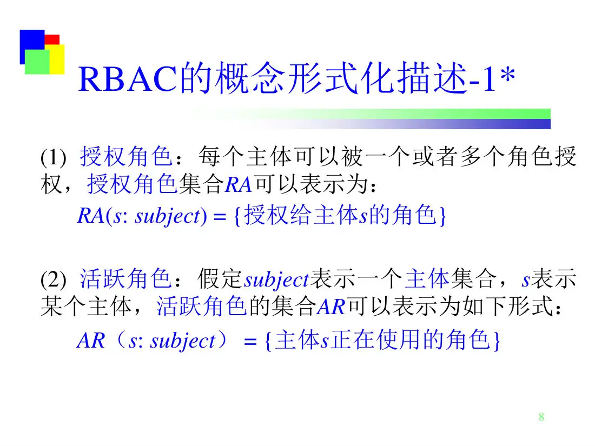

原文：

RBAC的概念形式化描述-1\*

(1) 授权角色：每个主体可以被一个或者多个角色授权，授权角色集合RA可以表示为：

$$
R A (s: \text { subject }) = \{\text { 授权给主体 } s \text { 的角色 } \}
$$

(2) 活跃角色：假定subject表示一个主体集合，s表示某个主体，活跃角色的集合AR可以表示为如下形式：

$$
A R (s: s u b j e c t) = \{\text {主体} s \text {正在使用的角色} \}
$$

8

### RBAC的概念形式化描述-2\

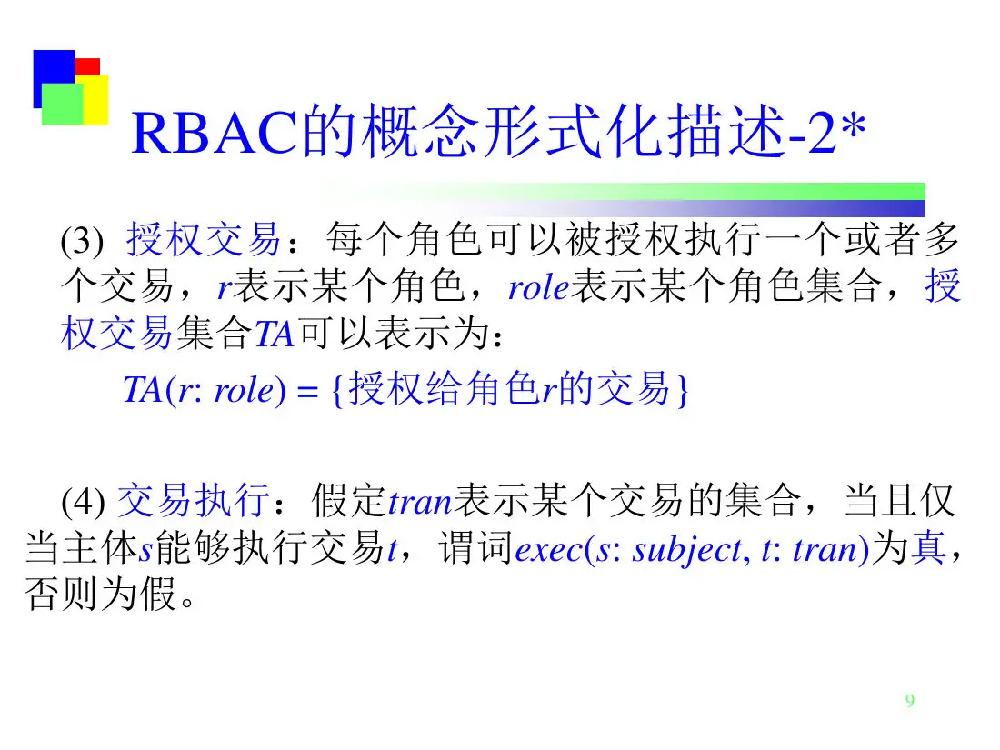

原文：

RBAC的概念形式化描述-2\*

(3) 授权交易：每个角色可以被授权执行一个或者多个交易，r表示某个角色，role表示某个角色集合，授权交易集合TA可以表示为：

$$
T A (r: r o l e) = \{\text {授权给角色} r \text {的交易} \}
$$

(4) 交易执行：假定tran表示某个交易的集合，当且仅当主体s能够执行交易t，谓词exec(s: subject, t: tran)为真，否则为假。

9

### RBAC的规则形式化描述-1\

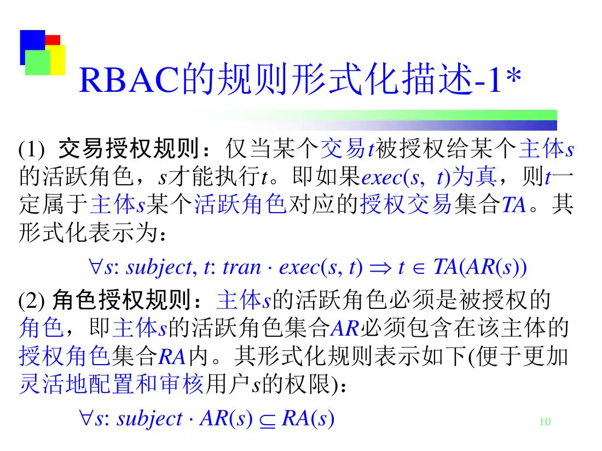

原文：

RBAC的规则形式化描述-1\*

(1) 交易授权规则：仅当某个交易t被授权给某个主体s的活跃角色，s才能执行t。即如果exec(s, t)为真，则t一定属于主体s某个活跃角色对应的授权交易集合TA。其形式化表示为：

$$
\forall s: \text { subject }, t: \text { tran } \cdot \text { exec } (s, t) \Rightarrow t \in T A (A R (s))
$$

(2) 角色授权规则：主体s的活跃角色必须是被授权的角色，即主体s的活跃角色集合AR必须包含在该主体的授权角色集合RA内。其形式化规则表示如下(便于更加灵活地配置和审核用户s的权限)：

$$
\forall s: \text { subject } \cdot A R (s) \subseteq R A (s)
$$

1

10

### RBAC的规则形式化描述-2\

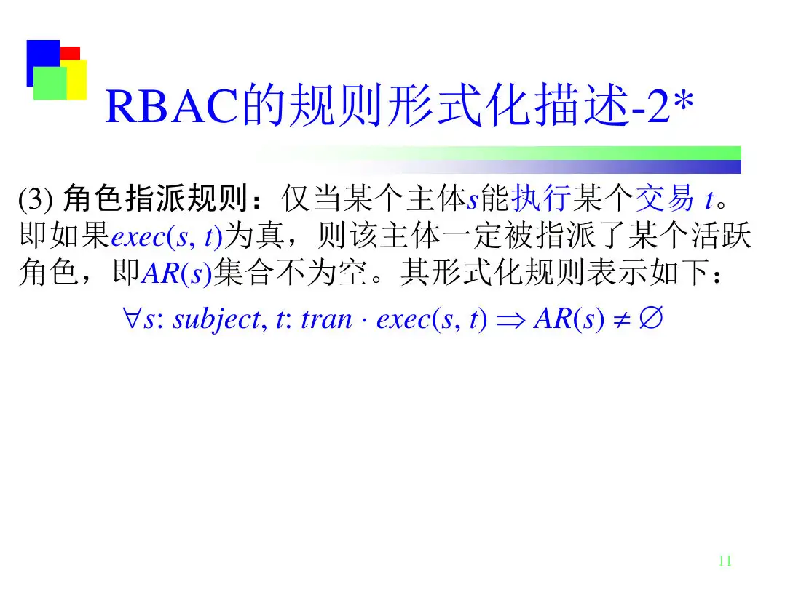

原文：

RBAC的规则形式化描述-2\*

(3) 角色指派规则：仅当某个主体s能执行某个交易 t。即如果exec(s, t)为真，则该主体一定被指派了某个活跃角色，即 $A R ( s )$ 集合不为空。其形式化规则表示如下：

$$
\forall s: \text { subject }, t: \text { tran } \cdot \text { exec } (s, t) \Rightarrow A R (s) \neq \varnothing
$$

11

### RBAC的应用举例

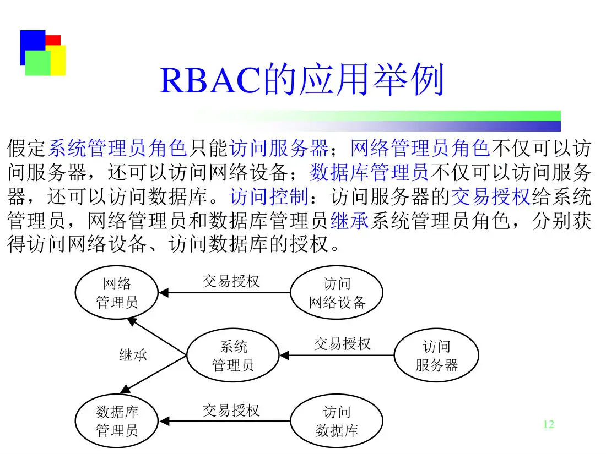

原文：

RBAC的应用举例

假定系统管理员角色只能访问服务器；网络管理员角色不仅可以访问服务器，还可以访问网络设备；数据库管理员不仅可以访问服务器，还可以访问数据库。访问控制：访问服务器的交易授权给系统管理员，网络管理员和数据库管理员继承系统管理员角色，分别获得访问网络设备、访问数据库的授权。

1

12

### RBAC与其他访问控制模型

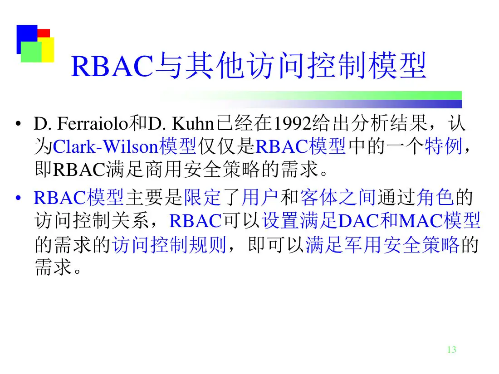

原文：

RBAC与其他访问控制模型

• D. Ferraiolo和D. Kuhn已经在1992给出分析结果，认为Clark-Wilson模型仅仅是RBAC模型中的一个特例，即RBAC满足商用安全策略的需求。

• RBAC模型主要是限定了用户和客体之间通过角色的访问控制关系，RBAC可以设置满足DAC和MAC模型的需求的访问控制规则，即可以满足军用安全策略的需求。

13
