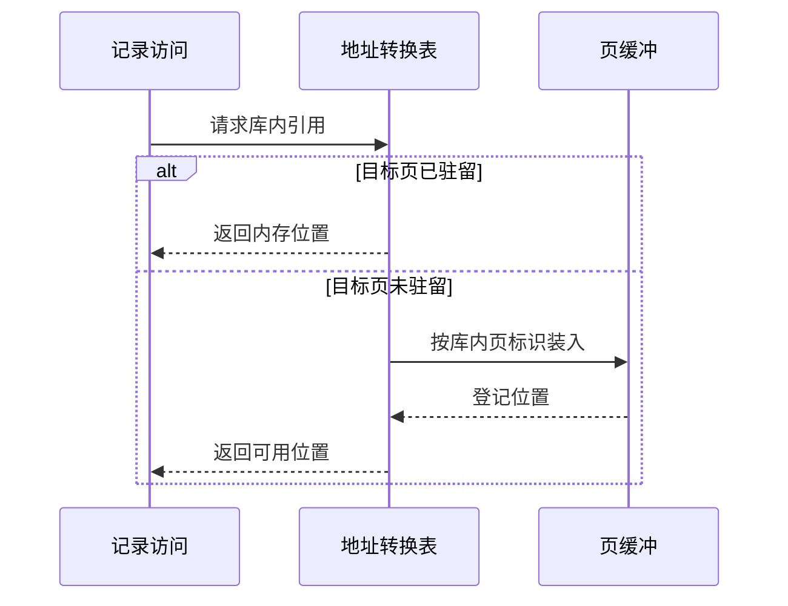

# 存储管理一：从页面成本到可迁移记录

一条记录移动后，怎样让旧索引仍能找到它？先区分三件事：**设备按什么单位交换数据，解码器怎样从字节恢复一行，其他记录用什么身份引用这一行**。本文是历史课件的独立伴读，除文中明确注明的原件思考题外，算例和图均为自编；不代表现行考核范围。原 PDF 到指针混写为止；导览提及的变长记录和记录修改不是这份分片的正文。

## 不是比较慢了多少次，而是读了多少页

[存储器层次](../../../topics/数据库内核实现/存储器层次.md)既解释速度，也解释粒度。寄存器可由处理器指令直接使用，缓存与主存之间常搬缓存行，持久设备和数据库缓冲池之间常搬页，磁带等归档设备还有显著的定位成本。操作系统虚拟内存页与数据库缓冲池管理的数据库页可能同样大，也可能尺寸、管理策略和替换时机都不同。

> [!WARNING]
> 原课件所列磁盘和内存延迟用于说明数量级，不是今天的设备参数。$1\,\mathrm{ns}=10^{-9}\,\mathrm{s}$，$1\,\mathrm{ms}=10^{-3}\,\mathrm{s}$；例如 10 ms 与 10 ns 相差 $10^6$ 倍。索引也不保证查询总被设备读取主导：缓存命中、顺序访问、压缩与计算量都可能改变瓶颈。

**补充算例。** 在[按块计算 I/O](../../../topics/数据库内核实现/io计算模型.md)的简化模型里，考察 513 个数据页，每页 10 行，查询恰好命中最后一页上的一行。冷缓存下，顺序搜索须读 513 页才找到答案；若先各读一页两层索引，再读目标页，则只读 3 页。索引即使不知道行的页内字节地址，也只需在读到的目标页中额外检查至多 10 行。若两层索引已缓存，则这次查询只有 1 次设备读；若结果有大量分散的行，用索引反可能带来大量随机读。==问 I/O 成本，先数实际读写的页==。在原件第 13 页所列选项中，处理器能直接使用的最快层是寄存器，不是名字最像「高速」的缓存。

## 一行怎样才能从字节中按原样还原

[数据类型与对齐](../../../topics/数据库内核实现/sql数据类型与对齐.md)处理两个问题：逻辑值是什么，布局怎样保存它。定长字符字段可补齐到固定宽度；变长字段可用长度前缀、偏移目录或约定结束符区分边界。长度前缀须注明单位，不能把 UTF-8 字符数当字节数；若采用结束符，还要规定它出现于内容时如何处理。日期可编码成文本或整数，枚举可编码为字典编号，位串可按字节打包但要知道有效位长，整数和浮点还需约定宽度及字节序。SQL 声明本身不指定唯一物理格式。

**补充算例。** 设一个教学布局：8 字节记录首部保存模式号和长度；字段依次为 1 字节状态、4 字节编号、11 字节定长标签。字段分别要求 1、4、1 字节对齐，记录起始处与步长均按 4 字节对齐。

| 对象 | 起始偏移 | 占用字节 | 边界判断 |
|---|---:|---:|---|
| 首部 | 0 | 8 | 记录级元信息与字段内容分开 |
| 状态 | 8 | 1 | 下一个可用偏移是 9 |
| 编号 | 12 | 4 | 9 向上对齐到 12 |
| 标签 | 16 | 11 | 最后一字节偏移为 26 |
| 尾部填充 | 27 | 1 | 步长 28，使下一行仍按 4 字节对齐 |

若页长为 1024 字节，页首占 16 字节，无槽目录且记录不跨页，则：

$$
N=\left\lfloor\frac{1024-16}{28}\right\rfloor=36,\qquad
1024-16-36\times28=0.
$$

另设每行需 2 字节槽项，槽目录与记录区分开，且仍满足记录区的起始对齐，则最多 33 行，余 18 字节。记录首部和页首不能重复扣除；记录长已经含填充，也不能再扣一次。[定长记录与块格式](../../../topics/数据库内核实现/定长记录与块格式.md)中的页首可管理块标识、页内目录等页级信息，模式本身可用模式号查数据库目录，不必每行保存一份。**参考解答（原件第 42 页）。** 用同一个方法：将 8192、12、400 分别看作页长、页首和已知记录步长，得 20 行，余 180 字节。

## 用间接层保持引用不变

「页地址加页内偏移」描述文件中的位置，并不等于 CPU 能解引用的虚拟地址。原材料用传统磁盘几何地址帮助理解层次；实际存储设备可用逻辑块地址，数据库则经常用文件标识、页号和页内位置来做定位。每一层的地址由该层解释。

**补充算例。** 索引可保存物理位置、可解析的逻辑记录 ID，或如「页 7，槽 2」的结构地址。假设槽 2 原来指向偏移 800，页内整理后改为 640。外部仍用「页 7，槽 2」定位，只有槽表项变了。

若记录移到别页，要更新逻辑 ID 映射或保留受控转向；旧槽不能悄悄给另一行，否则旧引用会读错行。删除可用空槽或代际标记区分旧身份。结构地址只在其稳定性约定内有效；不能把磁盘偏移、应用的键、内存地址都写成整数就当成可互换。参见[块与记录地址](../../../topics/数据库内核实现/块与记录地址.md)和[结构地址实现技术](../../../topics/数据库内核实现/结构地址实现技术.md)。

## 当记录间引用被频繁追踪

把库内地址转换成驻留页中的内存地址，可能省去重复查转换表的代价，却让缓存替换更复杂。让页 7 中的记录分别引用同页的一行和未驻留的页 8：页 7 装入时，立即转换策略能先转换第一条，但不能编造第二条的内存地址。按需策略则可先登记页和记录的位置，等真正追踪某条引用再尝试转换。

| 选择 | 何时支付代价 | 什么必须成立 |
|---|---|---|
| 立即转换已驻留的目标 | 装页时扫描可能使用的引用 | 需知道哪些字段是引用，不能误改数字 |
| 按需转换 | 首次追踪该引用时 | 必须区分库内地址与已转换的内存地址 |
| 不转换记录内引用 | 每次追踪时查地址映射 | 引用编码稳定，解析路径仍须能定位目标页 |

> [!TIP]
> 暂时保存指针不等于把它写回持久页。页被淘汰、缓冲帧被复用、进程重启，都可能使指针失效。采用[指针混写](../../../topics/数据库内核实现/结构地址实现技术.md)时，须钉住仍被直接引用的页，或在回收前消除、撤销或重新解析对应引用；持久格式仍保存可恢复的库内标识。
