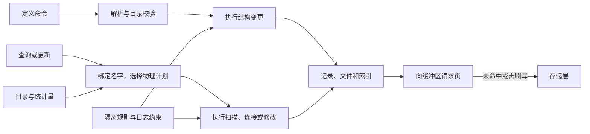

# 数据库管理系统实现概述：从一份文件到一次可恢复的查询

把每张表存成一个文件，扫一遍就有查询结果。真正难的是另一组要求：字段类型要能检查，连接不能反复搬运无关数据，程序中断也不能留下半笔业务。历史课件用 Megatron2000 文件原型把这些问题分开。本篇以独立算例说明机制，不代替原件、课堂程序或现行考纲。

## 先读目录，才能解释记录

[系统目录与元数据](../../../topics/数据库内核实现/dbms能力与成分.md)保存字段名、类型和约束等描述；数据文件保存某一时刻的元组。两者放在磁盘上，却回答不同的问题：整数编号 10 应按数值和 2 比较，而同样两个文本值可按字符顺序比较。如果不先知道类型，引擎连条件应该怎样判定都不能确定。

文件原型可以把目录拆为两层：头部存表名、字段数及其描述在文件体中的位置，另记下一处可写位置；文件体存各字段的名字和类型。查询只需按表名找到一处描述，不必在整个描述文件内继续猜每张表的边界。实际块大小由实现决定，不能把示意图中的字节偏移当成通用格式。

| 序列化策略 | 怎样定位下一字段 | 写入与更新的代价 |
| --- | --- | --- |
| 固定宽度 | 按布局累加已知宽度 | 定位简单，短值可能留出空白；超宽值必须拒绝或改布局 |
| 分隔符和转义 | 扫到未被转义的分隔符 | 容纳短长不同的值；字符若可包含分隔符，就必须约定转义或改用长度 |
| 长度或偏移目录 | 读长度或查偏移，才能解释边界 | 多一些元数据，但内容不受分隔符限制；记录增长时仍可能需要移动 |

**补充（独立算例）。** 在一个教学布局中，4096 字节的页有 64 字节页首，每行固定 28 字节，行不跨页，且没有槽目录或额外对齐。因此最多放 $\lfloor(4096-64)/28\rfloor=144$ 行，恰好用尽剩余 4032 字节。若每行再配 2 字节槽项，则最多放 134 行，还剩 12 字节。不要把文件原型的“一行文本”直接当作磁盘的一页：记录格式、装页方式、页内地址是三个层次。见[定长记录与块格式](../../../topics/数据库内核实现/定长记录与块格式.md)与[变长数据和记录](../../../topics/数据库内核实现/变长数据和记录.md)。

## 为什么把筛选条件移到配对之前

**补充（独立算例）。** 教学设备表有三行，分别位于实验室 11、12、11，只有第二件停用。实验室表中，11 对应 A1，12 对应 B2。取所有可用设备所在的房间：

```sql
SELECT l.room
FROM equipment AS e
JOIN lab AS l ON e.lab_id = l.id
WHERE e.enabled = 1;
```

**参考解答。** 先用目录确认字段存在并核对连接键的类型；扫描设备行时判断状态，只将第一、第三行送去连接。返回两行 A1，因为投影本身不去重，若业务要“有设备的房间集合”才加 DISTINCT。

若先扫描两表，对所有组合做测试，设备有 $m$ 行、实验室有 $n$ 行时，单纯双重循环会尝试 $mn$ 个配对，另有输出代价。本例先筛再连，比较次数从 $3\times2=6$ 降为 $2\times2=4$；这个单表条件可以提前是因为这里是内连接，不能机械地把跨表条件或外连接的过滤照此移动。若房间表能留在缓冲区，重复比较未必重复读盘；若每轮内表都要重读，页成本就会放大。==问连接代价，先分清是计配对还是计读页==。参见[查询处理流程](../../../topics/数据库内核实现/查询处理流程.md)、[代数优化转换规则](../../../topics/数据库内核实现/代数优化转换规则.md)及 [I/O 计算模型](../../../topics/数据库内核实现/io计算模型.md)。

如果改问“把结果留作下一条命令的输入”，就不能只把行输出给客户端：需要物化结果、为其产生字段定义，并按指定的名称及生命周期管理它。即使原型只是新建一个数据文件并登记一个目录条目，也要处理写到一半的失败，否则可能留下找不到定义的数据文件或指向不存在文件的目录项。创建临时表的确切语法与存续约定取决于数据库，不把课件的示意记号当成可直接执行的 SQL。

## 引擎如何把命令落到读写页

DDL 改变结构或目录，例如创建、改变、删除表；查询与更新作用于已有关系。普通应用只要有权限也能执行 DDL，DBA 也可以查询数据，这个分类首先看命令意图，不按人一刀切。查询编译先由文本形成语法结构，再绑定名字、检查类型并得到逻辑表达式，最后用等价变换与统计估算挑物理计划。执行器依计划向记录、文件及索引管理层请求数据；这些请求落到缓冲页，由缓冲和存储管理决定何时产生设备读写。



缓冲池不只服务用户表。目录和统计、索引、数据页都有缓存需求，日志也可能有独立缓冲；这些结构是否共用一个池取决于实现。缓存命中时可以在内存工作；写入修改的是缓冲页还是已落盘的页，同样要区分。持久化、索引使用和事务支持不是增加几个文件名就自然得到的能力。

> [!TIP]
> **补充。** 若把教学文本文件的一处字段从短值改成长值，后面的字节可能都要移动。使用页内槽表和空闲空间才能在某些情况下避免全文件重写，但这仍未解决并发和断电。回答“为什么需要引擎部件”时，给每个失败场景指出相应机制，而不是把缓存、索引和日志当作可互换的性能开关。

## 事务边界不是一条 SQL 的边界

**订正（原件第 27 页）。** 单条 SQL 在自动提交模式下可能独占一个隐式事务，但不能因此说每次查询或修改必然是一个完整事务：显式的事务块可以包含多条语句。另一方面，并发控制主要约束相互交错的事务能观察到什么，恢复机制参与失败时撤销或排除未完成事务的影响以及恢复已提交结果。一致性不是日志单独提供的：它还依赖约束、应用选择的业务边界、事务逻辑及所用隔离语义。参见 PostgreSQL 的[事务说明](https://www.postgresql.org/docs/current/tutorial-transactions.html)与[预写日志说明](https://www.postgresql.org/docs/current/wal-intro.html)。

**补充（独立反例）。** 设备库存从甲库移一台到乙库。甲、乙最初各有 4、2 台；目标是 3、3 台，总数仍为 6。若扣减和增加各自自动提交，在两条之间崩溃，持久的状态可能是 3、2。每条语句可以各自满足原子性和持久性，两个库的总量却违反业务意图。将两条更新放进一个显式事务，失败则回滚，成功才确认；对于其他并发操作，另外选择适合该不变量的约束和隔离方式。日志能把一次合法的提交恢复出来，却不能辨认应用本来想做的是“两条语句合在一起”。

| 看见的故障或问题 | 首先检查 |
| --- | --- |
| 转移做到一半，后一条更新失败 | 原子性：事务边界是否包住全部修改，失败是否整体回滚 |
| 同时操作时读到了不该观察到的中间结果 | 隔离性：并发控制与所配置的隔离级别 |
| 恢复后找不到已经确认的提交 | 持久性：提交确认前的持久化条件与恢复实现 |
| 每个操作都提交了，库存总数却不合业务规则 | 一致性：业务事务是否维持不变量、约束是否足够 |

> [!WARNING]
> 预写日志要求先使相应日志持久化，再允许相关数据页刷写；满足配置和存储假设时，可以在提交时先保证必要日志落盘，不要求所有脏页同时落盘。这解释了为什么“缓冲里有新值”和“提交后可恢复”不是同一个判断。

原件末段把存储和索引、查询处理、日志与事务分作后续主题，并提示配合示例原型完成留空代码。**补充。** 若没有同一版本的示例程序，先在自建小表上分别断言字段编码可往返、连接保留重复行、未提交的多条修改可整体撤销；不要把以上例子当作原作业缺失的代码。
