# 《数据库管理系统实现》第2部分 存储管理（课件）

原件的每一页，下面附识别出的文字。

### 目录

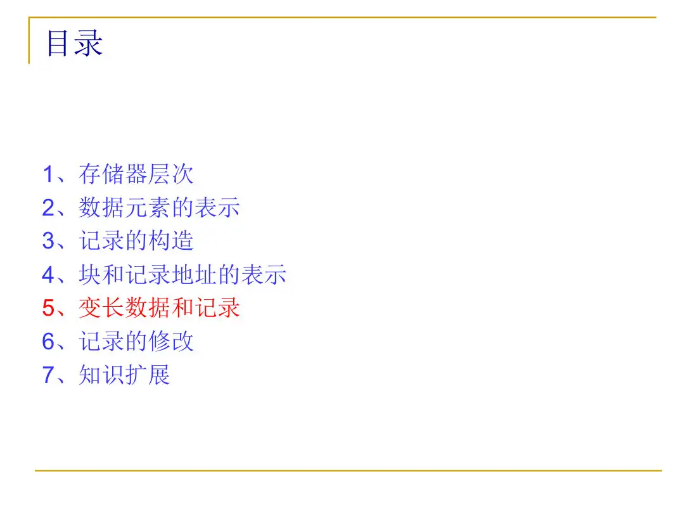

原文：

目录

1、存储器层次  
2、数据元素的表示  
3、记录的构造  
4、块和记录地址的表示  
5、变长数据和记录  
6、记录的修改  
7、知识扩展

### 变长数据和记录

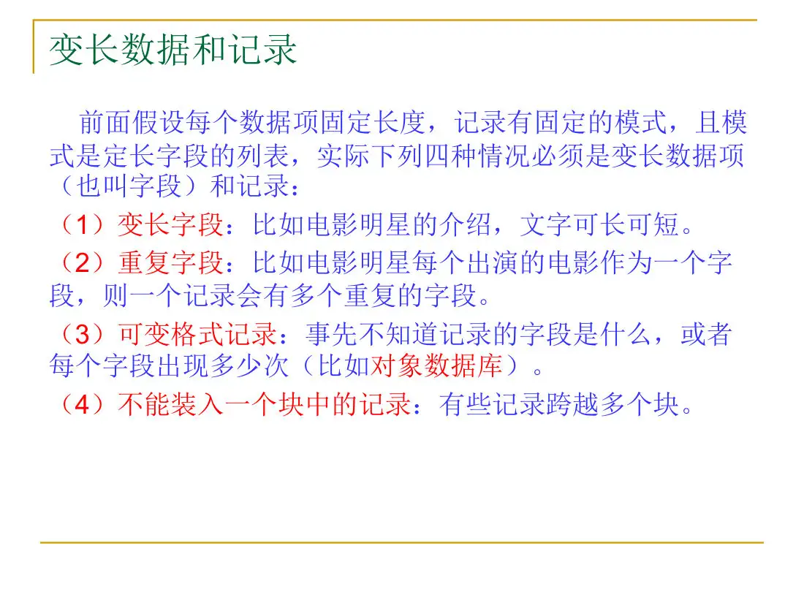

原文：

变长数据和记录

前面假设每个数据项固定长度，记录有固定的模式，且模式是定长字段的列表，实际下列四种情况必须是变长数据项（也叫字段）和记录：

（1）变长字段：比如电影明星的介绍，文字可长可短。

（2）重复字段：比如电影明星每个出演的电影作为一个字段，则一个记录会有多个重复的字段。

（3）可变格式记录：事先不知道记录的字段是什么，或者每个字段出现多少次（比如对象数据库）。

（4）不能装入一个块中的记录：有些记录跨越多个块。

### 变长数据和记录——（1）变长字段的记录

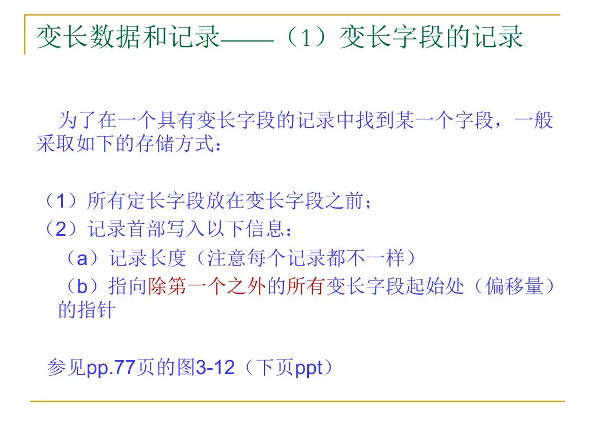

原文：

变长数据和记录——（1）变长字段的记录

为了在一个具有变长字段的记录中找到某一个字段，一般采取如下的存储方式：

（1）所有定长字段放在变长字段之前；

（2）记录首部写入以下信息：

（a）记录长度（注意每个记录都不一样）

（b）指向除第一个之外的所有变长字段起始处（偏移量）的指针

参见pp.77页的图3-12（下页ppt）

### 变长数据和记录— —（1）变长字段的记录

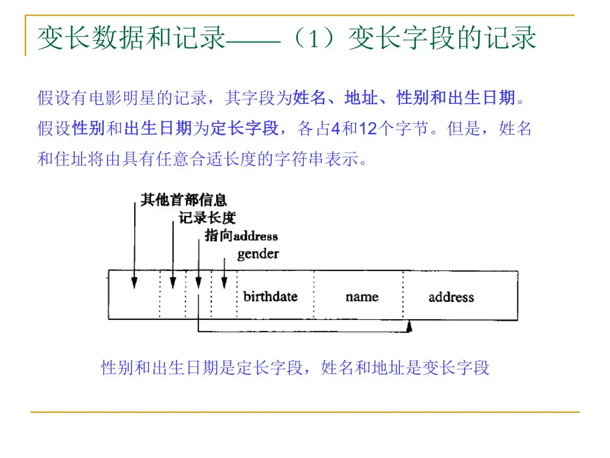

原文：

变长数据和记录— —（1）变长字段的记录

假设有电影明星的记录，其字段为姓名、地址、性别和出生日期。假设性别和出生日期为定长字段，各占4和12个字节。但是，姓名和住址将由具有任意合适长度的字符串表示。

### 变长数据和记录——（2）重复字段的记录

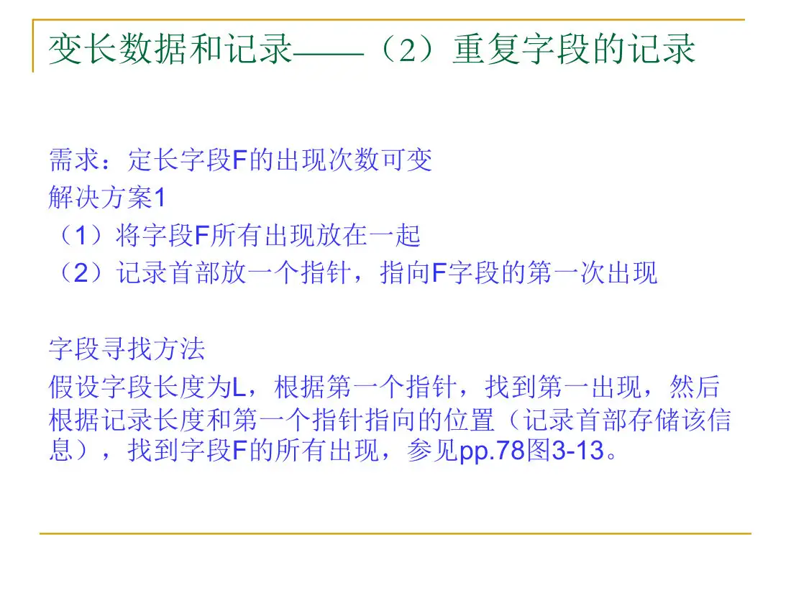

原文：

变长数据和记录——（2）重复字段的记录

需求：定长字段F的出现次数可变

解决方案1

（1）将字段F所有出现放在一起

（2）记录首部放一个指针，指向F字段的第一次出现

字段寻找方法

假设字段长度为L，根据第一个指针，找到第一出现，然后根据记录长度和第一个指针指向的位置（记录首部存储该信息），找到字段F的所有出现，参见pp.78图3-13。

### 变长数据和记录— —（2）重复字段的记录

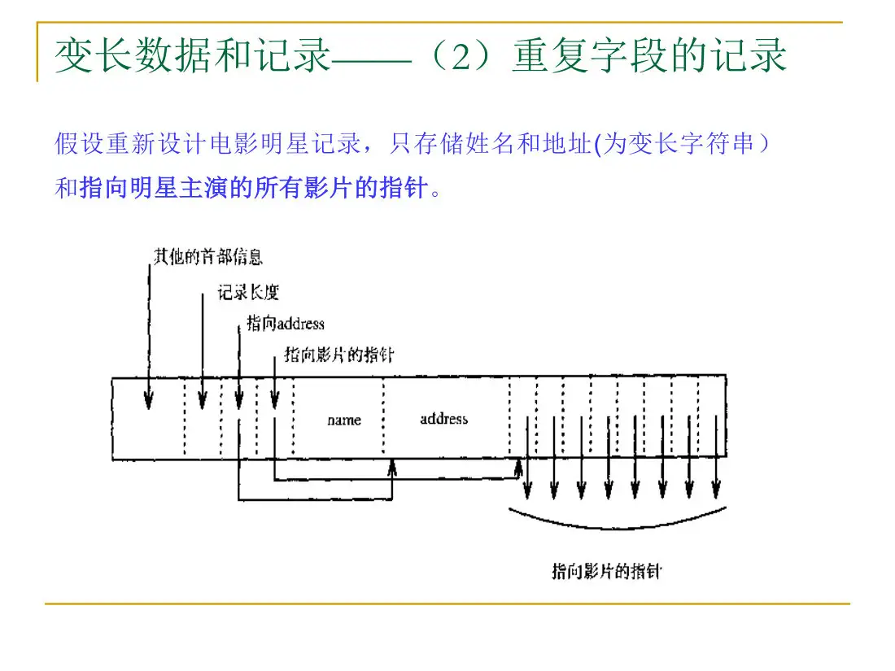

原文：

变长数据和记录— —（2）重复字段的记录

假设重新设计电影明星记录，只存储姓名和地址(为变长字符串）和指向明星主演的所有影片的指针。

### 变长数据和记录——（2）重复字段的记录

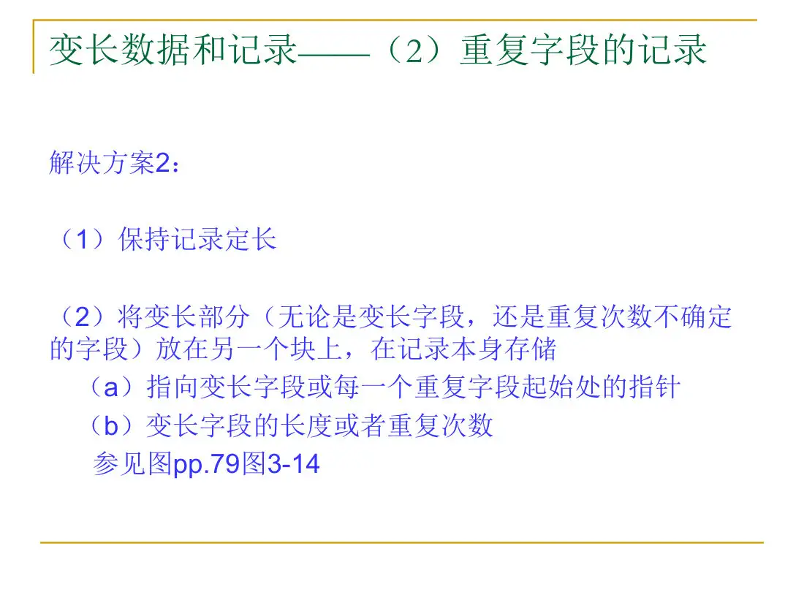

原文：

变长数据和记录——（2）重复字段的记录

解决方案2：

（1）保持记录定长

（2）将变长部分（无论是变长字段，还是重复次数不确定的字段）放在另一个块上，在记录本身存储

（a）指向变长字段或每一个重复字段起始处的指针

（b）变长字段的长度或者重复次数

参见图pp.79图3-14

### 变长数据和记录— —（2）重复字段的记录

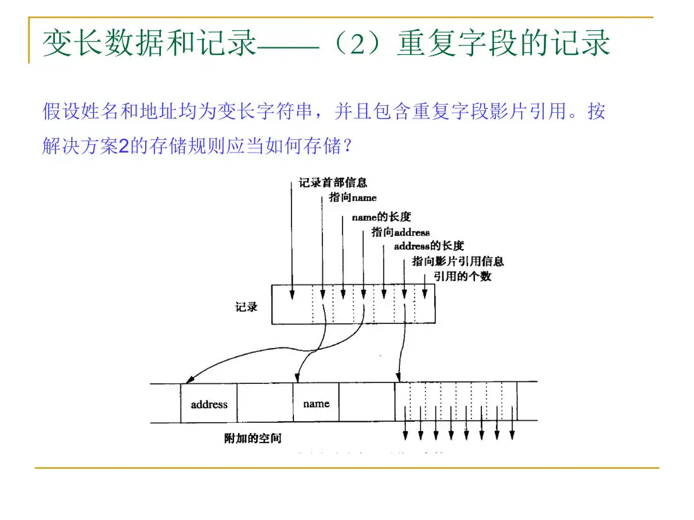

原文：

变长数据和记录— —（2）重复字段的记录

假设姓名和地址均为变长字符串，并且包含重复字段影片引用。按解决方案2的存储规则应当如何存储？

### 变长数据和记录 —（2）重复字段的记录

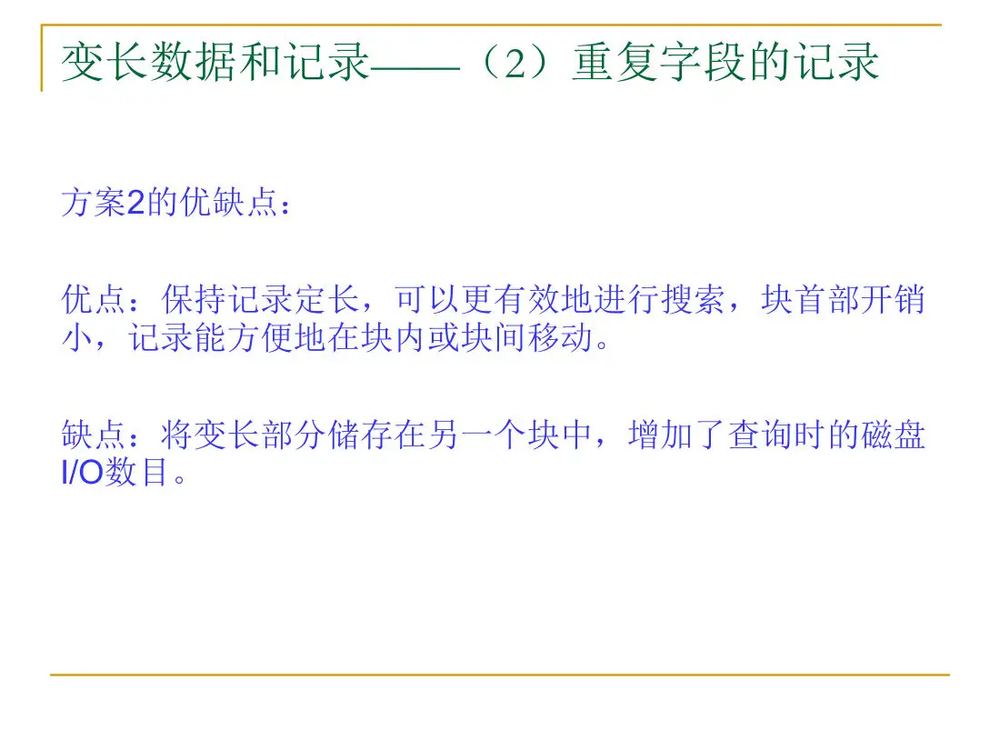

原文：

变长数据和记录 —（2）重复字段的记录

方案2的优缺点：

优点：保持记录定长，可以更有效地进行搜索，块首部开销小，记录能方便地在块内或块间移动。

缺点：将变长部分储存在另一个块中，增加了查询时的磁盘I/O数目。

### 变长数据和记录— —（3）可变格式的记录

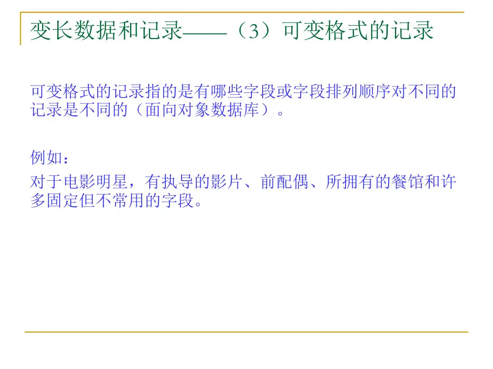

原文：

变长数据和记录— —（3）可变格式的记录

可变格式的记录指的是有哪些字段或字段排列顺序对不同的记录是不同的（面向对象数据库）

例如：

对于电影明星，有执导的影片、前配偶、所拥有的餐馆和许多固定但不常用的字段。

### 变长数据和记录——（3）可变格式的记录

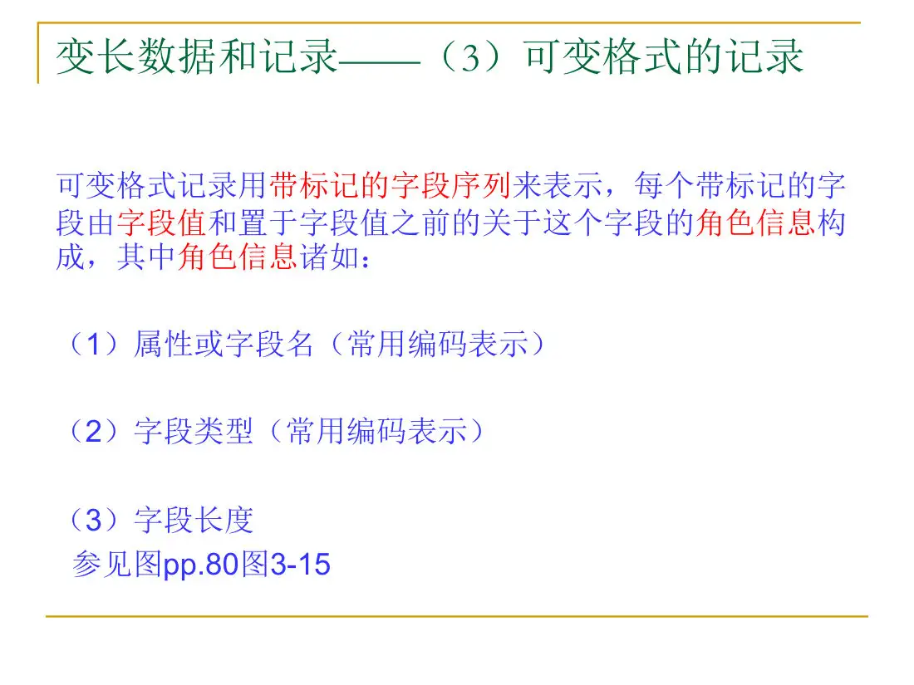

原文：

变长数据和记录——（3）可变格式的记录

可变格式记录用带标记的字段序列来表示，每个带标记的字段由字段值和置于字段值之前的关于这个字段的角色信息构成，其中角色信息诸如：

（1）属性或字段名（常用编码表示）

（2）字段类型（常用编码表示）

（3）字段长度

参见图pp.80图3-15

### 变长数据和记录— —（3）可变格式的记录

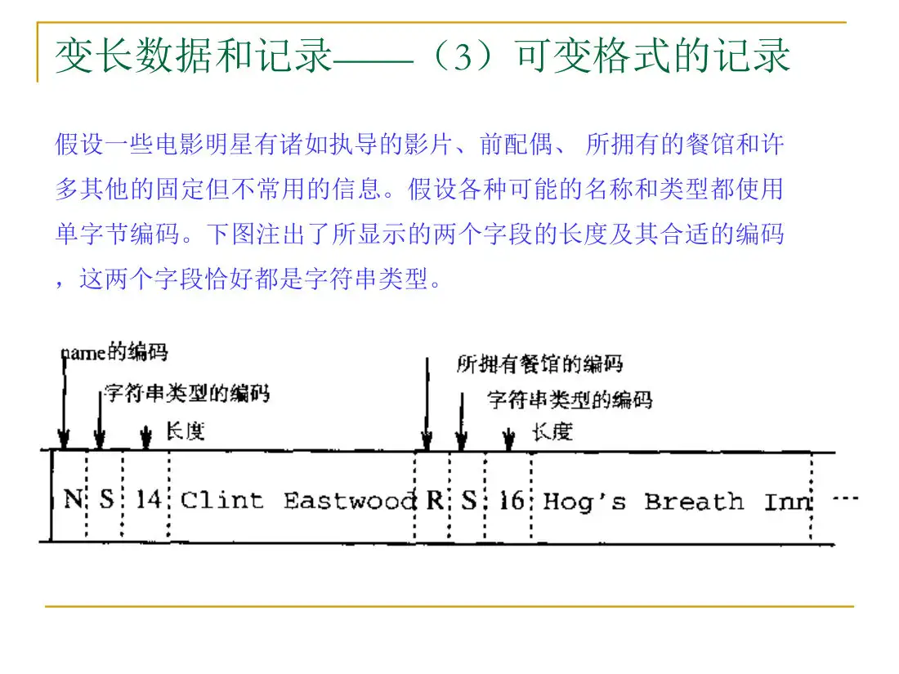

原文：

变长数据和记录— —（3）可变格式的记录

假设一些电影明星有诸如执导的影片、前配偶、 所拥有的餐馆和许多其他的固定但不常用的信息。假设各种可能的名称和类型都使用单字节编码。下图注出了所显示的两个字段的长度及其合适的编码，这两个字段恰好都是字符串类型。

### 变长数据和记录——（4）不能装入一个块中的记录

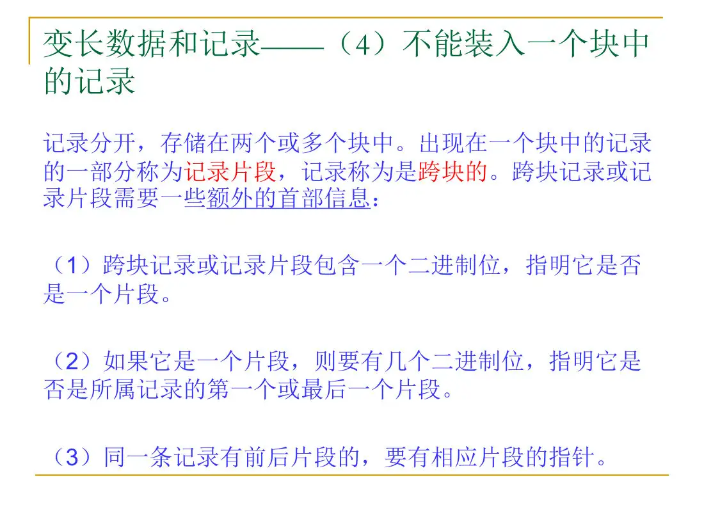

原文：

变长数据和记录——（4）不能装入一个块中的记录

记录分开，存储在两个或多个块中。出现在一个块中的记录的一部分称为记录片段，记录称为是跨块的。跨块记录或记录片段需要一些额外的首部信息：

（1）跨块记录或记录片段包含一个二进制位，指明它是否是一个片段。

（2）如果它是一个片段，则要有几个二进制位，指明它是否是所属记录的第一个或最后一个片段。

（3）同一条记录有前后片段的，要有相应片段的指针。

### 变长数据和记录——（4）不能装入一个块中的记录

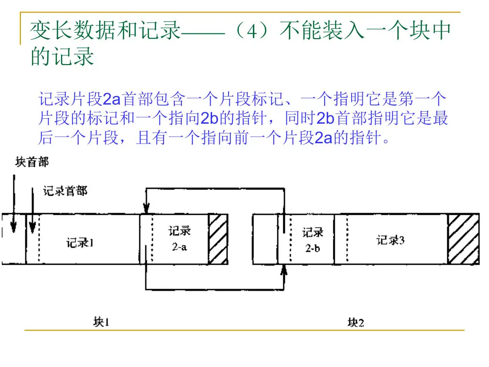

原文：

变长数据和记录——（4）不能装入一个块中的记录

记录片段2a首部包含一个片段标记、一个指明它是第一个片段的标记和一个指向2b的指针，同时2b首部指明它是最后一个片段，且有一个指向前一个片段2a的指针。

### 变长数据和记录

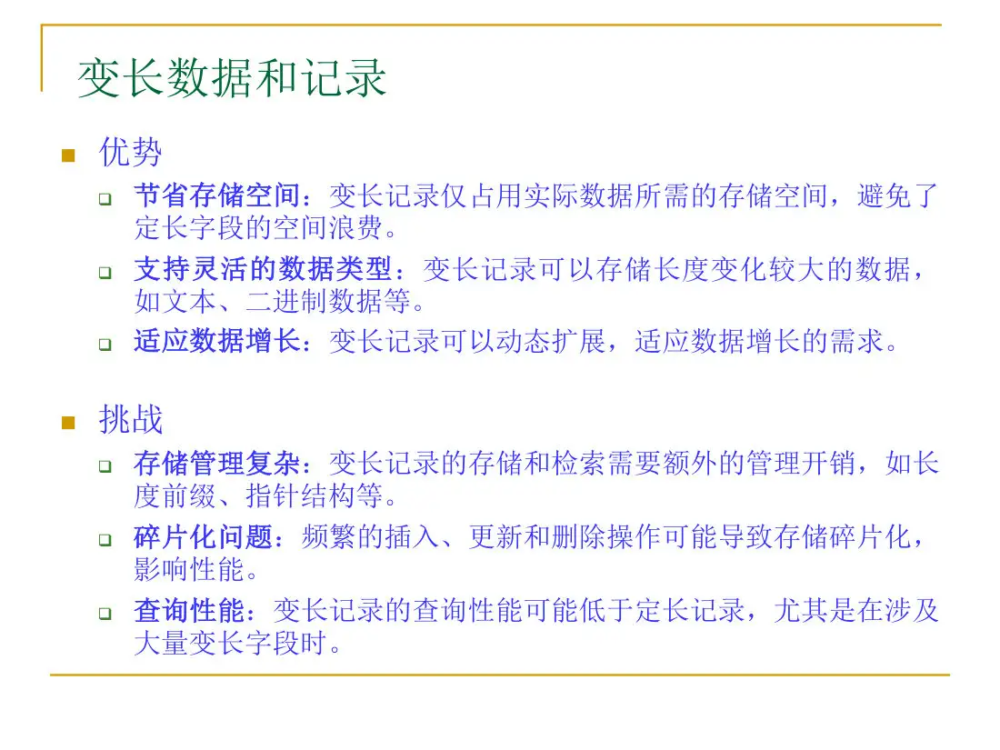

原文：

变长数据和记录

n 优势

节省存储空间：变长记录仅占用实际数据所需的存储空间，避免了定长字段的空间浪费。

q 支持灵活的数据类型：变长记录可以存储长度变化较大的数据，如文本、二进制数据等。

q 适应数据增长：变长记录可以动态扩展，适应数据增长的需求。

n 挑战

q 存储管理复杂：变长记录的存储和检索需要额外的管理开销，如长度前缀、指针结构等。

q 碎片化问题：频繁的插入、更新和删除操作可能导致存储碎片化，影响性能。

q 查询性能：变长记录的查询性能可能低于定长记录，尤其是在涉及大量变长字段时。

### 思考题

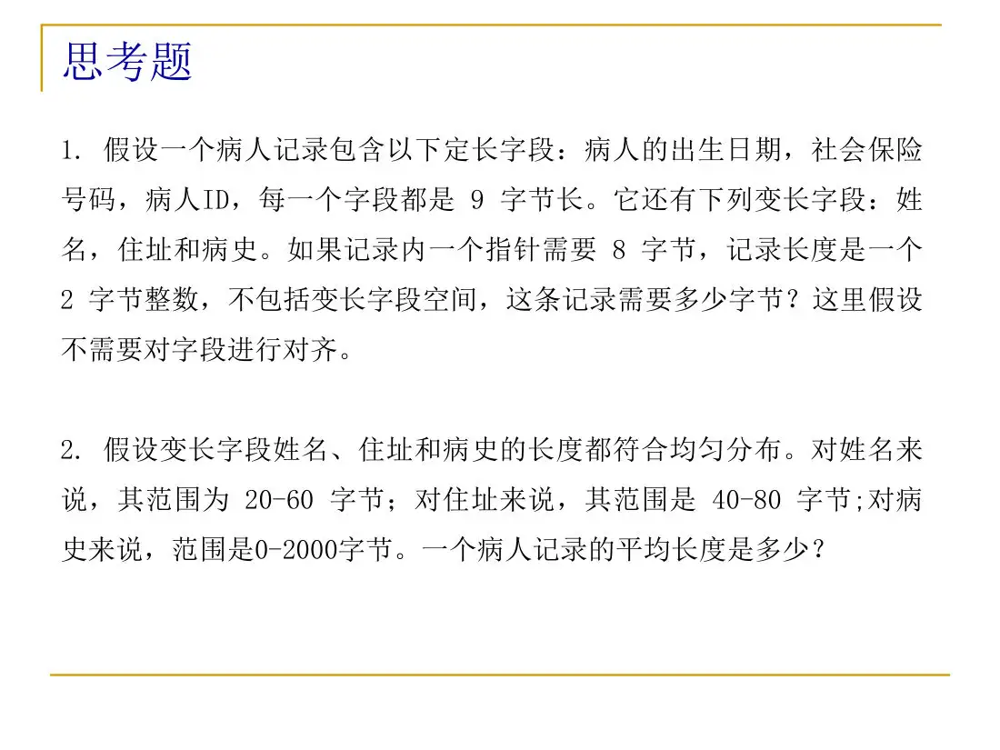

原文：

思考题

1. 假设一个病人记录包含以下定长字段：病人的出生日期，社会保险号码，病人ID，每一个字段都是 9 字节长。它还有下列变长字段：姓名，住址和病史。如果记录内一个指针需要 8 字节，记录长度是一个2 字节整数，不包括变长字段空间，这条记录需要多少字节？这里假设不需要对字段进行对齐。

2. 假设变长字段姓名、住址和病史的长度都符合均匀分布。对姓名来说，其范围为 20-60 字节；对住址来说，其范围是 40-80 字节;对病史来说，范围是0-2000字节。一个病人记录的平均长度是多少？

### 目录

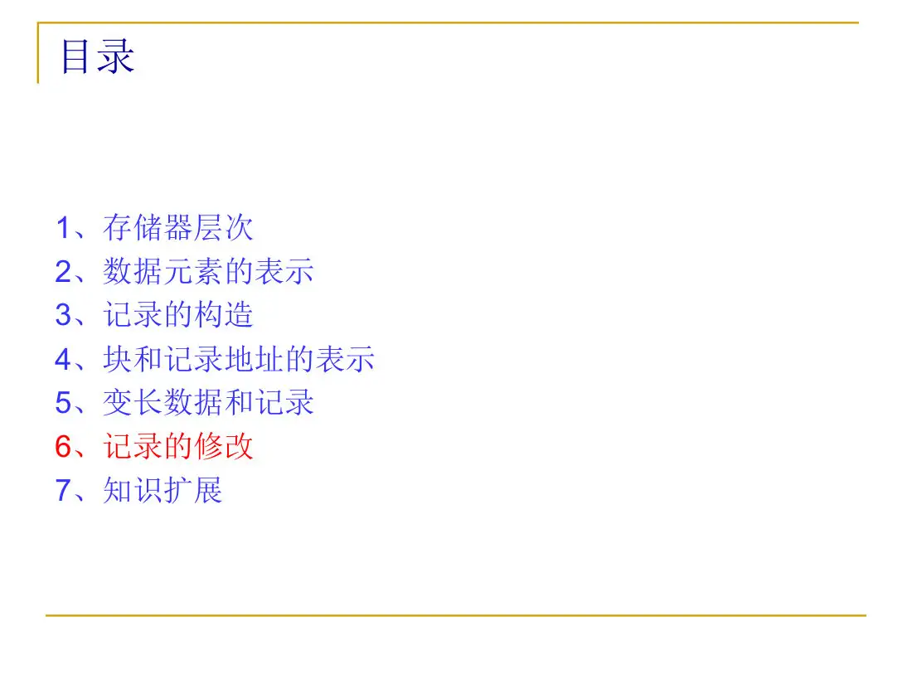

原文：

目录

1、存储器层次  
2、数据元素的表示  
3、记录的构造  
4、块和记录地址的表示  
5、变长数据和记录  
6、记录的修改  
7、知识扩展

### 记录的修改——插入

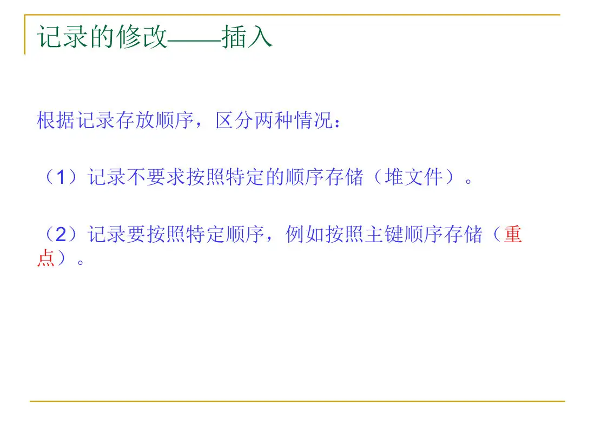

原文：

记录的修改——插入

根据记录存放顺序，区分两种情况：

（1）记录不要求按照特定的顺序存储（堆文件）。

（2）记录要按照特定顺序，例如按照主键顺序存储（重点）。

### 记录的修改——插入

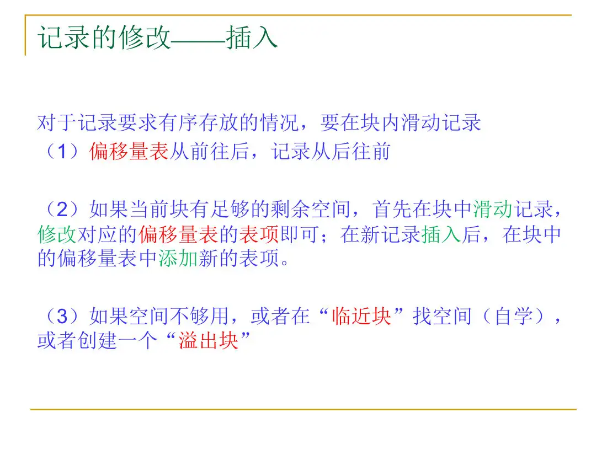

原文：

记录的修改——插入

对于记录要求有序存放的情况，要在块内滑动记录

（1）偏移量表从前往后，记录从后往前

（2）如果当前块有足够的剩余空间，首先在块中滑动记录，修改对应的偏移量表的表项即可；在新记录插入后，在块中的偏移量表中添加新的表项。

（3）如果空间不够用，或者在“临近块”找空间（自学），或者创建一个“溢出块”

### 记录的修改——插入

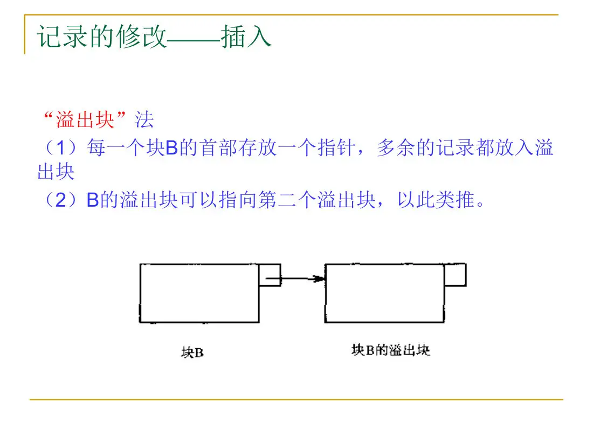

原文：

记录的修改——插入

“溢出块”法

（1）每一个块B的首部存放一个指针，多余的记录都放入溢出块

（2）B的溢出块可以指向第二个溢出块，以此类推。

### 记录的修改——删除

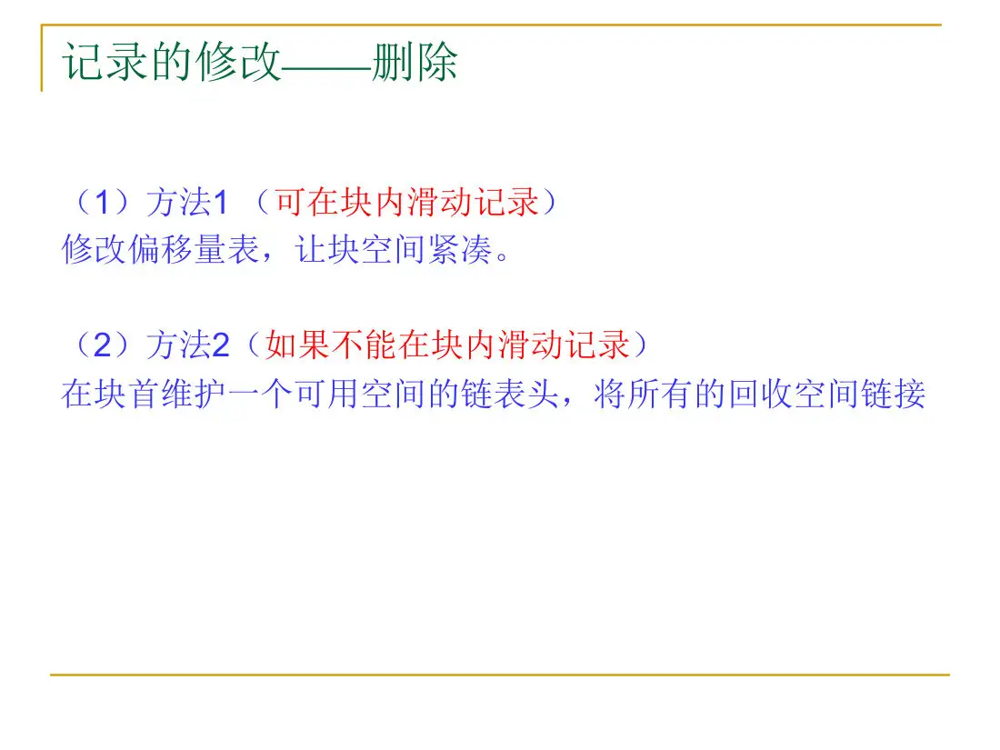

原文：

记录的修改——删除

（1）方法1 （可在块内滑动记录）修改偏移量表，让块空间紧凑。

（2）方法2（如果不能在块内滑动记录）

在块首维护一个可用空间的链表头，将所有的回收空间链接

### 记录的修改——更新

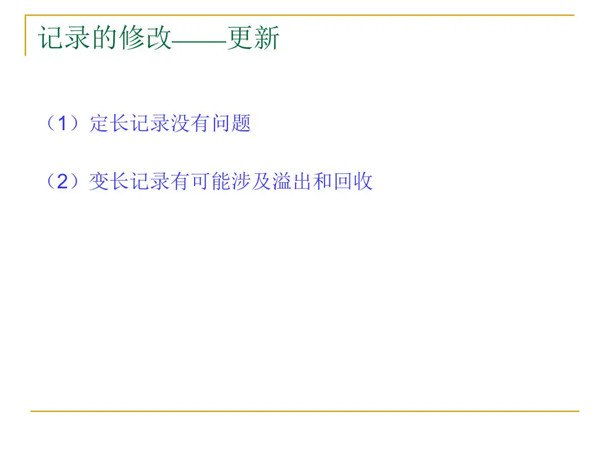

原文：

记录的修改——更新

（1）定长记录没有问题

（2）变长记录有可能涉及溢出和回收

### 总结

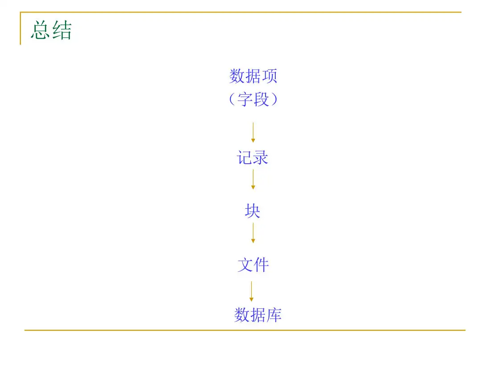

原文：

总结

数据项（字段）记录块文件数据库

### 目录

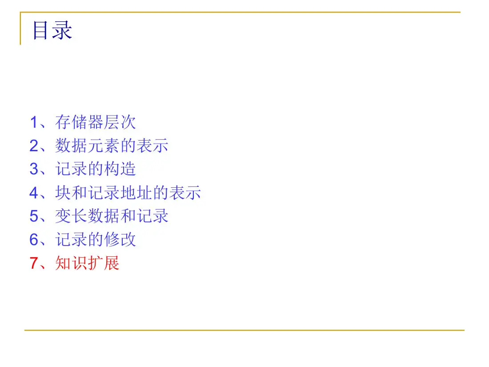

原文：

目录

1、存储器层次  
2、数据元素的表示  
3、记录的构造  
4、块和记录地址的表示  
5、变长数据和记录  
6、记录的修改  
7、知识扩展

### 行存储和列存储（扩展）

原文：

行存储和列存储（扩展）

n 目前为止，记录的所有字段连续存储 (行存储)...

n 另外一种存储方式，相同列的不同值连续存储在一起(列存储)

### 行存储

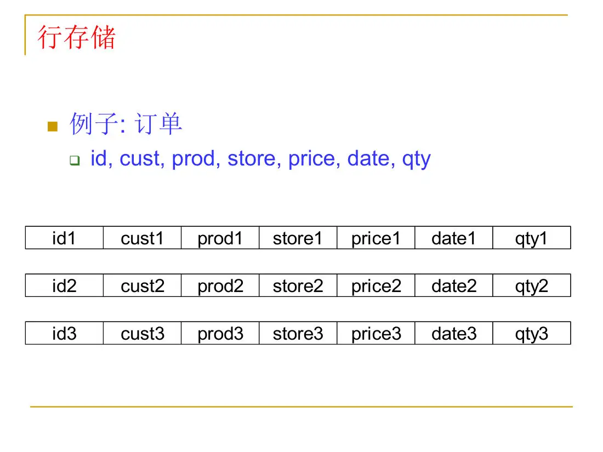

原文：

行存储

n 例子: 订单

q id, cust, prod, store, price, date, qty

<table><tr><td>id1</td><td>cust1</td><td>prod1</td><td>store1</td><td>price1</td><td>date1</td><td>qty1</td></tr></table>

<table><tr><td>id2</td><td>cust2</td><td>prod2</td><td>store2</td><td>price2</td><td>date2</td><td>qty2</td></tr></table>

<table><tr><td>id3</td><td>cust3</td><td>prod3</td><td>store3</td><td>price3</td><td>date3</td><td>qty3</td></tr></table>

### 列存储

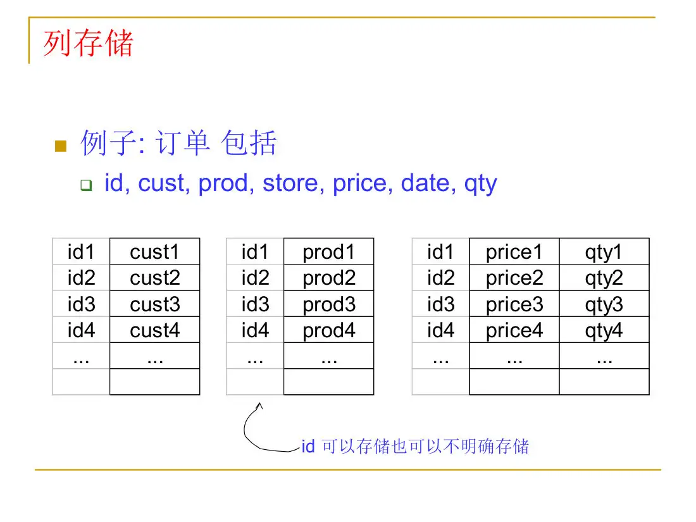

原文：

列存储

n 例子: 订单 包括

q id, cust, prod, store, price, date, qty

<table><tr><td>id1</td><td>cust1</td></tr><tr><td>id2</td><td>cust2</td></tr><tr><td>id3</td><td>cust3</td></tr><tr><td>id4</td><td>cust4</td></tr><tr><td>...</td><td>...</td></tr><tr><td></td><td></td></tr></table>

<table><tr><td>id1</td><td>prod1</td></tr><tr><td>id2</td><td>prod2</td></tr><tr><td>id3</td><td>prod3</td></tr><tr><td>id4</td><td>prod4</td></tr><tr><td>...</td><td>...</td></tr><tr><td></td><td></td></tr></table>

<table><tr><td>id1</td><td>price1</td><td>qty1</td></tr><tr><td>id2</td><td>price2</td><td>qty2</td></tr><tr><td>id3</td><td>price3</td><td>qty3</td></tr><tr><td>id4</td><td>price4</td><td>qty4</td></tr><tr><td>...</td><td>...</td><td>...</td></tr><tr><td></td><td></td><td></td></tr></table>

id 可以存储也可以不明确存储

### 行存储和列存储对比

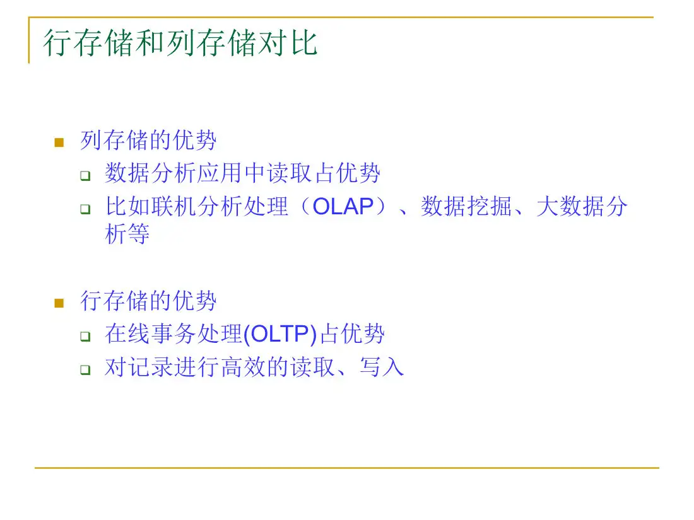

原文：

行存储和列存储对比

n 列存储的优势

q 数据分析应用中读取占优势

q 比如联机分析处理（OLAP）、数据挖掘、大数据分析等

n 行存储的优势

q 在线事务处理(OLTP)占优势

q 对记录进行高效的读取、写入

### 对比分析

原文：

对比分析

n 实际上有许多的不同方式来组织磁盘上的数据存储…哪种方式最好?

### 对比分析

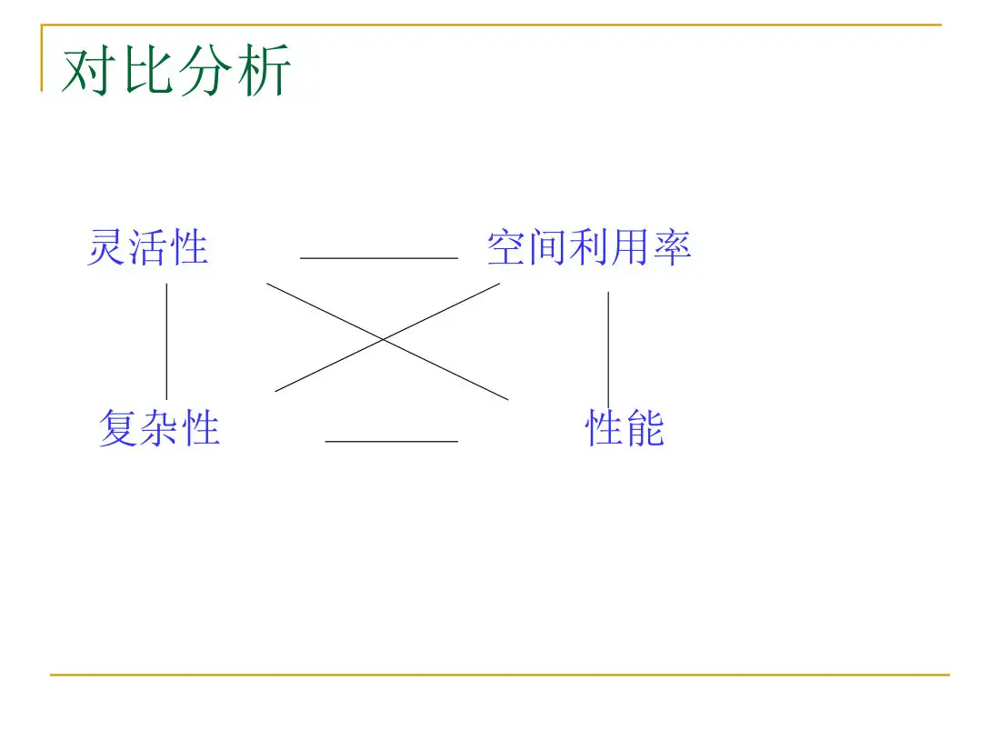

原文：

对比分析

灵活性

空间利用率

复杂性

性能

### 结论：

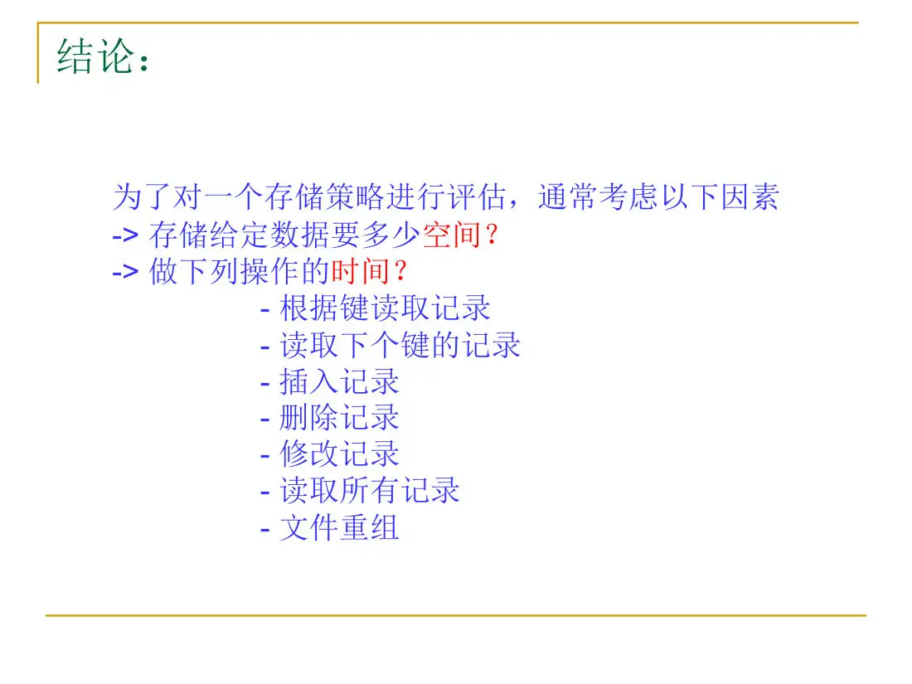

原文：

结论：

为了对一个存储策略进行评估，通常考虑以下因素

-> 存储给定数据要多少空间？

-> 做下列操作的时间？

\- 根据键读取记录

\- 读取下个键的记录

\- 插入记录

\- 删除记录

\- 修改记录

\- 读取所有记录

\- 文件重组

### 参考文献

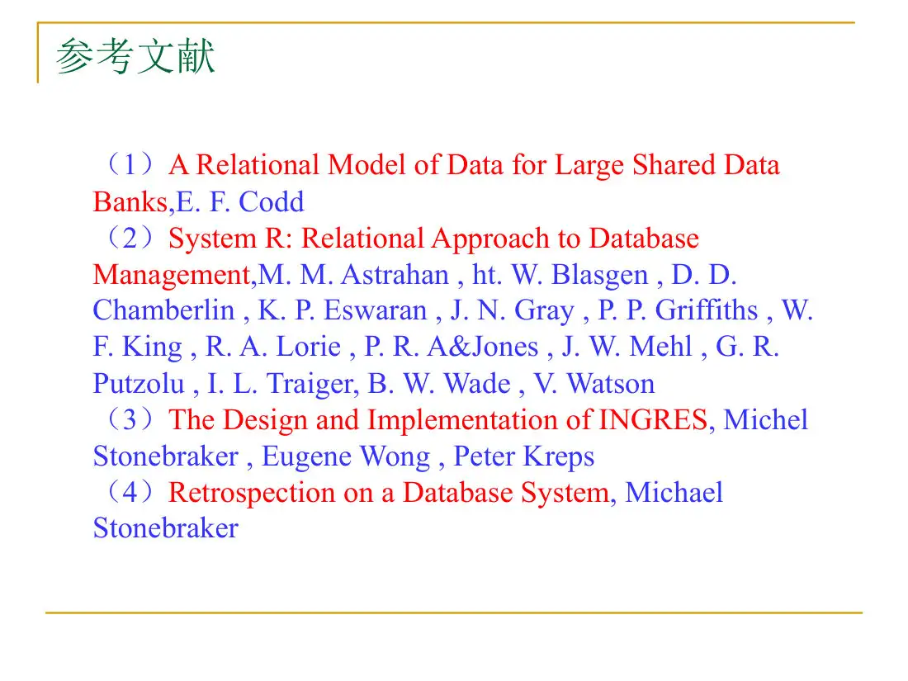

原文：

参考文献

（1）A Relational Model of Data for Large Shared Data Banks,E. F. Codd

（3）The Design and Implementation of INGRES, Michel Stonebraker , Eugene Wong , Peter Kreps

（4）Retrospection on a Database System, MichaelStonebraker

### 作业

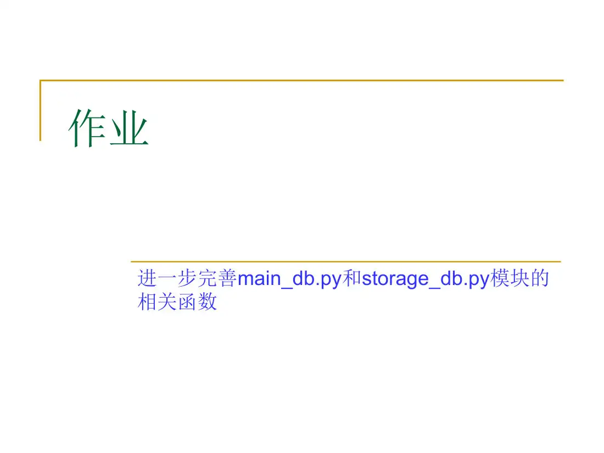

原文：

作业

进一步完善main\_db.py和storage\_db.py模块的相关函数
