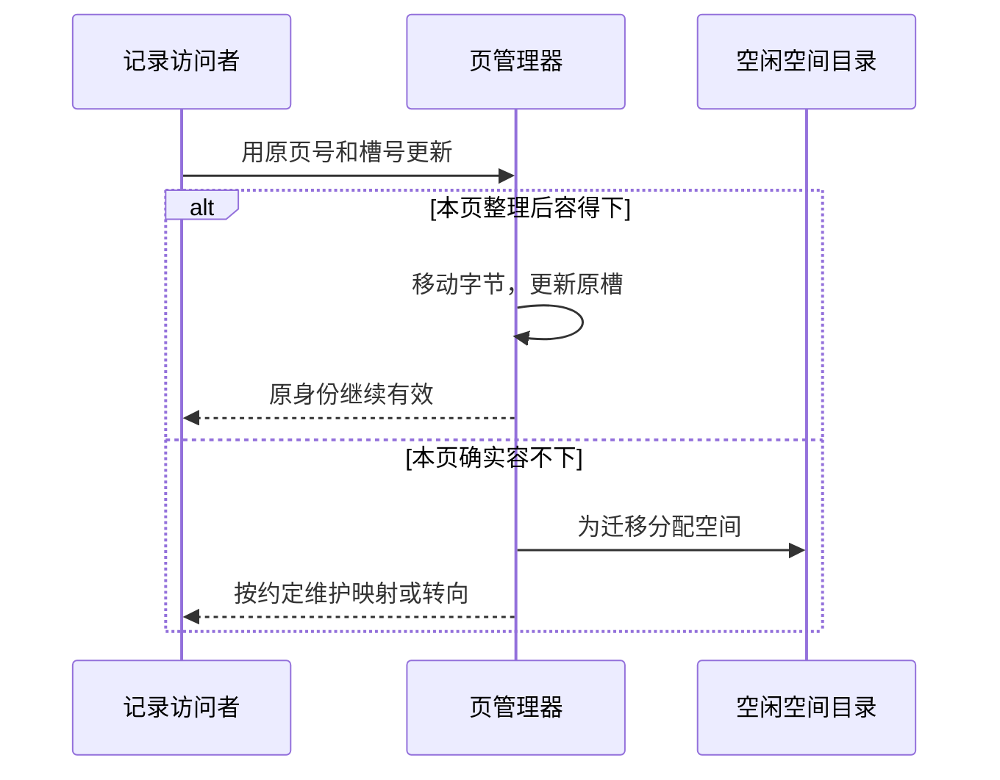

# 存储管理二：从变长字段到稳定记录身份

一条记录从 32 字节变成 50 字节，可能挤得邻居也要换地方。字段边界怎样找？页面空间怎样再利用？索引里原来记下的位置会失效吗？这三个问题要分别由==记录内格式、页内空间管理、跨层引用约定==回答。本文是历史课件的独立伴读，不是原件转录或现行考核说明；注明原题之处为独立解答，其余算例及图均为补充。

## 先让字节串可以无歧义地解码

定长字段只要知道模式，就可以从基址直接计算偏移。若前一个字段的字节数改变，后面的起点就不能再写成常量。可把定长区放在前面，让首部记录整条长度和各变长字段的边界。只要首部与定长区长度由模式确定，第一个变长字段的起点就能算出；最后一个字段从最后的边界一直读到记录末尾。比如变长区从偏移 12 开始，第二项从 15 开始，记录长为 20；两项分占半开区间 $[12,15)$、$[15,20)$，分别是 3、5 字节。这些是**字节**偏移，不是 Unicode 字符计数。

| 题面里的变化 | 在哪里保存解码所需的事实 | 容易弄混的边界 |
|---|---|---|
| 字段种类、顺序相同，只是长度不同 | 模式加偏移目录或长度前缀 | 字符数不一定是字节数 |
| 某个定宽字段出现次数可变 | 连续重复区的起点与终点，或起点与次数 | 还存在尾随字段时，记录结束不等于重复区结束 |
| 不同记录的字段集合或顺序可变 | 每段带字段标识、类型与长度；类型也可由模式注册表给出 | 空值与缺字段不一定相同 |
| 内容跨过单页容量 | 页外值定位符，或记录片段位置和首尾标识 | 页外值与整条跨页记录的访问代价不相同 |

**补充。** 如果某个 3 字节引用重复出现，重复区为 $[14,26)$，有 $(26-14)/3=4$ 项；若差值除不尽，这不是「多了一条不完整的引用」，而是边界或格式解释错误。把重复区留在记录里，读全记录通常有较好局部性；把大而少读的内容放到页外，主记录可更紧凑，代价是追指针和额外 I/O。页外字段通常从定位符另取，整条跨页记录则需要从逻辑记录的首片读到尾片；两者都得知道长度和终止条件。读入时还要校验偏移有序且不越界，未知标签能否跳过取决于该格式是否提供可用的长度。

**参考解答（原件第 16 页）。** 按课件第 3 页的布局，三个定长项各 9 字节，变长区第一个起点可推得，只须保存后两个字段的 8 字节偏移。再计 2 字节总长，不作对齐，不含变长字段的开销为 $3\times9+2\times8+2=45$ 字节。三个均匀区间的长度期望分别为 40、60、1000 字节；无须假设三者独立，期望可直接相加，得平均 $45+40+60+1000=1145$ 字节。若题目另规定每个变长字段都显式保存 8 字节偏移，答案相应为 53、1153；不要在两种格式之间混用首部开销。参见[变长数据和记录](../../../topics/数据库内核实现/变长数据和记录.md)。

## 移动的是页内载荷，不应让身份跟着漂移

页首一般放管理信息，槽目录从低地址扩展，记录从高地址一侧放置。外部引用拿到的可以是「页号、槽号」，槽里才保存该记录当下的偏移和长度。这样，==紧凑化改变偏移而不是槽号==；如果为了让槽号有序而直接挪动既有槽项，外部索引就可能读错行。按键遍历可另设次序结构，或采用明确允许移动和维护引用的组织方式。

**补充算例。** 一页 128 字节，页首 8 字节，每槽 4 字节。三条记录分别占 20、32、28 字节，三个槽一直保留。最初载荷可从页尾摆在 $[48,68)$、$[68,100)$、$[100,128)$ 三段，槽目录末端在 20。第二条变成 50 字节时，不分配新槽；第二条向低地址增长，同时挪动第一条，三段可变成 $[30,50)$、$[50,100)$、$[100,128)$，还剩 10 字节。若此时插入一条 8 字节记录，不能只比 $8<10$：**载荷加新槽要 12 字节**，这页放不下。若先删除第一条，回收 20 字节，可用空间变为 30；能否复用已删槽还取决于旧引用是否失效，不能让旧引用看成新行。参见[块与记录地址](../../../topics/数据库内核实现/块与记录地址.md)和[记录的修改](../../../topics/数据库内核实现/记录的修改.md)。

| 操作 | 先检查 | 放不下或不能搬时 |
|---|---|---|
| 插入 | 堆文件可找有空间的页；有序文件还要维护按键访问次序 | 选择邻页、分裂页，或使用约定的溢出页；溢出链增长会拖慢访问 |
| 删除 | 是只标记失效，还是可立即回收、压紧 | 不能立即滑动时，可用空闲空间目录或链表保存洞；总空闲量不等于最大连续洞 |
| 更新 | 不改长度可省掉重排，不代表索引或版本无须维护；变短、变长则重新核空间 | 同页放不下时转移，靠映射、转向或更新外部引用保持访问正确 |

> [!WARNING]
> 记录变大、记录搬走、旧身份作废是三件事。为了复用空间，可以挪动载荷；为了不把旧引用解成新记录，槽复用需要引用已失效的保证，或者带代际号等辨别机制。只知道「这里还有空字节」不足以决定任何引用可安全重用。

## 行存还是列存，要先问读哪些字节

字段组合成记录，记录放到页，页组织为文件；改变排列不是改变逻辑关系。行存把同一行的多个字段放近，读取或更新一个完整行通常便宜；列存把同一属性的许多值放近，只扫描少数列时可以少读，还常提高同质值的压缩机会。重建一行时，列段是否能按同一位置拼回去，依赖稳定对齐或显式行标识；不能把各列分别排序后仍按原行号机械拼接。

**补充算例。** 100 000 行，每行 10 个 4 字节字段。简化为数据页有效空间 4000 字节、不压缩且不计索引，扫描全部行来计算一列的和：行存每页 100 行，要读 1000 页；列存每页 1000 个值，该列只占 100 页。如果查询改成按键取一行且要所有字段，单靠上面的扫描账本不能判断优劣；还要问键怎样定位、对应列段能否少读、是否已缓存、更新是否跨多个段。==先写访问负载，再数真正触碰的页==。比较方案时分别记录空间、按键读取、顺序遍历、修改以及文件重组成本；没有统一最好的物理布局。参见[按块计算 I/O](../../../topics/数据库内核实现/io计算模型.md)。

> [!TIP]
> 原件末页只给出完善存储模块的练习方向。可以用上面的 128 字节页写三条独立检查：更新后按旧槽读到新值；空间恰好差 2 字节的插入被拒绝或换页；删除再复用没有让旧引用指向新值。若实现支持溢出，再测试重新装入后能按约定解出完整记录。这里不假定原课程程序的具体接口。
