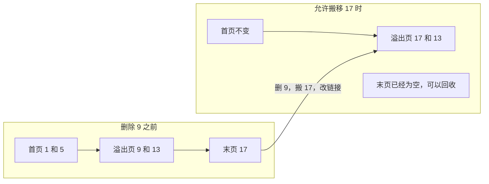
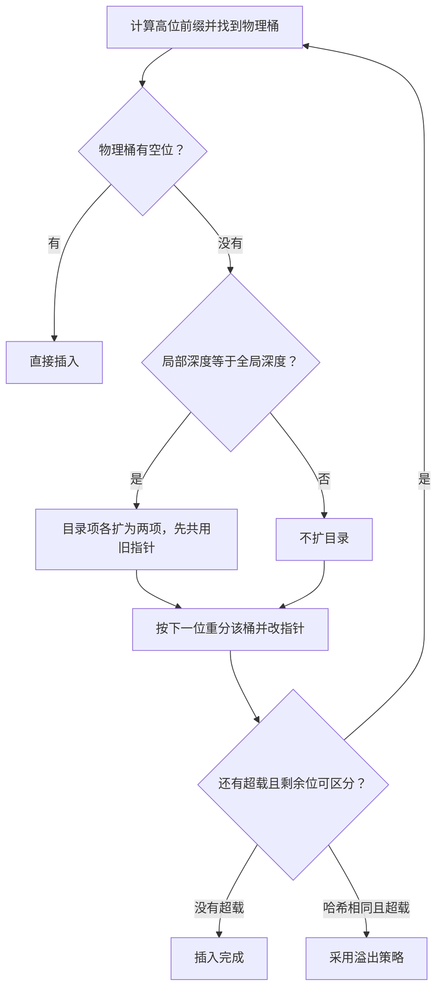
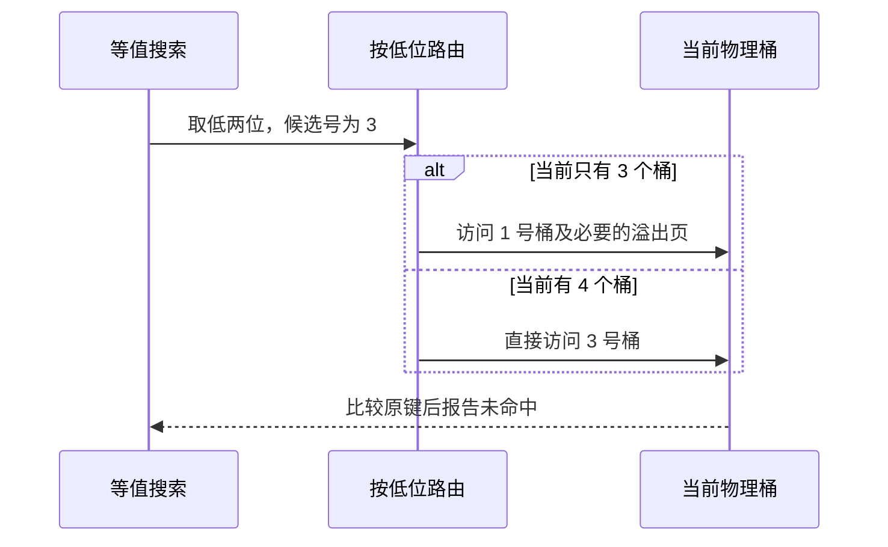

# 《数据库管理系统实现》第3部分 索引管理2（课件）

这份导读围绕原课件的三个问题展开：如何让按键定位的成本以磁盘页计量；为什么可扩展散列有时只分裂一页、有时还要扩目录；为什么线性散列可能分裂一个根本没收到本次插入的桶。例子和图为独立推演，原课件见页首来源。

## 把一次等值搜索变成一次定位（原课件第 1–9 页）

在内存里，把键散列到一个链表头，再沿链检查键即可。到了磁盘，若每次追指针都要读一页，即使比较次数不多，也可能很慢。于是把同一桶的数据装进页：先计算桶号，再通过页号映射找到桶的首块；块不够时，才沿着溢出块指针走。设静态表有 $B$ 个桶，桶号范围为 $0$ 到 $B-1$。散列值相同只说明该去同一桶，不能代替原键比较。若要找完重复键，需检查未被可靠排除的后续页；未命中也可能要读完整条链。这里的成本口径见 [I/O 计算模型](../../../topics/数据库内核实现/io计算模型.md)。

| 桶里装什么 | 读到等值项之后 | 更新时要注意什么 |
|---|---|---|
| 散列文件直接装记录 | 页中已经有目标记录，可返回完整记录 | 数据记录的物理组织就是这套桶结构 |
| [辅助索引](../../../topics/数据库内核实现/辅助索引.md)装键和记录地址 | 若投影字段未被索引覆盖，还要凭地址访问表页；多结果可能分散在多页 | 索引须与表行联动，不能把“是否新开溢出块”和“是否更新索引项”混为一谈 |

把字节值求和再对 $B$ 取模，可以快速演示定位，但不是均匀性的保证。例如取 $B=5$，ASCII 键 `A2` 和 `2A` 的字节都是 65 和 50，和同为 115，故同入 0 号桶。换桶数也拆不开这两种排列：在取模前已经丢失了顺序。

> [!TIP]
> 看到==只按一个键做等值搜索==，先考虑能否直接散列定位；看到范围、前缀区间或排序输出，再考虑 [B 树的有序访问](../../../topics/数据库内核实现/b树结构.md)。仅把桶内的键排好序不会使桶与桶之间有序；频繁更新时还要权衡调整页内排列的成本。排序可能减少页内比较，不能自动省掉跨溢出页的 I/O。

## 静态桶如何插入、删除和变满（第 10–20 页）

设有 4 个桶，每页可放 2 条记录，令整数键按除以 4 的余数定位。插入 1、5、9、13、17 后，这五条都在 1 号桶：首页装 1 和 5，第一个溢出页装 9 和 13，第二个装 17。此时删 9，第一溢出页还含 13，不能直接回收；如果不要求保持顺序，并且已处理记录位置变化，可以用末页的 17 补空，再摘下空的末页。若不搬移，下次插入同桶时可优先利用已有空位。删除首页记录也不等于可丢弃首页：若溢出链仍有数据，必须保留可达路径。回收、重排与地址稳定性的关系见 [记录的修改](../../../topics/数据库内核实现/记录的修改.md)。

全表仅放 5 条，按主桶容量计算的平均利用率是 $5/(4\times 2)=62.5\%$；1 号桶却已跨 3 页。这并不矛盾：平均值既不揭示倾斜，也不是把溢出页计入后计算的物理空间利用率。课件给出的 50%–80% 是留余量的经验区间，不是任何数据分布下都不会溢出的保证。静态表在持续增长时只能继续延长溢出链，或重新分配桶并重散列整份文件。动态方法都试图避免频繁全表重组，但安排分裂的理由不同。参见 [静态散列表](../../../topics/数据库内核实现/静态散列表.md)。

## 可扩展散列：目录项与物理桶不是同一回事（第 21–37 页）

如果直接加长桶号，是否一定要改动所有记录？不必。以散列值的高位作前缀，将目录深度记为 $i$，把桶自身依赖的前缀长度记为 $j$。目录有 $2^i$ 个指针；同一物理桶可被 $2^{i-j}$ 项引用。搜索按前 $i$ 位取目录项，循指针读物理桶。插入时，目标桶有空间便直接写；空间不足时：

- 若 $j<i$，目录已经能区分第 $j+1$ 位。只按这一位重分目标桶及待插入项，更新这两个桶的局部深度及原来指它们的目录项。
- 若 $j=i$，现有目录不够细。每个旧前缀 $p$ 延伸成 $p0$、$p1$，起初二者仍指旧桶；随后才按下一位分裂目标桶。翻倍的是目录项，不是所有物理桶。
- 若分裂后待插入项所在桶仍满，继续按上述条件，直到找到能区分的位。若完整散列值都相同，目录加深也不能拆开，工程上须有溢出页或其他退路，而不是无限扩目录。

> [!IMPORTANT]
> 必须同时维护“==目录前缀与桶的局部前缀一致==”和 $j\le i$。看到满桶时先比较两个深度，不要把“满桶”直接当成“目录翻倍”的信号。

**独立算例：先分裂而不翻倍，后分裂才翻倍。** 每桶容两条，表中值是互不相同键的四位散列值。初始 $i=2$，两个物理桶都只看首位，分别已有 `0011`、`0110` 和 `1001`、`1110`。插入 `0101` 后，局部深度 1 小于目录深度 2，所以只拆原 `0` 桶。再插入 `0111` 后，`01` 桶已满且局部深度就是 2，必须先加深目录。

| 状态 | 含 `0` 前缀的物理桶 | 右半部分是否移动 |
|---|---|---|
| 初态，$i=2$ | `00`、`01` 共指局部深度 1 的 `0` 桶 | `10`、`11` 共指局部深度 1 的 `1` 桶 |
| 插入 `0101`，$i=2$ | `00` → `0011`；`01` → `0110`、`0101` | 不移动 |
| 插入 `0111`，$i=3$ | `000`、`001` 共指原 `00` 桶；`010` → `0101`；`011` → `0110`、`0111` | `100`、`101`、`110`、`111` 仍共指原 `1` 桶 |

目录常驻内存且目标只有一块时，数据定位通常只要一次块读取；目录不能驻留、存在额外溢出或实际桶跨页时，这个结论不再成立。目录的指数增长是对前缀倾斜敏感的：长时间共享前缀可能反复产生空伙伴桶。参见 [动态散列](../../../topics/数据库内核实现/动态散列.md)。

## 线性散列：把扩容成本摊到不同的插入上（第 38–53 页）

如果不愿一次扩大整个目录，可以让物理桶号连续，每次只增加一桶。记当前桶数为 $n$，索引项数为 $r$，令 $i=\lceil\log_2 n\rceil$。暂用 $n\ge 2$ 的情况说明地址计算：取散列值最低 $i$ 位形成候选桶号 $m$，若 $m<n$ 直接用；否则说明这一轮的高编号伙伴尚不存在，去掉这组低位中的最高一位，也就是使用 $m-2^{i-1}$。去掉的是**候选桶号**的最高位，不是整串散列值的最高位。正好 $n=2^i$ 时，所有候选号均存在，不走回退分支。

课件示例在插入后比较 $r/n$ 与每桶 1.7 条的阈值。当页容量是两条时，这相当于按主桶容量算 85%，不是 170%。如果该插入触发增长，设 $M$ 是增长前不大于 $n$ 的最大 2 的整次幂：新桶编号是旧 $n$；重新分布的是旧桶 $n-M$；用这一轮新生效的一位决定每条项留在旧桶还是迁至新桶，包含旧桶的溢出链。由 $n=M$ 开始时，第一次拆 0 号桶；以后顺序拆 1 号、2 号，直到这轮结束。全程只需保存轮次和当前分裂位置等元数据，不需要可扩展散列中逐个高位前缀共享指针的翻倍目录。

**独立算例：同一桶再次溢出，增长却发生在另一个桶。** 页容量为两条，四位散列值，阈值仍为每桶 1.7 条。初始两个桶，0 号有 `0010`、`0100`，1 号有 `1001`：

| 操作 | 插入后、增长前的平均条数 | 地址与分裂结果 |
|---|---:|---|
| 插入 `0110` | $4/2=2$ | 先落 0 号；新增 2 号，拆 0 号，`0010`、`0110` 迁到 2，`0100` 留 0 |
| 插入 `1010` | $5/3\approx1.667$ | 2 号满，写溢出页；不增桶 |
| 插入 `1110` | $6/3=2$ | 又写 2 号的溢出页；却新增 3 号并拆 1 号，`1001` 留 1，2 号仍溢出 |
| 搜索 `1111`，在上一步前和上一步后各试一次 | 不改变计数 | 低两位都是 `11`；原先没有 3 号，回退到 1 号；现在 3 号已存在，直接去 3 号。两个时点都未命中 |

> [!CAUTION]
> ==线性散列的溢出位置、触发增长的插入、实际分裂的位置==不一定相同。做题时把这三者分开写；尤其别用新增桶后的 $n$ 倒推到底有没有触发本次增长。

| 对照维度 | 可扩展散列 | 线性散列 |
|---|---|---|
| 地址来源 | 当前目录深度给定的高位前缀 | 低位候选号与尚未建立时的回退 |
| 增长信号 | 插入目标桶空间不足 | 本课件以全表每桶平均条数为信号 |
| 分裂谁 | 本次目标桶 | 轮转顺序指定的旧桶 |
| 扩容开销 | 可能一次翻倍目录，但只拆目标物理桶 | 一次新增一个桶，但局部溢出可能继续存在 |

## 从散列算法到可用索引（第 54–55 页）

课件进一步阅读指向数据库对操作系统的要求，以及通用搜索树的索引抽象。这两条阅读线适合带着同一问题进入：磁盘页组织和外部键访问的约束，哪些应由索引实现消化，哪些应成为可替换的公共接口？

末页作业要求在 `index_db.py` 新增一种索引（单级、多级、B 树或散列表任选），明确文件结构、构造函数和 `insert_index_entry()`。若选散列表，可以先定义可持久化的元数据与页格式，规定键–记录地址项的编码，再在构造时正确区分新建文件与打开旧文件。让插入覆盖普通插入、散列碰撞、首次溢出和第一次扩容；再用重新打开后仍能命中、未命中和重复键不丢失验证实现。这个自检是导读补充，不是把课件未列出的项目冒充原作业要求。
