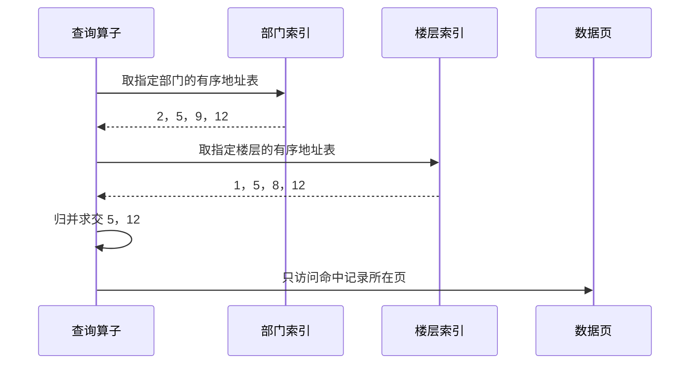
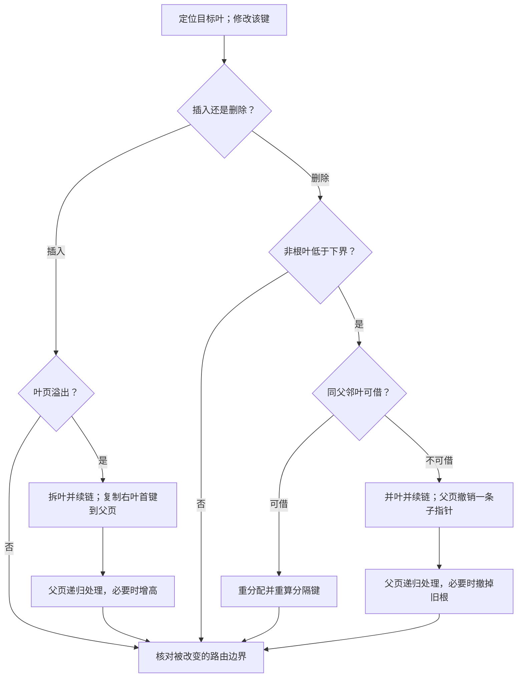

# 《数据库管理系统实现》第3部分 索引管理（课件）

磁盘上的记录不是一张可以任意跳到某一行的纸。即使知道要找什么键，数据库也得先决定读哪一页；如果文件无序、又没有别的路标，读完一页仍不能依据其内容排除其他页。索引把“键在何处”写进另一份小得多、可以搜索的结构。它越小、越容易驻留缓冲区，节省的就越不只是比较次数，而是最贵的页读写。

这部分课件有两条贯穿始终的线索：==谁保证候选记录不会漏掉==，以及==记录变化后要改几处才能恢复这个保证==。第 2–25 页讲顺序文件和简单索引，第 26–49 页讲更新，第 50–79 页把索引用到物理无序和多维搜索，第 80–128 页再让索引本身适应不断变化的数据。原件中具相同键值的图示及相关题解见下文；其余小例用新数据说明机制。

## 顺序文件：先把比较搬到小页集合

顺序文件按搜索键组织，沿数据页的**逻辑**顺序读，键不下降；这不要求各页在磁盘上物理相邻。索引项通常由键和指针构成。指针可能直接指向数据页，也可能定位到页内的槽，从而获得某条记录；这两种粒度不能混用。参见[块与记录地址](../../../topics/数据库内核实现/块与记录地址.md)及[I/O 计算模型](../../../topics/数据库内核实现/io计算模型.md)。

| 约定 | 最低层索引存什么 | 找到入口后还有什么工作 |
| --- | --- | --- |
| 稠密，每条记录一项 | 键与对应记录地址；重复键可有多项 | 无需在数据页上重新定位记录；若索引已覆盖投影，可以不取数据页 |
| 有序文件的稀疏索引 | 例如各基准数据页的最小键与页地址 | 先缩小到候选页，再在页内或后续页搜索 |
| 上层稀疏索引 | 下层每一索引页的起始键和页地址 | 在下层索引页继续导向；底层仍可用稠密或稀疏结构 |

为什么稀疏索引可以省掉其他键？不是因为那些键不重要，而是因为被省略的键仍落在**由有序性界定的范围**里。唯一键时，索引中不超过目标的最后一条起始键通常给出候选页；目标比第一项还小即可判空。对范围搜索，先定位区间左端，再按有序数据页前行，到第一个越过右端的键停止。顺序文件里，索引也可证明目标键不存在：若一个稠密索引没有目标项，则不必读取数据页；稀疏索引一般还需检查候选页。

> [!WARNING]
> “索引键连续”不能推出“数据页连续”。如果数据页是堆文件，键 2、4、6 三条记录可分别位于互不相邻的页。把堆页第一个键当作边界，会把另一个页上的命中排除掉。

### 按页预算，不按元组预算

课件例子设有 100 万条记录，每数据页 10 条，每索引页 100 项，页长 4,096 字节。数据是 100,000 页，即 409,600,000 字节。稠密索引本身是 10,000 页；一级稀疏索引只有 1,000 页；再给这 1,000 个索引页各存一条上层入口，只需 10 页。

如果页均未缓存且可随机定位，页级对半搜索在 10,000 个稠密索引页上最坏读约 14 个索引页，命中后若还要实际记录，再读其数据页；对 100,000 个数据页直接对半搜索，最坏约 17 个数据页。若 10 页上层稀疏索引已缓存，且数据键唯一、无溢出链、单条命中，确定位置后只需读目标下层索引页与数据页，合计两次 I/O。若整个有效索引驻留内存，命中后只多读一个数据页。缓存、覆盖索引、重复键或溢出链都会改变这个计数，不能把“二次 I/O”当成这个结构的固定成本。参见[稠密与稀疏索引](../../../topics/数据库内核实现/稠密与稀疏索引.md)、[多级索引](../../../topics/数据库内核实现/多级索引.md)。

> [!TIP]
> 看到==每页容纳多少项==，先算每一层的页数并逐层向上取整，最后才选“对半搜索”或给定的驻留假设。页装了一半也仍是一页。

第 49 页思考题的页容量条件是：数据页容纳 5 条记录，索引页容纳 20 项。**参考解答**：令记录数为 $n$，数据页数 $D=\lceil n/5\rceil$；只算索引，稠密式需 $\lceil n/20\rceil$ 页，按数据页取首键的稀疏式需 $\lceil D/20\rceil=\lceil n/100\rceil$ 页；若题意把数据与索引一起算，再分别加上 $D$。例如补充取 $n=437$，数据为 88 页，索引分别为 22 页和 5 页；给这 5 个稀疏索引页再加一层，只需 1 页。这些计算假定页面按给定容量紧凑装填，不包括溢出页、页头的另计空间或缓存命中。

## 重复键：先定最左候选，再扫描到退出边界

有序数据上的连续重复键有三种常用入口：每条记录一项；每个不同键只保存其首次出现位置，命中后沿记录顺序扫等值段；或者只为数据页保存边界。后二者的节省依赖有序性。每条记录一项时，也应从相等索引项的下界开始，而非随便找到一项就结束。

如果页首是边界，搜索值等于某页的首键，上一页末尾可能已经是同一键。定位第一个首键不小于目标的页，只要存在前驱页，就从它开始，随后按逻辑顺序读取，遇到大于目标的键即停。若这样的索引项不存在，从最后一页开搜；若目标小于全部首键，可直接判空。**订正**：课件第 21 页的两条边界若隔了数页，须检查两端**之间**的候选页，不能只读两个指针直接指向的页。

补充反例：各页依次为 `[1, 4, 6]`、`[6, 6, 6]`、`[6, 6, 6]`、`[6, 9, 11]`、`[13]`。只扫首键为 6 的页会漏掉第一页末尾的一条；按下界加前驱，恰好返回八条 6。课件第 22 页的图同理。**参考解答**：搜索 20，从第一张首键为 20 的页的前一页开始，共两条，分布在第二、第三页；搜索 10 两个开头页都要读，共三条。

课件还给出了不同的稀疏入口：页内若存在此前未出现的键，则以其中最小者为边界；若该页键全相同，仍用那个键作为入口。这会把有些入口向页内新键推进。第 25 页相应地把第二、第三页的边界记为 20 和 30。**参考解答**：搜索 30，保守地从第一条边界 30 的前一页开始；第二页无 30，第三页末尾有一条，第四页有两条。搜索 25，从边界 20 所指的第二页开始，见到第三页的 30 即可排除，共零条。**订正**：第 24 页的“从第一个相等入口开始”和“无相等入口只查起点页”都不能无条件保证无遗漏。例如页依次为 `[1, 4]`、`[4, 4]`，入口为 1、4，从后者开始搜索 4 会漏掉前一页的一条；若页依次为 `[1, 4]`、`[4, 7]`，入口为 1、7，仅查入口 1 的页也会漏掉后页开头的 4。安全做法是一样保留首个不小于目标入口的前驱，从前驱继续扫描，直至真实记录键越界，参见[重复搜索键索引](../../../topics/数据库内核实现/重复查找键索引.md)。

## 更新：先问改的是记录还是导航边界

删除不只有移动记录一法。可将槽标为空并保留稳定地址，也可紧凑排列以回收空间；真正空闲的页可回收，但要取消或改写所有仍指向它的结构。顺序文件插入时，可用本页空位、移动到有空位的相邻页并调整页界，或给已满的基准页挂溢出页。溢出页仍属于基准页的**逻辑范围**；搜索必须访问这条链，长期增长则应重整。改搜索键通常等于删除旧索引项再插入新项，不能只改记录上显示的值。

| 事件 | 按记录稠密索引 | 以基准页首键为边界的稀疏索引 |
| --- | --- | --- |
| 删除非边界记录 | 删对应项；分组索引删桶内位置 | 通常不改边界 |
| 页的首键变动 | 更新受影响记录的项 | 新首键代替旧首键；若上级也引用这个边界，继续修整 |
| 重排或搬移记录 | 只有地址语义变了才需修正落点；页内稳定槽可隐藏字节搬移 | 只要基准页的路由不变，不必为每条搬移记录加项 |
| 基准页被新增、分裂或回收 | 调整受影响的记录地址及索引项 | 增加、替换或撤去基准页边界 |

例如在有序页 `[2, 5, 8]`、`[12, 14]` 中删除 5，首键 2 不动；随后删 2 则首键改为 8。若要在容量三条的满页 `[2, 5, 8]` 中插入 7，把 8 移到仍有空位的后页，可同时维持全局顺序，并把后页边界从 12 降到 8。若后页也满，局部搬移和加溢出页的区别就落在“现在多写页”还是“今后搜索多读页”上。索引页本身也可能需要腾位、溢出或合并。参见[索引维护](../../../topics/数据库内核实现/索引维护.md)。

## 辅助索引：无序时，入口必须保住所有落点

一个物理组织不能同时按两个独立的键顺序排列，但可以有多条搜索路径。课件称与顺序组织相配的为主索引，另加的为辅助索引；前者不等于 SQL 的主键约束。非顺序键上的索引页可有序，索引项所指的堆页却可能分散。想回答所有命中，最低一层不应依赖未保证存在的数据页边界。

最直观的方法为每条记录一项，重复键也写多遍；可以只保存一个键，然后存其全部地址。变长指针串会使索引页分配和更新变复杂，把位置移到独立的桶页，就能让主入口维持固定大小；代价是额外读桶以及管理长桶。把同值记录串联也是可能的，但那会侵入数据记录结构，还会把跟随链的 I/O 推到记录文件。这里的“稠密”指覆盖所有落点，并不要求重复写每个键。更上一层仍能对已排序的辅助索引页使用稀疏入口。参见[辅助索引](../../../topics/数据库内核实现/辅助索引.md)。

辅助索引适用于堆文件，也可服务于把多种记录共置的聚集文件。例如电影与制片公司按公司归组，而经理编号并非布局键：用经理索引找到公司记录，再沿该组取影片；不要拿经理编号当物理页界。范围取得很多记录或回表落点高度离散时，应比较顺序扫描与大量随机访问；即使索引覆盖全部落点，也不代表走索引总是更快。

多个条件可以先在地址域内合流。假设部门索引给出记录地址集 $\{2,5,9,12\}$，楼层索引给出 $\{1,5,8,12\}$，两个条件都成立的地址只有 5、12；按地址去重，并在可行时按数据页归并取数。只查部门、读四条后再筛楼层也正确，但可能多读数据页。倒排索引把同一个动作换到文本领域：文档产生多个词项，词项映射到有序文档号，桶还可记录词的每次出现或该词在文档中的多个位置及类型，如需判断精确短语便应保留能证明相邻性的位置信息。同一文档同时含两个词，**不**推出它们相邻或顺序相同。分词、归一化和停用词策略影响候选集合，停用词若可能参与精确短语，就不能在无补偿方案时扔掉其位置信息。参见[倒排索引](../../../topics/数据库内核实现/倒排索引.md)。

资讯检索课件把静态倒排结构也当作一种有序字典：容易找词项或按字典相邻顺序扫，但若词项表按顺序排得太紧，新词会迫使搬移或产生溢出；文档号桶也须能增长。这和前面的顺序文件面对的是同一条约束：==读时喜欢边界稳定、物理连续，写时需要局部余量==。

## B+ 树：把稳定的导航与可增长的叶页分开

简单多级索引若像顺序数组一样存满，某处插入或删除就可能让大段边界迁移。能不能只动相邻少数页，即使整个文件增长，任何入口距离根仍一样？课件动态示意把实际记录指针放在叶页，把导航分隔键放在内部页，再把叶页串成可顺序扫描的链。这是 **B+ 树**组织；课件不少页用“B 树”作章节统称。它不等于可将完整记录或其定位信息分布在内部节点的普通 B 树定义。

以课件的 $n$ 表示页内最多的键数。非根内部页最多 $n+1$ 条子指针，最少 $\lceil(n+1)/2\rceil$ 条；子指针数始终比内部导航键数多一。非根叶页有 $\lceil n/2\rceil$ 到 $n$ 条数据入口，另有后继叶指针，它不是数据记录的一项。内部根至少两条子指针；树只有一页时，根就是叶并适用例外，空树不能强行要求非根占用率。所有叶等深。页大而键/指针小意味着扇出大，扇出比只比较两条分支更能降低冷页读取数。课件第 93 页假定每页 4,096 字节、键 4 字节、指针 8 字节，忽略页头等支出：$4n+8(n+1)\le 4096$，所以最大 $n=340$；如果另外预留 32 字节页头，则最大 $n=338$。

这里按“分隔键 = 右孩子中最小键”的约定演示。点搜索在内部页比较分隔键，等于分隔键转右，然后到叶页找记录或桶；范围搜索按左端键定位**第一个不小于左端**的项，再沿叶链到上界之外。若从起始叶位置已越过末项，应进入下一叶，而不是提前判空。重复键可以用叶中的键加位置列表，或以 $(\text{键},\text{记录地址})$ 作唯一全序；后一种布局的裸键等值搜索必须从该键的最低可能复合键开始沿叶链取齐，不能靠任意一处分隔值相等就停。课件第 97–98 页还展示了另一种重复键导航：分隔项取右子树里没有在左侧出现过的最小新键，找不到新键时分隔项可空，但不能少掉子指针。此时叶间等值段可能跨页，不能照搬唯一键的“相等即向右”；必须按该约定寻找等值段左端，再扫完整段。若 B+ 树是稀疏的，叶指向基准数据页，实际能否匹配仍须读数据；若数据按某个非主键顺序排列，也可让每个不同键指向其首个出现位置，再顺读等值段。若是辅助索引，叶链的键顺序不保证回表顺序。参见[B 树结构](../../../topics/数据库内核实现/b树结构.md)。

### 插入与删除守的不是同一个边界

插入有空位，只改目标叶，必要时同步变化的祖先边界；插满时按序拆成两个叶页，接好叶链，**复制**右叶首键到父页，真实键入口仍留在叶。父页满也拆，但内部页的中间分隔键是向上**提升**，而不是在内部左右子页各写一份。为什么一个复制、一个提升？叶里的键还能定位值；内部键只是对两个范围的切分，提升后由父页表达那条切分。若拆到旧根，新根接住两侧，全部叶的深度同时加一。按课件偏左的分配，叶溢出时可分成 $\lceil(n+1)/2\rceil$ 与 $\lfloor(n+1)/2\rfloor$ 项；内部页溢出时，左右分别留 $\lceil n/2\rceil$ 和 $\lfloor n/2\rfloor$ 个导航键，另有一键提升。这些数加回去分别是 $n+1$ 个叶入口和 $n+1$ 个暂存导航键。

删除后仍满足占用下界，就按需改边界；不满足，先看同父相邻页是否有余量，借移后重算分隔键。两侧都无余量时才合并，并从父页删掉消失的子指针及相关分隔键；父页下溢会向上递归。合并内部页须把父页居中的分隔关系补入合并结果；这和直接合并两份叶数据不同。根只余一个孩子时可撤去旧根，整树降一层。参见[B 树操作](../../../topics/数据库内核实现/b树操作.md)。

补充算例：非根叶容纳 2–3 项，起初两叶 `[2,6,8]` 与 `[12,16,20]`，根分隔为 12。插入 10 后拆为 `[2,6]`、`[8,10]`、`[12,16,20]`，根分隔变成 8、12。删除 8 后中叶只剩 10，从右页借 12，形成 `[10,12]` 和 `[16,20]`，根分隔此时为 10、16。删除 2 后第一叶只剩 6，旁页也到下界，故并成 `[6,10,12]`，根只保留 16。再删除 6 和 10，左叶变成 `[12]`，与右叶合成 `[12,16,20]`，撤去旧根。这几步分别暴露了三条常被漏掉的检查：借来的键改变**捐出页**的首键；并叶要同时撤父指针；降高后不能再以非根页的规则判断根。

> [!IMPORTANT]
> 检验树的操作不要只检查“键没丢”。每次同时检查：叶链有序且覆盖所有入口、除根外页占用合法、导航确实按照右子树最小键分流、所有叶深度相同。与只改了根分隔却未移动叶数据的错误相比，这些检查能直接找出哪条性质被破坏。

原件末页用大扇出说明树常不高。若冷缓存且树上从根到叶共访问 $h$ 个索引页，成功点搜索要取实际数据时通常再读目标数据页；根缓存会减去一次物理读取，重复命中或范围回表则可能增加不少。插入分裂、删除合并能逐级传播，代价不能概括成“总多一两页”；题目若讨论的是页 I/O，应明确读、写是否都计入，以及是否采用脏页缓冲。把这些条件带回前两节即可看出两种结构的关系：最大扇出决定树高，最小占用防止树松散，而有序叶链恢复了顺序文件原本珍贵的范围扫描能力。
