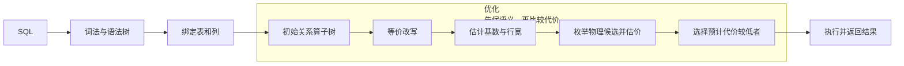
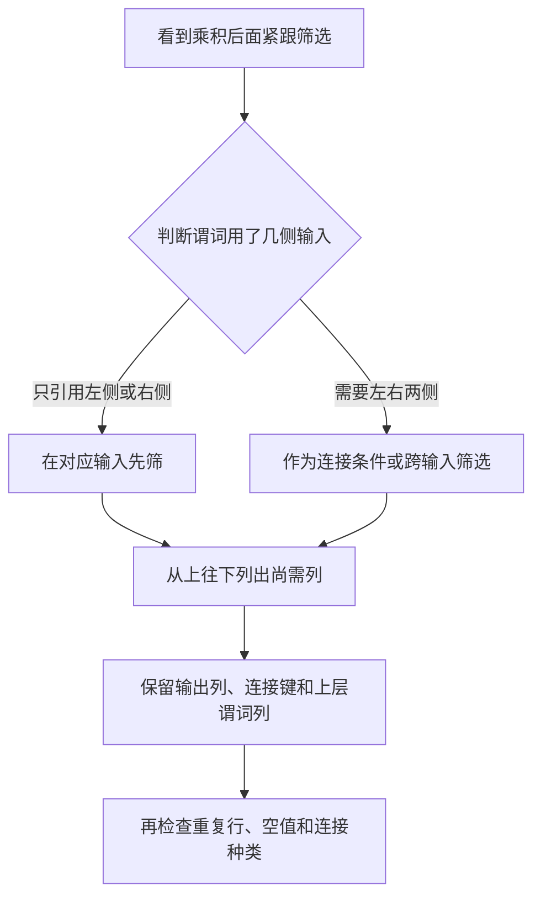
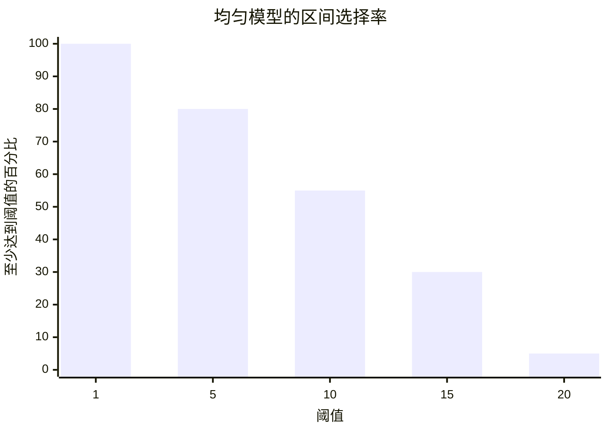

# 《数据库管理系统实现》第4部分 查询处理（课件）

同一条 SQL 可以对应相差很大的工作量。语句规定的是**要得到哪些行**，并不规定扫描哪张表、何时丢弃候选行，或如何找到连接对。优化器能改变后一组选择，但不能借机改变重复行、空值或输出列的含义。理解查询处理，先把==语义等价==、==结果规模==和==执行代价==分开：第一个是正确性条件，后两个是选择计划的依据。

## 一对结果，三条路径（原件第 1–17 页）

原件比较的查询从 $R(A,B,C)$ 和 $S(C,D,E)$ 中输出 $B,D$，条件是 $R.A=\text{'c'}$、$S.E=2$ 且 $R.C=S.C$。两张输入表各有 5 行；满足左侧条件的唯一行提供 $B=2,C=10$，满足右侧条件的 3 行中只有一行的 $C=10$，它提供 $D=x$。因此原件的输出为 $(2,x)$。

| 路径 | 为什么不会漏解 | 在原件数据上做什么 | 什么时候值得考虑 |
| --- | --- | --- | --- |
| 先积再筛，最后取列 | 所有输入对都枚举后才判断三个谓词 | 检查 $5\times5=25$ 个配对 | 适合说明逻辑规格，不应默认真的物化笛卡尔积 |
| 两边先筛，再等值连接 | 任一侧未通过本地谓词的行不可能进入答案 | 左剩 1 行、右剩 3 行；若直接枚举缩到 $1\times3$ 个候选 | 选择率低，能在早期显著压缩中间结果时 |
| 左侧按 $A$ 找行，再按 $C$ 探测右侧 | 左索引定位筛选键；右索引定位连接键，仍需检查 $E$ | 原件中左探测得到 1 行；以 $C=10$ 探测右侧得到 1 行，最后核验 $E=2$ | 左侧较小且右侧查键便宜时；索引缺失、重复键多或随机回表重时需重新估价 |

在该例中，两表唯一同名列是 $C$，所以用自然连接和显式条件 $R.C=S.C$ 能表达同一连接键。对实际数据库，显式写 <kbd>ON</kbd> 更稳妥，新添同名列不会无意间增加条件。上表中的 25、3、1 都是候选配对或探测返回行的计数，不是磁盘读了 25、3、1 个页；即使只有一行满足条件，索引树访问、回表和缓存都要另算。

> [!TIP]
> 看到一个谓词只引用 $R$ 或只引用 $S$ 的列，先问它是否能在连接前求值；看到连接键在被探测侧有索引，再估计外侧会发出多少探测。不要把“有索引”直接翻译成“必须走索引”。

## 从 SQL 到可执行物理计划（原件第 18–28 页）

语法树回答“哪些成分从属于哪个子句”。逻辑树回答“筛选、投影、连接在哪些输入上作用”。物理树才决定“顺序扫描还是索引扫描，哈希连接还是其他实现，哪个输入构建哈希表”。例如原件的一个物理候选对演出记录顺扫、对演员表索引扫描，再执行哈希连接；连接输入顺序、可用内存、输出列宽和扫描谓词都影响代价。它是候选，不是从 SQL 文本可直接读出的唯一实现。统计值影响候选排名；统计错估不会令正确实现返回错误答案，却可能令执行变慢。

原件用电影片名的查询讲解嵌套 <kbd>IN</kbd>：外表每条出演记录的演员名必须属于内层筛出的 1960 年出生的演员名字集合。内层出生条件可以尽早作用在演员表，右侧仅留下名字；外表早期投影也可以考虑，但必须同时留下之后要连接的演员名和最终要输出的片名。课件用字符串后缀匹配说明解析；若出生值在真实库里具有日期类型，应表达为当年起点（含）到次年起点（不含）的日期区间，而不是假定其格式。

> [!WARNING]
> **补充：**在 SQL 的包语义下，右侧同一个名字出现两次，<kbd>IN</kbd> 仍只判定“是否存在”，普通内连接却会把左侧对应行复制两份。保留真实语义的写法是半连接，或先对**右侧连接键**去重再做内连接；不要对最后的片名去重，因为不同出演记录本来就可能产生同名输出。这个判断限定在正向成员条件作为 <kbd>WHERE</kbd> 筛选的情境，不可直接套给 <kbd>NOT IN</kbd>；右侧的空值可能让无匹配的判断成为未知。

**补充：**若左侧恰好有两条片名为《甲》且演员名为小林的行，右侧恰好有两个满足年份条件的小林，则原查询输出《甲》两次，普通内连接输出四次，最终片名去重则只输出一次。两种“优化”一多一少，都没有保留原查询。

## 识别语句、绑定名字、创建算子（原件第 29–46 页）

课件以教学用 SQL 子集隔离查询前端。词法器把字符流分成关键字、标识符、字面值、逗号和括号等 token；例如逗号把选择列列表分开，却不应拆分字符串内部的逗号。语法器按递归规则（巴克斯范式）组合 token；教学代码使用 yacc 的归约动作创建语法节点：选择列表和 <kbd>FROM</kbd> 表列表可以递归延长；条件可以为等值比较、<kbd>LIKE</kbd> 模式匹配或带括号的 <kbd>IN</kbd> 子查询，也可由 <kbd>AND</kbd> 连接。得到树后还需绑定表和列、验证列是否歧义及类型是否可比较。拼写错误与列名歧义可能通过语法检查，但不能因此通过绑定。

| 教学工程文件 | 主要接口职责 | 可独立检查的问题 |
| --- | --- | --- |
| <kbd>lex_db.py</kbd> | 识别 SQL token | 关键字、列名、引号中的字面值能否区分 |
| <kbd>parser_db.py</kbd> | 归约产生语法节点，并保留嵌套结构 | 内层 <kbd>WHERE</kbd> 是否挂在子查询而非外查询 |
| <kbd>common_db.py</kbd> | 供多个环节使用的共享结构 | 节点类型和子节点的含义是否一致 |
| <kbd>query_plan_db.py</kbd> | 从语法结构形成计划，并连接到执行入口 | 谓词是否用到了相应的输入列，输出是否按选择列表排列 |
| <kbd>main_db.py</kbd> | 组织教学程序的输入与各阶段 | 错误能否在正确阶段报告，而非等到执行时误解为无结果 |

对基础的选择、来源、筛选查询，初始关系式可写成 $\pi_L(\sigma_P(R_1\times\cdots\times R_k))$：从来源取行、保留谓词为真的行、最后提取输出列。没有 <kbd>WHERE</kbd> 时省去选择。这是一棵可推理的逻辑树，并不要求执行器真的把乘积存下来。原件末页作业要求补齐受限 SQL 的词法、语法分析，而不是实现完整工业 SQL；可用等值条件、复合条件、子查询及括号缺失分别测合法与非法输入。

## 怎样安全地改树（原件第 47–63 页）

关系代数把无关的遍历顺序和实现细节藏起来，让人能在算子树上谈等价。但规则必须说明输入所属、列依赖和多重性；不能光看符号形似就搬运。

| 改写 | 为什么成立 | 要先过的关 |
| --- | --- | --- |
| 交换、重新括号化内连接、乘积；集合并可交换和结合 | 只改变组合顺序，不改变可由输入形成的组合 | 别混淆重名列及位置；并要求输入并相容；不套到外连接或集合差 |
| 把 $\sigma_{p\land q}$ 分成两次筛选 | 一行当且仅当两个条件都为真才留下 | 单侧谓词先下推；同时引用两侧的谓词不能塞进某个单独输入 |
| 集合代数中把 $\sigma_{p\lor q}$ 写成两次选择的并 | 只需至少满足一边，集合并消除交集的重复 | SQL 有包语义；普通 <kbd>UNION ALL</kbd> 可多留同时命中的行，<kbd>UNION</kbd> 也可能误删输入本来已有的副本 |
| 合并嵌套的投影，或下推投影 | 上层能看到全部必要的列才可继续计算 | 输出列、上方谓词和连接键都要保留；还需区分投影与显式去重 |
| 用等值或一般谓词连接替换积上的连接筛选 | 筛选条件恰好定义了哪对左右行能连接 | 独立筛选可先下推；涉及两个输入的比较仍要由两侧一起求值 |

若最后只读 $E$，过滤却还依赖 $A$ 和 $B$，则过滤前至少保留 $A,B,E$，过滤后才能只取 $E$。可用“未来还需要哪一列”从根向下计算保留列：结果需要的列向下传播，到连接节点加上连接键，再按所属关系拆成两份。

> [!CAUTION]
> **补充：**假设输入里有两条完全一样的行，两条都命中 $p$ 和 $q$。原来一个 <kbd>WHERE p OR q</kbd> 保留两条；两个分支用 <kbd>UNION ALL</kbd> 得四条，用 <kbd>UNION</kbd> 则只得一条。把少量有辨别力的反例送进每个候选改写，比只跑一份没有重复的示例更能发现错误。

## 从估多少行到估多少页（原件第 64–92 页）

先分清四个量：$T(R)$ 是表的行数，$S(R)$ 表示记录宽度，$B(R)$ 是存储关系的页或块数，$V(R,A)$ 是列 $A$ 观测到的不同值数。原件那张五行样表的每条记录由 20、4、8、5 B 的字段组成，示意行宽为 37 B，四列 $A,B,C,D$ 的不同值数分别是 $3,1,5,4$。五条记录的净宽合计为 185 B，但这不是实际磁盘足迹；页头、槽目录、填充和可变长记录都会影响 $B(R)$。

| 算子或谓词 | 可确定或可估计的量 | 容易误用的地方 |
| --- | --- | --- |
| 两表笛卡尔积 | 行数为 $T(R)T(S)$，单行净宽约为两输入宽度之和 | 不等于执行器一定写出这么多行到磁盘 |
| 只取一部分列 | 减少单行宽度；SQL 未执行去重时条数不变 | 集合关系代数投影可能消除副本，不能与 SQL 投影混用 |
| $A=a$ | 观测值近似均匀时用 $T/V$；已知完整离散域且模型按该域均匀时可考察 $T/\mathrm{DOM}$ | 一个分母数实际观测种类，一个分母数可能种类；遇到重频值、未知值、空值时不能机械套用 |
| 范围条件 | 缺统计时用默认选择率；已知离散均匀分布时直接数覆盖值 | 课件讨论的 $1/2$、$1/3$ 是默认先验，不是区间定律，且 <kbd>&gt;=</kbd> 的端点会影响结果 |
| $A\ne a$ | SQL 下用总行数减去 $A=a$ 的行及 $A$ 为空的行 | 课件取 $T(R)$ 是可用于稀有值的粗略近似；若全列都等于 $a$，实际为零 |

原件的整数示例给出 1 到 20 的离散范围；均匀模型下 $A\ge15$ 覆盖 15 到 20 共 6 个值，所以份额是 $6/20=30\%$。把它当成连续区间来减端点会漏掉一个离散值。原件同时给出样本只有 10 种观测值：30% 是按整个跨度均匀摊开的估值，不是从已知的 10 个实际值中数出来的比例。若数据集中在 1 到 10，仍在同样的允许值域内，但尾部份额可以远低于 30%，此时应读取直方图或最常见值统计。等宽桶能保留局部密度，边界要有统一的归桶规则；显式记下重频值及频数，能避免把热点和长尾一起均摊。统计信息是在成本与准确性之间换取的摘要，数据大量追加、集中删除或分布改变后就该重新采集。

**补充：**在原件采用的均匀模型下，逐渐提高阈值，至少达到阈值的比例如何变化？下图只绘制若干离散阈值处的模型值，不是观测分布。

**补充：**原件把连接大小留作自学。取一对普通 SQL 等值连接，对每个非空公共键 $k$，若左右频数为 $f_R(k)$、$f_S(k)$，它恰好产生 $f_R(k)f_S(k)$ 行，总量是这些乘积之和。仅持有行数和不同值数时，在无空值、近似均匀且较小键集合基本被较大键集合覆盖的模型下，可用 $T(R)T(S)/\max(V_R,V_S)$ 估计；键集合不交则真值为零，同一热点集中在两侧则真值可能很大。

### 补充算例：统计误差怎样换掉执行计划

设一张 1,000 行的预约表有 10 个不同状态，状态“取消”实际出现 400 次，空值有 50 行。只用不同值数估计“取消”为 100 行，与真实差 4 倍；<kbd>status &lt;&gt; '取消'</kbd> 则留下 $1\,000-400-50=550$ 行，而不是 600 行，也不是 1,000 行。再设取消组同另一张表连接时，其中某键在两侧分别出现 7、3 次，仅该键就产出 $7\times3=21$ 行。若按 100 行去规划逐行索引探测，而实际会探测 400 次，优化器就可能错误地低估随机访问；是否改用扫描仍要问数据页分布和缓存命中率，而不是只看 400 这个数。

> [!IMPORTANT]
> ==先验证等价，再估计行数和行宽，最后才比较 I/O 与内存==。投影下推减少的是要搬动的数据，选择下推首先减少候选行，索引首先改变数据访问方式。三个好处作用在不同的量上。

相关知识点：[查询处理流程](../../../topics/数据库内核实现/查询处理流程.md)、[词法语法分析](../../../topics/数据库内核实现/词法语法分析.md)、[初始逻辑查询计划](../../../topics/数据库内核实现/初始逻辑查询计划.md)、[代数优化转换规则](../../../topics/数据库内核实现/代数优化转换规则.md)、[结果大小估计](../../../topics/数据库内核实现/结果大小估计.md)、[代价估计与参数获取](../../../topics/数据库内核实现/代价估计与参数获取.md)。
