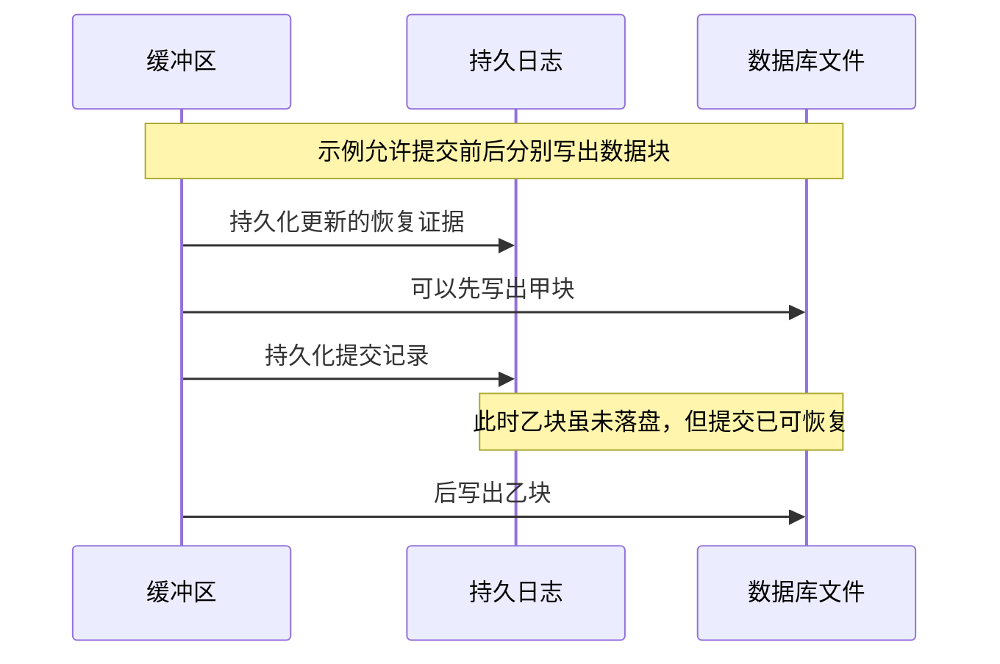

# 《数据库管理系统实现》第5部分 日志管理（课件）

可先对照[日志与事务恢复](../../../topics/数据库内核实现/日志与事务恢复.md)的术语。阅读配套讲解前，可从[数据库管理系统的能力与成分](../../../topics/数据库内核实现/dbms能力与成分.md)回看事务管理器、缓冲管理器与恢复机制的分工。本讲义按问题重新组织材料；备份、日志与副本见原件第 3–11 页，活动/提交事务列表及日志记录格式见第 12–25 页，提交规则、三种写盘策略和效率见第 25–37 页。以下例子由本篇补充，不是原课件的题目或答案。

## 为什么磁盘上的值不是事务的结论

假定事务在两个不同的数据库块上转账：账户甲原有 500，乙有 180，甲向乙转 70。若先在甲所在块写下 430，尚未写乙所在块就断电，磁盘上会剩下 430 与 180。这两个数字各自都能读出来，却不满足转账前后的余额和不变。即使把余额加起来看出出了问题，系统也无法单凭两个现值辨认**应该退回 500，还是应该补写 250**。恢复所缺的是两种证据：哪些数据发生过哪些变化，事务是否已经作出可恢复的提交决定。

- **原子性**要求视为全部完成或完全没发生，不等于硬件能同时写两个块。
- **一致性**要求从合法状态出发、按正确的事务逻辑和约束到达合法状态；日志能恢复原子性，但不能把错误的业务逻辑变成正确逻辑。
- **隔离性**约束其他并发事务可观察到什么；恢复日志本身不替代锁、版本或其他并发控制。
- **持久性**要求已经确认提交的效果在所承诺的故障范围内不丢失；不等于提交时每个数据库块都已经回写。

日志管理器的任务是记录变化及其事务归属，让故障后能重建判定。数据库文件保存数据现状，缓冲区承接未回写的变化；[记录的修改](../../../topics/数据库内核实现/记录的修改.md)与[块与记录地址](../../../topics/数据库内核实现/块与记录地址.md)帮助区分逻辑操作、缓冲页变动和实际数据库块写出。

## 先分清丢的是内存、介质还是正确历史

| 想解决的问题 | 备份（课件亦称转储） | 日志 | 独立副本 |
| --- | --- | --- | --- |
| 保存什么 | 某一恢复基点的数据映像；全量自足，增量需要配套基点与增量链 | 事务边界与更新证据，可用于撤销或重做 | 在独立设备或故障域保留另一份数据 |
| 通常怎样恢复 | 还原与日志位置匹配的备份 | 从恢复基点沿有效日志恢复；崩溃恢复还须依策略处理未提交事务 | 主设备或站点故障时读取或切换；可恢复程度取决于复制进度 |
| 缺了什么 | 单靠旧备份会丢失备份点之后的变化 | 存有逐次变化不代表凭空有可用基点，也不保证同盘上的日志能在介质损坏后幸存 | 同步复制也会传播误删或逻辑破坏，通常并不提供可选的历史时点 |

系统崩溃如果只丢失内存，可在仍可读的数据库页上执行恢复。若介质损坏，须从独立保存的备份和日志恢复；若要回到误操作以前，则须有合适的备份及连续的日志。**补充：**用干净备份恢复时，是否需要执行 UNDO 取决于备份/重放路径是否可能包含未提交效果，不能把“逐个撤销未提交事务”机械套到所有备份方式。原库曾回写某页，也不表示旧备份已含该页的新值。归档日志保留期要另受恢复目标与备份覆盖范围约束。

## 有了日志，凭什么判定撤销还是重做

课件用事务号 TID 区分事务，在活动事务列表 ATL 中登记开始，在提交事务列表 CTL 中登记提交。更新条目以 TID、关系名、逻辑块号定位受影响的块，保存旧映像（改前的值或块）与/或新映像（改后的值或块）。旧映像用于 **UNDO**，新映像用于 **REDO**，哪一种必须保存取决于允许写盘的时机。课件第 25 页的模型允许把同一事务同一块的后像合并成最后一份；只有恢复目标不需要中间状态、并且相关顺序与持久化边界都能保留时，才能这么合并。

ATL、CTL 是本课说明恢复决策的逻辑记号，不要求实现将它们做成独立的两张物理表。恢复实际依靠**持久**的开始、更新、提交等证据，不能根据断电前的内存变量或某一块碰巧写出就宣布提交。课件的典型时序是先记 CTL，再从 ATL 移除已结束事项；若抢先移除，在没有其他足够持久证据时就可能失去正确区分“未提交”与“已提交、仍待写完”的依据。

> [!IMPORTANT]
> 写前日志（WAL）的出发点是先让恢复证据可靠落到稳定存储，再让依赖该证据的数据库写入落盘。若允许提交前覆盖旧页，必须在覆盖前先保存可撤销的记录；若提交时允许新页尚未写出，则承诺提交前必须已有可重做的持久证据。这两条分别保护撤销和重做，不是“每改一个缓冲页就立刻写盘”。

> [!TIP]
> 看到题面说==未提交的脏页能先写出==，先问旧值从哪里找；看到==提交成功时还有页没有写出==，先问新值从哪里找。先由这两个问题判断 UNDO、REDO 哪一个可能发生，再用崩溃点的持久提交标记与页状态决定具体操作。

| 课件策略 | 在本讲模型中的约束 | 无持久提交标记 | 有持久提交标记 |
| --- | --- | --- | --- |
| 所有数据库块可在提交前写，且提交前须全部写完 | ATL → 旧映像耐久 → 写出全部新页 → CTL 耐久 → 移除 ATL | 数据页可能含未提交数据；对需要恢复的更新做 UNDO | 本次系统崩溃无需重做这些更新；它们在提交标记前已全部写完 |
| 数据库块只能在提交之后写 | ATL → 新映像耐久 → CTL 耐久 → 回写新页 → 移除 ATL | 未提交效果不可能出现在持久数据页，无需做页级 UNDO | 尚可能缺新页；通过新映像做 REDO（确认已完成的可跳过） |
| 数据库块允许在提交之前或之后写 | ATL → 先保留必要的旧/新映像 → 部分新页可先写 → CTL 耐久 → 其余新页回写 → 移除 ATL | 可能有先写出的未提交页，需 UNDO | 可能尚有未写出的已提交页，需 REDO |

表中区分的是“允许何时写”和“是否可能需要恢复”，不是说状态栏里每条日志都必须无条件覆盖数据页。课件中 CTL 已有且 ATL 已清的情形，在该顺序下表示相关页写入已结束；通用实现还可以借助检查点及页和日志的位置来判断从哪里恢复。现实的持久化保证也依赖存储层正确落实同步写入及故障模型；不完整或未刷出的提交记录不能当作有效 CTL。

**独立验算（补充）：**在只涉及该事务、无其他写入的转账模型下，磁盘上同样是 $(430,180)$，如果崩溃时没有有效 CTL，就用甲的旧映像恢复为 $(500,180)$；如果已记录有效 CTL，则用乙的新映像补写为 $(430,250)$。两种正确结果的总和都是 $680$，中间值只有 $610$。在“仅提交后写”的策略下，==无有效 CTL 却已持久化 430== 是违反题设的状态，不应套用撤销公式。在“全写完才提交”的策略下，==已有有效 CTL 却缺少 250== 也不可能出现在该模型的单纯系统崩溃中。

## 重放两次为什么有时安全、有时会破坏已恢复的数据

课件用“写入固定块映像”说明幂等：将块赋为同一个已确定值两次，和赋一次的结果一样。在上面的例子中，把乙块写成 250 不会再次加 70；如果日志仅告诉恢复器盲目执行“乙加 70”，重复做就会得到 320。

> [!WARNING]
> 固定映像也不能无视顺序。设一个事务将同一页依次从 500 改成 460，再改成 430。REDO 正序应用新映像得到 $500\to460\to430$；反过来会错误停在 460。UNDO 应倒序，$430\to460\to500$；正序撤销反而停在 460。更不能拿前一个事务留下的旧块映像去覆盖后来已合法写入的更新。

**补充：**上述例子是单事务物理映像模型。面对并发修改、已回写的页和恢复过程自身再次崩溃，实际系统需要以日志顺序、页的日志序号等机制处理何时跳过旧记录，并保证撤销不会覆盖其他事务应保留的效果。课件关于暂存/舍弃日志的讨论，适用于其恢复模型中不再需要相应记录的条件，而不是一条可用于通用系统的“写完页立即删日志”规则。

## 把写入成本放回故障目标

逐事务强行回写所有改动的数据页，会增加提交响应和随机 I/O 压力；允许延迟写数据页可让多个更新在同一页内合并，但要求保存可重做的日志，也可能增加恢复工作。日志通常比分散的数据页更适合顺序写；多个提交还可以等待同一次日志同步，分摊成本。课件第 37 页对写盘策略效率的判断应理解为其模型下的取舍，不是对所有设备、工作负载和实现的固定排名。可联系 [I/O 计算模型](../../../topics/数据库内核实现/io计算模型.md)，区分次序、次数、提交等待和恢复吞吐量。真实系统中的 [PostgreSQL 写前日志说明](https://www.postgresql.org/docs/current/wal-intro.html)及[连续归档与时间点恢复](https://www.postgresql.org/docs/current/continuous-archiving.html)展示了上述两类取舍分别怎样落地。
