# 《数据库管理系统实现》第5部分 日志管理（课件）

原件的每一页，下面附识别出的文字。

### 第五部分：事务恢复

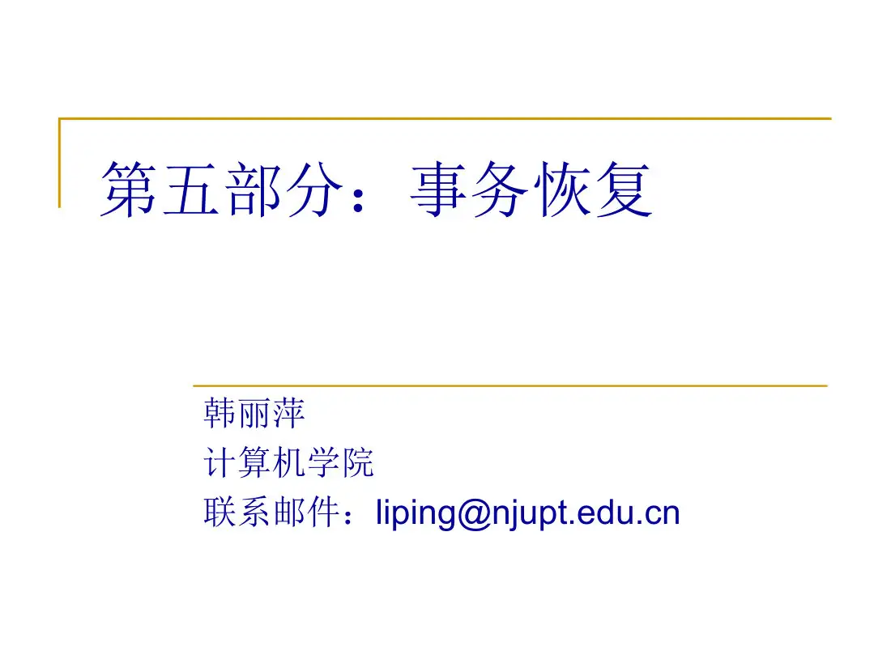

原文：

第五部分：事务恢复

韩丽萍

计算机学院

联系邮件：liping@njupt.edu.cn

### 内容提要

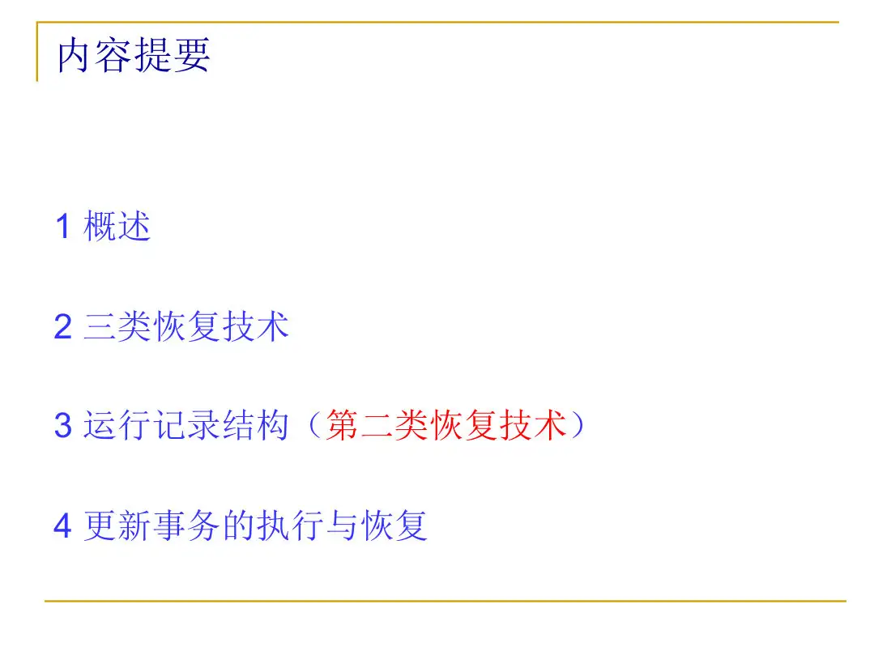

原文：

内容提要
1 概述
2 三类恢复技术
3 运行记录结构（第二类恢复技术）
4 更新事务的执行与恢复

### 概述

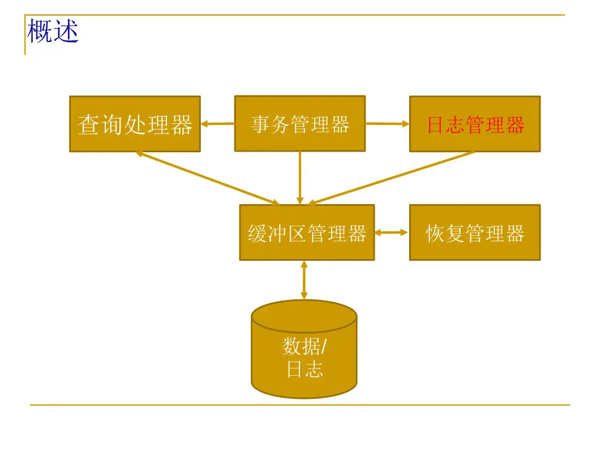

原文：

概述

查询处理器

事务管理器

缓冲区管理器

日志管理器

恢复管理器

数据/日志

### 概述

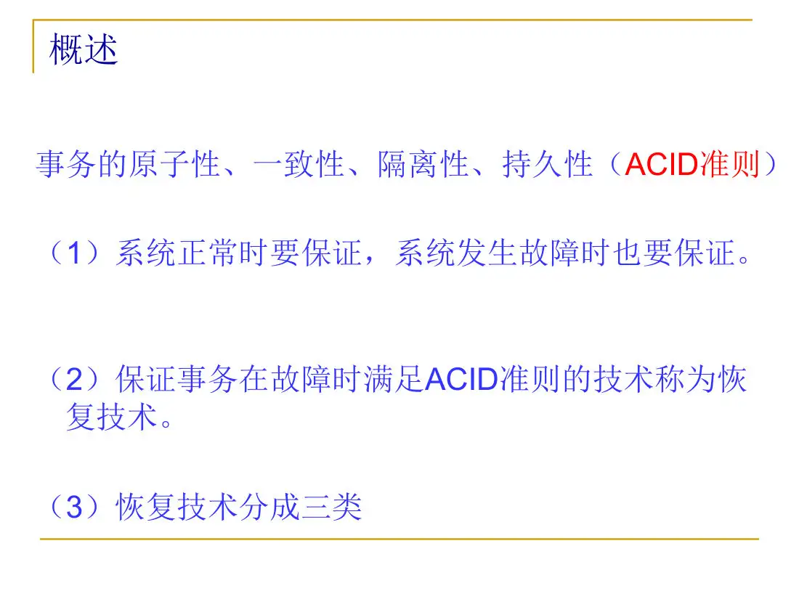

原文：

概述

事务的原子性、一致性、隔离性、持久性（ACID准则）

（1）系统正常时要保证，系统发生故障时也要保证。

（2）保证事务在故障时满足ACID准则的技术称为恢复技术。

（3）恢复技术分成三类

### 三类恢复技术

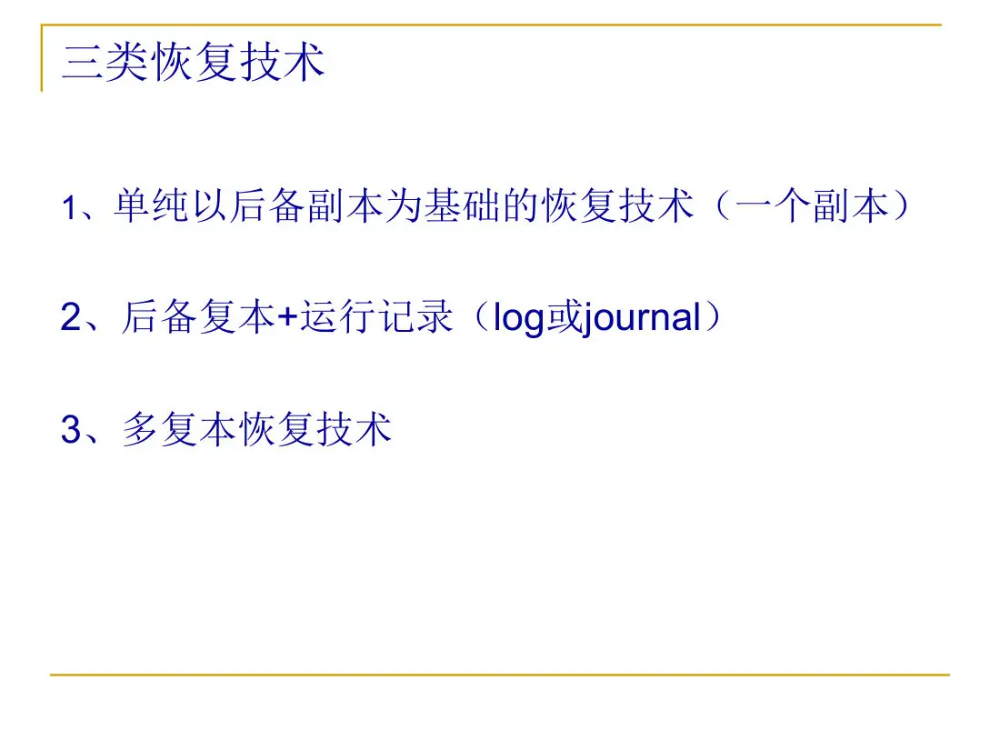

原文：

三类恢复技术

1、单纯以后备副本为基础的恢复技术（一个副本）

2、后备复本+运行记录（log或journal）

3、多复本恢复技术

### 1、单纯以后备副本为基础的恢复技术

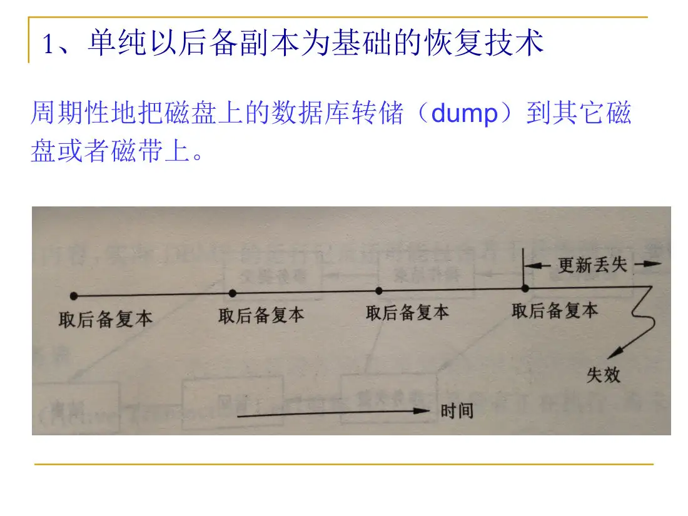

原文：

1、单纯以后备副本为基础的恢复技术

周期性地把磁盘上的数据库转储（dump）到其它磁盘或者磁带上。

### 1、单纯以后备副本为基础的恢复技术

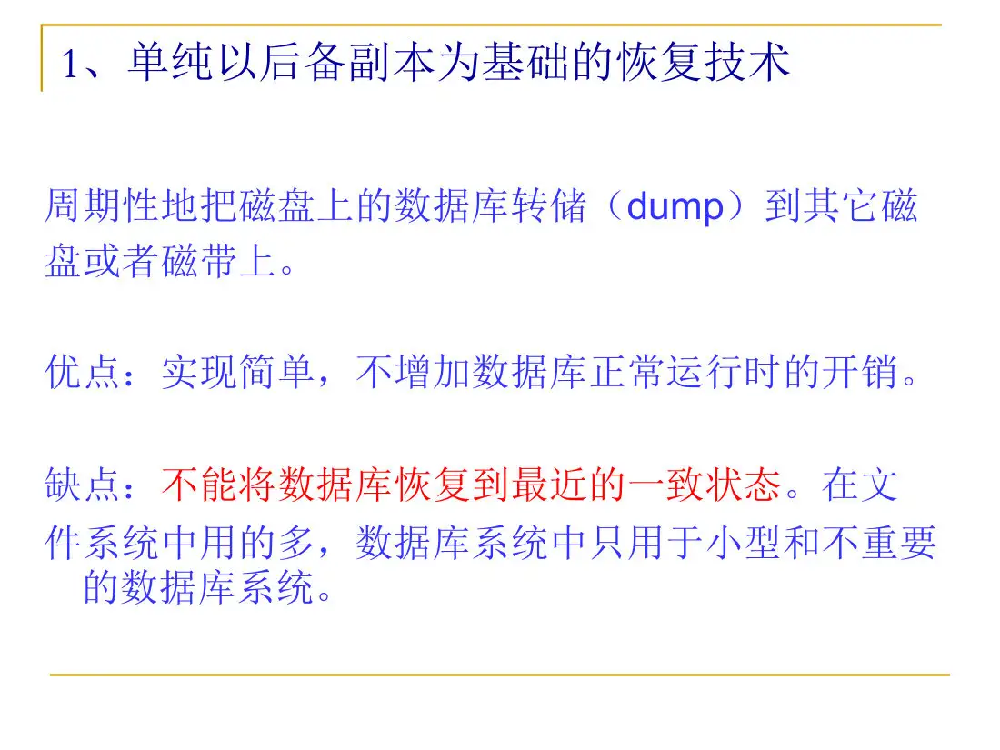

原文：

1、单纯以后备副本为基础的恢复技术

周期性地把磁盘上的数据库转储（dump）到其它磁盘或者磁带上。

优点：实现简单，不增加数据库正常运行时的开销。

缺点：不能将数据库恢复到最近的一致状态。在文件系统中用的多，数据库系统中只用于小型和不重要的数据库系统。

### 2、后备复本+运行记录（log或journal）

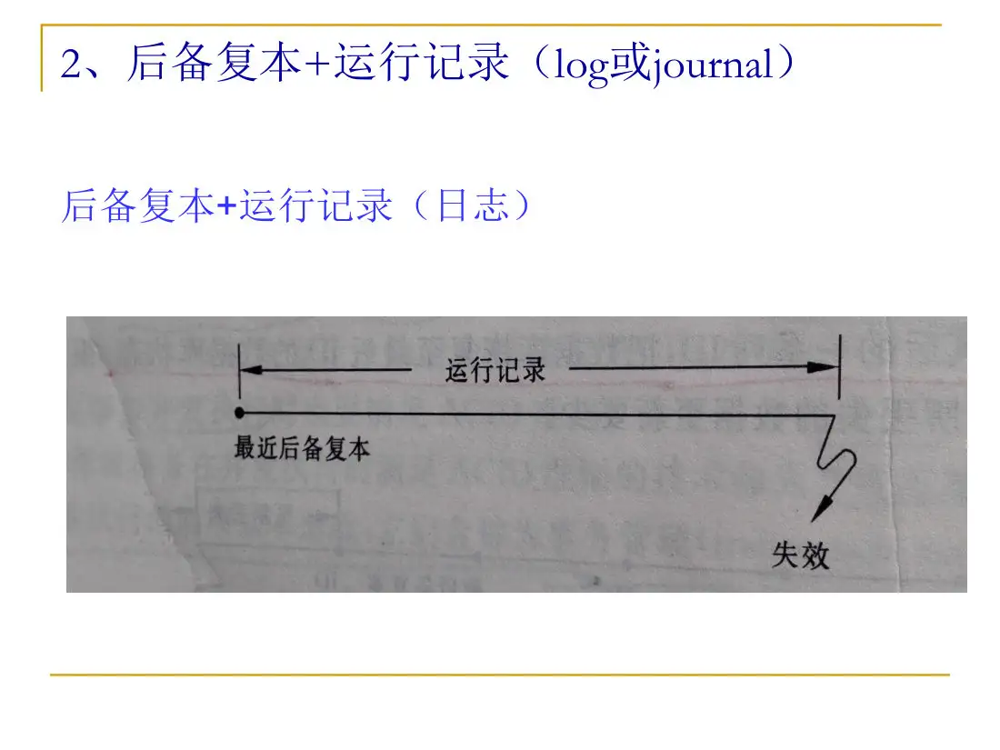

原文：

2、后备复本+运行记录（log或journal）

后备复本+运行记录（日志）

### 2、后备复本+运行记录（log或journal）

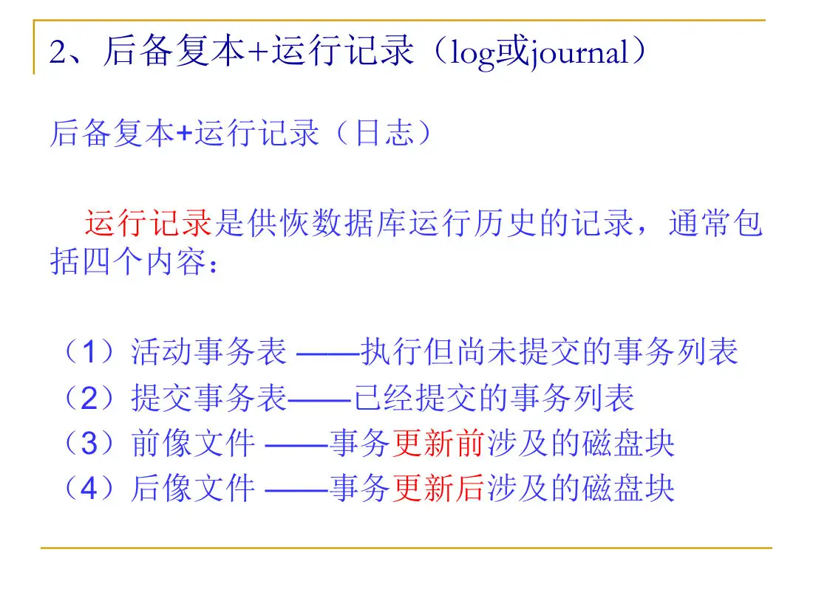

原文：

2、后备复本+运行记录（log或journal）

后备复本+运行记录（日志）

运行记录是供恢数据库运行历史的记录，通常包括四个内容：

（1）活动事务表 ——执行但尚未提交的事务列表

（2）提交事务表——已经提交的事务列表

（3）前像文件 ——事务更新前涉及的磁盘块

（4）后像文件 ——事务更新后涉及的磁盘块

### 2、后备复本+运行记录

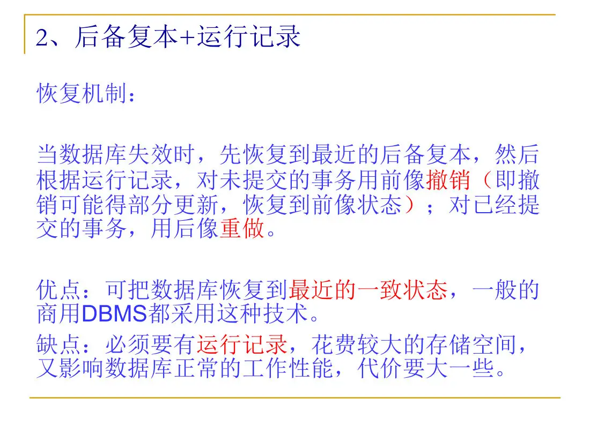

原文：

2、后备复本+运行记录

恢复机制：

当数据库失效时，先恢复到最近的后备复本，然后根据运行记录，对未提交的事务用前像撤销（即撤销可能得部分更新，恢复到前像状态）；对已经提交的事务，用后像重做。

优点：可把数据库恢复到最近的一致状态，一般的商用DBMS都采用这种技术。

缺点：必须要有运行记录，花费较大的存储空间，又影响数据库正常的工作性能，代价要大一些。

### 3、多复本恢复技术

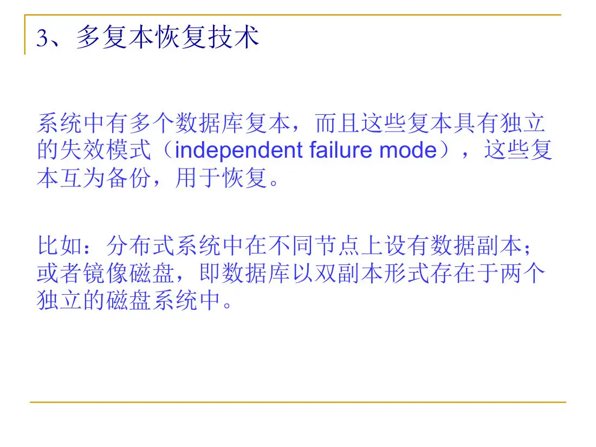

原文：

3、多复本恢复技术

系统中有多个数据库复本，而且这些复本具有独立的失效模式（independent failure mode），这些复本互为备份，用于恢复。

比如：分布式系统中在不同节点上设有数据副本；或者镜像磁盘，即数据库以双副本形式存在于两个独立的磁盘系统中。

### 后备复本+运行记录（log或journal）

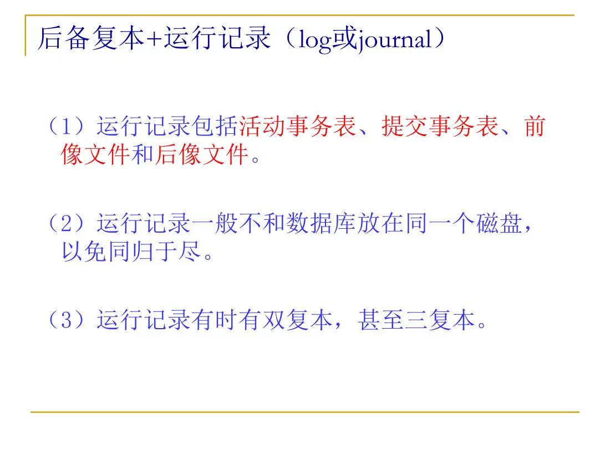

原文：

后备复本+运行记录（log或journal）

（1）运行记录包括活动事务表、提交事务表、前像文件和后像文件。

（2）运行记录一般不和数据库放在同一个磁盘，以免同归于尽。

（3）运行记录有时有双复本，甚至三复本。

### 后备复本+运行记录（log或journal）

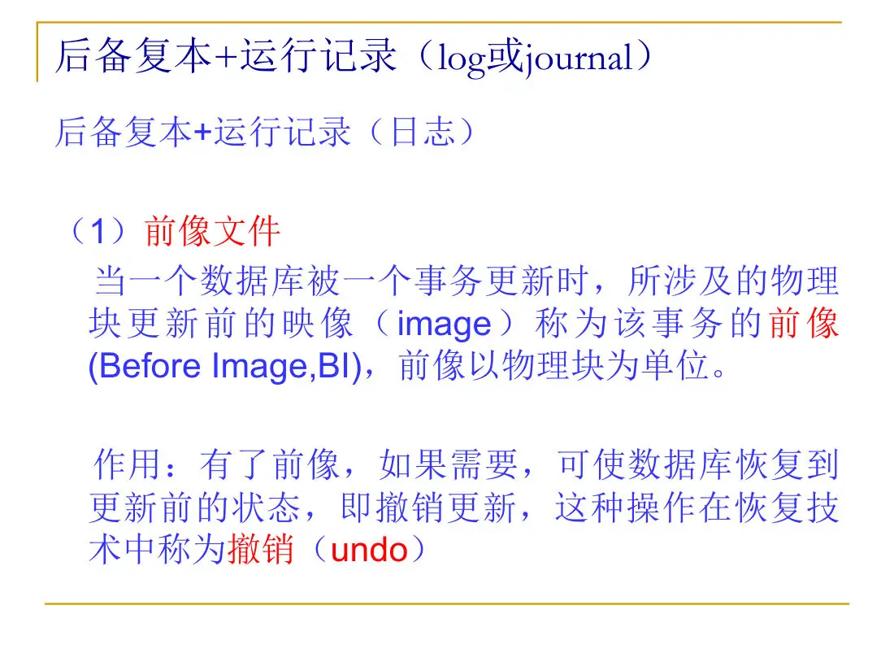

原文：

后备复本+运行记录（log或journal）

后备复本+运行记录（日志）

（1）前像文件

当一个数据库被一个事务更新时，所涉及的物理块更新前的映像（image）称为该事务的前像(Before Image,BI)，前像以物理块为单位。

作用：有了前像，如果需要，可使数据库恢复到更新前的状态，即撤销更新，这种操作在恢复技术中称为撤销（undo）

### 后备复本+运行记录（log或journal）

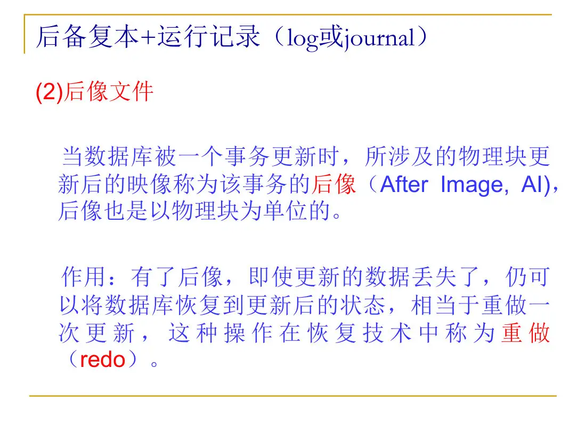

原文：

后备复本+运行记录（log或journal）

(2)后像文件

当数据库被一个事务更新时，所涉及的物理块更新后的映像称为该事务的后像（After Image, AI)，后像也是以物理块为单位的。

作用：有了后像，即使更新的数据丢失了，仍可以将数据库恢复到更新后的状态，相当于重做一次更新，这种操作在恢复技术中称为重做（redo）。

### 后备复本+运行记录

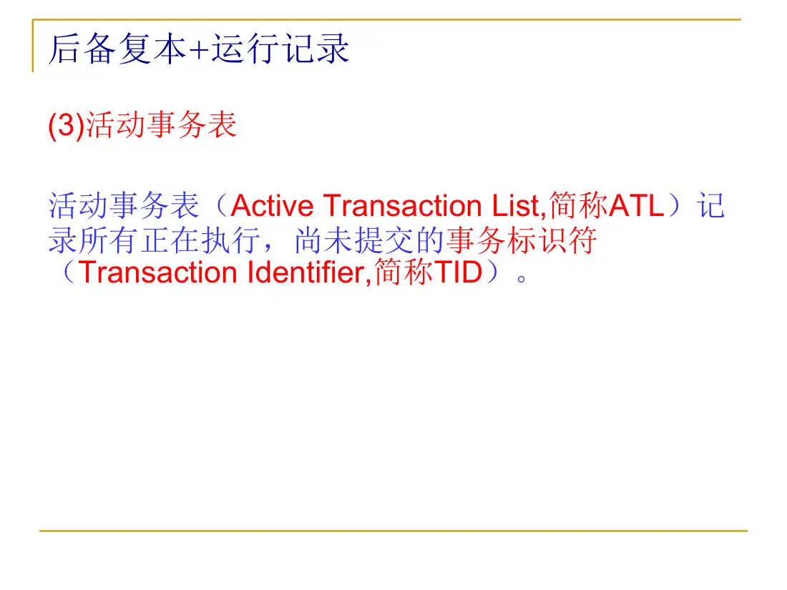

原文：

后备复本+运行记录

(3)活动事务表

活动事务表（Active Transaction List,简称ATL）记录所有正在执行，尚未提交的事务标识符（Transaction Identifier,简称TID）。

### 后备复本+运行记录

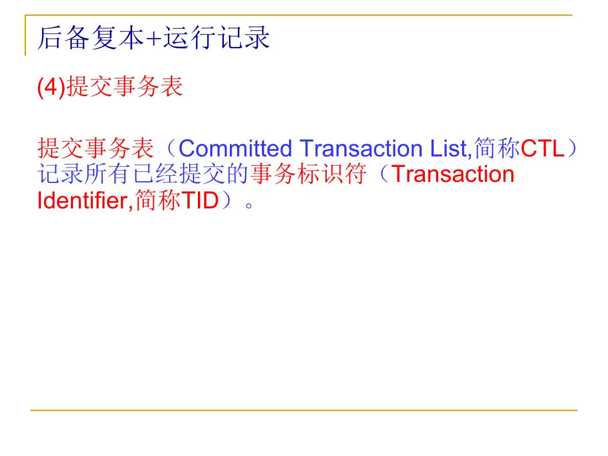

原文：

后备复本+运行记录

(4)提交事务表

提交事务表（Committed Transaction List,简称CTL）记录所有已经提交的事务标识符（TransactionIdentifier,简称TID）。

### 1、提交事务表和活动事务表维护注意事项

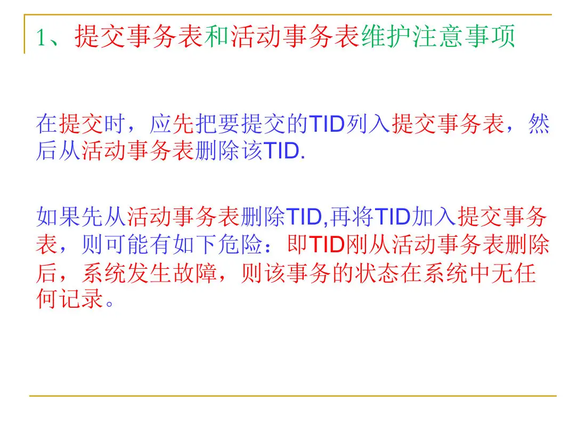

原文：

1、提交事务表和活动事务表维护注意事项

在提交时，应先把要提交的TID列入提交事务表，然后从活动事务表删除该TID.

如果先从活动事务表删除TID,再将TID加入提交事务表，则可能有如下危险：即TID刚从活动事务表删除后，系统发生故障，则该事务的状态在系统中无任何记录。

### 2、前像文件

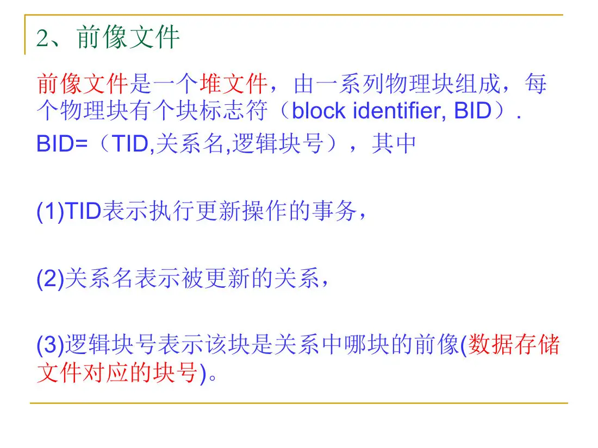

原文：

2、前像文件

前像文件是一个堆文件，由一系列物理块组成，每个物理块有个块标志符（block identifier, BID）.BID=（TID,关系名,逻辑块号），其中

(1)TID表示执行更新操作的事务，

(2)关系名表示被更新的关系，

(3)逻辑块号表示该块是关系中哪块的前像(数据存储文件对应的块号)。

### 2、前像文件

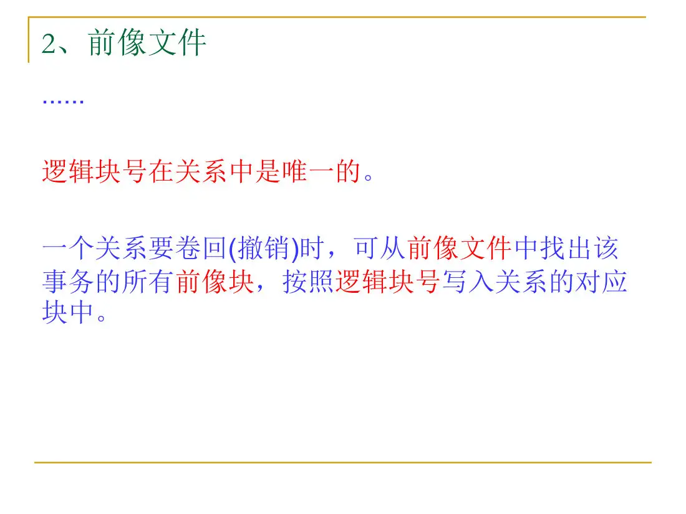

原文：

2、前像文件

逻辑块号在关系中是唯一的。

一个关系要卷回(撤销)时，可从前像文件中找出该事务的所有前像块，按照逻辑块号写入关系的对应块中。

### 2、 前像文件

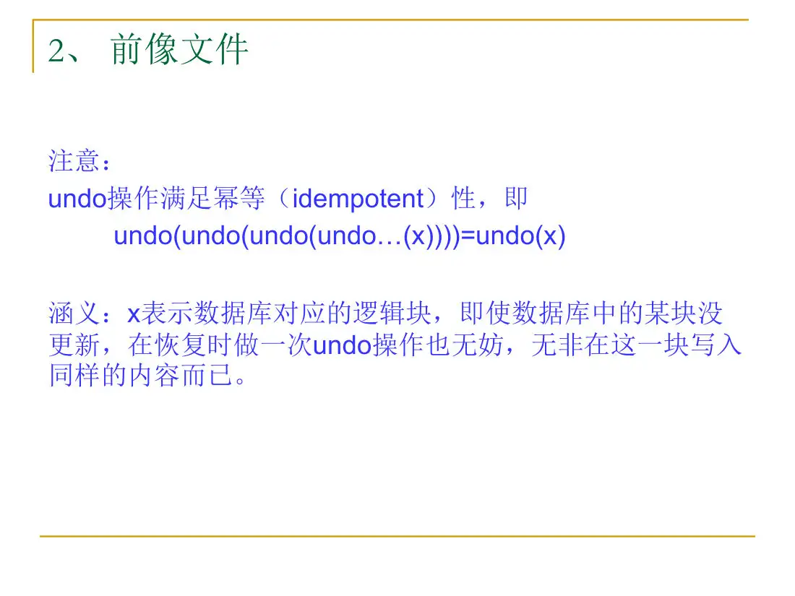

原文：

2、 前像文件

注意：

undo操作满足幂等（idempotent）性，即 undo(undo(undo(undo…(x))))=undo(x)

涵义：x表示数据库对应的逻辑块，即使数据库中的某块没更新，在恢复时做一次undo操作也无妨，无非在这一块写入同样的内容而已。

### 3 、后像文件

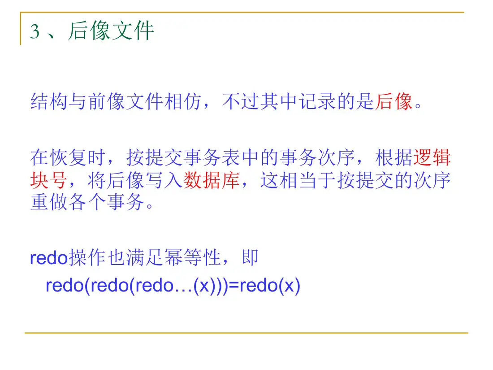

原文：

3 、后像文件

结构与前像文件相仿，不过其中记录的是后像。

在恢复时，按提交事务表中的事务次序，根据逻辑块号，将后像写入数据库，这相当于按提交的次序重做各个事务。

redo操作也满足幂等性，即

$$
\operatorname{redo} (\operatorname{redo} (\operatorname{redo} \dots (x))) = \operatorname{redo} (x)
$$

### 运行记录是累计的，很浪费存储空间，数据量大时，运行记录是可观的，可以采取如下措施

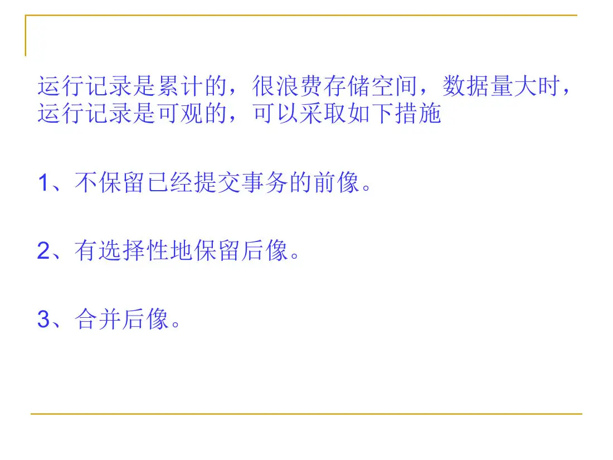

原文：

运行记录是累计的，很浪费存储空间，数据量大时，运行记录是可观的，可以采取如下措施

1、不保留已经提交事务的前像。

2、有选择性地保留后像。

3、合并后像。

### 运行记录是累计的，很浪费存储空间，对大数据库，运行记录是可观的，可以采取如下措施

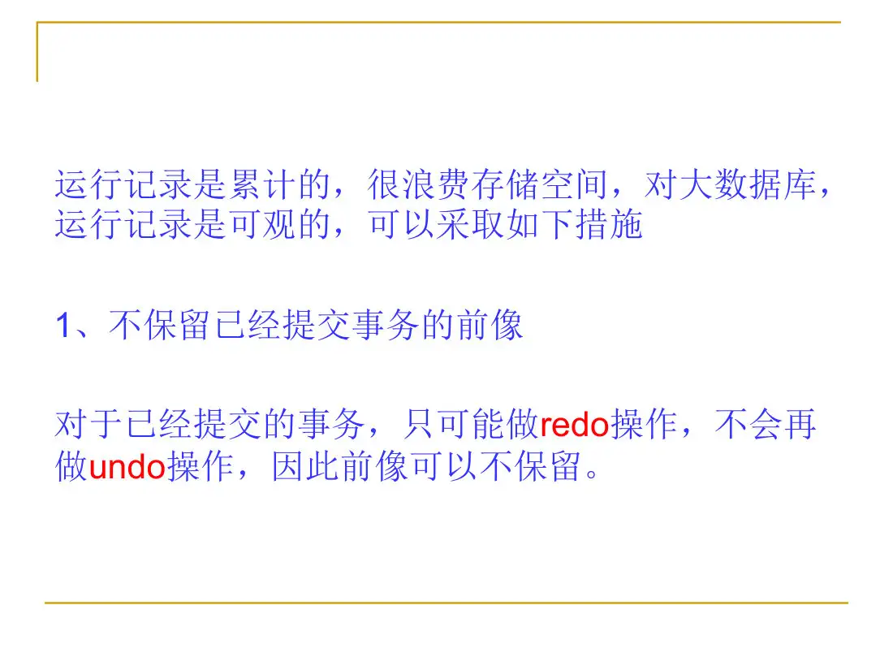

原文：

运行记录是累计的，很浪费存储空间，对大数据库，运行记录是可观的，可以采取如下措施

1、不保留已经提交事务的前像

对于已经提交的事务，只可能做redo操作，不会再做undo操作，因此前像可以不保留。

### 2、有选择性地保留后像

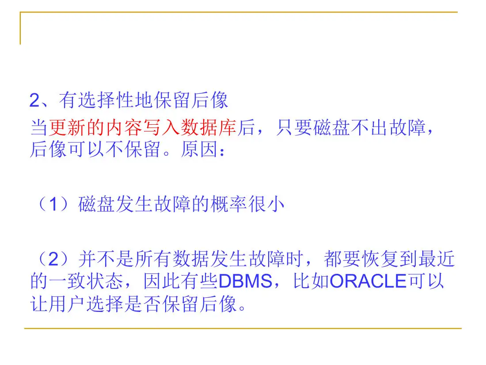

原文：

2、有选择性地保留后像

当更新的内容写入数据库后，只要磁盘不出故障，后像可以不保留。原因：

（1）磁盘发生故障的概率很小

（2）并不是所有数据发生故障时，都要恢复到最近的一致状态，因此有些DBMS，比如ORACLE可以让用户选择是否保留后像。

### 3、合并后像

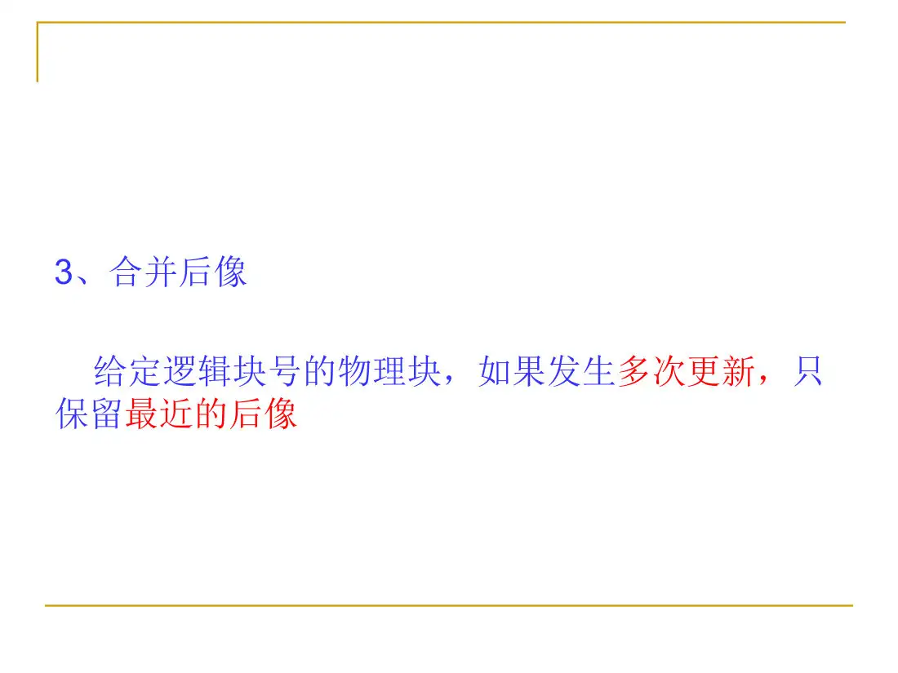

原文：

3、合并后像

给定逻辑块号的物理块，如果发生多次更新，只保留最近的后像

### 更新事务的执行与恢复（重点）

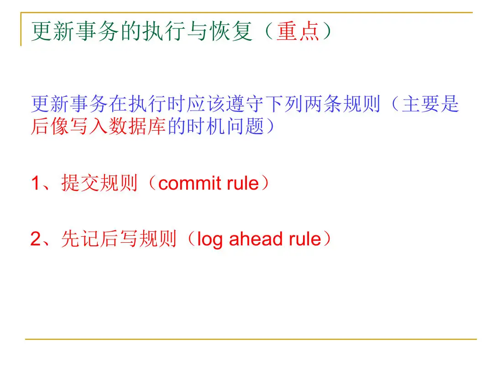

原文：

更新事务的执行与恢复（重点）

更新事务在执行时应该遵守下列两条规则（主要是后像写入数据库的时机问题）

1、提交规则（commit rule）

2、先记后写规则（log ahead rule）

### 备注：事务提交标识（TID）

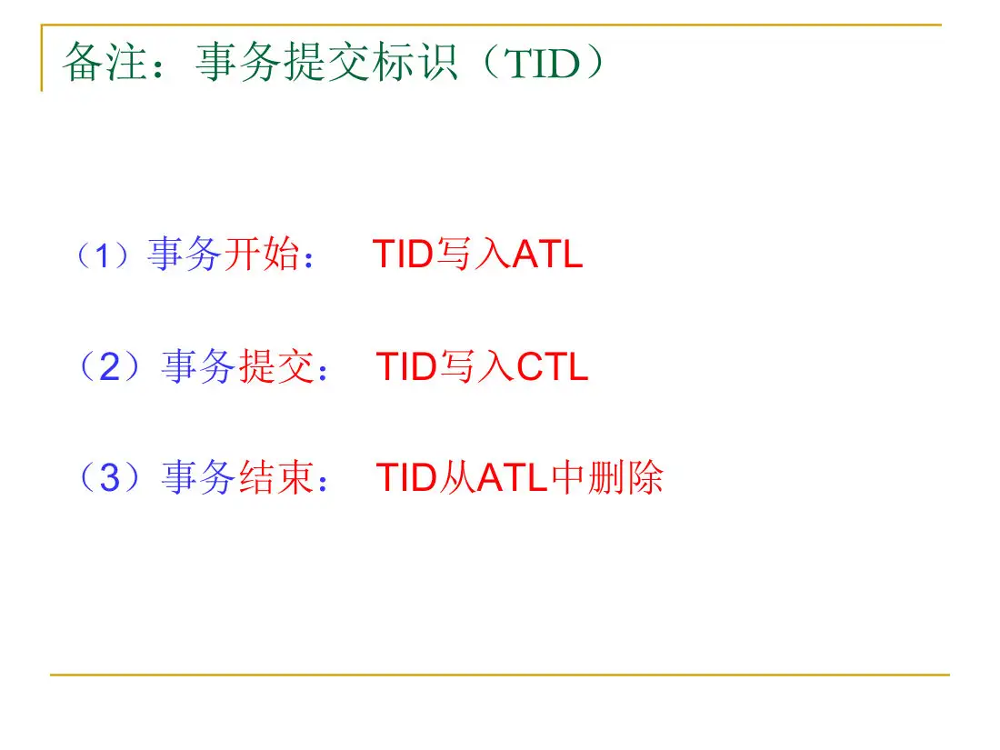

原文：

备注：事务提交标识（TID）

（1）事务开始： TID写入ATL

（2）事务提交： TID写入CTL

（3）事务结束： TID从ATL中删除

### 1、提交规则（commit rule）

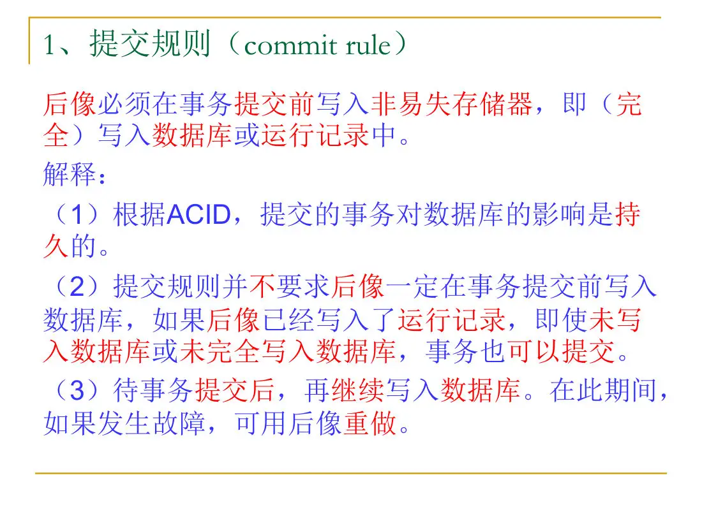

原文：

1、提交规则（commit rule）

后像必须在事务提交前写入非易失存储器，即（完全）写入数据库或运行记录中。

解释：

（1）根据ACID，提交的事务对数据库的影响是持久的。

（2）提交规则并不要求后像一定在事务提交前写入数据库，如果后像已经写入了运行记录，即使未写入数据库或未完全写入数据库，事务也可以提交。

（3）待事务提交后，再继续写入数据库。在此期间，如果发生故障，可用后像重做。

### 2、先记后写规则（log ahead rule）

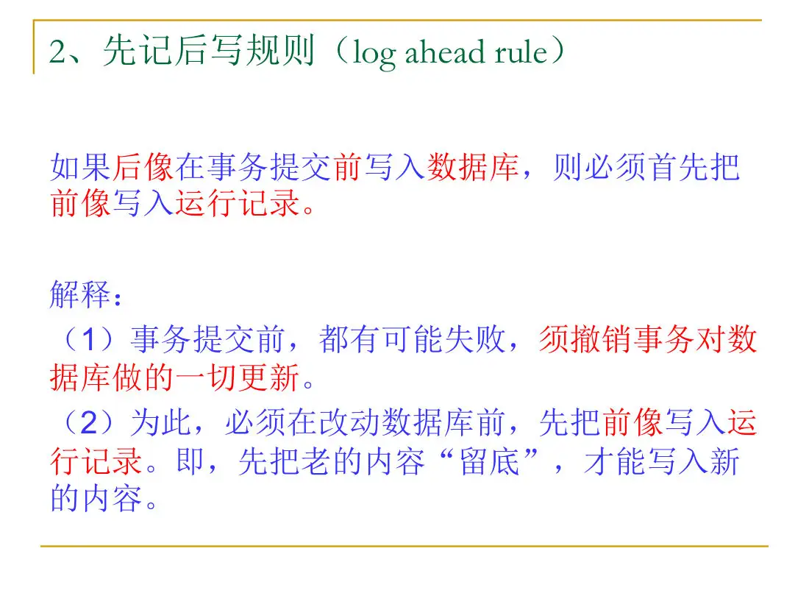

原文：

2、先记后写规则（log ahead rule）

如果后像在事务提交前写入数据库，则必须首先把前像写入运行记录。

解释：

（1）事务提交前，都有可能失败，须撤销事务对数据库做的一切更新。

（2）为此，必须在改动数据库前，先把前像写入运行记录。即，先把老的内容“留底”，才能写入新的内容。

### 事务更新的三种方案

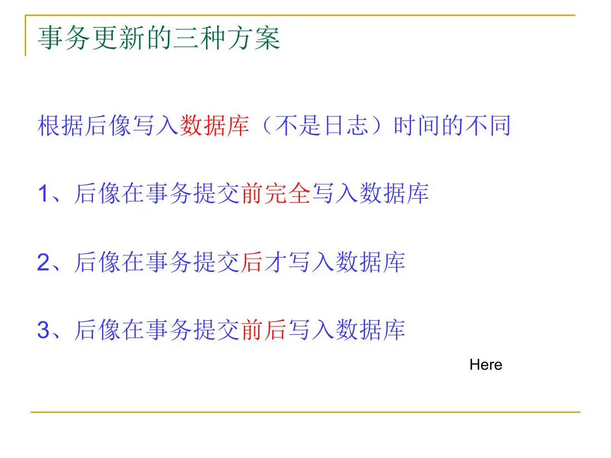

原文：

事务更新的三种方案
根据后像写入数据库（不是日志）时间的不同
1、后像在事务提交前完全写入数据库
2、后像在事务提交后才写入数据库
3、后像在事务提交前后写入数据库
Here

### 第 31 页

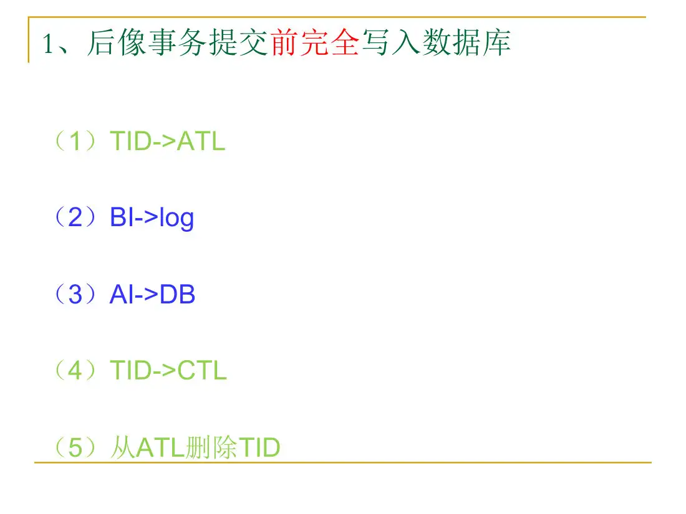

原文：

1、后像事务提交前完全写入数据库（1） ${ \top } { \bf D } {  } { \sf A T I }$ （2）BI->log（3） $\mathsf { A l } \mathsf { - } \mathsf { > } \mathsf { D } \mathsf { B }$ （4）TID->CTL（5）从ATL删除TID

### 1、后像事务提交前完全写入DB(恢复措施)

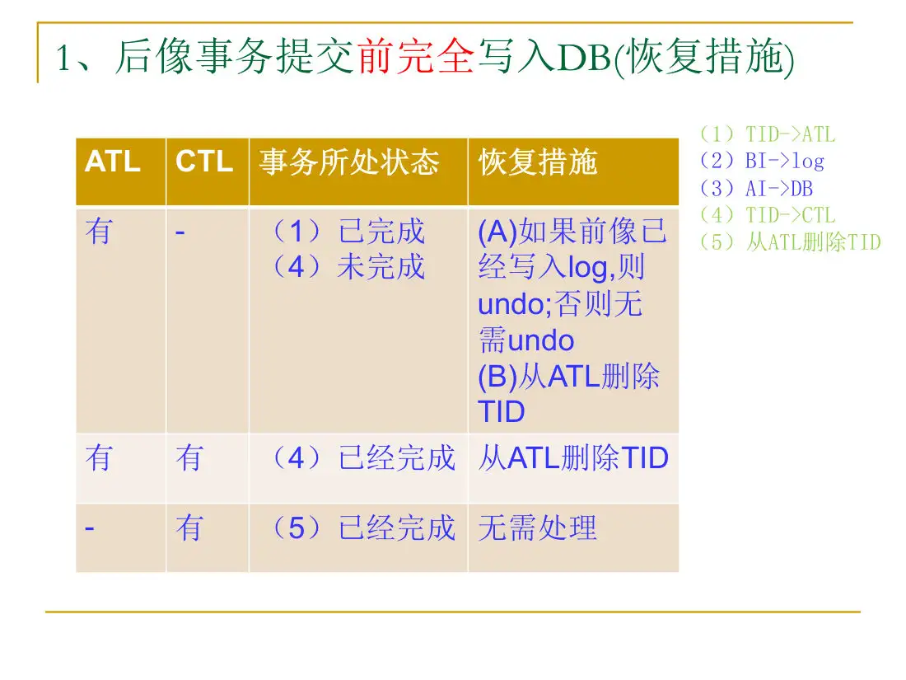

原文：

1、后像事务提交前完全写入DB(恢复措施)

<table><tr><td>ATL</td><td>CTL</td><td>事务所处状态</td><td>恢复措施</td></tr><tr><td>有</td><td>-</td><td>(1) 已完成(4) 未完成</td><td>(A)如果前像已经写入log,则undo;否则无需undo(B)从ATL删除TID</td></tr><tr><td>有</td><td>有</td><td>(4) 已经完成</td><td>从ATL删除TID</td></tr><tr><td>-</td><td>有</td><td>(5) 已经完成</td><td>无需处理</td></tr></table>

（1）TID->ATL （2）BI->log （3）AI->DB （4）TID->CTL （5）从ATL删除TID

### 第 33 页

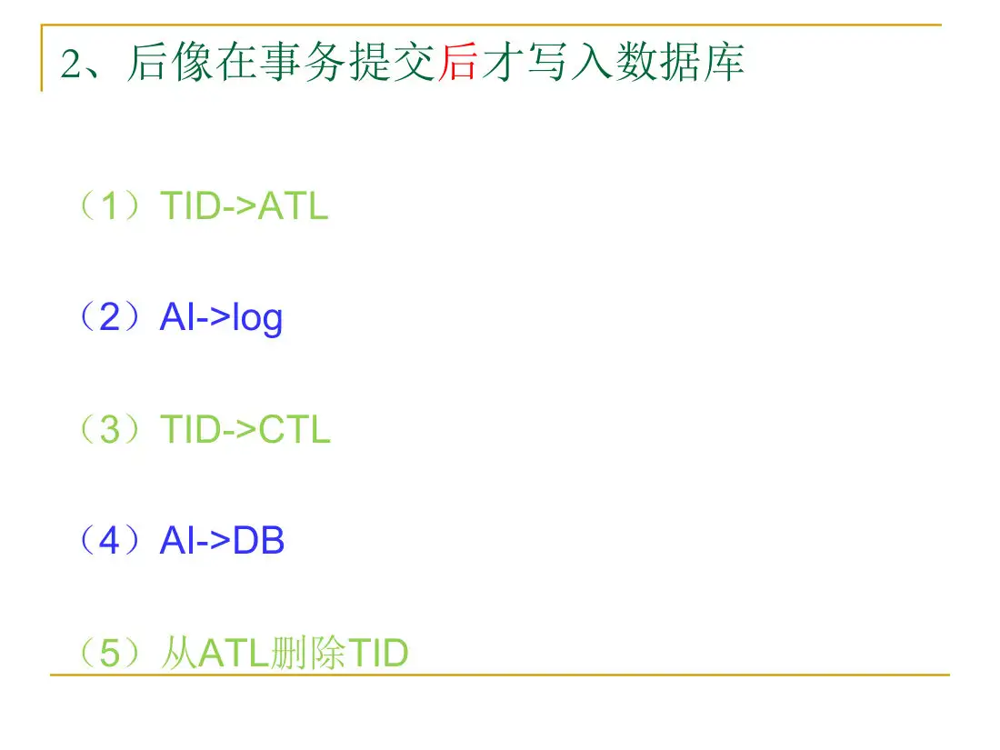

原文：

2、后像在事务提交后才写入数据库（1） ${ \top } { \bf D } {  } { \sf A T I }$ （2） $\mathsf { A l - } { \mathsf { > } } | \mathsf { o g }$ （3）TID->CTL（4） $\mathsf { A l } \mathsf { - } \mathsf { > } \mathsf { D } \mathsf { B }$ （5）从ATL删除TID

### 2、后像事务提交后才写入数据库（恢复措施）

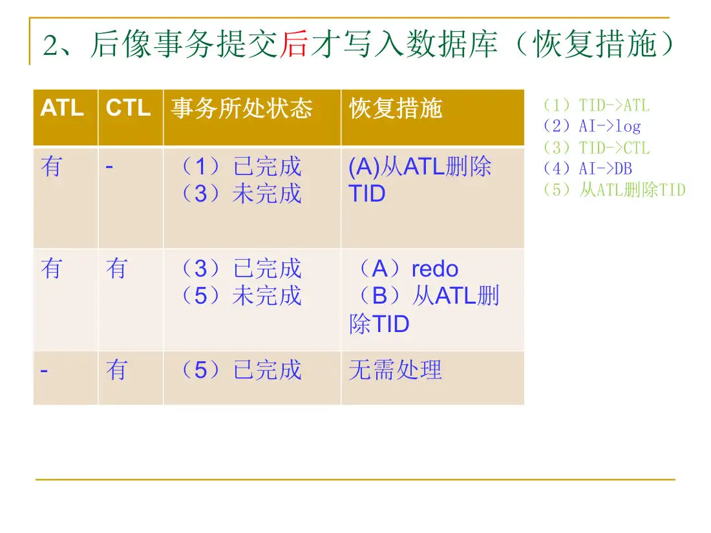

原文：

2、后像事务提交后才写入数据库（恢复措施）

<table><tr><td>ATL</td><td>CTL</td><td>事务所处状态</td><td>恢复措施</td></tr><tr><td>有</td><td>-</td><td>(1) 已完成(3) 未完成</td><td>(A)从ATL删除TID</td></tr><tr><td>有</td><td>有</td><td>(3) 已完成(5) 未完成</td><td>(A) redo(B) 从ATL删除TID</td></tr><tr><td>-</td><td>有</td><td>(5) 已完成</td><td>无需处理</td></tr></table>

（1）TID->ATL （2）AI->log （3）TID->CTL （4）AI->DB （5）从ATL删除TID

### 第 35 页

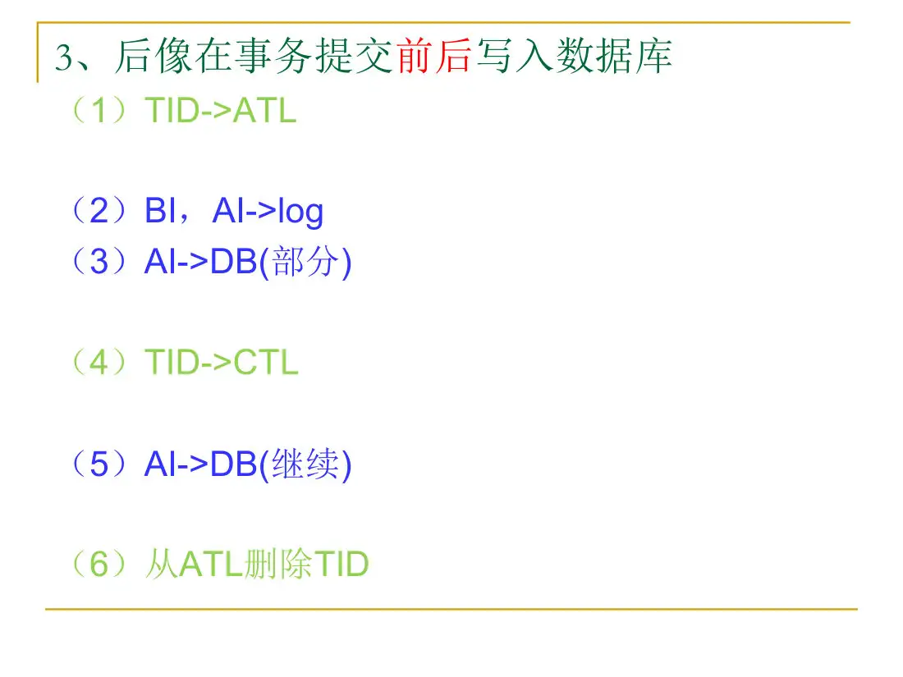

原文：

3、后像在事务提交前后写入数据库（1）TID->ATL（2）BI，AI->log（3）AI->DB(部分)（4）TID->CTL（5）AI->DB(继续)（6）从ATL删除TID

### 3、后像在事务提交前后写入数据库（恢复）

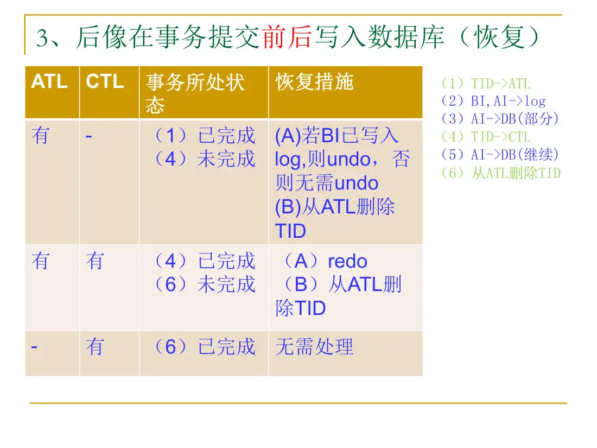

原文：

3、后像在事务提交前后写入数据库（恢复）

<table><tr><td>ATL</td><td>CTL</td><td>事务所处状态</td><td>恢复措施</td></tr><tr><td>有</td><td>-</td><td>(1) 已完成(4) 未完成</td><td>(A)若BI已写入log,则undo,否则无需undo(B)从ATL删除TID</td></tr><tr><td>有</td><td>有</td><td>(4) 已完成(6) 未完成</td><td>(A) redo(B) 从ATL删除TID</td></tr><tr><td>-</td><td>有</td><td>(6) 已完成</td><td>无需处理</td></tr></table>

（1）TID->ATL

（2）BI,AI->log

（3）AI->DB(部分)

（4）TID->CTL

（5）AI->DB(继续)

（6）从ATL删除TID

### 三种方案的优缺点

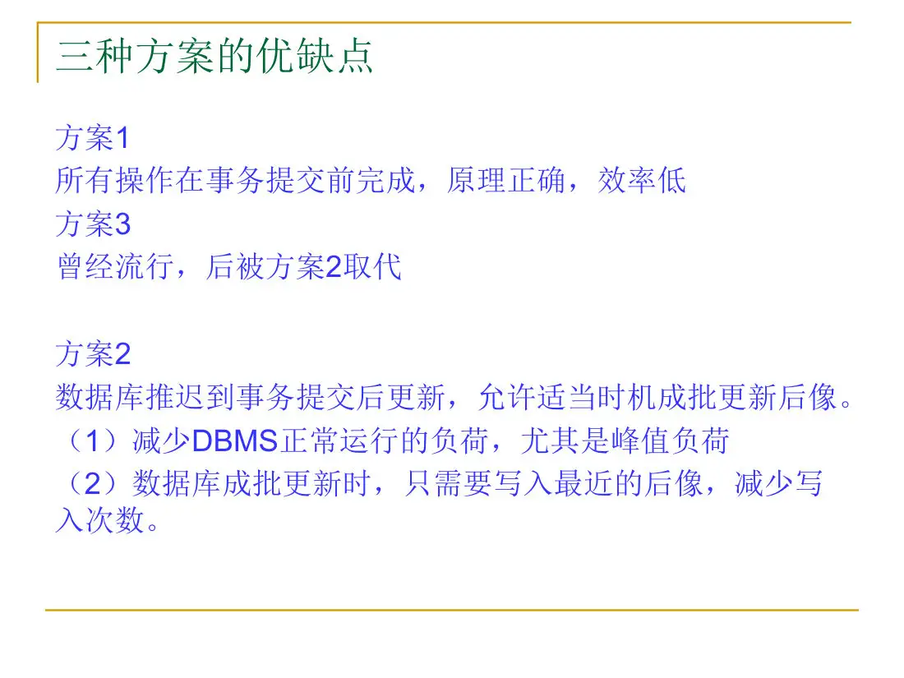

原文：

三种方案的优缺点

方案1

所有操作在事务提交前完成，原理正确，效率低

方案3

曾经流行，后被方案2取代

方案2

数据库推迟到事务提交后更新，允许适当时机成批更新后像。

（1）减少DBMS正常运行的负荷，尤其是峰值负荷

（2）数据库成批更新时，只需要写入最近的后像，减少写入次数。

### 本章参考资料

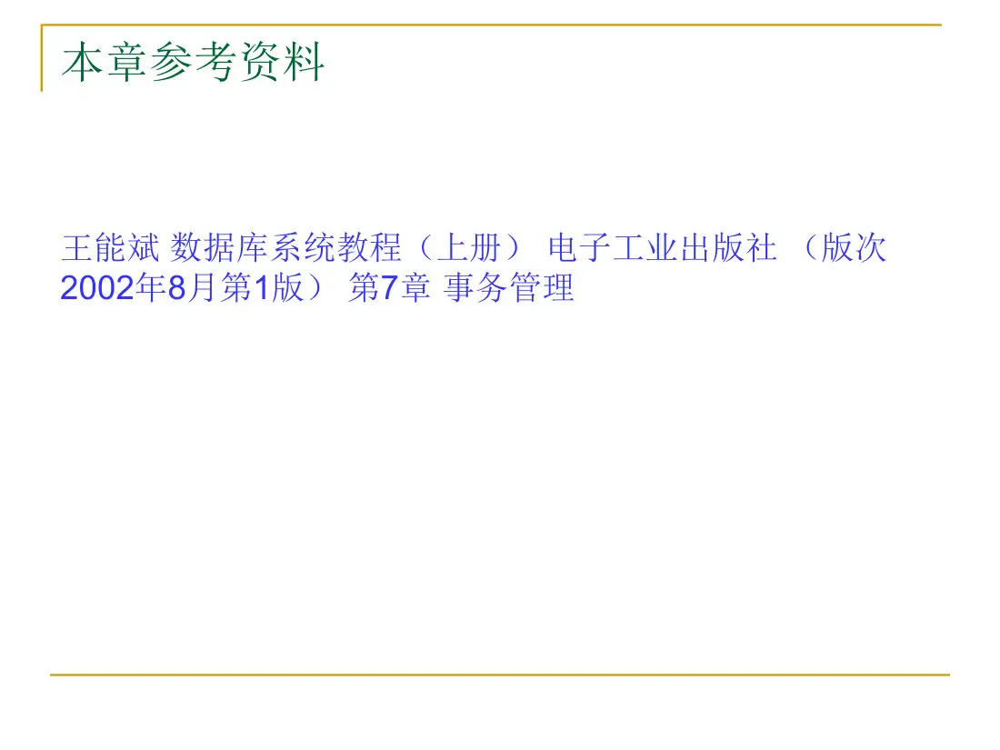

原文：

本章参考资料

王能斌 数据库系统教程（上册） 电子工业出版社 （版次2002年8月第1版） 第7章 事务管理

### 相关材料

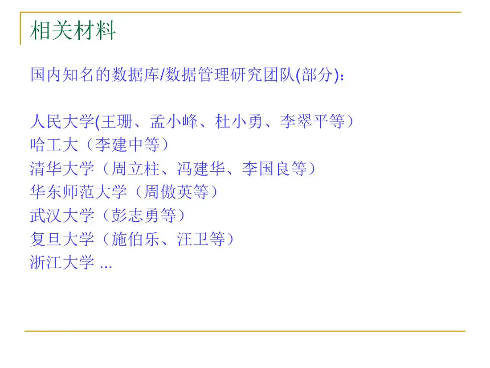

原文：

相关材料

国内知名的数据库/数据管理研究团队(部分)：

人民大学(王珊、孟小峰、杜小勇、李翠平等）

哈工大（李建中等）

清华大学（周立柱、冯建华、李国良等）

华东师范大学（周傲英等）

武汉大学（彭志勇等）

复旦大学（施伯乐、汪卫等）

浙江大学 ...
