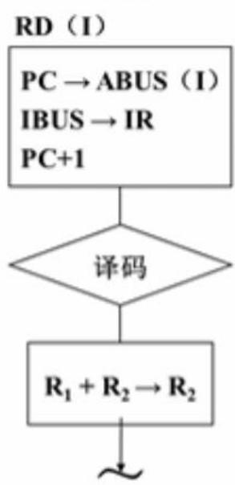

# 2024—2025 学年第一学期《计算机系统基础 II》期末试卷（A卷）

原件经识别和整理；“参考解答”是我们补的。

# 2024—2025 学年第一学期《计算机系统基础 II》期末试卷（A卷）

## 一、单项选择题（每题 2 分，共 20 分）

### 选择 1

设计某指令系统时，假设采用 16 位定长指令字格式，操作码使用扩展编码方式，地址码为 6 位，包含零地址、一地址和二地址 3 种格式的指令。若二地址指令有 12 条，一地址指令有 254 条，则零地址指令的条数最多为（）条。

- A. 0
- B. 2
- C. 64
- D. 128

知识点：[Y86-64 指令集架构（ISA）定义](../../../topics/计算机系统基础/Y86-64指令集.md)

### 选择 2

在下列因素中，和 Cache 命中率无关的是（）。

- A. Cache 的大小
- B. Cache 的容量
- C. 主存的存取速度
- D. Cache 的映射方式

知识点：[Cache 命中与缺失分析（读写过程、替换策略）](../../../topics/计算机系统基础/Cache命中与缺失.md)、[Cache 组织结构（组相联、直接映射、全相联，S/E/B/m/t/s/b）](../../../topics/计算机系统基础/Cache组织结构.md)

### 选择 3

以下给出的选项中，不会引起从用户态陷入内核态的是（）。

- A. 执行指令过程中发生缺页
- B. DMA 传送完成
- C. 执行指令过程中发生 cache 缺失
- D. 按下 `Ctrl+C` 键

答案：C。

知识点：[异常控制流机制（异常、陷阱、中断、故障、终止）](../../../topics/计算机系统基础/异常控制流机制.md)、[计算机系统的层次结构与抽象](../../../topics/计算机系统基础/系统层次结构.md)、[Cache 命中与缺失分析（读写过程、替换策略）](../../../topics/计算机系统基础/Cache命中与缺失.md)

### 选择 4

以下关于 I/O 子系统的描述中，错误的是（）。

- A. I/O 子系统包含 I/O 软件和 I/O 硬件两大部分。
- B. I/O 软件包含用户空间 I/O 软件部分和内核空间 I/O 软件部分。
- C. 内核空间 I/O 软件包含设备无关软件、设备驱动程序和中断服务程序。
- D. 直接控制 I/O 硬件的是设备驱动程序，而不是中断服务程序。

答案：D。

知识点：[计算机系统的层次结构与抽象](../../../topics/计算机系统基础/系统层次结构.md)

### 选择 5

某计算机的控制器采用微程序控制方式，微指令中的操作控制字段采用字段直接编码法，共有 30 个微命令，构成 4 个互斥类，分别包含 7、3、12 和 8 个微命令，则操作控制字段至少有几位？

- A. 11
- B. 12
- C. 13
- D. 14

答案：B。

知识点：[计算机系统的层次结构与抽象](../../../topics/计算机系统基础/系统层次结构.md)

### 选择 6

在下列选项中，能引起中断的事件是（）

- A. 键盘输入
- B. 除数为 0
- C. 访存缺页
- D. 系统调用

答案：A, B, C, D。（注：题目通常为单选，但根据定义，外部事件如键盘输入、内部异常如除零、缺页以及软中断如系统调用均可引起中断或异常处理，若必须单选通常指外部中断源或特定上下文，此处列出所有可能项。）

知识点：[异常控制流机制（异常、陷阱、中断、故障、终止）](../../../topics/计算机系统基础/异常控制流机制.md)

### 选择 7

下列有关数据通路的叙述中，错误的是 ( )。

- A. 数据通路由若干组合逻辑和时序逻辑元件连接而成。
- B. 数据通路的功能由控制部件送出的控制信号决定。
- C. ALU 属于操作元件，用于执行各类算术/逻辑运算。
- D. 通用寄存器属于状态元件，但不包含在数据通路中。

答案：D。

知识点：[SEQ 顺序处理器实现（取指、译码、执行、访存、写回、更新PC）](../../../topics/计算机系统基础/SEQ顺序实现.md)

### 选择 8

设指令流水线由取指、分析和执行 3 个阶段组成，每个阶段完成时间为 50ps，150ps，200ps，则该流水线的吞吐量为（）。

- A. 2.5 GIPS
- B. 4 GIPS
- C. 5 GIPS
- D. 20 GIPS

答案：C。
计算过程：流水线周期 $\Delta t = \max(50, 150, 200) = 200\text{ps}$。吞吐量 $TP = 1/\Delta t = 1/(200 \times 10^{-12}) = 5 \times 10^9 \text{IPS} = 5 \text{GIPS}$。

知识点：[PIPE 流水线处理器实现（流水线寄存器与阶段划分）](../../../topics/计算机系统基础/PIPE流水线实现.md)

### 选择 9

某 CPU 访问存储器与访问 I/O 端口的指令相同，则存储器和 I/O 端口（）

- A. 地址编码可能重叠
- B. 地址编码一定互斥
- C. 地址空间一定重叠
- D. 寻址的地址线不同

答案：A。

知识点：[计算机系统的层次结构与抽象](../../../topics/计算机系统基础/系统层次结构.md)

### 选择 10

对于下面这个函数，说法正确的是（）。

```c
int func(int x) {
    int y = 0;
    while (x > 0) {
        if (x % 2 == 1) y++;
        x /= 2;
    }
    return y;
}
```

*(注：原题此处图片缺失或文本未完整显示，根据常见考点推测考察二进制中 1 的个数)*

## 二、分析题（每题 5 分，共 20 分）

知识点：[算术与逻辑指令（add、sub、imul、sal、sar、xor等及对条件码的影响）](../../../topics/计算机系统基础/算术与逻辑指令.md)、[控制流指令（cmp、test、jmp、jxx、setxx）](../../../topics/计算机系统基础/控制流指令.md)、[高级语言程序转换为机器代码的过程（预处理、编译、汇编、链接）](../../../topics/计算机系统基础/高级语言转机器代码过程.md)

### 分析 1

简述 SRAM 和 DRAM 存储芯片的三个不同特点，并分别写出存储容量为 16K×32 位的 SRAM 芯片和 DRAM 芯片的地址引脚数。

知识点：[计算机系统的层次结构与抽象](../../../topics/计算机系统基础/系统层次结构.md)

### 分析 2

（1）从原理、执行速度和灵活性三个方面分析硬布线控制器和微程序控制器的区别。

（2）简述下面的微程序流程图完成每步具体操作。



知识点：[计算机系统的层次结构与抽象](../../../topics/计算机系统基础/系统层次结构.md)

### 分析 3

在采用取指、译码、执行、访存、写回 5 段流水线的处理器上执行下列指令序列：

（1）流水线的数据相关分为哪两类？上面指令序列发生哪类相关？

（2）若控制在时钟的前半周期写寄存器堆，后半周期读寄存器堆，不采用转发技术，需要在第 3 条指令前加入多少条 nop 指令才能使这段程序不发生冒险？

（3）若采用转发技术，则需要在第 3 条指令前加入多少条 nop 指令才能使这段程序不发生冒险？在转发的同时还需要结合什么技术解决这个冒险？

知识点：[流水线冒险（数据冒险与控制冒险）及转发机制](../../../topics/计算机系统基础/流水线冒险.md)、[PIPE 流水线处理器实现（流水线寄存器与阶段划分）](../../../topics/计算机系统基础/PIPE流水线实现.md)、[数据传送指令（mov、movs、movz及扩展）](../../../topics/计算机系统基础/数据传送指令.md)

### 分析 4

printf 语句用于实现从屏幕上显示一个字符串信息。简述计算机系统如何实现 printf 的功能？（包括对应哪个系统调用、如何从用户态陷入内核态、内核的大致处理过程等）。

## 三、应用题（50 分）

知识点：[计算机系统的层次结构与抽象](../../../topics/计算机系统基础/系统层次结构.md)

### 1.（10 分）

某机器存储器容量为 64K×16 位，一种单地址指令格式如下所示，其中 I 为间接特征（I=1 间接寻址），M 为寻址模式，A 为形式地址，X 为变址寻址特征（X=1 变址），立即数用补码表示，PC 为程序计数器，设 Rx 为变址寄存器，RB 为基址寄存器。

<table>
  <tr><td>OP</td><td>M</td><td>I</td><td>X</td><td>A</td></tr>
  <tr><td>0~3</td><td>4~5</td><td>6</td><td>7</td><td>8~15</td></tr>
</table>

（1）该指令能定义多少种操作？（2 分）

（2）立即寻址操作数范围是多少？假设不允许多次间接寻址，间接寻址范围是多少？（3 分）

（3）请在下表中填写寻址方式：（5 分）

<table>
  <tr><td></td><td>操作数 D</td><td>寻址方式</td></tr>
  <tr><td>1</td><td>D= (A)</td><td></td></tr>
  <tr><td>2</td><td>D= ((PC) +D)</td><td></td></tr>
  <tr><td>3</td><td>D = ((Rx) +D)</td><td></td></tr>
  <tr><td>4</td><td>D=A</td><td></td></tr>
  <tr><td>5</td><td>D = ((RB) + (A))</td><td></td></tr>
</table>

知识点：[寻址方式详细列表与举例（立即数、寄存器、存储器寻址）](../../../topics/计算机系统基础/寻址方式.md)、[补码：有符号整数编码（特殊数的补码，如TMin、-1）](../../../topics/计算机系统基础/补码编码.md)

### 2.（10 分）

某磁盘组有 5 个盘片，最上最下两个面不用，存储区内直径为 10cm，外直径为 20cm，道密度为 60 磁道/cm，最大位密度（内径处）为 520 位/cm，转速为 8000 转/分钟。

1）每磁道能存储多少字节？（$\pi$ 取 3.14）（2 分）

2）磁盘数据传输率是多少？（2 分）

3）假设每个扇区记录 512 个字节，请设计该磁盘组的地址格式。（3 分）

4）假设平均寻道时间为 4ms，则一个扇区的传输时间和访问时间分别为多少 ms？（3 分）

### 3.（15 分）

假定一个计算机系统中有一个 TLB 和一个 L1 Data Cache。该系统按字节编址和访问，虚拟地址 14 位，物理地址 12 位，页大小为 64B；TLB 采用 4 路组相联方式，共有 16 个页表项；L1 Data Cache 采用 2 路组映射，块大小为 4B，共 8 组。在系统运行到某一时刻时，TLB、页表和 L1 Data Cache 中的部分内容如下：

(a) TLB(4 路组相联):4 组、16 个页表项

<table>
  <tr><td>Set</td><td>Tag</td><td>PPN</td><td>Valid</td><td>Tag</td><td>PPN</td><td>Valid</td><td>Tag</td><td>PPN</td><td>Valid</td><td>Tag</td><td>PPN</td><td>Valid</td></tr>
  <tr><td>0</td><td>03</td><td></td><td>0</td><td>09</td><td>0D</td><td>1</td><td>00</td><td></td><td>0</td><td>07</td><td>02</td><td>1</td></tr>
  <tr><td>1</td><td>03</td><td>2D</td><td>1</td><td>02</td><td></td><td>0</td><td>04</td><td></td><td>0</td><td>0A</td><td></td><td>0</td></tr>
  <tr><td>2</td><td>02</td><td></td><td>0</td><td>08</td><td></td><td>0</td><td>06</td><td></td><td>0</td><td>04</td><td></td><td>0</td></tr>
  <tr><td>3</td><td>07</td><td></td><td>0</td><td>03</td><td>0D</td><td>1</td><td>0A</td><td>34</td><td>1</td><td>02</td><td></td><td>0</td></tr>
</table>

(b) 部分页表

<table>
  <tr><td>VPN</td><td>PPN</td><td>Valid</td></tr>
  <tr><td>000</td><td>28</td><td>1</td></tr>
  <tr><td>001</td><td></td><td>0</td></tr>
  <tr><td>002</td><td>33</td><td>1</td></tr>
  <tr><td>003</td><td>02</td><td>1</td></tr>
  <tr><td>004</td><td></td><td>0</td></tr>
  <tr><td>005</td><td>16</td><td>1</td></tr>
  <tr><td>006</td><td></td><td>0</td></tr>
  <tr><td>007</td><td></td><td>0</td></tr>
  <tr><td>008</td><td>13</td><td>1</td></tr>
  <tr><td>009</td><td>17</td><td>1</td></tr>
  <tr><td>00A</td><td>09</td><td>1</td></tr>
  <tr><td>00B</td><td></td><td>0</td></tr>
  <tr><td>00C</td><td></td><td>0</td></tr>
  <tr><td>00D</td><td>2D</td><td>1</td></tr>
  <tr><td>00E</td><td>11</td><td>1</td></tr>
  <tr><td>00F</td><td>0D</td><td>1</td></tr>
</table>

(c) L1 Data Cache:2 路组映射，块大小为 4B

<table>
  <tr><td>Idx</td><td>Taq</td><td>Valid</td><td>B0</td><td>B1</td><td>B2</td><td>B3</td><td>Tag</td><td>Valid</td><td>B0</td><td>B1</td><td>B2</td><td>B3</td></tr>
  <tr><td>000</td><td>19</td><td>1</td><td>99</td><td>11</td><td>23</td><td>11</td><td>24</td><td>1</td><td>3A</td><td>00</td><td>51</td><td>89</td></tr>
  <tr><td>001</td><td>15</td><td>0</td><td></td><td></td><td></td><td></td><td>2D</td><td>0</td><td></td><td></td><td></td><td></td></tr>
  <tr><td>002</td><td>1B</td><td>1</td><td>00</td><td>02</td><td>04</td><td>08</td><td>2D</td><td>1</td><td>93</td><td>15</td><td>DA</td><td>3B</td></tr>
  <tr><td>003</td><td>36</td><td>0</td><td></td><td></td><td></td><td></td><td>0B</td><td>0</td><td></td><td></td><td></td><td></td></tr>
  <tr><td>004</td><td>32</td><td>1</td><td>43</td><td>6D</td><td>8F</td><td>09</td><td>12</td><td>0</td><td></td><td></td><td></td><td></td></tr>
  <tr><td>005</td><td>0D</td><td>1</td><td>36</td><td>72</td><td>F0</td><td>1D</td><td>16</td><td>1</td><td>04</td><td>96</td><td>34</td><td>15</td></tr>
  <tr><td>006</td><td>31</td><td>0</td><td></td><td></td><td></td><td></td><td>13</td><td>1</td><td>83</td><td>77</td><td>1B</td><td>D3</td></tr>
  <tr><td>007</td><td>23</td><td>1</td><td>11</td><td>C2</td><td>DF</td><td>03</td><td>14</td><td>0</td><td></td><td></td><td></td><td></td></tr>
</table>

请回答下列问题（假定图中数据都为十六进制形式）。

（1）虚拟地址 VA13~VA0 中哪几位表示虚拟页号？哪几位表示页内偏移量？虚拟页号中哪几位表示 TLB 标记？哪几位表示 TLB 组索引？（4 分）

（2）物理地址 PA11~PA0 中哪几位表示物理页号？哪几位表示页内偏移量？（2 分）

（3）假设单项页表大小为 16B，该页表的总容量为多少？（2 分）

（4）设 CPU 访问虚拟地址 0x03BD 的一字节字，请填写下表（7 分）

<table>
  <tr><td>参数</td><td>值</td></tr>
  <tr><td>VPN</td><td>0x______</td></tr>
  <tr><td>TLB 命中?(是/否)</td><td></td></tr>
  <tr><td>缺页?(是/否)</td><td></td></tr>
  <tr><td>高速缓存组索引(CI)</td><td>0x______</td></tr>
  <tr><td>高速缓存标记(CT)</td><td>0x______</td></tr>
  <tr><td>高速缓存命中?(是/否)</td><td></td></tr>
  <tr><td>返回的高速缓冲字节</td><td>0x______</td></tr>
</table>

知识点：[Cache 组织结构（组相联、直接映射、全相联，S/E/B/m/t/s/b）](../../../topics/计算机系统基础/Cache组织结构.md)、[Cache 命中与缺失分析（读写过程、替换策略）](../../../topics/计算机系统基础/Cache命中与缺失.md)、[局部性原理（时间局部性与空间局部性）](../../../topics/计算机系统基础/局部性原理.md)

### 4.（15 分）

假定计算机的主频为 60MHz，块设备传输速率为 60KB/s，磁盘控制器有一个 64B 的数据缓存器，要求没有任何数据被错过，并假定 CPU 访存和 DMA 访存没有冲突，磁盘进行传送的时间占 100%（即：磁盘一直进行读写，并传输数据）。（10 分）

（1）若用中断方式，每次中断可传输 8B，数据每次中断响应需要 2 个时钟周期，中断服务程序的执行需要 1200 个时钟周期每次传送的开销。那么处理器用在磁盘 I/O 操作上所花的时间百分比（主机占用率）为多少？（4 分）

（2）若用 DMA 方式，处理器用 1000 个时钟进行 DMA 传送初始化，在 DMA 完成后的中断处理需要 500 个时钟。如果每次 DMA 传送 6KB 的数据块，处理器用在磁盘 I/O 操作上的时间百分比（主机占用率）为多少？（4 分）

（3）如果块设备的速度提高到 5MB/s，则上述三种方式哪些是不可行的？简单叙述不可行的原因。（2 分）

## 四、实验题（10 分）

甲同学正在完成 Cache 实验，即编写一个 Cache 模拟器来模拟 Cache 的工作原理。其中主存地址的长度是 12 位，按照规定采用 LRU 替换策略。下面是对甲同学编写的模拟器的测试结果：

其中 yi.trace 的内容如下：

（1）判断甲同学的程序是否编写正确，如果不正确，写出正确的测试结果。（6 分）

（2）设 Cache 采用回写 (Write Back) 方式，则该 Cache 的总容量的大小。（4 分）

知识点：[局部性原理（时间局部性与空间局部性）](../../../topics/计算机系统基础/局部性原理.md)
