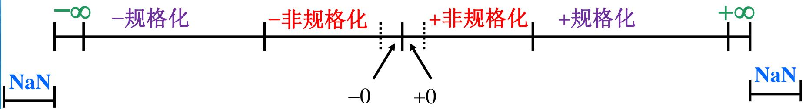
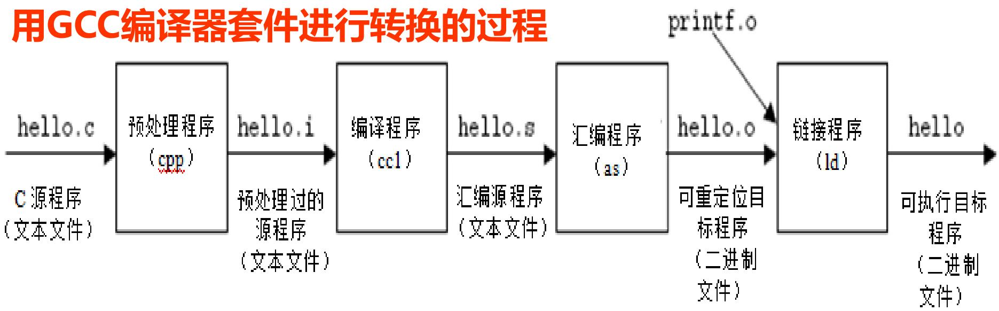
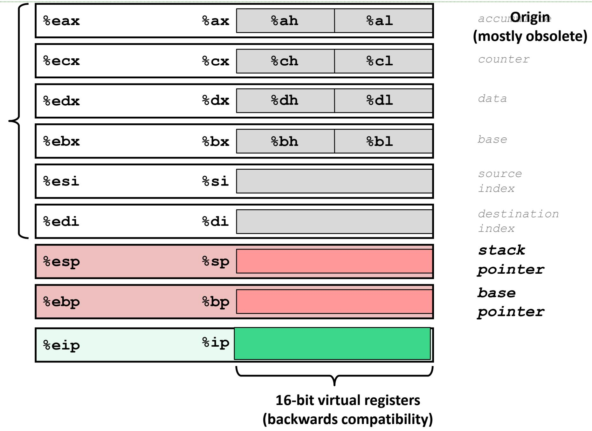
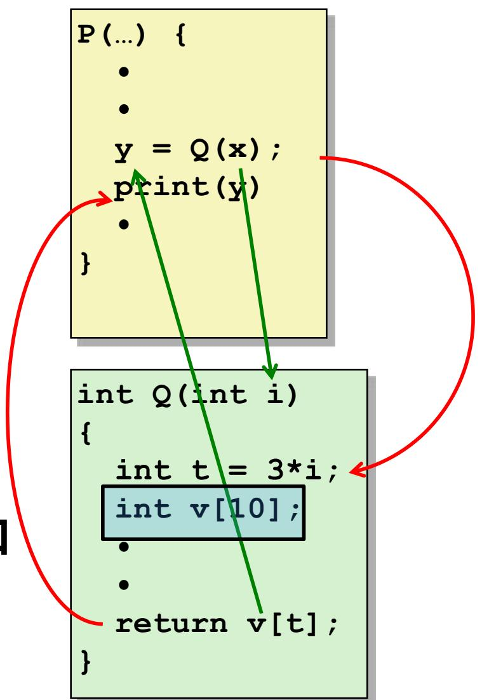
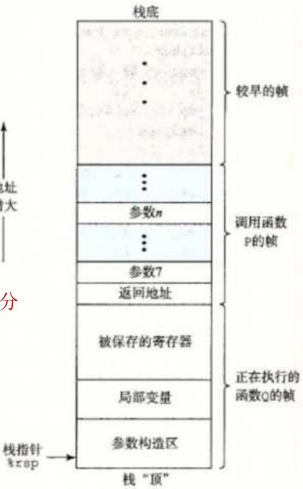
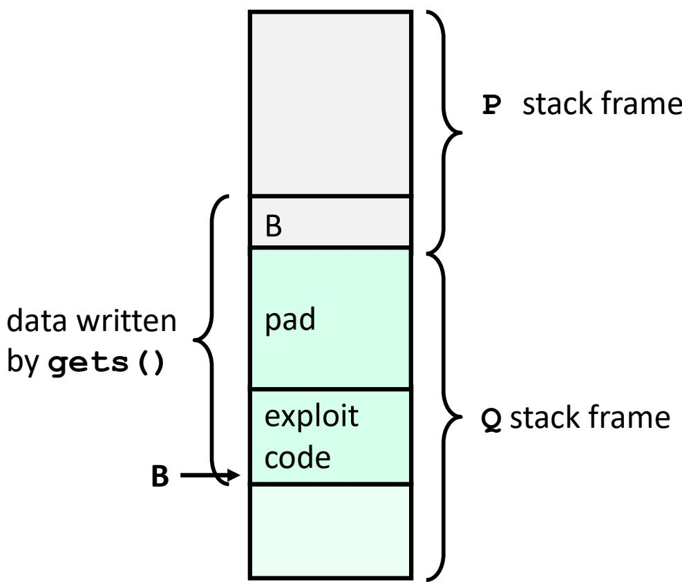
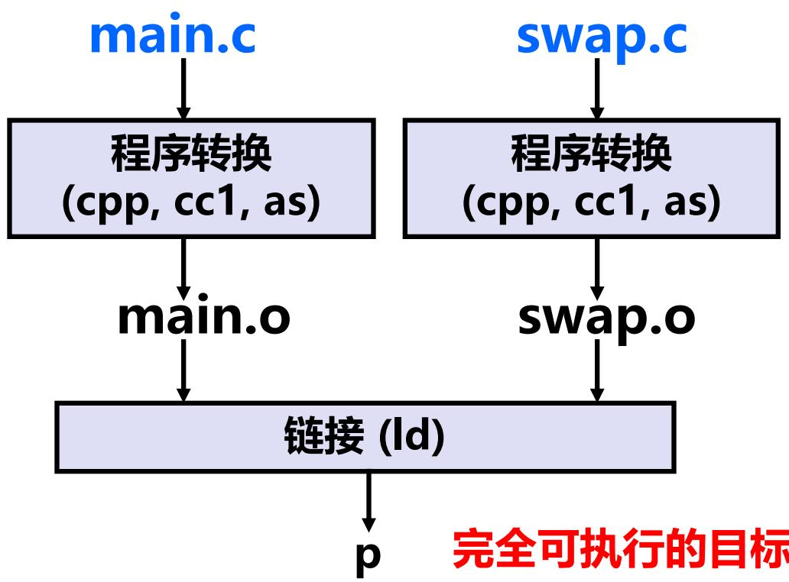
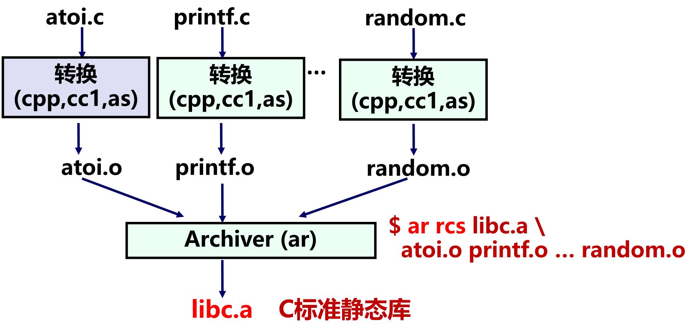
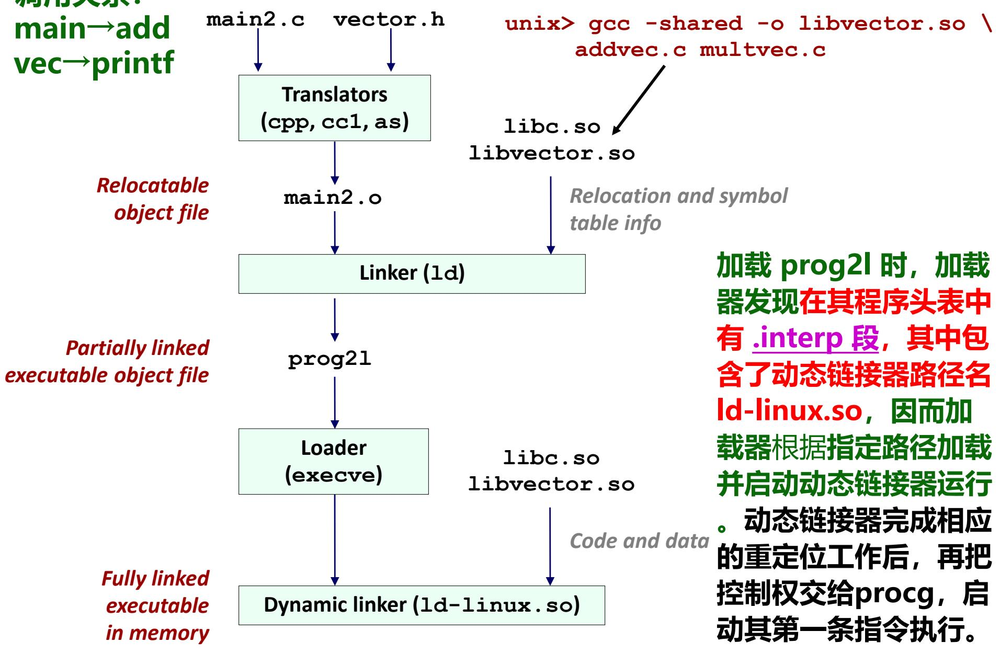

# 《计算机系统基础》2023-2024学年第二学期复习提纲

原件经识别和整理；“参考解答”是我们补的。

# 计算机系统基础2023-2024学年第二学期复习要点（第1部分）

本资料由识别工具从《计算机系统基础》2023-2024学年第二学期复习提纲中读取整理，主要涵盖计算机中数据的编码、整数表示及浮点数表示基础。

## 一、计算机中数据的编码

### 基本C数据类型的典型大小

在几乎所有的机器上，多字节对象都被存储为连续的字节序列，对象的地址为所使用字节中最小的地址。分配的字节数受程序是如何编译的影响而变化。

| C声明 (有符号) | C声明 (无符号) | 32位字节数 | 64位字节数 |
| :--- | :--- | :--- | :--- |
| `[signed] char` | `unsigned char` | 1 | 1 |
| `short` | `unsigned short` | 2 | 2 |
| `int` | `unsigned` | 4 | 4 |
| `long` | `unsigned long` | 4 | 8 |
| `int32_t` | `uint32_t` | 4 | 4 |
| `int64_t` | `uint64_t` | 8 | 8 |
| `char *` | - | 4 | 8 |
| `float` | - | 4 | 4 |
| `double` | - | 8 | 8 |

**例：** `unsigned int x=1000;`
若变量 `x` 的地址为 `0x500`，则其内存布局如下：

**小端方式（Little Endian）：**
低位字节存放在低地址单元，高位字节存放在相邻的高地址单元。
数值 `1000` 的十六进制为 `0x000003e8`。

$$
\begin{array}{c c} \hline 0x503 & 00 \\ \hline 0x502 & 00 \\ \hline 0x501 & 03 \\ \hline 0x500 & e8 \\ \hline \end{array}
$$

**大端方式（Big Endian）：**
高位字节存放在低地址单元，低位字节存放在相邻的高地址单元。

$$
\begin{array}{c c} \hline 0x503 & e8 \\ \hline 0x502 & 03 \\ \hline 0x501 & 00 \\ \hline 0x500 & 00 \\ \hline \end{array}
$$

知识点：[基本C数据类型的典型大小（sizeof）](../../../topics/计算机系统基础/C数据类型大小.md)

### 单选题 1

题干：设Intel机器中，有一个int型变量x的地址为0xFFFFC000，x=0x12345678，则内存单元0xFFFFC001中存放的内容的十六进制表示为（ ）

- A. 0x12
- B. 0x34
- C. 0x56
- D. 0x78

答案：B。
知识点：[基本C数据类型的典型大小（sizeof）](../../../topics/计算机系统基础/C数据类型大小.md)、[无符号整数编码（二进制加权求和）](../../../topics/计算机系统基础/无符号整数编码.md)

### 例：int x=-1000

32位补码计算：
$1000_{10} = 0x3E8 = 0000\ 0000\ 0000\ 0000\ 0000\ 0011\ 1110\ 1000_2$
取反：`1111 1111 1111 1111 1111 1100 0001 0111`
加1：`1111 1111 1111 1111 1111 1100 0001 1000`
十六进制：`0xFFFFFA18`

GDB调试命令示例：
`x/4xb 0x503` : 显示结果为 `18 fa ff ff` (小端序，低地址存低位)
`x/1xw 0x503` : 显示结果为 `fffffa18`

**GDB常用格式说明：**
- `b` 表示单字节，`h` 表示双字节，`w` 表示四字（word，通常4字节），`g` 表示八字节（giant）。
- `x` 表示十六进制，`d` 表示有符号十进制，`u` 表示无符号十进制。

n位补码所能表示的真值范围为：$-2^{n-1} \sim +2^{n-1} - 1$

| C数据类型 | 位数 | $TMin_w$ 最小值 | $TMax_w$ 最大值 |
| :--- | :--- | :--- | :--- |
| `char` | 8 | -128 | 127 |
| `short` | 16 | -32768 | 32767 |
| `int` | 32 | -2147483648 | 2147483647 |
| `long` | 64 | -9223372036854775808 | 9223372036854775807 |

C语言中`char`类型的宽度为1个字节，可表示一个字符（非数值数据），也可表示一个8位的整数（数值数据）。

知识点：[补码：有符号整数编码（特殊数的补码，如TMin、-1）](../../../topics/计算机系统基础/补码编码.md)、[基本C数据类型的典型大小（sizeof）](../../../topics/计算机系统基础/C数据类型大小.md)、[x86-64 整数寄存器（%rax~%r15及其子寄存器）](../../../topics/计算机系统基础/x86-64整数寄存器.md)

### 特殊数的补码

假定机器数有n位：
1. $[-2^{n-1}]_{补} = 2^n - 2^{n-1} = 10\dots0$ ($n-1$个0)
2. $[-1]_{补} = 2^n - 1 = 11\dots1$ ($n$个1)
3. $[+0]_{补} = [-0]_{补} = 00\dots0$ ($n$个0)

没有负零的补码，或者说负零的补码与正零的补码相同。

补码所对应的真值范围是不对称的，负数个数比正数多一个。
注意：-1 和 UMax 有同样的位表示——一个全1的串；数值0在两种表示方式中都是全0的串。

图2-14 重要的数字（数值和十六进制表示）

| 数 | 字长 w=8 | 字长 w=16 | 字长 w=32 | 字长 w=64 |
| :--- | :--- | :--- | :--- | :--- |
| $UMax_w$ (Hex) | 0xFF | 0xFFFF | 0xFFFFFFFF | 0xFFFFFFFFFFFFFFFF |
| $UMax_w$ (Dec) | 255 | 65535 | 4294967295 | 18446744073709551615 |
| $TMin_w$ (Hex) | 0x80 | 0x8000 | 0x80000000 | 0x8000000000000000 |
| $TMin_w$ (Dec) | -128 | -32768 | -2147483648 | -9223372036854775808 |
| $TMax_w$ (Hex) | 0x7F | 0x7FFF | 0x7FFFFFFF | 0x7FFFFFFFFFFFFFFF |
| $TMax_w$ (Dec) | 127 | 32767 | 2147483647 | 9223372036854775807 |
| -1 (Hex) | 0xFF | 0xFFFF | 0xFFFFFFFF | 0xFFFFFFFFFFFFFFFF |
| 0 (Hex) | 0x00 | 0x0000 | 0x00000000 | 0x0000000000000000 |

## 四、无符号数和有符号数的转换

考虑以下C代码：

```c
1 int x = –1;
2 unsigned u = 2147483648;
3 printf("x=%d u=%d\n", x, u);
```

在机器上运行上述代码时，它的输出结果是什么？为什么？

**分析：**
$u = 2147483648 = 2^{31}$。
$2^{31}$ 的无符号数表示为 “100…0”（32位下最高位为1，其余为0）。
当被解释为32位带符号整数时，其值为最小负数：$-2^{32-1} = -2^{31} = -2147483648$。

处理同样字长的有符号数和无符号数之间相互转换的一般规则是：
**数值可能会改变，但是位模式不变。**
强制类型转换的结果保持位值不变，只是改变了解释这些位的方式。

## 五、浮点数表示

知识点：[补码：有符号整数编码（特殊数的补码，如TMin、-1）](../../../topics/计算机系统基础/补码编码.md)、[无符号数和有符号数的转换（位级不变，解释改变）](../../../topics/计算机系统基础/无符号与有符号转换.md)

### IEEE浮点标准

公式：$(-1)^s M 2^E$

- **Sign (符号位 s)**：代表这个数的正负。
- **Significand (尾数 M)**：有效数字。
- **Exponent (指数 E)**：阶码。

**编码结构：**
- MSB s 是符号位 s。
- exp 编码 E (but is not equal to E)。
- frac 编码 M (but is not equal to M)。

**双精度 (Double, 64 bits):**
- s: 1 bit
- exp: 11 bits
- frac: 52 bits

**单精度 (Float, 32 bits):**
- s: 1 bit
- exp: 8 bits
- frac: 23 bits

知识点：[浮点数表示与 IEEE 754 标准（S、E、M 的计算）](../../../topics/计算机系统基础/IEEE754标准.md)、[Normalized numbers（规格化数）与 Denormalized numbers（非规格化数）](../../../topics/计算机系统基础/规格化与非规格化数.md)、[无符号整数编码（二进制加权求和）](../../../topics/计算机系统基础/无符号整数编码.md)

### 根据exp的值，被编码的值可以分成三种不同的情况

1. 规格化的
2. 非规格化的
3. 无穷大 / NaN



# 《计算机系统基础》2023-2024学年第二学期复习提纲（第 2 部分）

本资料整理自《计算机系统基础》2023-2024学年第二学期复习要点第 2 部分（第 17–29 页），主要涵盖浮点数表示、程序编译过程、x86-64指令系统及寻址方式等核心知识点。

## 浮点数表示与 IEEE 754 标准

知识点：[浮点数表示与 IEEE 754 标准（S、E、M 的计算）](../../../topics/计算机系统基础/IEEE754标准.md)、[Normalized numbers（规格化数）与 Denormalized numbers（非规格化数）](../../../topics/计算机系统基础/规格化与非规格化数.md)

### Normalized numbers（规格化数）

规格化数的定义如下：
$$ v = (-1)^s M 2^E $$

其中，位域分配如下：

| s | exp | frac |
|---|---|---|
| 1 bit | 8/11 bits | 23/52 bits |

**条件：** $\exp \neq 00\dots0$ 且 $\exp \neq 11\dots1$

**指数 $E$ 的计算：**
*   $\exp = E + Bias$
*   $\exp$: 无符号数
*   $Bias = 2^{k-1} - 1$，其中 $k$ 为 $\exp$ 的位数（单精度 $k=8$，双精度 $k=11$）

**具体偏置值：**
*   **单精度：** $Bias = 127$
    *   $\exp$ 范围：$1 \dots 254$
    *   $E$ 范围：$-126 \dots 127$
*   **双精度：** $Bias = 1023$
    *   $\exp$ 范围：$1 \dots 2046$
    *   $E$ 范围：$-1022 \dots 1023$

**尾数 $M$ 的计算：**
*   $M = 1.xxxxx\dots x_2$ （xxx…x 对应 frac 位）
*   **规定：** 规格化尾数最高位总是 1，因此隐含表示，节省 1 位存储空间。
    *   **最小值：** 当 $frac = 00\dots0$ 时，$M = 1.0$
    *   **最大值：** 当 $frac = 11\dots1$ 时，$M = 2.0 - \varepsilon$

**单精度与双精度的通用公式：**
*   **单精度：** $v = (-1)^s \times (1 + frac) \times 2^{(exp - 127)}$
*   **双精度：** $v = (-1)^s \times (1 + frac) \times 2^{(exp - 1023)}$

**规格化数举例：**
*   Value: `float F = 15213.0`
*   整数转换：$15213 = 11101101101101_2$
*   规格化：$1.1101101101101_2 \times 2^{13}$
*   计算逻辑：
    $$
    \boxed{
    \begin{array}{l}
    v = (-1)^s M 2^E \\
    E = Exp - Bias
    \end{array}
    }
    $$
*   组成部分：Significand, Exponent, Result

知识点：[Normalized numbers（规格化数）与 Denormalized numbers（非规格化数）](../../../topics/计算机系统基础/规格化与非规格化数.md)、[浮点数表示与 IEEE 754 标准（S、E、M 的计算）](../../../topics/计算机系统基础/IEEE754标准.md)

### Denormalized numbers（非规格化数）

**定义：**
$$ v = (-1)^s M 2^E $$

**位域结构：**
*   $s$: 1 bit
*   $\exp$: 全 0 ($00\dots0$, 8/11 bits)
*   $frac$: 23/52 bits

**条件：** $\exp = 00\dots0$

**指数 $E$ 的计算：**
*   $E = 1 - Bias$
*   **单精度：** $E = 1 - 127 = -126$
*   **双精度：** $E = 1 - 1023 = -1022$

**尾数 $M$ 的计算：**
*   $M = 0.xxxx\dots x_2$ （xxx…x 对应 frac 位）

**特殊情况处理：**
1.  **$\exp = 00\dots0$ 且 $frac = 00\dots0$**
    *   代表数值 **0**。
    *   不区分 +0 和 -0（但在存储中符号位不同）。
2.  **$\exp = 00\dots0$ 且 $frac \neq 00\dots0$**
    *   代表接近 0.0 的小数。

**特殊值说明：**
*   **无穷大 ($\infty$)：**
    *   在浮点运算中，除数为 0 的结果是 $\pm \infty$，而不是溢出异常（整数除 0 为异常）。
    *   可以利用 $\pm \infty$ 进行比较，例如：$X/0 > Y$ 可作为有效比较。
    *   **情况 1：** $\exp = 11\dots1$ 且 $frac = 00\dots0$
        *   代表 $\infty$。
        *   例如：$1.0 / 0.0 = +\infty$，$-1.0 / 0.0 = -\infty$，$1.0 / -0.0 = -\infty$。
    *   **情况 2：** $\exp = 11\dots1$ 且 $frac \neq 00\dots0$
        *   代表 **Not-a-Number (NaN)**。
        *   例如：$\sqrt{-1}$，$\infty - \infty$，$\infty \times 0$。

知识点：[Normalized numbers（规格化数）与 Denormalized numbers（非规格化数）](../../../topics/计算机系统基础/规格化与非规格化数.md)、[浮点数表示与 IEEE 754 标准（S、E、M 的计算）](../../../topics/计算机系统基础/IEEE754标准.md)

### IEEE 754 的舍入方式

设 $Z$ 为结果，$Z_1$ 和 $Z_2$ 分别是结果 $Z$ 最近的可表示的左、右两个数。

1.  **就近舍入（Round to Nearest, Ties to Even）：** 舍入为最近可表示的数。
    *   **非中间值：** 0 舍 1 入。
        *   例如：附加位为 `01` -> 舍；`10` -> 舍（若下一位为0则看前一位奇偶，此处简化为常规判断）。
    *   **中间值（Ties）：** 强迫结果为偶数。
        *   例如：附加位为 `11` -> 入；`10` -> 若需强制偶数则根据最低位决定。
        *   *注：此方法速度较慢，但统计误差最小。*

## 高级语言程序转换为机器代码的过程



1.  **预处理（Preprocessing）：**
    *   在高级语言源程序中插入所有用 `#include` 命令指定的文件。
    *   展开用 `#define` 声明指定的宏。
2.  **编译（Compilation）：**
    *   将预处理后的源程序文件编译生成相应的汇编语言程序。
3.  **汇编（Assembly）：**
    *   由汇编程序将汇编语言源程序文件转换为可重定位的机器语言目标代码文件。
4.  **链接（Linking）：**
    *   由链接器将多个可重定位的机器语言目标文件以及库例程（如 `printf()` 库函数）链接起来。
    *   生成最终的可执行目标文件。

## x86-64 指令概述

知识点：[IEEE 754 的舍入方式（向偶数舍入等四种模式）](../../../topics/计算机系统基础/IEEE754舍入方式.md)、[高级语言程序转换为机器代码的过程（预处理、编译、汇编、链接）](../../../topics/计算机系统基础/高级语言转机器代码过程.md)、[x86-64 指令概述（指令存放格式、操作数类型）](../../../topics/计算机系统基础/x86-64指令概述.md)

### 指令存放

*   **规则：** 多字节操作数连续存放，顺序依据**小端法（Little Endian）**规则。
*   **定义：** 低位字节存放在低地址单元，高位字节存放在相邻的高地址单元。

**示例：**
```text
内存地址 40110a: b8 78 56 34 12
内存地址 40110f: bb 78 56 34 12

指令: mov $0x12345678, %eax
指令: mov $0x12345678, %ebx
```

知识点：[x86-64 指令概述（指令存放格式、操作数类型）](../../../topics/计算机系统基础/x86-64指令概述.md)、[数据传送指令（mov、movs、movz及扩展）](../../../topics/计算机系统基础/数据传送指令.md)

### 寻址方式

*   **定义：** 根据指令给定信息得到操作数所在位置的机制。
*   **分类：**
    *   **指令中：** 立即寻址（Immediate Addressing）
    *   **寄存器中：** 寄存器寻址（Register Addressing）
    *   **存储单元中：** 存储器操作数（按字节编址）
        *   包括绝对寻址、间接寻址、基址+偏移量寻址等。
    *   **端口中：** I/O 端口寻址

知识点：[寻址方式详细列表与举例（立即数、寄存器、存储器寻址）](../../../topics/计算机系统基础/寻址方式.md)、[x86-64 指令概述（指令存放格式、操作数类型）](../../../topics/计算机系统基础/x86-64指令概述.md)、[数据传送指令（mov、movs、movz及扩展）](../../../topics/计算机系统基础/数据传送指令.md)

### x86-64 整数寄存器

通用寄存器及其子集映射关系如下表所示：

| 64位寄存器 | 32位寄存器 | 64位寄存器 | 32位寄存器 |
|---|---|---|---|
| `%rax` | `%eax` | `%r8` | `%r8d` |
| `%rbx` | `%ebx` | `%r9` | `%r9d` |
| `%rcx` | `%ecx` | `%r10` | `%r10d` |
| `%rdx` | `%edx` | `%r11` | `%r11d` |
| `%rsi` | `%esi` | `%r12` | `%r12d` |
| `%rdi` | `%edi` | `%r13` | `%r13d` |
| `%rsp` | `%esp` | `%r14` | `%r14d` |
| `%rbp` | `%ebp` | `%r15` | `%r15d` |
| - | - | `%rip` | - |



知识点：[x86-64 整数寄存器（%rax~%r15及其子寄存器）](../../../topics/计算机系统基础/x86-64整数寄存器.md)

### 寻址方式详细列表

| 语法表示 | 有效地址计算 | 寻址类型 |
|---|---|---|
| `Imm` | `Imm` | 绝对寻址 (Absolute) |
| `(R[r_a])` | `M[R[r_a]]` | 间接寻址 (Indirect) |
| `Imm(R[r_b])` | `M[Imm + R[r_b]]` | 基址+偏移量寻址 (Base+Displacement) |
| `(R[r_b], R[r_i])` | `M[R[r_b] + R[r_i]]` | 变址寻址 (Index) |
| `Imm(R[r_b], R[r_i])` | `M[Imm + R[r_b] + R[r_i]]` | 变址寻址 (Scaled Index with Displacement) |
| `(R[r_i], s)` | `M[R[r_i] \cdot s]` | 比例变址寻址 (Scaled Index) |
| `Imm(R[r_i], s)` | `M[Imm + R[r_i] \cdot s]` | 比例变址寻址 (Scaled Index with Displacement) |
| `(R[r_b], R[r_i], s)` | `M[R[r_b] + R[r_i] \cdot s]` | 比例变址寻址 (Base + Scaled Index) |
| `Imm(R[r_b], R[r_i], s)` | `M[Imm + R[r_b] + R[r_i] \cdot s]` | 比例变址寻址 (Full Addressing) |

*注：$s$ 为比例因子，通常为 1, 2, 4, 8。*

知识点：[寻址方式详细列表与举例（立即数、寄存器、存储器寻址）](../../../topics/计算机系统基础/寻址方式.md)

### 寻址方式举例

**已知数据：**

**内存内容：**
| 地址 | 值 |
|---|---|
| 0x100 | 0xff |
| 0x104 | 0xab |
| 0x108 | 0x13 |
| 0x10c | 0x11 |

**寄存器内容：**
| 寄存器 | 值 |
|---|---|
| `%rax` | 0x100 |
| `%rcx` | 0x1 |
| `%rdx` | 0x3 |

**操作数解析：**

| 操作数 | 计算过程 | 结果值 |
|---|---|---|
| `%rax` | 寄存器直接取值 | 0x100 |
| `0x104` | 立即数 | 0xab (注意：此处原题表格可能有误，立即数本身是0x104，若指内存值则为0xab，通常立即数不查内存。根据上下文，这里可能是指直接访问地址0x104处的值，即`(0x104)`或直接寻址。原表写的是`0x104`对应`0xab`，暗示这是内存间接访问或笔误。若严格按语法，`0x104`是立即数。若理解为`(%rax)`即0x100处值为0xff。让我们看下一行。`4(%rax)`是0x104处值。所以`0x104`作为操作数如果是立即数则是0x104。如果是内存引用通常是括号。原表第一列`%rax`对应0x100，第二列`0x104`对应0xab。这看起来像是把“地址”当成了“操作数”。让我们重新审视原表结构。原表是四列：操作数1, 值1, 操作数2, 值2。 <br> Row 1: `%rax` -> 0x100; `9(%rax,%rdx)` -> ? <br> Row 2: `0x104` -> 0xab (这可能是指地址0x104的内容，或者笔误应为`(0x104)`? 或者是指立即数0x104? 但值是0xab。0xab在0x104。所以这应该是内存访问。但在x86语法中，单独的数字是立即数。可能是指 `(%rax)`? 不，`(%rax)`是0xff。 `4(%rax)`是0xab。 让我们看第三行 `$0x108` -> 0x108 (立即数)。 <br> 修正理解：原表可能有些混乱。让我们依据标准x86-64语法重新计算右侧列，并尽量匹配左侧列的含义。 <br> 假设左侧列是“描述”，右侧是“计算示例”。 <br> 让我们专注于右侧列的计算验证，因为左侧列可能存在排版歧义。 | |
| `$0x108` | 立即数 | 0x108 |
| `(%rax)` | $M[\%rax] = M[0x100]$ | 0xff |
| `4(%rax)` | $M[0x100 + 4] = M[0x104]$ | 0xab |
| `9(%rax,%rdx)` | $M[\%rax + \%rdx + 9] = M[0x100 + 3 + 9] = M[0x10C]$ | 0x11 |
| `260(%rcx,%rdx)` | $M[\%rcx + \%rdx + 260] = M[0x1 + 3 + 260] = M[0x10C]$ | 0x11 (注意：260=0x104, 1+3+0x104=0x108? 不对。260十进制=0x104。0x1+0x3+0x104=0x108。M[0x108]=0x13。原表写0x13。正确。) | 0x13 |
| `0xFC(,%rcx,4)` | $M[0xFC + \%rcx \times 4] = M[0xFC + 1 \times 4] = M[0x100]$ | 0xff |
| `(%rax,%rcx,4)` | $M[\%rax + \%rcx \times 4] = M[0x100 + 1 \times 4] = M[0x104]$ | 0xab |

*注：原表中部分左侧操作数写法可能存在简写或非标准表达，上述解析基于标准 x86-64 寻址语法及给定的内存/寄存器状态进行推导。*

## 一、指令执行与寻址模式

知识点：[寻址方式详细列表与举例（立即数、寄存器、存储器寻址）](../../../topics/计算机系统基础/寻址方式.md)、[x86-64 整数寄存器（%rax~%r15及其子寄存器）](../../../topics/计算机系统基础/x86-64整数寄存器.md)

### 选择 1

假设下面的值存放在指定的内存地址和寄存器中：

| 地址 | 值 |
| :--- | :--- |
| 0x100 | 0xFF |
| 0x108 | 0xAB |
| 0x110 | 0x13 |
| 0x118 | 0x11 |

| 寄存器 | 值 |
| :--- | :--- |
| %rax | 0x100 |
| %rcx | 0x1 |
| %rdx | 0x3 |

包括其他指令，如 LEA，逻辑运算、移位指令等。请确定以下指令执行后的目的操作数及新值：

| 指令 | 目的 | 值 |
| :--- | :--- | :--- |
| `addq %rcx, (%rax)` | 内存地址: 0x100 | 0x100 |
| `subq %rdx, 8(%rax)` | 内存地址: 0x108 | 0xA8 |
| `imulq $16, (%rax, %rdx, 8)` | 内存地址: 0x118 | 0x110 |
| `incq 16(%rax)` | 内存地址: 0x110 | 0x14 |
| `decq %rcx` | %rcx | 0x0 |
| `subq %rdx, %rax` | %rax | 0xfd |

知识点：[x86-64 整数寄存器（%rax~%r15及其子寄存器）](../../../topics/计算机系统基础/x86-64整数寄存器.md)、[寻址方式详细列表与举例（立即数、寄存器、存储器寻址）](../../../topics/计算机系统基础/寻址方式.md)、[算术与逻辑指令（add、sub、imul、sal、sar、xor等及对条件码的影响）](../../../topics/计算机系统基础/算术与逻辑指令.md)

### 简答 1

**整数加法指令举例**

假设 `R[ax]=FFFAH`，`R[bx]=FFF0H`，则执行以下指令后 “`addw %bx, %ax`”：
AX、BX 中的内容各是什么？标志 CF、OF、ZF、SF 各是什么？要求分别将操作数作为无符号数和带符号整数解释并验证指令执行结果。

解：功能：$R[ax] \leftarrow R[ax] + R[bx]$，指令执行后的结果如下：
$R[ax] = \text{FFFAH} + \text{FFF0H} = \text{FFEAH}$，BX 中内容不变。
CF=1，OF=0，ZF=0，SF=1。

若是无符号整数运算，则 CF=1 说明结果溢出。
验证：FFFA 的真值为 $65535-5=65530$，FFF0 的真值为 65520。
FFEA 的真值为 $65535-21=65514 \neq 65530+65520$，即溢出。

若是带符号整数运算，则 OF=0 说明结果没有溢出。
验证：FFFA 的真值为 -6，FFF0 的真值为 -16。
FFEA 的真值为 $-22 = -6 + (-16)$，结果正确，无溢出。

知识点：[BombLab：GDB调试与汇编逆向分析（字符串比较、数字序列递推、跳转表switch、递归函数func4、隐藏关phase_defused/secret_phase）](../../../topics/计算机系统基础/BombLab逆向分析.md)

### 简答 2

**LEA 指令应用**

*   `lea Src, Dst`：计算有效地址
    *   E.g., translation of `p = &x[i];`
    *   算术运算表达式形式为：$X + k^*y$
        *   $k = 1, 2, 4, \text{or } 8$
    *   例：`leaq 7(%rdx,%rdx,4),%rax` $\rightarrow$ `%rax = 5*%rdx + 7`
    *   Converted to ASM by compiler.

知识点：[x86-64 整数寄存器（%rax~%r15及其子寄存器）](../../../topics/计算机系统基础/x86-64整数寄存器.md)、[算术与逻辑指令（add、sub、imul、sal、sar、xor等及对条件码的影响）](../../../topics/计算机系统基础/算术与逻辑指令.md)、[基本C数据类型的典型大小（sizeof）](../../../topics/计算机系统基础/C数据类型大小.md)

### 简答 3

**按位运算指令举例**

假设 short 型变量 x 被编译器分配在寄存器 AX 中，`R[ax]=FF80H`，则以下汇编代码段执行后变量 x 的机器数和真值分别是多少？

```assembly
movw %ax, %dx
salw $2, %ax      ; 1111 1111 1000 0000 << 2
addl %dx, %ax     ; 1111 1111 1000 0000 + 1111 1110 0000 0000
sarw $1, %ax      ; 1111 1101 1000 0000 >> 1 = 1111 1110 1100 0000
```

解：`$2` 和 `$1` 分别表示立即数 2 和 1。
x 是 short 型变量，故都是算术移位指令，并进行带符号整数加。假设上述代码段执行前 `R[ax]=x`，则执行 `((x<<2)+x)>>1` 后，`R[ax]=5x/2`。
算术左移时，AX 中的内容在移位前、后符号未发生变化，故 OF=0，没有溢出。
最终 AX 的内容为 FEC0H，解释为 short 型整数时，其值为 -320。
验证：$x=-128$，$5x/2=-320$。经验证，结果正确。

逆向工程：从汇编指令退出高级语言程序代码。

## 二、控制流指令

知识点：[x86-64 指令概述（指令存放格式、操作数类型）](../../../topics/计算机系统基础/x86-64指令概述.md)、[控制流指令（cmp、test、jmp、jxx、setxx）](../../../topics/计算机系统基础/控制流指令.md)、[算术与逻辑指令（add、sub、imul、sal、sar、xor等及对条件码的影响）](../../../topics/计算机系统基础/算术与逻辑指令.md)

### 简答 4

**跳转指令分类**

*   **无条件跳转指令**
    *   `jmp DST`：无条件转移到目标指令 DST 处执行
    *   (1) 直接跳转：`jmp 标号`
    *   (2) 间接跳转：例如 `jmp *%rdx`，`jmp *(%rdx)`
*   **条件跳转指令**
    *   `Jcc DST`：cc 为条件码，根据标志（条件码）判断是否满足条件，若满足，则转移到目标指令 DST 处执行，否则按顺序执行


| 类别 | 序号 | 指令 | 转移条件 | 说明 |
| :--- | :--- | :--- | :--- | :--- |
| **(1) 根据单个标志的值转移**<br>**(2) 按无符号整数比较转移**<br>**(3) 按带符号整数比较转移** | 1 | `jc label` | CF=1 | 有进位/借位 |
| | 2 | `jnc label` | CF=0 | 无进位/借位 |
| | 3 | `je/jz label` | ZF=1 | 相等/等于零 |
| | 4 | `jne/jnz label` | ZF=0 | 不相等/不等于零 |
| | 5 | `js label` | SF=1 | 是负数 |
| | 6 | `jns label` | SF=0 | 是非负数 |
| | 7 | `jo label` | OF=1 | 有溢出 |
| | 8 | `jno label` | OF=0 | 无溢出 |
| | 9 | `ja/jnbe label` | CF=0 AND ZF=0 | 无符号整数 A>B |
| | 10 | `jae/jnb label` | CF=0 OR ZF=1 | 无符号整数 A≥B |
| | 11 | `jb/jnae label` | CF=1 AND ZF=0 | 无符号整数 A<B |
| | 12 | `jbe/jna label` | CF=1 OR ZF=1 | 无符号整数 A≤B |
| | 13 | `jg/jnle label` | SF=OF AND ZF=0 | 带符号整数 A>B |
| | 14 | `jge/jnl label` | SF=OF OR ZF=1 | 带符号整数 A≥B |
| | 15 | `jl/jnge label` | SF≠OF AND ZF=0 | 带符号整数 A<B |
| | 16 | `jle/jng label` | SF≠OF OR ZF=1 | 带符号整数 A≤B |

以上内容不要死记硬背，遇到具体指令时能查阅到并理解即可。

知识点：[x86-64 整数寄存器（%rax~%r15及其子寄存器）](../../../topics/计算机系统基础/x86-64整数寄存器.md)、[过程调用与栈帧（call、ret、栈帧结构、寄存器使用惯例）](../../../topics/计算机系统基础/过程调用与栈帧.md)、[BombLab：GDB调试与汇编逆向分析（字符串比较、数字序列递推、跳转表switch、递归函数func4、隐藏关phase_defused/secret_phase）](../../../topics/计算机系统基础/BombLab逆向分析.md)

### 简答 5

**跳转指令的编码**

计算机系统基础 I

汇编器产生的“.”格式的反汇编版本如下：

| 行号 | 地址 | 字节 1 | 字节 2 | 字节 3 |
| :--- | :--- | :--- | :--- | :--- |
| 1 | 0: | 48 | 89 | f8 |
| 2 | 3: | eb | 03 | |
| 3 | 5: | 48 | d1 | f8 |
| 4 | 8: | 48 | 85 | c0 |
| 5 | b: | 7f | f8 | |
| 6 | d: | f3 | c3 | |

对应汇编指令：

| 指令 | 操作数 |
| :--- | :--- |
| `mov` | `%rdi,%rax` |
| `jmp` | `8 <loop+0x8>` |
| `sar` | `%rax` |
| `test` | `%rax,%rax` |
| `jg` | `5 <loop+0x5>` |
| `repz retq` | |

## 三、过程调用与栈帧

知识点：[过程调用与栈帧（call、ret、栈帧结构、寄存器使用惯例）](../../../topics/计算机系统基础/过程调用与栈帧.md)、[计算机系统的层次结构与抽象](../../../topics/计算机系统基础/系统层次结构.md)

### 简答 6

**过程调用的机器级表示**

*   传递控制：过程的调用和返回
*   传递数据：参数的传递和返回值
*   内存的分配和释放：为局部变量分配空间及释放

x86-64 的过程实现包括过程调用和返回指令和一些对机器资源(例如寄存器和程序内存)使用的约定规则。



P：
```
add(t1,t2)
存放参数
call Q
取出参数
存返回结果
ret
```

**过程调用 call 指令**
(1) P 保存返回地址
(2) 跳转到 Q 过程

**返回 ret 指令**
(1) 从堆栈栈顶取出 P 的返回地址
(2) 跳转到返回地址，即 `call Q` 指令后面的指令继续执行。

*   直接调用：`call 标号`
*   间接调用：`call *operand`

知识点：[过程调用与栈帧（call、ret、栈帧结构、寄存器使用惯例）](../../../topics/计算机系统基础/过程调用与栈帧.md)、[控制流指令（cmp、test、jmp、jxx、setxx）](../../../topics/计算机系统基础/控制流指令.md)、[x86-64 整数寄存器（%rax~%r15及其子寄存器）](../../../topics/计算机系统基础/x86-64整数寄存器.md)

### 简答 7

**数据传送与寄存器约定**

计算机系统基础 I

*   通过寄存器最多传递 6 个整型(例如整数和指针)参数：
    $$
    \begin{array}{c} \% \text {rdi} \\ \% \text {rsi} \\ \% \text {rdx} \\ \% \text {rcx} \\ \% \text {r8} \\ \% \text {r9} \end{array}
    $$
*   返回值：%rax

**堆栈**
*   需要的时候分配堆栈空间

$$
\begin{array}{c} \bullet \quad \bullet \quad \bullet \\ \hline \text {Arg n} \\ \hline \bullet \quad \bullet \quad \bullet \\ \hline \text {Arg 8} \\ \hline \text {Arg 7} \end{array}
$$

| 操作数宽度(字节) | 入口参数 1 | 入口参数 2 | 入口参数 3 | 入口参数 4 | 入口参数 5 | 入口参数 6 | 返回参数 |
| :--- | :--- | :--- | :--- | :--- | :--- | :--- | :--- |
| 8 | RDI | RSI | RDX | RCX | R8 | R9 | RAX |
| 4 | EDI | ESI | EDX | ECX | R8D | R9D | EAX |
| 2 | DI | SI | DX | CX | R8W | R9W | AX |
| 1 | DIL | SIL | DL | CL | R8B | R9B | AL |

知识点：[过程调用与栈帧（call、ret、栈帧结构、寄存器使用惯例）](../../../topics/计算机系统基础/过程调用与栈帧.md)

### 简答 8

**x86-64 栈帧**

计算机系统基础 I

*   **内容**
    *   返回地址
    *   调用另一个过程设置的参数 7~n
    *   局部变量
        *   (1) 寄存器不足够存放所有的本地数据。
        *   (2) 局部变量使用地址运算符 ‘&' ，必须为它产生一个地址。
        *   (3) 局部变量是数组或结构
    *   被保存的现场寄存器

X86-64 过程只分配自己所需要的栈帧部分。实际上，许多函数甚至根本不需要栈帧。若所有的局部变量都可以保存在寄存器中，而且该函数不会调用任何其他函数。



知识点：[过程调用与栈帧（call、ret、栈帧结构、寄存器使用惯例）](../../../topics/计算机系统基础/过程调用与栈帧.md)、[x86-64 整数寄存器（%rax~%r15及其子寄存器）](../../../topics/计算机系统基础/x86-64整数寄存器.md)、[数据传送指令（mov、movs、movz及扩展）](../../../topics/计算机系统基础/数据传送指令.md)

### 简答 9

**数组的分配和访问**

T A[L];

*   用标识符 A 来作为指向数组开头的指针: Type T*
*   用 0~N-1 的整数索引来访问该数组元素
*   第 i ($0 \le i \le L-1$) 个元素的地址计算公式: `&A[0] + sizeof(T) * i`

知识点：[数组、结构体和联合的内存分配与访问](../../../topics/计算机系统基础/数组与结构体分配.md)、[基本C数据类型的典型大小（sizeof）](../../../topics/计算机系统基础/C数据类型大小.md)、[计算机系统的层次结构与抽象](../../../topics/计算机系统基础/系统层次结构.md)

### 内存越界引用和缓冲区溢出

知识点：[内存越界引用和缓冲区溢出（栈溢出原理）](../../../topics/计算机系统基础/缓冲区溢出攻击.md)

### 代码注入攻击 Code Injection Attacks

Stack after call to gets()
data written by gets()
P stack frame



Q stack frame

*   输入给程序一个字符串，这个字符串包含一些可执行代码的字节编码，称为攻击代码 (exploit code)。
*   攻击代码的地址覆盖原返回地址。
*   执行 ret 指令跳转到攻击代码。

知识点：[代码注入攻击 Code Injection Attacks（构造恶意攻击字符串）](../../../topics/计算机系统基础/代码注入攻击.md)、[内存越界引用和缓冲区溢出（栈溢出原理）](../../../topics/计算机系统基础/缓冲区溢出攻击.md)

### 6 对抗缓冲区溢出攻击

#### 1. 程序员角度防范—在代码中避免

*   使用带限制长度的库函数 – fgets instead of gets 等

#### 2. 系统级别的防范

*   栈随机化
*   限制可执行代码区域
*   栈破坏检测

知识点：[对抗缓冲区溢出攻击（Setting Up Canary、ASLR、DEP/NX）](../../../topics/计算机系统基础/栈保护机制.md)、[内存越界引用和缓冲区溢出（栈溢出原理）](../../../topics/计算机系统基础/缓冲区溢出攻击.md)

### Setting Up Canary

Before call to gets

知识点：[内存越界引用和缓冲区溢出（栈溢出原理）](../../../topics/计算机系统基础/缓冲区溢出攻击.md)、[对抗缓冲区溢出攻击（Setting Up Canary、ASLR、DEP/NX）](../../../topics/计算机系统基础/栈保护机制.md)

### 过程中的浮点代码

在 x86-64 中，XMM 寄存器用来向函数传递浮点参数，以及从函数返回浮点值。具体规则：

(1) XMM 寄存器 %xmm0~%xmm7 最多可以传递 8 个浮点参数。按照参数列出的顺序使用这些寄存器。可以通过栈传递额外的浮点参数。

(2) 函数使用寄存器 %xmm0 来返回浮点值。

(3) 当函数包含指针、整数和浮点数混合的参数时，指针和整数通过通用寄存器传递，而浮点值通过 XMM 寄存器传递。

例：`double fl(int x, double y, long z);`
x 存放在 %edi 中，y 存放在 %xmm0 中，而 z 存放在 %rsi 中。

`double fl(float x, double *y, long *z);`
x 放在 %xmm0 中，y 放在 %rdi 中，而 z 放在 %rsi 中。

使用 GCC 编译器编译并链接生成可执行程序 P：
```bash
$ gcc -o p main.c swap.c
$ ./p
```

知识点：[x86-64 指令概述（指令存放格式、操作数类型）](../../../topics/计算机系统基础/x86-64指令概述.md)、[x86-64 整数寄存器（%rax~%r15及其子寄存器）](../../../topics/计算机系统基础/x86-64整数寄存器.md)、[过程调用与栈帧（call、ret、栈帧结构、寄存器使用惯例）](../../../topics/计算机系统基础/过程调用与栈帧.md)

### 浮点指令与代码

知识点：[x86-64 指令概述（指令存放格式、操作数类型）](../../../topics/计算机系统基础/x86-64指令概述.md)、[算术与逻辑指令（add、sub、imul、sal、sar、xor等及对条件码的影响）](../../../topics/计算机系统基础/算术与逻辑指令.md)、[浮点数表示与 IEEE 754 标准（S、E、M 的计算）](../../../topics/计算机系统基础/IEEE754标准.md)

### GCC编译器的静态链接过程



知识点：[GCC编译器的静态链接过程（可执行文件的生成）](../../../topics/计算机系统基础/静态链接过程.md)、[可重定位目标文件格式（ELF头信息举例、各节的作用）](../../../topics/计算机系统基础/可重定位目标文件.md)、[符号和符号解析（强符号、弱符号、多重定义规则）](../../../topics/计算机系统基础/符号与符号解析.md)

### 源程序文件

分别转换（预处理、编译、汇编）为可重定位目标文件。

知识点：[高级语言程序转换为机器代码的过程（预处理、编译、汇编、链接）](../../../topics/计算机系统基础/高级语言转机器代码过程.md)、[计算机系统的层次结构与抽象](../../../topics/计算机系统基础/系统层次结构.md)、[可重定位目标文件格式（ELF头信息举例、各节的作用）](../../../topics/计算机系统基础/可重定位目标文件.md)

### 可执行文件的生成

知识点：[GCC编译器的静态链接过程（可执行文件的生成）](../../../topics/计算机系统基础/静态链接过程.md)、[高级语言程序转换为机器代码的过程（预处理、编译、汇编、链接）](../../../topics/计算机系统基础/高级语言转机器代码过程.md)

### 可重定位目标文件格式

**ELF 头**
定义了 ELF 魔数、版本、小端/大端、操作系统平台、目标文件的类型、机器结构类型、节头表的起始位置和长度等。

**.text 节**
编译后的代码部分。

**.rodata 节**
只读数据，如 printf 格式串、switch 跳转表等。

**.data 节**
已初始化的全局变量。

**.bss 节**
未初始化全局变量，仅是占位符，不占据任何实际磁盘空间。区分初始化和非初始化是为了空间效率。

| 节名称 |
| :--- |
| ELF 头 |
| .text 节 |
| .rodata 节 |
| .data 节 |
| .bss 节 |
| .symtab 节 |
| .rel.text 节 |
| .rel.data 节 |
| .debug 节 |
| .line 节 |
| .strtab 节 |
| Section header table (节头表) |

知识点：[可重定位目标文件格式（ELF头信息举例、各节的作用）](../../../topics/计算机系统基础/可重定位目标文件.md)

### 6 链接操作的步骤

#### Step 1. 符号解析（Symbol resolution）

*   程序中有定义和引用的符号 (包括变量和函数等)
    *   `void swap() {…} /* 定义符号swap */`
    *   `swap(); /* 引用符号swap */`
    *   `int *xp = &x; /* 定义符号 xp, 引用符号 x */`
*   编译器将定义和引用的符号存放在一个符号表（symbol table）中。
*   链接器将每个符号的引用都与一个确定的符号定义建立关联。

#### Step 2. 重定位

*   将多个代码节与数据节分别合并为一个单独的代码段和数据段。
*   计算每个定义的符号在虚拟地址空间中的绝对地址。
*   将可执行文件中符号引用处的地址修改为重定位后的地址信息。

知识点：[符号和符号解析（强符号、弱符号、多重定义规则）](../../../topics/计算机系统基础/符号与符号解析.md)、[相对地址重定位方式（符号解析后的地址修改）](../../../topics/计算机系统基础/重定位.md)、[GCC编译器的静态链接过程（可执行文件的生成）](../../../topics/计算机系统基础/静态链接过程.md)

### 符号和符号解析

每个可重定位目标模块 m 都有一个符号表，它包含了在 m 中定义的符号。

有三种链接器符号：

**Global symbols（模块内部定义的全局符号）**
由模块 m 定义并能被其他模块引用的符号。例如，非 static 函数和非 static 的全局变量（指不带 static 的全局变量）。
如，main.c 中的全局变量名 buf。

**External symbols（外部定义的全局符号）**
由其他模块定义并被模块 m 引用的全局符号。
如，main.c 中的函数名 swap。

**Local symbols（本模块的局部符号）**
仅由模块 m 定义和引用的本地符号。例如，在模块 m 中定义的带 static 的函数和全局变量。
如，swap.c 中的 static 变量名 bufp1。

注意：链接器局部符号不是指程序中的局部变量（分配在栈中的临时性变量），链接器不关心这种局部变量。

知识点：[可重定位目标文件格式（ELF头信息举例、各节的作用）](../../../topics/计算机系统基础/可重定位目标文件.md)、[符号和符号解析（强符号、弱符号、多重定义规则）](../../../topics/计算机系统基础/符号与符号解析.md)

### 静态库的创建



Archiver（归档器）允许增量更新，只要重新编译需修改的源码并将其 .o 文件替换到静态库中。
在 gcc 命令行中无需明显指定 C 标准库 libc.a (默认库)。

**链接顺序问题**

假设调用关系如下：
func.o → libx.a 和 liby.a 中的函数
libx.a → libz.a 中的函数
libx.a 和 liby.a 之间、liby.a 和 libz.a 相互独立。

则以下几个命令行都是可行的：
```bash
gcc -static –o myfunc func.o libx.a liby.a libz.a
gcc -static –o myfunc func.o liby.a libx.a libz.a
gcc -static –o myfunc func.o libx.a libz.a liby.a
```

假设调用关系如下：
func.o → libx.a 和 liby.a 中的函数
libx.a → liby.a 同时 liby.a → libx.a

则以下命令行可行：
```bash
gcc -static –o myfunc func.o libx.a liby.a libx.a
gcc -static –o myfunc func.o liby.a libx.a liby.a
```

汇编器遇到引用时，生成一个重定位条目。
*   数据引用的重定位条目在 `.rel_data` 节中。
*   指令中引用的重定位条目在 `.rel_text` 节中。

**重定位类型：**
*   `R_X86_64_64` (32)：重定位一个使用 64 位绝对地址的引用。
*   `R_X86_64_PC32`：重定位一个使用 32 位 PC 相对地址的引用。
*   `R_X86_64_PLT32`：过程链接表延迟绑定。

知识点：[静态库的创建与使用（ar命令）](../../../topics/计算机系统基础/静态库创建.md)、[相对地址重定位方式（符号解析后的地址修改）](../../../topics/计算机系统基础/重定位.md)、[可重定位目标文件格式（ELF头信息举例、各节的作用）](../../../topics/计算机系统基础/可重定位目标文件.md)

### 相对地址重定位方式

假定：
*   可执行文件中 main 函数对应机器代码从 0x401106 开始。
*   swap 紧跟 main 后。

则 swap 起始地址 = $0x401106 + 0x1C$。

则重定位后 call 指令的机器代码是什么？

```assembly
d: e8 00 00 00 00    call 12 <main+0x12>
e: R_X86_64_PLT32    swap-0x4
12: b8 00 00 00 00   mov $0x0,%eax
```

*   转移目标地址 = PC + 偏移量 (重定位值)
*   $PC = ADDR(s) + r.offset - r.addend = 0x401106 + 0x0e - (-4) = 0x401118$
*   重定位值 = 转移目标地址 - PC = $0x401122 - 0x401118 = 0xa$
*   call 指令的机器代码为 “e8 0a 00 00 00”

main.o 中 text 节的地址。

PC 相对地址方式下，重定位值计算公式为：
$$ADDR(r.sym) - ((ADDR(.text) + r.offset) - r.addend)$$
(call 指令下条指令地址，即当前 PC 的值)

引用目标处地址

知识点：[相对地址重定位方式（符号解析后的地址修改）](../../../topics/计算机系统基础/重定位.md)、[可重定位目标文件格式（ELF头信息举例、各节的作用）](../../../topics/计算机系统基础/可重定位目标文件.md)、[x86-64 指令概述（指令存放格式、操作数类型）](../../../topics/计算机系统基础/x86-64指令概述.md)

### ELF头信息举例

| readelf -h main 可执行目标文件的ELF头 | 结构说明 |
| :--- | :--- |
| **ELF Header:** | **ELF头** |
| Magic: 7f 45 4c 46 02 01 01 00 00 00 00 00 00 00 00 00 00 | |
| Class: ELF64 | |
| Data: 2's complement, little endian | |
| Version: 1 (current) | |
| OS/ABI: UNIX - System V | |
| ABI Version: 0 | |
| Type: EXEC (Executable file) | |
| Machine: Advanced Micro Devices X86-64 | |
| Version: 0x1 | |
| Entry point address: 0x401020 | |
| Start of program headers: 64 (bytes into file) | **程序头表** |
| Start of section headers: 14000 (bytes into file) | |
| Flags: 0x0 | |
| Size of this header: 64 (bytes) | |
| Size of program headers: 56 (bytes) | |
| Number of program headers: 13 | |
| Size of section headers: 64 (bytes) | |
| Number of section headers: 28 | |
| Section header string table index: 27 | **.init节** |
| | **.text节** |
| | **.rodata节** |
| | **.data节** |
| | **.bss节** |
| | **.symtab节** |
| | **.debug节** |
| | **.strtab节** |
| | **.line节** |
| | **Section header table (节头表)** |

知识点：[可重定位目标文件格式（ELF头信息举例、各节的作用）](../../../topics/计算机系统基础/可重定位目标文件.md)

### 加载时动态链接

调用关系：main → addvec → printf



加载 prog2l 时，加载器发现在其程序头表中有 .interp 段，其中包含了动态链接器路径名 ld-linux.so，因而加载器根据指定路径加载并启动动态链接器运行。动态链接器完成相应的重定位工作后，再把控制权交给 prog2l，启动其第一条指令执行。

知识点：[加载时动态链接与位置无关代码（PIC）](../../../topics/计算机系统基础/动态链接.md)

### 位置无关代码（PIC）

*   动态链接用到一个重要概念：
    *   位置无关代码（Position-Independent Code，PIC）
    *   GCC 选项 -fPIC 指示生成 PIC 代码
*   共享库代码是一种 PIC。要实现动态链接，必须生成 PIC 代码。
    *   共享库代码的位置可以是不确定的。
    *   即使共享库代码的长度发生变化，也不影响调用它的程序。
*   引入 PIC 的目的：
    *   链接器无需修改代码即可将共享库加载到任意地址运行。

**所有引用情况：**

1.  模块内的过程调用、跳转，采用 PC 相对偏移寻址。
2.  模块内数据访问，如模块内的全局变量和静态变量。
3.  模块外的过程调用、跳转。
4.  模块外的数据访问，如外部变量的访问。

## 综合 1

阅读下面的反汇编代码（函数 `f1`）：

| 地址 | 机器码 | 汇编指令 |
| --- | --- | --- |
| 401176 | f3 0f 1e fa | endbr64 |
| 40117a | ba 01 00 00 00 | mov $0x1,%edx |
| 40117f | b9 01 00 00 00 | mov $0x1,%ecx |
| 401184 | b8 00 00 00 00 | mov $0x0,%eax |
| 401189 | eb 07 | jmp 401192 <f1+0x1c> |
| 40118b | 01 d2 | add %edx,%edx |
| 40118d | 01 d1 | add %edx,%ecx |
| 40118f | 83 c0 01 | add $0x1,%eax |
| 401192 | 39 f8 | cmp %edi,%eax |
| 401194 | 7c f5 | jl 40118b <f1+0x15> |
| 401196 | 89 c8 | mov %ecx,%eax |
| 401198 | c3 | ret |

## 综合 2

阅读下面的反汇编代码（`main` 函数部分）：

| 地址 | 机器码 | 汇编指令 |
| --- | --- | --- |
| 401199 | f3 0f 1e fa | endbr64 |
| 40119d | 48 83 ec 18 | sub $0x18,%rsp |
| 4011a1 | 64 48 8b 04 25 28 00 00 00 | mov %fs:0x28,%rax |
| 4011aa | 48 89 44 24 08 | mov %rax,0x8(%rsp) |
| 4011af | 31 c0 | xor %eax,%eax |
| 4011b1 | 48 8d 74 24 04 | lea 0x4(%rsp),%rsi |
| 4011b6 | 48 8d 3d 47 0e 00 00 | lea 0xe47(%rip),%rdi |
| 4011bd | e8 be fe ff ff | call 401080 \<__isoc99_scanf@plt\> |
| 4011c2 | 8b 7c 24 04 | mov 0x4(%rsp),%edi |
| 4011c6 | e8 ab ff ff ff | call 401176 <f1> |
| 4011cb | 89 c2 | mov %eax,%edx |
| 4011cd | 48 8d 35 33 0e 00 00 | lea 0xe33(%rip),%rsi |
| 4011d4 | bf 01 00 00 00 | mov $0x1,%edi |
| 4011d9 | b8 00 00 00 00 | mov $0x0,%eax |

程序部分调试信息如下：

```text
(gdb) i r rip
rip 0x401196
(gdb) i r rsp
rsp 0x7fffffffde18
0x0000000400000000 0x0000000000000000
```

知识点：[加载时动态链接与位置无关代码（PIC）](../../../topics/计算机系统基础/动态链接.md)、[x86-64 指令概述（指令存放格式、操作数类型）](../../../topics/计算机系统基础/x86-64指令概述.md)、[寻址方式详细列表与举例（立即数、寄存器、存储器寻址）](../../../topics/计算机系统基础/寻址方式.md)

### 简答 1

基于调试信息，输入的 n 的值是多少？（十进制表示）

答案：4

知识点：[BombLab：GDB调试与汇编逆向分析（字符串比较、数字序列递推、跳转表switch、递归函数func4、隐藏关phase_defused/secret_phase）](../../../topics/计算机系统基础/BombLab逆向分析.md)

### 简答 2

此时 eax、edi、ecx 寄存器的值分别是多少？（十进制表示）

答案：4 4 31

知识点：[x86-64 整数寄存器（%rax~%r15及其子寄存器）](../../../topics/计算机系统基础/x86-64整数寄存器.md)、[算术与逻辑指令（add、sub、imul、sal、sar、xor等及对条件码的影响）](../../../topics/计算机系统基础/算术与逻辑指令.md)、[基本C数据类型的典型大小（sizeof）](../../../topics/计算机系统基础/C数据类型大小.md)

### 简答 3

执行下述两条指令的作用是什么？（对照 C 语句解释）

```text
401192: 39 f8    cmp %edi,%eax
401194: 7c f5    jl 40118b <f1+0x15>
```

知识点：[x86-64 指令概述（指令存放格式、操作数类型）](../../../topics/计算机系统基础/x86-64指令概述.md)、[控制流指令（cmp、test、jmp、jxx、setxx）](../../../topics/计算机系统基础/控制流指令.md)、[算术与逻辑指令（add、sub、imul、sal、sar、xor等及对条件码的影响）](../../../topics/计算机系统基础/算术与逻辑指令.md)

### 简答 4

在给出的 main() 的部分反汇编代码中，哪些指令会改变 rsp 寄存器的内容？选取其中一条指令，基于调试信息，说明该指令执行后 rsp 寄存器的内容是什么？

知识点：[x86-64 整数寄存器（%rax~%r15及其子寄存器）](../../../topics/计算机系统基础/x86-64整数寄存器.md)、[过程调用与栈帧（call、ret、栈帧结构、寄存器使用惯例）](../../../topics/计算机系统基础/过程调用与栈帧.md)、[BombLab：GDB调试与汇编逆向分析（字符串比较、数字序列递推、跳转表switch、递归函数func4、隐藏关phase_defused/secret_phase）](../../../topics/计算机系统基础/BombLab逆向分析.md)

### 简答 5

在 main() 和 f1() 中都定义了 sum 变量，为什么这两个 sum 变量的访问没有冲突？

知识点：[过程调用与栈帧（call、ret、栈帧结构、寄存器使用惯例）](../../../topics/计算机系统基础/过程调用与栈帧.md)、[计算机系统的层次结构与抽象](../../../topics/计算机系统基础/系统层次结构.md)
