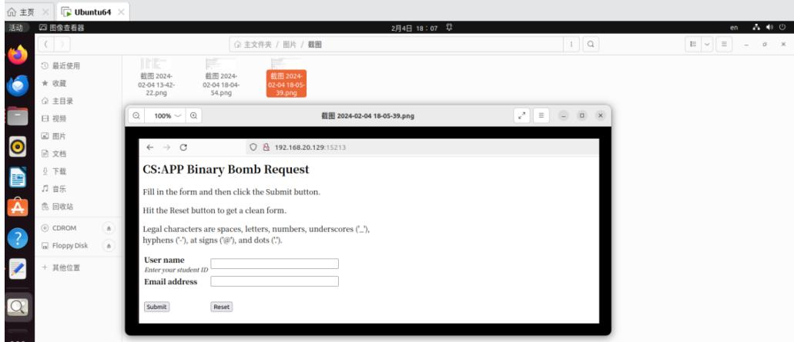

# 《计算机系统基础》BOMBLAB 实验手册

原件经识别和整理；“参考解答”是我们补的。

# 实验 2：BOMB 实验

## 一、实验目的

通过逆向分析二进制程序（称为“炸弹程序”）的构成和运行逻辑，加深对理论课程中关于程序的机器级表示各方面知识点的理解，以及反汇编、跟踪/分析调试等常用技能的掌握。

## 二、实验内容

作为实验目标的二进制炸弹 “bombs” 可执行程序包含了以下 7 个阶段，分别考察对程序的机器级表示以及下面各方面知识点的理解和掌握：

- 阶段 1：字符串比较
- 阶段 2：循环语句
- 阶段 3：选择/分支语句
- 阶段 4：递归调用
- 阶段 5：数组结构
- 阶段 6：链表/指针/结构
- 阶段 7：递归函数/指针/链

在每个阶段程序要求输入一个特定字符串，如果输入满足程序代码所指定的字符串，则这个阶段的炸弹被拆除，该阶段即通过，否则炸弹会爆炸，屏幕显示“BOOM!!!”。为完成炸弹的拆除任务，需要通过反汇编和分析/跟踪（使用 GDB 调试器等工具）程序每一阶段的机器代码，从中定位和理解程序的主要执行逻辑（关键指令、控制结构等）和相关数据变量，进而推断拆除炸弹所需的目标字符串。

## 三、实验过程

### 1、获取炸弹程序

在 ubuntu 上通过浏览器输入 `http://10.160.106.190:15213` 后，会出现下面炸弹申请页面：



输入您的用户名（即学号）和电子邮箱地址，然后点击提交按钮。服务器会生成你的炸弹程序，并在浏览器返回一个名为 `bombk.tar` 的 tar 文件，其中 k 是你的炸弹的唯一编号。`bombk.tar` 文件将存储在你的“下载”子目录中。

### 2、破译炸弹

本实验的任务就是拆除你的炸弹，可以使用许多工具来帮助你破译炸弹。

（1）在本地虚拟机下载目录下，将炸弹压缩文件拷贝到服务器你的目录下：

```bash
scp bombk.tar username@10.160.106.190:/home/username
```

（2）登录您的 10.160.106.190 帐户，`username` = 学号。

>>>>>在本地机器上>>>>>

连接服务器：

```bash
ssh username@10.160.106.190
```

（3）运行解压命令：

```bash
tar -xvf bombk.tar
```

解压后，它将创建一个目录 `bombk`，在此目录下会包含以下三个文件：

- `.README`：标识炸弹及其所有者。
- `.bomb`：可执行的二进制炸弹程序。
- `.bomb.c`：源文件，包含炸弹的主要程序。

（4）进入 `bombk` 目录，可用调试器运行炸弹程序，通过单步跟踪，查看寄存器或者存储器信息，来破译炸弹。有许多工具可以帮助你破译炸弹。

（a）gdb 可执行文件名

GNU 调试器是一个命令行调试器工具，可以逐行跟踪程序，检查内存和寄存器，同时查看源代码和汇编代码（本次实验不提供源代码），设置断点、设置内存监视点并编写脚本。

（b）objdump 可执行文件名

- `objdump -t 可执行文件名`

这将显示出炸弹的符号表。符号表包括所有的名称、炸弹中的函数和全局变量、炸弹调用的所有函数的名称，以及对应的地址。

- `objdump -d 可执行文件名`

反汇编炸弹程序中的所有代码，通过阅读汇编代码，可以知道炸弹程序是如何工作的。

（c）strings 可执行文件名

显示程序中的所有 print 字符串。

### 3、拆除炸弹

（1）在服务器上 `bombk` 目录下，使用文本编辑器，将各阶段破译的字符串逐行输入，保存在一个文本文件：`学号.txt` 中。

（2）拆除炸弹：

```bash
./bomb 学号.txt
```

服务器将从文件 `学号.txt` 中读取输入行，直到到达 EOF（文件末尾）。

文件中的每行包含拆除对应炸弹阶段的字符串，程序将依次检查每一阶段拆除字符串的正确性来决定炸弹拆除成败。该文本文件必须采用 Unix 格式（换行字符不同于 Windows 格式），并且注意最后一个字符串后也要进行换行（即所有字符串必须以换行结尾）。

### 4、查看成绩

通过浏览器输入 `http://10.160.106.190:15213/scoreboard`，查看记分牌来了解自己的实验成绩。

## 四、实验程序提交

1. 在个人目录下创建子目录 `lab2`。

>>>>>在服务器上>>>>>

```bash
cd /home/username
```

4. 将炸弹解密文件 `学号.txt` 和实验报告复制到子目录 `lab2` 中。

实验报告命名格式：`学号姓名 lab2.docx`

## 五、通知

1. 截止日期：2024.6.9

2. 当实验室提交日期到期时，我们将从子目录中取走符合命名格式的作业，延迟提交或不符合命名格式的作业将不会被取走。

3. 这个运行于 10.160.106.190 的实验室系统在我们的校园内。如果你在我们的外面校园，请使用南邮 VPN 客户端程序 ENWAgent。

4. 请不要通过不停的测试方法进行暴力拆除，原因如下：

（1）每次你猜错导致炸弹爆炸，都会通知后台服务器，并扣除你的分数（最多 20 分）。

（2）每次你猜错导致炸弹爆炸，都会向后台服务器发送一条消息。这些消息会迅速使网络饱和，并导致系统管理员撤销您的计算机访问权限。
