# 《软件建模与设计》第1章（2025版）

原件的每一页，下面附识别出的文字。

### 软件建模与设计

原文：

软件建模与设计

授课班级：B220417-19，B220400

授课安排：QQ群、超星学习通，课堂

授课时间：周二第8-9节{第1-16周}

金惠颖

### QQ群及超星学习通

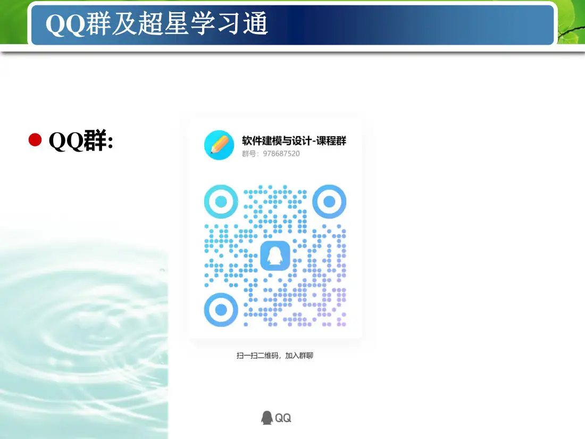

原文：

QQ群及超星学习通

- QQ群:

QQ

### 教材与主要参考书

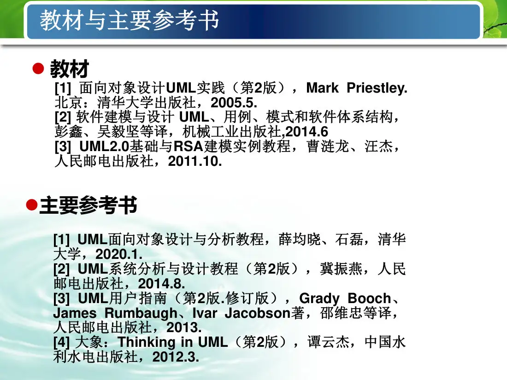

原文：

教材与主要参考书

教材

[1] 面向对象设计UML实践（第2版），Mark Priestley. 北京：清华大学出版社，2005.5.

[2] 软件建模与设计 UML、用例、模式和软件体系结构，彭鑫、吴毅坚等译，机械工业出版社,2014.6

[3] UML2.0基础与RSA建模实例教程，曹涟龙、汪杰，人民邮电出版社，2011.10.

主要参考书

[1] UML面向对象设计与分析教程，薛均晓、石磊，清华大学，2020.1.

[2] UML系统分析与设计教程（第2版），冀振燕，人民邮电出版社，2014.8.

[3] UML用户指南（第2版.修订版），Grady Booch、James Rumbaugh、Ivar Jacobson著，邵维忠等译，人民邮电出版社，2013.

[4] 大象：Thinking in UML（第2版），谭云杰，中国水利水电出版社，2012.3.

### 总课时：64，其中32课时线下，32课时线上

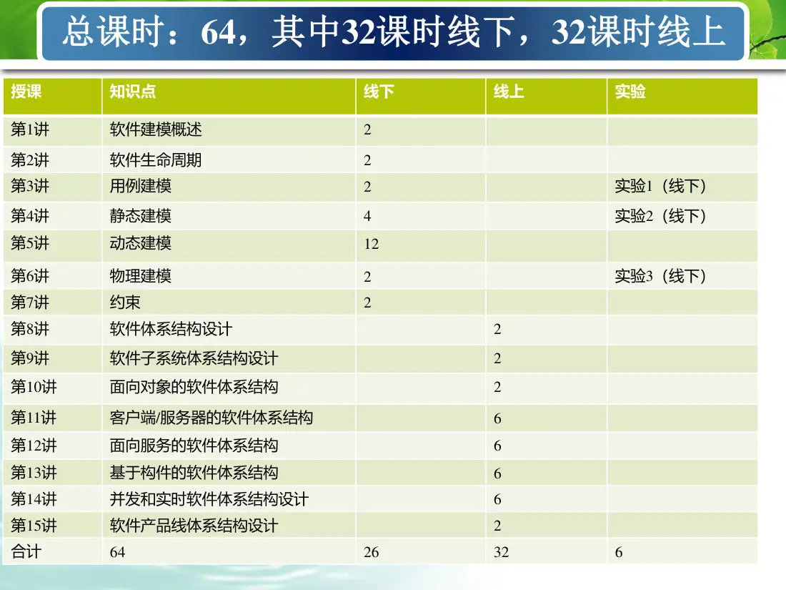

原文：

总课时：64，其中32课时线下，32课时线上

<table><tr><td>授课</td><td>知识点</td><td>线下</td><td>线上</td><td>实验</td></tr><tr><td>第1讲</td><td>软件建模概述</td><td>2</td><td></td><td></td></tr><tr><td>第2讲</td><td>软件生命周期</td><td>2</td><td></td><td></td></tr><tr><td>第3讲</td><td>用例建模</td><td>2</td><td></td><td>实验1(线下)</td></tr><tr><td>第4讲</td><td>静态建模</td><td>4</td><td></td><td>实验2(线下)</td></tr><tr><td>第5讲</td><td>动态建模</td><td>12</td><td></td><td></td></tr><tr><td>第6讲</td><td>物理建模</td><td>2</td><td></td><td>实验3(线下)</td></tr><tr><td>第7讲</td><td>约束</td><td>2</td><td></td><td></td></tr><tr><td>第8讲</td><td>软件体系结构设计</td><td></td><td>2</td><td></td></tr><tr><td>第9讲</td><td>软件子系统体系结构设计</td><td></td><td>2</td><td></td></tr><tr><td>第10讲</td><td>面向对象的软件体系结构</td><td></td><td>2</td><td></td></tr><tr><td>第11讲</td><td>客户端/服务器的软件体系结构</td><td></td><td>6</td><td></td></tr><tr><td>第12讲</td><td>面向服务的软件体系结构</td><td></td><td>6</td><td></td></tr><tr><td>第13讲</td><td>基于构件的软件体系结构</td><td></td><td>6</td><td></td></tr><tr><td>第14讲</td><td>并发和实时软件体系结构设计</td><td></td><td>6</td><td></td></tr><tr><td>第15讲</td><td>软件产品线体系结构设计</td><td></td><td>2</td><td></td></tr><tr><td>合计</td><td>64</td><td>26</td><td>32</td><td>6</td></tr></table>

### 课程考试

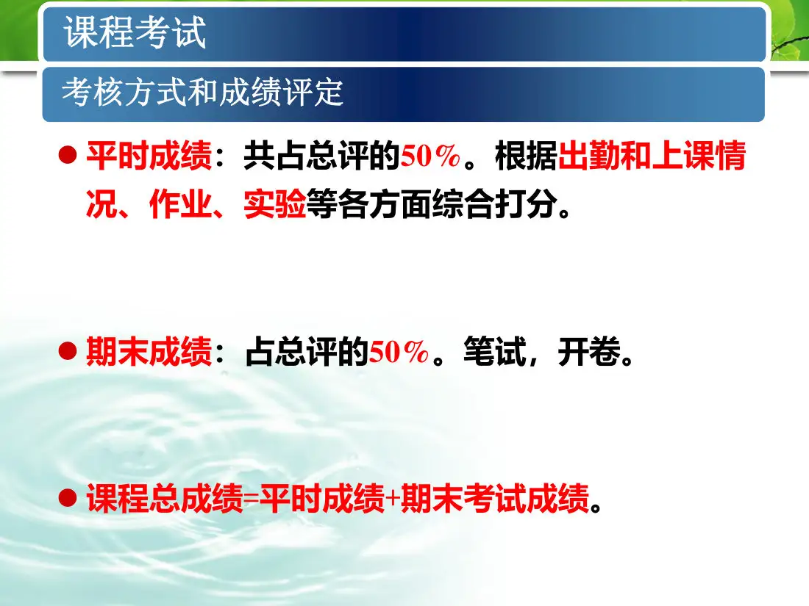

原文：

课程考试

考核方式和成绩评定

\- 平时成绩：共占总评的 $50 \%$ 。根据出勤和上课情况、作业、实验等各方面综合打分。

● 期末成绩：占总评的50%。笔试，开卷。

● 课程总成绩=平时成绩+期末考试成绩。

### 第1讲: 软件建模概述

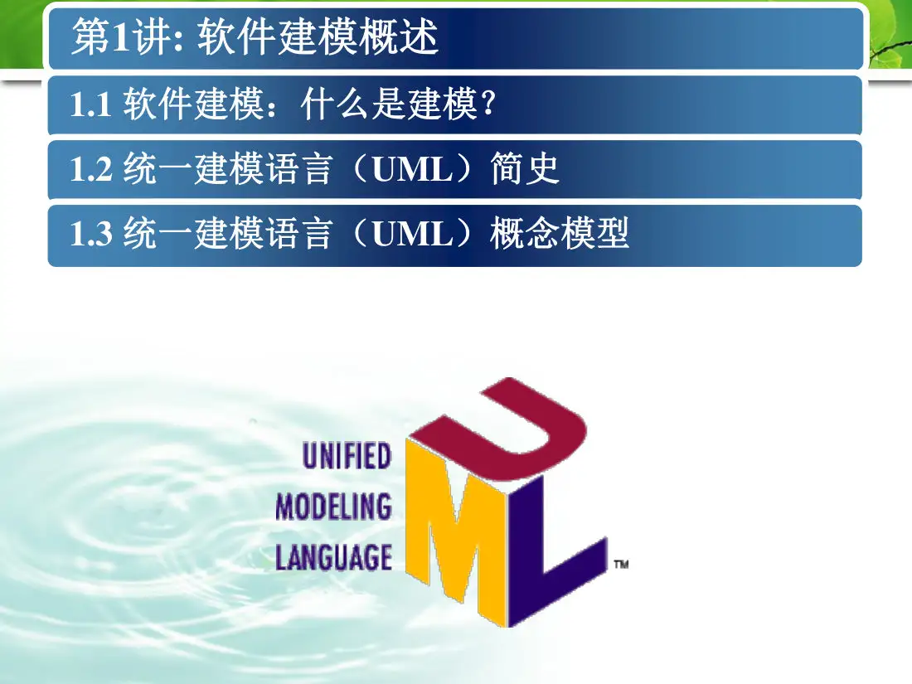

原文：

第1讲: 软件建模概述

1.1 软件建模：什么是建模？

1.2 统一建模语言（UML）简史

1.3 统一建模语言（UML）概念模型

UNIFIED MODELING LANGUAGE

### 第1讲:软件建模概述

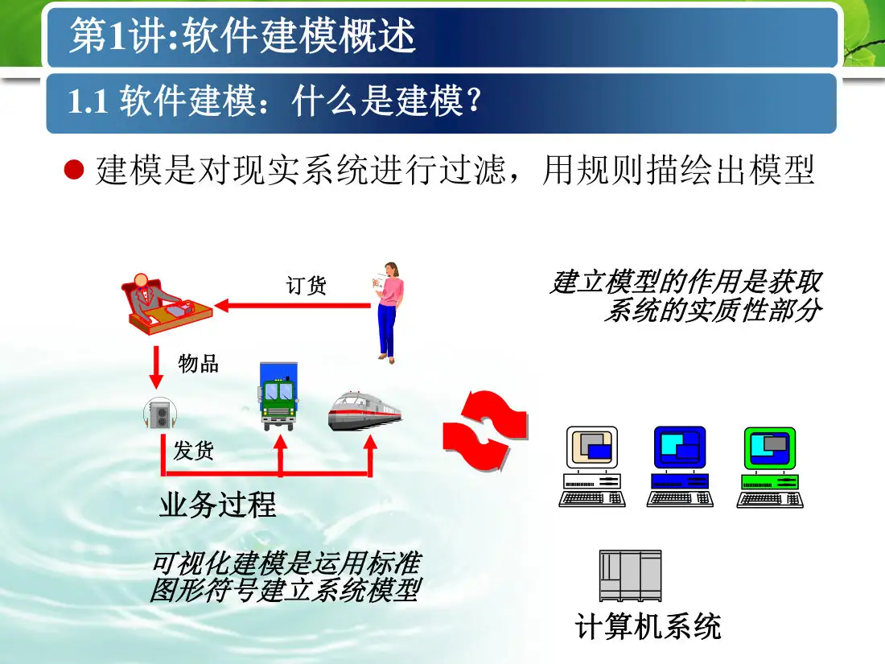

原文：

第1讲:软件建模概述

1.1 软件建模：什么是建模？

● 建模是对现实系统进行过滤，用规则描绘出模型

建立模型的作用是获取系统的实质性部分

### 第1讲:软件建模概述

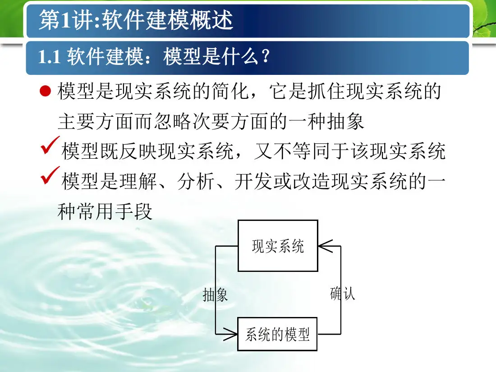

原文：

第1讲:软件建模概述

1.1 软件建模：模型是什么？

\- 模型是现实系统的简化，它是抓住现实系统的主要方面而忽略次要方面的一种抽象

√ 模型既反映现实系统，又不等同于该现实系统

√ 模型是理解、分析、开发或改造现实系统的一种常用手段

### 第1讲:软件建模概述

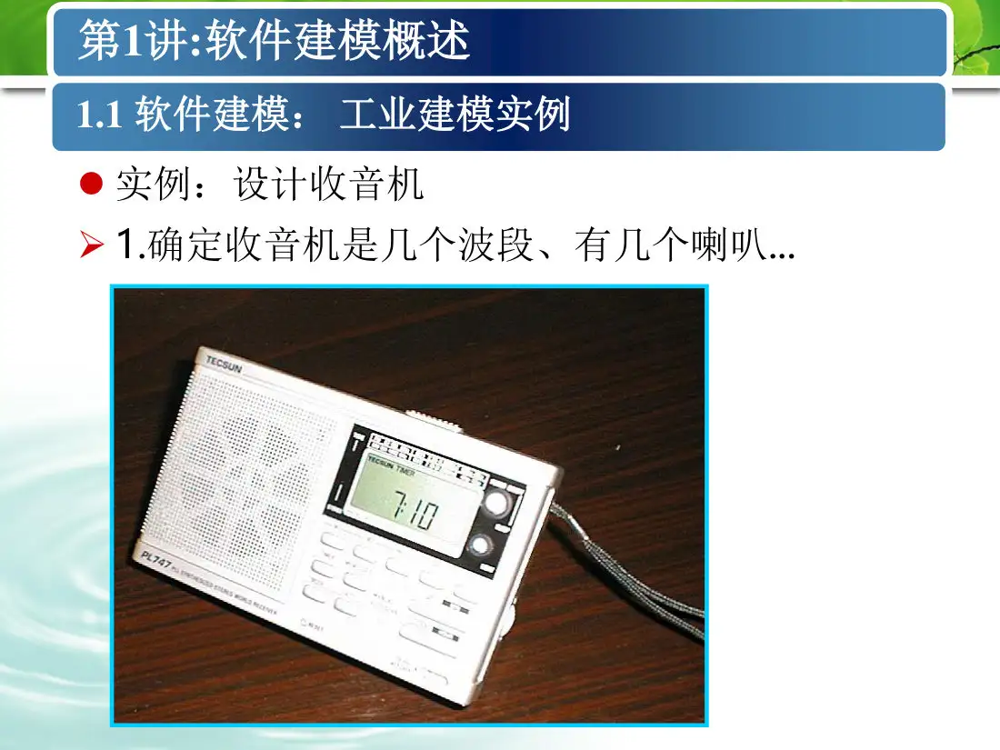

原文：

第1讲:软件建模概述

1.1 软件建模：工业建模实例

● 实例：设计收音机

1. 确定收音机是几个波段、有几个喇叭...

### 第1讲:软件建模概述

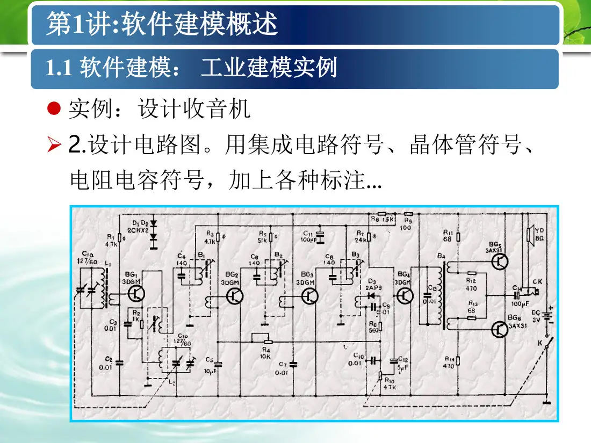

原文：

第1讲:软件建模概述

1.1 软件建模：工业建模实例

● 实例：设计收音机

2. 设计电路图。用集成电路符号、晶体管符号、电阻电容符号，加上各种标注...

### 第1讲:软件建模概述

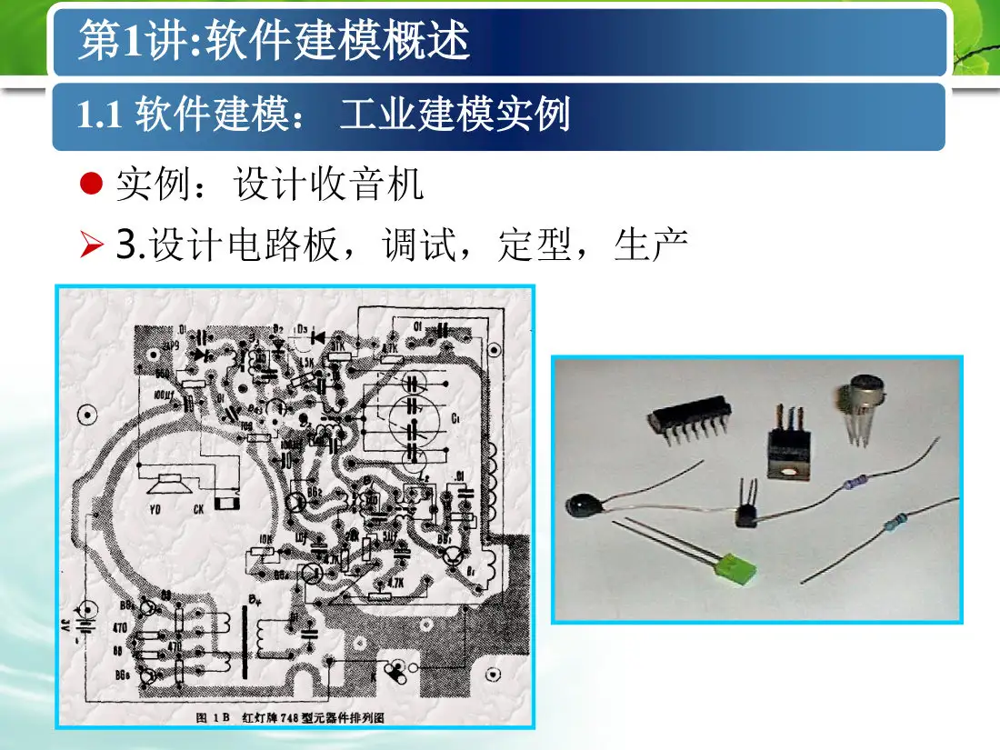

原文：

第1讲:软件建模概述

1.1 软件建模：工业建模实例

● 实例：设计收音机

3. 设计电路板，调试，定型，生产

### 第1讲:软件建模概述

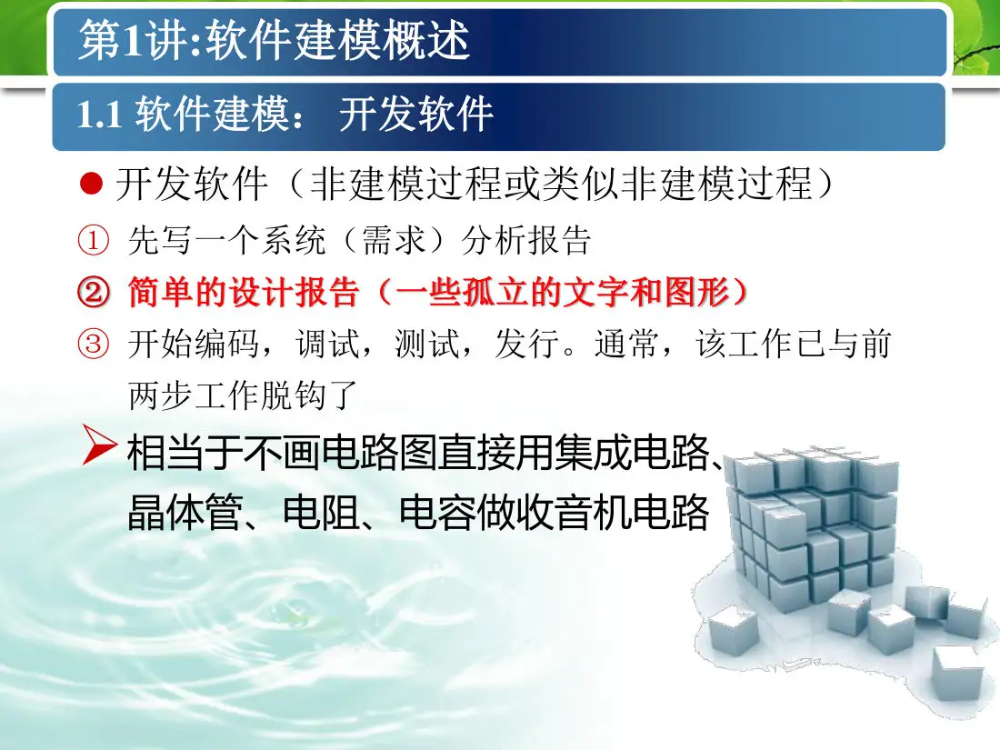

原文：

第1讲:软件建模概述

1.1 软件建模：开发软件

● 开发软件（非建模过程或类似非建模过程）

① 先写一个系统（需求）分析报告

② 简单的设计报告（一些孤立的文字和图形）

③ 开始编码，调试，测试，发行。通常，该工作已与前两步工作脱钩了

相当于不画电路图直接用集成电路、晶体管、电阻、电容做收音机电路

### 第1讲:软件建模概述

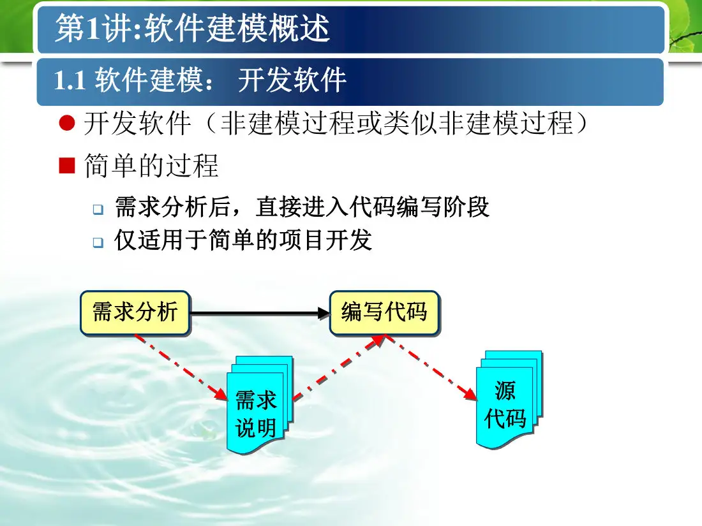

原文：

第1讲:软件建模概述

1.1 软件建模：开发软件

● 开发软件（非建模过程或类似非建模过程）

■ 简单的过程

☐ 需求分析后，直接进入代码编写阶段

□ 仅适用于简单的项目开发

### 第1讲:软件建模概述

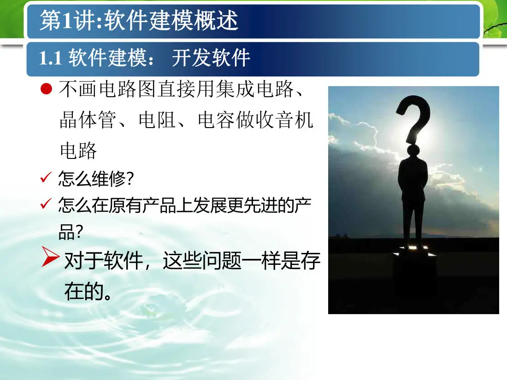

原文：

第1讲:软件建模概述

1.1 软件建模：开发软件

\- 不画电路图直接用集成电路、晶体管、电阻、电容做收音机电路

√ 怎么维修？

√ 怎么在原有产品上发展更先进的产品？

对于软件，这些问题一样是存在的。

### 第1讲:软件建模概述

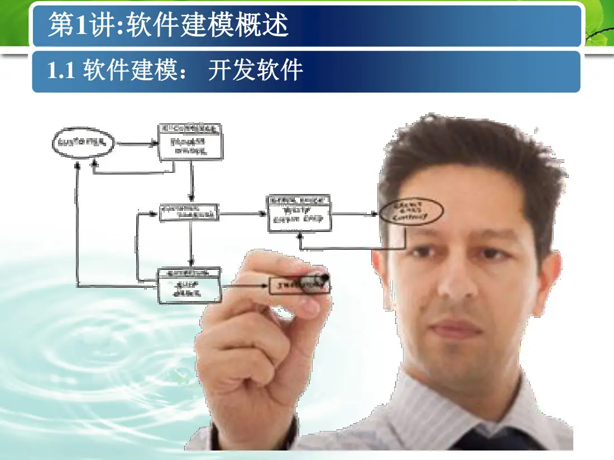

原文：

第1讲:软件建模概述

1.1 软件建模：开发软件

### 第1讲:软件建模概述

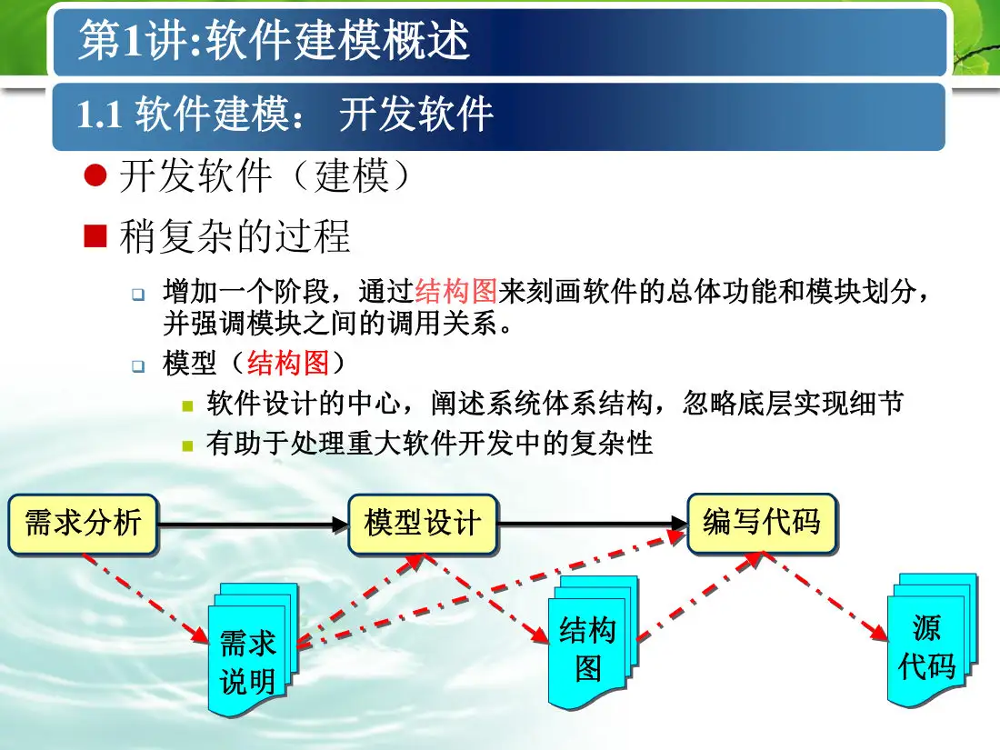

原文：

第1讲:软件建模概述

1.1 软件建模：开发软件

● 开发软件（建模）

■ 稍复杂的过程

☐ 增加一个阶段，通过结构图来刻画软件的总体功能和模块划分，并强调模块之间的调用关系。

模型（结构图）

■ 软件设计的中心，阐述系统体系结构，忽略底层实现细节

■ 有助于处理重大软件开发中的复杂性

### 第1讲:软件建模概述

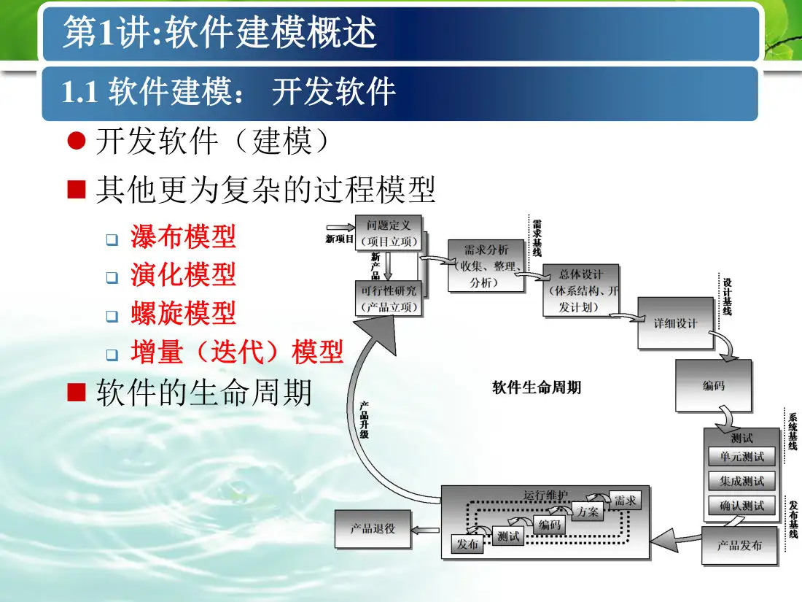

原文：

第1讲:软件建模概述

1.1 软件建模：开发软件

● 开发软件（建模）

■ 其他更为复杂的过程模型

瀑布模型

□ 演化模型

□ 螺旋模型

☐ 增量（迭代）模型

■ 软件的生命周期

### 第1讲:软件建模概述

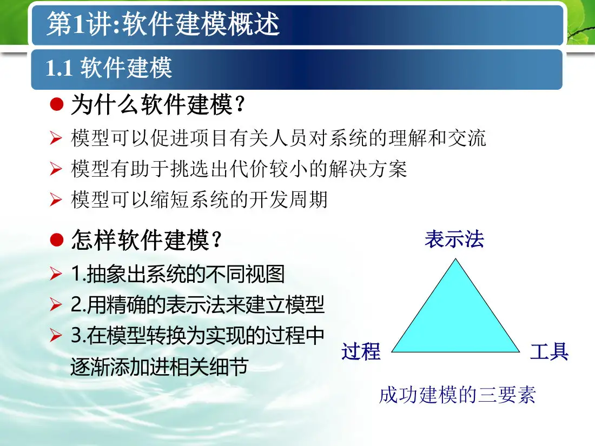

原文：

第1讲:软件建模概述

1.1 软件建模

- 为什么软件建模？

模型可以促进项目有关人员对系统的理解和交流

模型有助于挑选出代价较小的解决方案

模型可以缩短系统的开发周期

\- 怎样软件建模？

1. 抽象出系统的不同视图

2.用精确的表示法来建立模型

3. 在模型转换为实现的过程中逐渐添加进相关细节

### 第1讲:软件建模概述

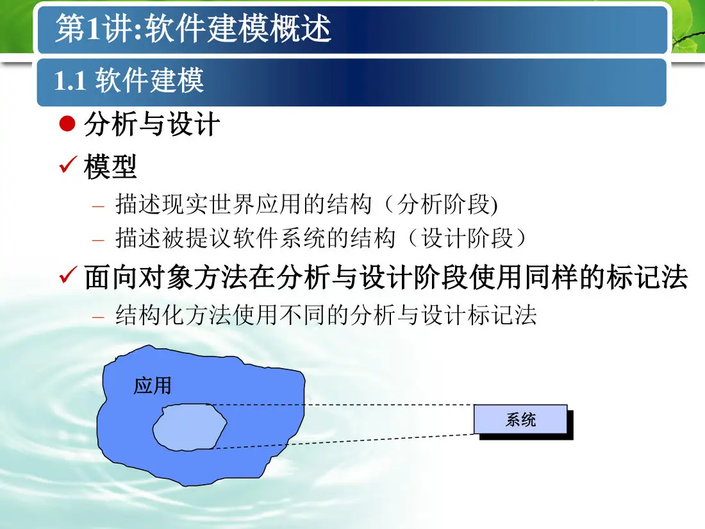

原文：

第1讲:软件建模概述

1.1 软件建模

- 分析与设计

√ 模型

\- 描述现实世界应用的结构（分析阶段）

\- 描述被提议软件系统的结构（设计阶段）

√ 面向对象方法在分析与设计阶段使用同样的标记法
- 结构化方法使用不同的分析与设计标记法

### 第1讲:软件建模概述

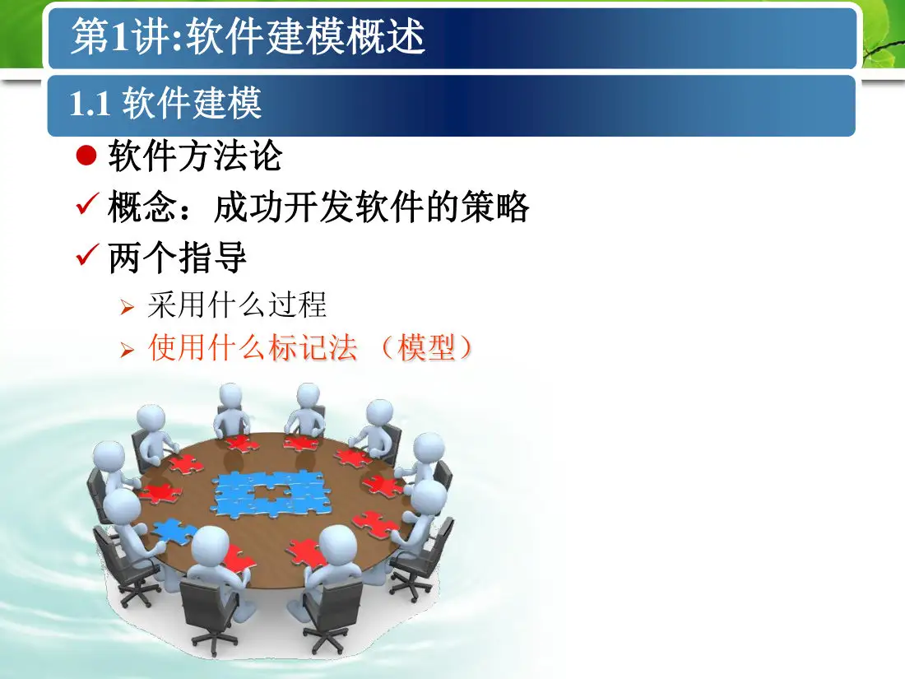

原文：

第1讲:软件建模概述

1.1 软件建模

\- 软件方法论

√ 概念：成功开发软件的策略

√ 两个指导

采用什么过程

➢ 使用什么标记法 （模型）

### 第1讲:软件建模概述

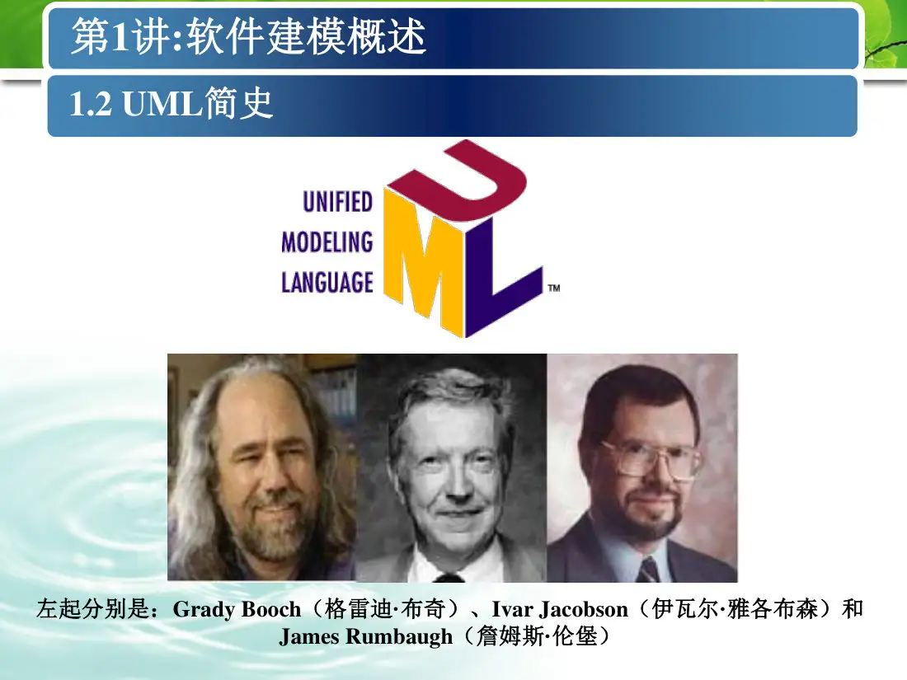

原文：

第1讲:软件建模概述

1.2 UML简史

UNIFIED
MODELING
LANGUAGE

### 第1讲:软件建模概述

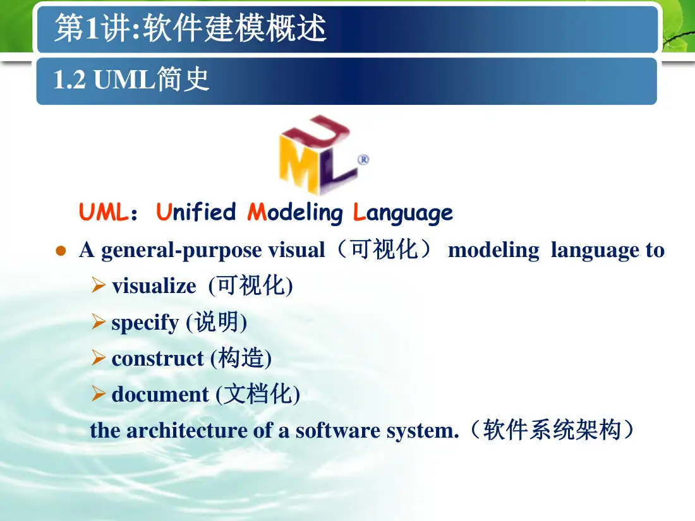

原文：

第1讲:软件建模概述

1.2 UML简史

UML: Unified Modeling Language

\- A general-purpose visual（可视化） modeling language to visualize（可视化）

specify (说明)

construct (构造)

document (文档化)

the architecture of a software system.（软件系统架构）

### 第1讲:软件建模概述

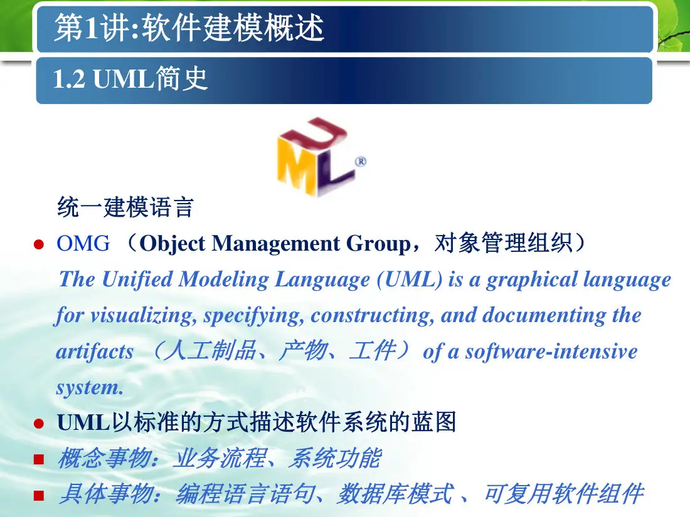

原文：

第1讲:软件建模概述

1.2 UML简史

统一建模语言

\- OMG（Object Management Group，对象管理组织）
The Unified Modeling Language (UML) is a graphical language for visualizing, specifying, constructing, and documenting the artifacts （人工制品、产物、工件） of a software-intensive system.

UML以标准的方式描述软件系统的蓝图

■ 概念事物：业务流程、系统功能

■ 具体事物：编程语言语句、数据库模式、可复用软件组件

### 第1讲:软件建模概述

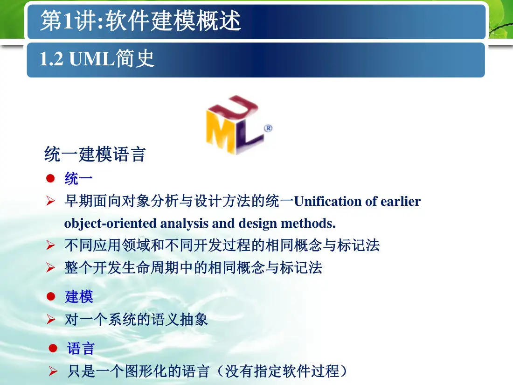

原文：

第1讲:软件建模概述

1.2 UML简史

统一建模语言

\- 统一

早期面向对象分析与设计方法的统一Unification of earlier object-oriented analysis and design methods.

不同应用领域和不同开发过程的相同概念与标记法

整个开发生命周期中的相同概念与标记法

建模

对一个系统的语义抽象

语言

只是一个图形化的语言（没有指定软件过程）

### 第1讲:软件建模概述

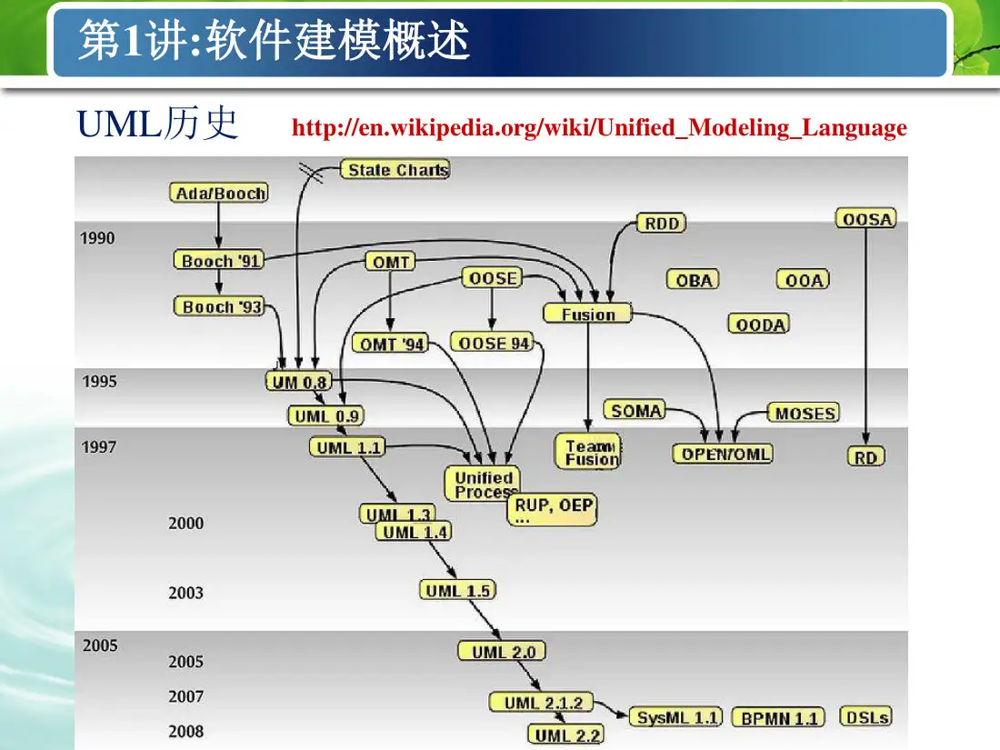

原文：

第1讲:软件建模概述

UML历史

http://en.wikipedia.org/wiki/Unified\_Modeling\_Language

### 第1讲:软件建模概述

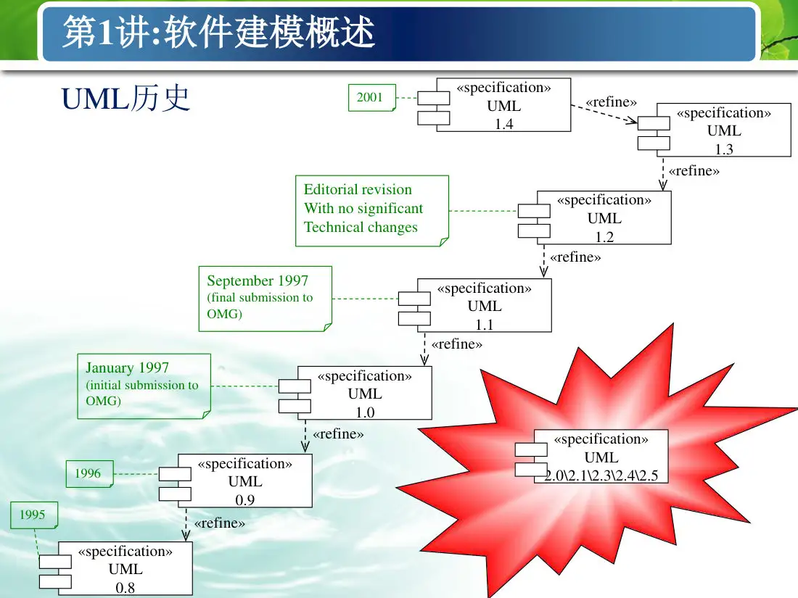

原文：

第1讲:软件建模概述

UML历史

### 第1讲:软件建模概述

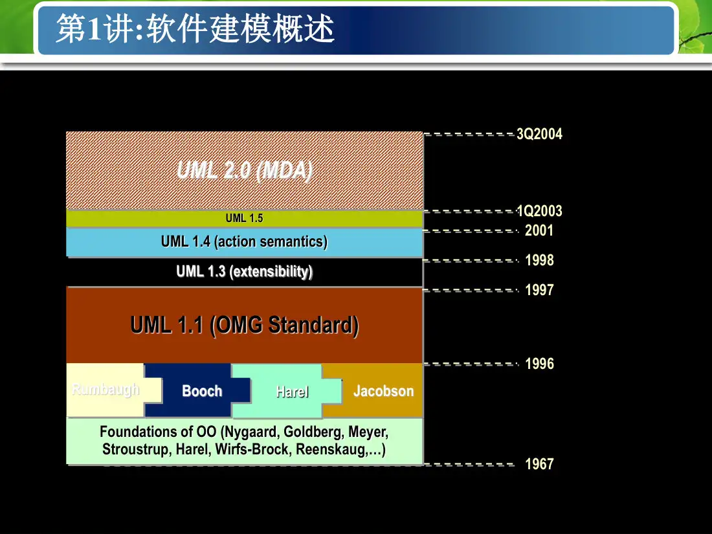

原文：

第1讲:软件建模概述

UML 1.3 (extensibility)

UML 1.1 (OMG Standard)

Foundations of OO (Nygaard, Goldberg, Meyer, Stroustrup, Harel, Wirfs-Brock, Reenskaug,...)

### 第1讲:软件建模概述

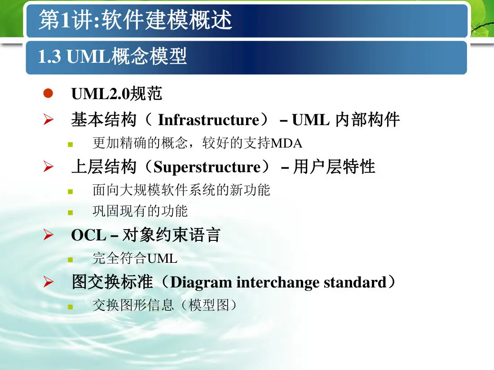

原文：

第1讲:软件建模概述

1.3 UML概念模型

UML2.0规范

基本结构（Infrastructure）- UML 内部构件

■ 更加精确的概念，较好的支持MDA

上层结构（Superstructure）- 用户层特性

面向大规模软件系统的新功能

巩固现有的功能

OCL - 对象约束语言

完全符合UML

图交换标准（Diagram interchange standard）

交换图形信息（模型图）

### 第1讲:软件建模概述

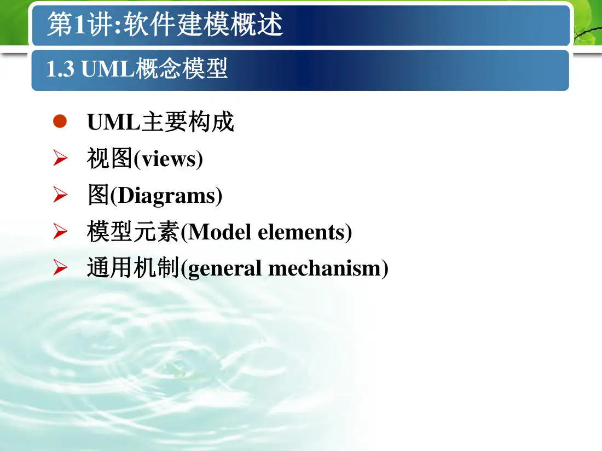

原文：

第1讲:软件建模概述

1.3 UML概念模型

UML主要构成

视图(views)

图(Diagrams)

模型元素(Model elements)

通用机制(general mechanism)

### 第1讲:软件建模概述

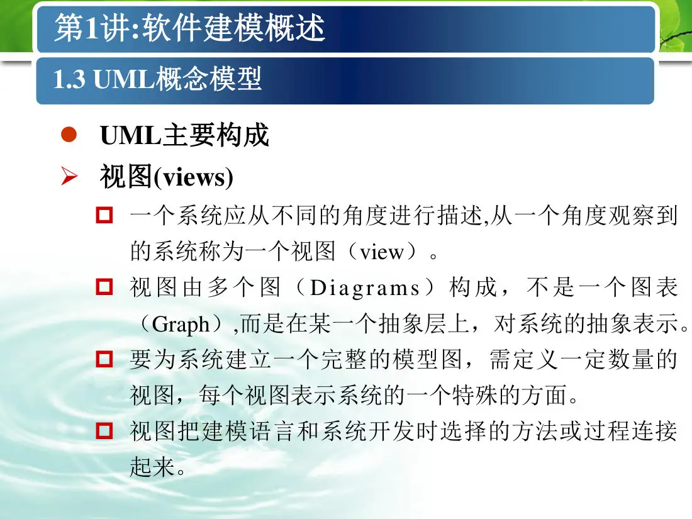

原文：

第1讲:软件建模概述

1.3 UML概念模型

UML主要构成

视图(views)

☐ 一个系统应从不同的角度进行描述,从一个角度观察到的系统称为一个视图（view）。

☐ 视图由多个图（Diagrams）构成，不是一个图表（Graph），而是在某一个抽象层上，对系统的抽象表示。

要为系统建立一个完整的模型图，需定义一定数量的视图，每个视图表示系统的一个特殊的方面。

☐ 视图把建模语言和系统开发时选择的方法或过程连接起来。

### 第1讲:软件建模概述

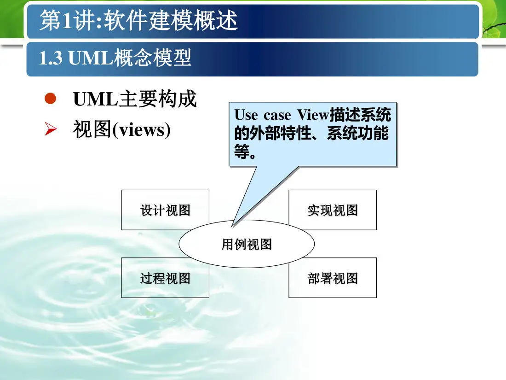

原文：

第1讲:软件建模概述

1.3 UML概念模型

UML主要构成

视图(views)

Use case View描述系统的外部特性、系统功能等。

设计视图

过程视图

实现视图

部署视图

### 第1讲:软件建模概述

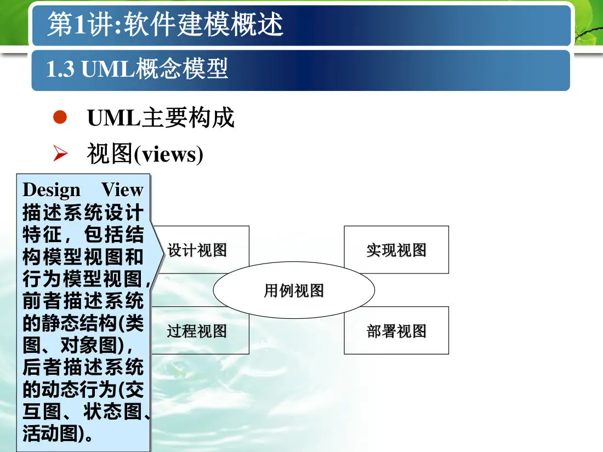

原文：

第1讲:软件建模概述

1.3 UML概念模型

UML主要构成

视图(views)

Design View 描述系统设计特征，包括结构模型视图和行为模型视图，前者描述系统的静态结构(类图、对象图)，后者描述系统的动态行为(交互图、状态图、活动图)。

### 第1讲:软件建模概述

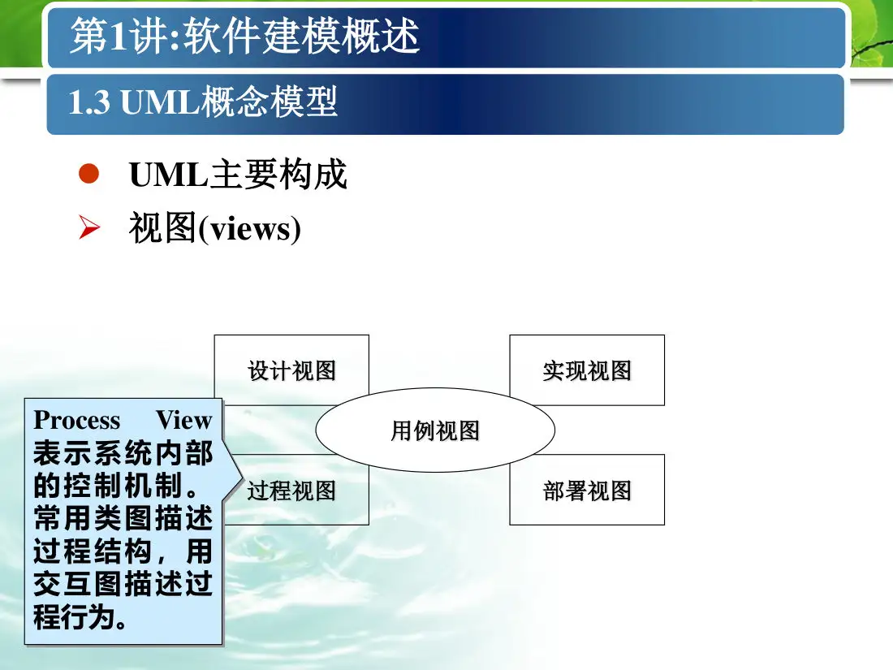

原文：

第1讲:软件建模概述

1.3 UML概念模型

UML主要构成

视图(views)

Process View 表示系统内部的控制机制。常用类图描述过程结构，用交互图描述过程行为。

### 第1讲:软件建模概述

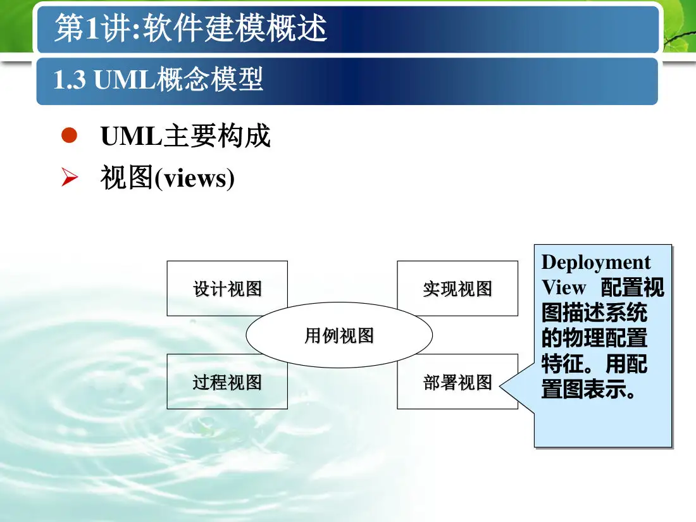

原文：

第1讲:软件建模概述

1.3 UML概念模型

UML主要构成

视图(views)

Deployment View 配置视图描述系统的物理配置特征。用配置图表示。

### 第1讲:软件建模概述

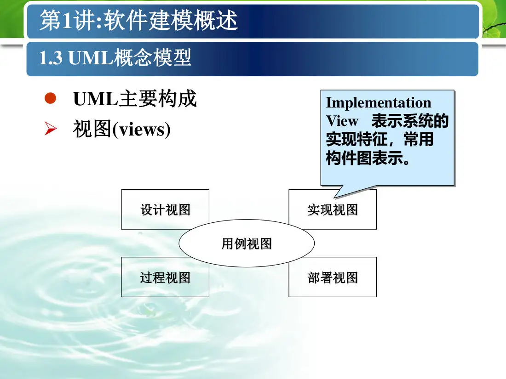

原文：

第1讲:软件建模概述

1.3 UML概念模型

UML主要构成

视图(views)

Implementation View 表示系统的实现特征，常用构件图表示。

用例视图

### 第1讲:软件建模概述

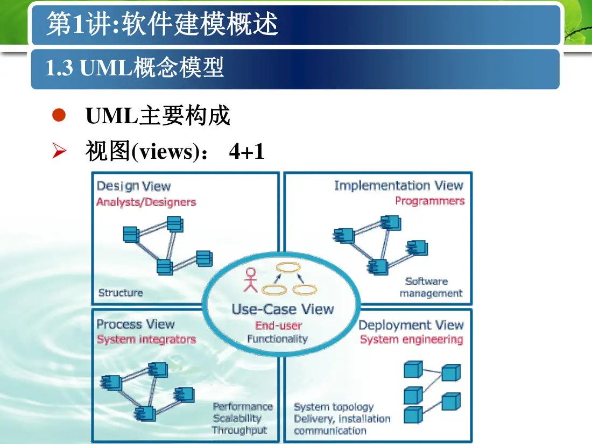

原文：

第1讲:软件建模概述

1.3 UML概念模型

UML主要构成

视图(views): 4+1

### 第1讲:软件建模概述

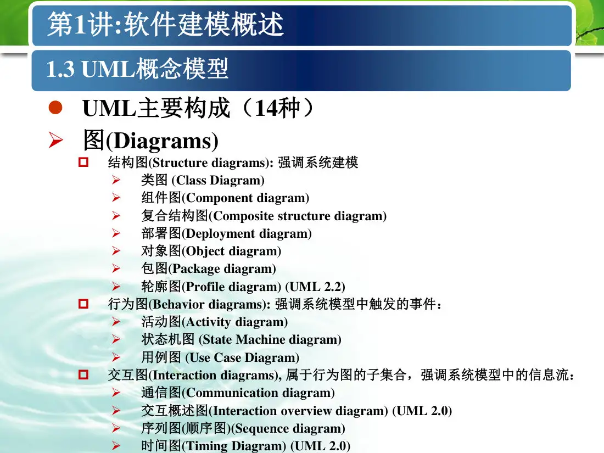

原文：

第1讲:软件建模概述

1.3 UML概念模型

UML主要构成（14种）

图(Diagrams)

结构图(Structure diagrams): 强调系统建模

类图 (Class Diagram)

组件图(Component diagram)

复合结构图(Composite structure diagram)

部署图(Deployment diagram)

对象图(Object diagram)

包图(Package diagram)

轮廓图(Profile diagram) (UML 2.2)

☐ 行为图(Behavior diagrams): 强调系统模型中触发的事件:

活动图(Activity diagram)

状态机图 (State Machine diagram)

用例图 (Use Case Diagram)

☐ 交互图(Interaction diagrams), 属于行为图的子集合, 强调系统模型中的信息流:

通信图(Communication diagram)

交互概述图(Interaction overview diagram) (UML 2.0)

序列图(顺序图)(Sequence diagram)

时间图(Timing Diagram) (UML 2.0)

### 第1讲:软件建模概述

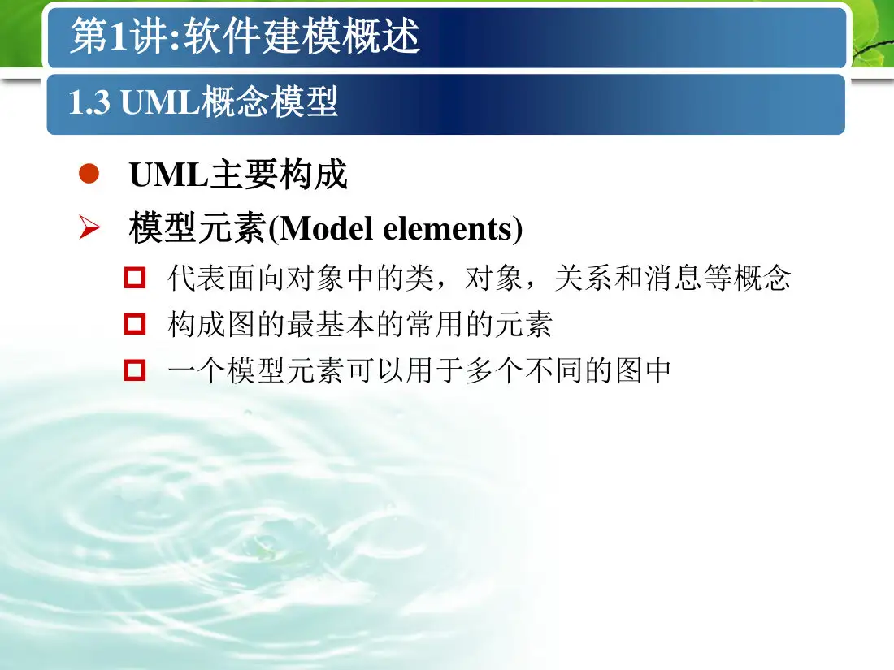

原文：

第1讲:软件建模概述

1.3 UML概念模型

UML主要构成

模型元素(Model elements)

□ 代表面向对象中的类，对象，关系和消息等概念

构成图的最基本的常用的元素

一个模型元素可以用于多个不同的图中

### 第1讲:软件建模概述

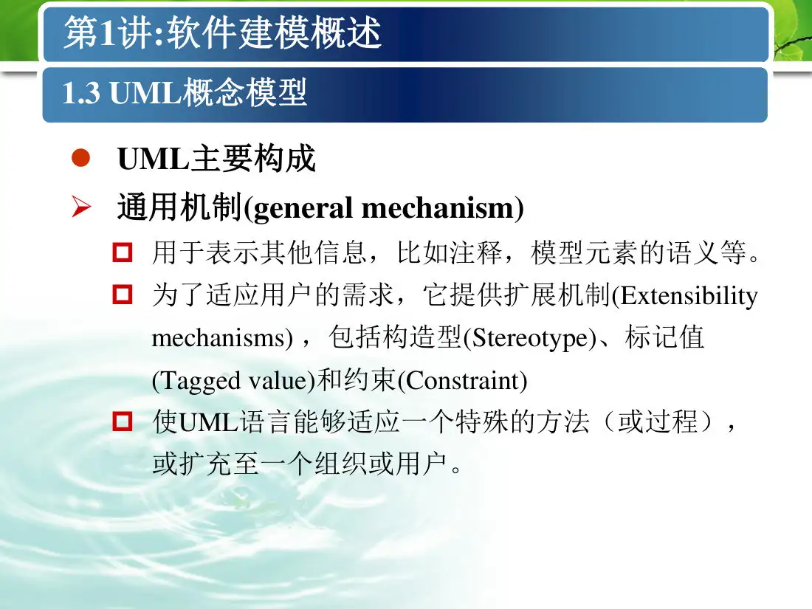

原文：

第1讲:软件建模概述

1.3 UML概念模型

UML主要构成

通用机制(general mechanism)

☐ 用于表示其他信息，比如注释，模型元素的语义等。

☐ 为了适应用户的需求，它提供扩展机制(Extensibility mechanisms)，包括构造型(Stereotype)、标记值(Tagged value)和约束(Constraint)

☐ 使UML语言能够适应一个特殊的方法（或过程），或扩充至一个组织或用户。

### 第1讲:软件建模概述

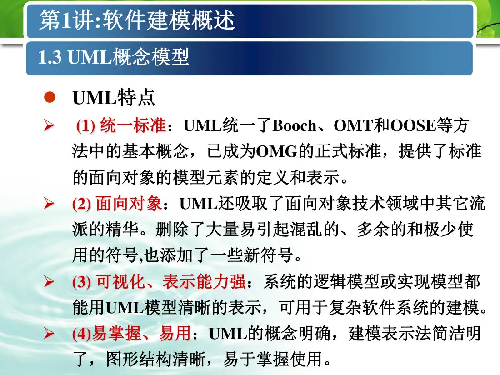

原文：

第1讲:软件建模概述

1.3 UML概念模型

UML特点

(1) 统一标准：UML统一了Booch、OMT和OOSE等方法中的基本概念，已成为OMG的正式标准，提供了标准的面向对象的模型元素的定义和表示。

(2) 面向对象: UML还吸取了面向对象技术领域中其它流派的精华。删除了大量易引起混乱的、多余的和极少使用的符号,也添加了一些新符号。

(3) 可视化、表示能力强：系统的逻辑模型或实现模型都能用UML模型清晰的表示，可用于复杂软件系统的建模。

(4)易掌握、易用：UML的概念明确，建模表示法简洁明了，图形结构清晰，易于掌握使用。

### 第1讲:软件建模概述

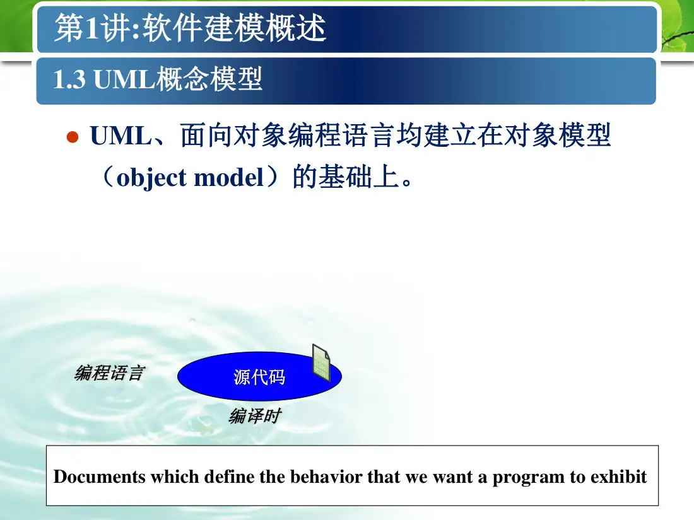

原文：

第1讲:软件建模概述

1.3 UML概念模型

\- UML、面向对象编程语言均建立在对象模型（object model）的基础上。

编程语言

源代码

编译时

Documents which define the behavior that we want a program to exhibit

### 第1讲:软件建模概述

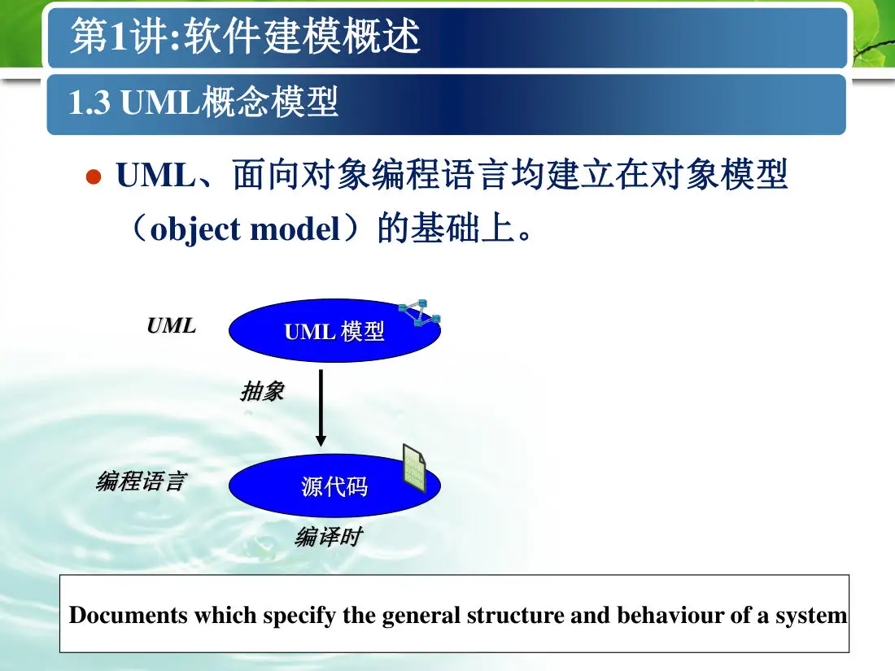

原文：

第1讲:软件建模概述

1.3 UML概念模型

\- UML、面向对象编程语言均建立在对象模型（object model）的基础上。

Documents which specify the general structure and behaviour of a system

### 第1讲:软件建模概述

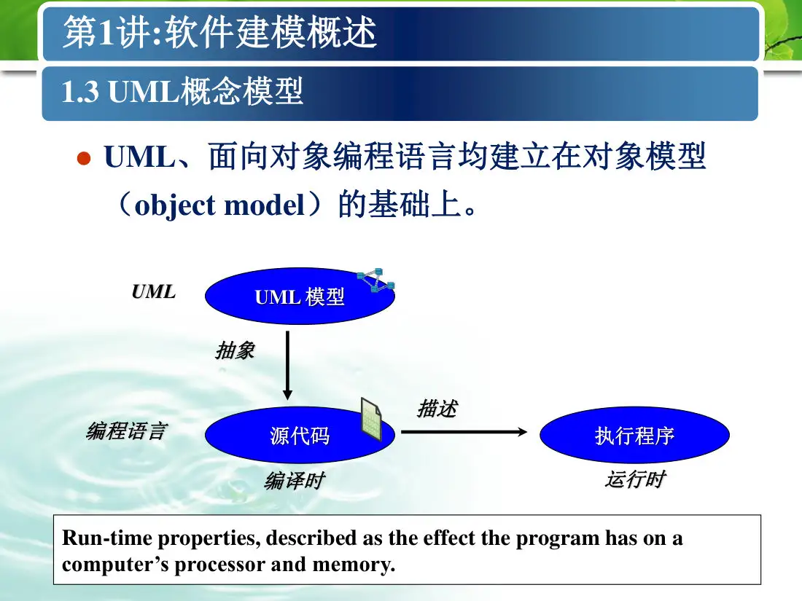

原文：

第1讲:软件建模概述

1.3 UML概念模型

\- UML、面向对象编程语言均建立在对象模型（object model）的基础上。

Run-time properties, described as the effect the program has on a computer's processor and memory.

### 第1讲:软件建模概述

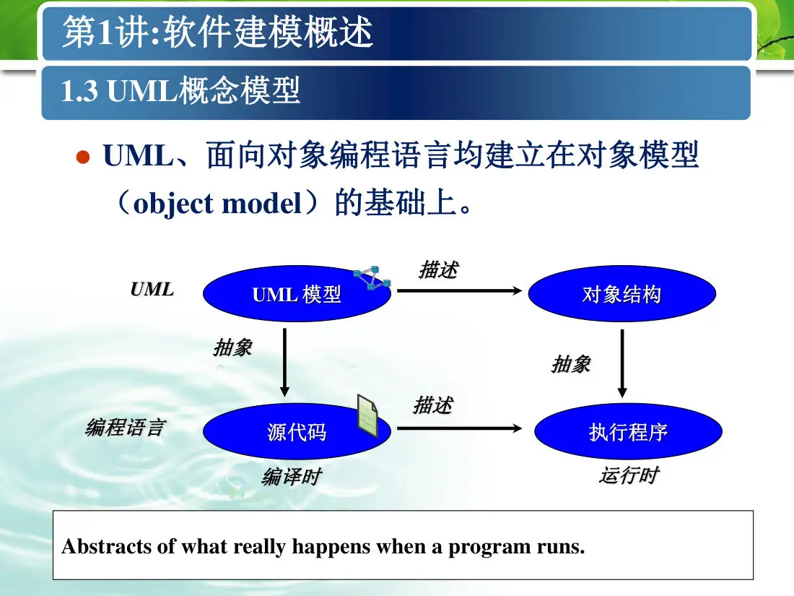

原文：

第1讲:软件建模概述

1.3 UML概念模型

\- UML、面向对象编程语言均建立在对象模型（object model）的基础上。

Abstracts of what really happens when a program runs.

### 第1讲:软件建模概述

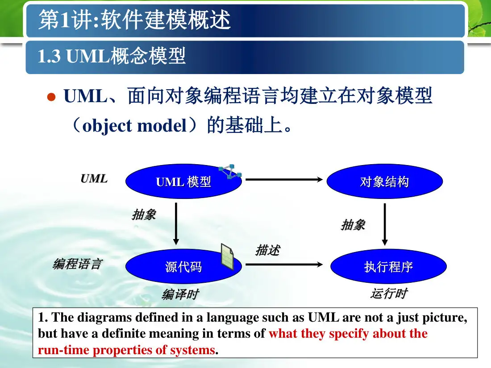

原文：

第1讲:软件建模概述

1.3 UML概念模型

\- UML、面向对象编程语言均建立在对象模型（object model）的基础上。

### 第1讲:软件建模概述

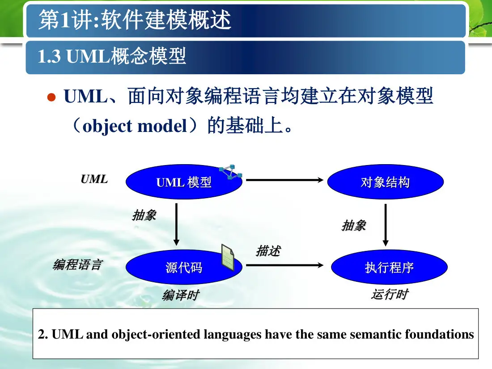

原文：

第1讲:软件建模概述

1.3 UML概念模型

\- UML、面向对象编程语言均建立在对象模型（object model）的基础上。
