# 《软件建模与设计》第2讲 软件开发过程（课件）

原件的每一页，下面附识别出的文字。

### 软件建模与设计

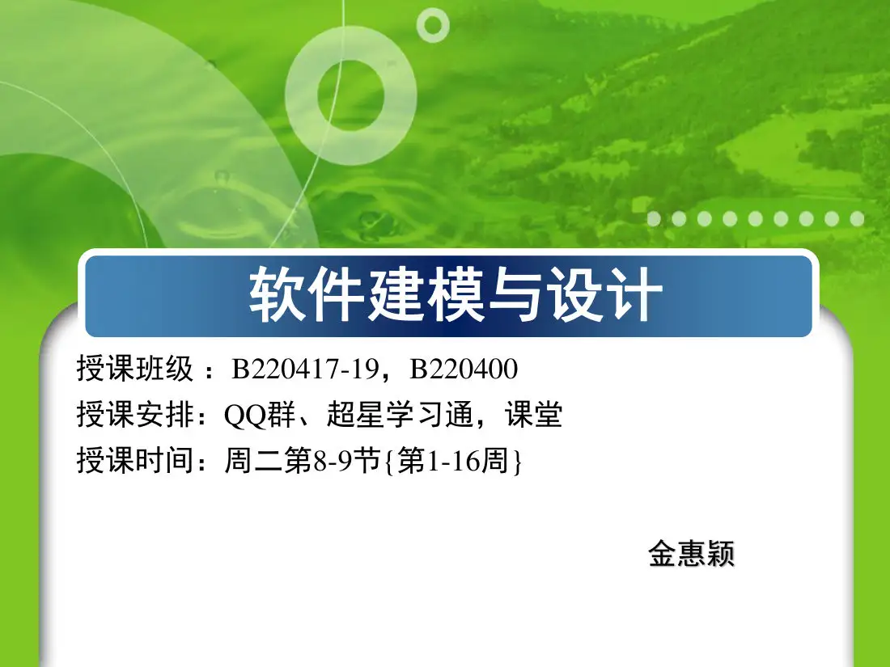

原文：

软件建模与设计

授课班级：B220417-19，B220400

授课安排：QQ群、超星学习通，课堂

授课时间：周二第8-9节{第1-16周}

金惠颖

### 第2讲: 软件开发过程

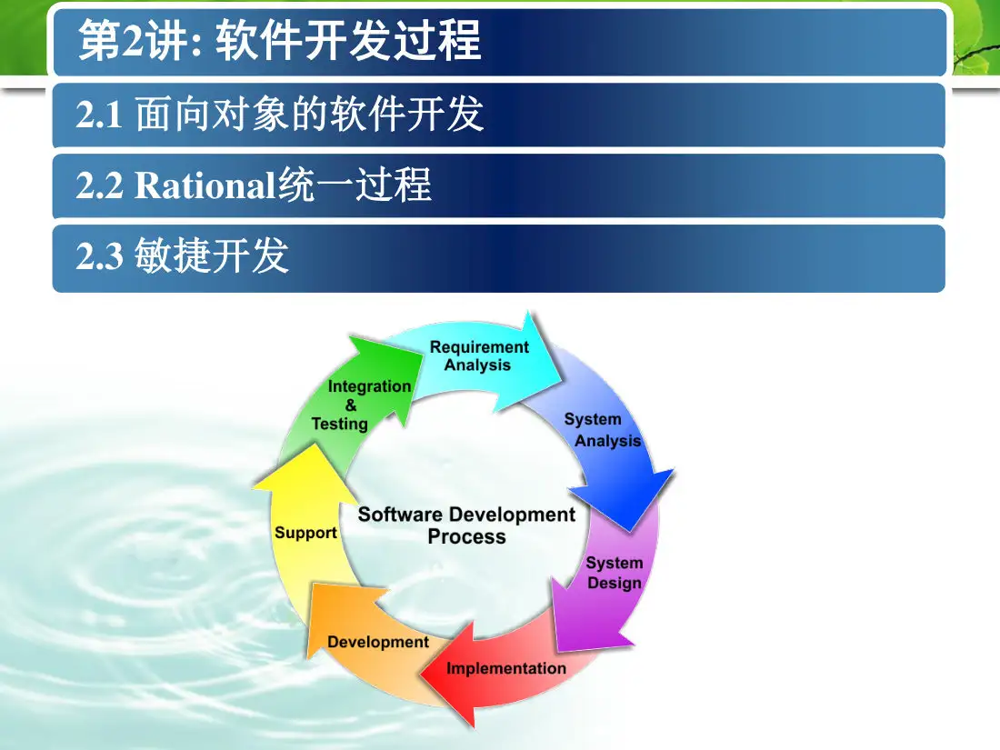

原文：

第2讲: 软件开发过程

2.1 面向对象的软件开发

2.2 Rational统一过程

2.3 敏捷开发

### 第2讲: 软件开发过程

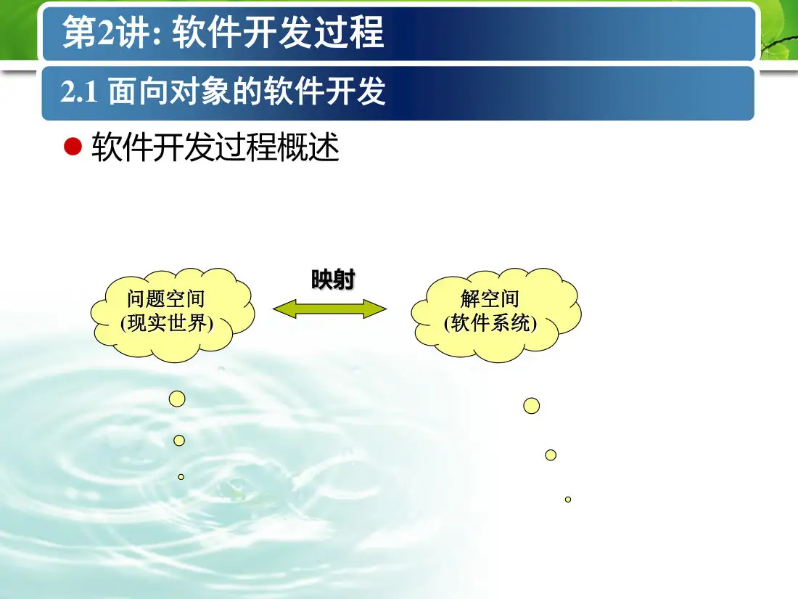

原文：

第2讲: 软件开发过程

2.1 面向对象的软件开发

\- 软件开发过程概述

问题空间
(现实世界)

解空间
(软件系统)

### 第2讲: 软件开发过程

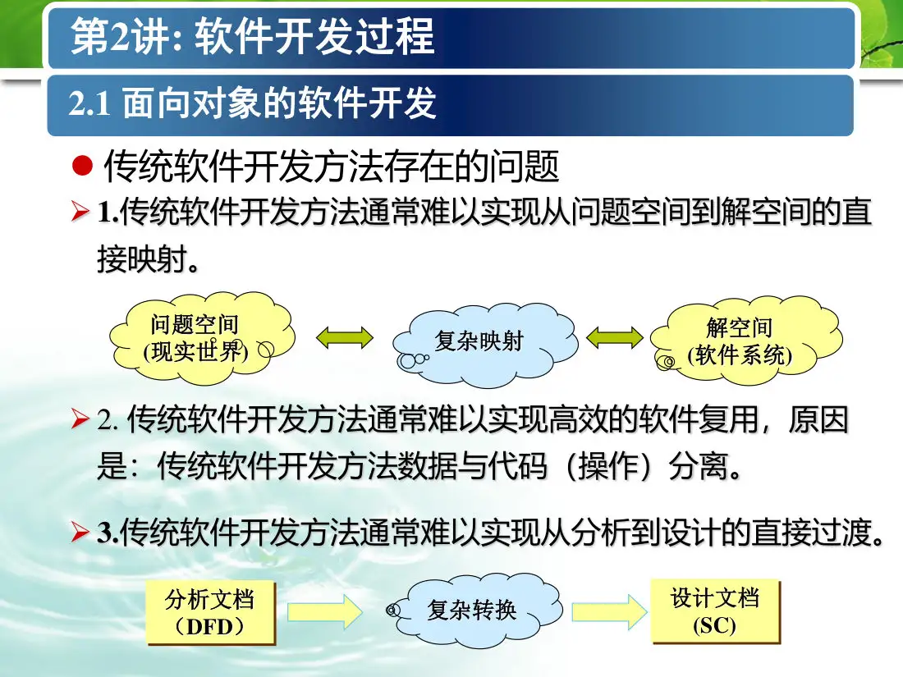

原文：

第2讲: 软件开发过程

2.1 面向对象的软件开发

\- 传统软件开发方法存在的问题

1.传统软件开发方法通常难以实现从问题空间到解空间的直接映射。

2. 传统软件开发方法通常难以实现高效的软件复用，原因是：传统软件开发方法数据与代码（操作）分离。

3.传统软件开发方法通常难以实现从分析到设计的直接过渡。

### 第2讲: 软件开发过程

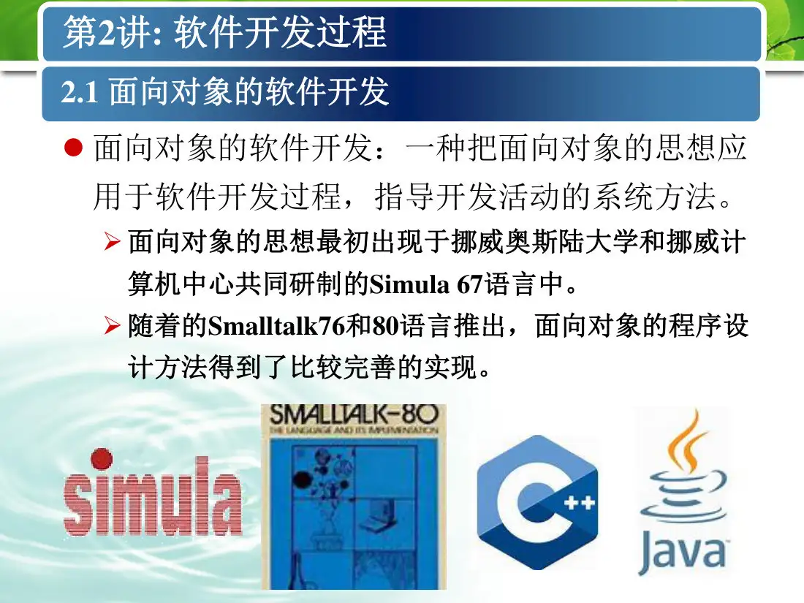

原文：

第2讲: 软件开发过程

2.1 面向对象的软件开发

\- 面向对象的软件开发：一种把面向对象的思想应用于软件开发过程，指导开发活动的系统方法。

面向对象的思想最初出现于挪威奥斯陆大学和挪威计算机中心共同研制的Simula 67语言中。

随着的Smalltalk76和80语言推出，面向对象的程序设计方法得到了比较完善的实现。

### 第2讲: 软件开发过程

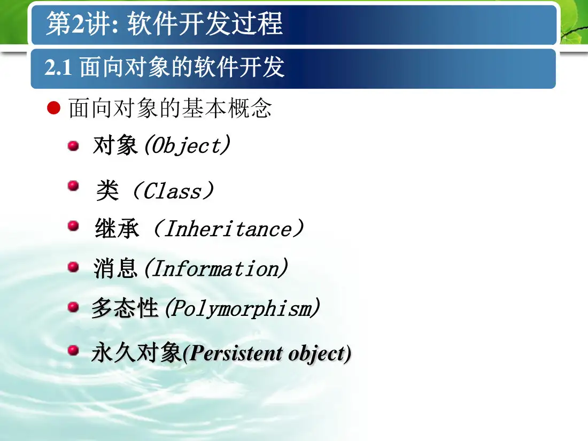

原文：

第2讲: 软件开发过程

2.1 面向对象的软件开发

面向对象的基本概念

\- 对象 (Object)

类 (Class)

\- 继承（Inheritance）

\- 消息 (Information)

\- 多态性 (Polymorphism)

\- 永久对象(Persistent object)

### 第2讲: 软件开发过程

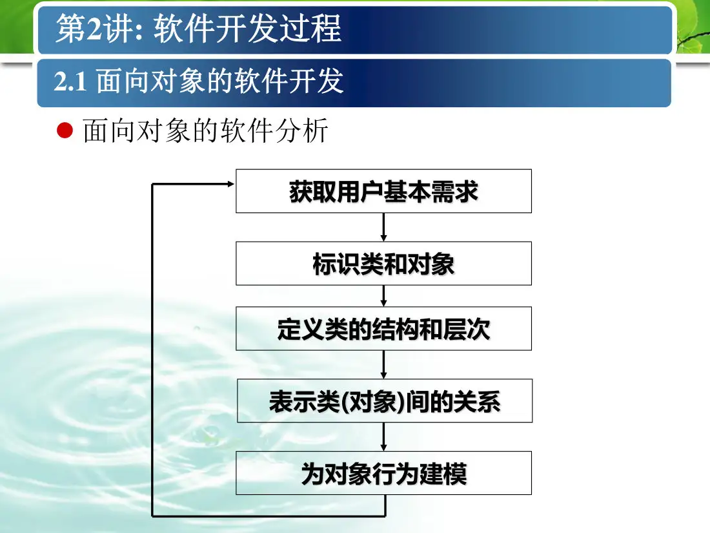

原文：

第2讲: 软件开发过程

2.1 面向对象的软件开发

面向对象的软件分析

### 第2讲: 软件开发过程

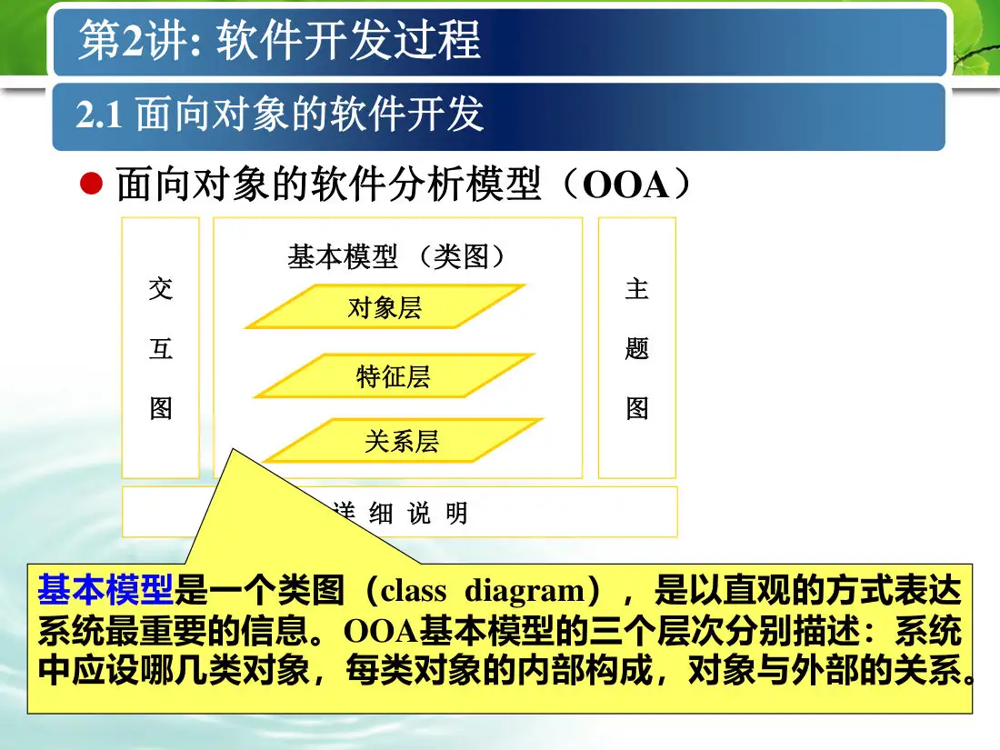

原文：

第2讲: 软件开发过程

2.1 面向对象的软件开发

面向对象的软件分析模型（OOA）

主
题
图交
互
图

基本模型是一个类图（class diagram），是以直观的方式表达系统最重要的信息。OOA基本模型的三个层次分别描述：系统中应设哪几类对象，每类对象的内部构成，对象与外部的关系。

### 第2讲: 软件开发过程

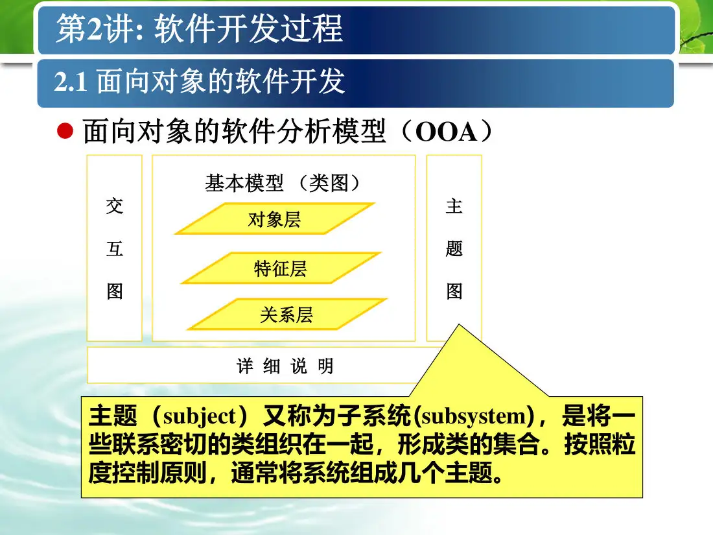

原文：

第2讲: 软件开发过程

2.1 面向对象的软件开发

面向对象的软件分析模型（OOA）

交
互
图主
题
图

详细说明

主题（subject）又称为子系统(subsystem)，是将一些联系密切的类组织在一起，形成类的集合。按照粒度控制原则，通常将系统组成几个主题。

### 第2讲: 软件开发过程

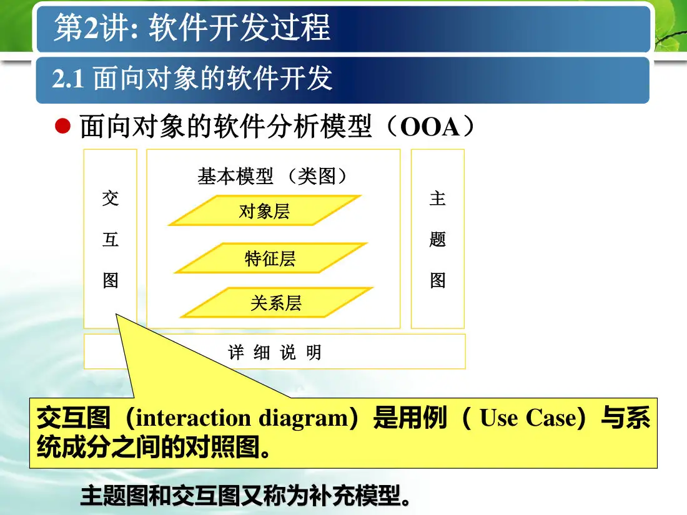

原文：

第2讲: 软件开发过程

2.1 面向对象的软件开发

面向对象的软件分析模型（OOA）

交互图（interaction diagram）是用例（Use Case）与系统成分之间的对照图。

主题图和交互图又称为补充模型。

### 第2讲: 软件开发过程

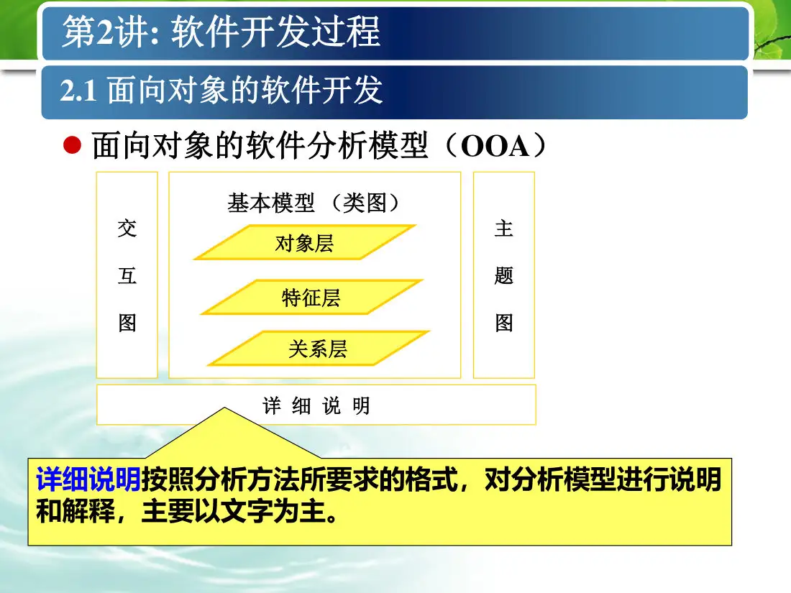

原文：

第2讲: 软件开发过程

2.1 面向对象的软件开发

面向对象的软件分析模型（OOA）

基本模型（类图）

交
互
图主
题
图

关系层

详细说明

详细说明按照分析方法所要求的格式，对分析模型进行说明和解释，主要以文字为主。

### 第2讲: 软件开发过程

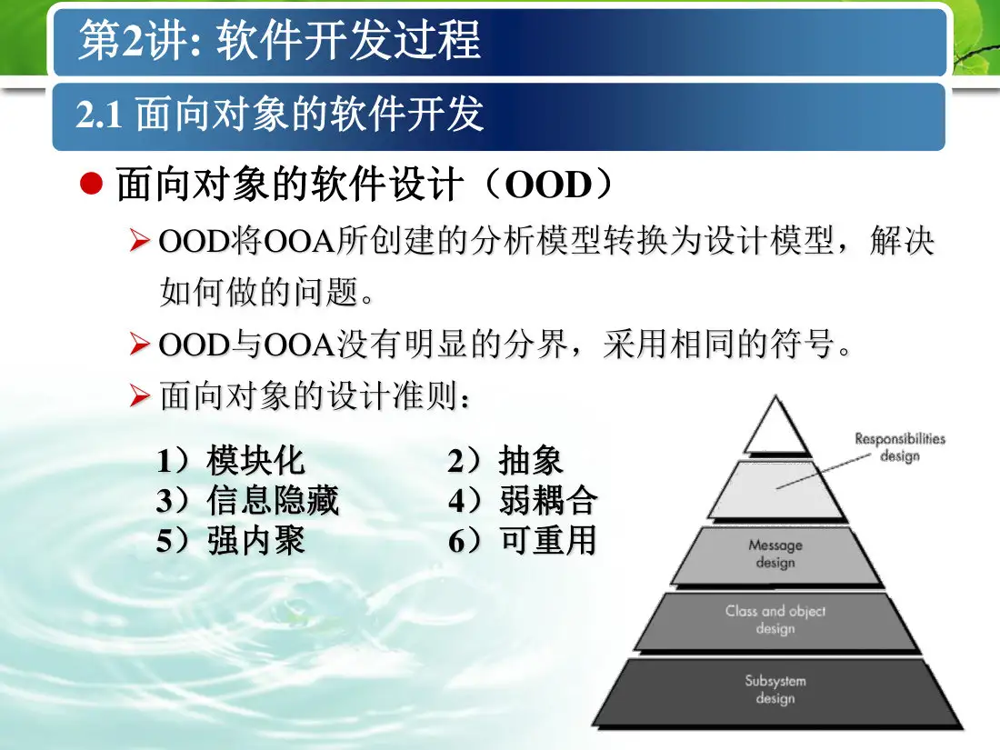

原文：

第2讲: 软件开发过程

2.1 面向对象的软件开发

面向对象的软件设计（OOD）

➢ OOD将OOA所创建的分析模型转换为设计模型，解决如何做的问题。

➢ OOD与OOA没有明显的分界，采用相同的符号。

面向对象的设计准则：

1）模块化

3）信息隐藏

5）强内聚

2）抽象

4）弱耦合

6）可重用

### 第2讲: 软件开发过程

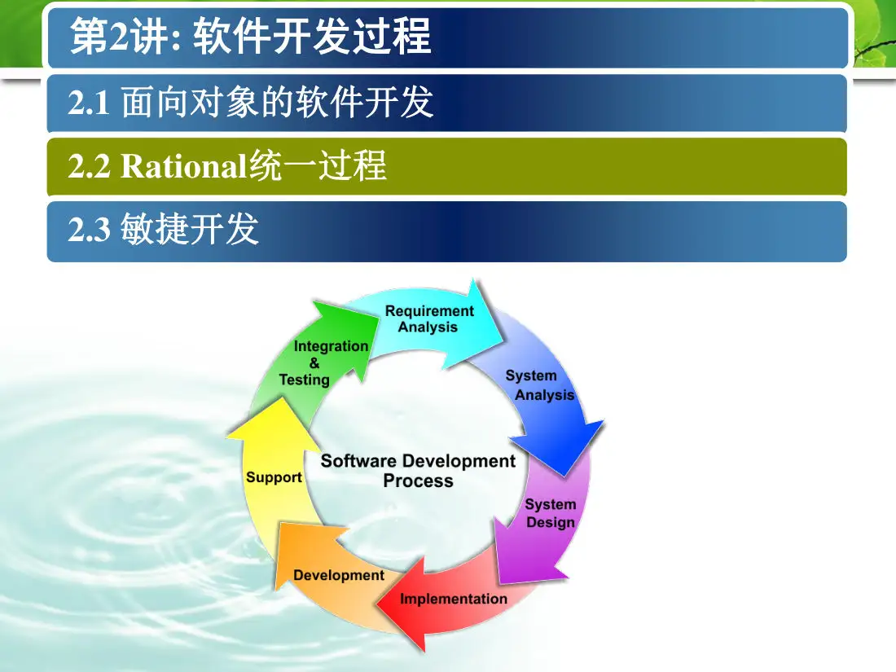

原文：

第2讲: 软件开发过程

2.1 面向对象的软件开发

2.2 Rational统一过程

2.3 敏捷开发

### 第2讲: 软件开发过程

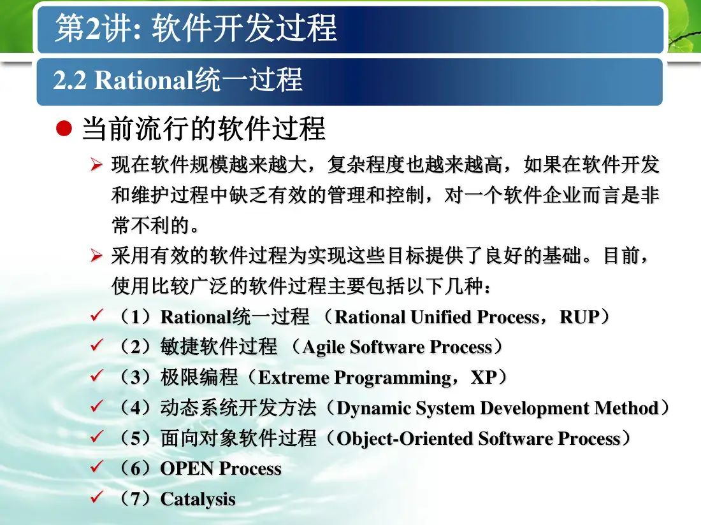

原文：

第2讲: 软件开发过程

2.2 Rational统一过程

- 当前流行的软件过程

现在软件规模越来越大，复杂程度也越来越高，如果在软件开发和维护过程中缺乏有效的管理和控制，对一个软件企业而言是非常不利的。

采用有效的软件过程为实现这些目标提供了良好的基础。目前，使用比较广泛的软件过程主要包括以下几种：

√ （1）Rational统一过程（Rational Unified Process，RUP）

√ （2）敏捷软件过程（Agile Software Process）

√ (3) 极限编程（Extreme Programming, XP）

√ （4）动态系统开发方法（Dynamic System Development Method）

√ （5）面向对象软件过程（Object-Oriented Software Process）

√ (6) OPEN Process

√ (7) Catalysis

### 第2讲: 软件开发过程

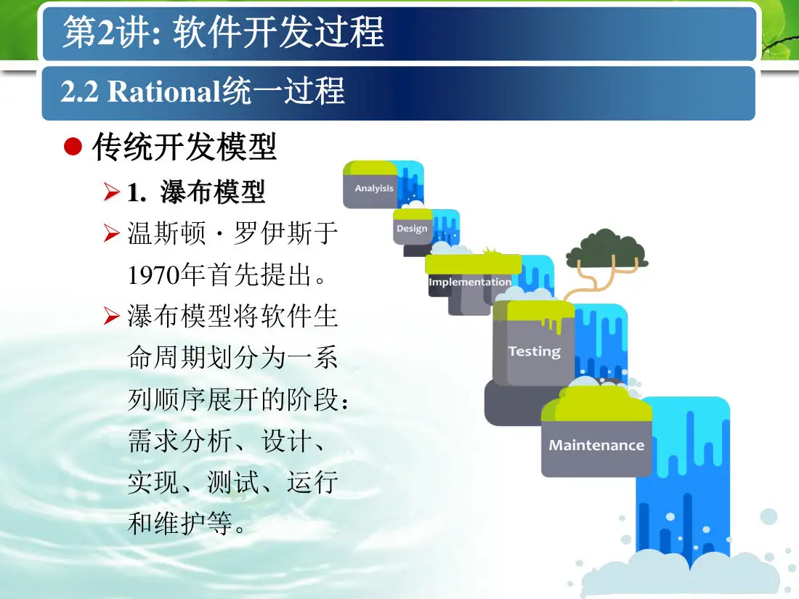

原文：

第2讲: 软件开发过程

2.2 Rational统一过程

- 传统开发模型

1. 瀑布模型

温斯顿·罗伊斯于1970年首先提出。

瀑布模型将软件生命周期划分为一系列顺序展开的阶段:需求分析、设计、实现、测试、运行和维护等。

### 第2讲: 软件开发过程

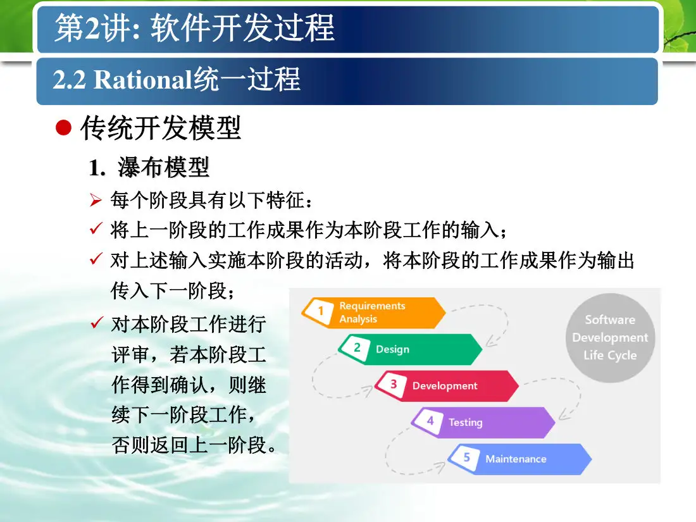

原文：

第2讲: 软件开发过程

2.2 Rational统一过程

- 传统开发模型

1. 瀑布模型

每个阶段具有以下特征:

√ 将上一阶段的工作成果作为本阶段工作的输入；

√ 对上述输入实施本阶段的活动，将本阶段的工作成果作为输出传入下一阶段；

√ 对本阶段工作进行评审，若本阶段工作得到确认，则继续下一阶段工作，否则返回上一阶段。

### 第2讲: 软件开发过程

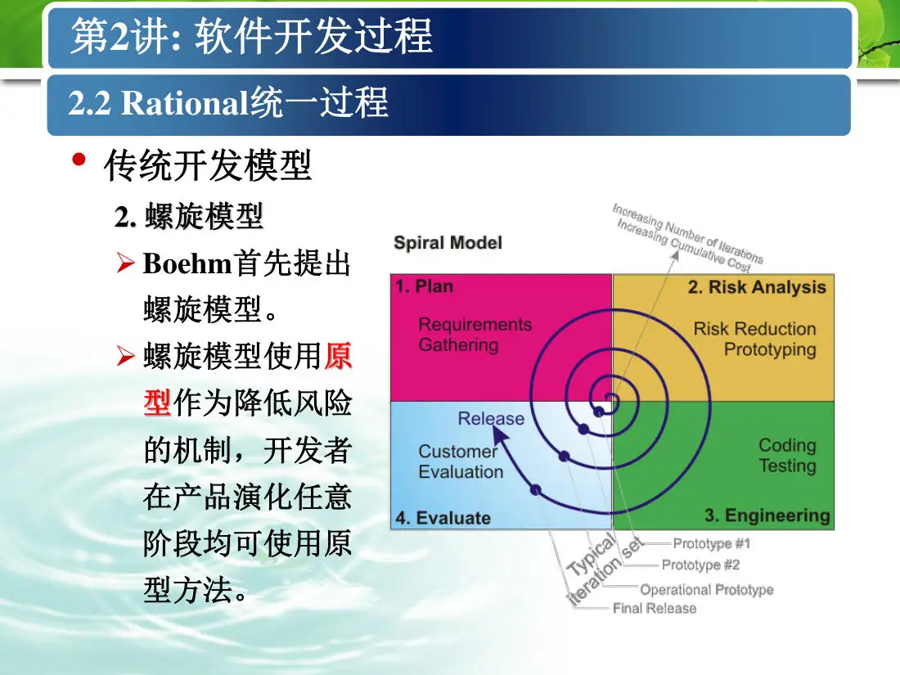

原文：

第2讲: 软件开发过程

2.2 Rational统一过程

- 传统开发模型

2. 螺旋模型

Boehm首先提出螺旋模型。

螺旋模型使用原型作为降低风险的机制，开发者在产品演化任意阶段均可使用原型方法。

Spiral Model

### 第2讲: 软件开发过程

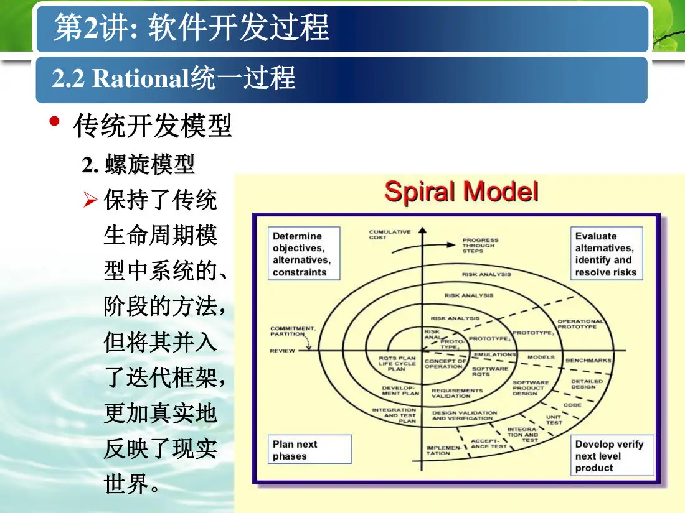

原文：

第2讲: 软件开发过程

2.2 Rational统一过程

- 传统开发模型

2. 螺旋模型

保持了传统生命周期模型中系统的、阶段的方法，但将其并入了迭代框架，更加真实地反映了现实世界。

Spiral Model

### 第2讲: 软件开发过程

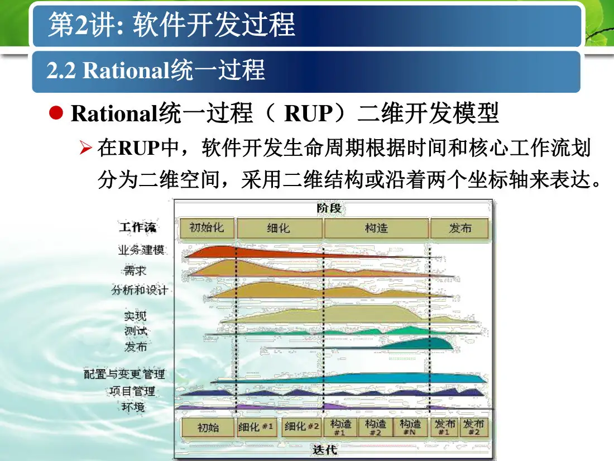

原文：

第2讲: 软件开发过程

2.2 Rational统一过程

- Rational统一过程（RUP）二维开发模型

在RUP中，软件开发生命周期根据时间和核心工作流划分为二维空间，采用二维结构或沿着两个坐标轴来表达。

业务建模

需求分析和设计

实现
测试
发布

配置与变更管理项目管理环境

### 第2讲: 软件开发过程

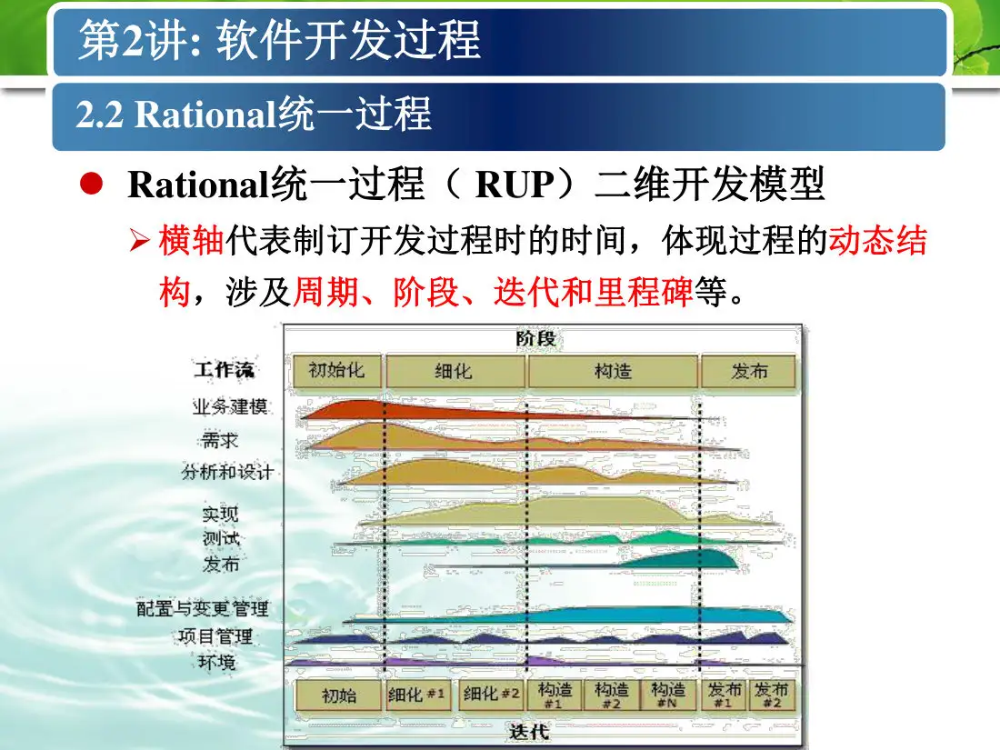

原文：

第2讲: 软件开发过程

2.2 Rational统一过程

- Rational统一过程（RUP）二维开发模型

➢ 横轴代表制订开发过程时的时间，体现过程的动态结构，涉及周期、阶段、迭代和里程碑等。

业务建模

需求

分析和设计

实现
测试
发布

配置与变更管理项目管理环境

### 第2讲: 软件开发过程

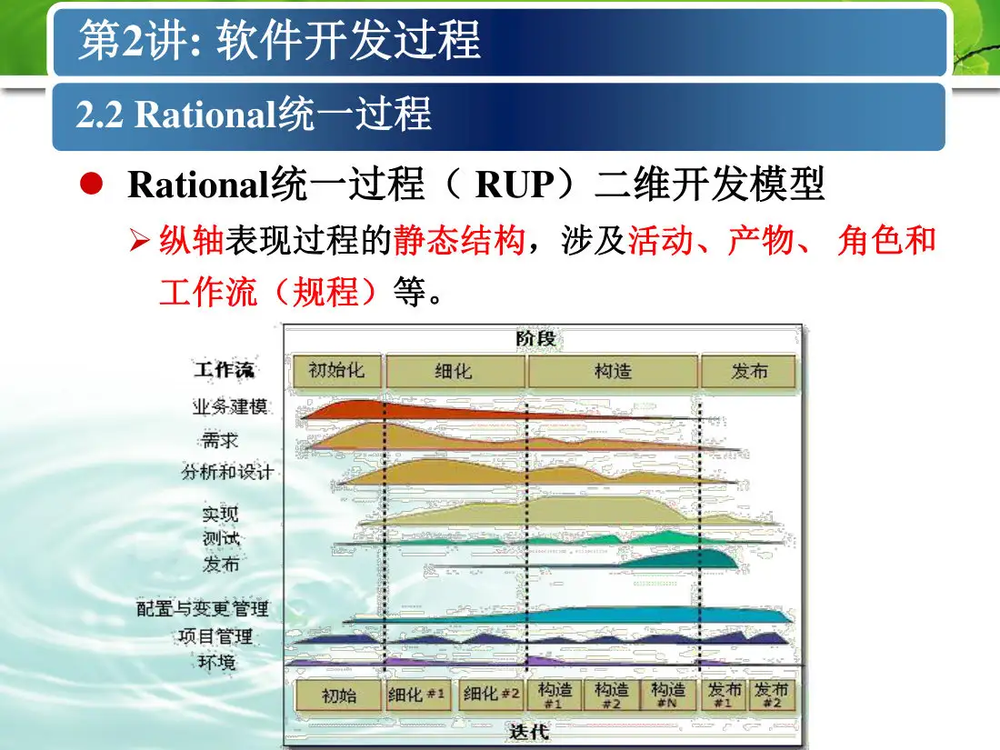

原文：

第2讲: 软件开发过程

2.2 Rational统一过程

- Rational统一过程（RUP）二维开发模型

➢ 纵轴表现过程的静态结构，涉及活动、产物、角色和工作流（规程）等。

业务建模

需求分析和设计

实现
测试
发布

配置与变更管理项目管理环境

### 第2讲: 软件开发过程

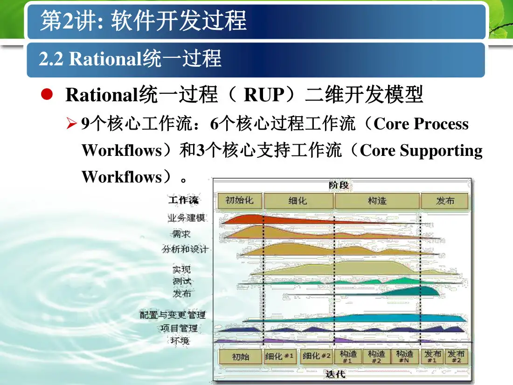

原文：

第2讲: 软件开发过程

2.2 Rational统一过程

- Rational统一过程（RUP）二维开发模型

9个核心工作流：6个核心过程工作流（Core Process Workflows）和3个核心支持工作流（Core Supporting Workflows）。

业务建模

需求

分析和设计

实现测试发布

配置与变更管理项目管理环境

### 第2讲: 软件开发过程

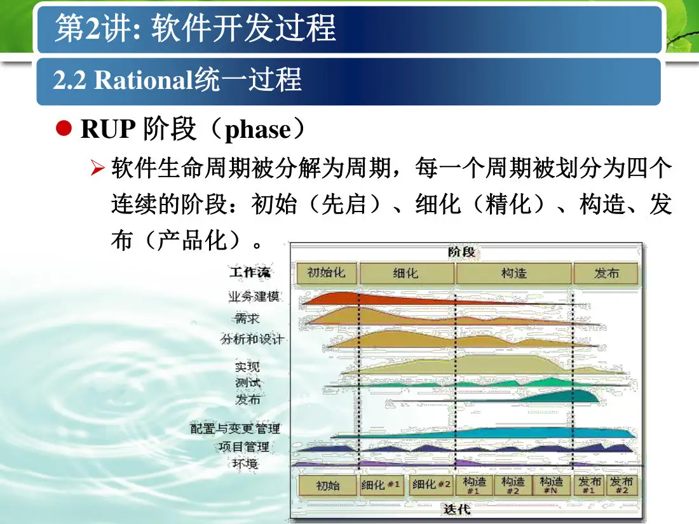

原文：

第2讲: 软件开发过程

2.2 Rational统一过程

● RUP 阶段（phase）

软件生命周期被分解为周期，每一个周期被划分为四个连续的阶段：初始（先启）、细化（精化）、构造、发布（产品化）。

实现测试发布

配置与变更管理项目管理环境

### 先启精化构建产品化

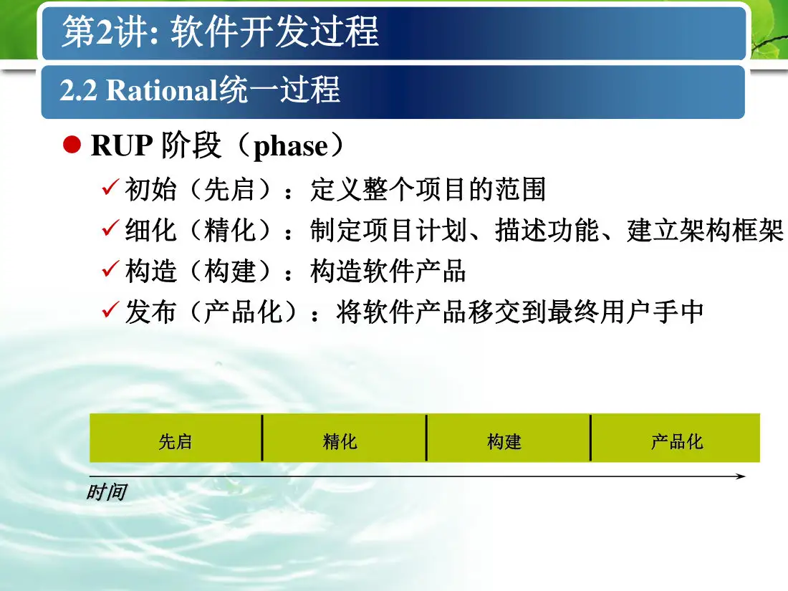

原文：

<table><tr><td>先启</td><td>精化</td><td>构建</td><td>产品化</td></tr></table>
时间

第2讲: 软件开发过程

2.2 Rational统一过程

● RUP 阶段（phase）

√ 初始（先启）：定义整个项目的范围

√ 细化（精化）：制定项目计划、描述功能、建立架构框架

√ 构造（构建）：构造软件产品

√ 发布（产品化）：将软件产品移交到最终用户手中

### 第2讲: 软件开发过程

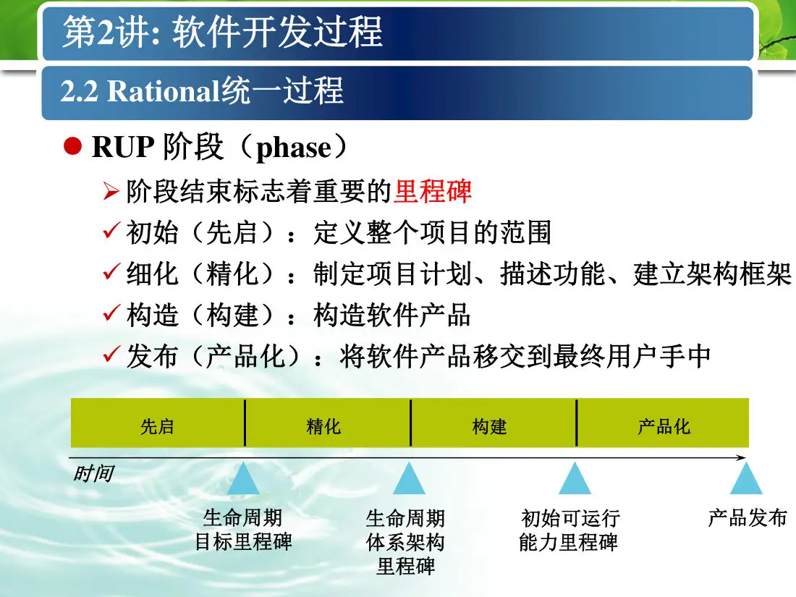

原文：

第2讲: 软件开发过程

2.2 Rational统一过程

● RUP 阶段（phase）

阶段结束标志着重要的里程碑

√ 初始（先启）：定义整个项目的范围

√ 细化（精化）：制定项目计划、描述功能、建立架构框架

√ 构造（构建）：构造软件产品

√ 发布（产品化）：将软件产品移交到最终用户手中

### 第2讲: 软件开发过程

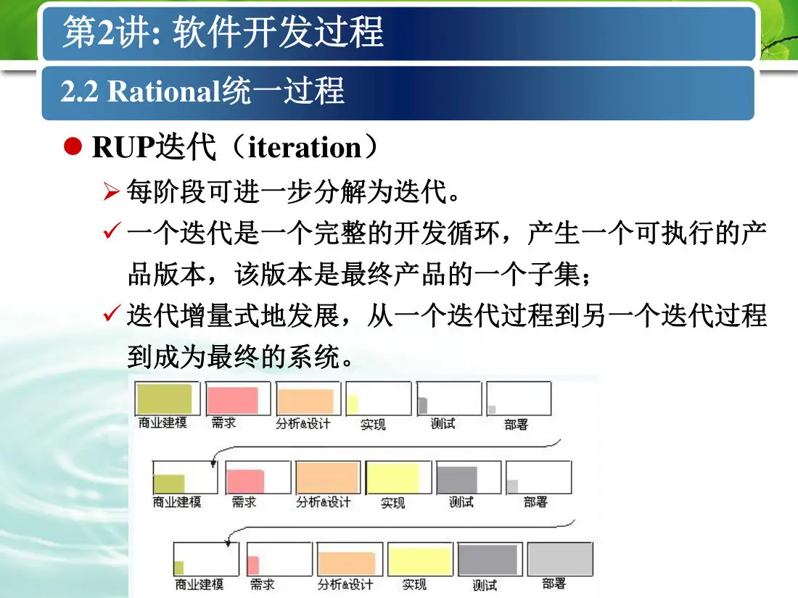

原文：

第2讲: 软件开发过程

2.2 Rational统一过程

● RUP迭代（iteration）

每阶段可进一步分解为迭代。

√ 一个迭代是一个完整的开发循环，产生一个可执行的产品版本，该版本是最终产品的一个子集；

√ 迭代增量式地发展，从一个迭代过程到另一个迭代过程到成为最终的系统。

### 第2讲: 软件开发过程

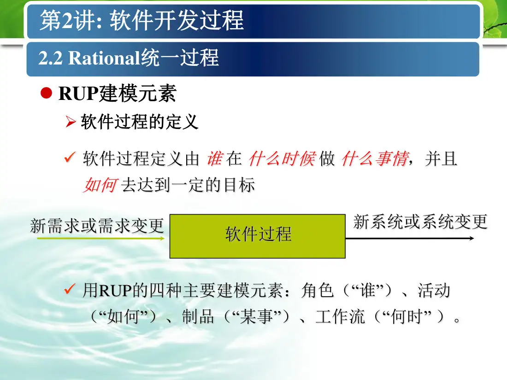

原文：

第2讲: 软件开发过程

2.2 Rational统一过程

RUP建模元素

软件过程的定义

√ 软件过程定义由谁在什么时候做什么事情，并且如何去达到一定的目标

新需求或需求变更

软件过程

新系统或系统变更

√ 用RUP的四种主要建模元素：角色（“谁”）、活动（“如何”）、制品（“某事”）、工作流（“何时”）。

### 第2讲: 软件开发过程

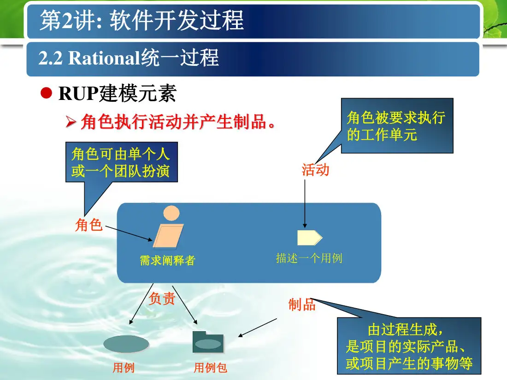

原文：

第2讲: 软件开发过程

2.2 Rational统一过程

RUP建模元素

角色执行活动并产生制品。

角色可由单个人或一个团队扮演角色被要求执行的工作单元

活动

负责

制品

用例

用例包

由过程生成，是项目的实际产品、或项目产生的事物等

### 第2讲: 软件开发过程

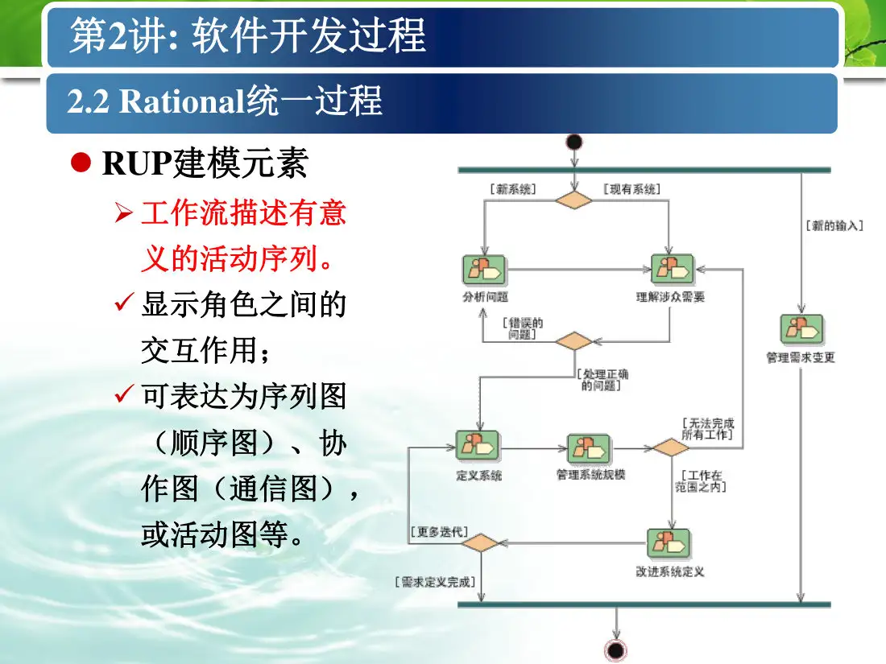

原文：

第2讲: 软件开发过程

2.2 Rational统一过程

RUP建模元素

工作流描述有意义的活动序列。

√ 显示角色之间的交互作用；

√ 可表达为序列图（顺序图）、协作图（通信图），或活动图等。

### 第2讲: 软件开发过程

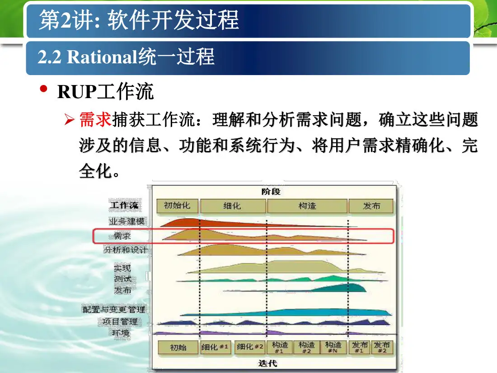

原文：

第2讲: 软件开发过程

2.2 Rational统一过程

• RUP工作流

需求捕获工作流：理解和分析需求问题，确立这些问题涉及的信息、功能和系统行为、将用户需求精确化、完全化。

### 第2讲: 软件开发过程

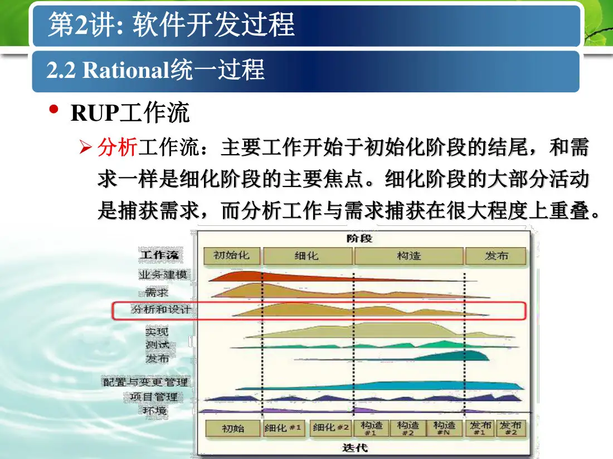

原文：

第2讲: 软件开发过程

2.2 Rational统一过程

• RUP工作流

分析工作流：主要工作开始于初始化阶段的结尾，和需求一样是细化阶段的主要焦点。细化阶段的大部分活动是捕获需求，而分析工作与需求捕获在很大程度上重叠。

### 第2讲: 软件开发过程

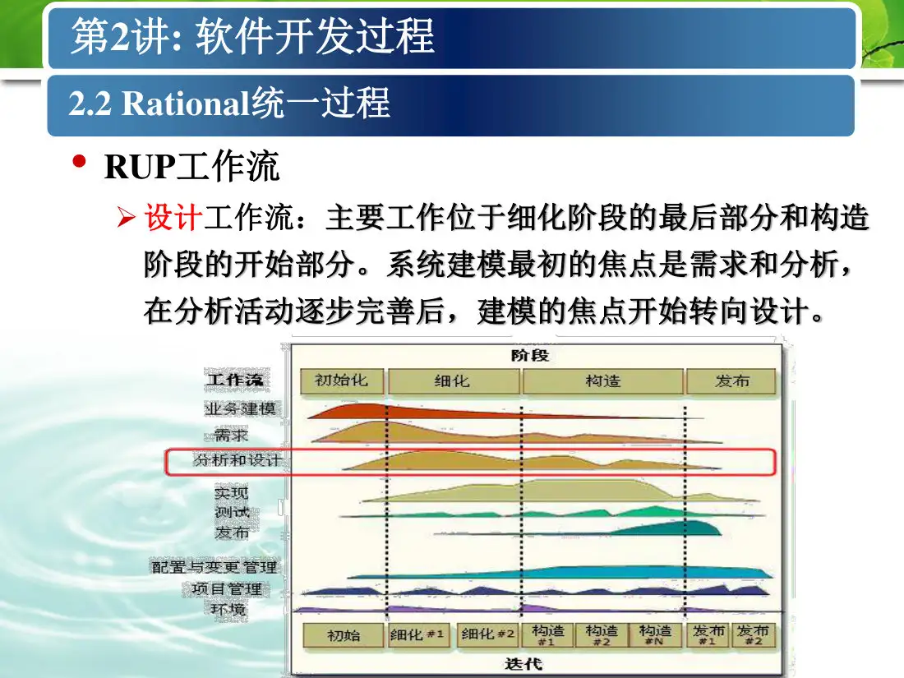

原文：

第2讲: 软件开发过程

2.2 Rational统一过程

• RUP工作流

设计工作流：主要工作位于细化阶段的最后部分和构造阶段的开始部分。系统建模最初的焦点是需求和分析，在分析活动逐步完善后，建模的焦点开始转向设计。

### 第2讲: 软件开发过程

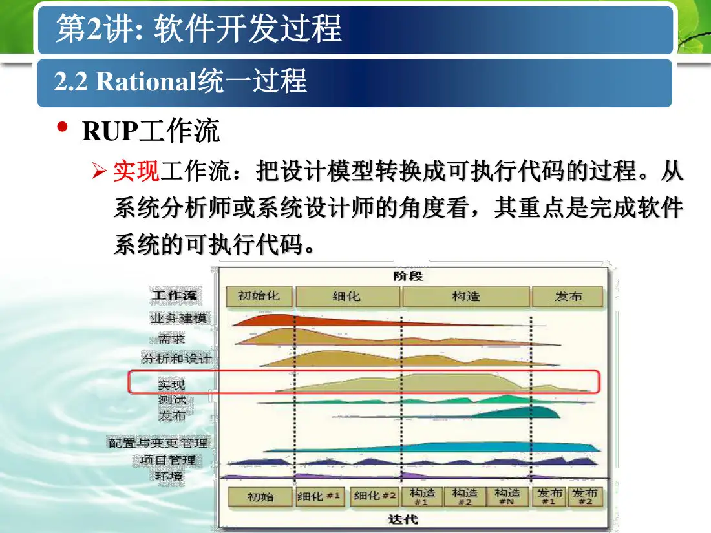

原文：

第2讲: 软件开发过程

2.2 Rational统一过程

• RUP工作流

实现工作流：把设计模型转换成可执行代码的过程。从系统分析师或系统设计师的角度看，其重点是完成软件系统的可执行代码。

### 第2讲: 软件开发过程

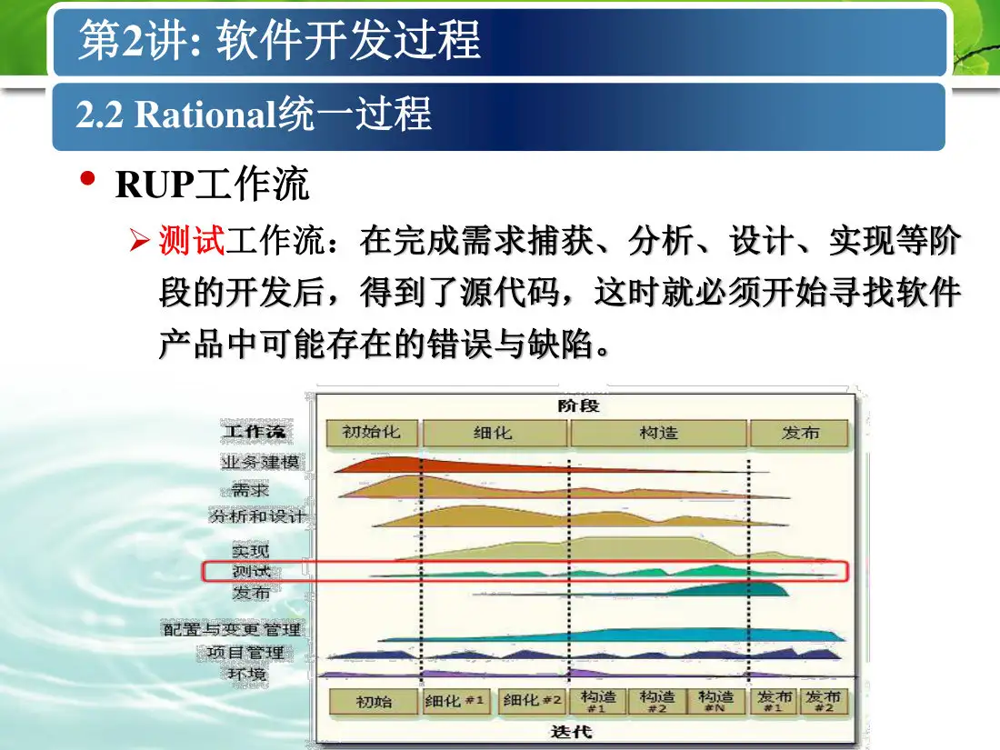

原文：

第2讲: 软件开发过程

2.2 Rational统一过程

• RUP工作流

> 测试工作流：在完成需求捕获、分析、设计、实现等阶段的开发后，得到了源代码，这时就必须开始寻找软件产品中可能存在的错误与缺陷。

### 第2讲: 软件开发过程

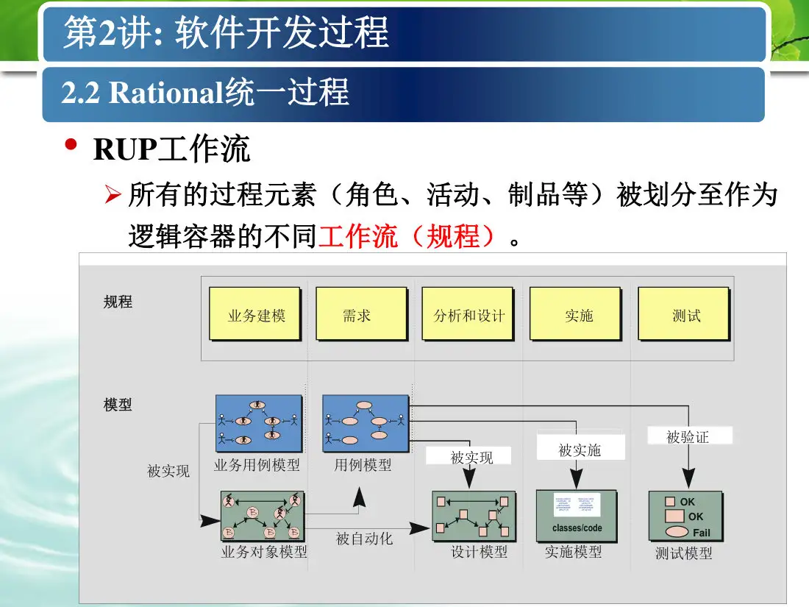

原文：

第2讲: 软件开发过程

2.2 Rational统一过程

• RUP工作流

所有的过程元素（角色、活动、制品等）被划分至作为逻辑容器的不同工作流（规程）。

### 第2讲: 软件开发过程

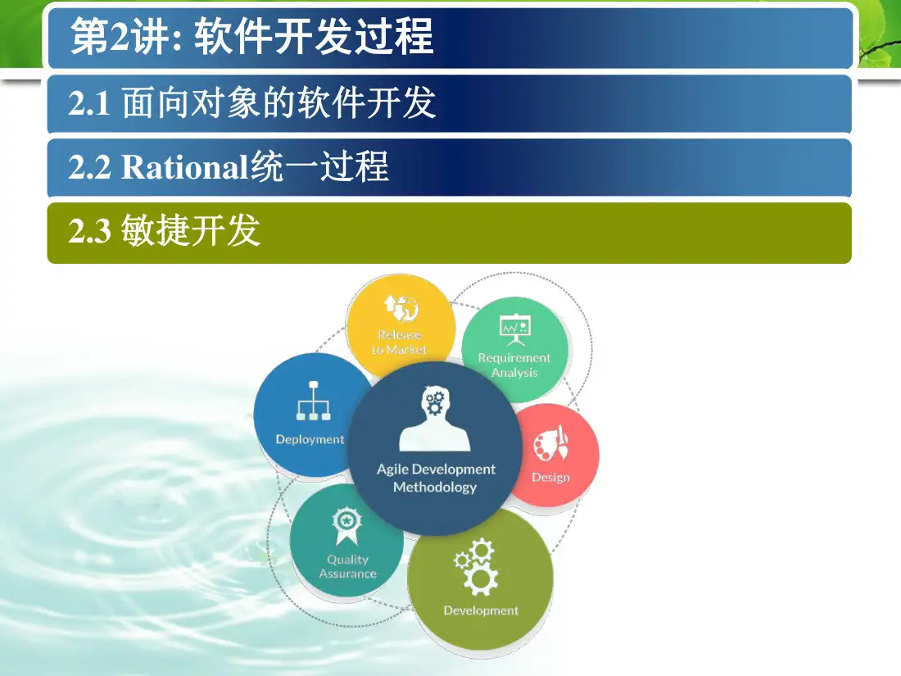

原文：

第2讲: 软件开发过程

2.1 面向对象的软件开发

2.2 Rational统一过程

2.3 敏捷开发

### 方法论

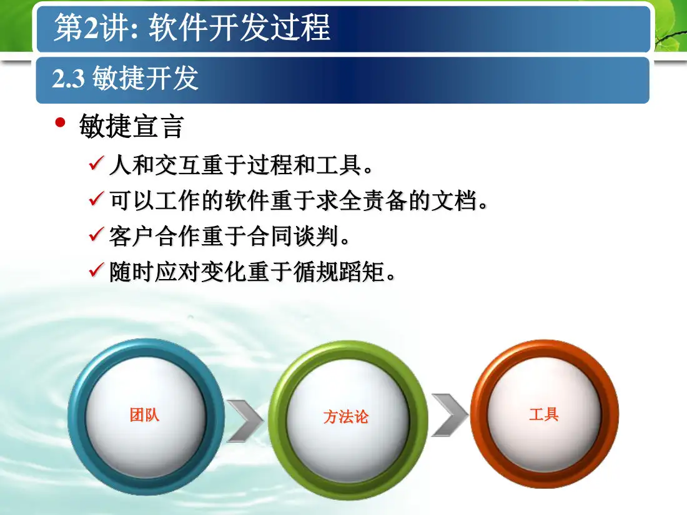

原文：

方法论

第2讲: 软件开发过程

2.3 敏捷开发

- 敏捷宣言

√ 人和交互重于过程和工具。

√ 可以工作的软件重于求全责备的文档。

√ 客户合作重于合同谈判。

√ 随时应对变化重于循规蹈矩。

团队

工具

### 第2讲: 软件开发过程

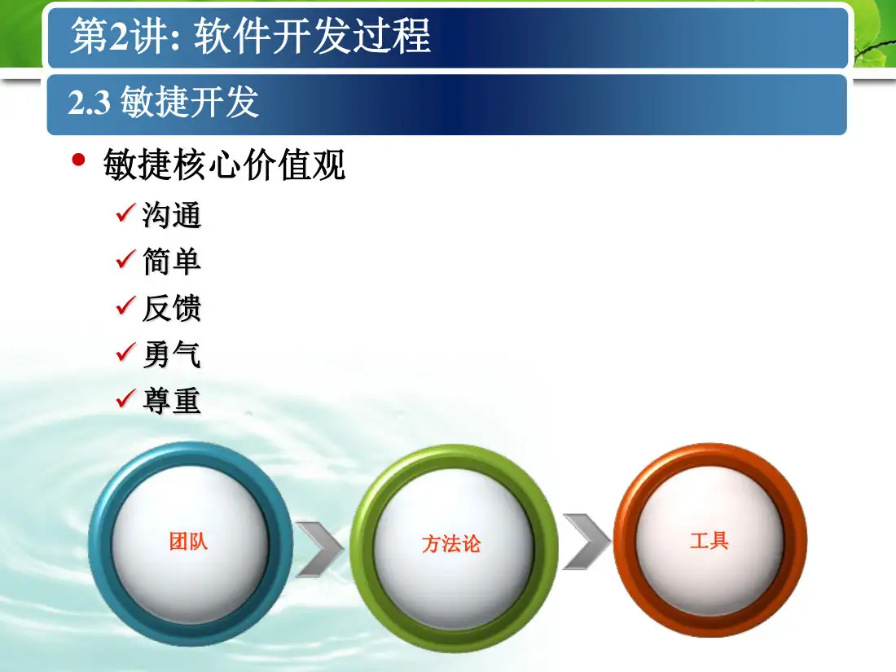

原文：

第2讲: 软件开发过程

2.3 敏捷开发

- 敏捷核心价值观

√ 沟通

√ 简单

√ 反馈

√ 勇气

√ 尊重

团队

方法论

工具

### 第2讲: 软件开发过程

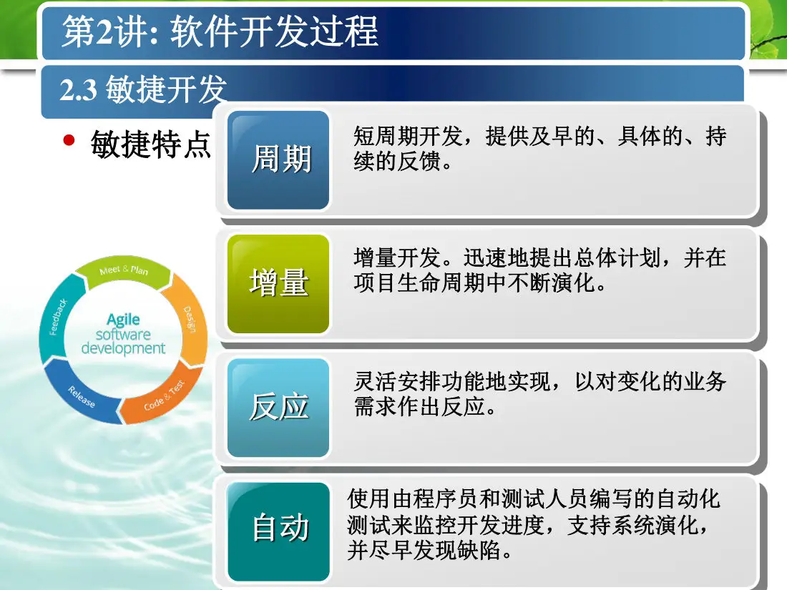

原文：

第2讲: 软件开发过程

2.3 敏捷开发

- 敏捷特点

Meet & Plan

Agile
software
development

周期

短周期开发，提供及早的、具体的、持续的反馈。

增量

增量开发。迅速地提出总体计划，并在项目生命周期中不断演化。

反应

灵活安排功能地实现，以对变化的业务需求作出反应。

自动

使用由程序员和测试人员编写的自动化测试来监控开发进度，支持系统演化，并尽早发现缺陷。

### 第2讲: 软件开发过程

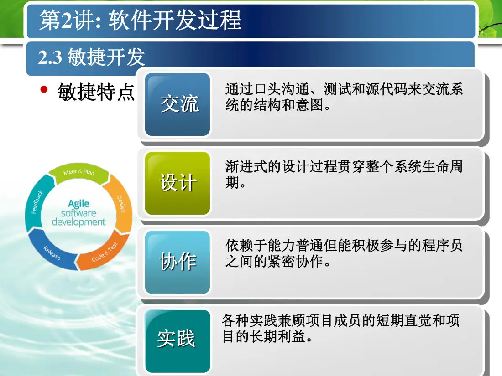

原文：

第2讲: 软件开发过程

2.3 敏捷开发

\- 敏捷特点

Agile
software
development

交流

通过口头沟通、测试和源代码来交流系统的结构和意图。

设计

渐进式的设计过程贯穿整个系统生命周期。

协作

依赖于能力普通但能积极参与的程序员之间的紧密协作。

实践

各种实践兼顾项目成员的短期直觉和项目的长期利益。

### 第2讲: 软件开发过程

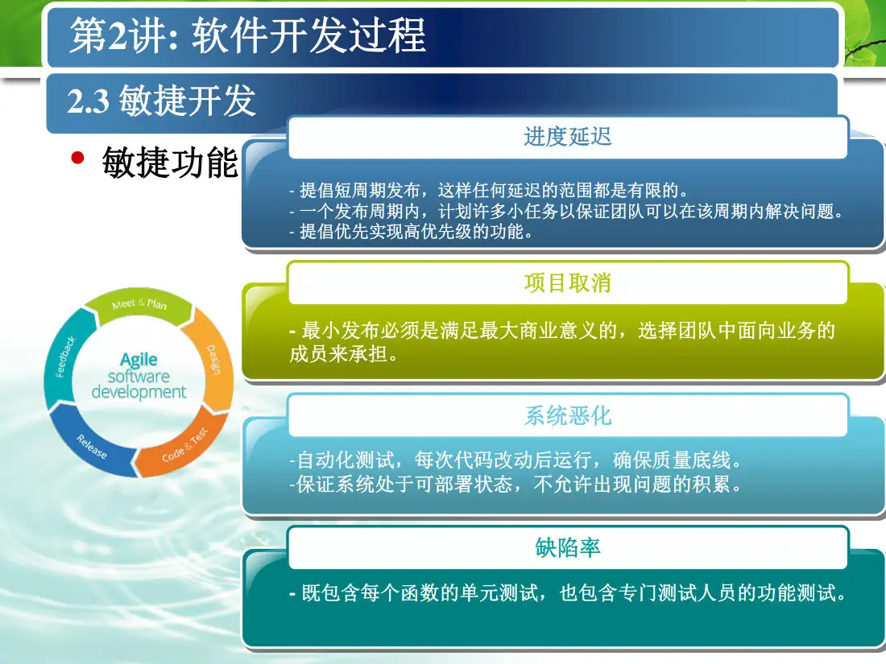

原文：

第2讲: 软件开发过程

2.3 敏捷开发

\- 敏捷功能

进度延迟

\- 提倡短周期发布，这样任何延迟的范围都是有限的。
- 一个发布周期内，计划许多小任务以保证团队可以在该周期内解决问题。
- 提倡优先实现高优先级的功能。

项目取消

Meet & Plan

Agile
software
development

\- 最小发布必须是满足最大商业意义的，选择团队中面向业务的成员来承担。

系统恶化

\- 自动化测试，每次代码改动后运行，确保质量底线。
- 保证系统处于可部署状态，不允许出现问题的积累。

缺陷率

\- 既包含每个函数的单元测试，也包含专门测试人员的功能测试。

### 第2讲: 软件开发过程

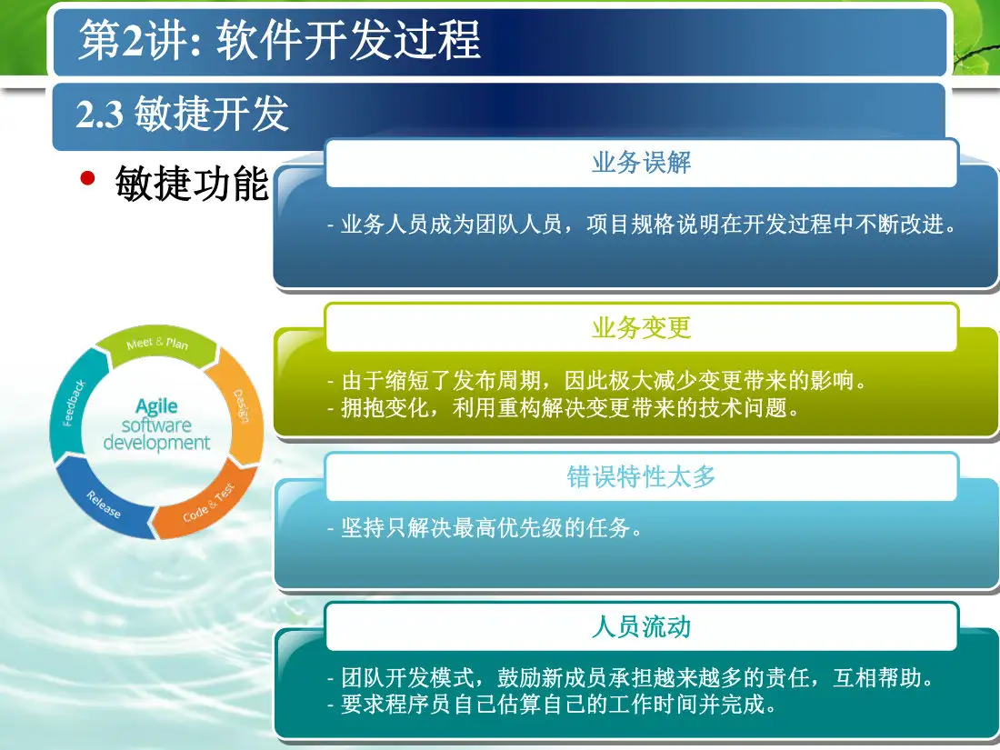

原文：

第2讲: 软件开发过程

2.3 敏捷开发

\- 敏捷功能

业务误解

\- 业务人员成为团队人员，项目规格说明在开发过程中不断改进。

Meet & Plan

Agile
software
development 业务变更

\- 由于缩短了发布周期，因此极大减少变更带来的影响。
- 拥抱变化，利用重构解决变更带来的技术问题。

错误特性太多

\- 坚持只解决最高优先级的任务。

人员流动

\- 团队开发模式，鼓励新成员承担越来越多的责任，互相帮助。
- 要求程序员自己估算自己的工作时间并完成。

### 第2讲: 软件开发过程

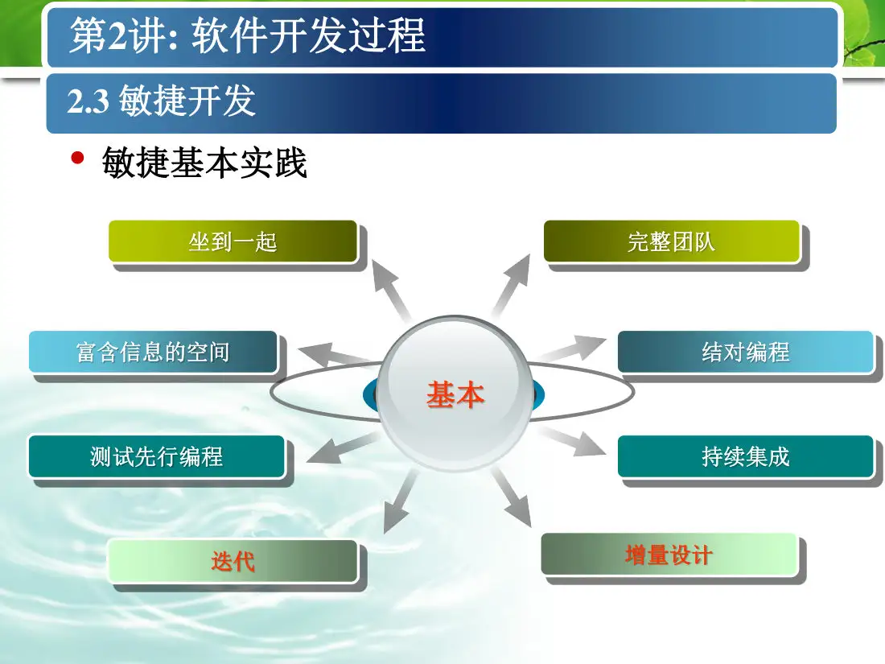

原文：

第2讲: 软件开发过程

2.3 敏捷开发

\- 敏捷基本实践

坐到一起

完整团队

富含信息的空间

结对编程

基本

测试先行编程

持续集成

迭代

增量设计

### 第2讲: 软件开发过程

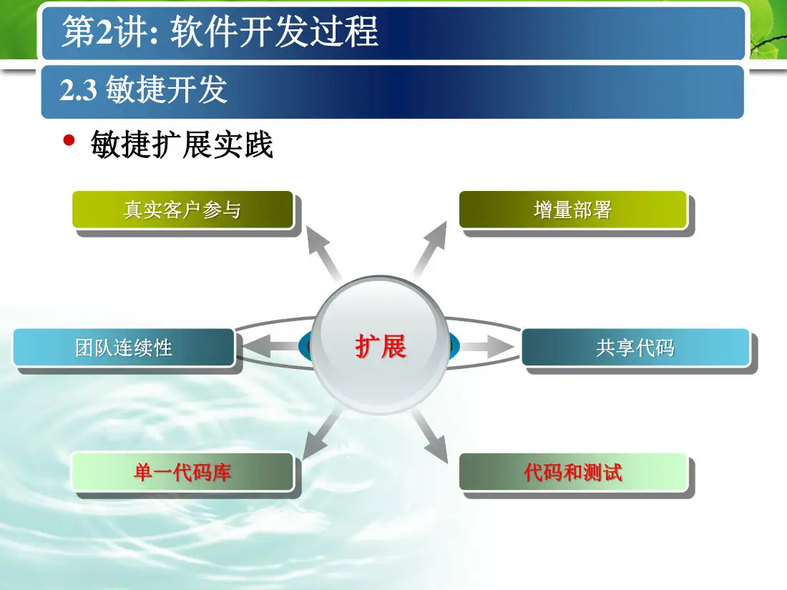

原文：

第2讲: 软件开发过程

2.3 敏捷开发

\- 敏捷扩展实践

真实客户参与

增量部署

团队连续性

扩展

共享代码

单一代码库

代码和测试

### 第2讲: 软件开发过程

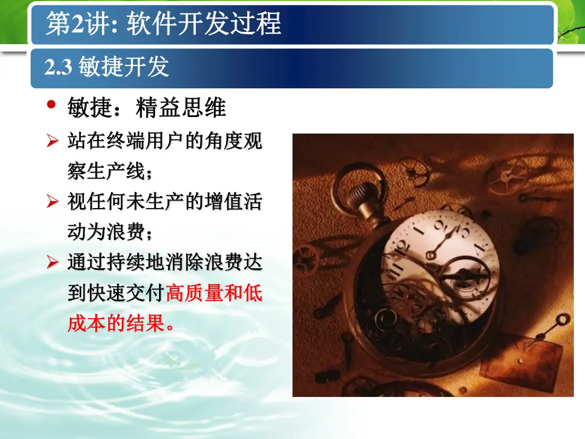

原文：

第2讲: 软件开发过程

2.3 敏捷开发

- 敏捷：精益思维

站在终端用户的角度观察生产线；

视任何未生产的增值活动为浪费；

通过持续地消除浪费达到快速交付高质量和低成本的结果。

### 第2讲: 软件开发过程

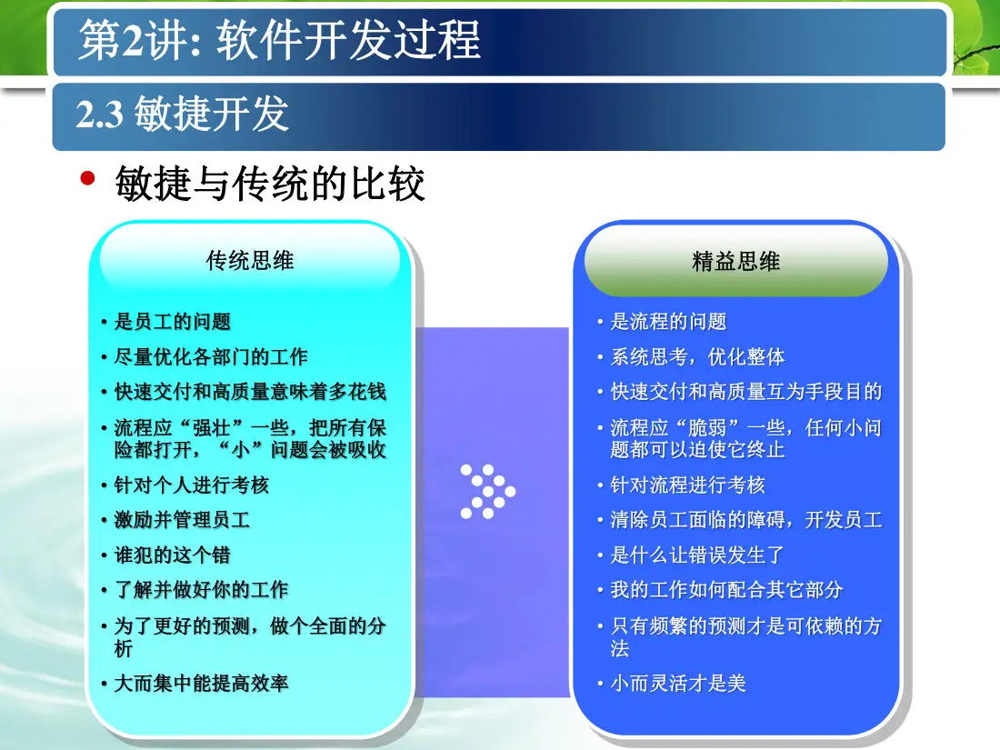

原文：

第2讲: 软件开发过程

2.3 敏捷开发

- 敏捷与传统的比较

传统思维

\- 是员工的问题

\- 尽量优化各部门的工作

\- 快速交付和高质量意味着多花钱

\- 流程应“强壮”一些，把所有保险都打开，“小”问题会被吸收

\- 针对个人进行考核

\- 激励并管理员工

\- 谁犯的这个错

\- 了解并做好你的工作

\- 为了更好的预测，做个全面的分析

\- 大而集中能提高效率

精益思维

\- 是流程的问题

\- 系统思考，优化整体

\- 快速交付和高质量互为手段目的

\- 流程应“脆弱”一些，任何小问题都可以迫使它终止

\- 针对流程进行考核

\- 清除员工面临的障碍，开发员工

\- 是什么让错误发生了

\- 我的工作如何配合其它部分

\- 只有频繁的预测才是可依赖的方法

\- 小而灵活才是美
