# 《软件建模与设计》第3章 用例建模（课件）

原件的每一页，下面附识别出的文字。

### 软件建模与设计

原文：

软件建模与设计

授课班级：B220417-19，B220400

授课安排：QQ群、超星学习通，课堂

授课时间：周二第8-9节{第1-16周}

金惠颖

### 第3讲: 用例建模

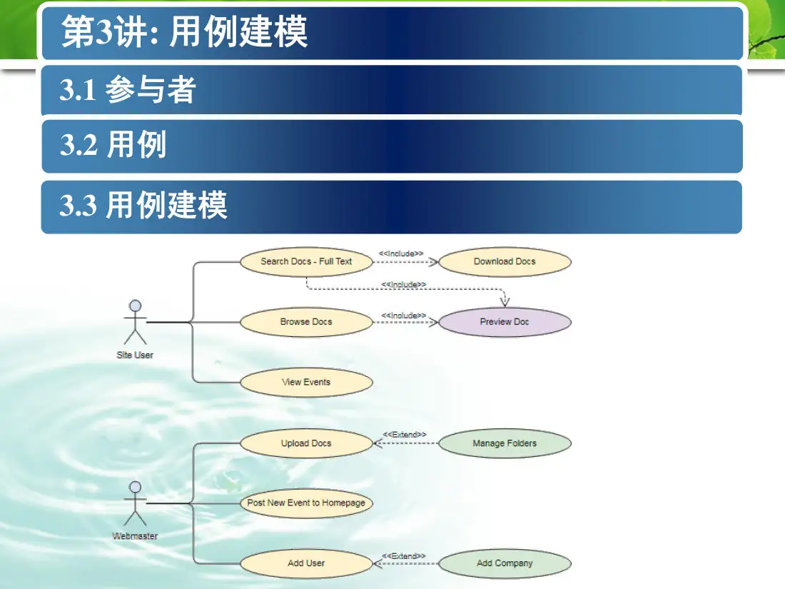

原文：

第3讲: 用例建模

3.1 参与者

3.2 用例

3.3 用例建模

### 第3讲:用例建模

原文：

第3讲:用例建模

3.1 参与者

系统的需求描述了用户对系统的期望；换言之，即系统将为用户做些什么。当定义系统的需求时，系统将在数据存储、界面风格、使用灵活度和系统的特性等方面被考虑。功能性需求和非功能性需求都需要被完整地覆盖。需求建模包含了需求分析和需求规格说明。

用例建模是一种描述系统的功能性需求的方法（等价于需求规格说明）。系统的数据需求（以需求数据库的结构为前言）是在功能性需求后来确定的。系统的输入和输出首先在用例模型中描述，然后在静态模型或其他组件中进行建模。

### 第3讲:用例建模

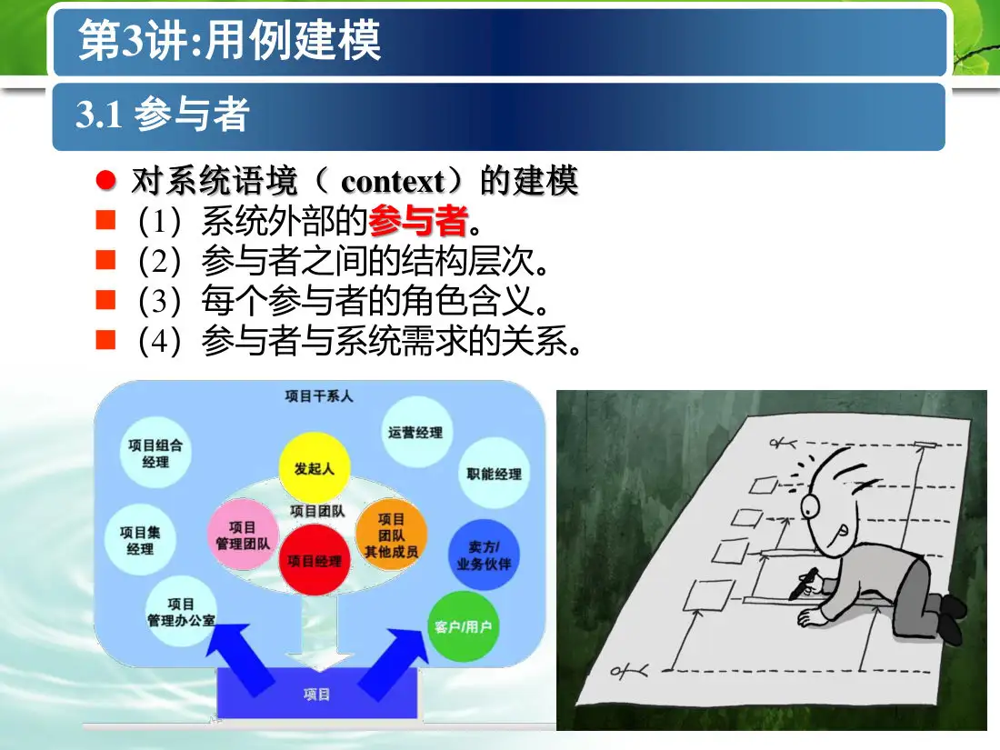

原文：

第3讲:用例建模

3.1 参与者

\- 对系统语境（context）的建模

(1) 系统外部的参与者。

(2) 参与者之间的结构层次。

(3) 每个参与者的角色含义。

(4) 参与者与系统需求的关系。

### 第3讲:用例建模

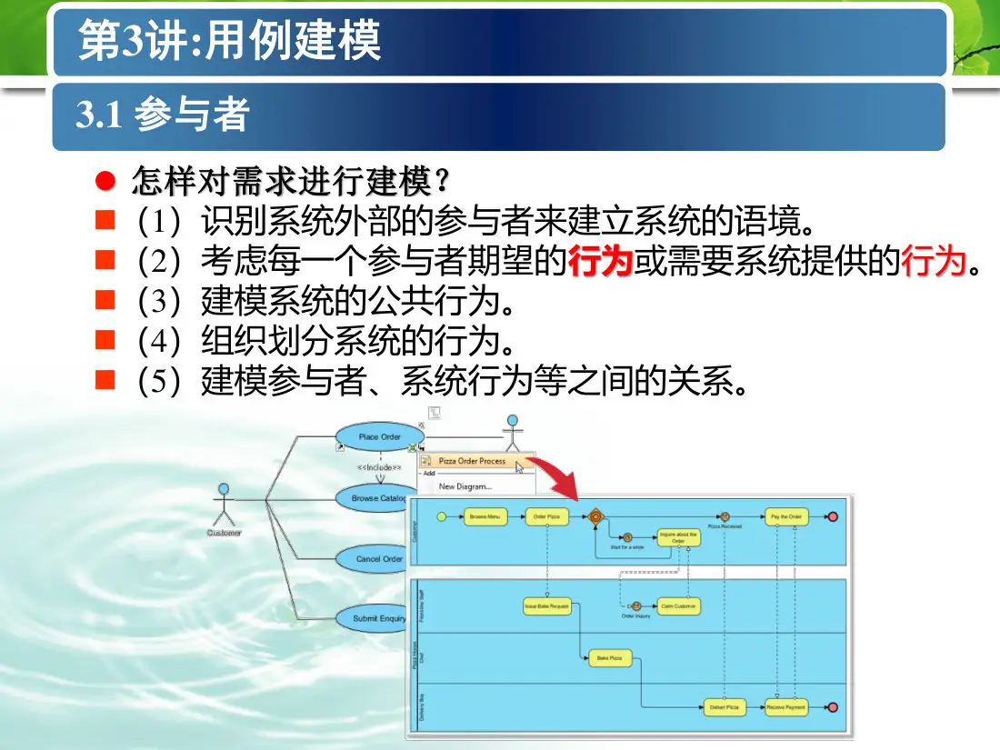

原文：

第3讲:用例建模

3.1 参与者

\- 怎样对需求进行建模？

(1) 识别系统外部的参与者来建立系统的语境。

(2) 考虑每一个参与者期望的行为或需要系统提供的行为。

(3) 建模系统的公共行为。

(4) 组织划分系统的行为。

(5) 建模参与者、系统行为等之间的关系。

### 第3讲:用例建模

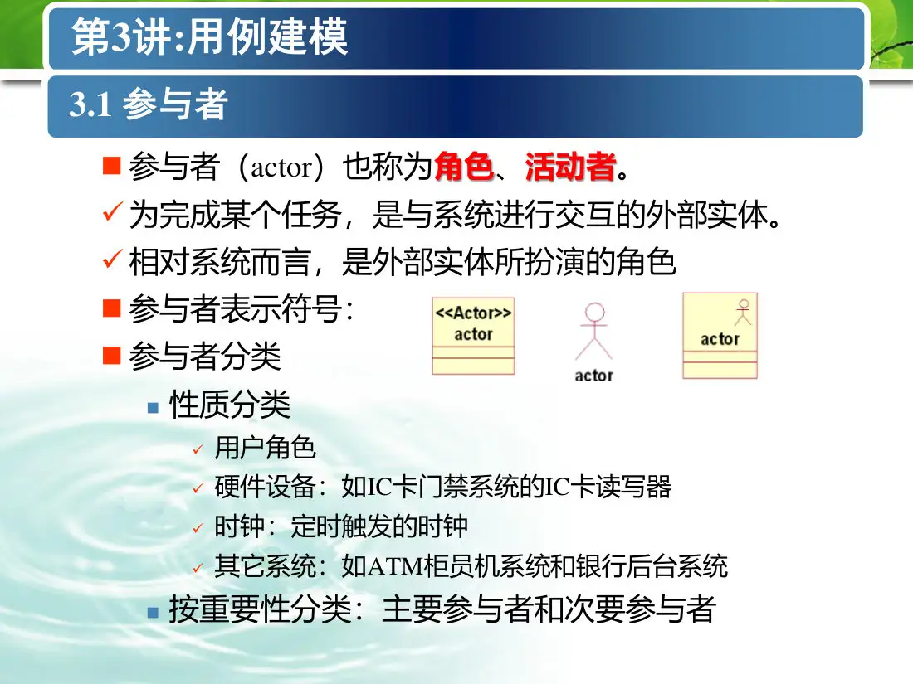

原文：

第3讲:用例建模

3.1 参与者

■ 参与者（actor）也称为角色、活动者。

√ 为完成某个任务，是与系统进行交互的外部实体。

√ 相对系统而言，是外部实体所扮演的角色

■ 参与者表示符号：

■ 参与者分类

■ 性质分类

√ 用户角色

√ 硬件设备：如IC卡门禁系统的IC卡读写器

√ 时钟：定时触发的时钟

√ 其它系统：如ATM柜员机系统和银行后台系统

■ 按重要性分类：主要参与者和次要参与者

### 第3讲:用例建模

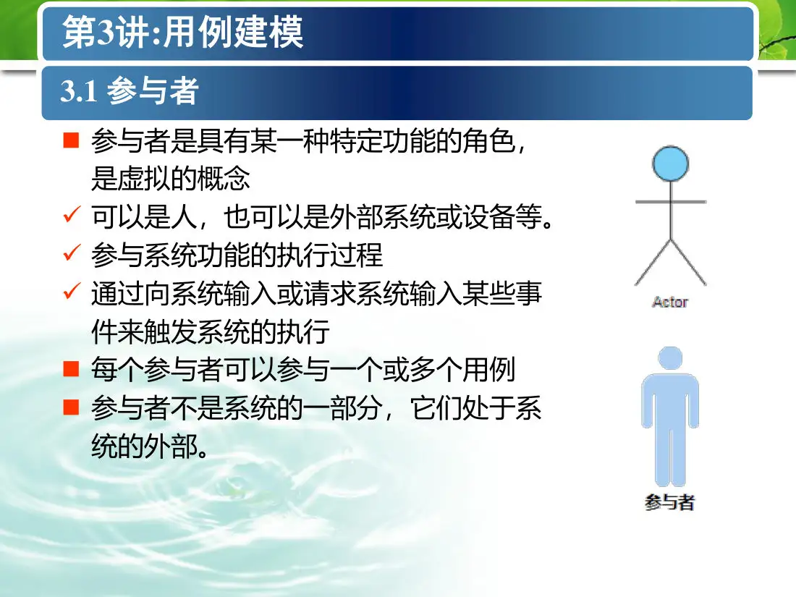

原文：

第3讲:用例建模

3.1 参与者

■ 参与者是具有某一种特定功能的角色，是虚拟的概念

√ 可以是人，也可以是外部系统或设备等。

√ 参与系统功能的执行过程

√ 通过向系统输入或请求系统输入某些事件来触发系统的执行

■ 每个参与者可以参与一个或多个用例

■ 参与者不是系统的一部分，它们处于系统的外部。

### 第3讲:用例建模

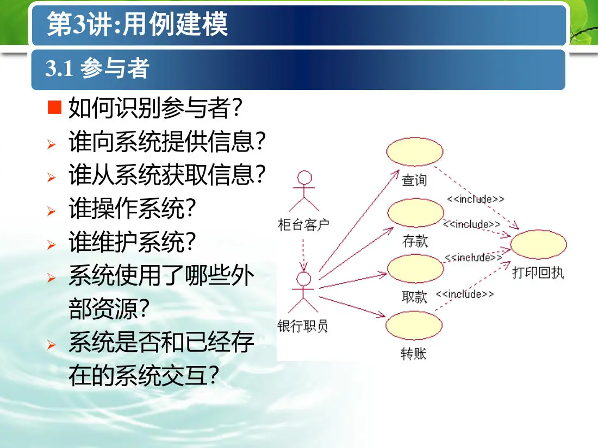

原文：

第3讲:用例建模

3.1 参与者

■ 如何识别参与者？

谁向系统提供信息？

谁从系统获取信息？

谁操作系统？

谁维护系统？

系统使用了哪些外部资源？

系统是否和已经存在的系统交互？

### 第3讲:用例建模

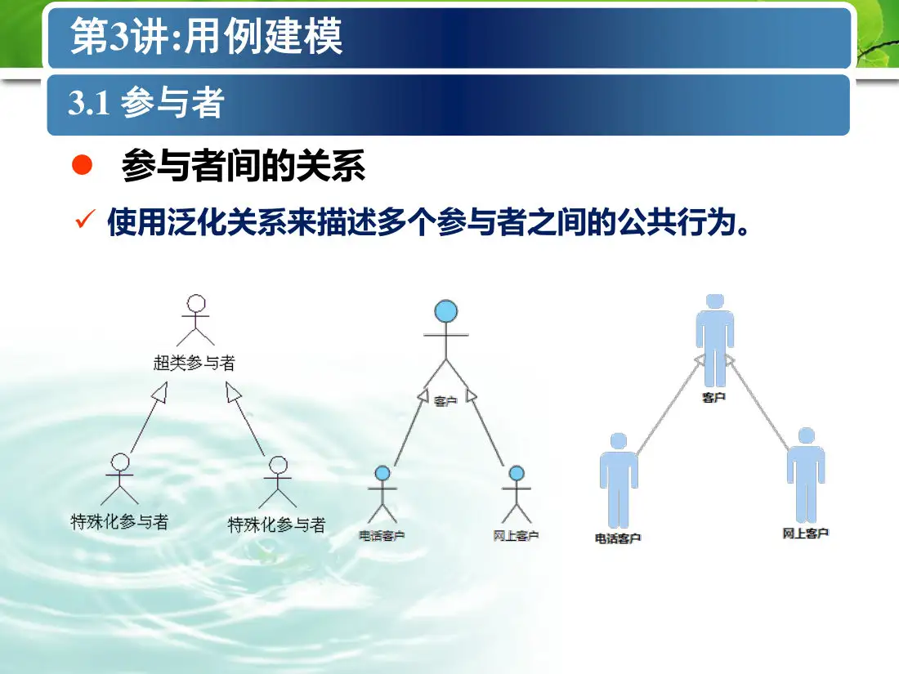

原文：

第3讲:用例建模

3.1 参与者

- 参与者间的关系

√ 使用泛化关系来描述多个参与者之间的公共行为。

### 第3讲:用例建模

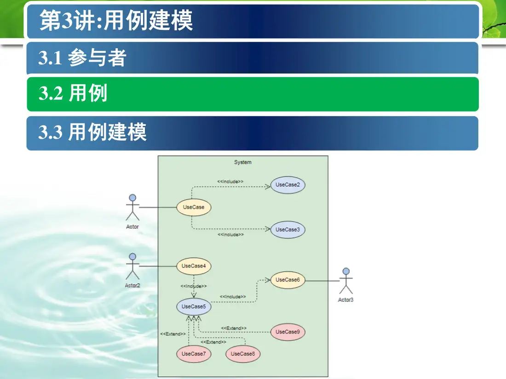

原文：

第3讲:用例建模

3.1 参与者

3.2 用例

3.3 用例建模

### 第3讲:用例建模

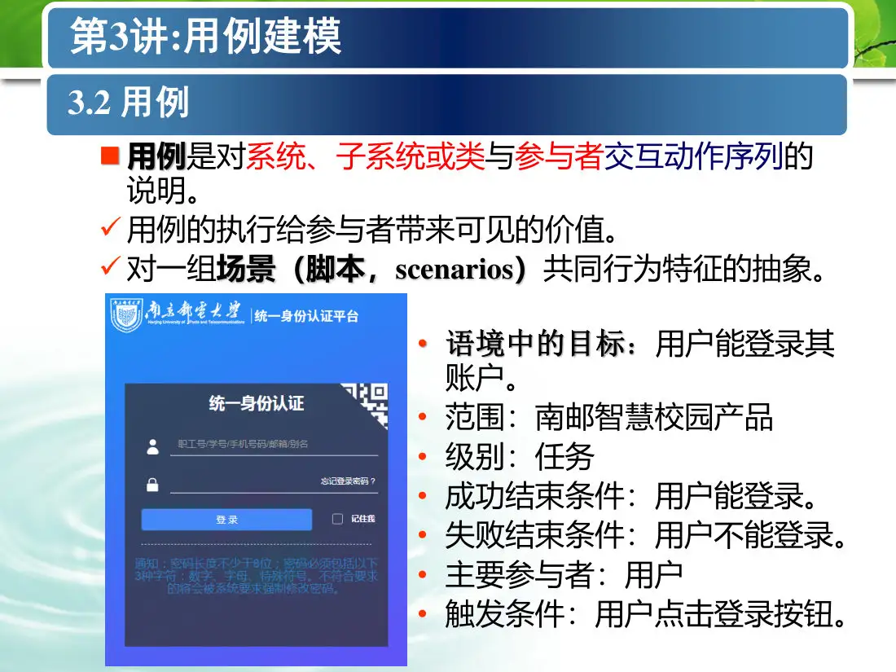

原文：

第3讲:用例建模

3.2 用例

■ 用例是对系统、子系统或类与参与者交互动作序列的说明。

√ 用例的执行给参与者带来可见的价值。

√ 对一组场景（脚本，scenarios）共同行为特征的抽象。

统一身份认证

职工号/学号/手机号码/邮箱/别名

忘记登录密码？

记住我

\- 语境中的目标：用户能登录其账户。

通知：密码长度不少于8位；密码必须包括以下3种字符：数字、字母、特殊符号。不符合要求的将会被系统要求强制修改密码。

\- 范围：南邮智慧校园产品

\- 级别：任务

\- 成功结束条件：用户能登录。

\- 失败结束条件：用户不能登录。

\- 主要参与者：用户

\- 触发条件：用户点击登录按钮。

### 第3讲:用例建模

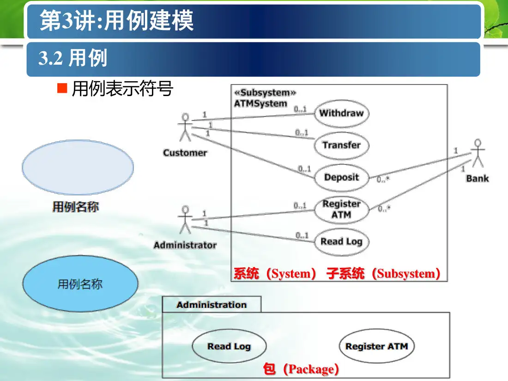

原文：

第3讲:用例建模

3.2 用例

■ 用例表示符号

用例名称

### 第3讲:用例建模

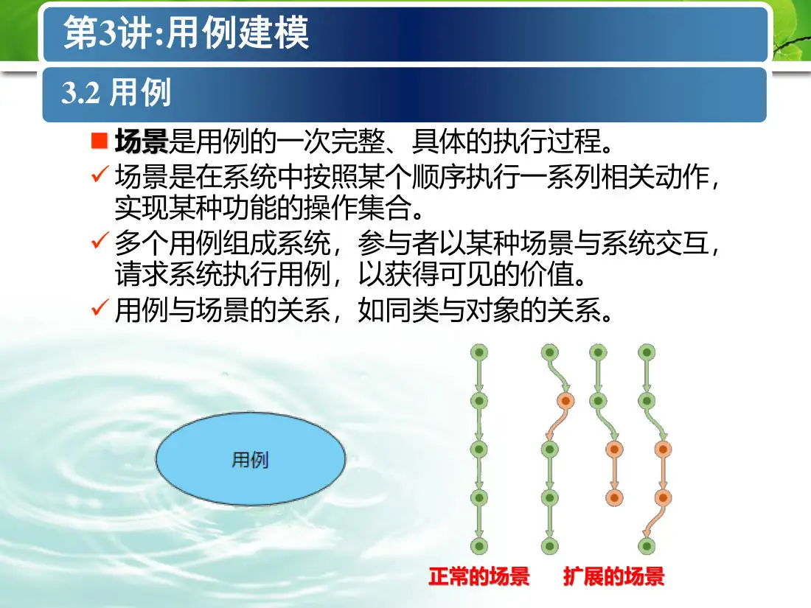

原文：

第3讲:用例建模

3.2 用例

■ 场景是用例的一次完整、具体的执行过程。

√ 场景是在系统中按照某个顺序执行一系列相关动作，实现某种功能的操作集合。

√ 多个用例组成系统，参与者以某种场景与系统交互，请求系统执行用例，以获得可见的价值。

√ 用例与场景的关系，如同类与对象的关系。

用例

正常的场景

### 第3讲:用例建模

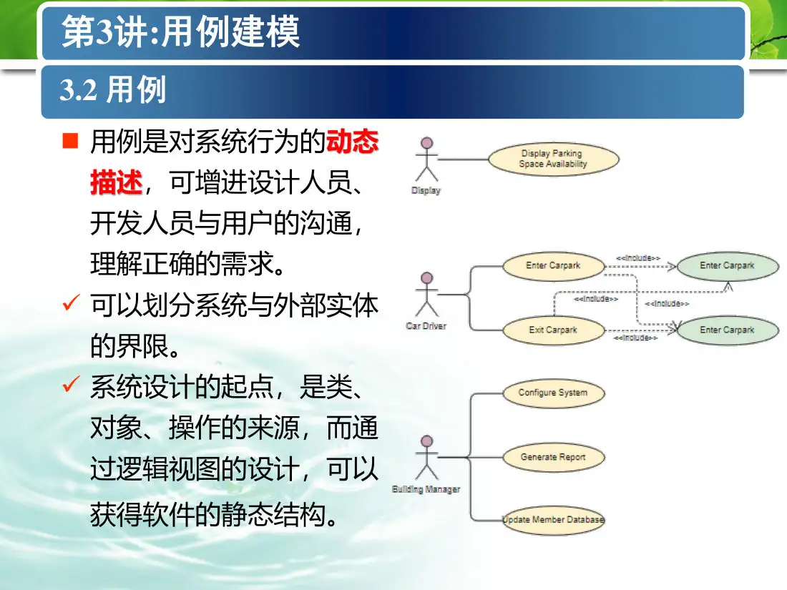

原文：

第3讲:用例建模

3.2 用例

■ 用例是对系统行为的动态描述，可增进设计人员、开发人员与用户的沟通，理解正确的需求。

√ 可以划分系统与外部实体的界限。

√ 系统设计的起点，是类、对象、操作的来源，而通过逻辑视图的设计，可以获得软件的静态结构。

### 第3讲:用例建模

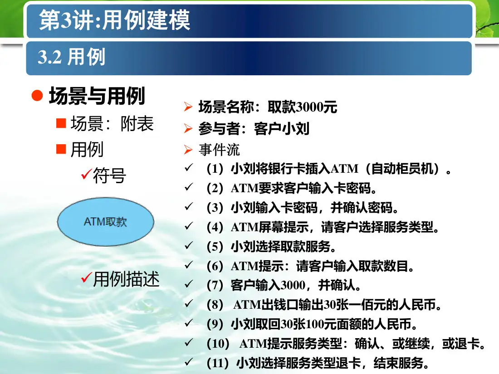

原文：

第3讲:用例建模

3.2 用例

场景与用例

■ 场景：附表

用例

√符号

ATM取款

√ 用例描述

场景名称：取款3000元

参与者：客户小刘

事件流

√ (1) 小刘将银行卡插入ATM（自动柜员机）。

(2) ATM要求客户输入卡密码。

√ (3) 小刘输入卡密码，并确认密码。

√ (4) ATM屏幕提示，请客户选择服务类型。

(5) 小刘选择取款服务。

(6) ATM提示：请客户输入取款数目。

(7) 客户输入3000，并确认。

(8) ATM出钱口输出30张一佰元的人民币。

(9) 小刘取回30张100元面额的人民币。

√ (10) ATM提示服务类型：确认、或继续，或退卡。

√ （11）小刘选择服务类型退卡，结束服务。

### 第3讲:用例建模

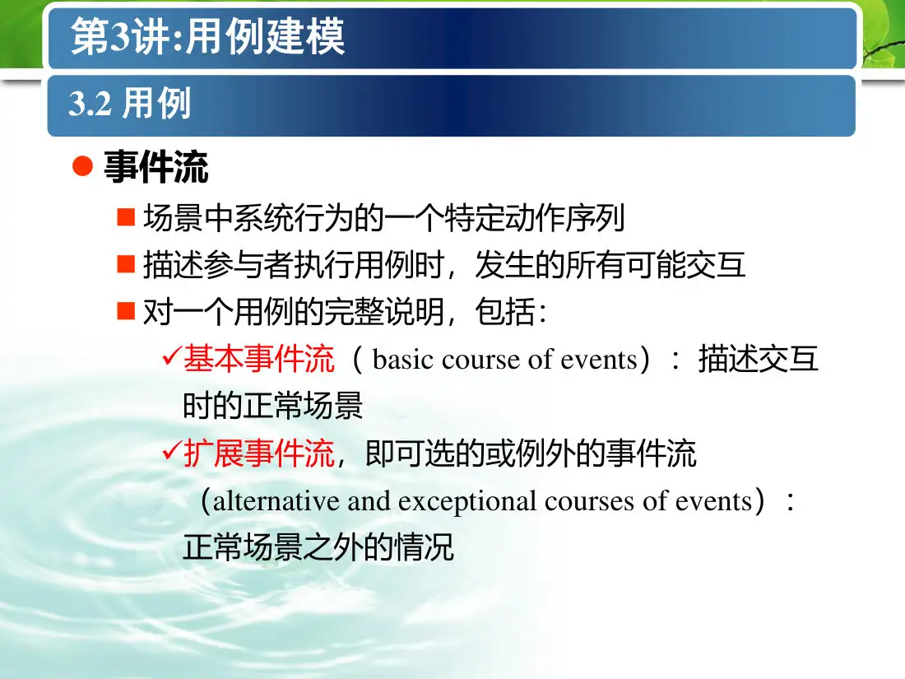

原文：

第3讲:用例建模

3.2 用例

事件流

■ 场景中系统行为的一个特定动作序列

■ 描述参与者执行用例时，发生的所有可能交互

■ 对一个用例的完整说明，包括：

√基本事件流（basic course of events）：描述交互时的正常场景

√扩展事件流，即可选的或例外的事件流

(alternative and exceptional courses of events) :

正常场景之外的情况

### 第3讲:用例建模

原文：

第3讲:用例建模

3.2 用例

用例分析

■ 是对系统功能的分解

- 如何确定用例的粒度？

■ 粒度可大可小，一般一个系统宜控制在20个用例左右

■ 用例是系统级、抽象的描述，不是细化的（做什么）

■ 复杂的系统可以划分成若干子系统处理。

- 如何确定用例？

■ 参与者希望系统执行什么任务？

■ 参与者在系统中访问的哪些信息（增删改查）

■ 需要将外界的哪些信息提供给系统？

■ 需要将系统的哪个事件告诉参与者？

■ 如何维护系统?

### 第3讲:用例建模

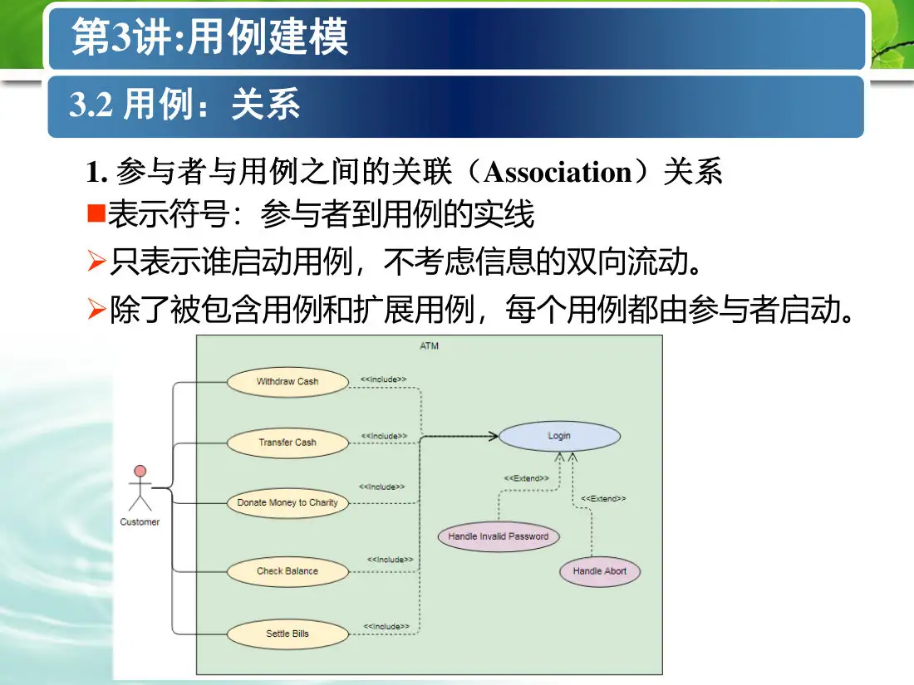

原文：

第3讲:用例建模

3.2 用例：关系

1. 参与者与用例之间的关联（Association）关系

■表示符号：参与者到用例的实线

只表示谁启动用例，不考虑信息的双向流动。

除了被包含用例和扩展用例，每个用例都由参与者启动。

### 第3讲:用例建模

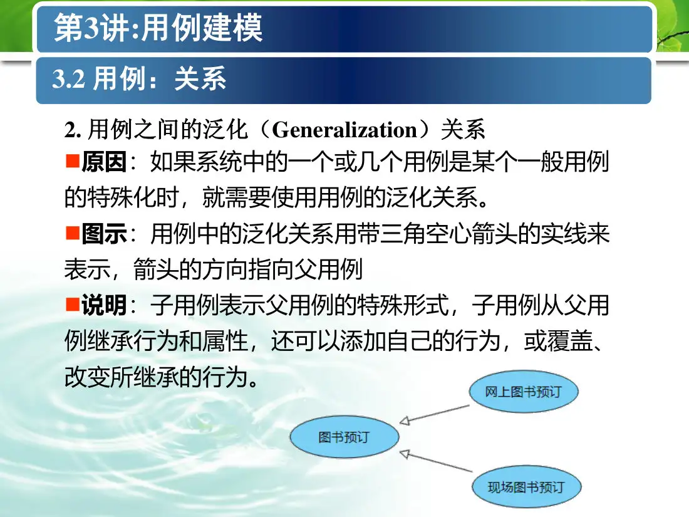

原文：

第3讲:用例建模

3.2 用例：关系

2. 用例之间的泛化（Generalization）关系

■原因：如果系统中的一个或几个用例是某个一般用例的特殊化时，就需要使用用例的泛化关系。

■图示：用例中的泛化关系用带三角空心箭头的实线来表示，箭头的方向指向父用例

■说明：子用例表示父用例的特殊形式，子用例从父用例继承行为和属性，还可以添加自己的行为，或覆盖、改变所继承的行为。

网上图书预订

图书预订

现场图书预订

### 第3讲:用例建模

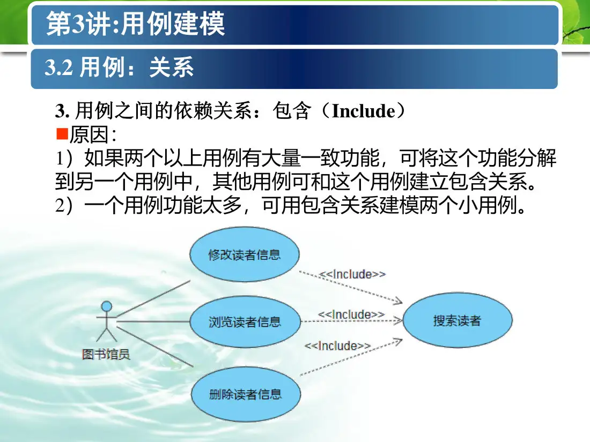

原文：

第3讲:用例建模

3.2 用例：关系

3. 用例之间的依赖关系：包含（Include）

原因：

1）如果两个以上用例有大量一致功能，可将这个功能分解到另一个用例中，其他用例可和这个用例建立包含关系。

2）一个用例功能太多，可用包含关系建模两个小用例。

### 第3讲:用例建模

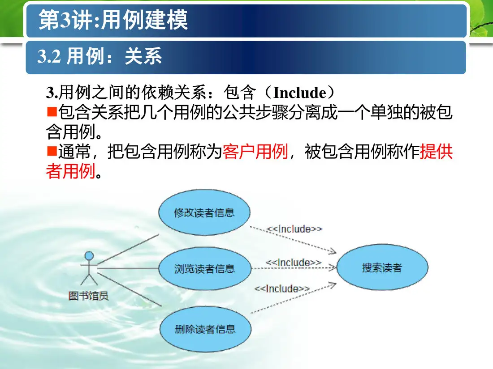

原文：

第3讲:用例建模

3.2 用例：关系

3.用例之间的依赖关系：包含（Include）

■包含关系把几个用例的公共步骤分离成一个单独的被包含用例。

■通常，把包含用例称为客户用例，被包含用例称作提供者用例。

### 第3讲:用例建模

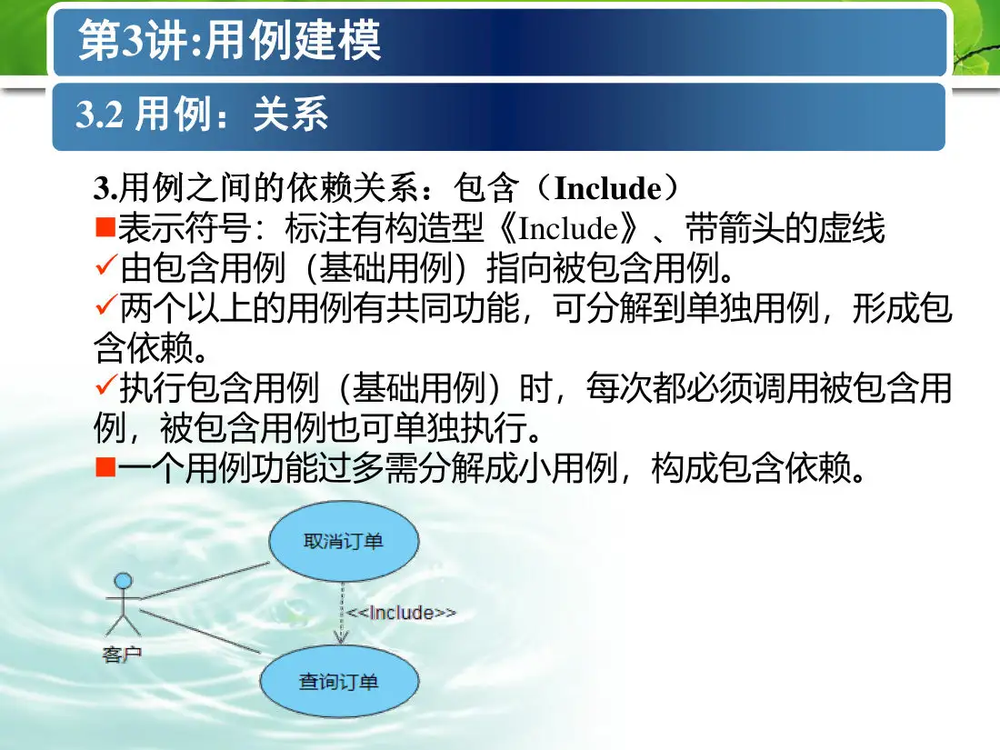

原文：

第3讲:用例建模

3.2 用例：关系

3.用例之间的依赖关系：包含（Include）

■表示符号：标注有构造型《Include》、带箭头的虚线

√ 由包含用例（基础用例）指向被包含用例。

√两个以上的用例有共同功能，可分解到单独用例，形成包含依赖。

√执行包含用例（基础用例）时，每次都必须调用被包含用例，被包含用例也可单独执行。

■一个用例功能过多需分解成小用例，构成包含依赖。

### 第3讲:用例建模

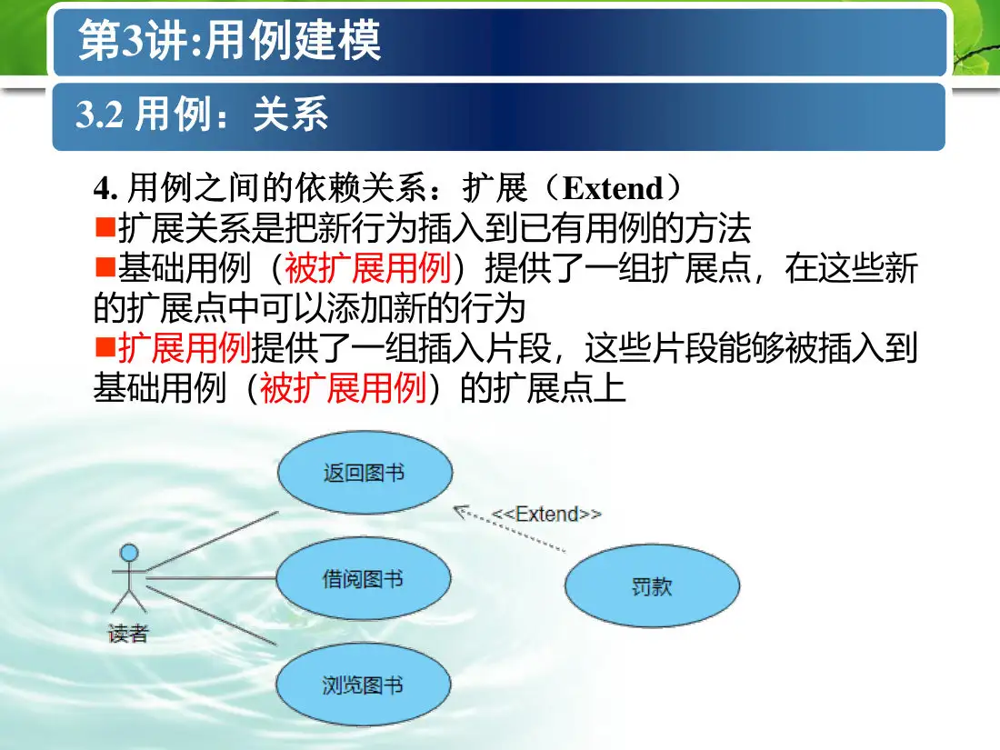

原文：

第3讲:用例建模

3.2 用例：关系

4. 用例之间的依赖关系：扩展（Extend）

■扩展关系是把新行为插入到已有用例的方法

■基础用例（被扩展用例）提供了一组扩展点，在这些新的扩展点中可以添加新的行为

■扩展用例提供了一组插入片段，这些片段能够被插入到基础用例（被扩展用例）的扩展点上

### 第3讲:用例建模

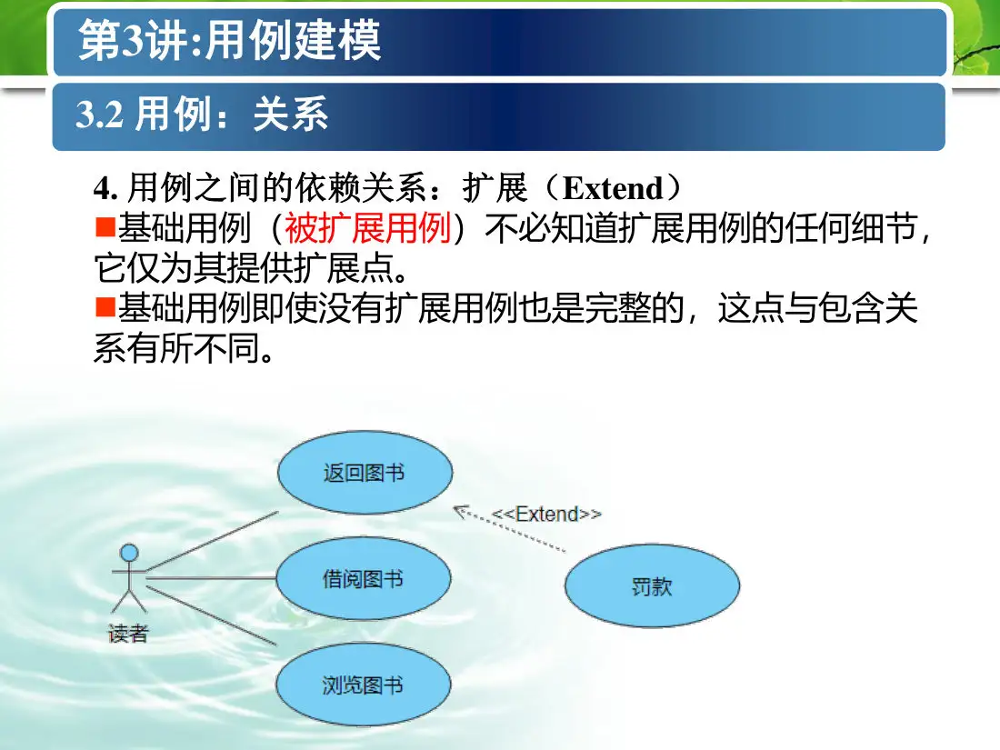

原文：

第3讲:用例建模

3.2 用例：关系

4. 用例之间的依赖关系：扩展（Extend）

■基础用例（被扩展用例）不必知道扩展用例的任何细节，它仅为其提供扩展点。

■基础用例即使没有扩展用例也是完整的，这点与包含关系有所不同。

### 第3讲:用例建模

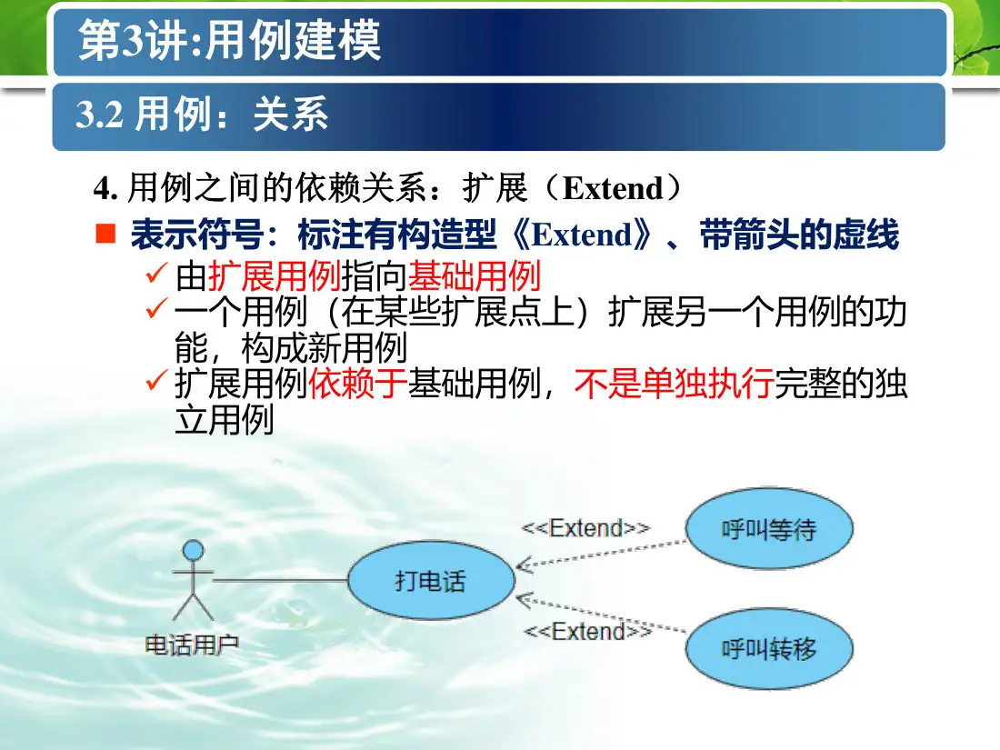

原文：

第3讲:用例建模

3.2 用例：关系

4. 用例之间的依赖关系：扩展（Extend）

■ 表示符号：标注有构造型《Extend》、带箭头的虚线
√ 由扩展用例指向基础用例

√ 一个用例（在某些扩展点上）扩展另一个用例的功能，构成新用例

√ 扩展用例依赖于基础用例，不是单独执行完整的独立用例

打电话

电话用户

呼叫等待

呼叫转移

### 第3讲:用例建模

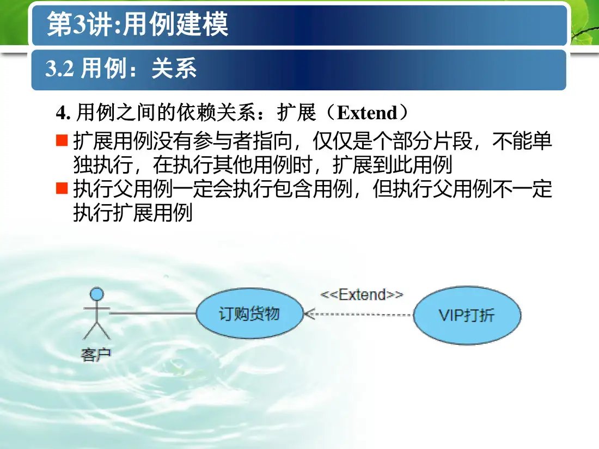

原文：

第3讲:用例建模

3.2 用例：关系

4. 用例之间的依赖关系：扩展（Extend）

■ 扩展用例没有参与者指向，仅仅是个部分片段，不能单独执行，在执行其他用例时，扩展到此用例

■ 执行父用例一定会执行包含用例，但执行父用例不一定执行扩展用例

订购货物

VIP打折

### 第3讲:用例建模

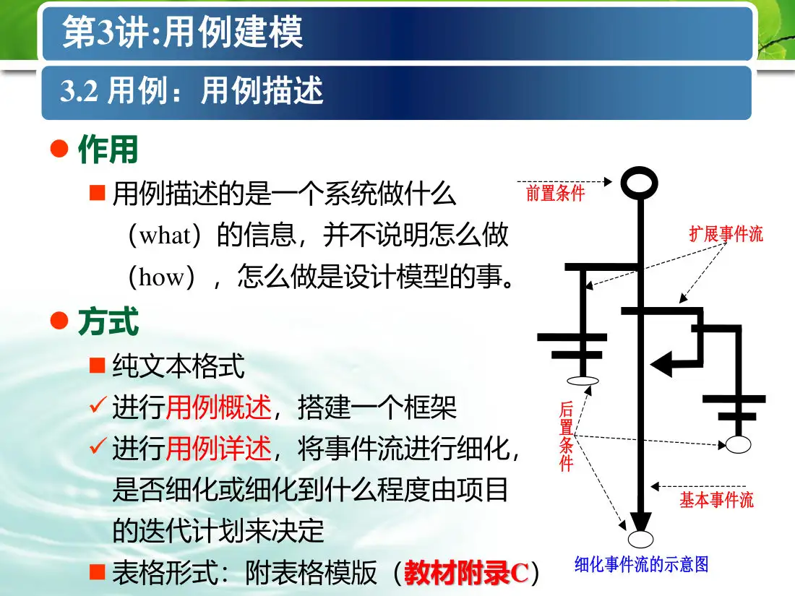

原文：

第3讲:用例建模

3.2 用例：用例描述

• 作用

■ 用例描述的是一个系统做什么（what）的信息，并不说明怎么做（how），怎么做是设计模型的事。

方式

纯文本格式

√ 进行用例概述，搭建一个框架

√ 进行用例详述，将事件流进行细化，是否细化或细化到什么程度由项目的迭代计划来决定

■ 表格形式：附表格模版（教材附录C）

### 第3讲:用例建模

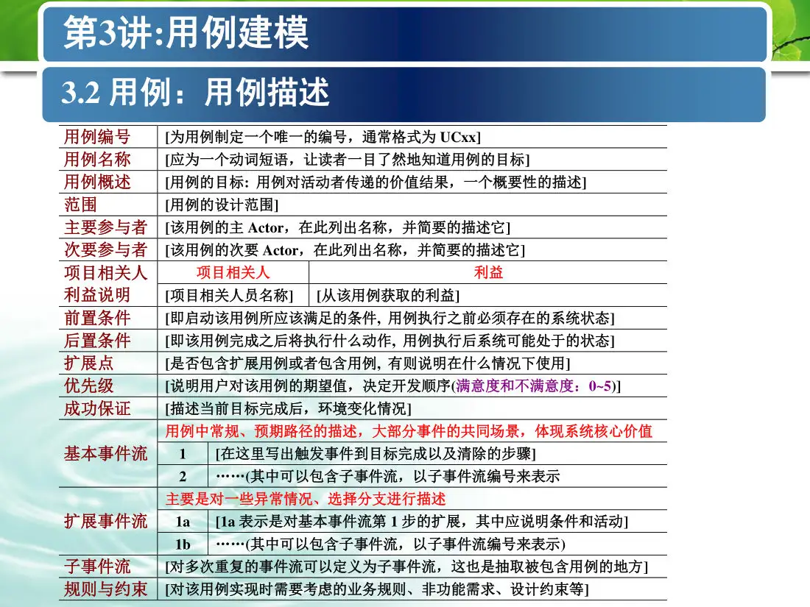

原文：

第3讲:用例建模

3.2 用例：用例描述

<table><tr><td>用例编号</td><td colspan="2">[为用例制定一个唯一的编号,通常格式为UCxx]</td></tr><tr><td>用例名称</td><td colspan="2">[应为一个动词短语,让读者一目了然地知道用例的目标]</td></tr><tr><td>用例概述</td><td colspan="2">[用例的目标:用例对活动者传递的价值结果,一个概要性的描述]</td></tr><tr><td>范围</td><td colspan="2">[用例的设计范围]</td></tr><tr><td>主要参与者</td><td colspan="2">[该用例的主Actor,在此列出名称,并简要的描述它]</td></tr><tr><td>次要参与者</td><td colspan="2">[该用例的次要Actor,在此列出名称,并简要的描述它]</td></tr><tr><td rowspan="2">项目相关人利益说明</td><td>项目相关人</td><td>利益</td></tr><tr><td>[项目相关人员名称]</td><td>[从该用例获取的利益]</td></tr><tr><td>前置条件</td><td colspan="2">[即启动该用例所应该满足的条件,用例执行之前必须存在的系统状态]</td></tr><tr><td>后置条件</td><td colspan="2">[即该用例完成之后将执行什么动作,用例执行后系统可能处于的状态]</td></tr><tr><td>扩展点</td><td colspan="2">[是否包含扩展用例或者包含用例,有则说明在什么情况下使用]</td></tr><tr><td>优先级</td><td colspan="2">[说明用户对该用例的期望值,决定开发顺序(满意度和不满意度:0~5)]</td></tr><tr><td>成功保证</td><td colspan="2">[描述当前目标完成后,环境变化情况]</td></tr><tr><td rowspan="3">基本事件流</td><td colspan="2">用例中常规、预期路径的描述,大部分事件的共同场景,体现系统核心价值</td></tr><tr><td>1</td><td>[在这里写出触发事件到目标完成以及清除的步骤]</td></tr><tr><td>2</td><td>......(其中可以包含子事件流,以子事件流编号来表示</td></tr><tr><td rowspan="3">扩展事件流</td><td colspan="2">主要是对一些异常情况、选择分支进行描述</td></tr><tr><td>1a</td><td>[1a表示是对基本事件流第1步的扩展,其中应说明条件和活动]</td></tr><tr><td>1b</td><td>......(其中可以包含子事件流,以子事件流编号来表示)</td></tr><tr><td>子事件流</td><td colspan="2">[对多次重复的事件流可以定义为子事件流,这也是抽取被包含用例的地方]</td></tr><tr><td>规则与约束</td><td colspan="2">对该用例实现时需要考虑的业务规则、非功能需求、设计约束等]</td></tr></table>

### 第3讲:用例建模

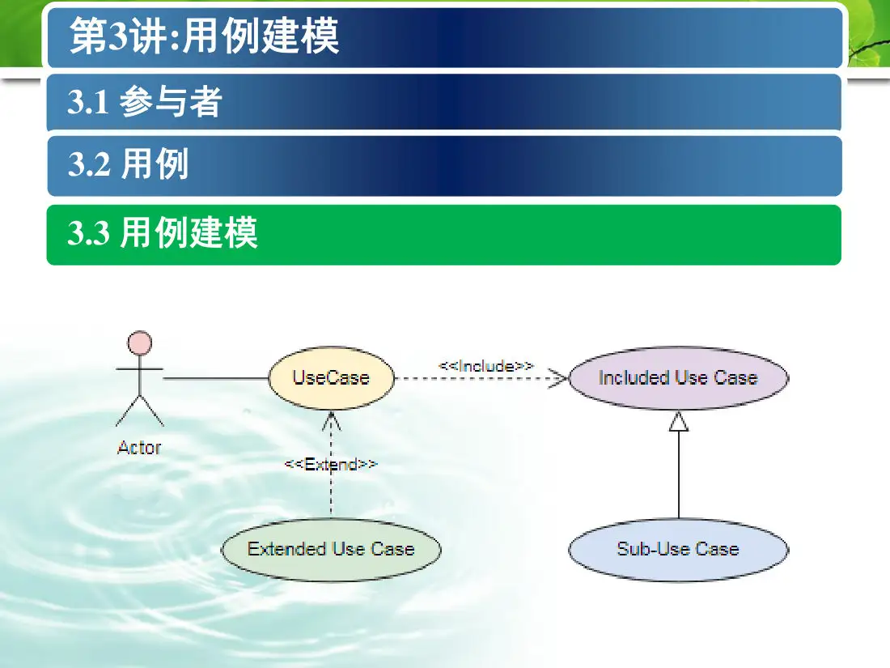

原文：

第3讲:用例建模

3.1 参与者

3.2 用例

3.3 用例建模

### 第3讲:用例建模

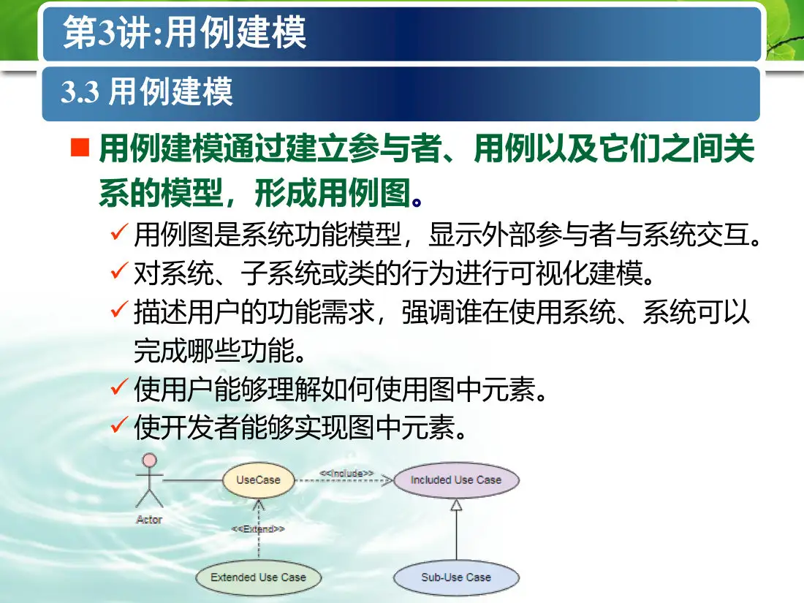

原文：

第3讲:用例建模

3.3 用例建模

■ 用例建模通过建立参与者、用例以及它们之间关系的模型，形成用例图。

√ 用例图是系统功能模型，显示外部参与者与系统交互。

√ 对系统、子系统或类的行为进行可视化建模。

√ 描述用户的功能需求，强调谁在使用系统、系统可以完成哪些功能。

√ 使用户能够理解如何使用图中元素。

√ 使开发者能够实现图中元素。

### 第3讲:用例建模

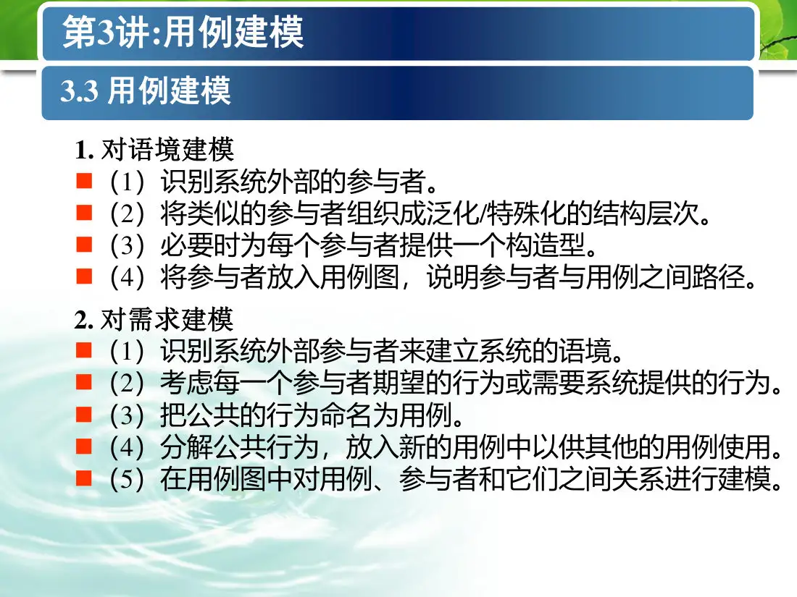

原文：

第3讲:用例建模

3.3 用例建模

1. 对语境建模

(1) 识别系统外部的参与者。

(2) 将类似的参与者组织成泛化/特殊化的结构层次。

(3) 必要时为每个参与者提供一个构造型。

(4) 将参与者放入用例图，说明参与者与用例之间路径。

2. 对需求建模

(1) 识别系统外部参与者来建立系统的语境。

(2) 考虑每一个参与者期望的行为或需要系统提供的行为。

(3) 把公共的行为命名为用例。

(4) 分解公共行为，放入新的用例中以供其他的用例使用。

(5) 在用例图中对用例、参与者和它们之间关系进行建模。

### 第3讲:用例建模

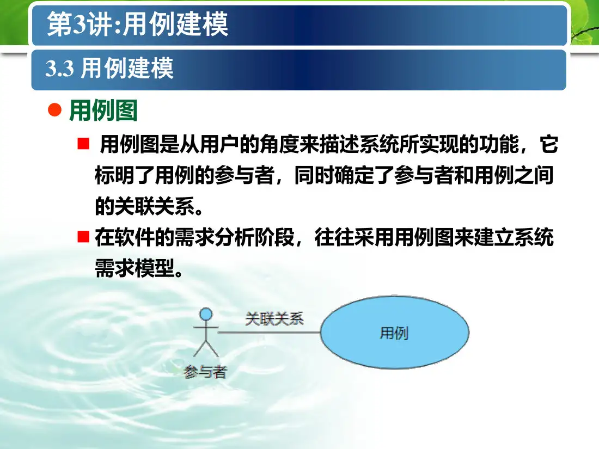

原文：

第3讲:用例建模

3.3 用例建模

用例图

用例图是从用户的角度来描述系统所实现的功能，它标明了用例的参与者，同时确定了参与者和用例之间的关联关系。

■ 在软件的需求分析阶段，往往采用用例图来建立系统需求模型。

### 第3讲:用例建模

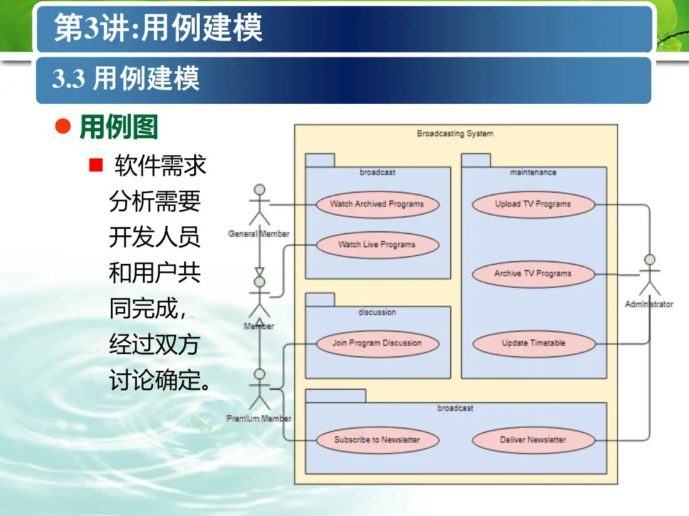

原文：

第3讲:用例建模

3.3 用例建模

用例图

软件需求分析需要开发人员和用户共同完成，经过双方讨论确定。

### 第3讲:用例建模

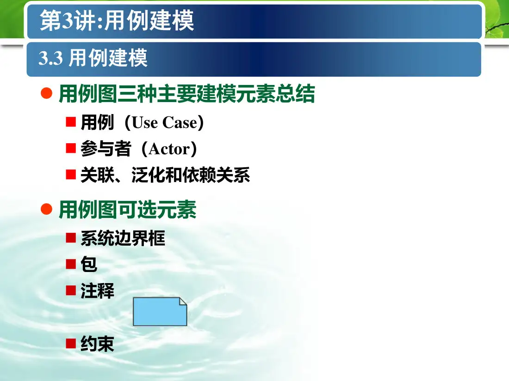

原文：

第3讲:用例建模

3.3 用例建模

用例图三种主要建模元素总结

■ 用例 (Use Case)

■ 参与者 (Actor)

■ 关联、泛化和依赖关系

用例图可选元素

系统边界框

包

注释

约束

### 第3讲:用例建模

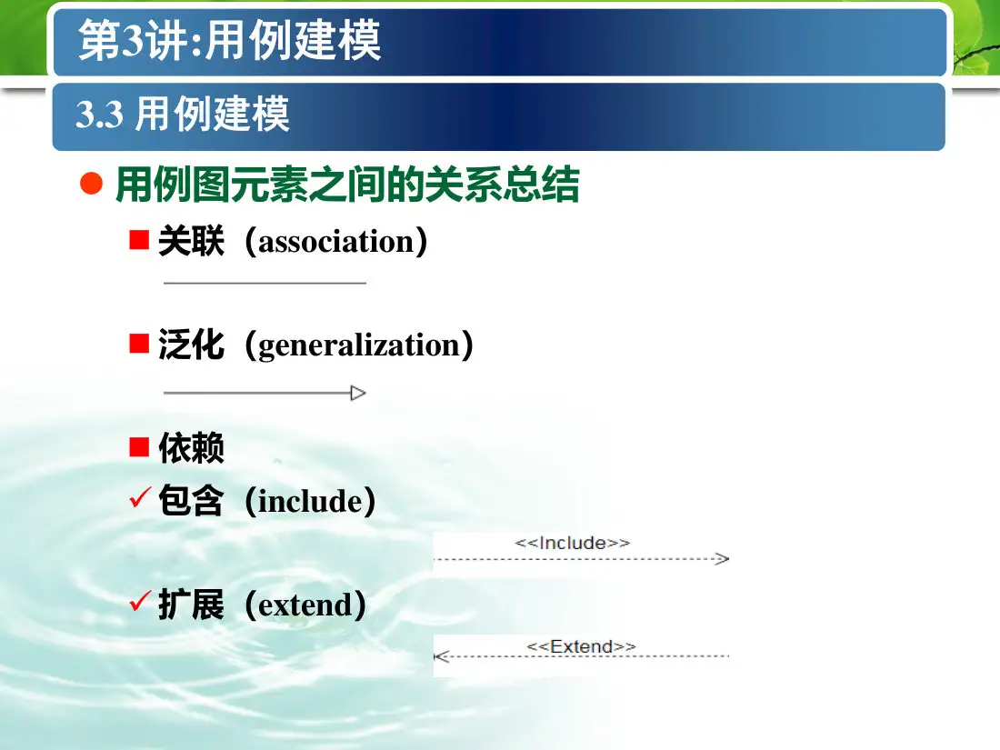

原文：

第3讲:用例建模

3.3 用例建模

用例图元素之间的关系总结

■ 关联 (association)

■ 泛化 (generalization)

依赖

√ 包含 (include)

<<Include>>

√ 扩展 (extend)

### 第3讲:用例建模

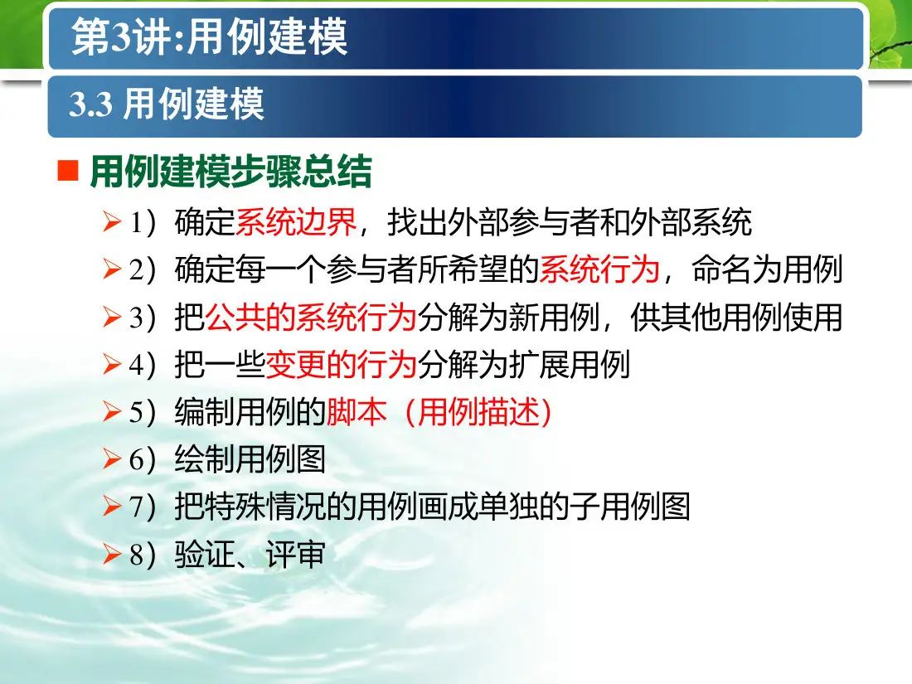

原文：

第3讲:用例建模

3.3 用例建模

■ 用例建模步骤总结

1）确定系统边界，找出外部参与者和外部系统

2）确定每一个参与者所希望的系统行为，命名为用例

3）把公共的系统行为分解为新用例，供其他用例使用

4）把一些变更的行为分解为扩展用例

5）编制用例的脚本（用例描述）

6）绘制用例图

7）把特殊情况的用例画成单独的子用例图

8）验证、评审

### 第3讲:用例建模

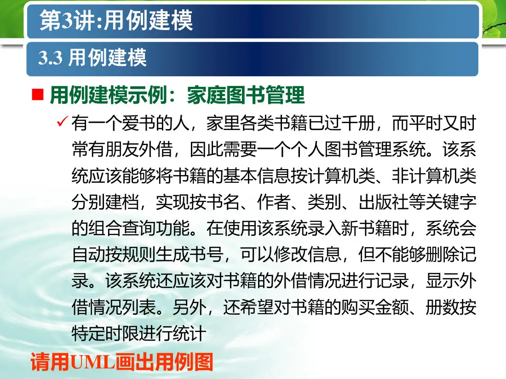

原文：

第3讲:用例建模

3.3 用例建模

■ 用例建模示例：家庭图书管理

√ 有一个爱书的人，家里各类书籍已过千册，而平时又时常有朋友外借，因此需要一个个人图书管理系统。该系统应该能够将书籍的基本信息按计算机类、非计算机类分别建档，实现按书名、作者、类别、出版社等关键字的组合查询功能。在使用该系统录入新书籍时，系统会自动按规则生成书号，可以修改信息，但不能够删除记录。该系统还应该对书籍的外借情况进行记录，显示外借情况列表。另外，还希望对书籍的购买金额、册数按特定时限进行统计

请用UML画出用例图

### 第3讲:用例建模

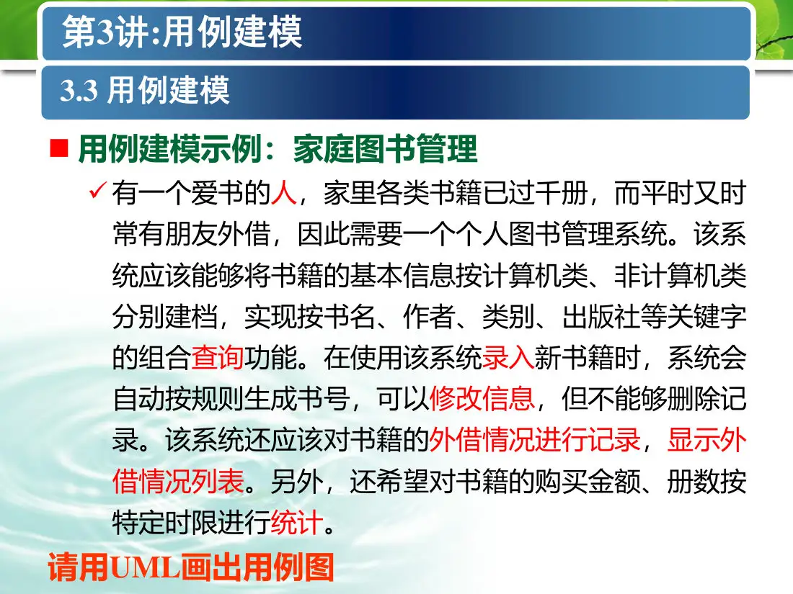

原文：

第3讲:用例建模

3.3 用例建模

■ 用例建模示例：家庭图书管理

√ 有一个爱书的人，家里各类书籍已过千册，而平时又时常有朋友外借，因此需要一个个人图书管理系统。该系统应该能够将书籍的基本信息按计算机类、非计算机类分别建档，实现按书名、作者、类别、出版社等关键字的组合查询功能。在使用该系统录入新书籍时，系统会自动按规则生成书号，可以修改信息，但不能够删除记录。该系统还应该对书籍的外借情况进行记录，显示外借情况列表。另外，还希望对书籍的购买金额、册数按特定时限进行统计。

请用UML画出用例图

### 第3讲:用例建模

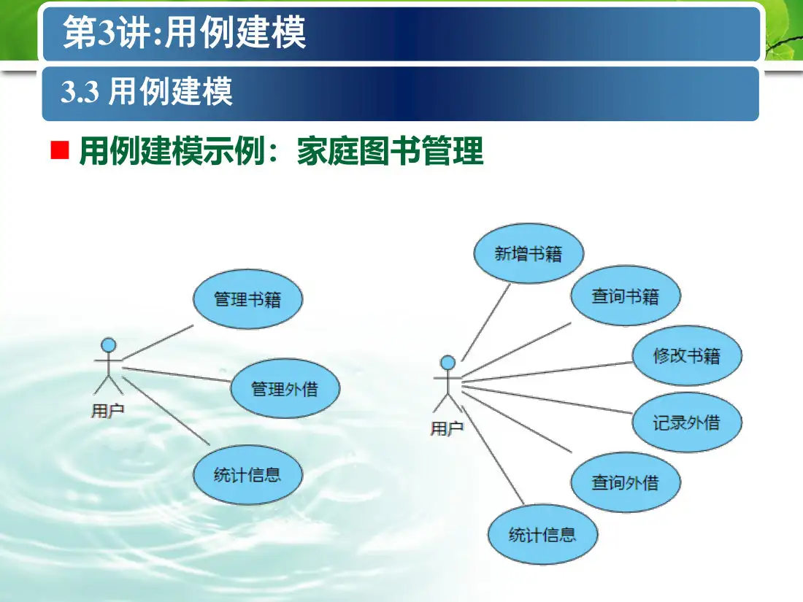

原文：

第3讲:用例建模

3.3 用例建模

■ 用例建模示例：家庭图书管理

### 第3讲:用例建模

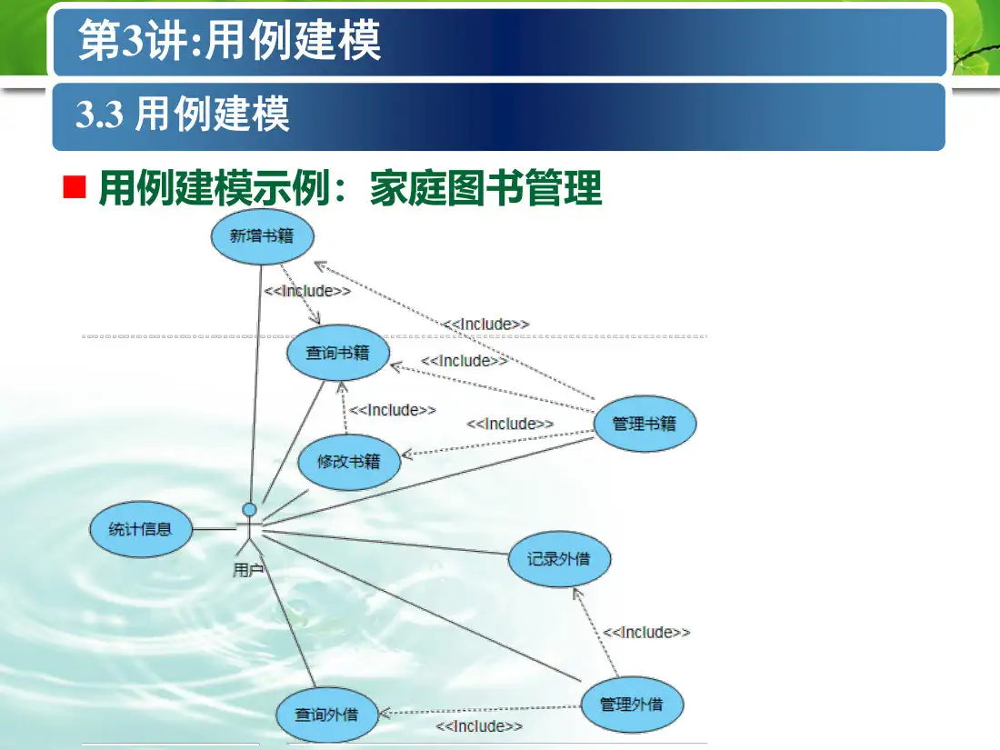

原文：

第3讲:用例建模

3.3 用例建模

■ 用例建模示例：家庭图书管理
