# 《软件建模与设计》第5章 动态建模-活动图（2025版）

原件的每一页，下面附识别出的文字。

### 软件建模与设计

原文：

软件建模与设计

授课班级：B220417-19，B220400

授课安排：QQ群、超星学习通，课堂

授课时间：周二第8-9节{第1-16周}

金惠颖

### 5.1 活动图的基本元素

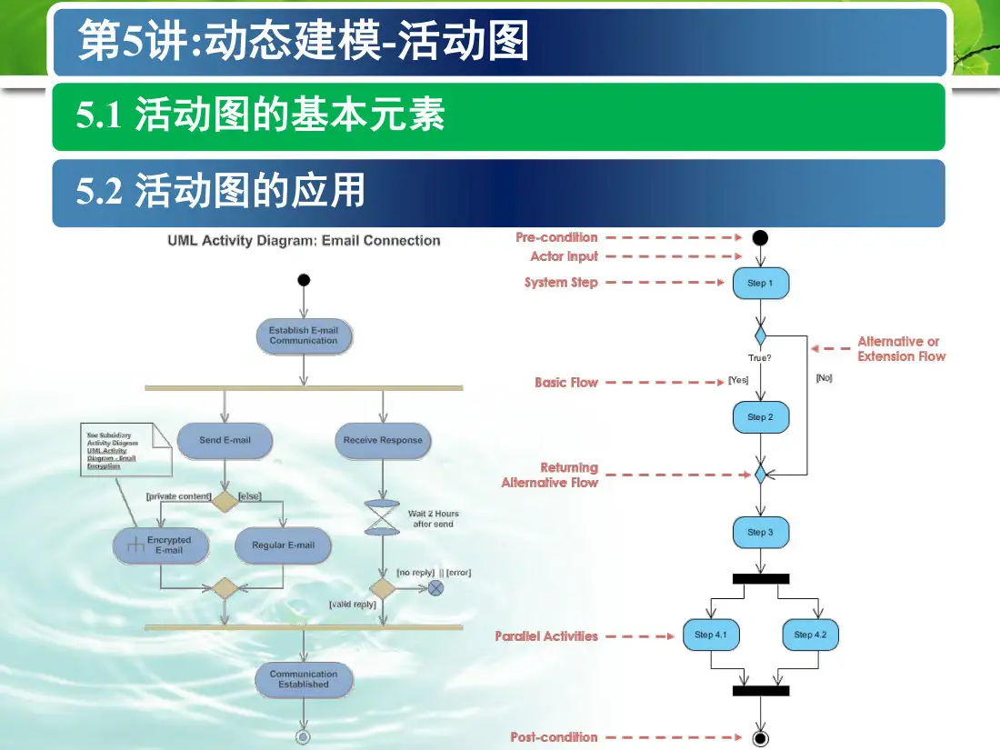

原文：

5.1 活动图的基本元素

5.2 活动图的应用

第5讲:动态建模-活动图

### 第5讲:动态建模-活动图

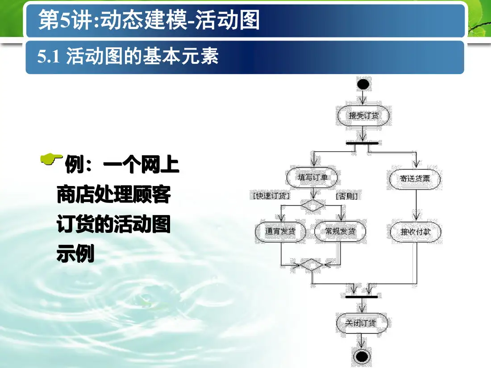

原文：

第5讲:动态建模-活动图

5.1 活动图的基本元素

例：一个网上商店处理顾客订货的活动图示例

### 第5讲:动态建模-活动图

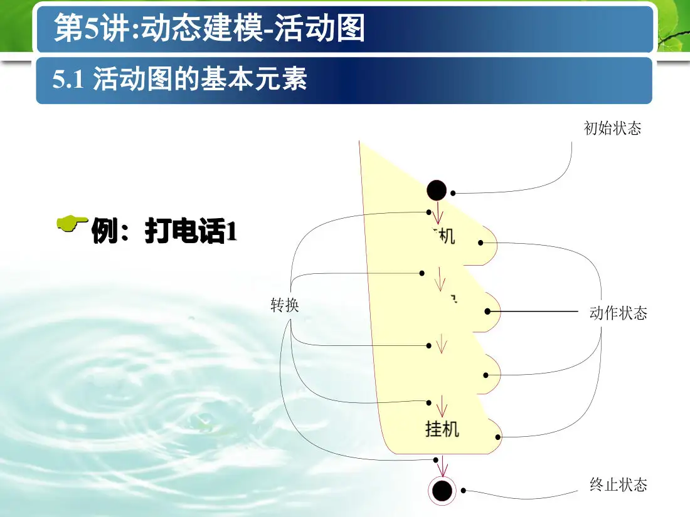

原文：

第5讲:动态建模-活动图

5.1 活动图的基本元素

例：打电话1

初始状态

### 第5讲:动态建模-活动图

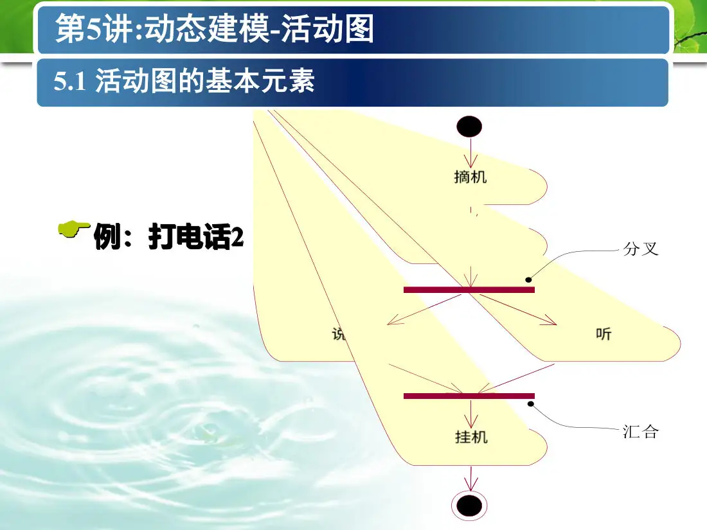

原文：

第5讲:动态建模-活动图

5.1 活动图的基本元素

例：打电话2

### 第5讲:动态建模-活动图

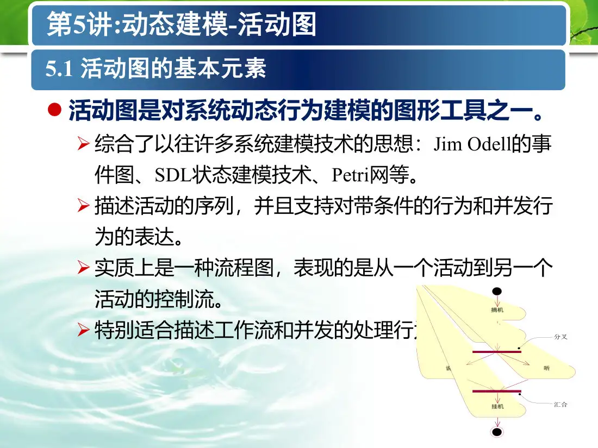

原文：

第5讲:动态建模-活动图

5.1 活动图的基本元素

- 活动图是对系统动态行为建模的图形工具之一。

综合了以往许多系统建模技术的思想：Jim Odell的事件图、SDL状态建模技术、Petri网等。

描述活动的序列，并且支持对带条件的行为和并发行为的表达。

实质上是一种流程图，表现的是从一个活动到另一个

活动的控制流。

特别适合描述工作流和并发的处理行为

### 第5讲:动态建模-活动图

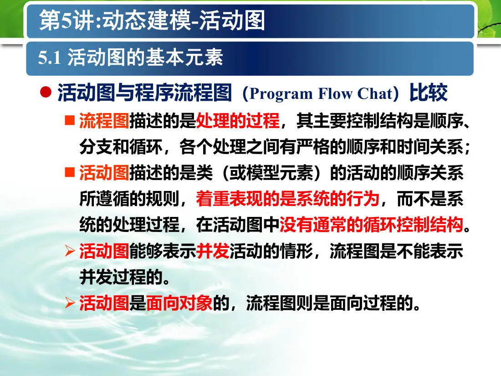

原文：

第5讲:动态建模-活动图

5.1 活动图的基本元素

\- 活动图与程序流程图（Program Flow Chat）比较

■ 流程图描述的是处理的过程，其主要控制结构是顺序、分支和循环，各个处理之间有严格的顺序和时间关系；

■ 活动图描述的是类（或模型元素）的活动的顺序关系所遵循的规则，着重表现的是系统的行为，而不是系统的处理过程，在活动图中没有通常的循环控制结构。

活动图能够表示并发活动的情形，流程图是不能表示并发过程的。

活动图是面向对象的，流程图则是面向过程的。

### 第5讲:动态建模-活动图

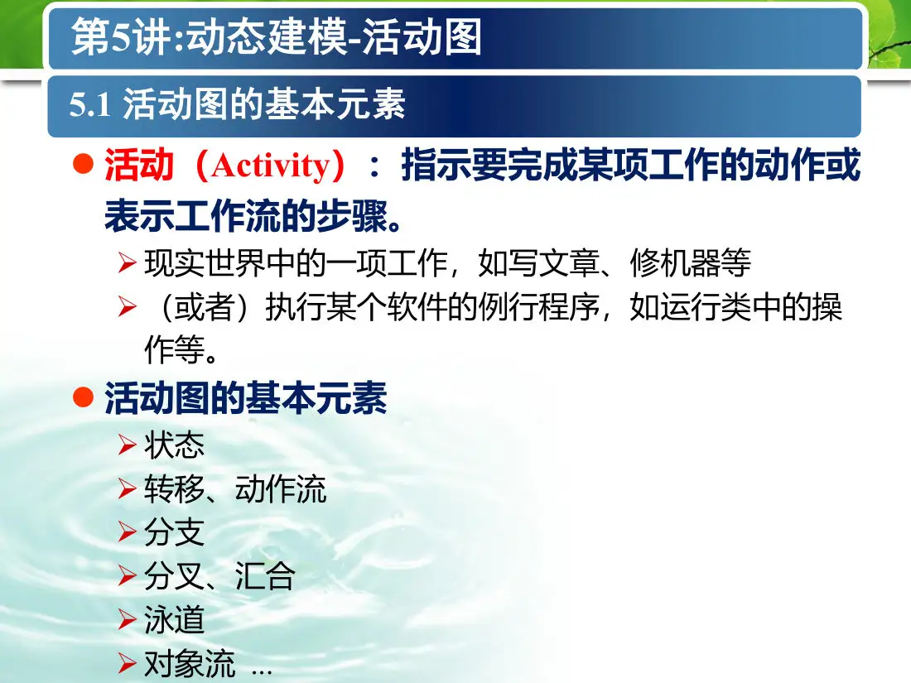

原文：

第5讲:动态建模-活动图

5.1 活动图的基本元素

\- 活动（Activity）：指示要完成某项工作的动作或表示工作流的步骤。

现实世界中的一项工作，如写文章、修机器等

（或者）执行某个软件的例行程序，如运行类中的操作等。

活动图的基本元素

状态

转移、动作流

分支

分叉、汇合

泳道

对象流 ...

### 第5讲:动态建模-活动图

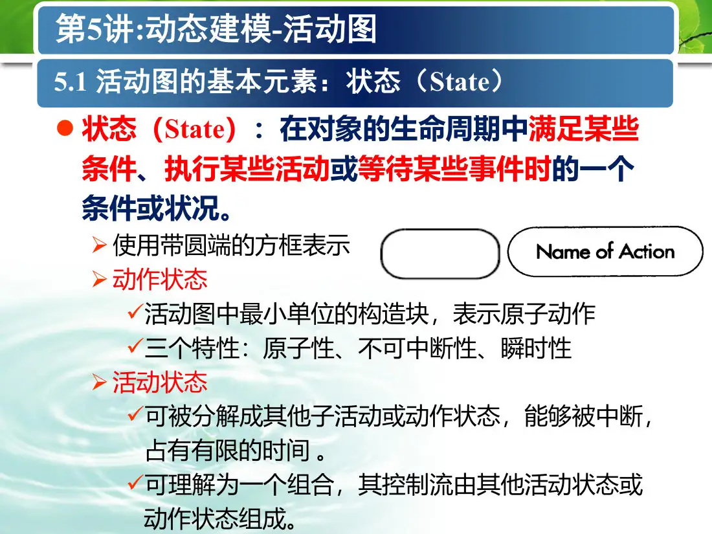

原文：

第5讲:动态建模-活动图

5.1 活动图的基本元素：状态（State）

\- 状态（State）：在对象的生命周期中满足某些条件、执行某些活动或等待某些事件时的一个条件或状况。

使用带圆端的方框表示

动作状态

Name of Action

√活动图中最小单位的构造块，表示原子动作

√ 三个特性：原子性、不可中断性、瞬时性

活动状态

√ 可被分解成其他子活动或动作状态，能够被中断，占有有限的时间。

√ 可理解为一个组合，其控制流由其他活动状态或动作状态组成。

### 第5讲:动态建模-活动图

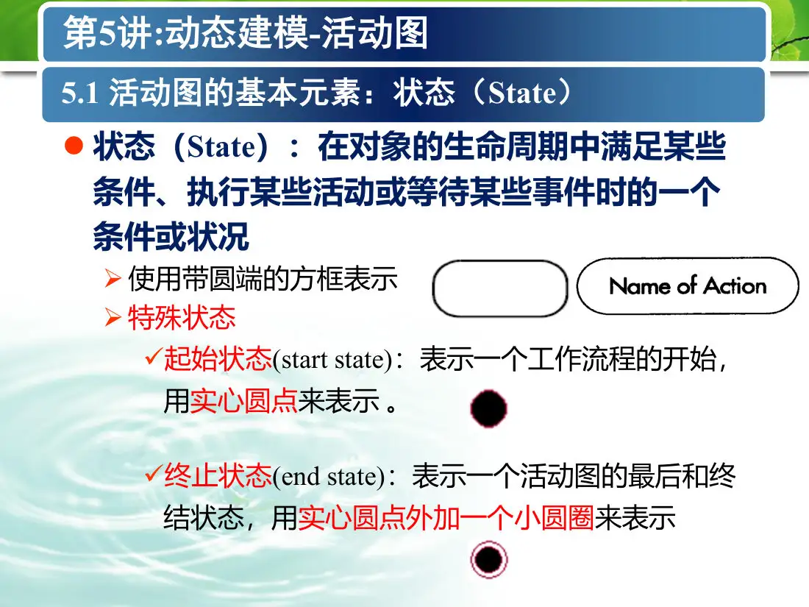

原文：

第5讲:动态建模-活动图

5.1 活动图的基本元素：状态（State）

\- 状态（State）：在对象的生命周期中满足某些条件、执行某些活动或等待某些事件时的一个条件或状况

使用带圆端的方框表示

Name of Action

特殊状态

√起始状态(start state): 表示一个工作流程的开始,用实心圆点来表示。

√终止状态(end state): 表示一个活动图的最后和终结状态, 用实心圆点外加一个小圆圈来表示

### 第5讲:动态建模-活动图

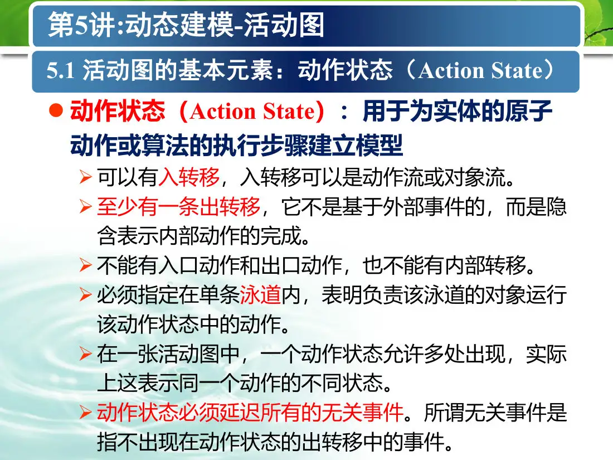

原文：

第5讲:动态建模-活动图

5.1 活动图的基本元素：动作状态（Action State）

\- 动作状态（Action State）：用于为实体的原子动作或算法的执行步骤建立模型

可以有入转移，入转移可以是动作流或对象流。

至少有一条出转移，它不是基于外部事件的，而是隐含表示内部动作的完成。

不能有入口动作和出口动作，也不能有内部转移。

必须指定在单条泳道内，表明负责该泳道的对象运行该动作状态中的动作。

在一张活动图中，一个动作状态允许多处出现，实际上这表示同一个动作的不同状态。

➢ 动作状态必须延迟所有的无关事件。所谓无关事件是指不出现在动作状态的出转移中的事件。

### 第5讲:动态建模-活动图

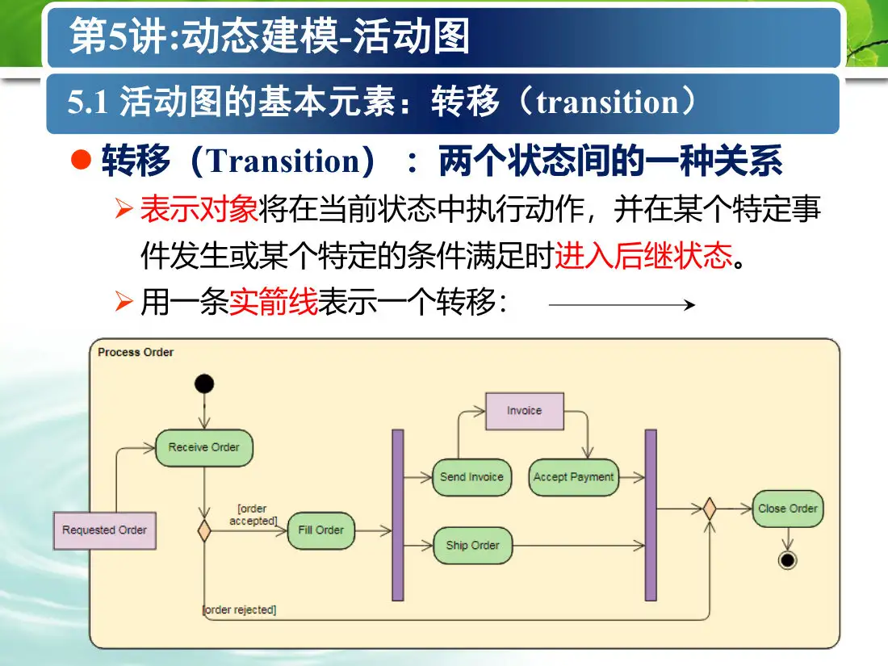

原文：

第5讲:动态建模-活动图

5.1 活动图的基本元素：转移（transition）

\- 转移（Transition）：两个状态间的一种关系

表示对象将在当前状态中执行动作，并在某个特定事件发生或某个特定的条件满足时进入后继状态。

用一条实箭线表示一个转移：

### 第5讲:动态建模-活动图

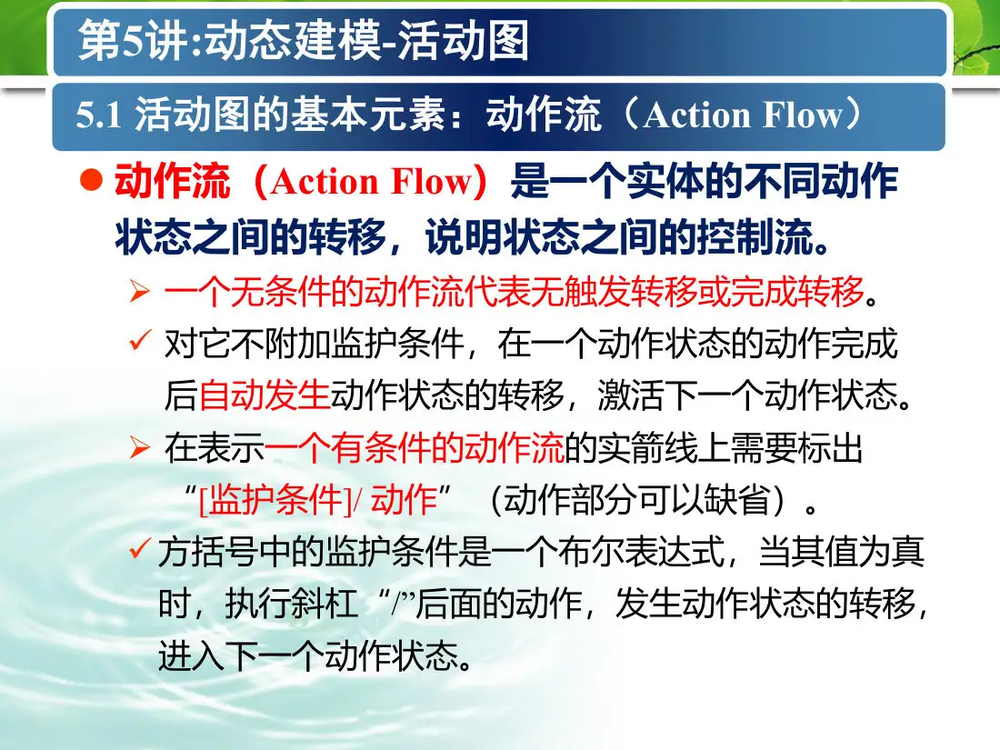

原文：

第5讲:动态建模-活动图

5.1 活动图的基本元素：动作流（Action Flow）

\- 动作流（Action Flow）是一个实体的不同动作状态之间的转移，说明状态之间的控制流。

一个无条件的动作流代表无触发转移或完成转移。

√ 对它不附加监护条件，在一个动作状态的动作完成后自动发生动作状态的转移，激活下一个动作状态。

在表示一个有条件的动作流的实箭线上需要标出“[监护条件]/动作”（动作部分可以缺省）。

√ 方括号中的监护条件是一个布尔表达式，当其值为真时，执行斜杠“/”后面的动作，发生动作状态的转移，进入下一个动作状态。

### 第5讲:动态建模-活动图

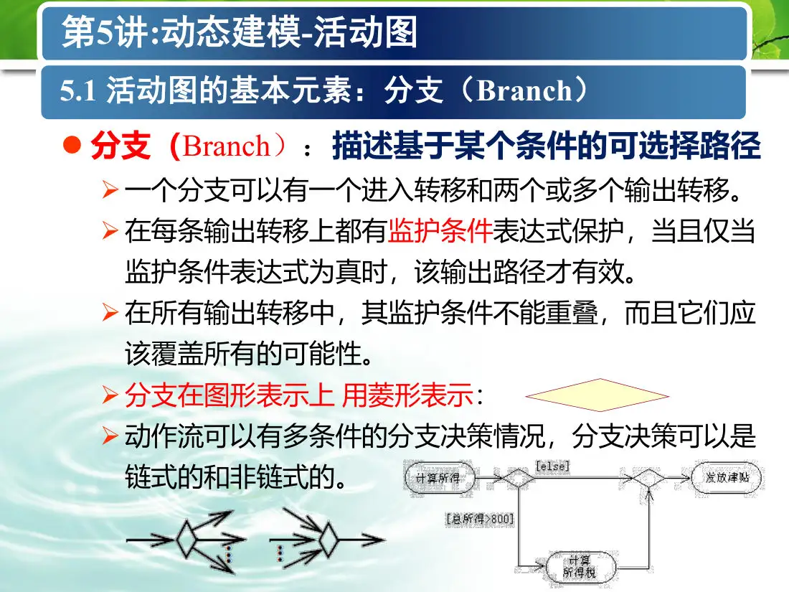

原文：

第5讲:动态建模-活动图

5.1 活动图的基本元素：分支（Branch）

- 分支（Branch）：描述基于某个条件的可选择路径

一个分支可以有一个进入转移和两个或多个输出转移。

在每条输出转移上都有监护条件表达式保护，当且仅当监护条件表达式为真时，该输出路径才有效。

在所有输出转移中，其监护条件不能重叠，而且它们应该覆盖所有的可能性。

分支在图形表示上 用菱形表示：

动作流可以有多条件的分支决策情况，分支决策可以是

链式的和非链式的。

### 第5讲:动态建模-活动图

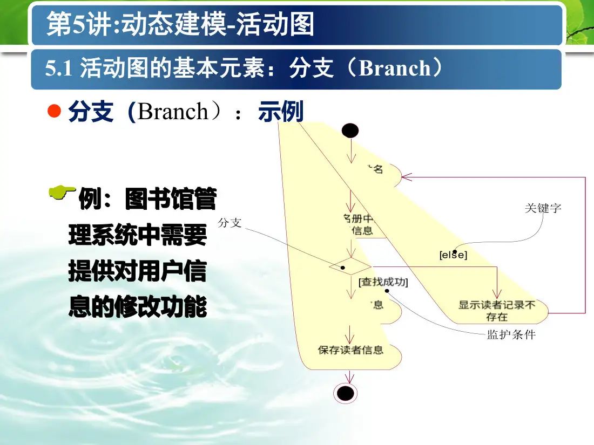

原文：

第5讲:动态建模-活动图

5.1 活动图的基本元素：分支（Branch）

\- 分支（Branch）：示例

例：图书馆管理系统中需要提供对用户信息的修改功能

### 第5讲:动态建模-活动图

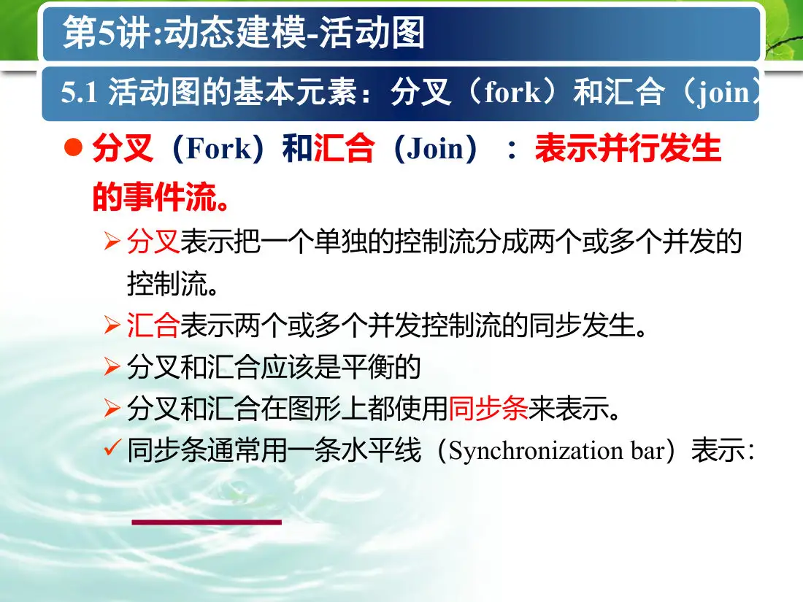

原文：

第5讲:动态建模-活动图

5.1 活动图的基本元素：分叉（fork）和汇合（join

\- 分叉（Fork）和汇合（Join）：表示并行发生的事件流。

分叉表示把一个单独的控制流分成两个或多个并发的控制流。

汇合表示两个或多个并发控制流的同步发生。

分叉和汇合应该是平衡的

分叉和汇合在图形上都使用同步条来表示。

√ 同步条通常用一条水平线（Synchronization bar）表示：

### 第5讲:动态建模-活动图

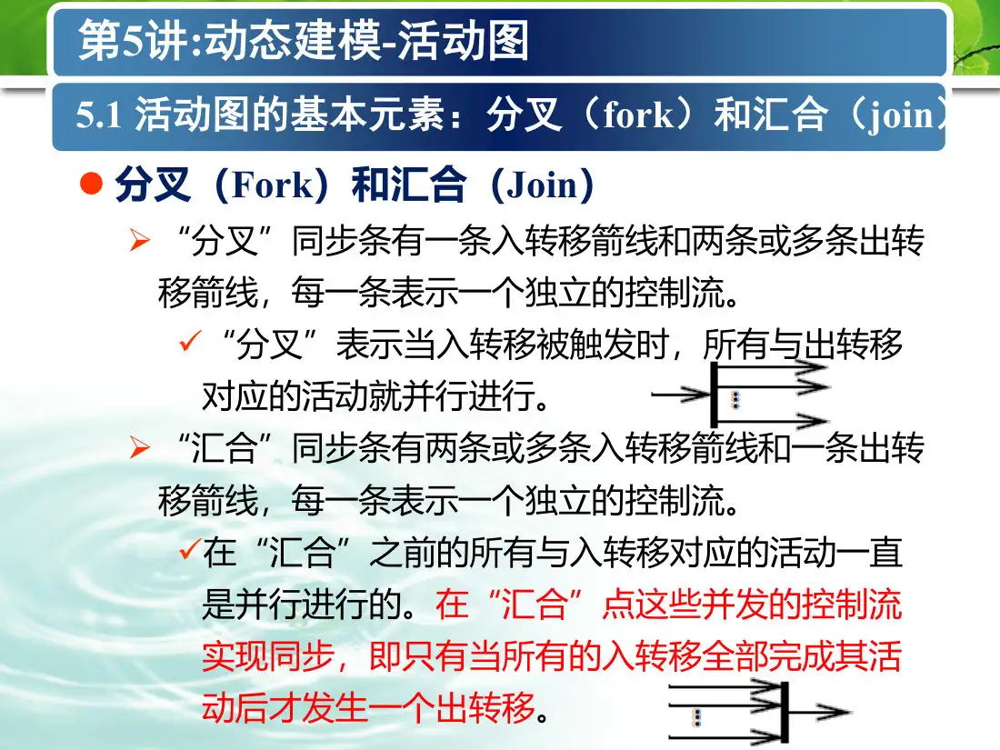

原文：

第5讲:动态建模-活动图

5.1 活动图的基本元素：分叉（fork）和汇合（join

- 分叉（Fork）和汇合（Join）

“分叉”同步条有一条入转移箭线和两条或多条出转移箭线，每一条表示一个独立的控制流。

√ “分叉”表示当入转移被触发时，所有与出转移

对应的活动就并行进行。

“汇合”同步条有两条或多条入转移箭线和一条出转移箭线，每一条表示一个独立的控制流。

√在“汇合”之前的所有与入转移对应的活动一直是并行进行的。在“汇合”点这些并发的控制流实现同步，即只有当所有的入转移全部完成其活动后才发生一个出转移。

### 第5讲:动态建模-活动图

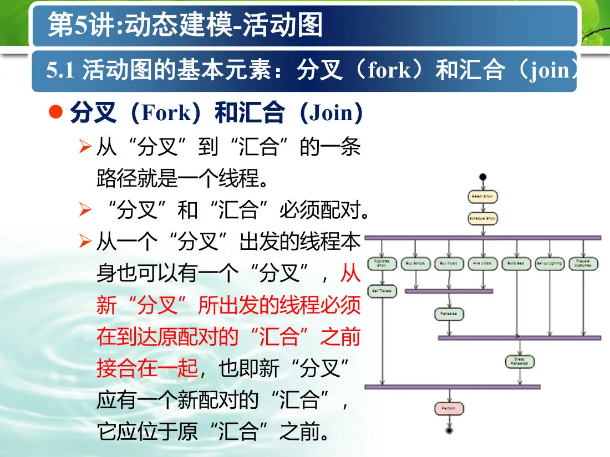

原文：

第5讲:动态建模-活动图

5.1 活动图的基本元素：分叉（fork）和汇合（join

- 分叉（Fork）和汇合（Join）

从“分叉”到“汇合”的一条路径就是一个线程。

“分叉”和“汇合”必须配对。

从一个“分叉”出发的线程本身也可以有一个“分叉”，从新“分叉”所出发的线程必须在到达原配对的“汇合”之前接合在一起，也即新“分叉”应有一个新配对的“汇合”，它应位于原“汇合”之前。

### 第5讲:动态建模-活动图

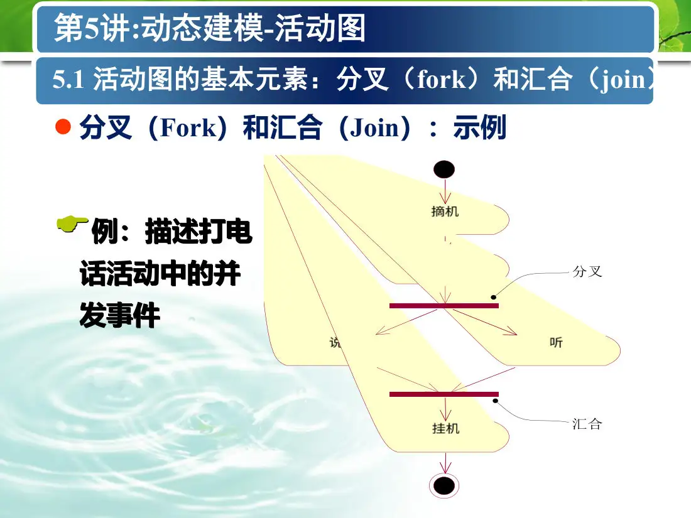

原文：

第5讲:动态建模-活动图

5.1 活动图的基本元素：分叉（fork）和汇合（join

\- 分叉（Fork）和汇合（Join）：示例

例：描述打电话活动中的并发事件

### 第5讲:动态建模-活动图

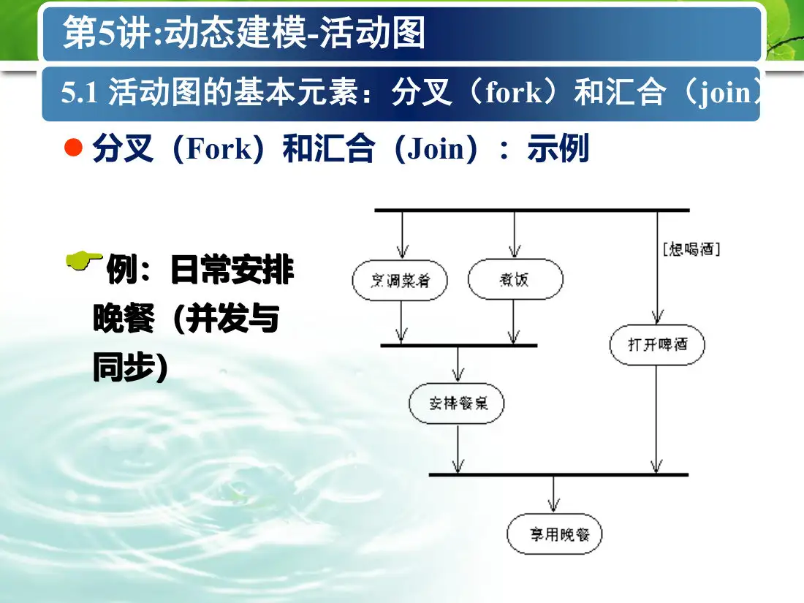

原文：

第5讲:动态建模-活动图

5.1 活动图的基本元素：分叉（fork）和汇合（join

\- 分叉（Fork）和汇合（Join）：示例

例：日常安排晚餐（并发与同步）

### 第5讲:动态建模-活动图

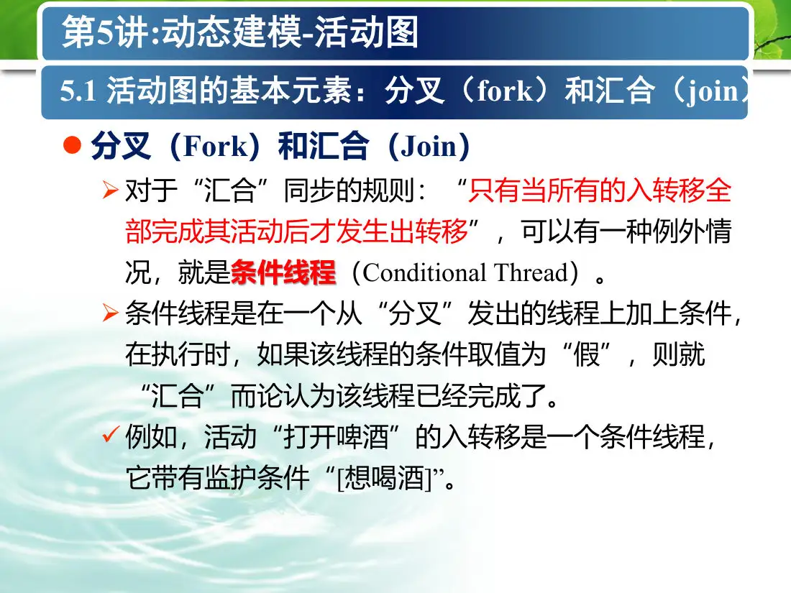

原文：

第5讲:动态建模-活动图

5.1 活动图的基本元素：分叉（fork）和汇合（join

- 分叉（Fork）和汇合（Join）

对于“汇合”同步的规则：“只有当所有的入转移全部完成其活动后才发生出转移”，可以有一种例外情况，就是条件线程（Conditional Thread）。

条件线程是在一个从“分叉”发出的线程上加上条件，在执行时，如果该线程的条件取值为“假”，则就“汇合”而论认为该线程已经完成了。

√ 例如，活动“打开啤酒”的入转移是一个条件线程，它带有监护条件“[想喝酒]”。

### 第5讲:动态建模-活动图

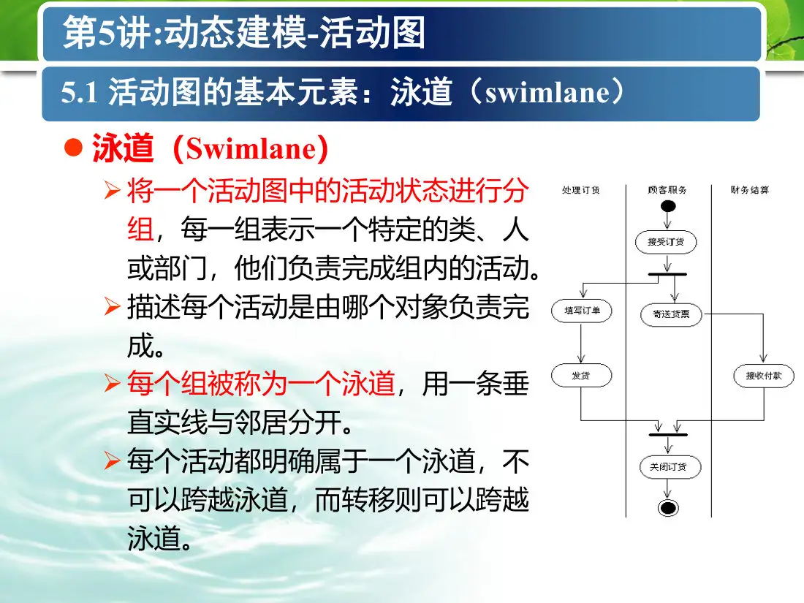

原文：

第5讲:动态建模-活动图

5.1 活动图的基本元素：泳道（swimlane）

- 泳道 (Swimlane)

将一个活动图中的活动状态进行分组，每一组表示一个特定的类、人或部门，他们负责完成组内的活动。

描述每个活动是由哪个对象负责完成。

每个组被称为一个泳道，用一条垂直实线与邻居分开。

每个活动都明确属于一个泳道，不可以跨越泳道，而转移则可以跨越泳道。

### 第5讲:动态建模-活动图

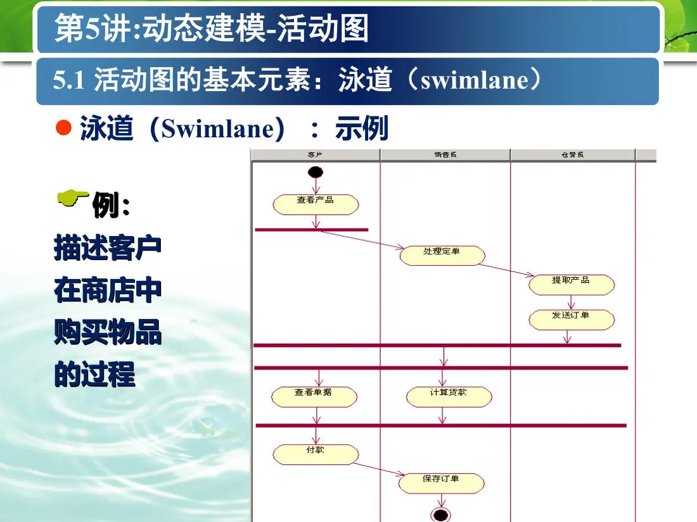

原文：

第5讲:动态建模-活动图

5.1 活动图的基本元素：泳道（swimlane）

\- 泳道（Swimlane）：示例

例:

描述客户

在商店中

购买物品

的过程

### 第5讲:动态建模-活动图

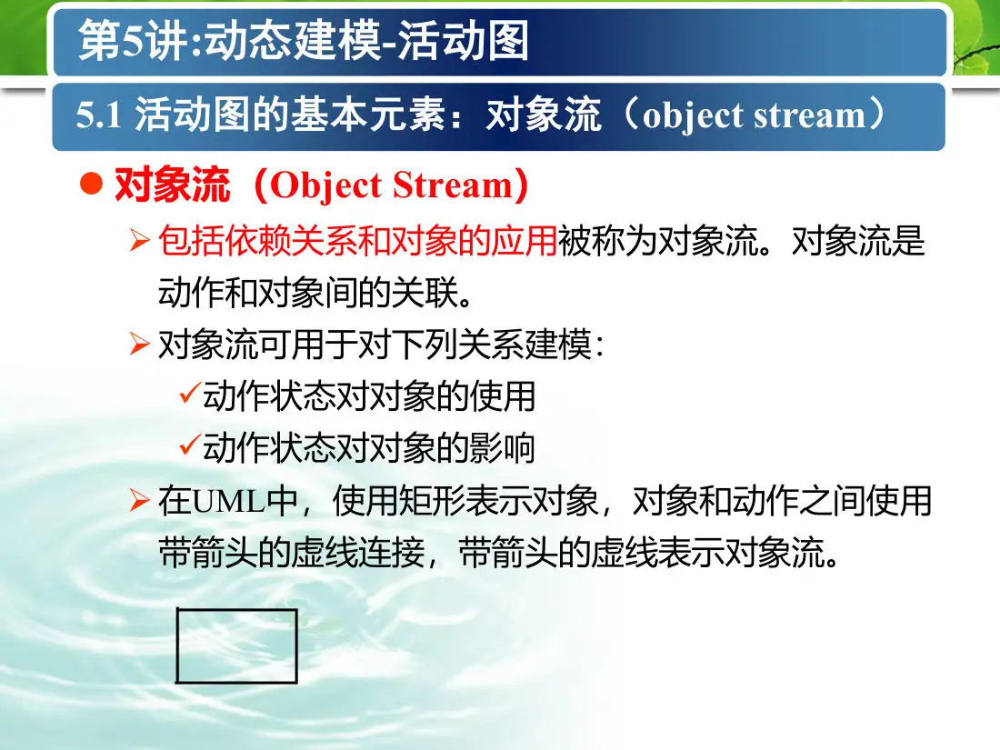

原文：

第5讲:动态建模-活动图

5.1 活动图的基本元素：对象流（object stream）

- 对象流 (Object Stream)

包括依赖关系和对象的应用被称为对象流。对象流是动作和对象间的关联。

对象流可用于对下列关系建模：

√动作状态对对象的使用

√ 动作状态对对象的影响

在UML中，使用矩形表示对象，对象和动作之间使用带箭头的虚线连接，带箭头的虚线表示对象流。

### 第5讲:动态建模-活动图

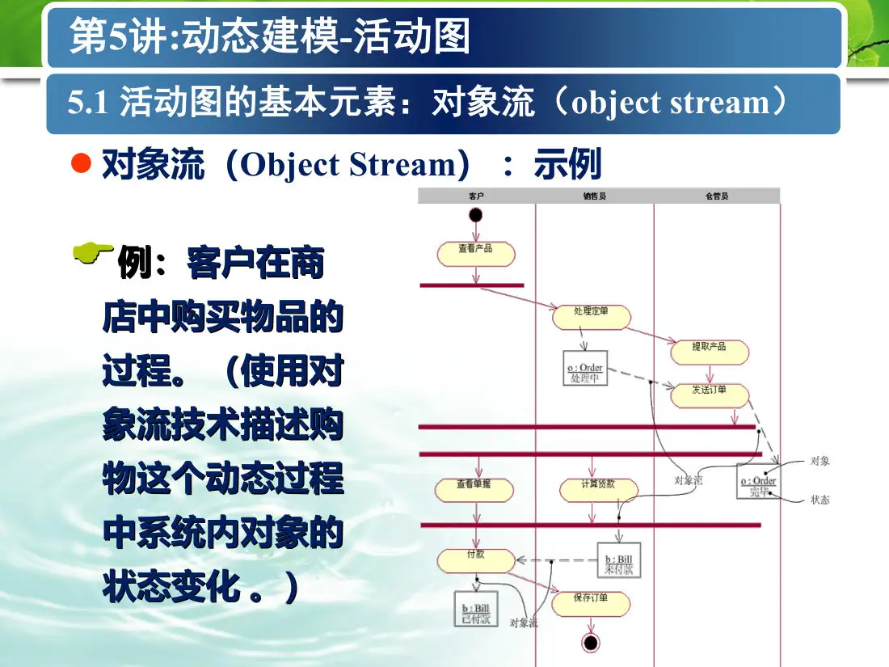

原文：

第5讲:动态建模-活动图

5.1 活动图的基本元素：对象流（object stream）

\- 对象流（Object Stream）：示例

例：客户在商店中购买物品的过程。（使用对象流技术描述购物这个动态过程中系统内对象的状态变化。）

### 第5讲:动态建模-活动图

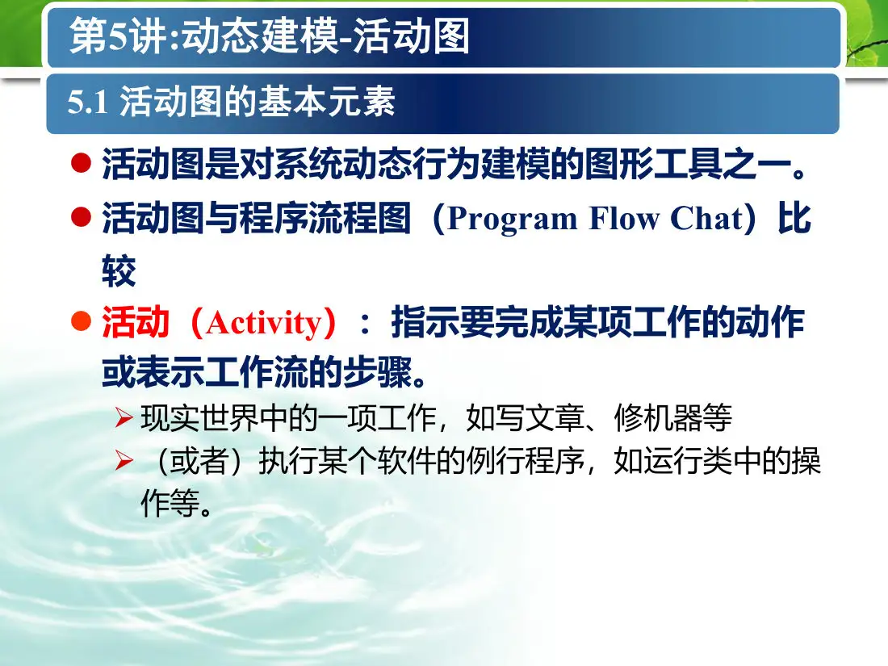

原文：

第5讲:动态建模-活动图

5.1 活动图的基本元素

\- 活动图是对系统动态行为建模的图形工具之一。

\- 活动图与程序流程图（Program Flow Chat）比较

\- 活动（Activity）：指示要完成某项工作的动作或表示工作流的步骤。

现实世界中的一项工作，如写文章、修机器等

（或者）执行某个软件的例行程序，如运行类中的操作等。

### 第5讲:动态建模-活动图

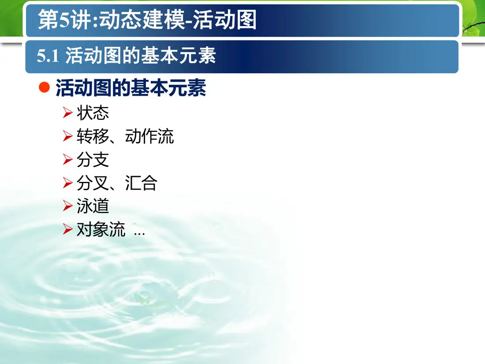

原文：

第5讲:动态建模-活动图

5.1 活动图的基本元素

- 活动图的基本元素

状态

转移、动作流

分支

分叉、汇合

泳道

对象流 ...

### 5.1 活动图的基本元素

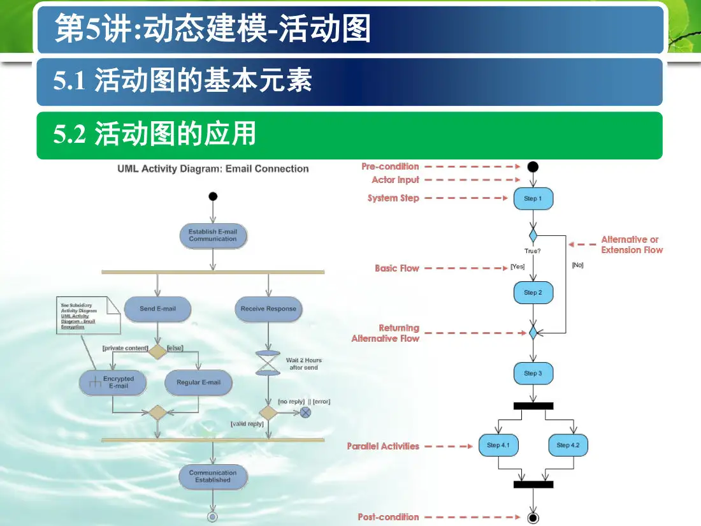

原文：

5.1 活动图的基本元素

5.2 活动图的应用

第5讲:动态建模-活动图

### 第5讲:动态建模-活动图

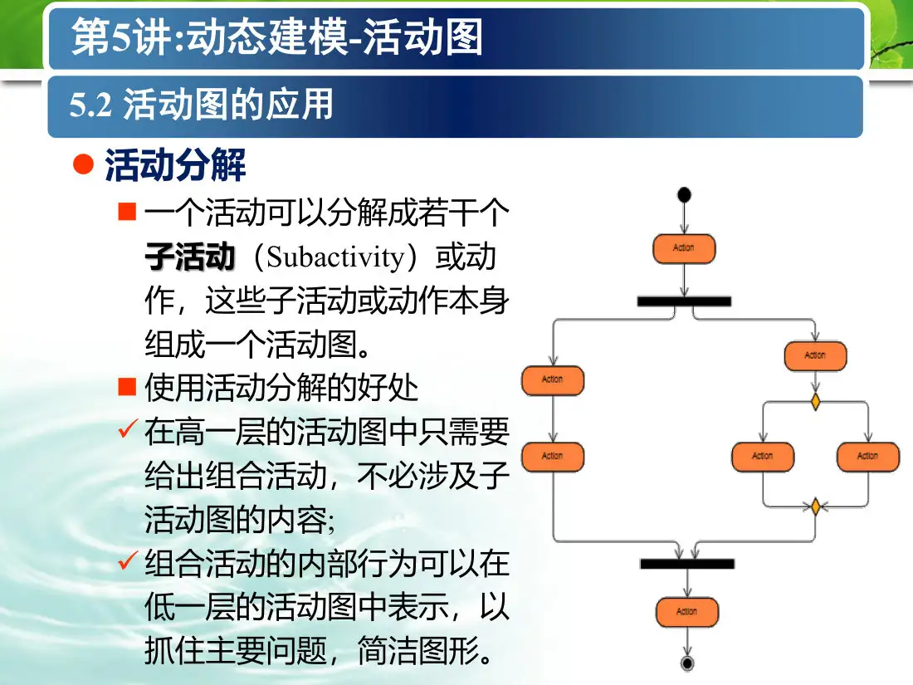

原文：

第5讲:动态建模-活动图

5.2 活动图的应用

- 活动分解

■ 一个活动可以分解成若干个子活动（Subactivity）或动作，这些子活动或动作本身组成一个活动图。

■ 使用活动分解的好处

√ 在高一层的活动图中只需要给出组合活动，不必涉及子活动图的内容；

√ 组合活动的内部行为可以在低一层的活动图中表示，以抓住主要问题，简洁图形。

### 第5讲:动态建模-活动图

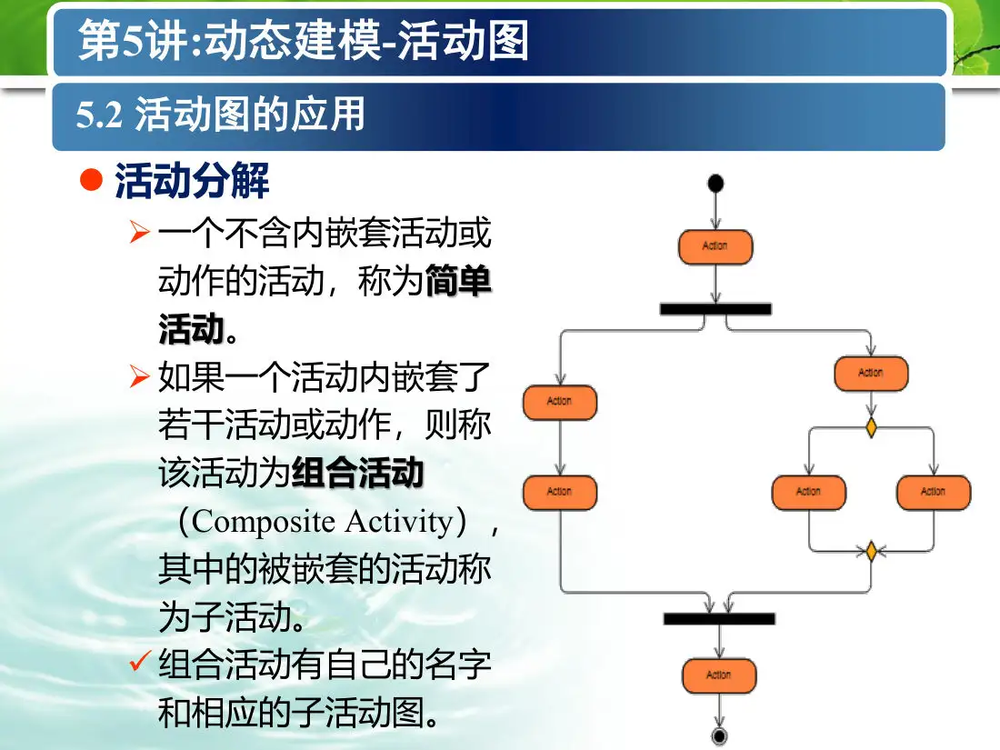

原文：

第5讲:动态建模-活动图

5.2 活动图的应用

- 活动分解

一个不含内嵌套活动或动作的活动，称为简单活动。

如果一个活动内嵌套了若干活动或动作，则称该活动为组合活动

(Composite Activity), 其中的被嵌套的活动称为子活动。

√ 组合活动有自己的名字和相应的子活动图。

### 第5讲:动态建模-活动图

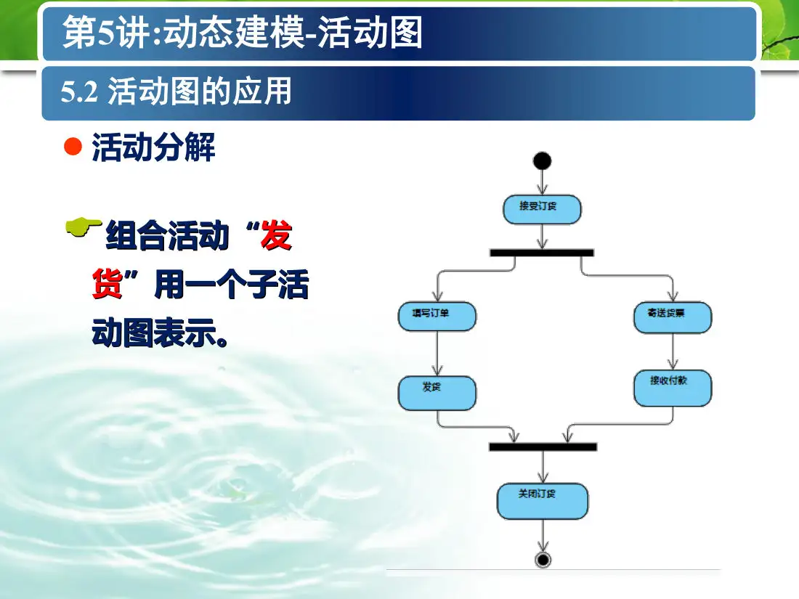

原文：

第5讲:动态建模-活动图

5.2 活动图的应用

活动分解

组合活动“发货”用一个子活动图表示。

### 第5讲:动态建模-活动图

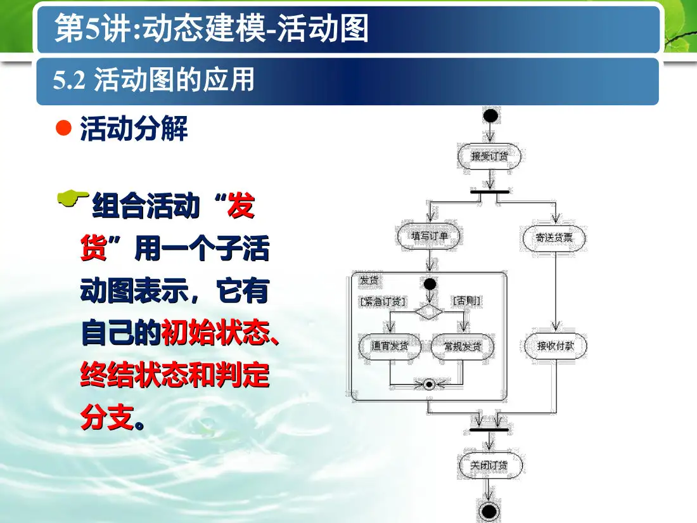

原文：

第5讲:动态建模-活动图

5.2 活动图的应用

活动分解

组合活动“发货”用一个子活动图表示，它有自己的初始状态、终结状态和判定分支。

### 第5讲:动态建模-活动图

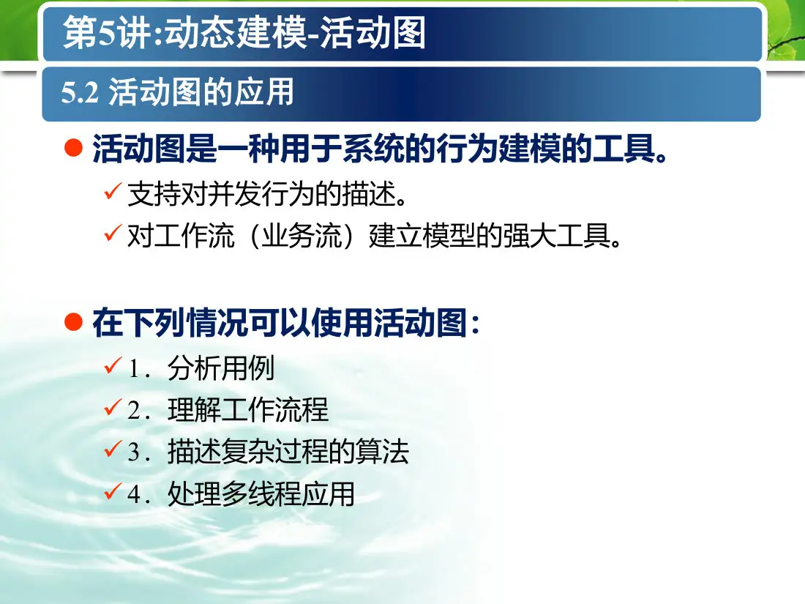

原文：

第5讲:动态建模-活动图

5.2 活动图的应用

- 活动图是一种用于系统的行为建模的工具。

√ 支持对并发行为的描述。

√ 对工作流（业务流）建立模型的强大工具。

在下列情况可以使用活动图：

√ 1. 分析用例

√ 2. 理解工作流程

√ 3. 描述复杂过程的算法

√ 4. 处理多线程应用

### 第5讲:动态建模-活动图

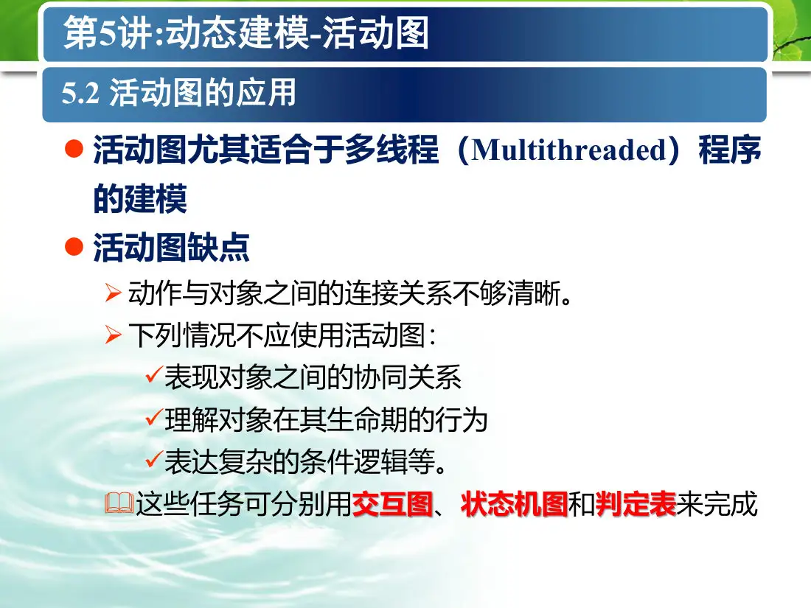

原文：

第5讲:动态建模-活动图

5.2 活动图的应用

\- 活动图尤其适合于多线程（Multithreaded）程序的建模

- 活动图缺点

动作与对象之间的连接关系不够清晰。

下列情况不应使用活动图：

√ 表现对象之间的协同关系

√理解对象在其生命期的行为

√ 表达复杂的条件逻辑等。

这些任务可分别用交互图、状态机图和判定表来完成

### 第5讲:动态建模-活动图

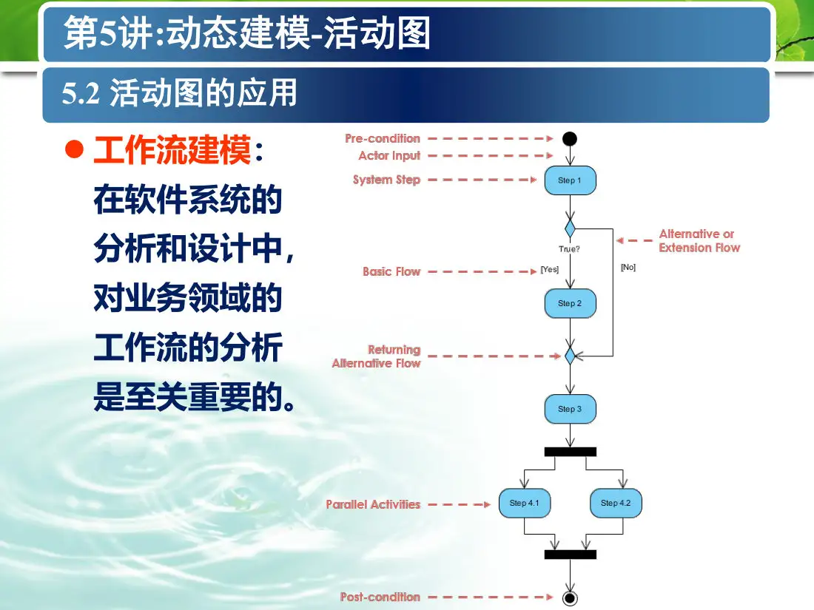

原文：

第5讲:动态建模-活动图

5.2 活动图的应用

\- 工作流建模：在软件系统的分析和设计中，对业务领域的工作流的分析是至关重要的。

### 第5讲:动态建模-活动图

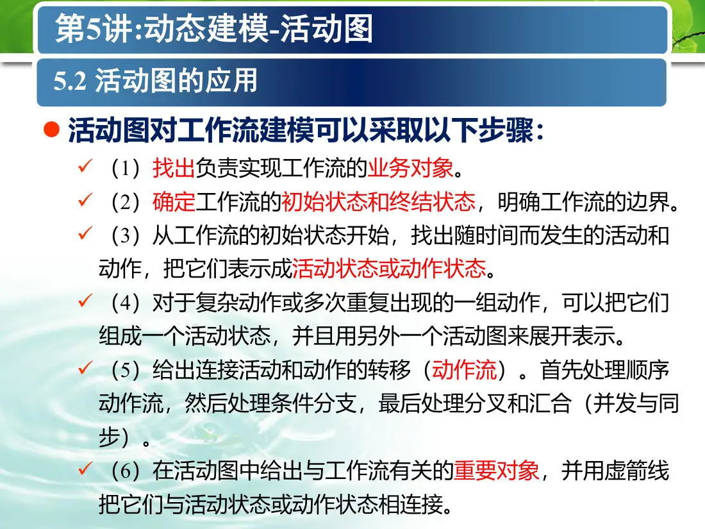

原文：

第5讲:动态建模-活动图

5.2 活动图的应用

- 活动图对工作流建模可以采取以下步骤：

√ （1）找出负责实现工作流的业务对象。

√ （2）确定工作流的初始状态和终结状态，明确工作流的边界。

√ （3）从工作流的初始状态开始，找出随时间而发生的活动和动作，把它们表示成活动状态或动作状态。

√ (4) 对于复杂动作或多次重复出现的一组动作, 可以把它们组成一个活动状态, 并且用另外一个活动图来展开表示。

√ (5) 给出连接活动和动作的转移（动作流）。首先处理顺序动作流，然后处理条件分支，最后处理分叉和汇合（并发与同步）。

√ (6) 在活动图中给出与工作流有关的重要对象，并用虚箭线把它们与活动状态或动作状态相连接。

### 第5讲:动态建模-活动图

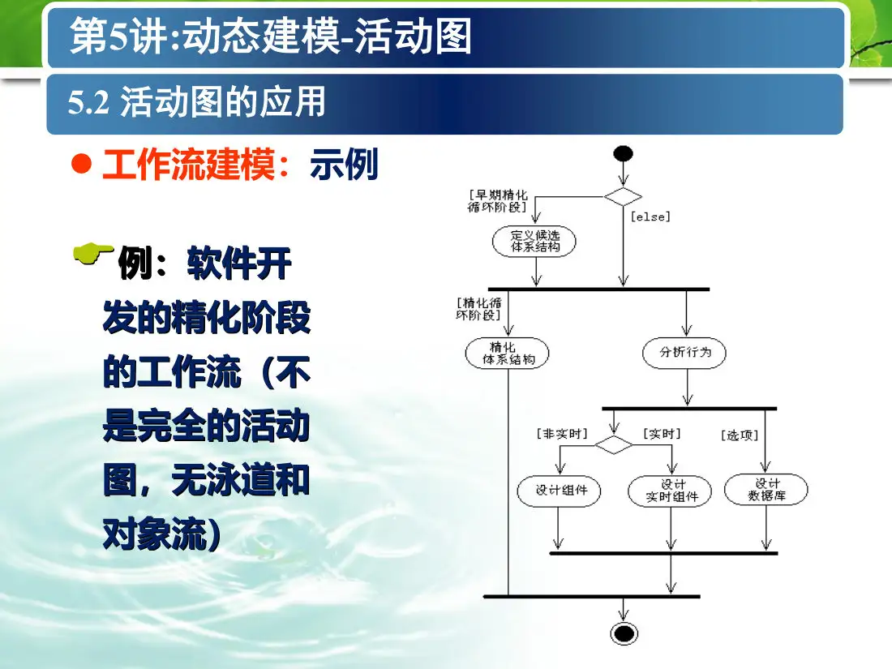

原文：

第5讲:动态建模-活动图

5.2 活动图的应用

\- 工作流建模：示例

例：软件开发的精化阶段的工作流（不是完全的活动图，无泳道和对象流）

### 第5讲:动态建模-活动图

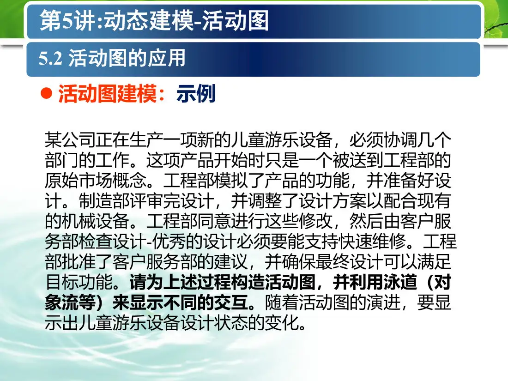

原文：

第5讲:动态建模-活动图

5.2 活动图的应用

- 活动图建模：示例

某公司正在生产一项新的儿童游乐设备，必须协调几个部门的工作。这项产品开始时只是一个被送到工程部的原始市场概念。工程部模拟了产品的功能，并准备好设计。制造部评审完设计，并调整了设计方案以配合现有的机械设备。工程部同意进行这些修改，然后由客户服务部检查设计-优秀的设计必须要能支持快速维修。工程部批准了客户服务部的建议，并确保最终设计可以满足目标功能。请为上述过程构造活动图，并利用泳道（对象流等）来显示不同的交互。随着活动图的演进，要显示出儿童游乐设备设计状态的变化。

### 第5讲:动态建模-活动图

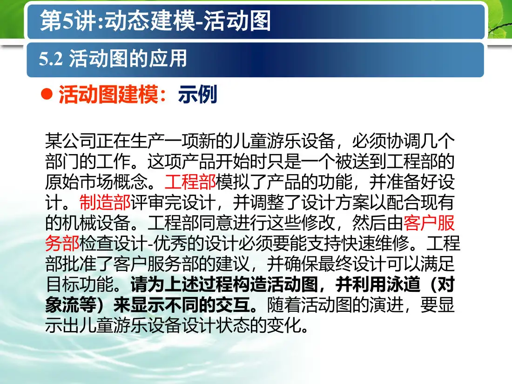

原文：

第5讲:动态建模-活动图

5.2 活动图的应用

- 活动图建模：示例

某公司正在生产一项新的儿童游乐设备，必须协调几个部门的工作。这项产品开始时只是一个被送到工程部的原始市场概念。工程部模拟了产品的功能，并准备好设计。制造部评审完设计，并调整了设计方案以配合现有的机械设备。工程部同意进行这些修改，然后由客户服务部检查设计-优秀的设计必须要能支持快速维修。工程部批准了客户服务部的建议，并确保最终设计可以满足目标功能。请为上述过程构造活动图，并利用泳道（对象流等）来显示不同的交互。随着活动图的演进，要显示出儿童游乐设备设计状态的变化。

### 第5讲:动态建模-活动图

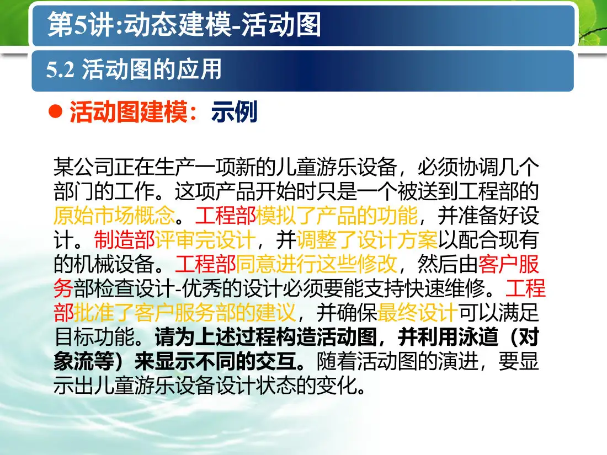

原文：

第5讲:动态建模-活动图

5.2 活动图的应用

- 活动图建模：示例

某公司正在生产一项新的儿童游乐设备，必须协调几个部门的工作。这项产品开始时只是一个被送到工程部的原始市场概念。工程部模拟了产品的功能，并准备好设计。制造部评审完设计，并调整了设计方案以配合现有的机械设备。工程部同意进行这些修改，然后由客户服务部检查设计-优秀的设计必须要能支持快速维修。工程部批准了客户服务部的建议，并确保最终设计可以满足目标功能。请为上述过程构造活动图，并利用泳道（对象流等）来显示不同的交互。随着活动图的演进，要显示出儿童游乐设备设计状态的变化。

### 第5讲:动态建模-活动图

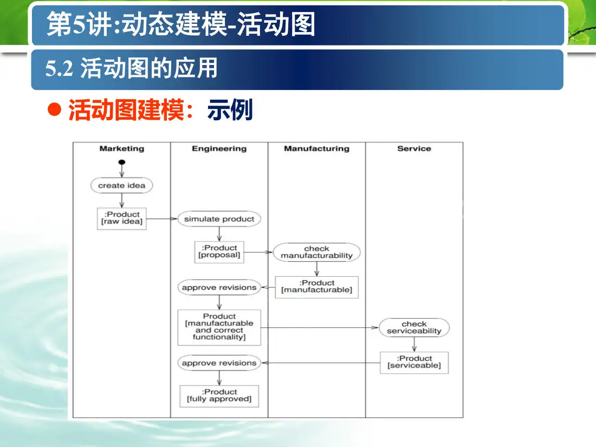

原文：

第5讲:动态建模-活动图

5.2 活动图的应用

\- 活动图建模：示例

### 第5讲:动态建模-活动图

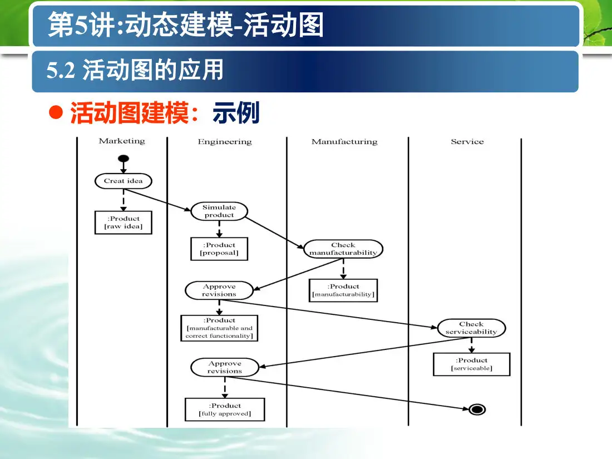

原文：

第5讲:动态建模-活动图

5.2 活动图的应用

\- 活动图建模：示例

### 第5讲:动态建模-活动图

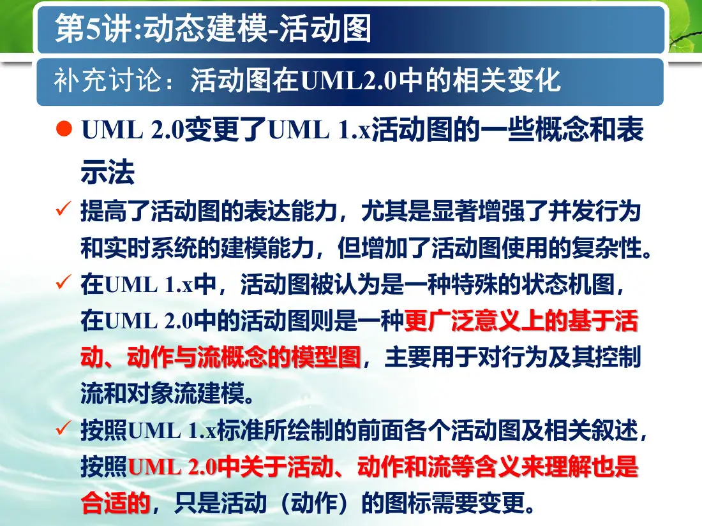

原文：

第5讲:动态建模-活动图

补充讨论：活动图在UML2.0中的相关变化

- UML 2.0变更了UML 1.x活动图的一些概念和表示法

√ 提高了活动图的表达能力，尤其是显著增强了并发行为和实时系统的建模能力，但增加了活动图使用的复杂性。

√ 在UML 1.x中，活动图被认为是一种特殊的状态机图，在UML 2.0中的活动图则是一种更广泛意义上的基于活动、动作与流概念的模型图，主要用于对行为及其控制流和对象流建模。

√ 按照UML 1.x标准所绘制的前面各个活动图及相关叙述，按照UML 2.0中关于活动、动作和流等含义来理解也是合适的，只是活动（动作）的图标需要变更。
