# 《软件建模与设计》第6章 动态建模-交互图（课件）

原件的每一页，下面附识别出的文字。

### 软件建模与设计

原文：

软件建模与设计

授课班级：B220417-19，B220400

授课安排：QQ群、超星学习通，课堂

授课时间：周二第8-9节{第1-16周}

金惠颖

### 第6讲: 动态建模-交互图

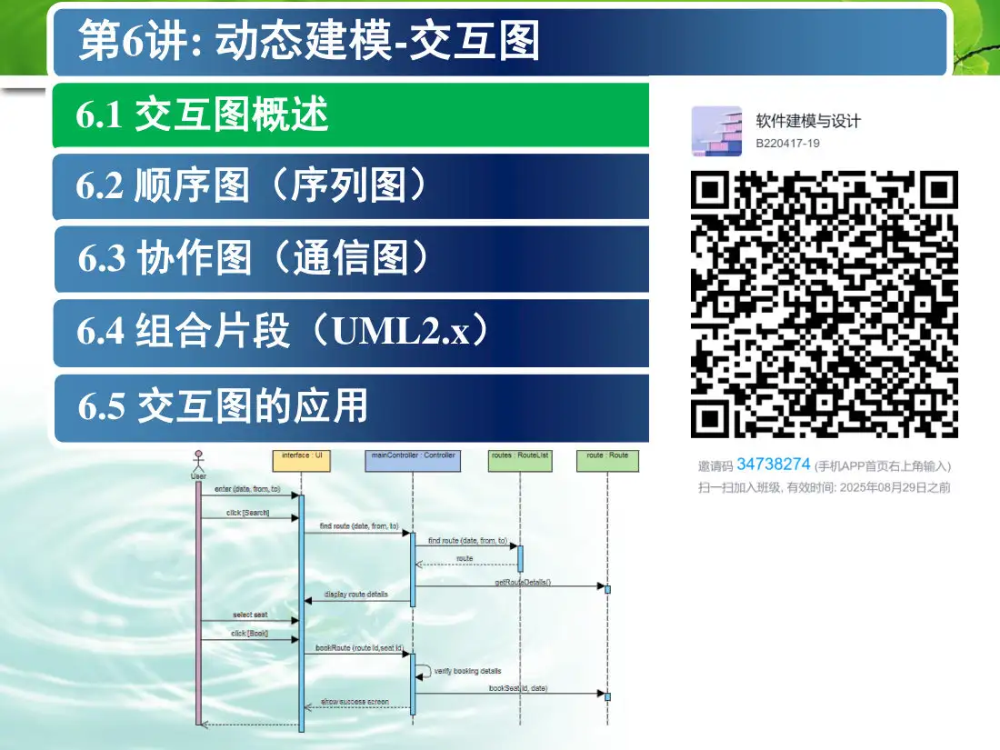

原文：

第6讲: 动态建模-交互图

6.1 交互图概述

6.2 顺序图（序列图）

6.3 协作图（通信图）

6.4 组合片段（UML2.x）

6.5 交互图的应用

### 第6讲: 动态建模-交互图

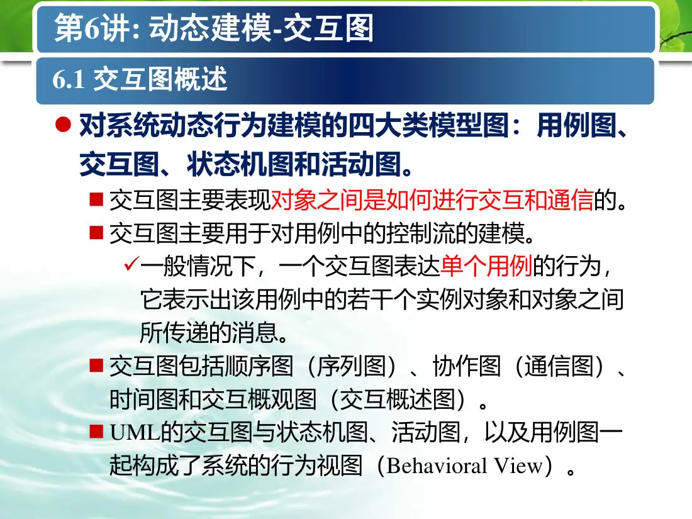

原文：

第6讲: 动态建模-交互图

6.1 交互图概述

\- 对系统动态行为建模的四大类模型图：用例图、交互图、状态机图和活动图。

■ 交互图主要表现对象之间是如何进行交互和通信的。

■ 交互图主要用于对用例中的控制流的建模。

√一般情况下，一个交互图表达单个用例的行为，它表示出该用例中的若干个实例对象和对象之间所传递的消息。

■ 交互图包括顺序图（序列图）、协作图（通信图）、时间图和交互概观图（交互概述图）。

■ UML的交互图与状态机图、活动图，以及用例图一起构成了系统的行为视图（Behavioral View）。

### 第6讲: 动态建模-交互图

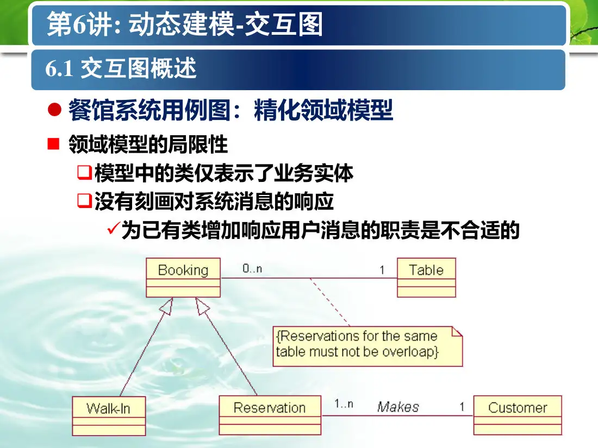

原文：

第6讲: 动态建模-交互图

6.1 交互图概述

\- 餐馆系统用例图：精化领域模型

■ 领域模型的局限性

□模型中的类仅表示了业务实体

□没有刻画对系统消息的响应

√为已有类增加响应用户消息的职责是不合适的

### 第6讲: 动态建模-交互图

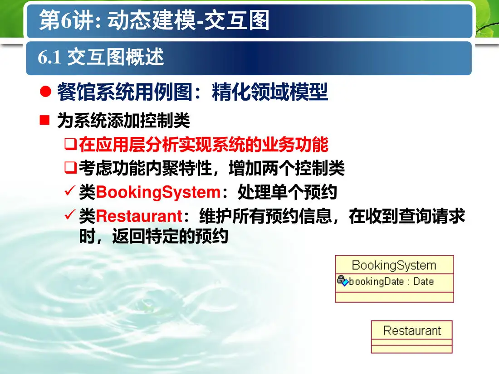

原文：

第6讲: 动态建模-交互图

6.1 交互图概述

\- 餐馆系统用例图：精化领域模型

■ 为系统添加控制类

□在应用层分析实现系统的业务功能

□考虑功能内聚特性，增加两个控制类

√ 类BookingSystem：处理单个预约

√ 类Restaurant：维护所有预约信息，在收到查询请求时，返回特定的预约

BookingSystem
bookingDate : Date

Restaurant

### 第6讲: 动态建模-交互图

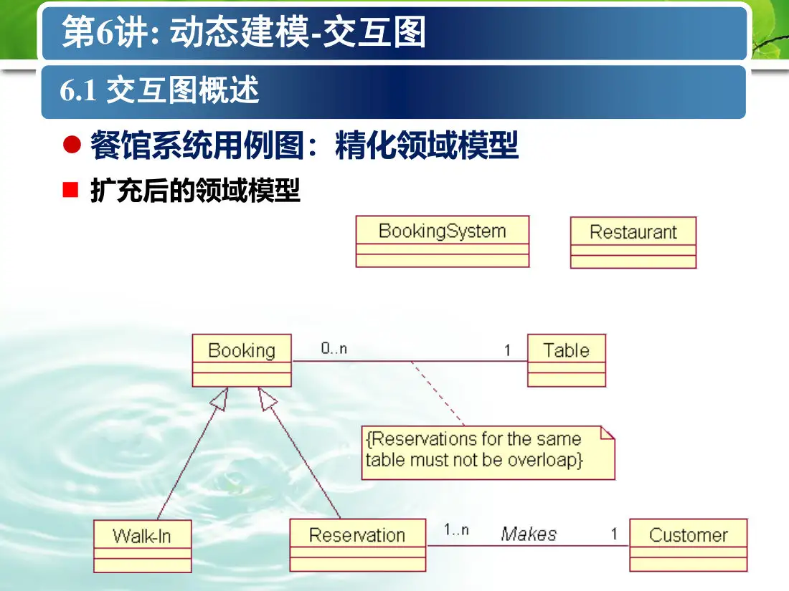

原文：

第6讲: 动态建模-交互图

6.1 交互图概述

\- 餐馆系统用例图：精化领域模型

■ 扩充后的领域模型

BookingSystem

Restaurant

### 第6讲: 动态建模-交互图

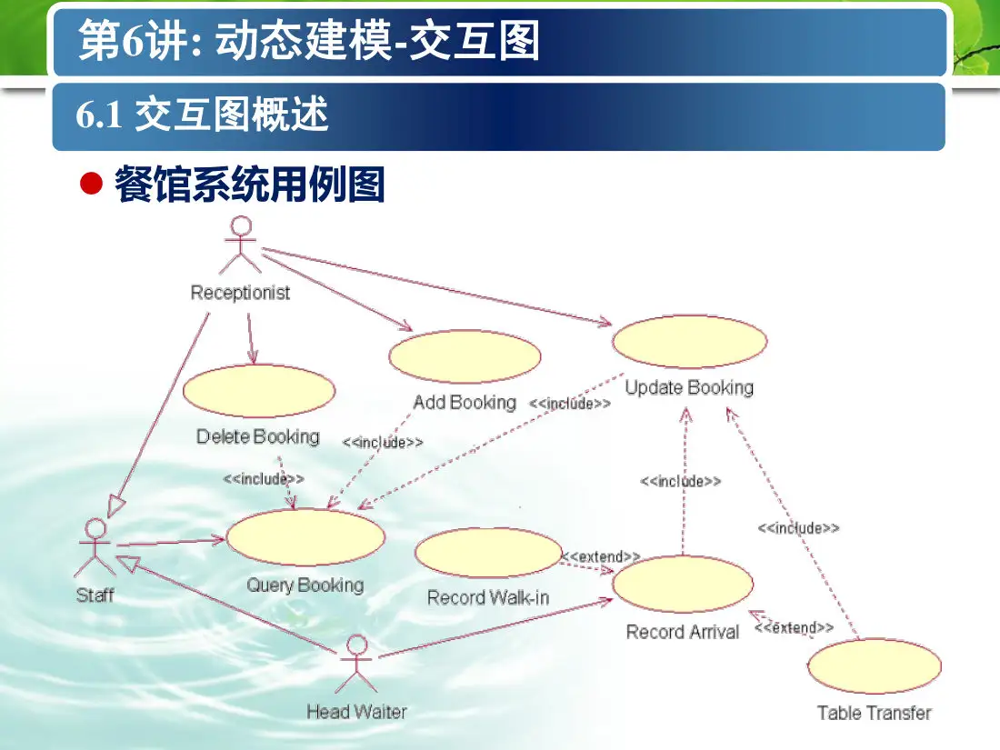

原文：

第6讲: 动态建模-交互图

6.1 交互图概述

\- 餐馆系统用例图

### 第6讲: 动态建模-交互图

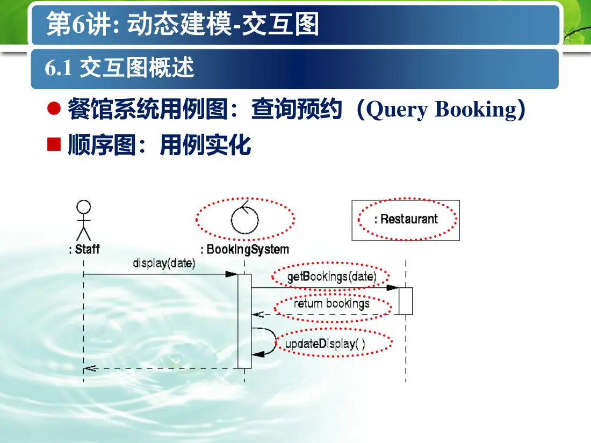

原文：

第6讲: 动态建模-交互图

6.1 交互图概述

\- 餐馆系统用例图：查询预约 (Query Booking)

■ 顺序图：用例实化

### 第6讲: 动态建模-交互图

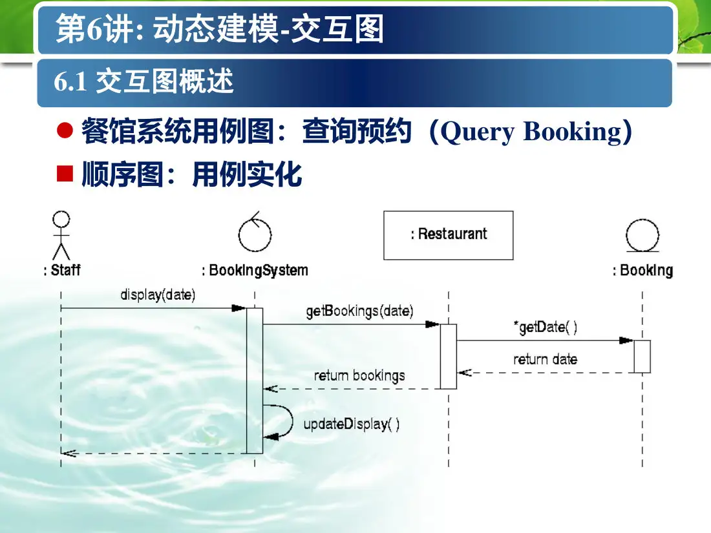

原文：

第6讲: 动态建模-交互图

6.1 交互图概述

\- 餐馆系统用例图：查询预约（Query Booking）

■ 顺序图：用例实化

: Restaurant

:Booking

### 第6讲: 动态建模-交互图

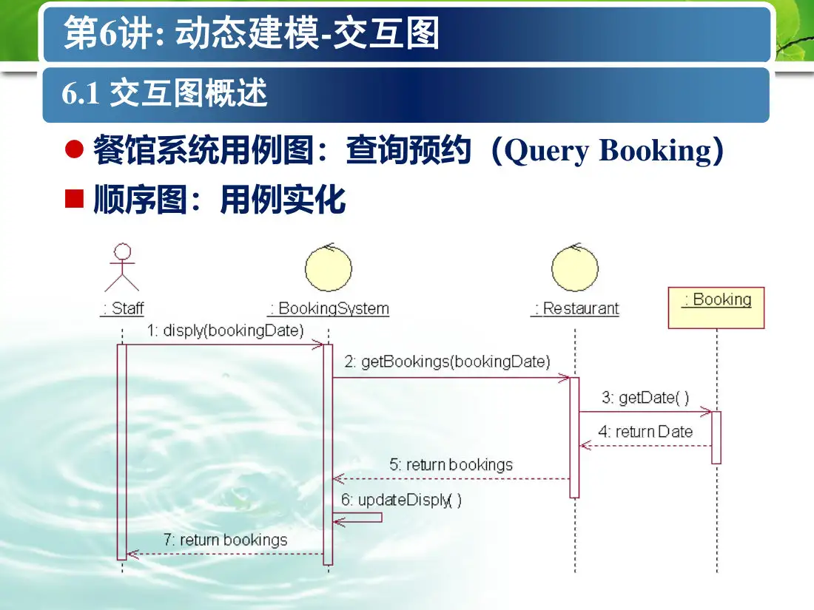

原文：

第6讲: 动态建模-交互图

6.1 交互图概述

\- 餐馆系统用例图：查询预约（Query Booking）

■ 顺序图：用例实化

### 第6讲: 动态建模-交互图

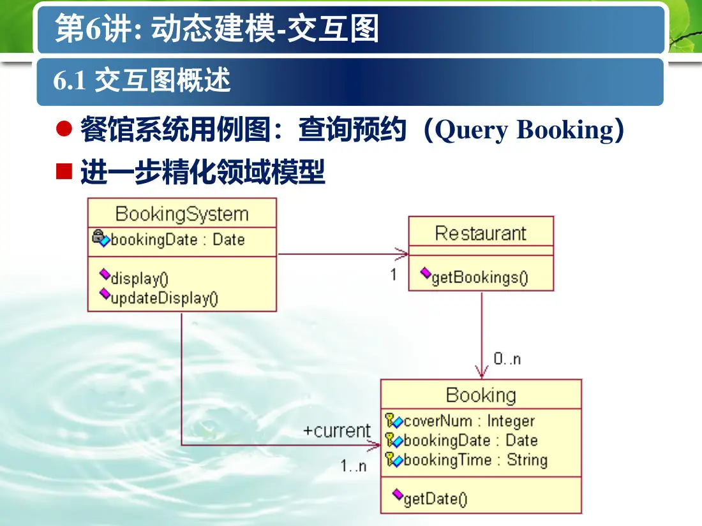

原文：

第6讲: 动态建模-交互图

6.1 交互图概述

\- 餐馆系统用例图：查询预约 (Query Booking)

■ 进一步精化领域模型

### 第6讲: 动态建模-交互图

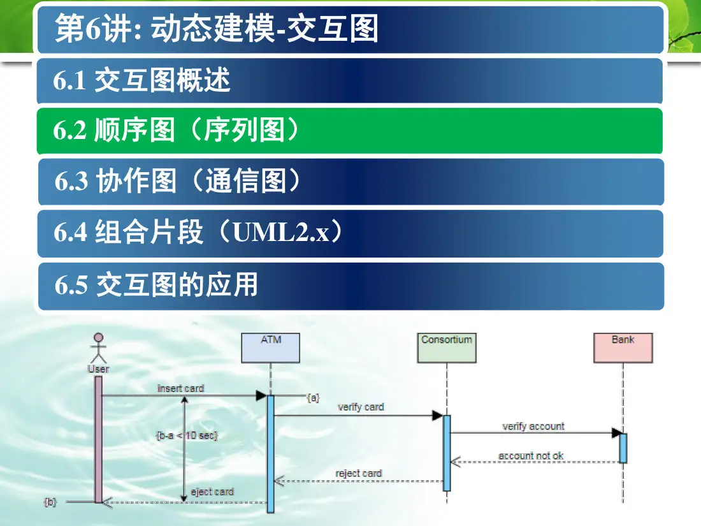

原文：

第6讲: 动态建模-交互图

6.1 交互图概述

6.2 顺序图（序列图）

6.3 协作图（通信图）

6.4 组合片段（UML2.x）

6.5 交互图的应用

### 第6讲: 动态建模-交互图

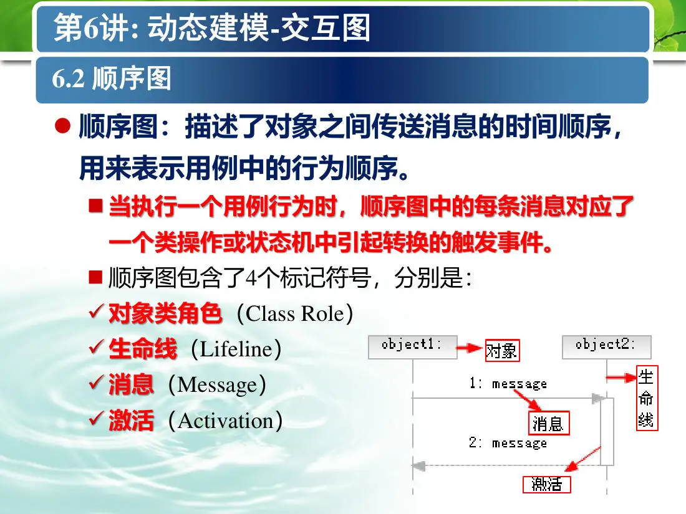

原文：

第6讲: 动态建模-交互图

6.2 顺序图

\- 顺序图：描述了对象之间传送消息的时间顺序，用来表示用例中的行为顺序。

■ 当执行一个用例行为时，顺序图中的每条消息对应了一个类操作或状态机中引起转换的触发事件。

■ 顺序图包含了4个标记符号，分别是：

√ 对象类角色 (Class Role)

√ 生命线 (Lifeline)

√ 消息 (Message)

√ 激活 (Activation)

### 第6讲: 动态建模-交互图

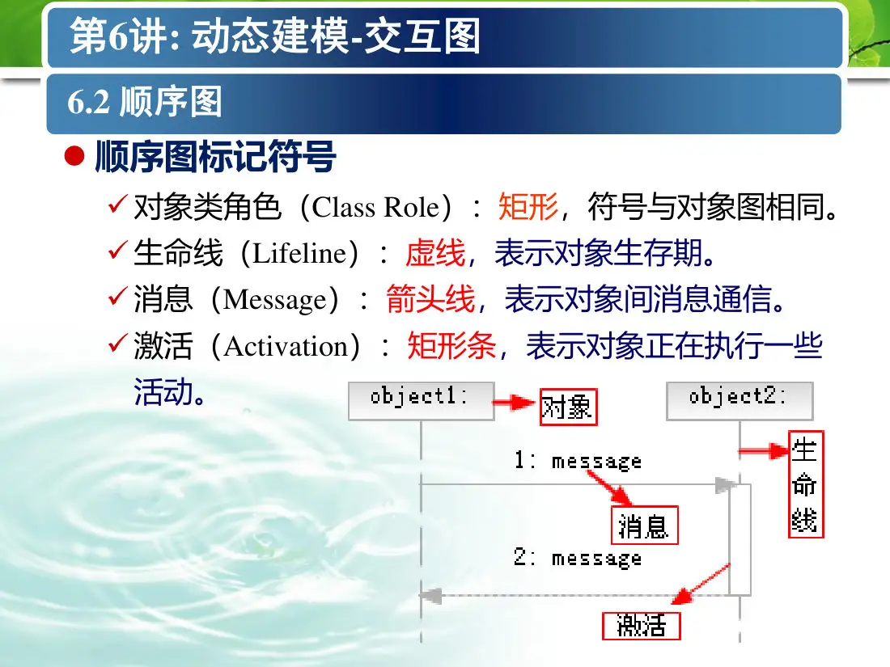

原文：

第6讲: 动态建模-交互图

6.2 顺序图

- 顺序图标记符号

√ 对象类角色（Class Role）：矩形，符号与对象图相同。

√ 生命线（Lifeline）：虚线，表示对象生存期。

√ 消息（Message）：箭头线，表示对象间消息通信。

√ 激活（Activation）：矩形条，表示对象正在执行一些

活动。

### 第6讲: 动态建模-交互图

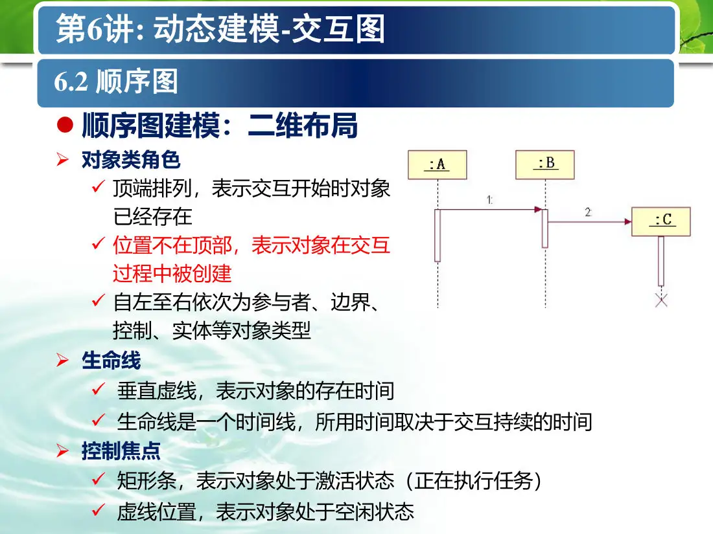

原文：

第6讲: 动态建模-交互图

6.2 顺序图

- 顺序图建模：二维布局

对象类角色

√ 顶端排列，表示交互开始时对象已经存在

√ 位置不在顶部，表示对象在交互过程中被创建

√ 自左至右依次为参与者、边界、控制、实体等对象类型

生命线

√ 垂直虚线，表示对象的存在时间

√ 生命线是一个时间线，所用时间取决于交互持续的时间

控制焦点

√ 矩形条，表示对象处于激活状态（正在执行任务）

√ 虚线位置，表示对象处于空闲状态

### 第6讲: 动态建模-交互图

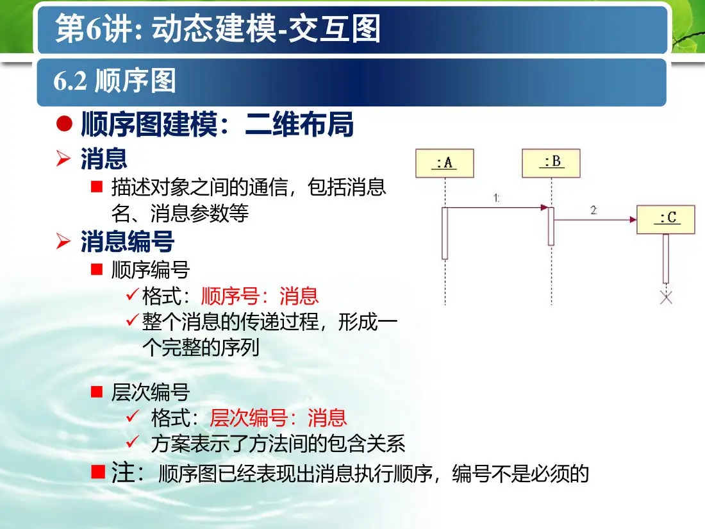

原文：

第6讲: 动态建模-交互图

6.2 顺序图

- 顺序图建模：二维布局

消息

■ 描述对象之间的通信，包括消息名、消息参数等

消息编号

顺序编号

√ 格式：顺序号：消息

√ 整个消息的传递过程，形成一个完整的序列

层次编号

√ 格式：层次编号：消息

√ 方案表示了方法间的包含关系

注：顺序图已经表现出消息执行顺序，编号不是必须的

### 第6讲: 动态建模-交互图

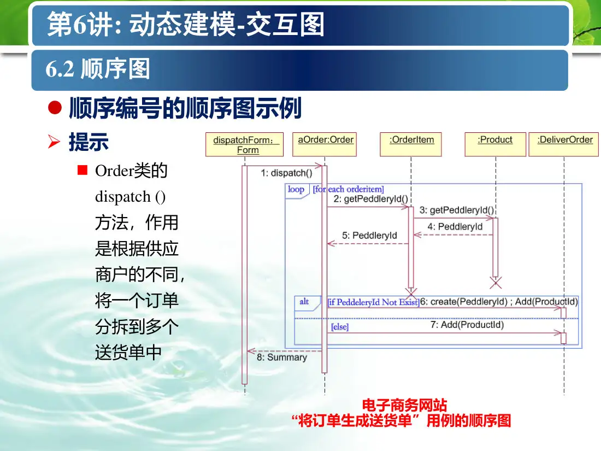

原文：

第6讲: 动态建模-交互图

6.2 顺序图

- 顺序编号的顺序图示例

提示

Order类的
dispatch ()
方法，作用
是根据供应
商户的不同，
将一个订单
分拆到多个
送货单中

电子商务网站
“将订单生成送货单”用例的顺序图

### 第6讲: 动态建模-交互图

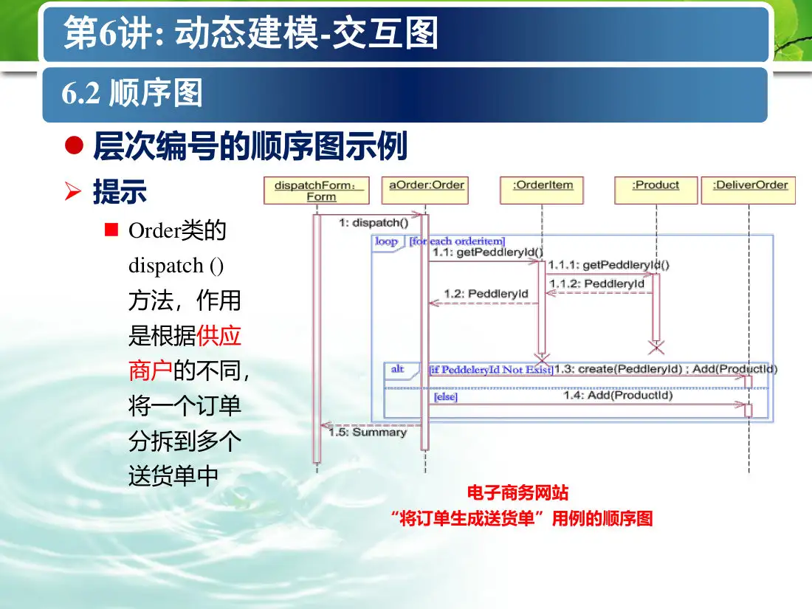

原文：

第6讲: 动态建模-交互图

6.2 顺序图

- 层次编号的顺序图示例

提示

Order类的
dispatch ()
方法，作用
是根据供应
商户的不同，
将一个订单
分拆到多个
送货单中

### 第6讲: 动态建模-交互图

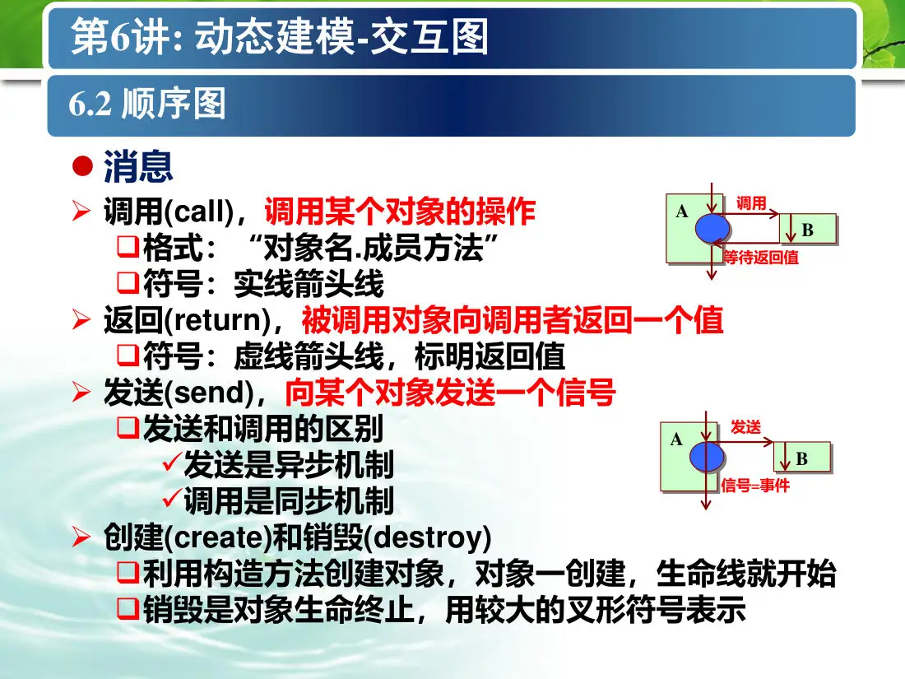

原文：

第6讲: 动态建模-交互图

6.2 顺序图

● 消息

调用(call)，调用某个对象的操作

□格式：“对象名.成员方法”

□符号：实线箭头线

➢ 返回(return)，被调用对象向调用者返回一个值
□符号：虚线箭头线，标明返回值

> 发送(send)，向某个对象发送一个信号

□发送和调用的区别

√ 发送是异步机制

√调用是同步机制

创建(create)和销毁(destroy)

□利用构造方法创建对象，对象一创建，生命线就开始

□销毁是对象生命终止，用较大的叉形符号表示

### 第6讲: 动态建模-交互图

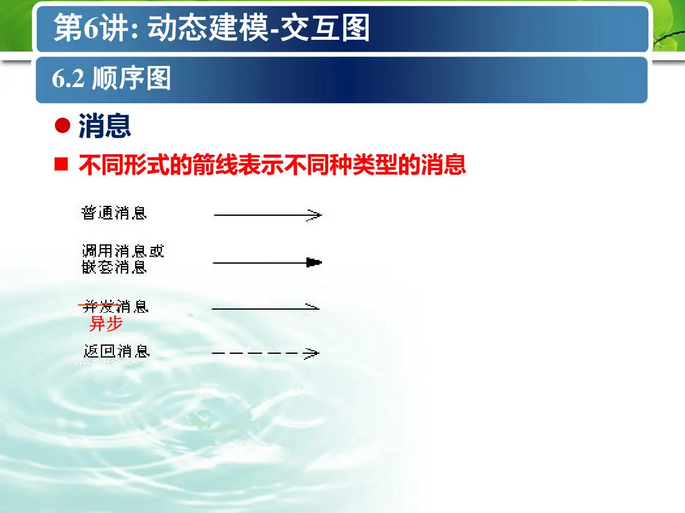

原文：

第6讲: 动态建模-交互图

6.2 顺序图

\- 消息

■ 不同形式的箭线表示不同种类型的消息

普通消息

调用消息或嵌套消息

并发消息
异步

返回消息 \_\_\_\_

### 第6讲: 动态建模-交互图

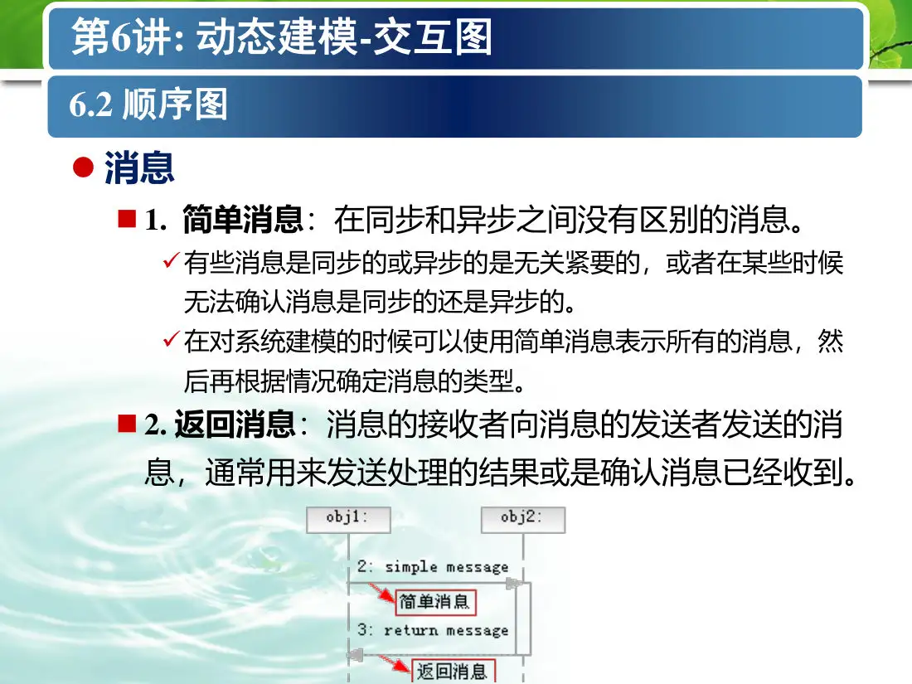

原文：

第6讲: 动态建模-交互图

6.2 顺序图

- 消息

■ 1. 简单消息：在同步和异步之间没有区别的消息。

√ 有些消息是同步的或异步的是无关紧要的，或者在某些时候无法确认消息是同步的还是异步的。

√ 在对系统建模的时候可以使用简单消息表示所有的消息，然后再根据情况确定消息的类型。

■2. 返回消息：消息的接收者向消息的发送者发送的消息，通常用来发送处理的结果或是确认消息已经收到。

### 第6讲: 动态建模-交互图

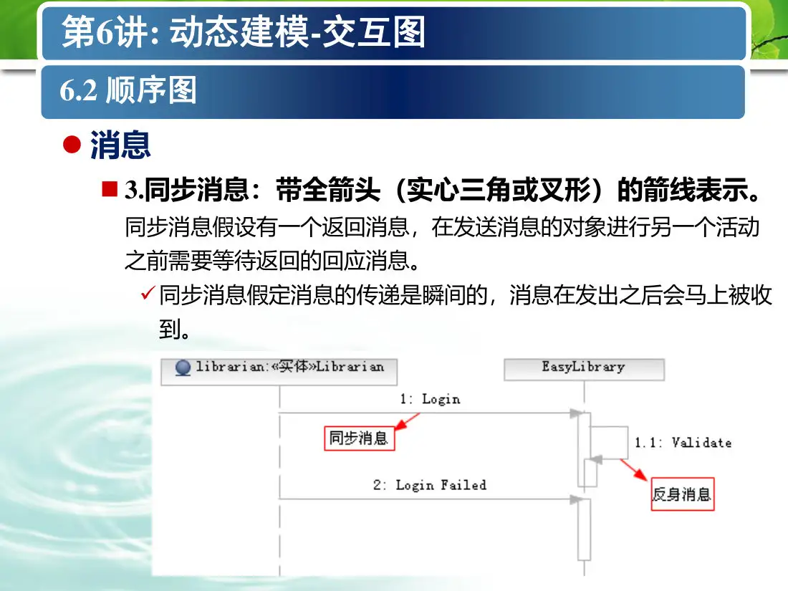

原文：

第6讲: 动态建模-交互图

6.2 顺序图

- 消息

■ 3. 同步消息：带全箭头（实心三角或叉形）的箭线表示。同步消息假设有一个返回消息，在发送消息的对象进行另一个活动之前需要等待返回的回应消息。

√ 同步消息假定消息的传递是瞬间的，消息在发出之后会马上被收到。

### 第6讲: 动态建模-交互图

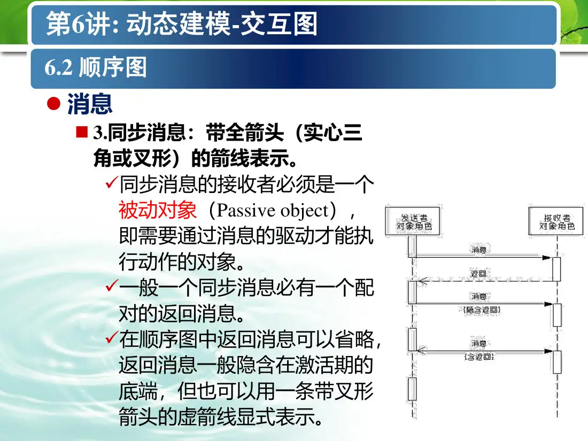

原文：

第6讲: 动态建模-交互图

6.2 顺序图

- 消息

■ 3. 同步消息：带全箭头（实心三角或叉形）的箭线表示。

√ 同步消息的接收者必须是一个被动对象（Passive object），即需要通过消息的驱动才能执行动作的对象。

√一般一个同步消息必有一个配对的返回消息。

√ 在顺序图中返回消息可以省略，返回消息一般隐含在激活期的底端，但也可以用一条带叉形箭头的虚箭线显式表示。

### 第6讲: 动态建模-交互图

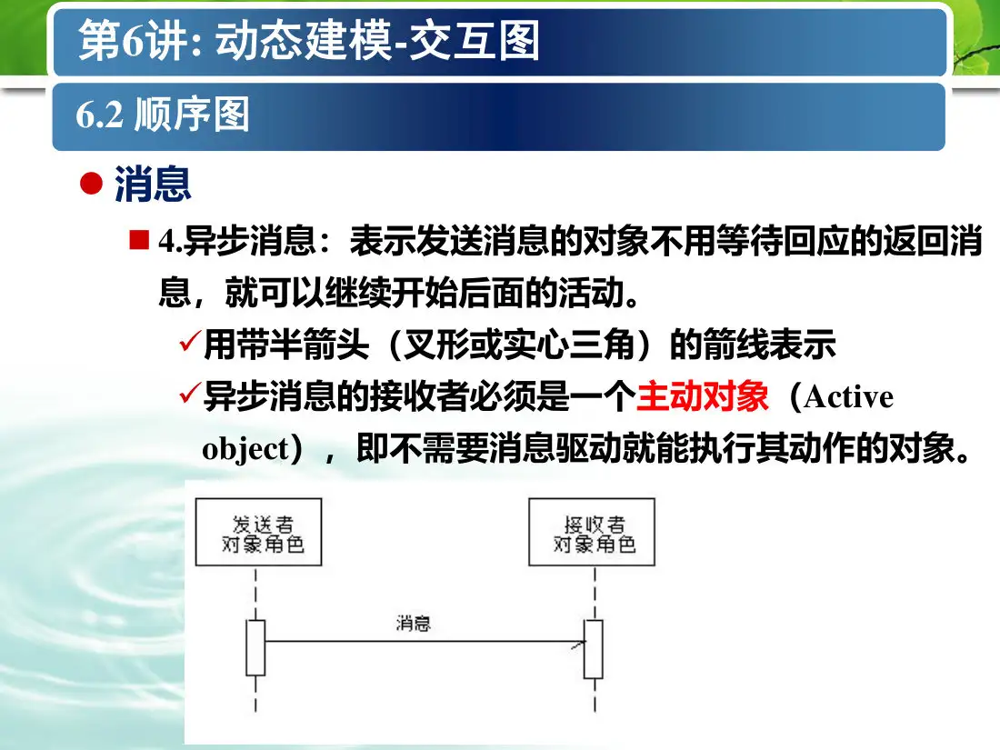

原文：

第6讲: 动态建模-交互图

6.2 顺序图

- 消息

4. 异步消息：表示发送消息的对象不用等待回应的返回消息，就可以继续开始后面的活动。

√ 用带半箭头（叉形或实心三角）的箭线表示

√ 异步消息的接收者必须是一个主动对象（Active object），即不需要消息驱动就能执行其动作的对象。

### 第6讲: 动态建模-交互图

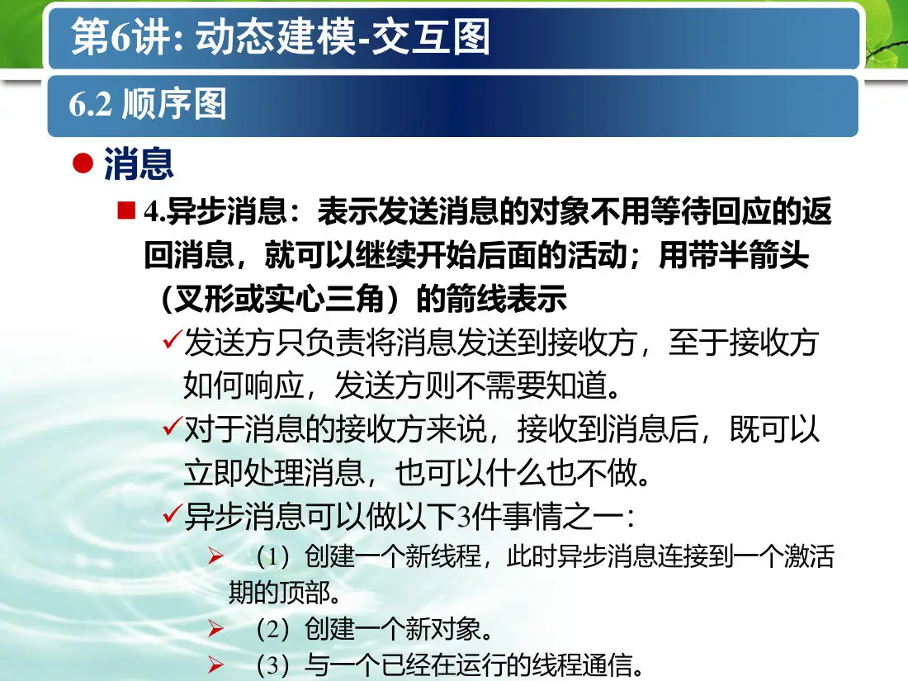

原文：

第6讲: 动态建模-交互图

6.2 顺序图

- 消息

4. 异步消息：表示发送消息的对象不用等待回应的返回消息，就可以继续开始后面的活动；用带半箭头（叉形或实心三角）的箭线表示

√ 发送方只负责将消息发送到接收方，至于接收方如何响应，发送方则不需要知道。

√对于消息的接收方来说，接收到消息后，既可以立即处理消息，也可以什么也不做。

√ 异步消息可以做以下3件事情之一：

(1) 创建一个新线程, 此时异步消息连接到一个激活期的顶部。

(2) 创建一个新对象。

(3) 与一个已经在运行的线程通信。

### 第6讲: 动态建模-交互图

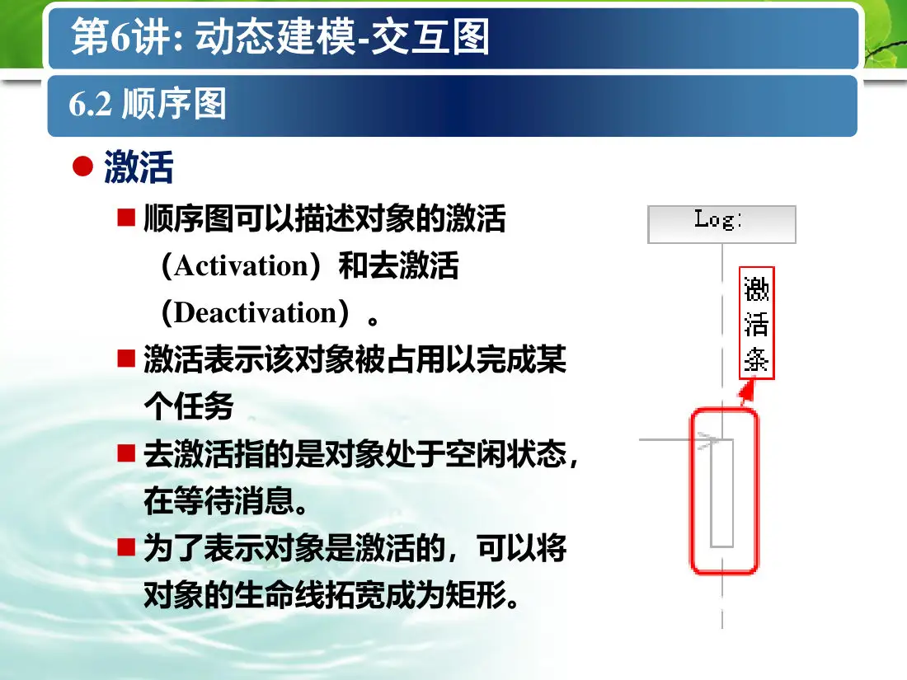

原文：

第6讲: 动态建模-交互图

6.2 顺序图

- 激活

■ 顺序图可以描述对象的激活 (Activation) 和去激活 (Deactivation)。

■ 激活表示该对象被占用以完成某个任务

■ 去激活指的是对象处于空闲状态，在等待消息。

■为了表示对象是激活的，可以将对象的生命线拓宽成为矩形。

### 第6讲: 动态建模-交互图

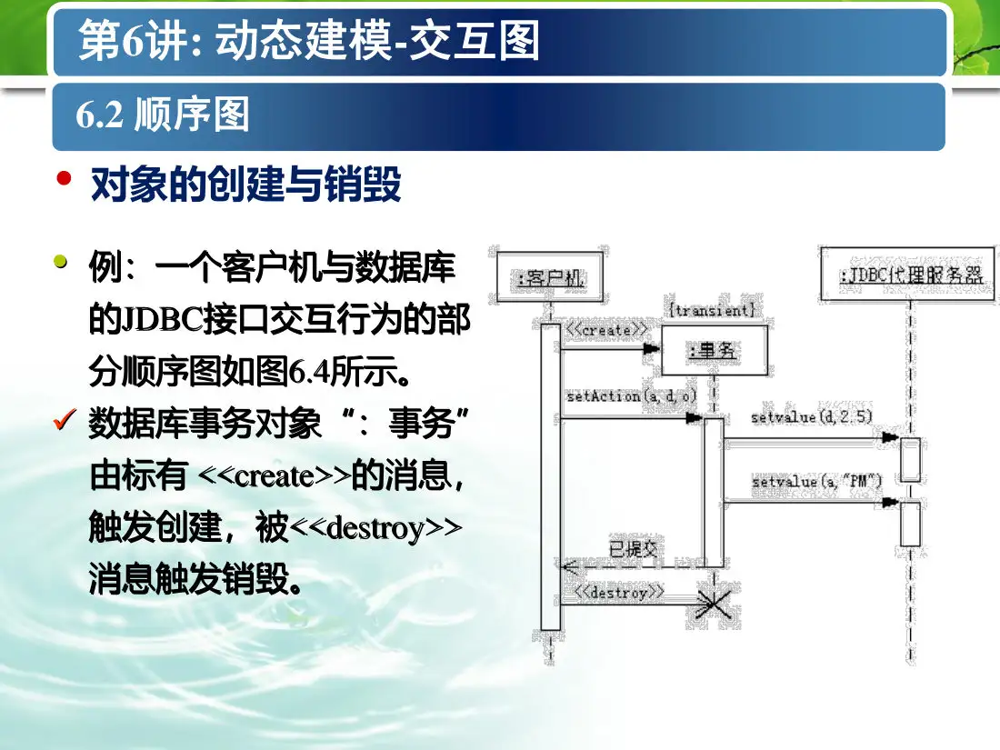

原文：

第6讲: 动态建模-交互图

6.2 顺序图

- 对象的创建与销毁

• 例：一个客户机与数据库的JDBC接口交互行为的部分顺序图如图6.4所示。

√ 数据库事务对象“：事务”由标有<<create>>的消息，触发创建，被<<destroy>>消息触发销毁。

### 第6讲: 动态建模-交互图

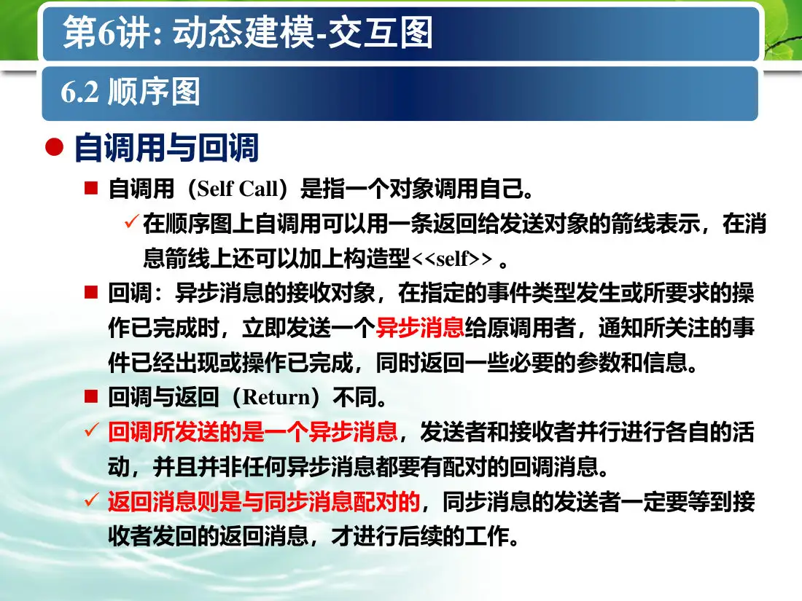

原文：

第6讲: 动态建模-交互图

6.2 顺序图

- 自调用与回调

■ 自调用（Self Call）是指一个对象调用自己。

√ 在顺序图上自调用可以用一条返回给发送对象的箭线表示，在消息箭线上还可以加上构造型<<self>>。

■ 回调：异步消息的接收对象，在指定的事件类型发生或所要求的操作已完成时，立即发送一个异步消息给原调用者，通知所关注的事件已经出现或操作已完成，同时返回一些必要的参数和信息。

■ 回调与返回（Return）不同。

√ 回调所发送的是一个异步消息，发送者和接收者并行进行各自的活动，并且并非任何异步消息都要有配对的回调消息。

√ 返回消息则是与同步消息配对的，同步消息的发送者一定要等到接收者发回的返回消息，才进行后续的工作。

### 第6讲: 动态建模-交互图

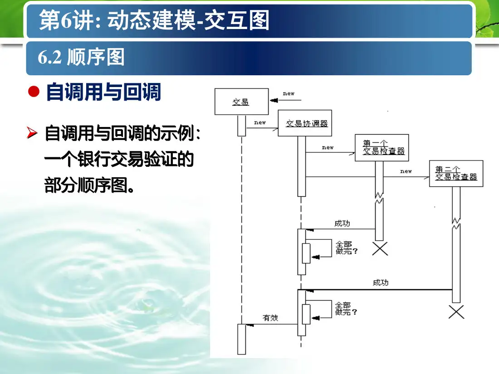

原文：

第6讲: 动态建模-交互图

6.2 顺序图

- 自调用与回调

自调用与回调的示例: 一个银行交易验证的部分顺序图。

### 第6讲: 动态建模-交互图

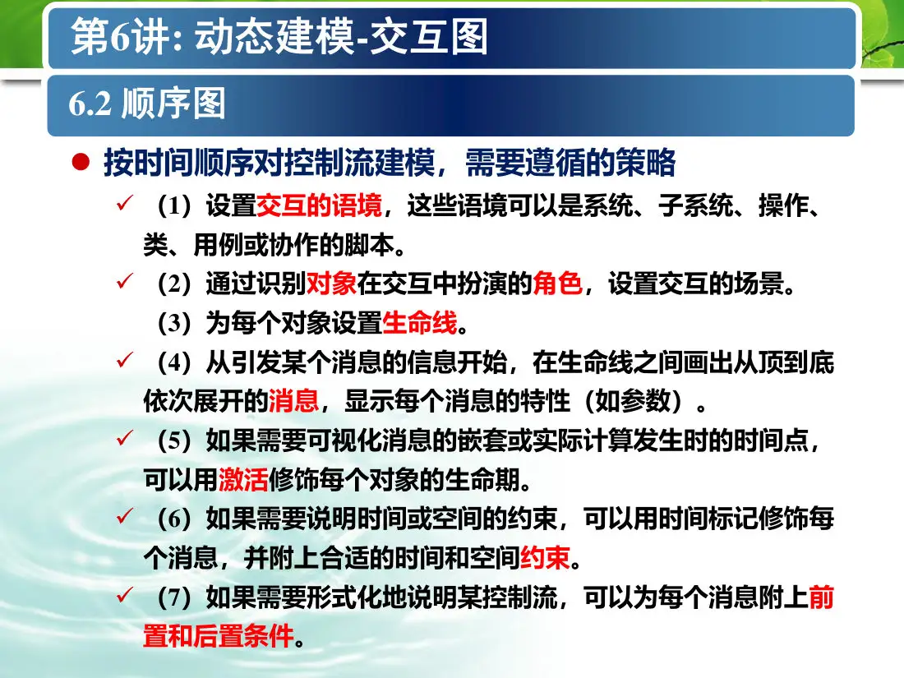

原文：

第6讲: 动态建模-交互图

6.2 顺序图

\- 按时间顺序对控制流建模，需要遵循的策略

√ （1）设置交互的语境，这些语境可以是系统、子系统、操作、类、用例或协作的脚本。

√ (2) 通过识别对象在交互中扮演的角色，设置交互的场景。

(3) 为每个对象设置生命线。

√ （4）从引发某个消息的信息开始，在生命线之间画出从顶到底依次展开的消息，显示每个消息的特性（如参数）。

√ (5) 如果需要可视化消息的嵌套或实际计算发生时的时间点，可以用激活修饰每个对象的生命期。

(6) 如果需要说明时间或空间的约束，可以用时间标记修饰每个消息，并附上合适的时间和空间约束。

√ (7) 如果需要形式化地说明某控制流，可以为每个消息附上前置和后置条件。

### 第6讲: 动态建模-交互图

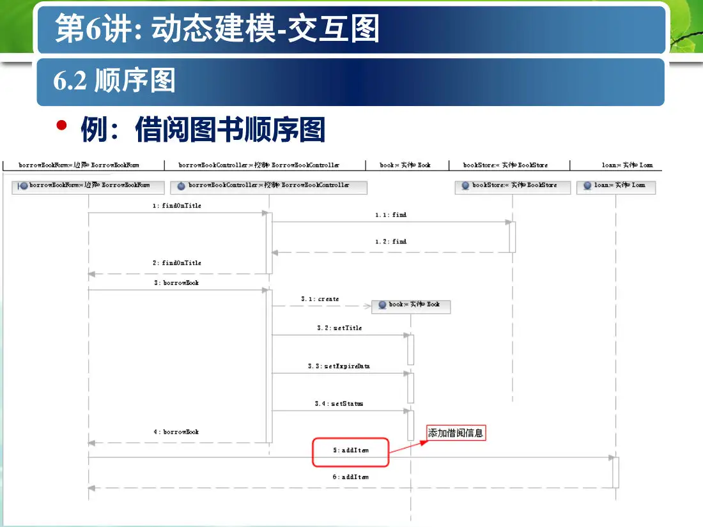

原文：

第6讲: 动态建模-交互图

6.2 顺序图

• 例：借阅图书顺序图

### 第6讲: 动态建模-交互图

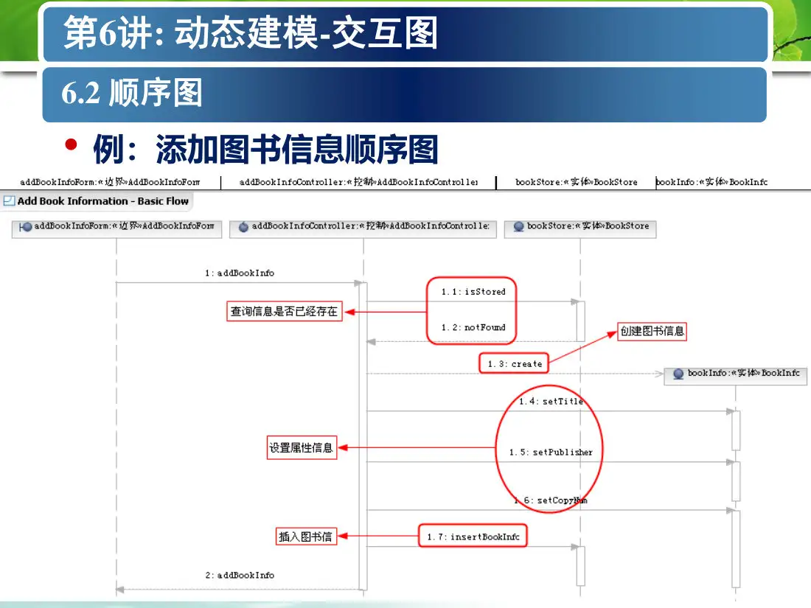

原文：

第6讲: 动态建模-交互图

6.2 顺序图

• 例：添加图书信息顺序图

### 第6讲: 动态建模-交互图

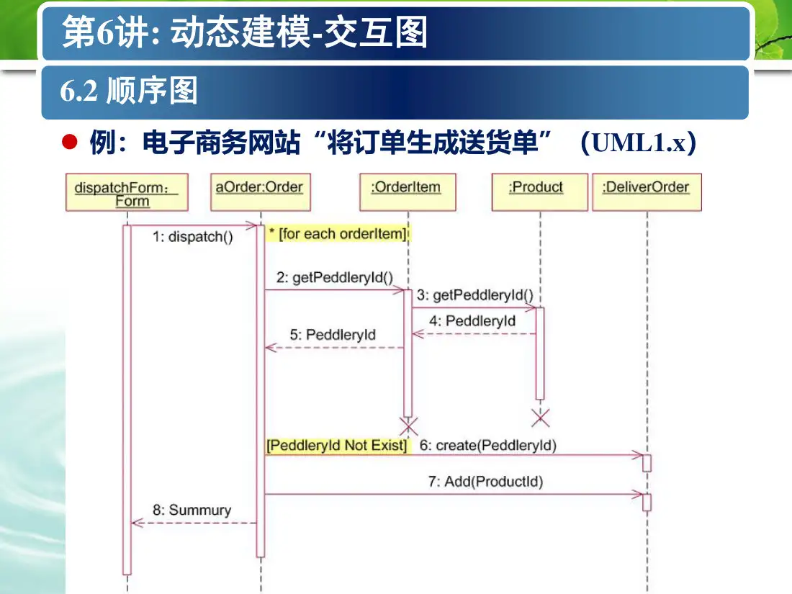

原文：

第6讲: 动态建模-交互图

6.2 顺序图

\- 例：电子商务网站“将订单生成送货单” (UML1.x)

### 第6讲: 动态建模-交互图

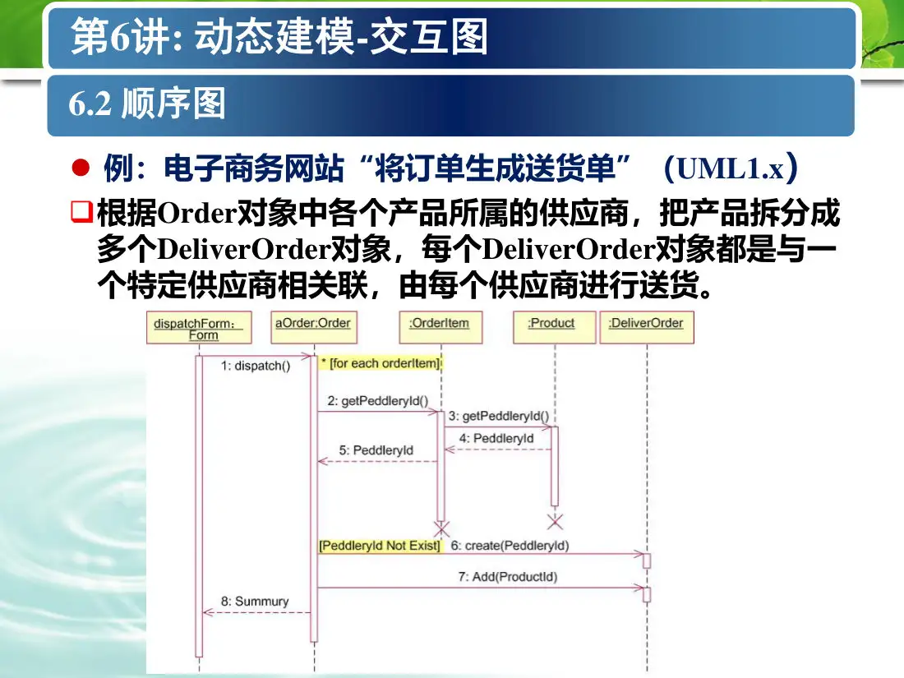

原文：

第6讲: 动态建模-交互图

6.2 顺序图

例：电子商务网站“将订单生成送货单”（UML1.x）

□根据Order对象中各个产品所属的供应商，把产品拆分成多个DeliverOrder对象，每个DeliverOrder对象都是与一个特定供应商相关联，由每个供应商进行送货。

### 第6讲: 动态建模-交互图

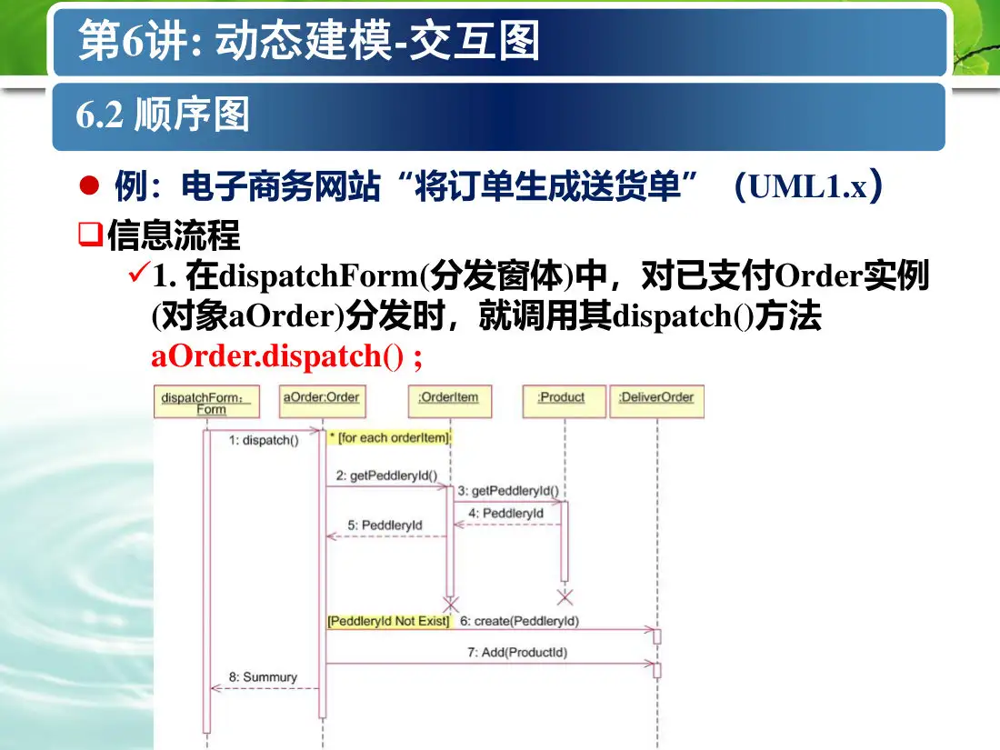

原文：

第6讲: 动态建模-交互图

6.2 顺序图

● 例：电子商务网站“将订单生成送货单”（UML1.x）

信息流程

√1. 在dispatchForm(分发窗体)中，对已支付Order实例(对象aOrder)分发时，就调用其dispatch()方法 aOrder.dispatch();

### 第6讲: 动态建模-交互图

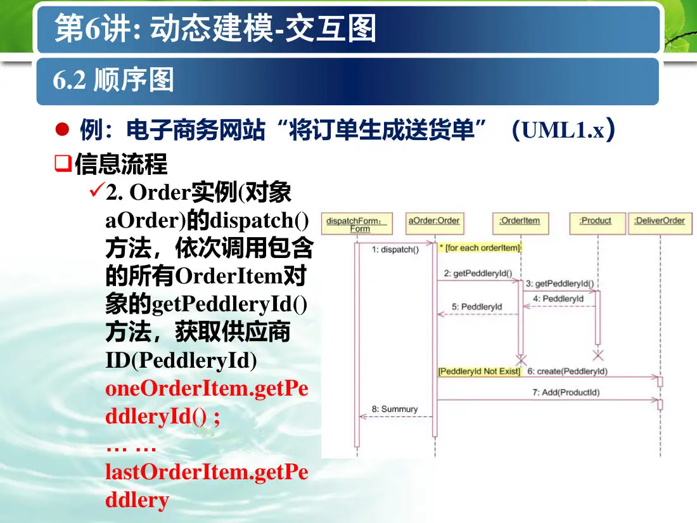

原文：

第6讲: 动态建模-交互图

6.2 顺序图

● 例：电子商务网站“将订单生成送货单”（UML1.x）

信息流程

√2. Order实例(对象aOrder)的dispatch()方法，依次调用包含的所有OrderItem对象的getPeddleryId()方法，获取供应商ID(PeddleryId)
oneOrderItem.getPeddleryId();

lastOrderItem.getPeddlery

### 第6讲: 动态建模-交互图

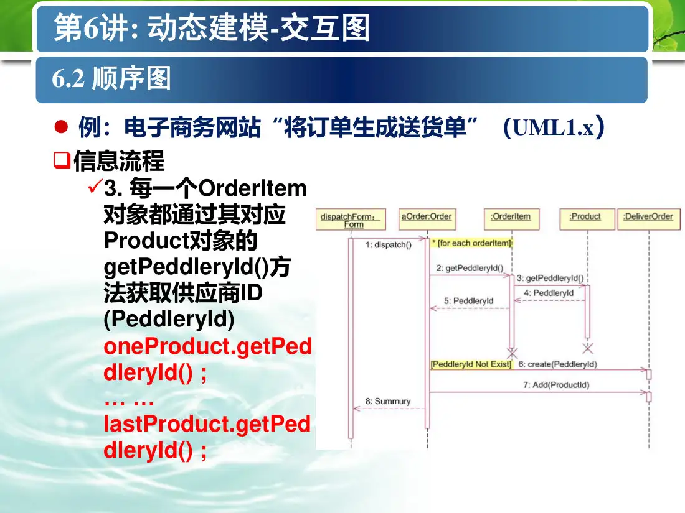

原文：

第6讲: 动态建模-交互图

6.2 顺序图

● 例：电子商务网站“将订单生成送货单”（UML1.x）

信息流程

√3. 每一个OrderItem对象都通过其对应Product对象的getPeddleryId()方法获取供应商ID(PeddleryId)
oneProduct.getPeddleryId();
... lastProduct.getPeddleryId();

### 第6讲: 动态建模-交互图

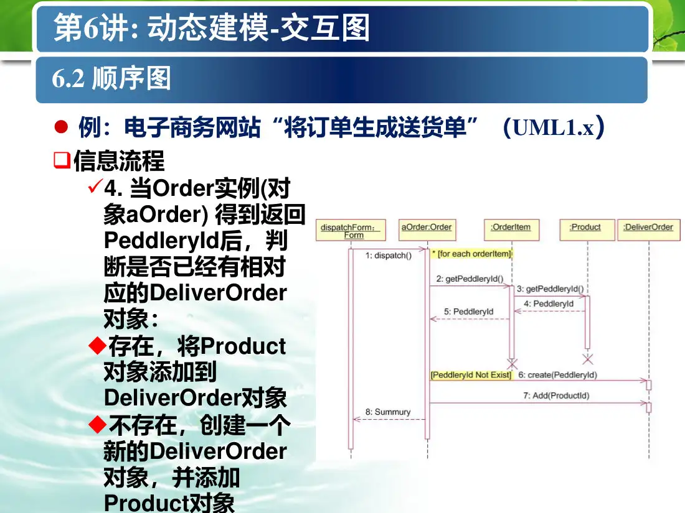

原文：

第6讲: 动态建模-交互图

6.2 顺序图

● 例：电子商务网站“将订单生成送货单”（UML1.x）

信息流程

√4. 当Order实例(对象aOrder)得到返回PeddleryId后，判断是否已经有相对应的DeliverOrder对象：

存在，将Product对象添加到DeliverOrder对象

不存在，创建一个新的DeliverOrder对象，并添加Product对象

### 第6讲: 动态建模-交互图

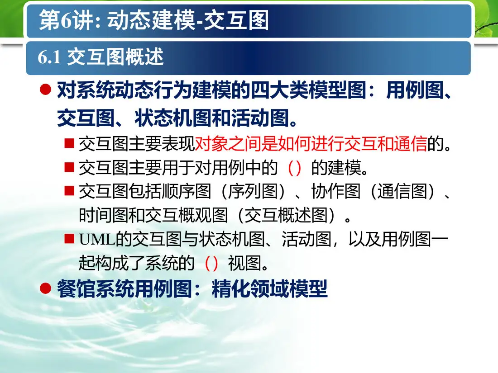

原文：

第6讲: 动态建模-交互图

6.1 交互图概述

\- 对系统动态行为建模的四大类模型图：用例图、交互图、状态机图和活动图。

■ 交互图主要表现对象之间是如何进行交互和通信的。

■ 交互图主要用于对用例中的（）的建模。

■ 交互图包括顺序图（序列图）、协作图（通信图）、时间图和交互概观图（交互概述图）。

■ UML的交互图与状态机图、活动图，以及用例图一起构成了系统的（）视图。

\- 餐馆系统用例图：精化领域模型

### 第6讲: 动态建模-交互图

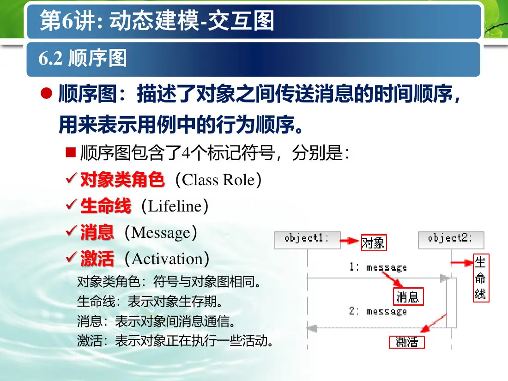

原文：

第6讲: 动态建模-交互图

6.2 顺序图

\- 顺序图：描述了对象之间传送消息的时间顺序，用来表示用例中的行为顺序。

■ 顺序图包含了4个标记符号，分别是：

√ 对象类角色 (Class Role)

√ 生命线 (Lifeline)

√ 消息 (Message)

√ 激活 (Activation)

对象类角色：符号与对象图相同。

生命线：表示对象生存期。

消息：表示对象间消息通信。

激活：表示对象正在执行一些活动。

### 第6讲: 动态建模-交互图

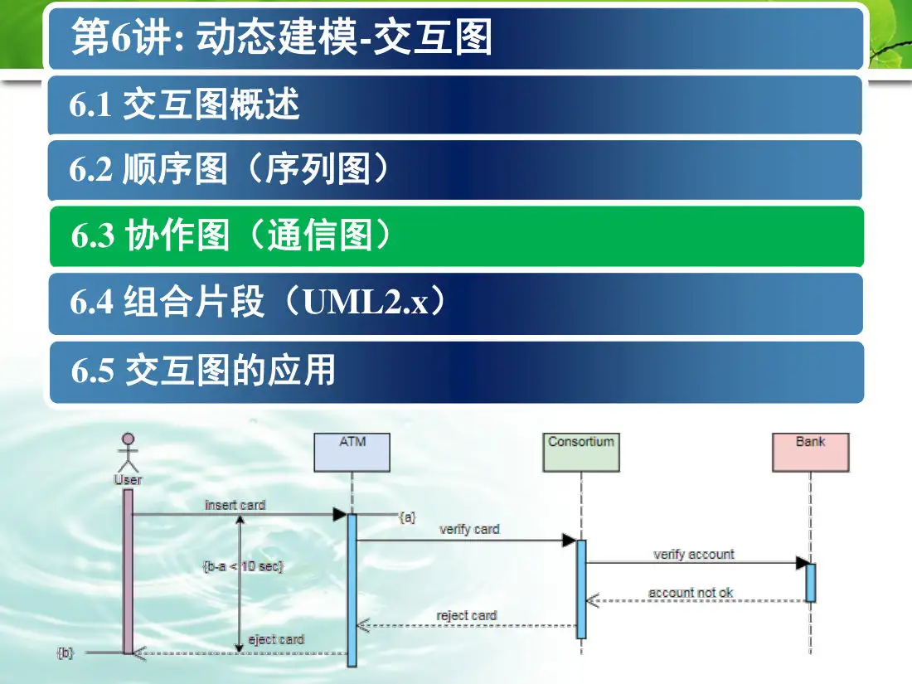

原文：

第6讲: 动态建模-交互图

6.1 交互图概述

6.2 顺序图（序列图）

6.3 协作图（通信图）

6.4 组合片段（UML2.x）

6.5 交互图的应用

### 第6讲: 动态建模-交互图

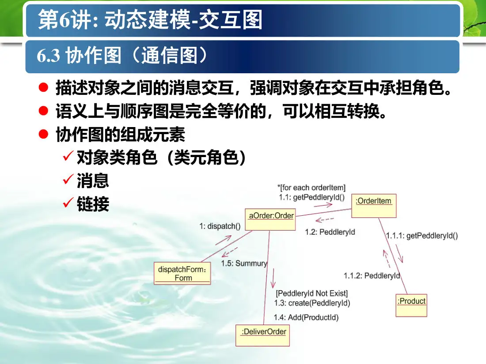

原文：

第6讲: 动态建模-交互图

6.3 协作图（通信图）

\- 描述对象之间的消息交互，强调对象在交互中承担角色。

\- 语义上与顺序图是完全等价的，可以相互转换。

协作图的组成元素

√ 对象类角色（类元角色）

√ 消息

√ 链接

### 第6讲: 动态建模-交互图

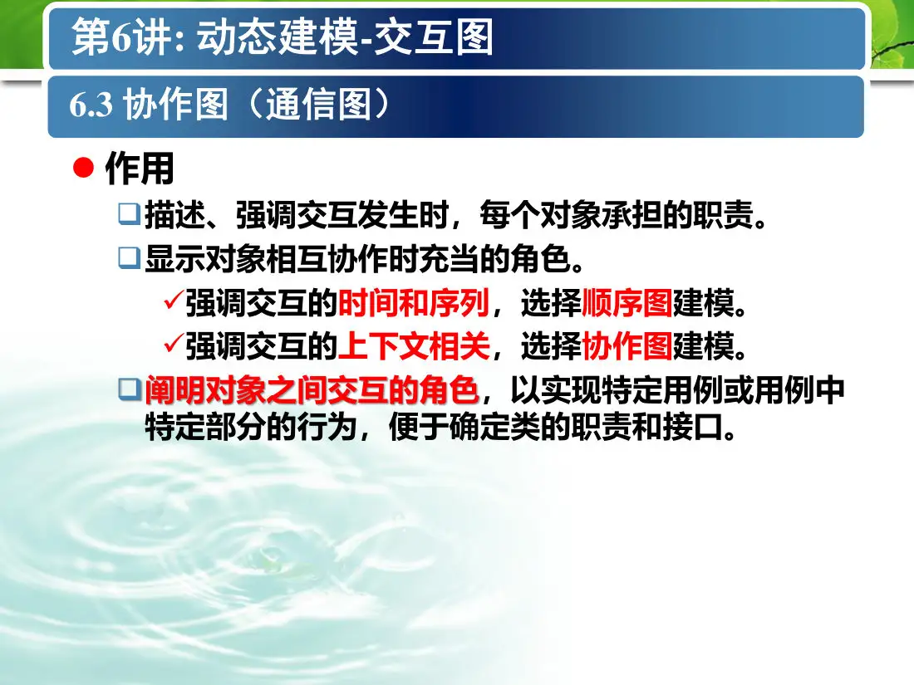

原文：

第6讲: 动态建模-交互图

6.3 协作图（通信图）

• 作用

□描述、强调交互发生时，每个对象承担的职责。

□显示对象相互协作时充当的角色。

√ 强调交互的时间和序列，选择顺序图建模。

√ 强调交互的上下文相关，选择协作图建模。

□阐明对象之间交互的角色，以实现特定用例或用例中特定部分的行为，便于确定类的职责和接口。

### 第6讲: 动态建模-交互图

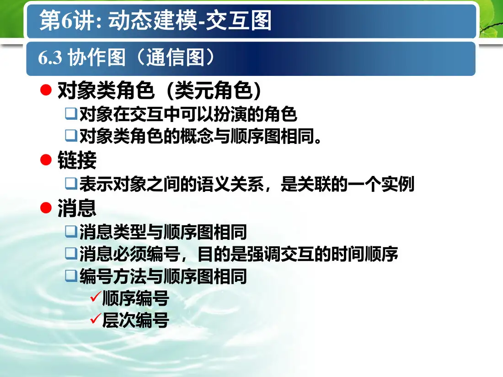

原文：

第6讲: 动态建模-交互图

6.3 协作图（通信图）

- 对象类角色（类元角色）

□对象在交互中可以扮演的角色

□对象类角色的概念与顺序图相同。

\- 链接

□表示对象之间的语义关系，是关联的一个实例

\- 消息

□ 消息类型与顺序图相同

□消息必须编号，目的是强调交互的时间顺序

编号方法与顺序图相同

√ 顺序编号

√ 层次编号

### 第6讲: 动态建模-交互图

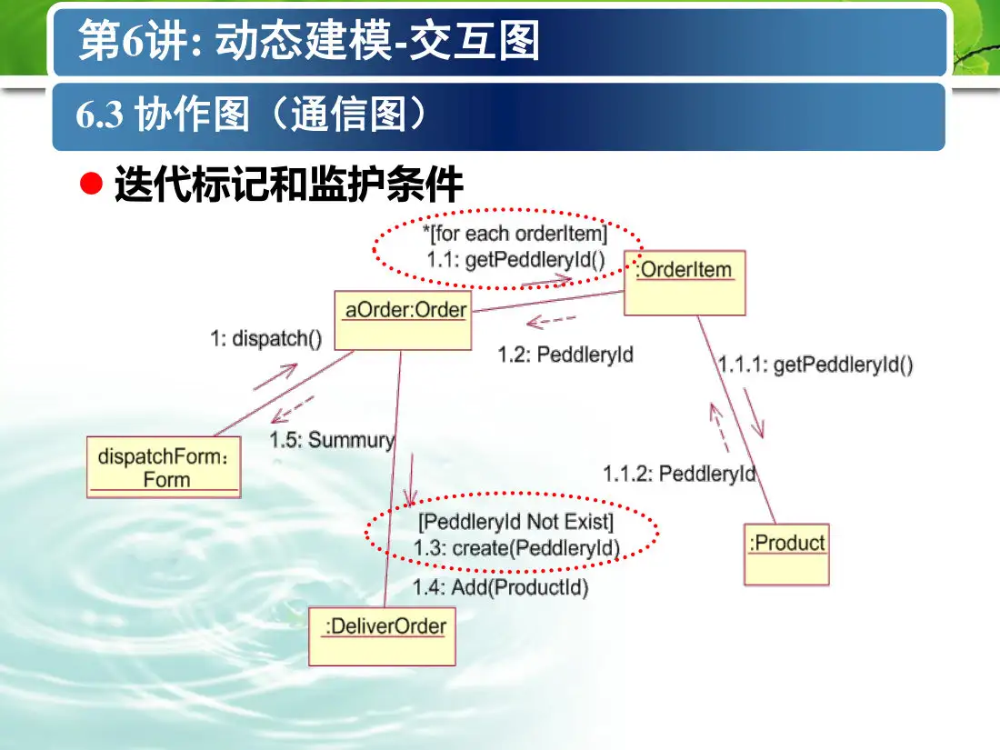

原文：

第6讲: 动态建模-交互图

6.3 协作图（通信图）

- 迭代标记和监护条件

### 第6讲: 动态建模-交互图

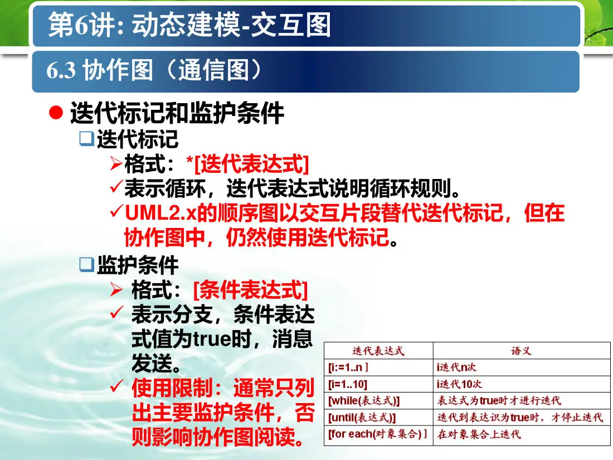

原文：

第6讲: 动态建模-交互图

6.3 协作图（通信图）

- 迭代标记和监护条件

迭代标记

格式：\*[迭代表达式]

√ 表示循环，迭代表达式说明循环规则。

√UML2.x的顺序图以交互片段替代迭代标记，但在协作图中，仍然使用迭代标记。

□ 监护条件

格式：[条件表达式]

√ 表示分支，条件表达式值为true时，消息发送。

√ 使用限制：通常只列出主要监护条件，否则影响协作图阅读。

<table><tr><td>迭代表达式</td><td>语义</td></tr><tr><td>[i:=1..n]</td><td>i迭代n次</td></tr><tr><td>[i=1..10]</td><td>i迭代10次</td></tr><tr><td>[while(表达式)]</td><td>表达式为true时才进行迭代</td></tr><tr><td>[until(表达式)]</td><td>迭代到表达识为true时,才停止迭代</td></tr><tr><td>[foreach(对象集合)]</td><td>在对象集合上迭代</td></tr></table>

### 第6讲: 动态建模-交互图

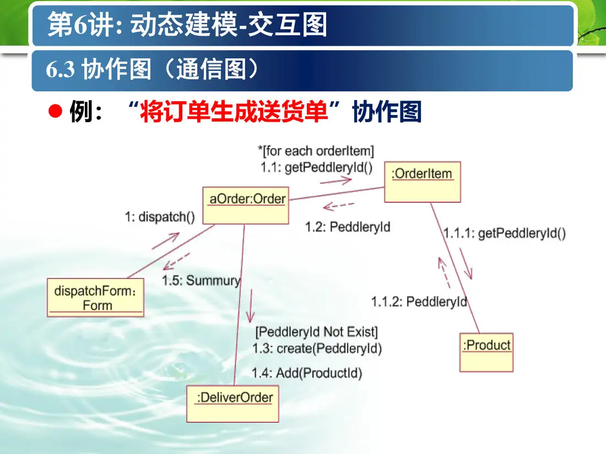

原文：

第6讲: 动态建模-交互图

6.3 协作图（通信图）

● 例：“将订单生成送货单”协作图

### 第6讲: 动态建模-交互图

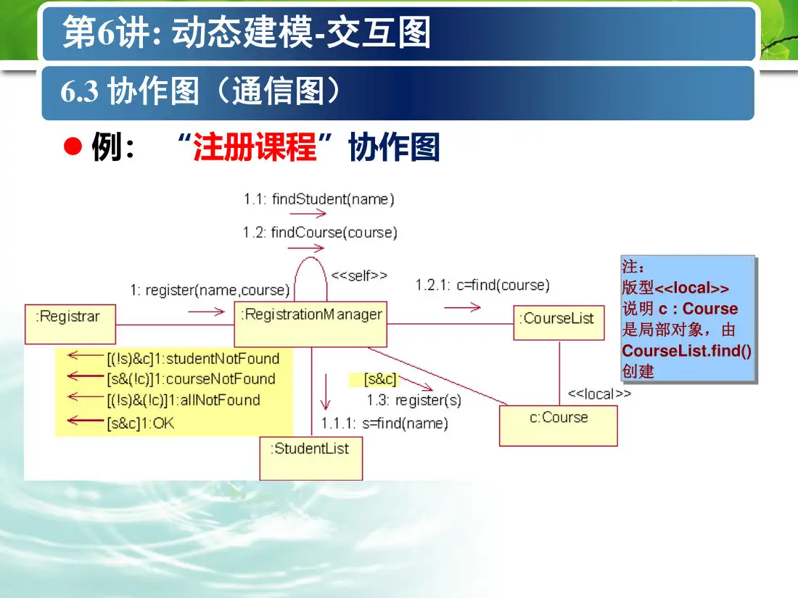

原文：

第6讲: 动态建模-交互图

6.3 协作图（通信图）

● 例：“注册课程”协作图

### 第6讲: 动态建模-交互图

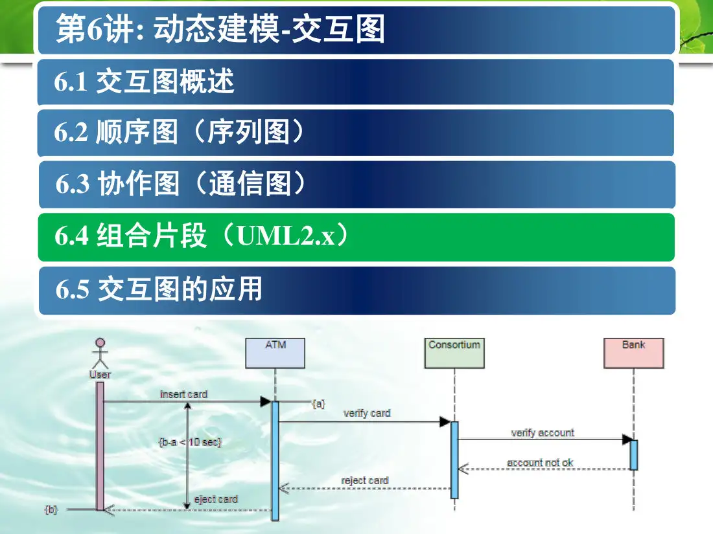

原文：

第6讲: 动态建模-交互图

6.1 交互图概述

6.2 顺序图（序列图）

6.3 协作图（通信图）

6.4 组合片段（UML2.x）

6.5 交互图的应用

### 第6讲: 动态建模-交互图

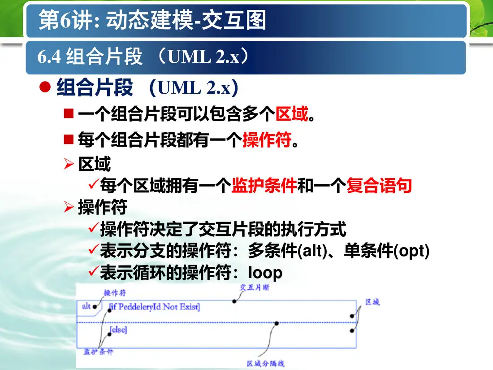

原文：

第6讲: 动态建模-交互图

6.4 组合片段（UML 2.x）

- 组合片段 (UML 2.x)

■ 一个组合片段可以包含多个区域。

■ 每个组合片段都有一个操作符。

区域

√每个区域拥有一个监护条件和一个复合语句

操作符

√ 操作符决定了交互片段的执行方式

√ 表示分支的操作符：多条件(alt)、单条件(opt)

√ 表示循环的操作符：loop

### 第6讲: 动态建模-交互图

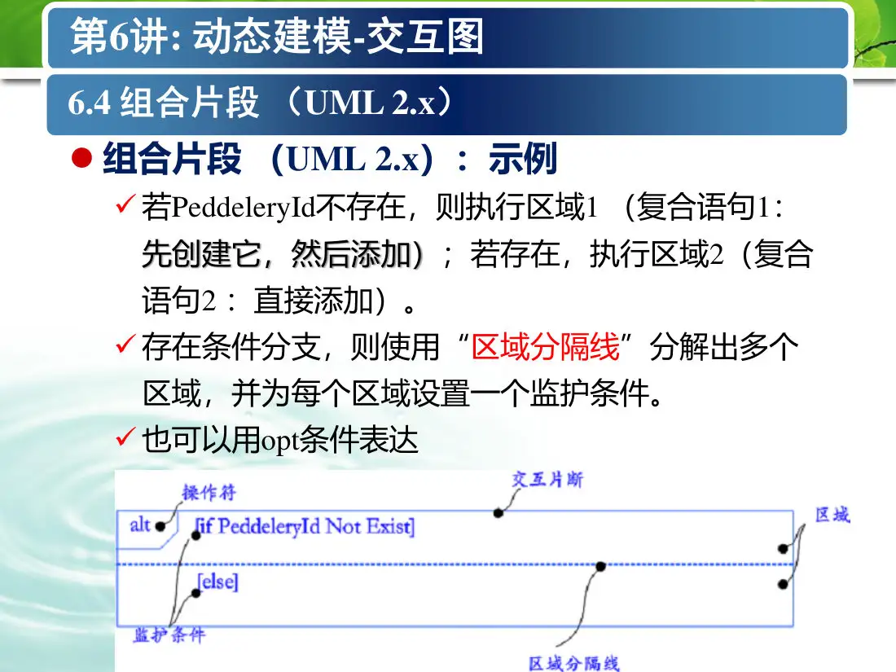

原文：

第6讲: 动态建模-交互图

6.4 组合片段（UML 2.x）

- 组合片段 (UML 2.x)：示例

√ 若PeddeleryId不存在，则执行区域1（复合语句1：先创建它，然后添加）；若存在，执行区域2（复合语句2：直接添加）。

√ 存在条件分支，则使用“区域分隔线”分解出多个区域，并为每个区域设置一个监护条件。

√ 也可以用opt条件表达

### 第6讲: 动态建模-交互图

原文：

第6讲: 动态建模-交互图

6.4 组合片段（UML 2.x）

- 分支 (多条件)

一种条件选择行为，它根据交互操作上的交互约束来判断是否运行分支。

■ alt（备选）：包含一个片段列表，这些片段包含备选消息序列，在任何场合下只发生一个序列。

■ 可在每个片段中设置一个监护条件（临界）来指示该片段可以运行的条件；else 的临界指示其他任何临界都不为 True 时应运行的片段；如果所有临界都为 False 并且没有 else，则不执行任何片段。

### 第6讲: 动态建模-交互图

原文：

第6讲: 动态建模-交互图

6.4 组合片段（UML 2.x）

- 分支（单条件）

一种条件选择行为，它根据交互操作上的交互约束来判断是否运行分支。

■ opt （可选）：包含一个可能发生或可能不发生的序列，可在监护条件（临界）中指定序列发生的条件。

### 第6讲: 动态建模-交互图

原文：

第6讲: 动态建模-交互图

6.4 组合片段（UML 2.x）

- 循环

指被包含的事件将会被执行多次。循环组合片段的标注方法中可以包含一个最小值和最大值，来表明应被执行的次数。

■ loop（循环）：表示片段的多次执行，由循环次数和监护条件说明

√ loop(1,n), loop(10)

√ loop [for each Item]

### 第6讲: 动态建模-交互图

原文：

第6讲: 动态建模-交互图

6.4 组合片段（UML 2.x）

中断

中断组合片段表示这个片段执行完毕之后终止当前的组合片段，类似于编程语言中的return语句。

■ break（中断）：定义含有监护条件的片段，若条件为“真”执行子片段，而不执行子片段后面的其它交互；若条件为“假”，那么就按正常流程执行。

### 第6讲: 动态建模-交互图

原文：

第6讲: 动态建模-交互图

6.4 组合片段（UML 2.x）

中断

中断组合片段表示这个片段执行完毕之后终止当前的组合片段，类似于编程语言中的return语句。

■ break（中断）：定义含有监护条件的片段，若条件为“真”执行子片段，而不执行子片段后面的其它交互；若条件为“假”，那么就按正常流程执行。

### 第6讲: 动态建模-交互图

原文：

第6讲: 动态建模-交互图

6.4 组合片段（UML 2.x）

关键

通常表示一个原子性的连续操作，例如事务性操作

critical（关键）：表示子片段是“临界区域”，区域中生命线上的事件序列不能和其他区域中的任何其他事件交错

### 第6讲: 动态建模-交互图

原文：

第6讲: 动态建模-交互图

6.4 组合片段（UML 2.x）

• 并行

并行组合片段描述了多个组合片段可以同时被执行。

par（并行）：表示并发执行的若干个子片段，子片段中的单个元素可以以任何可能的顺序相互操作（除非采用critical禁止）。

### 第6讲: 动态建模-交互图

原文：

第6讲: 动态建模-交互图

6.4 组合片段（UML 2.x）

- 组合片段：其他操作

■ seq：有两个或更多操作数片段，涉及同一生命线的消息必须以片段的顺序发生。

■ strict：有两个或更多操作数片段。这些片段必须按给定顺序发生。

assert

consider

ignore

ref

### 第6讲: 动态建模-交互图

原文：

第6讲: 动态建模-交互图

6.3 协作图（通信图）

\- 描述对象之间的消息交互，强调对象在交互中承担角色。

\- 语义上与顺序图是完全等价的，可以相互转换。

协作图的组成元素

√ 对象类角色（类元角色）

√ 消息

√ 链接

迭代标记和监护条件

例：“将订单生成送货单”协作图

例：“注册课程”协作图

### 第6讲: 动态建模-交互图

原文：

第6讲: 动态建模-交互图

6.3 协作图（通信图）

• 作用

□描述、强调交互发生时，每个对象承担的职责。

□显示对象相互协作时充当的角色。

√ 强调交互的时间和序列，选择顺序图建模。

√ 强调交互的上下文相关，选择协作图建模。

□阐明对象之间交互的角色，以实现特定用例或用例中特定部分的行为，便于确定类的职责和接口。

### 第6讲: 动态建模-交互图

原文：

第6讲: 动态建模-交互图

6.4 组合片段（UML 2.x）

■ 一个组合片段可以包含多个区域。

■ 每个组合片段都有一个操作符。

区域

√每个区域拥有一个监护条件和一个复合语句

操作符

√ 操作符决定了交互片段的执行方式

√表示分支的操作符：多条件(alt)、单条件(opt)

√ 表示循环的操作符：loop

√中断、关键、并行操作符

### 第6讲: 动态建模-交互图

原文：

第6讲: 动态建模-交互图

6.1 交互图概述

6.2 顺序图（序列图）

6.3 协作图（通信图）

6.4 组合片段（UML2.x）

6.5 交互图的应用

### 第6讲: 动态建模-交互图

原文：

第6讲: 动态建模-交互图

6.5 交互图的应用

- 顺序图与协作图的关系

两者都表示了对象之间的交互，语义上等价，但侧重点不同。

√ 顺序图描述了对象交互的时间顺序，但没有明确地表达对象之间的关系，也没有表明对象在交互中承担的角色。

√ 协作图描述了交互中对象承担角色(关系)，但对象在交互中的时间顺序必须通过消息的编号来获得。

√ 顺序图可以表示出对象的激活状态和去激活状态，也可以表示出对象的创建和销毁的相对时间；协作图则没有这些功能

### 第6讲: 动态建模-交互图

原文：

第6讲: 动态建模-交互图

6.5 交互图的应用

绘制交互图

步骤

☐1）找出交互对象及其关系（仅对于协作图而言）

□2）确定对象之间交互的消息格式和流程

√ 用同步调用、异步消息、返回消息来表示

☐3）利用交互片段或迭代标志、监护条件表示循环和分支

□4）通过一些构造型来完善整个交互图

说明

☐ RUP方法中，以用例为材料来构造交互图

√候选对象来自用例描述

√ 交互消息取自事件流

□分析模型中的交互图是对用例功能的实现

### 第6讲: 动态建模-交互图

原文：

第6讲: 动态建模-交互图

6.5 交互图的应用

- 餐馆系统用例图：新增预约 (Add Booking)

用例

用例描述：

1）用例名称：Add Booking

2）用例编号：

3) 参与者:

4）事件流：

Receptionist

基本事件流：

1) 接待员 (Receptionist) 向系统输入要预约的日期

2）系统显示该日期的预约信息

3）检查是否有合适的餐桌可以使用，有合适的餐桌，则录入预约信息（餐桌号、顾客姓名、电话号码、预约时间、人数）

4）系统显示录入的预约信息

5）结束预约

可选事件流：

1) 接待员 (Receptionist) 向系统输入要预约的日期

2）系统显示该日期的预约信息

3）检查是否有合适的餐桌可以使用，没有合适的餐桌

4) 结束预约

例外事件流：

1) 接待员 (Receptionist) 向系统输入要预约的日期

2）系统显示该日期的预约信息

3) 检查是否有合适的餐桌可以使用，有合适的餐桌，但录入人数时，发现餐桌太小容纳不下顾客人数

4) 询问是否继续预约，回答“否”直接结束预约；回答“是”保存预约信息并附有警告标志后，结束预约

### BookingSystem

原文：

BookingSystem

第6讲: 动态建模-交互图

6.5 交互图的应用

\- 餐馆系统用例图：新增预约（Add Booking）

■ 记录预定：初始交互 （课本图5.7）

: Restaurant

: Receptionist

makeReservation(details)

### 第6讲: 动态建模-交互图

原文：

第6讲: 动态建模-交互图

6.5 交互图的应用

\- 餐馆系统用例图：新增预约（Add Booking）

■ 创建一个新预定（课本图5.8）

### 第6讲: 动态建模-交互图

原文：

第6讲: 动态建模-交互图

6.5 交互图的应用

\- 餐馆系统用例图：取消预约 (Cancel Booking)

课本图5.9

: Staff

### 第6讲: 动态建模-交互图

原文：

第6讲: 动态建模-交互图

6.5 交互图的应用

\- 餐馆系统用例图：取消预约 (Cancel Booking)

■ 细化领域模型

### 第6讲: 动态建模-交互图

原文：

第6讲: 动态建模-交互图

6.5 交互图的应用

\- 餐馆系统用例图：更新预约 (Updating Booking)

■ 记录一个顾客的到达（课本图5.11）

### 第6讲: 动态建模-交互图

原文：

第6讲: 动态建模-交互图

6.5 交互图的应用

\- 餐馆系统用例图：更新预约 (Updating Booking)

■ 在类层次中分配责任 （课本图5.12）

### 第6讲: 动态建模-交互图

原文：

第6讲: 动态建模-交互图

6.5 交互图的应用

- 示例：用例“新增书籍信息”描述与事件流

新增书籍信息的用例概述：

1) 用例名称：新增书籍信息（UC01）

2) 简要说明：录入新购书籍信息，并自动存储建档

3) 事件流：基本事件流和扩展事件流

4) 非功能需求

5) 前置条件：用户进入图书管理系统

6) 后置条件：完成新书信息的存储建档

7) 扩展点: 无

8) 优先级：最高（满意度 5，不满意度 5）

主事件流:

1) 管理员向系统发出“新增书籍信息”请求

2) 系统要求管理员选择新增书籍的类别（如计算机类）

3) 管理员选择，显示相应界面，输入信息（书名、作者、出版社、ISBN号、开本页数、定价、是否有CDROM），并自动根据规则生成书号

4) 系统确认是否书名重复
→ 扩展事件流

5) 系统存档图书信息

扩展事件流：

4a) 若系统中存在重名书籍，显示重名书籍，并要求管理员选择修改书名或取消输入

i. 管理员选择取消输入，则结束用例，不做存档工作

ii. 管理员选择修改书名后转 4)

### 第6讲: 动态建模-交互图

原文：

第6讲: 动态建模-交互图

6.5 交互图的应用

\- 示例：用例“新增书籍信息”描述与事件流

寻找分析类

分析阶段寻找3种分析类（边界类、控制类和实体类）

☐1）寻找边界对象：以参与者“图书管理员”为线索
■ 图书管理员向系统发出“新增书籍信息”请求。
√ 主窗口、“新增书籍信息”按钮

■系统要求选择新增书籍是计算机类还是非计算机类。  
√“书籍类别”列表框

■选择类别后，根据书号规则自动生成书号，管理员输入信息，并提交。

√ “新书信息录入” 窗口、“提交” 按钮由“参与者和边界对象”绘制初步的分析图。

### 第6讲: 动态建模-交互图

原文：

第6讲: 动态建模-交互图

6.5 交互图的应用

\- 示例：用例“新增书籍信息”描述与事件流

寻找分析类

分析阶段寻找3种分析类（边界类、控制类和实体类）

□1）寻找边界对象：以参与者“图书管理员”为线索

### 第6讲: 动态建模-交互图

原文：

第6讲: 动态建模-交互图

6.5 交互图的应用

\- 示例：用例“新增书籍信息”描述与事件流

寻找分析类

分析阶段寻找3种分析类（边界类、控制类和实体类）

□2）寻找控制对象和实体对象

■实体对象来源于领域中的类图，描述业务领域的名词和名词短语

□书籍、计算机书籍、非计算机书籍、书籍列表
■控制对象来源于事件流

□ 按钮事件处理器、书名重复性检查、创建书籍、加入书籍列表、获得书籍类别、生成书号
基于所有对象，绘制完整的分析图

### 第6讲: 动态建模-交互图

原文：

第6讲: 动态建模-交互图

6.5 交互图的应用

\- 示例：用例“新增书籍信息”描述与事件流

寻找分析类

分析阶段寻找3种分析类（边界类、控制类和实体类）

### 第6讲: 动态建模-交互图

原文：

第6讲: 动态建模-交互图

6.5 交互图的应用

\- 示例：用例“新增书籍信息”描述与事件流

■ 根据分析图，构建交互模型

步骤

■自左至右，依次将参与者、边界对象、实体对象放在顶部（分析阶段可以不考虑控制类）

■根据事件流描述，结合分析图，得到消息流

绘制顺序图

绘制协作图（可以由顺序图自动转化）

### 第6讲: 动态建模-交互图

原文：

第6讲: 动态建模-交互图

6.5 交互图的应用

\- 示例：用例“新增书籍信息”描述与事件流

协作图

### 第6讲: 动态建模-交互图

原文：

第6讲: 动态建模-交互图

6.5 交互图的应用

\- 示例：用例“新增书籍信息”描述与事件流

顺序图

：图书管理员：新增图书信息按钮：新书录入窗口：书籍类别下拉列表：提交按钮：书号规则：书籍：书籍列表

### 第6讲: 动态建模-交互图

原文：

第6讲: 动态建模-交互图

6.5 交互图的应用

- 餐馆系统用例图：查询预约（Query Booking）

■ 顺序图 → 协作图

### 第6讲: 动态建模-交互图

原文：

第6讲: 动态建模-交互图

6.5 交互图的应用

- 餐馆系统用例图：新增预约 (Add Booking)

用例

用例描述：

1）用例名称：Add Booking

2）用例编号：

3) 参与者:

4）事件流：

Receptionist

基本事件流：

1) 接待员 (Receptionist) 向系统输入要预约的日期

2）系统显示该日期的预约信息

3）检查是否有合适的餐桌可以使用，有合适的餐桌，则录入预约信息（餐桌号、顾客姓名、电话号码、预约时间、人数）

4）系统显示录入的预约信息

5）结束预约

可选事件流：

1) 接待员 (Receptionist) 向系统输入要预约的日期

2）系统显示该日期的预约信息

3）检查是否有合适的餐桌可以使用，没有合适的餐桌

4) 结束预约

例外事件流：

1) 接待员 (Receptionist) 向系统输入要预约的日期

2）系统显示该日期的预约信息

3) 检查是否有合适的餐桌可以使用，有合适的餐桌，但录入人数时，发现餐桌太小容纳不下顾客人数

4) 询问是否继续预约，回答“否”直接结束预约；回答“是”保存预约信息并附有警告标志后，结束预约

### 6.5 交互图的应用

原文：

6.5 交互图的应用

- 餐馆系统用例图：新增预约（Add Booking）

顺序图

第6讲: 动态建模-交互图

### 第6讲: 动态建模-交互图

原文：

第6讲: 动态建模-交互图

6.5 交互图的应用

- 餐馆系统用例图：新增预约（Add Booking）

协作图

### 6.5 交互图的应用

原文：

6.5 交互图的应用

- 餐馆系统用例图：取消预约 (Delete Booking)

顺序图

第6讲: 动态建模-交互图

### 第6讲: 动态建模-交互图

原文：

第6讲: 动态建模-交互图

6.5 交互图的应用

\- 餐馆系统用例图：取消预约 (Delete Booking)

协作图

### 第6讲: 动态建模-交互图

原文：

第6讲: 动态建模-交互图

6.5 交互图的应用

- 餐馆系统用例图：修改预约 (Update Booking)

用例

用例描述:

1) 用例名称: Update Booking

2) 用例编号:

3) 参与的活动者: Receptionist

4) 事件流:

基本事件流：

1) 删除原有预约信息

2) 重新登记预约信息

### 第6讲: 动态建模-交互图

原文：

第6讲: 动态建模-交互图

6.5 交互图的应用

- 餐馆系统用例图：修改预约（Update Booking）

顺序图

### 第6讲: 动态建模-交互图

原文：

第6讲: 动态建模-交互图

6.5 交互图的应用

\- 餐馆系统用例图：修改预约（Update Booking）

协作图

### 第6讲: 动态建模-交互图

原文：

第6讲: 动态建模-交互图

6.5 交互图的应用

- 餐馆系统：细化领域模型

### 第6讲: 动态建模-交互图

原文：

第6讲: 动态建模-交互图

6.5 交互图的应用

- 餐馆系统用例图：记录顾客到来（Record Arrival）

用例

用例描述:

1) 用例名称: Record Arrival

2) 用例编号:

3) 参与的活动者: Head Waiter

4) 事件流:

基本事件流：

1) 侍者领班(Head Waiter)向系统输入当前日期

2) 系统显示当前日期的预约信息

3) 检查是否有预约信息，有预约信息，则确认一个选定的预约已经到达

4) 系统更新显示，标记顾客已到达

5) 退出预约系统

例外事件流：

1) 侍者领班(Head Waiter)向系统输入当前日期

2) 系统显示当前日期的预约信息

3) 检查是否有预约信息，没有预约信息，且有空闲合适的餐桌，记录预约信息，并标记顾客已到达

4) 退出预约系统

可选事件流：

1) 侍者领班(Head Waiter)向系统输入当前日期

2) 系统显示当前日期的预约信息

3) 检查是否有预约信息，没有预约信息，也没有空闲合适的餐桌，退出预约系统

### 第6讲: 动态建模-交互图

原文：

第6讲: 动态建模-交互图

6.5 交互图的应用

\- 餐馆系统用例图：记录顾客到来（Record Arrival）

顺序图

### 第6讲: 动态建模-交互图

原文：

第6讲: 动态建模-交互图

6.5 交互图的应用

\- 餐馆系统用例图：记录顾客到来（Record Arrival）

协作图

### 6.5 交互图的应用

原文：

6.5 交互图的应用

\- 餐馆系统用例图：未预约顾客到来（Record Walk-in）

顺序图

第6讲: 动态建模-交互图

### 6.5 交互图的应用

原文：

6.5 交互图的应用

- 餐馆系统用例图：未预约顾客到来（Record Walk-in）

协作图

第6讲: 动态建模-交互图

### 第6讲: 动态建模-交互图

原文：

第6讲: 动态建模-交互图

6.5 交互图的应用

- 餐馆系统用例图：调整餐桌 (Table Transfer)

用例

用例描述:

1) 用例名称: Table Transfer

2) 用例编号:

3) 参与的活动者: Head Waiter

4) 事件流:

基本事件流：

1) 侍者领班(Head Waiter)向系统输入预约的日期

2) 系统显示该日期的预约信息

3) 调整餐桌的分配

4) 系统更新预约信息

5) 结束

例外事件流：

1) 侍者领班(Head Waiter)向系统输入预约的日期

2) 系统显示该日期的预约信息

3) 调整餐桌的分配时，没有可调换的餐桌

4) 结束

### 第6讲: 动态建模-交互图

原文：

第6讲: 动态建模-交互图

6.5 交互图的应用

- 餐馆系统用例图：调整餐桌（Table Transfer）

顺序图

### 第6讲: 动态建模-交互图

原文：

第6讲: 动态建模-交互图

6.5 交互图的应用

\- 餐馆系统用例图：调整餐桌（Table Transfer）

协作图

### 第6讲: 动态建模-交互图

原文：

第6讲: 动态建模-交互图

6.5 交互图的应用

- 餐馆系统：进一步细化领域模型

### 第6讲: 动态建模-交互图

原文：

第6讲: 动态建模-交互图

6.5 交互图的应用

- 餐馆系统：完整的分析模型

### 第6讲: 动态建模-交互图

原文：

第6讲: 动态建模-交互图

6.5 交互图的应用

- 练习：饮料自动销售系统

正常场景

√ 顾客从钱币口投入钱币，然后选择想要的饮料。

√ 钱币到达钱币记录仪，记录仪更新存储。

√ 记录仪通知分配器分发饮料。

异常场景

√1）饮料已售完。

√2）饮料没有售完，但机器没有合适的零钱。

### 第6讲: 动态建模-交互图

原文：

第6讲: 动态建模-交互图

6.5 交互图的应用

\- 练习：饮料自动销售系统

### 第6讲: 动态建模-交互图

原文：

第6讲: 动态建模-交互图

6.5 交互图的应用

\- 练习：饮料自动销售系统

异常场景1

### 第6讲: 动态建模-交互图

原文：

第6讲: 动态建模-交互图

6.5 交互图的应用

\- 练习：饮料自动销售系统

异常场景2

### 第6讲: 动态建模-交互图

原文：

第6讲: 动态建模-交互图

6.5 交互图的应用

作业

4.14 (课本P57)

5.5 (课本P75)

5.14 (课本P75)
