# 《软件建模与设计》第8章 物理建模（课件）

原件的每一页，下面附识别出的文字。

### 软件建模与设计

原文：

软件建模与设计

授课班级：B220417-19，B220400

授课安排：QQ群、超星学习通，课堂

授课时间：周二第8-9节{第1-16周}

金惠颖

### 第8讲: 物理建模

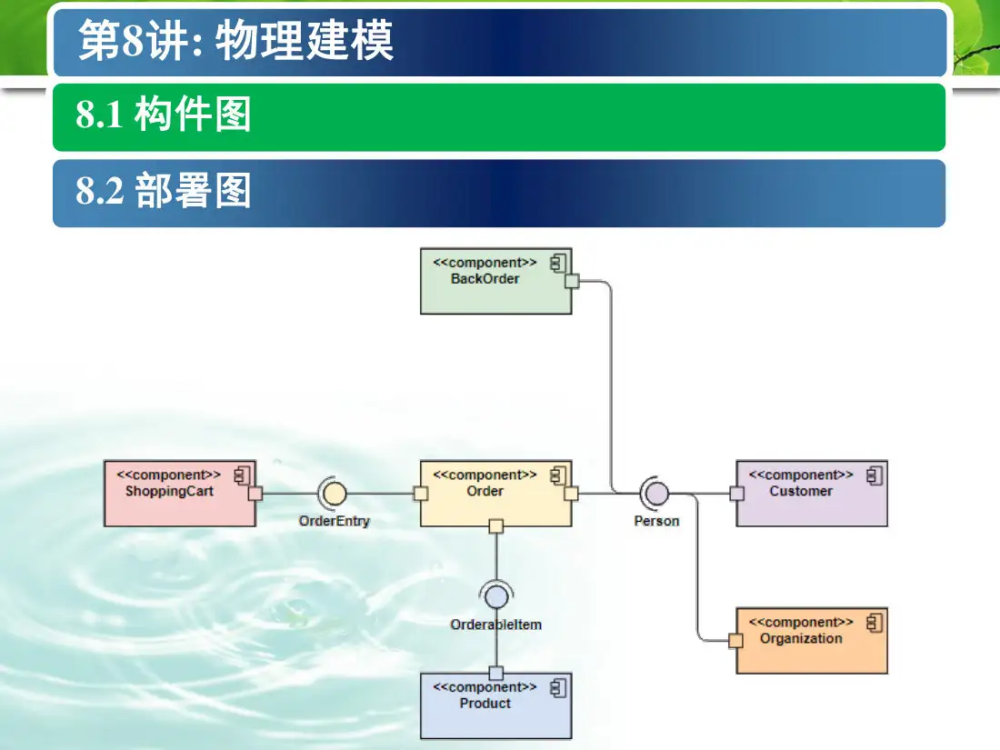

原文：

第8讲: 物理建模

8.1 构件图

8.2 部署图

### 第8讲: 物理建模

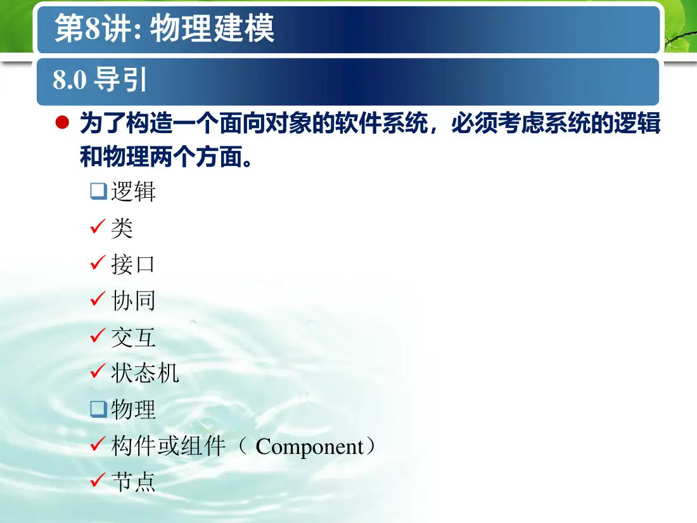

原文：

第8讲: 物理建模

8.0 导引

\- 为了构造一个面向对象的软件系统，必须考虑系统的逻辑和物理两个方面。

逻辑

√类

√ 接口

√ 协同

√ 交互

√ 状态机

物理

√ 构件或组件（Component）

√ 节点

### 第8讲: 物理建模

原文：

第8讲: 物理建模

8.0 导引

UML提供了两种物理表示图形：构件图和部署图。

构件图

√ 表示系统中的不同物理构件及其关系。

√ 表达的是系统代码本身的结构。

部署图

√ 由节点构成，节点代表系统的硬件，构件在节点上驻留并执行。

√ 表示系统的软件构件与硬件之间的关系。

√ 表达的是运行系统的结构。

□构件图和部署图用于建立系统的实现模型。

### 第8讲: 物理建模

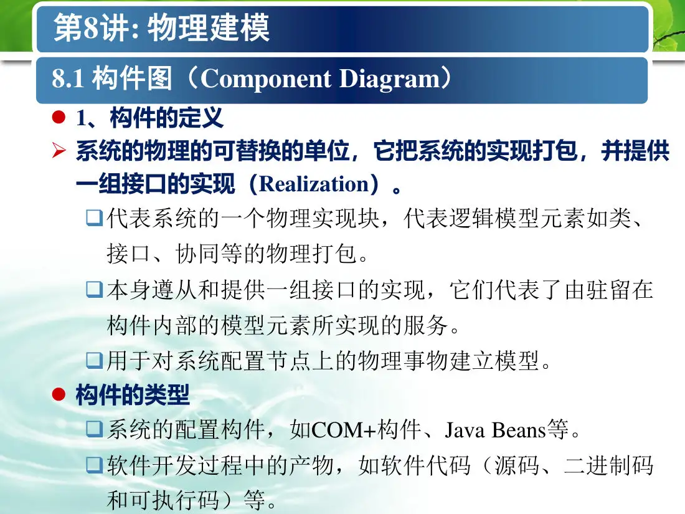

原文：

第8讲: 物理建模

8.1 构件图（Component Diagram）

1、构件的定义

系统的物理的可替换的单位，它把系统的实现打包，并提供一组接口的实现（Realization）。

□代表系统的一个物理实现块，代表逻辑模型元素如类、接口、协同等的物理打包。

□本身遵从和提供一组接口的实现，它们代表了由驻留在构件内部的模型元素所实现的服务。

□用于对系统配置节点上的物理事物建立模型。

- 构件的类型

□系统的配置构件，如COM+构件、Java Beans等。

□软件开发过程中的产物，如软件代码（源码、二进制码和可执行码）等。

### 第8讲: 物理建模

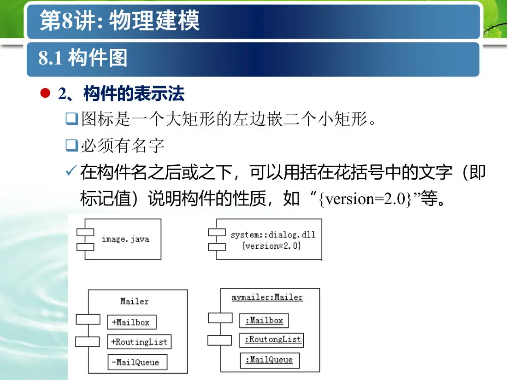

原文：

第8讲: 物理建模

8.1 构件图

2、构件的表示法

☐ 图标是一个大矩形的左边嵌二个小矩形。

必须有名字

√ 在构件名之后或之下，可以用括在花括号中的文字（即标记值）说明构件的性质，如“{version=2.0}”等。

### 第8讲: 物理建模

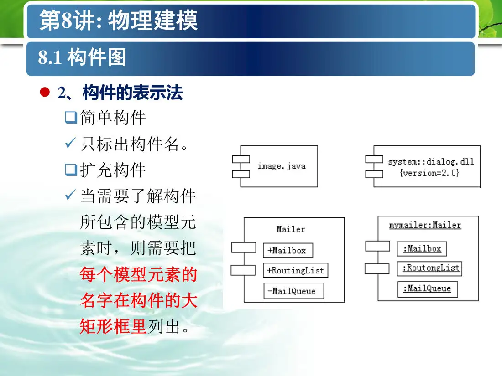

原文：

第8讲: 物理建模

8.1 构件图

2、构件的表示法

简单构件

√ 只标出构件名。

□扩充构件

√ 当需要了解构件所包含的模型元素时，则需要把每个模型元素的名字在构件的大矩形框里列出。

image.java

Mailer

+Mailbox

+RoutingList

-MailQueue system::dialog.dll
{version=2.0}

mymailer:Mailer

:Mailbox

:RoutongList

:MailQueue

### 第8讲: 物理建模

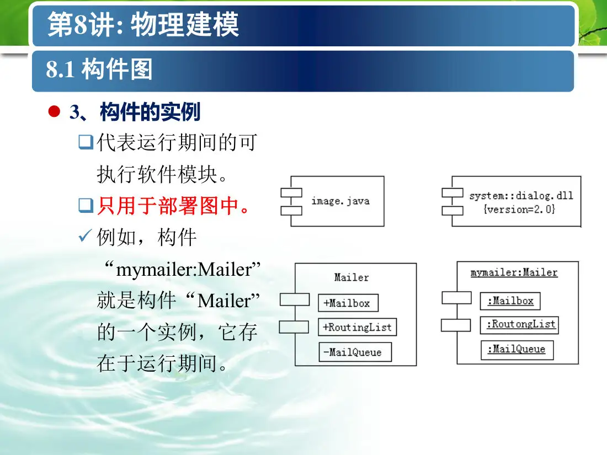

原文：

第8讲: 物理建模

8.1 构件图

3、构件的实例

□代表运行期间的可执行软件模块。

□只用于部署图中。

√ 例如，构件

“mymailer:Mailer”就是构件“Mailer”的一个实例，它存在于运行期间。

+RoutingList

-MailQueue system::dialog.dll
{version=2.0}

:RoutongList

:MailQueue

### 第8讲: 物理建模

原文：

第8讲: 物理建模

8.1 构件图

4、构件与类的比较和联系

相似点

√ 有名字，有实例，能实现接口，存在着关系等。

√ 性质的表示：构件所包含的模型元素的可视性同样有“公共”、“保护”、“私用”等。

区别

√ 构件代表物理事物，而类代表事物的逻辑抽象，因此构件可以用于部署图的节点中，而类不能。

√ 一般构件只有操作，外界只能通过接口接触它们，而类可以直接有属性和操作。

### 第8讲: 物理建模

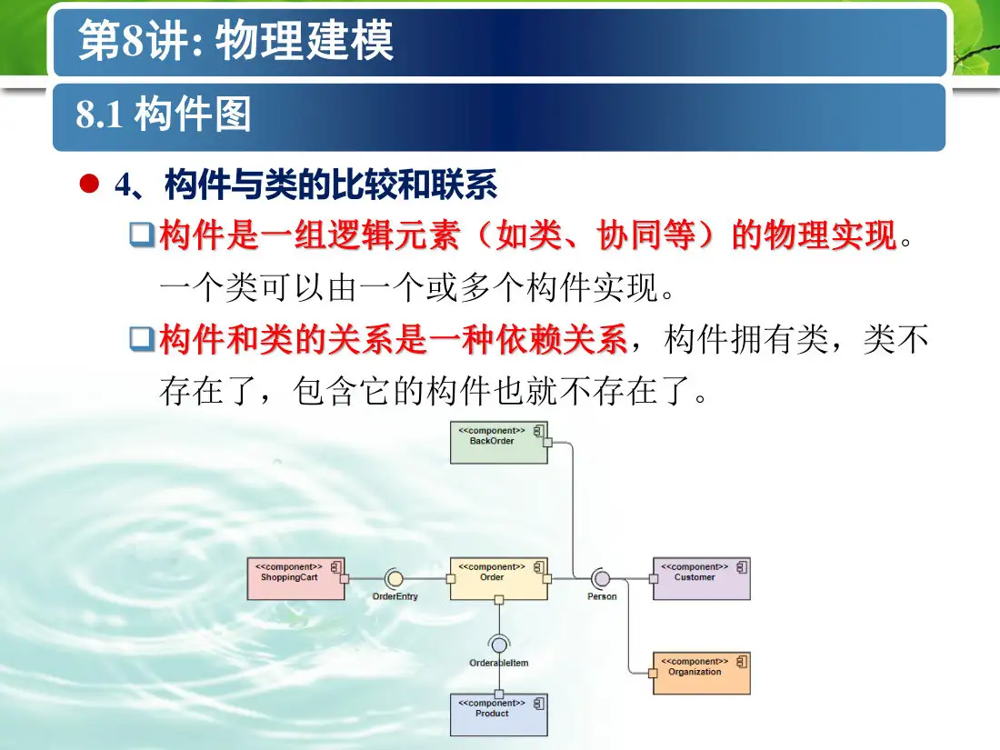

原文：

第8讲: 物理建模

8.1 构件图

4、构件与类的比较和联系

□构件是一组逻辑元素（如类、协同等）的物理实现。

一个类可以由一个或多个构件实现。

□构件和类的关系是一种依赖关系，构件拥有类，类不存在了，包含它的构件也就不存在了。

### 第8讲: 物理建模

原文：

第8讲: 物理建模

8.1 构件图

4、构件与类的比较和联系

□通常，构件与类的依赖关系不必用图形显式表示，可以在说明文档中予以说明。

√ 例：下图中的构件 “Mailer”依赖于类 “Mailbox”、“RoutingList”和 “MailQueue”。

### 第8讲: 物理建模

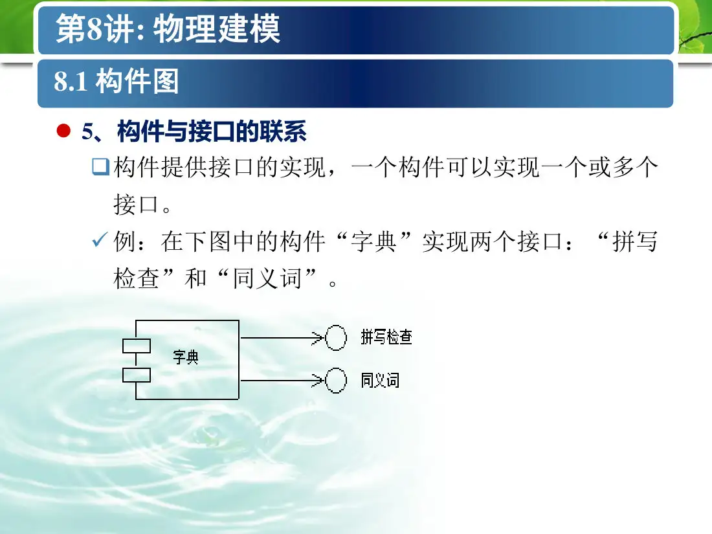

原文：

第8讲: 物理建模

8.1 构件图

5、构件与接口的联系

□构件提供接口的实现，一个构件可以实现一个或多个接口。

√ 例：在下图中的构件 “字典” 实现两个接口：“拼写检查” 和 “同义词”。

### 第8讲: 物理建模

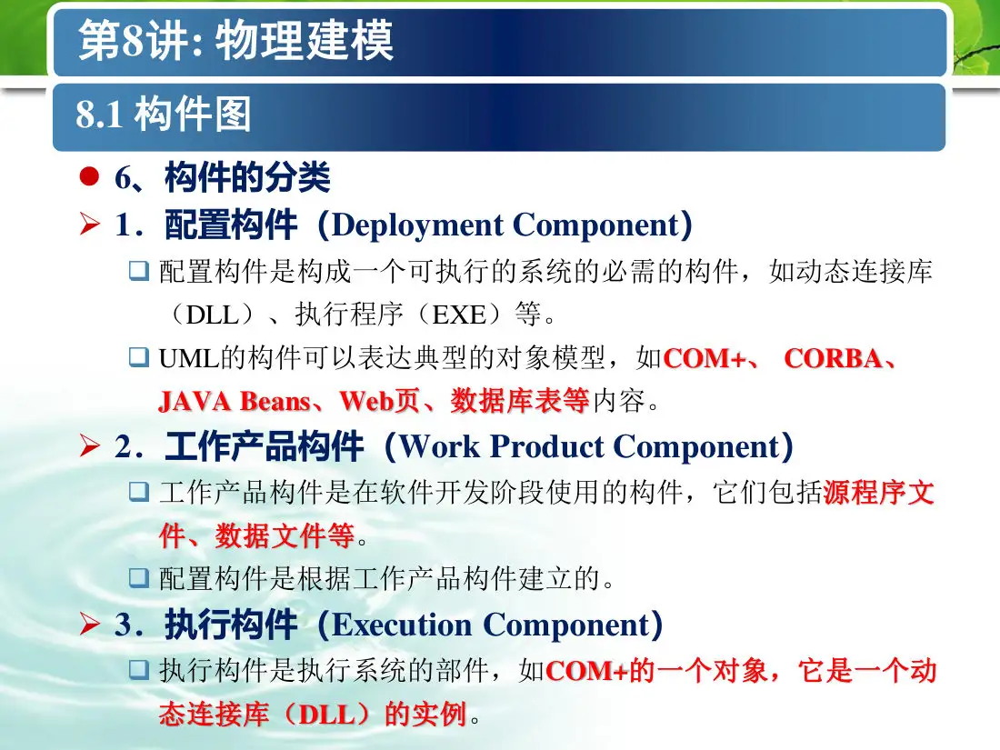

原文：

第8讲: 物理建模

8.1 构件图

6、构件的分类

1. 配置构件 (Deployment Component)

☐ 配置构件是构成一个可执行的系统的必需的构件，如动态连接库（DLL）、执行程序（EXE）等。

☐ UML的构件可以表达典型的对象模型，如COM+、CORBA、JAVA Beans、Web页、数据库表等内容。

2. 工作产品构件 (Work Product Component)

□ 工作产品构件是在软件开发阶段使用的构件，它们包括源程序文件、数据文件等。

□ 配置构件是根据工作产品构件建立的。

3. 执行构件 (Execution Component)

☐ 执行构件是执行系统的部件，如COM+的一个对象，它是一个动态连接库（DLL）的实例。

### 第8讲: 物理建模

原文：

第8讲: 物理建模

8.1 构件图

7、构件的扩展机制

UML的所有扩展机制都可以用于构件。

√ 例如，可在构件上加上标记值描述构件的性质，使用构造型规定构件种类。

√ 5个用于构件的标准构造型

1. <<executable>>：说明一个构件可以在系统的节点上执行

2. <<library>>：说明一个构件是一个静态的或动态的对象库

☐ 3. <<table>>：说明一个构件代表的是一个数据库表

□4. <<file>>：说明一个构件代表的是一个文档，它包含的是源代码或数据

□5. <<document>>：说明一个构件代表的是一个文档

### 第8讲: 物理建模

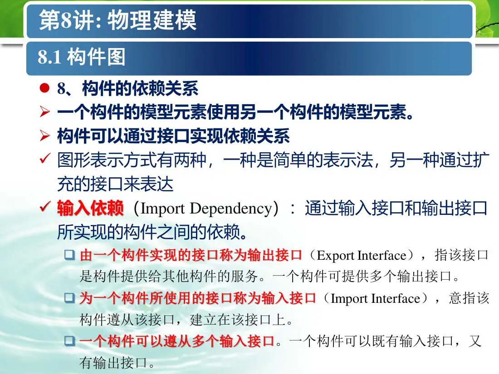

原文：

第8讲: 物理建模

8.1 构件图

8、构件的依赖关系

一个构件的模型元素使用另一个构件的模型元素。

构件可以通过接口实现依赖关系

√ 图形表示方式有两种，一种是简单的表示法，另一种通过扩充的接口来表达

√ 输入依赖（Import Dependency）：通过输入接口和输出接口所实现的构件之间的依赖。

☐ 由一个构件实现的接口称为输出接口（Export Interface），指该接口是构件提供给其他构件的服务。一个构件可提供多个输出接口。

☐ 为一个构件所使用的接口称为输入接口（Import Interface），意指该构件遵从该接口，建立在该接口上。

□一个构件可以遵从多个输入接口。一个构件可以既有输入接口，又有输出接口。

### 第8讲: 物理建模

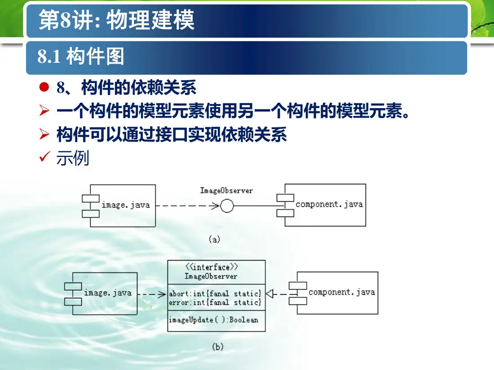

原文：

第8讲: 物理建模

8.1 构件图

8、构件的依赖关系

一个构件的模型元素使用另一个构件的模型元素。

构件可以通过接口实现依赖关系

√ 示例

### 第8讲: 物理建模

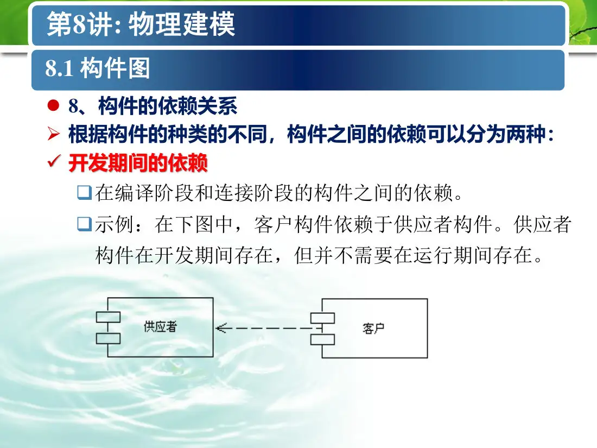

原文：

第8讲: 物理建模

8.1 构件图

8、构件的依赖关系

根据构件的种类的不同，构件之间的依赖可以分为两种：

√ 开发期间的依赖

□在编译阶段和连接阶段的构件之间的依赖。

示例：在下图中，客户构件依赖于供应者构件。供应者构件在开发期间存在，但并不需要在运行期间存在。

### 第8讲: 物理建模

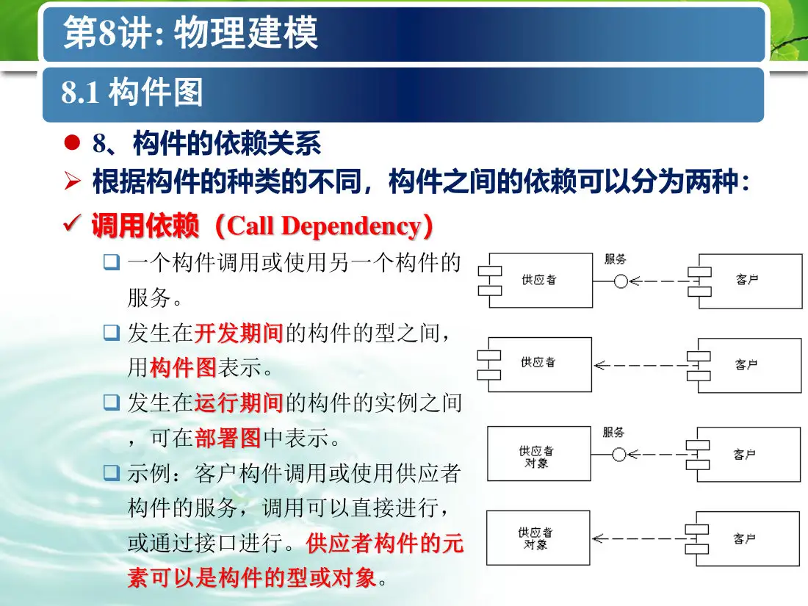

原文：

第8讲: 物理建模

8.1 构件图

8、构件的依赖关系

根据构件的种类的不同，构件之间的依赖可以分为两种：

√ 调用依赖 (Call Dependency)

一个构件调用或使用另一个构件的服务。

☐ 发生在开发期间的构件的型之间，用构件图表示。

□发生在运行期间的构件的实例之间，可在部署图中表示。

☐ 示例：客户构件调用或使用供应者构件的服务，调用可以直接进行，或通过接口进行。供应者构件的元素可以是构件的型或对象。

### 第8讲: 物理建模

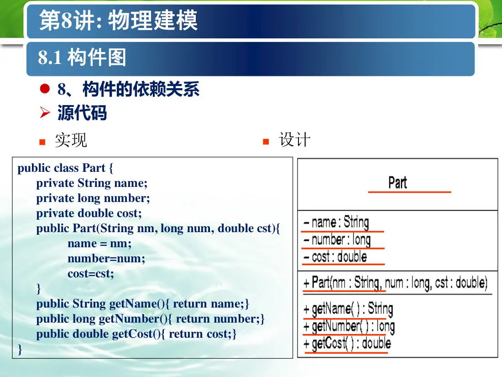

原文：

第8讲: 物理建模

8.1 构件图

8、构件的依赖关系

源代码

实现

设计

### 第8讲: 物理建模

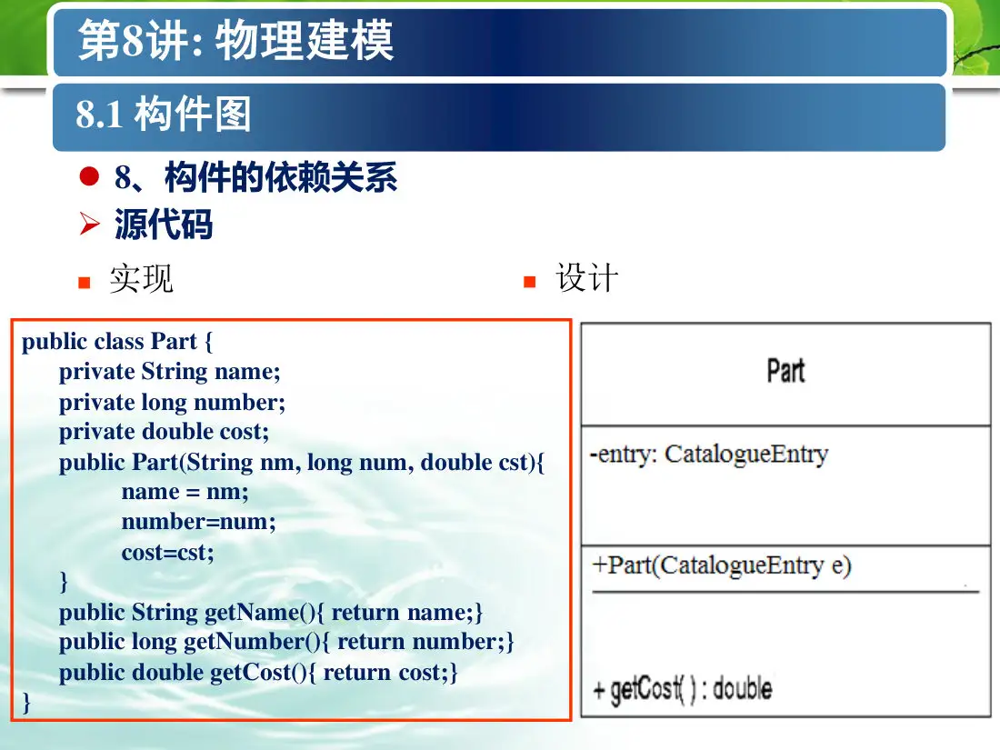

原文：

第8讲: 物理建模

8.1 构件图

8、构件的依赖关系

源代码

实现

设计

### 第8讲: 物理建模

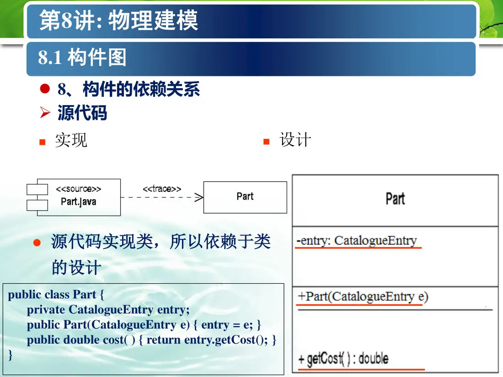

原文：

第8讲: 物理建模

8.1 构件图

8、构件的依赖关系

源代码

实现

设计

- 源代码实现类，所以依赖于类的设计

<table><tr><td>Part</td></tr><tr><td>-entry: CatalogueEntry</td></tr><tr><td>+Part(CatalogueEntry e)</td></tr><tr><td>+getCost( ) : double</td></tr></table>

### 第8讲: 物理建模

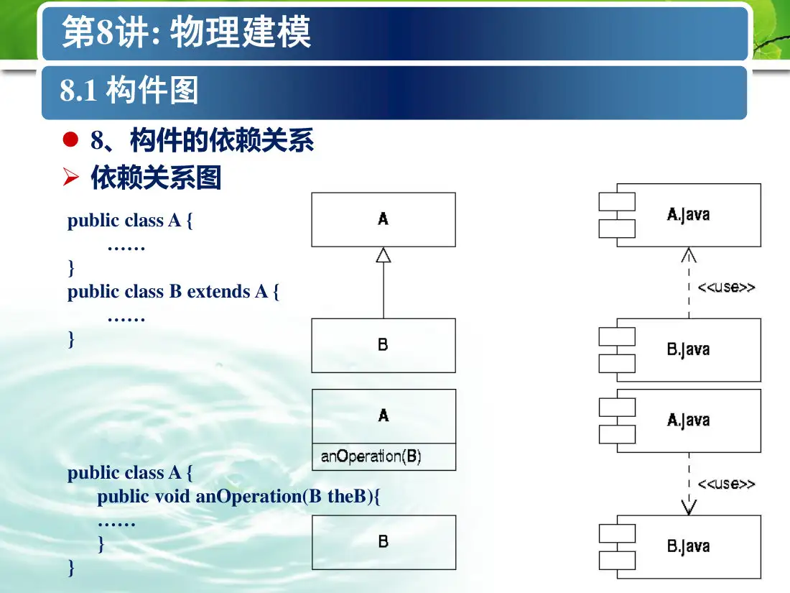

原文：

第8讲: 物理建模

8.1 构件图

8、构件的依赖关系

依赖关系图

public class A {
    ......
}
public class B extends A {
    ......
}

### 第8讲: 物理建模

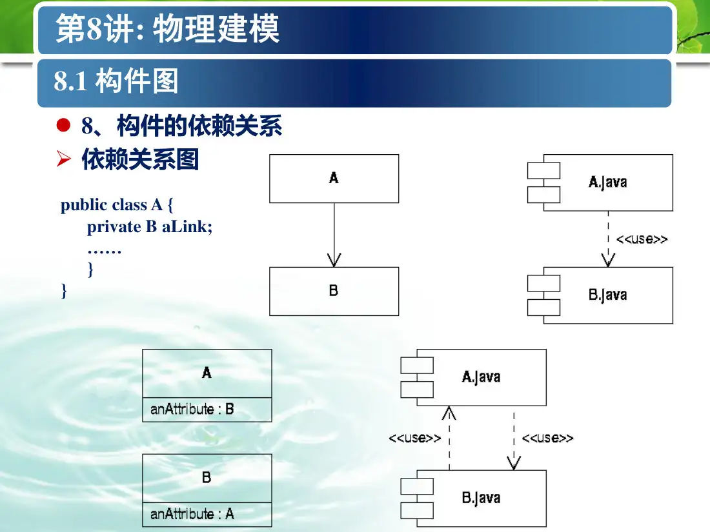

原文：

第8讲: 物理建模

8.1 构件图

8、构件的依赖关系

依赖关系图

public class A {
    private B aLink;
    ......
}

### 第8讲: 物理建模

原文：

第8讲: 物理建模

8.1 构件图

9、构件图：定义

> 构件图由构件、接口和构件之间的关系构成，其中的构件可以是源码、二进制码或可执行程序。

√ 表示系统中的不同物理部件及其关系，它表达的是系统代码本身的结构。

√ 只有型（Type）的形式，没有实例形式。为了显示构件的实例需要使用部署图。

√ 用于下列事物建立模型：系统的源代码、系统的发布版本、物理数据库、自适应系统等。

□建立业务模型，此时的构件是业务的过程和文档。

□建立开发期间的软件产物的依赖关系，用于系统开发的管理。

### 第8讲: 物理建模

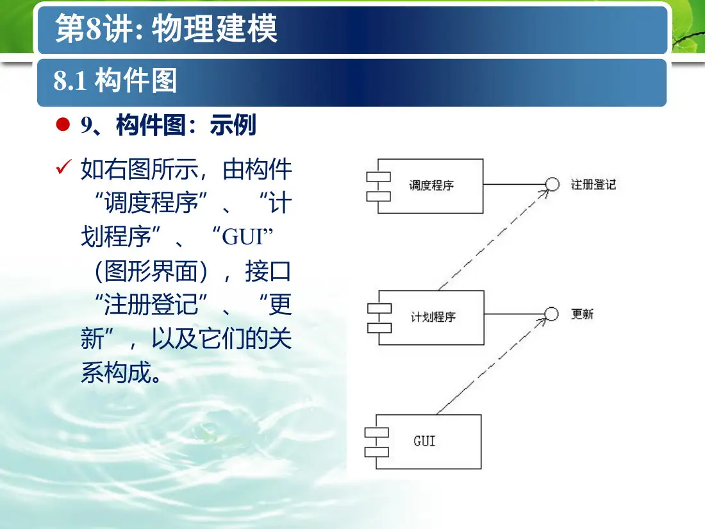

原文：

第8讲: 物理建模

8.1 构件图

9、构件图：示例

√ 如右图所示，由构件“调度程序”、“计划程序”、“GUI”（图形界面），接口“注册登记”、“更新”，以及它们的关系构成。

### 第8讲: 物理建模

原文：

第8讲: 物理建模

8.1 构件图

9、构件图：应用

一个可执行系统的构件图的建立步骤

☐ （1）确定构件。

(2) 对构件加上必要的构造型。如标准构造型
<<executable>>、<<library>>、<<table>>、<<file>>、
<<document>>，或自定义新的构造型。

(3) 确定构件之间的关系。最常见的构件之间的关系是通过接口依赖。一个构件使用（输入）某个接口，另一个构件实现（输出）该接口。

☐ （4）必要时把构件组织成包。

☐ （5）绘制构件图。

### 第8讲: 物理建模

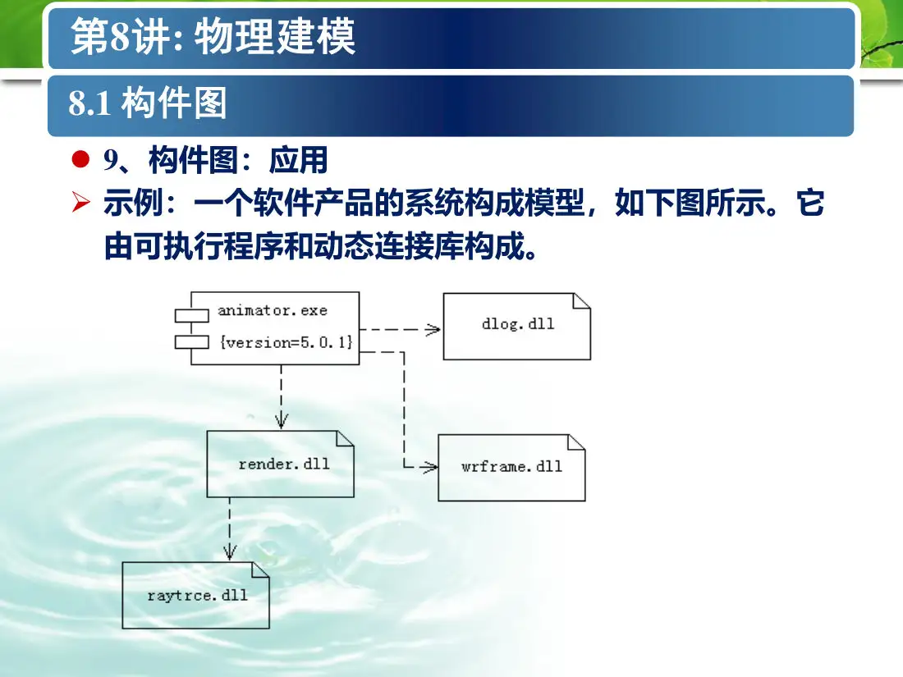

原文：

第8讲: 物理建模

8.1 构件图

9、构件图：应用

示例：一个软件产品的系统构成模型，如下图所示。它由可执行程序和动态连接库构成。

### 第8讲: 物理建模

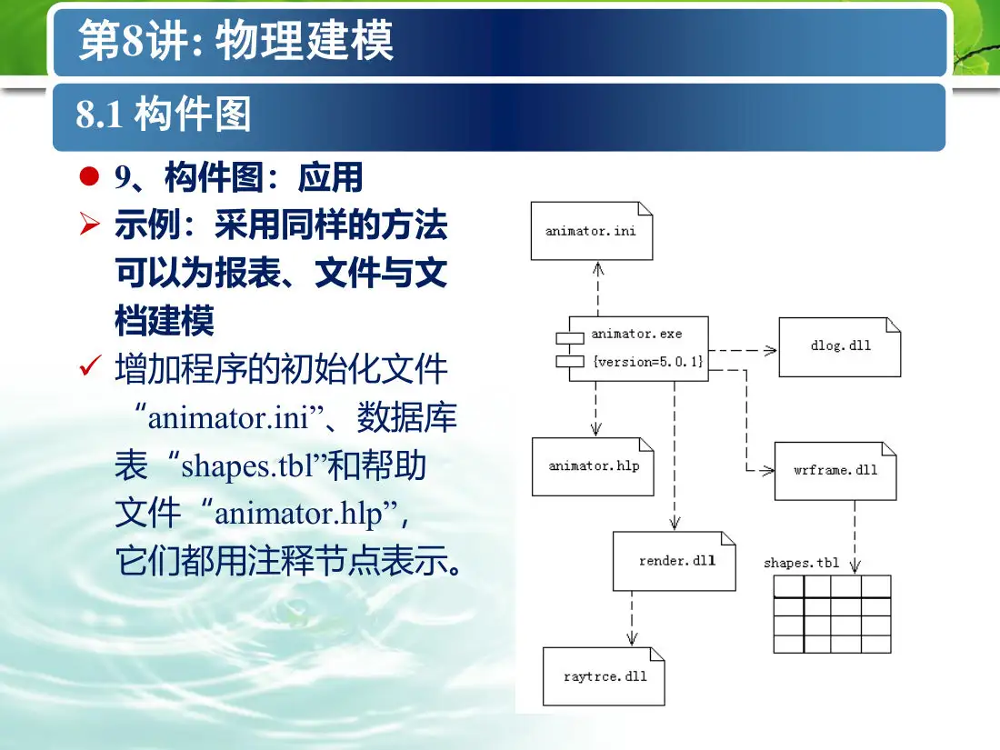

原文：

第8讲: 物理建模

8.1 构件图

9、构件图：应用

示例：采用同样的方法可以为报表、文件与文档建模

√ 增加程序的初始化文件 “animator.ini”、数据库表 “shapes.tbl”和帮助文件 “animator.hlp”，它们都用注释节点表示。

### 第8讲: 物理建模

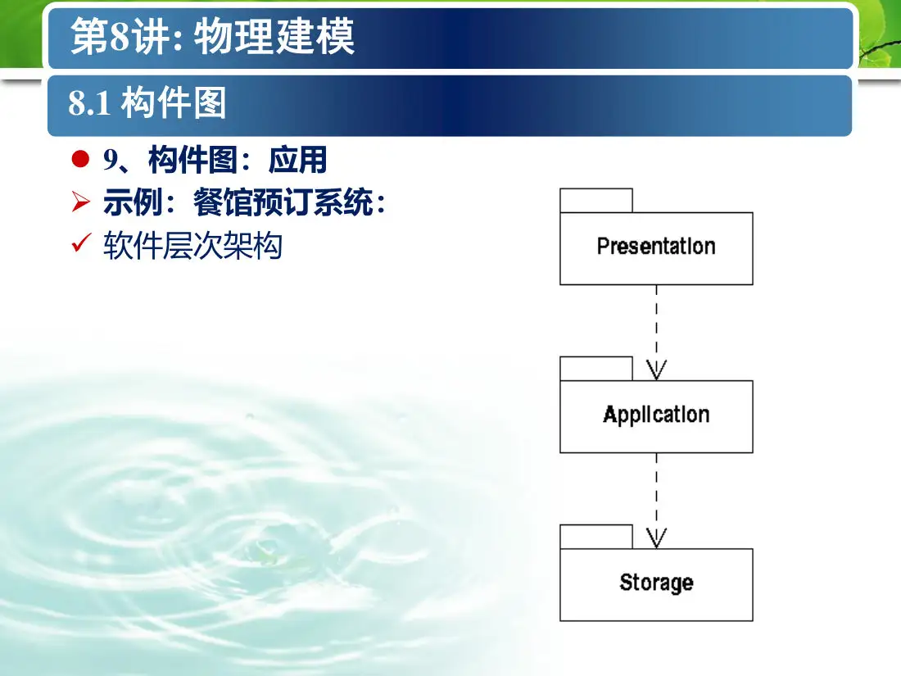

原文：

第8讲: 物理建模

8.1 构件图

9、构件图：应用

示例：餐馆预订系统：

√ 软件层次架构

### 第8讲: 物理建模

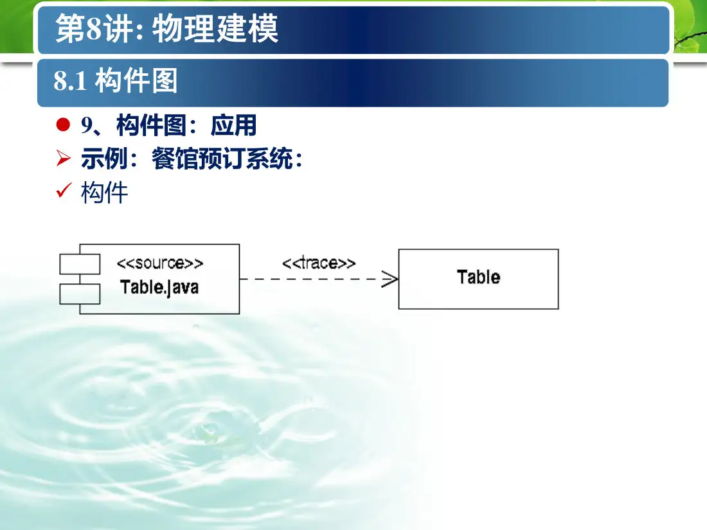

原文：

第8讲: 物理建模

8.1 构件图

9、构件图：应用

示例：餐馆预订系统：

√ 构件

### 第8讲: 物理建模

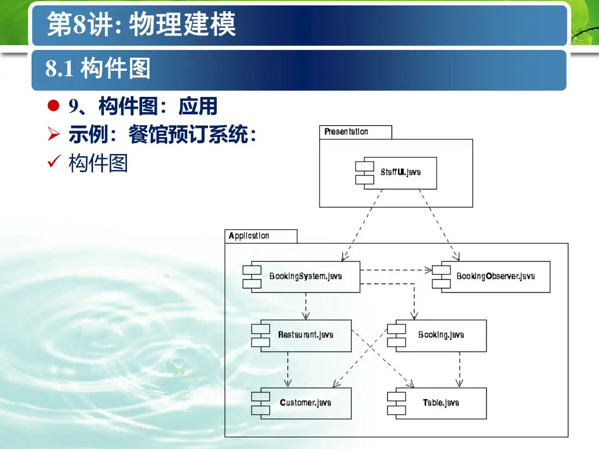

原文：

第8讲: 物理建模

8.1 构件图

9、构件图：应用

示例：餐馆预订系统：

√ 构件图

### 第8讲: 物理建模

原文：

第8讲: 物理建模

8.1 构件图

10、UML 2.0 构件图

UML 2.0 构件：图标

<<component>>
image.java

√ 在UML 2.0中，构件代表系统的一个模块化部分，可以是指逻辑的，也可以是指物理的。

√ 按照基于UML 2.0构件的开发方法，一个系统可以看作是由若干个构件通过接口连接而成的。

□构件通过供给接口和需要接口定义其行为。

□在构件中，供给接口和需要接口可以组织成端口，它们常在运行时被访问。

### 第8讲: 物理建模

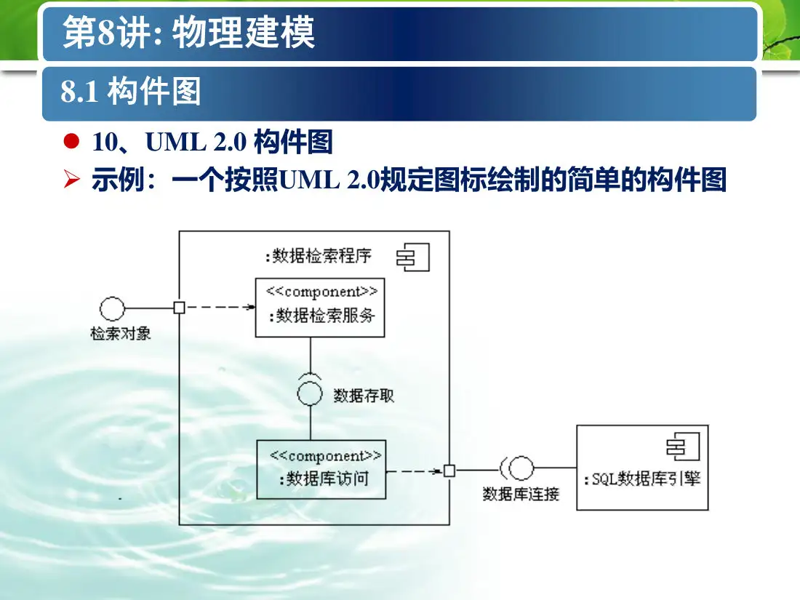

原文：

第8讲: 物理建模

8.1 构件图

10、UML 2.0 构件图

示例：一个按照UML 2.0规定图标绘制的简单的构件图

### 第8讲: 物理图（Physical Diagram）

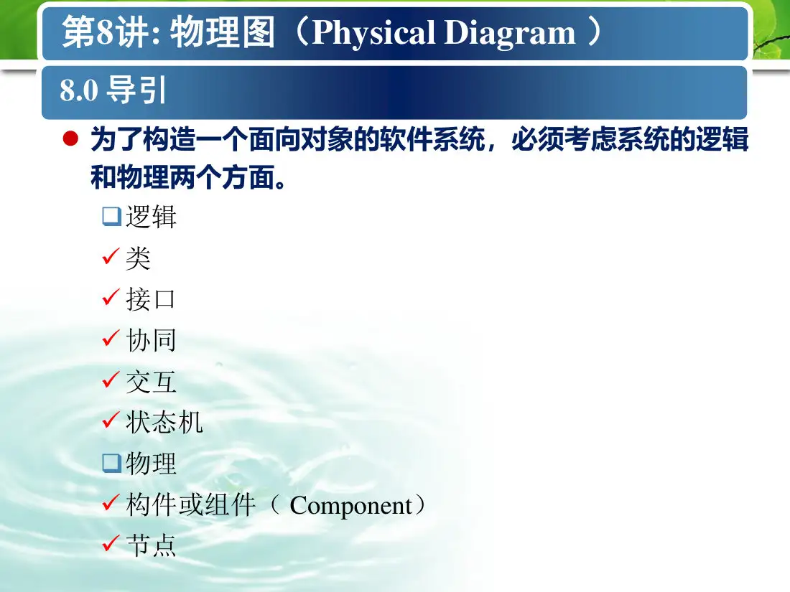

原文：

第8讲: 物理图（Physical Diagram）

8.0 导引

\- 为了构造一个面向对象的软件系统，必须考虑系统的逻辑和物理两个方面。

逻辑

√类

√ 接口

√ 协同

√ 交互

√ 状态机

物理

√ 构件或组件（Component）

√ 节点

### 第8讲: 物理图（Physical Diagram）

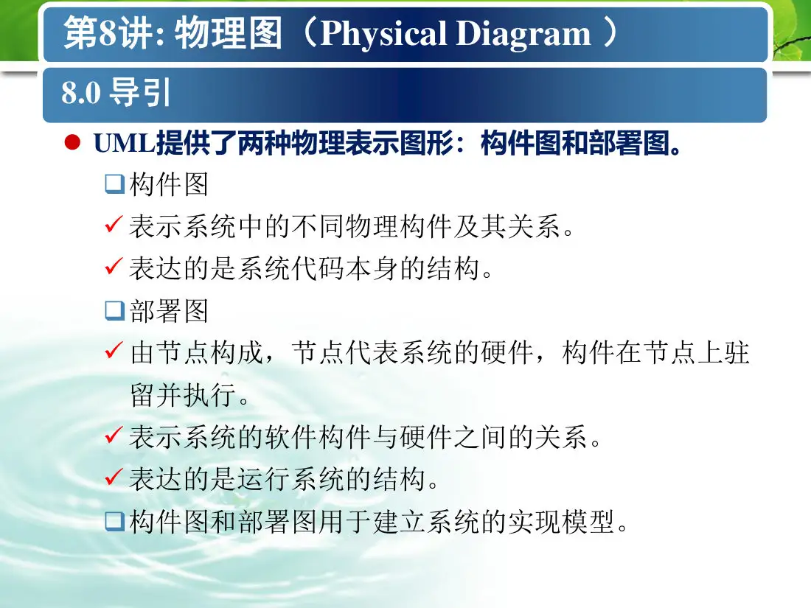

原文：

第8讲: 物理图（Physical Diagram）

8.0 导引

UML提供了两种物理表示图形：构件图和部署图。

□构件图

√ 表示系统中的不同物理构件及其关系。

√ 表达的是系统代码本身的结构。

部署图

√ 由节点构成，节点代表系统的硬件，构件在节点上驻留并执行。

√ 表示系统的软件构件与硬件之间的关系。

√ 表达的是运行系统的结构。

□构件图和部署图用于建立系统的实现模型。

### 第8讲: 物理建模

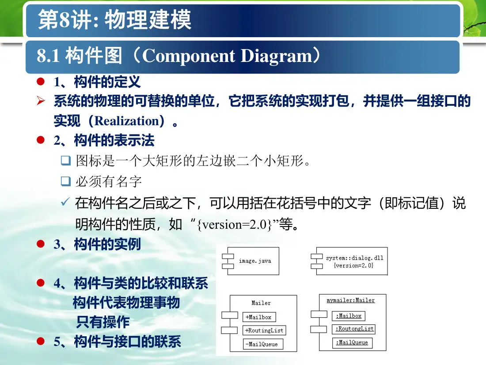

原文：

第8讲: 物理建模

8.1 构件图（Component Diagram）

1、构件的定义

系统的物理的可替换的单位，它把系统的实现打包，并提供一组接口的实现（Realization）。

2、构件的表示法

☐ 图标是一个大矩形的左边嵌二个小矩形。

必须有名字

√ 在构件名之后或之下，可以用括在花括号中的文字（即标记值）说明构件的性质，如“{version=2.0}”等。

3、构件的实例

4、构件与类的比较和联系
构件代表物理事物
只有操作

5、构件与接口的联系

### 第8讲: 物理建模

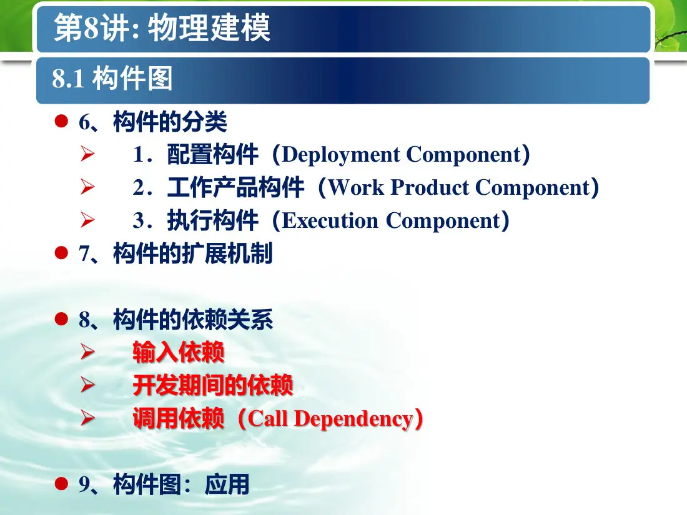

原文：

第8讲: 物理建模

8.1 构件图

6、构件的分类

1. 配置构件 (Deployment Component)

2. 工作产品构件 (Work Product Component)

3. 执行构件 (Execution Component)

7、构件的扩展机制

8、构件的依赖关系

输入依赖

开发期间的依赖

调用依赖（Call Dependency）

9、构件图：应用

### 第8讲: 物理建模

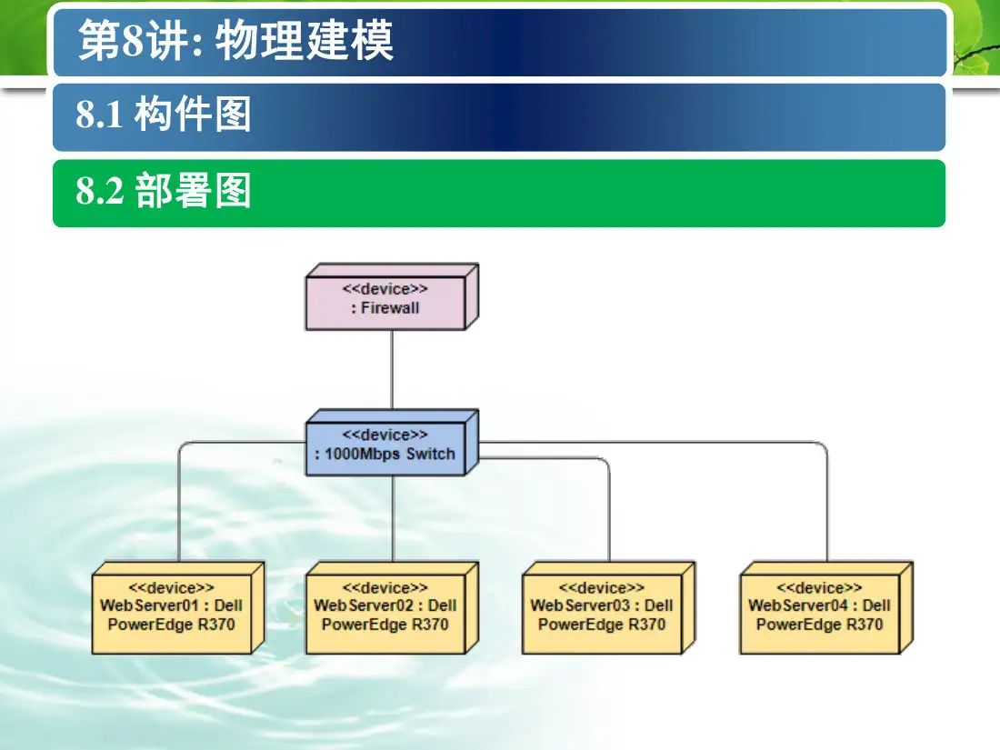

原文：

第8讲: 物理建模

8.1 构件图

8.2 部署图

### 第8讲: 物理建模

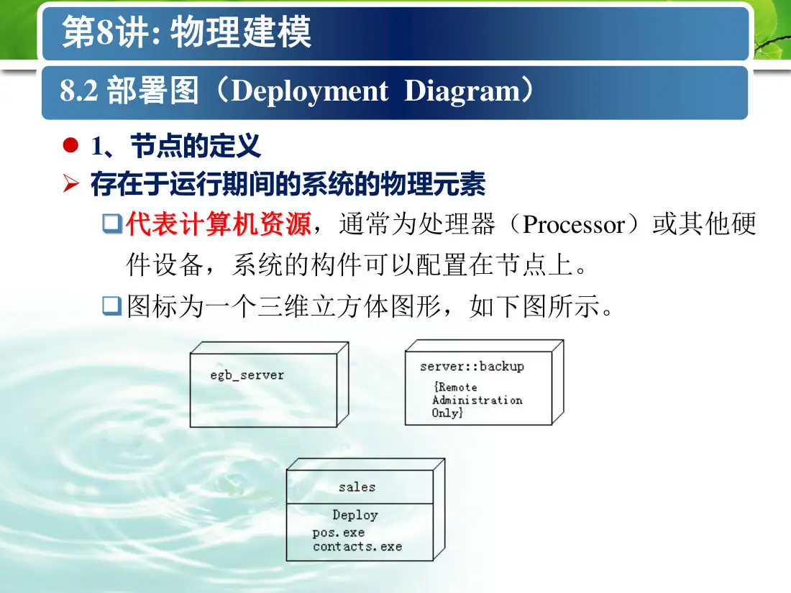

原文：

第8讲: 物理建模

8.2 部署图（Deployment Diagram）

1、节点的定义

存在于运行期间的系统的物理元素

□代表计算机资源，通常为处理器（Processor）或其他硬件设备，系统的构件可以配置在节点上。

☐ 图标为一个三维立方体图形，如下图所示。

### 第8讲: 物理建模

原文：

第8讲: 物理建模

8.2 部署图

1、节点的定义

存在于运行期间的系统的物理元素

√ 节点必须有名字，可以是一个简单名，或用路径名。

√ 与类一样，节点可以用标记值说明名字的性质。

√ 与类一样，节点可以区分为型和实例，型代表计算资源的不同类型，实例代表特定的具体的计算机资源。

√ 对象和构件实例可以驻留在节点实例上，而且可以从一个节点向另一个节点迁移。

√ 节点执行构件，构件是被节点执行的事物。

√ 一个节点可以与其它的节点、构件、对象有关联。

√ 节点和类、协同、构件等模型元素一样可以组织成包。

### 第8讲: 物理建模

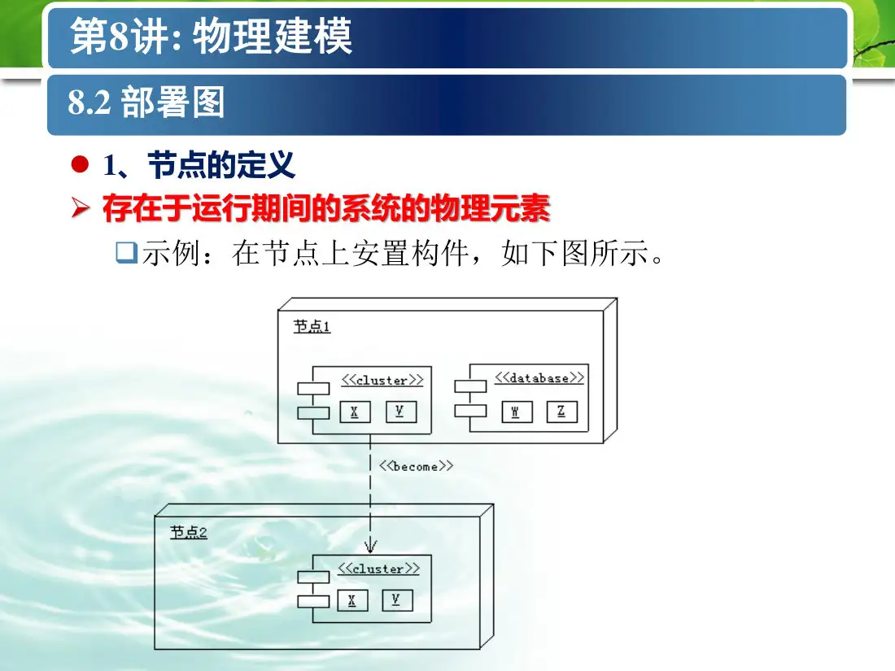

原文：

第8讲: 物理建模

8.2 部署图

1、节点的定义

存在于运行期间的系统的物理元素

☐示例：在节点上安置构件，如下图所示。

### 第8讲: 物理建模

原文：

第8讲: 物理建模

8.2 部署图

2、节点的关系

节点与节点通过物理连接（Connection）形成关系

√ 物理连接如以太网络、共享总线等，从硬件方面保证了系统的节点协同运行。

√ 节点与节点、节点与构件之间存在着多种类型的关系。

### 第8讲: 物理建模

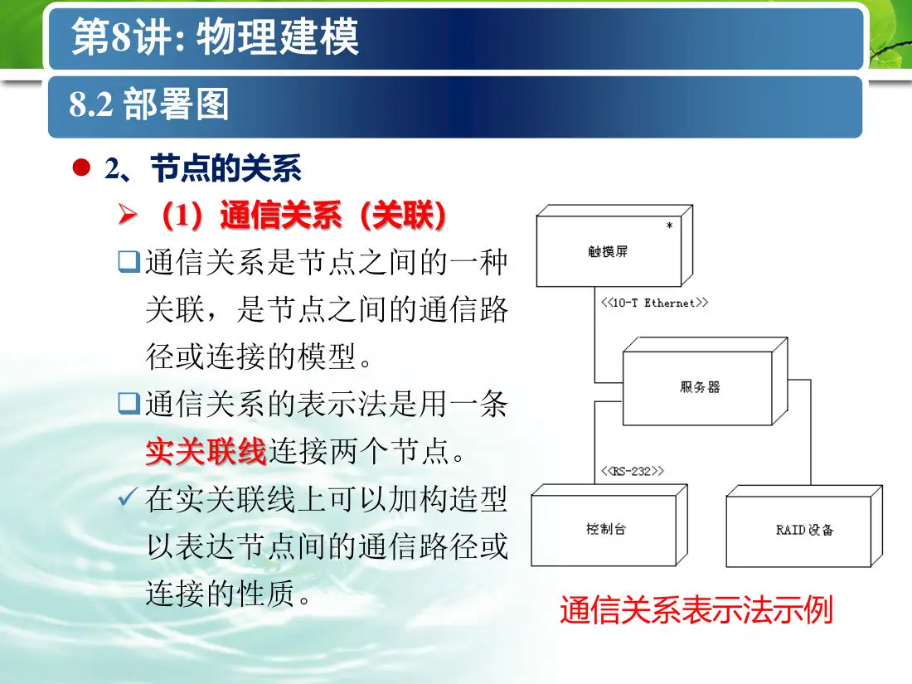

原文：

第8讲: 物理建模

8.2 部署图

2、节点的关系

(1) 通信关系 (关联)

☐ 通信关系是节点之间的一种关联，是节点之间的通信路径或连接的模型。

☐通信关系的表示法是用一条实关联线连接两个节点。

√ 在实关联线上可以加构造型以表达节点间的通信路径或连接的性质。

通信关系表示法示例

### 第8讲: 物理建模

原文：

第8讲: 物理建模

8.2 部署图

2、节点的关系

(2) 成为关系

□成为关系是构件与构件、构件与对象、对象与对象之间的依赖关系。

√ 成为关系不是节点之间的关系，但是它是构件或对象在节点之间的迁移的模型。

□成为关系说明源对象（或构件）和目标对象（或构件）是在不同时间点的同一个对象（或构件），而且它们的状态和角色不同。

□成为关系可以用标记值“{time=...}”说明其时间性质，即构件或对象在什么时间发生迁移活动。

### 第8讲: 物理建模

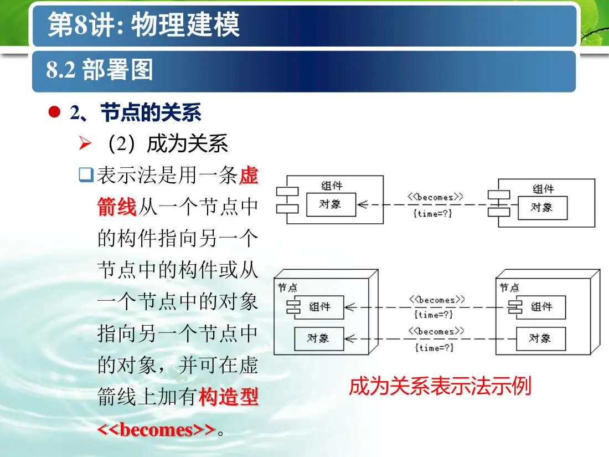

原文：

第8讲: 物理建模

8.2 部署图

2、节点的关系

(2) 成为关系

□表示法是用一条虚箭线从一个节点中的构件指向另一个节点中的构件或从一个节点中的对象指向另一个节点中的对象，并可在虚箭线上加有构造型<<becomes>>。

成为关系表示法示例

### 第8讲: 物理建模

原文：

第8讲: 物理建模

8.2 部署图

3、部署图的定义

由节点与节点之间的关系构成，包括构件之间、节点与构件之间、构件与构件之间的关系。

□表示分布式系统的软件构件与硬件之间的关系，它表达的是运行系统的结构。

☐ 主要用于对在网络环境运行的分布式系统建立系统物理模型，或者对嵌入式系统建模。

□可以用于建立业务模型，此时的“运行系统”就是业务的组织机构和资源（人力、设备等）。

### 第8讲: 物理建模

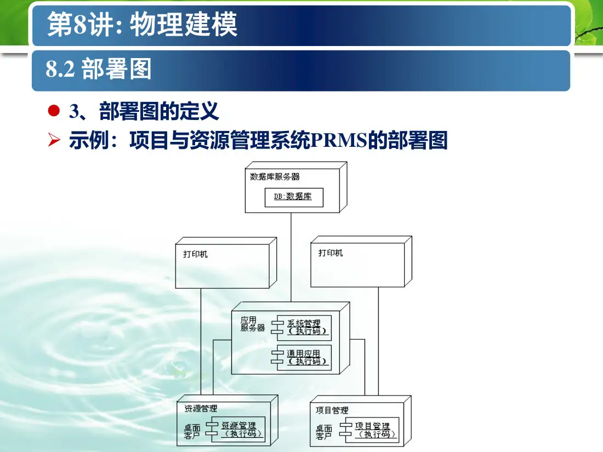

原文：

第8讲: 物理建模

8.2 部署图

3、部署图的定义

示例：项目与资源管理系统PRMS的部署图

### 第8讲: 物理建模

原文：

第8讲: 物理建模

8.2 部署图

4、部署图的应用

建立一个客户机/服务器系统或Web应用系统的部署图一般可按以下步骤进行：

(1) 确定节点。

☐ （2）对节点加上必要的构造型。

(3) 确定关系。

√ 把系统的构件如可执行程序、动态连接库等分配到节点上，并确定节点与节点之间、节点与构件之间、构件与构件之间的关系，以及它们的性质。

(4) 绘制部署图。

### 第8讲: 物理建模

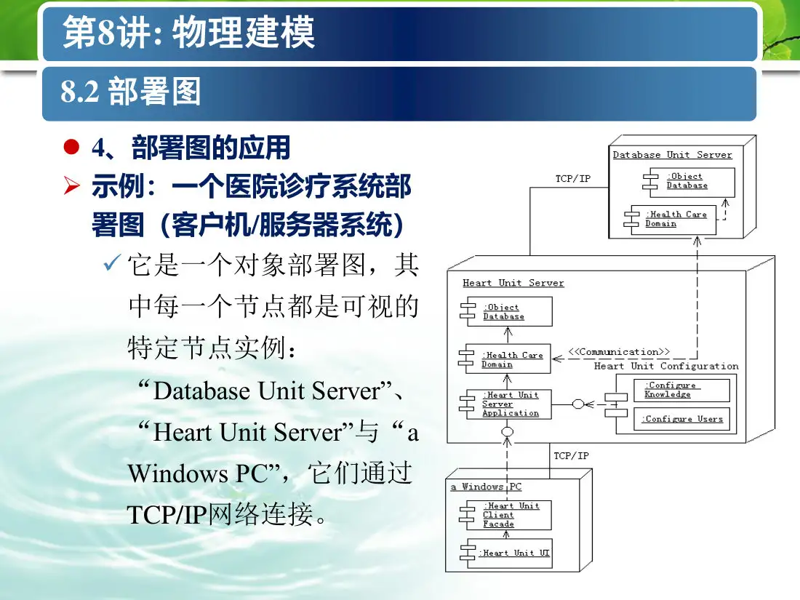

原文：

第8讲: 物理建模

8.2 部署图

4、部署图的应用

示例：一个医院诊疗系统部署图（客户机/服务器系统）

√ 它是一个对象部署图，其中每一个节点都是可视的特定节点实例：

“Database Unit Server”、“Heart Unit Server”与“a Windows PC”，它们通过TCP/IP网络连接。

### 第8讲: 物理建模

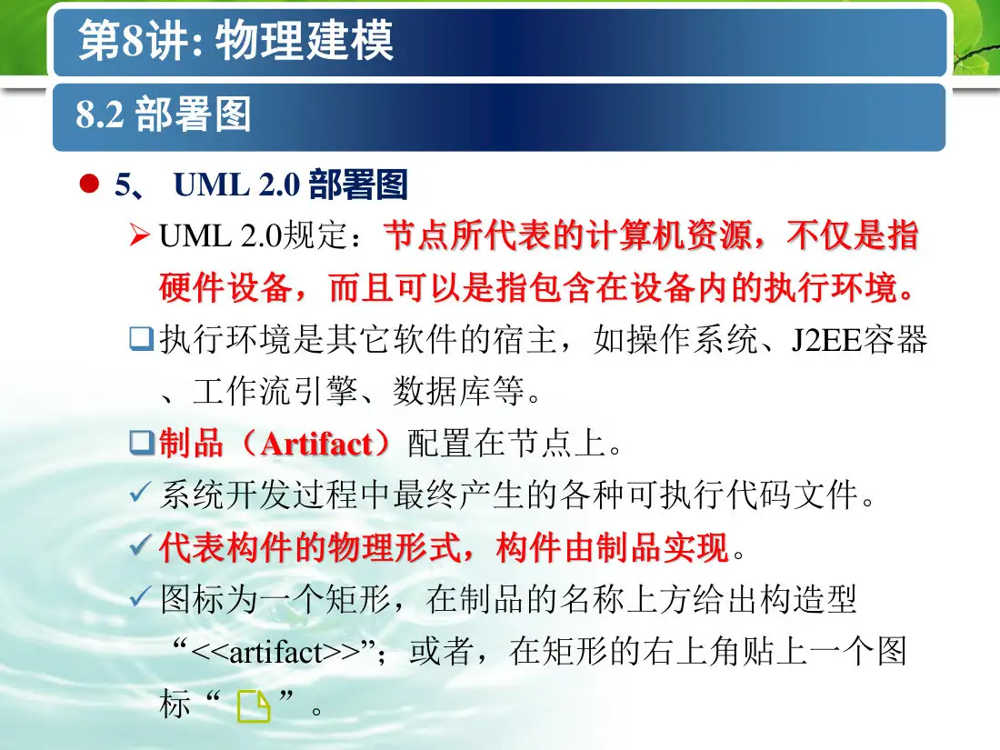

原文：

第8讲: 物理建模

8.2 部署图

5、UML 2.0 部署图

UML 2.0规定：节点所代表的计算机资源，不仅是指硬件设备，而且可以是指包含在设备内的执行环境。

□执行环境是其它软件的宿主，如操作系统、J2EE容器、工作流引擎、数据库等。

☐制品（Artifact）配置在节点上。

√ 系统开发过程中最终产生的各种可执行代码文件。

√ 代表构件的物理形式，构件由制品实现。

√ 图标为一个矩形，在制品的名称上方给出构造型“<<artifact>>”；或者，在矩形的右上角贴上一个图标“☐”。

### 第8讲: 物理建模

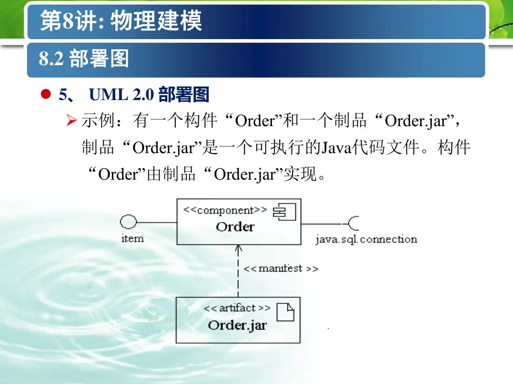

原文：

第8讲: 物理建模

8.2 部署图

5、UML 2.0 部署图

示例：有一个构件 “Order” 和一个制品 “Order.jar”，制品 “Order.jar” 是一个可执行的 Java 代码文件。构件 “Order” 由制品 “Order.jar” 实现。

### 第8讲: 物理建模

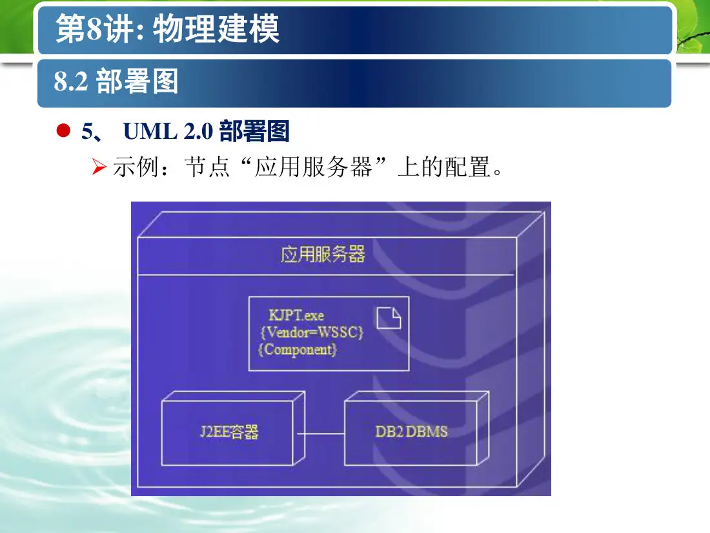

原文：

第8讲: 物理建模

8.2 部署图

5、UML 2.0 部署图

示例：节点“应用服务器”上的配置。

### 第8讲: 物理建模

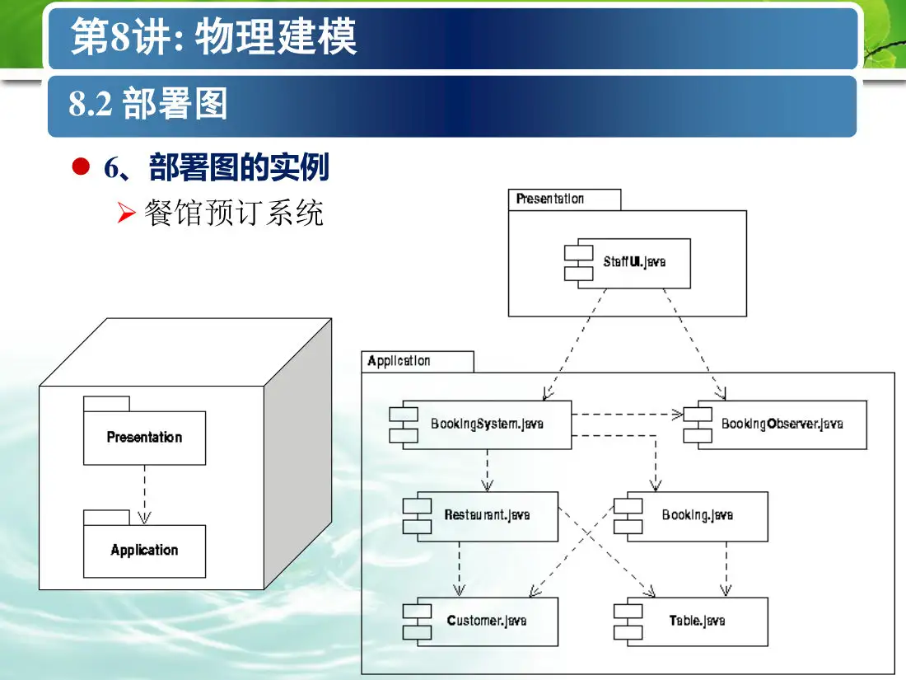

原文：

第8讲: 物理建模

8.2 部署图

6、部署图的实例

餐馆预订系统

### 第8讲: 物理建模

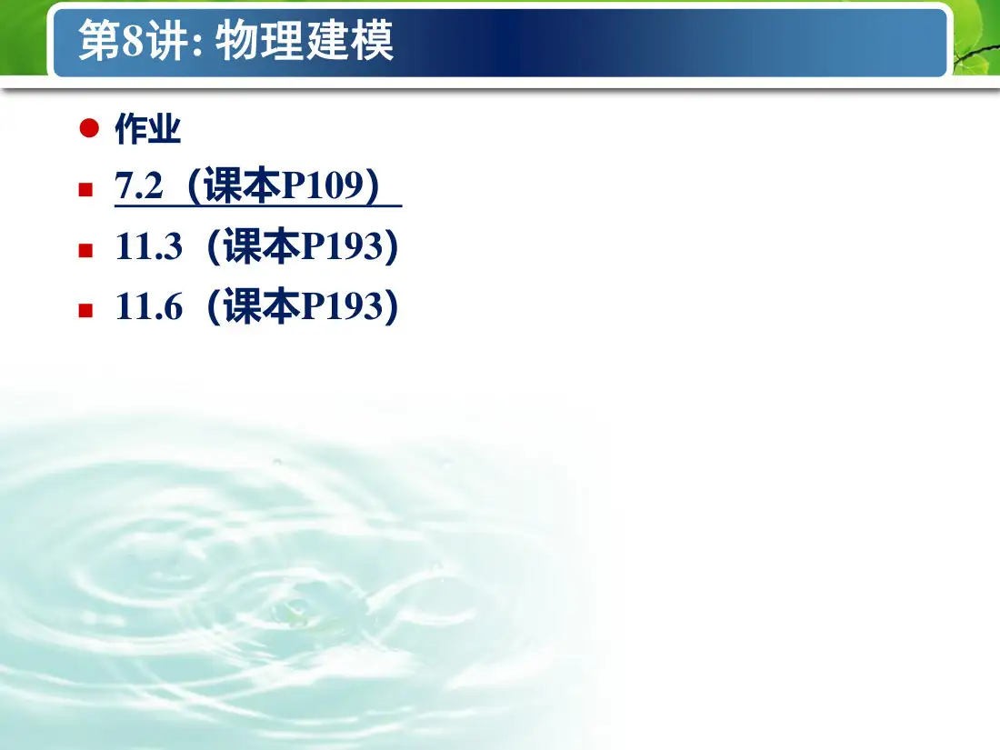

原文：

第8讲: 物理建模

作业

7.2 (课本P109)

■ 11.3 (课本P193)

■ 11.6 (课本P193)
