# 《软件建模与设计》第9讲 约束（Constraint）（课件）

原件的每一页，下面附识别出的文字。

### 软件建模与设计

原文：

软件建模与设计

授课班级：B220417-19，B220400

授课安排：QQ群、超星学习通，课堂

授课时间：周二第8-9节{第1-16周}

金惠颖

### 第9讲:约束（Constraint）

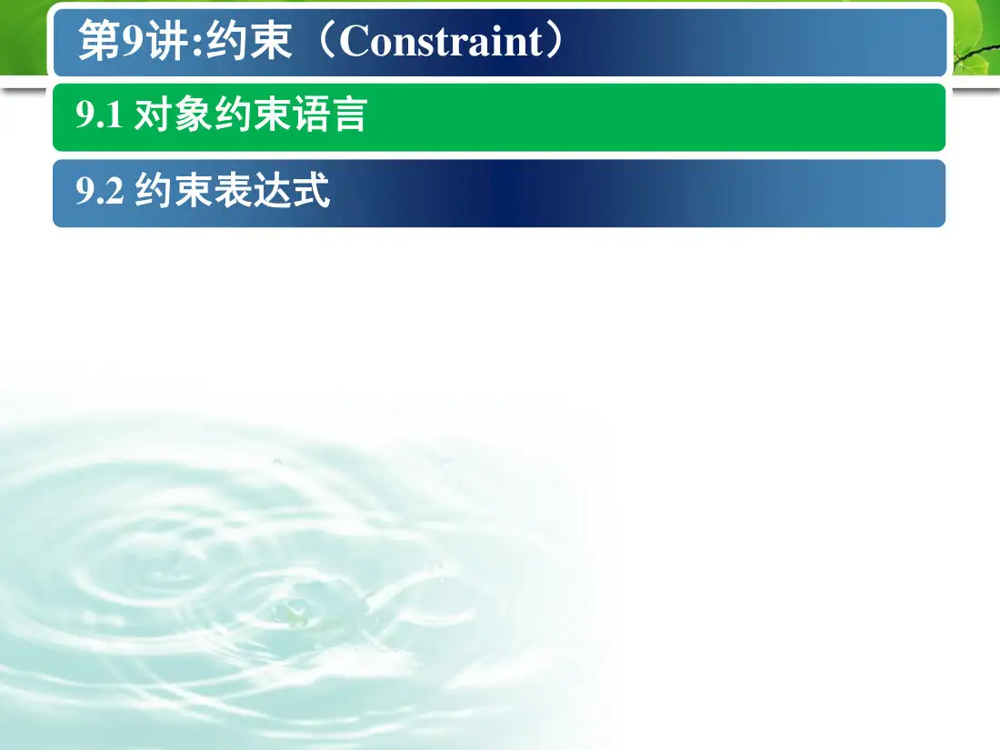

原文：

第9讲:约束（Constraint）

9.1 对象约束语言

9.2 约束表达式

### 第9讲:约束（Constraint）

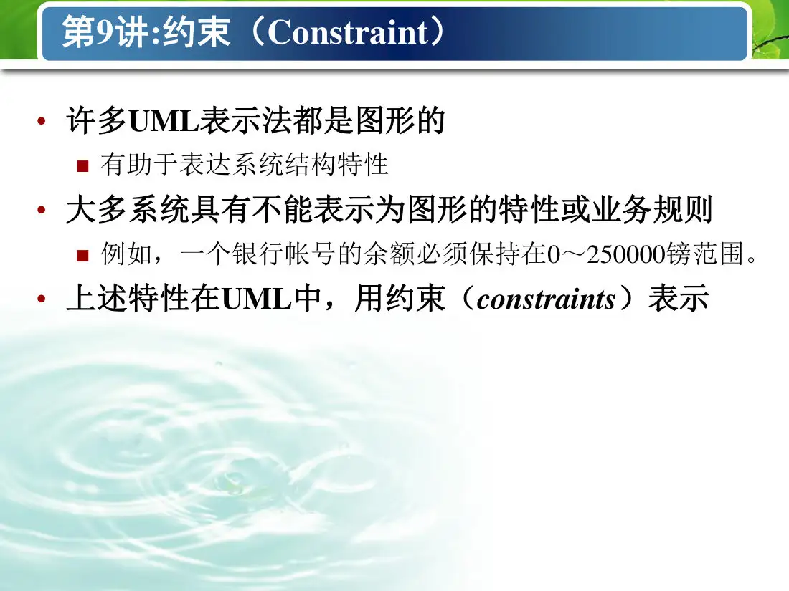

原文：

第9讲:约束（Constraint）

\- 许多UML表示法都是图形的

■ 有助于表达系统结构特性

\- 大多系统具有不能表示为图形的特性或业务规则

■ 例如，一个银行帐号的余额必须保持在0～250000镑范围。

\- 上述特性在UML中，用约束（constraints）表示

### 第9讲:约束（Constraint）

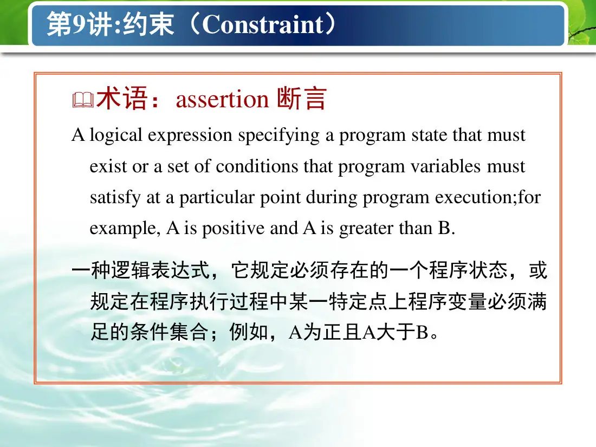

原文：

第9讲:约束（Constraint）

术语：assertion 断言

A logical expression specifying a program state that must exist or a set of conditions that program variables must satisfy at a particular point during program execution; for example, A is positive and A is greater than B.

一种逻辑表达式，它规定必须存在的一个程序状态，或规定在程序执行过程中某一特定点上程序变量必须满足的条件集合；例如，A为正且A大于B。

### 第9讲:约束（Constraint）

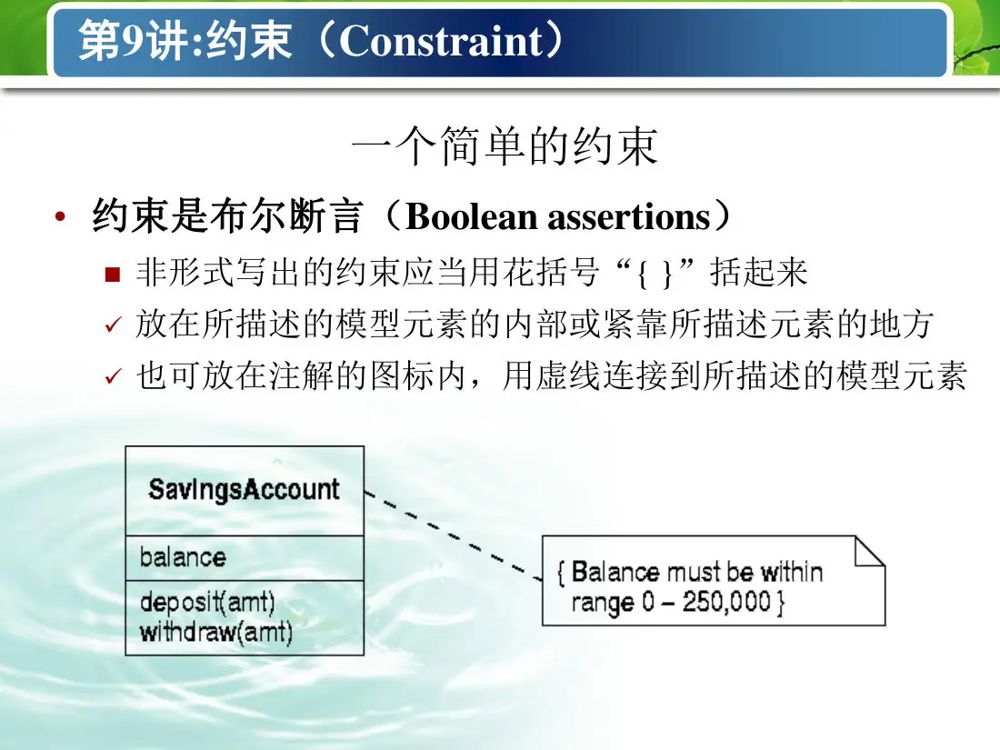

原文：

第9讲:约束（Constraint）

一个简单的约束

- 约束是布尔断言（Boolean assertions）

■ 非形式写出的约束应当用花括号“{}”括起来

√ 放在所描述的模型元素的内部或紧靠所描述元素的地方

√ 也可放在注解的图标内，用虚线连接到所描述的模型元素

### 第9讲:约束（Constraint）

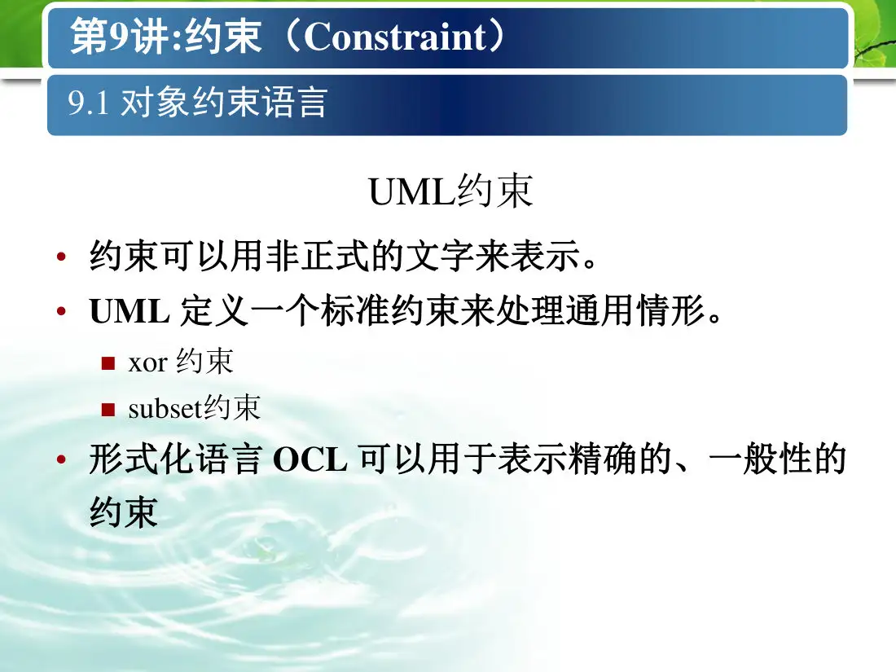

原文：

第9讲:约束（Constraint）

9.1 对象约束语言

UML约束

\- 约束可以用非正式的文字来表示。

\- UML 定义一个标准约束来处理通用情形。

xor 约束

\- subset约束

\- 形式化语言OCL可以用于表示精确的、一般性的约束

### 第9讲:约束（Constraint）

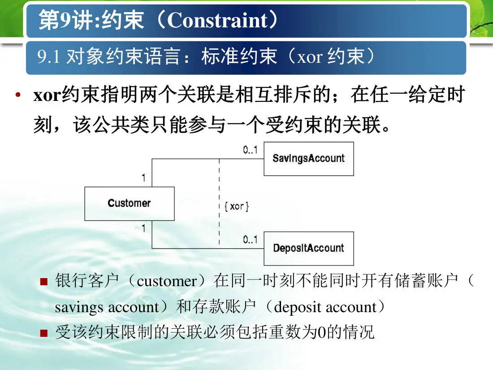

原文：

第9讲:约束（Constraint）

9.1 对象约束语言：标准约束（xor 约束）

\- xor约束指明两个关联是相互排斥的；在任一给定时刻，该公共类只能参与一个受约束的关联。

■ 银行客户（customer）在同一时刻不能同时开有储蓄账户（savings account）和存款账户（deposit account）

■ 受该约束限制的关联必须包括重数为0的情况

### 第9讲:约束（Constraint）

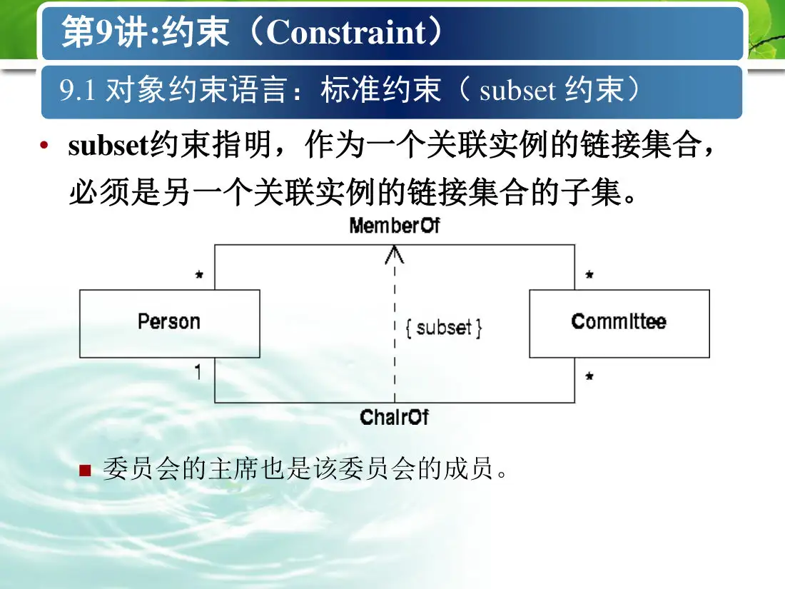

原文：

第9讲:约束（Constraint）

9.1 对象约束语言：标准约束（subset 约束）

\- subset约束指明，作为一个关联实例的链接集合，必须是另一个关联实例的链接集合的子集。

■ 委员会的主席也是该委员会的成员。

### 第9讲:约束（Constraint）

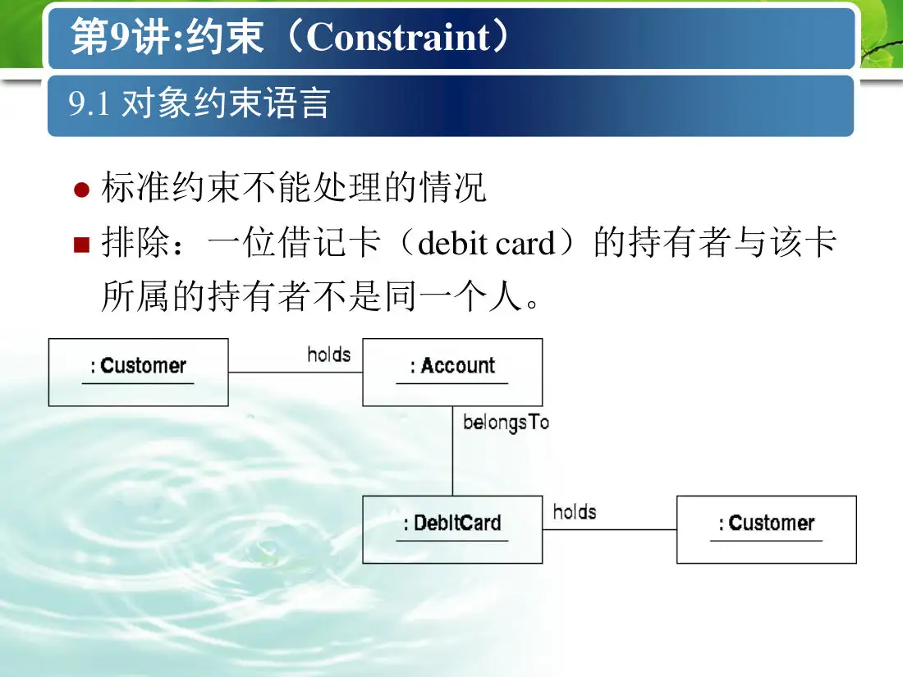

原文：

第9讲:约束（Constraint）

9.1 对象约束语言

\- 标准约束不能处理的情况

■ 排除：一位借记卡（debit card）的持有者与该卡所属的持有者不是同一个人。

### 第9讲:约束（Constraint）

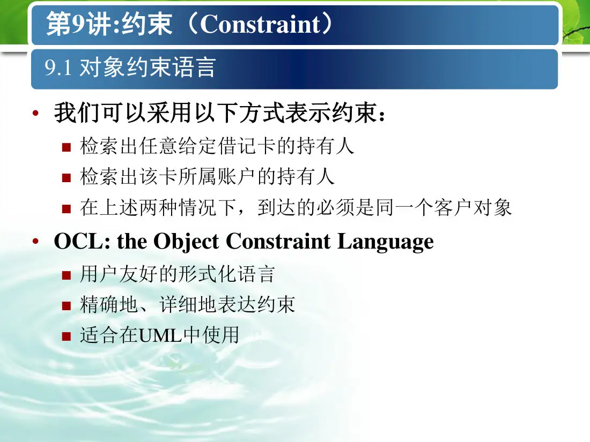

原文：

第9讲:约束（Constraint）

9.1 对象约束语言

- 我们可以采用以下方式表示约束:

■ 检索出任意给定借记卡的持有人

■ 检索出该卡所属账户的持有人

■ 在上述两种情况下，到达的必须是同一个客户对象

• OCL: the Object Constraint Language

■ 用户友好的形式化语言

■ 精确地、详细地表达约束

■ 适合在UML中使用

### 第9讲:约束（Constraint）

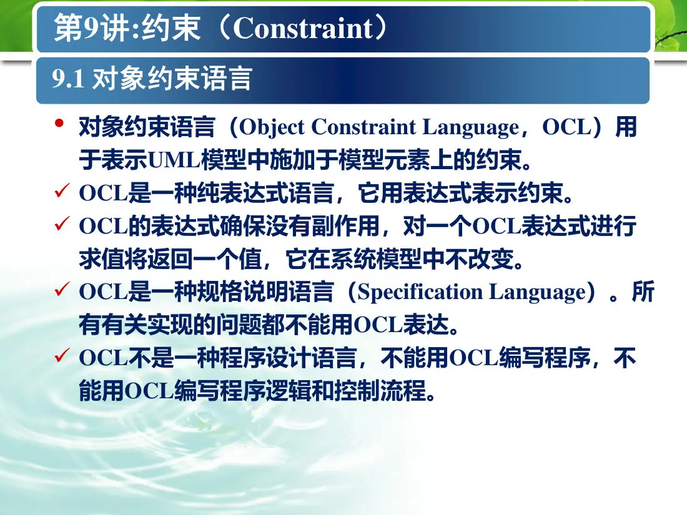

原文：

第9讲:约束（Constraint）

9.1 对象约束语言

\- 对象约束语言（Object Constraint Language，OCL）用于表示UML模型中施加于模型元素上的约束。

√ OCL是一种纯表达式语言，它用表达式表示约束。

√ OCL的表达式确保没有副作用，对一个OCL表达式进行求值将返回一个值，它在系统模型中不改变。

√ OCL是一种规格说明语言（Specification Language）。所有有关实现的问题都不能用OCL表达。

√ OCL不是一种程序设计语言，不能用OCL编写程序，不能用OCL编写程序逻辑和控制流程。

### 9.1 对象约束语言

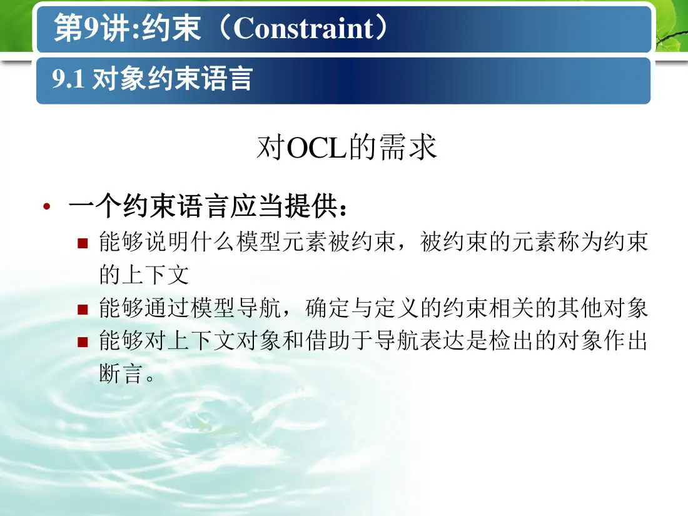

原文：

9.1 对象约束语言

对OCL的需求

- 一个约束语言应当提供:

■ 能够说明什么模型元素被约束，被约束的元素称为约束的上下文

■ 能够通过模型导航，确定与定义的约束相关的其他对象

■ 能够对上下文对象和借助于导航表达是检出的对象作出断言。

第9讲:约束（Constraint）

### 第9讲:约束（Constraint）

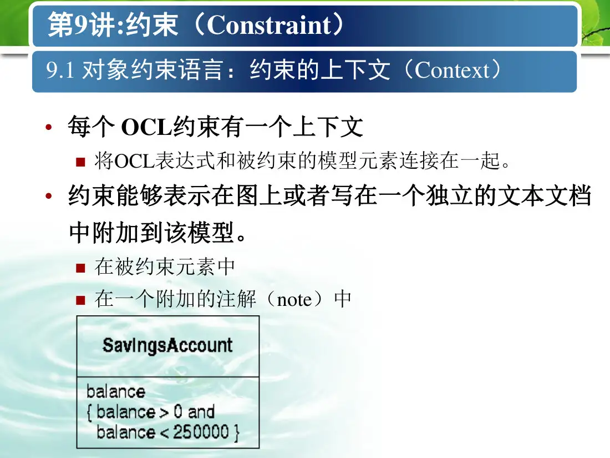

原文：

第9讲:约束（Constraint）

9.1 对象约束语言：约束的上下文（Context）

- 每个OCL约束有一个上下文

■ 将OCL表达式和被约束的模型元素连接在一起。

\- 约束能够表示在图上或者写在一个独立的文本文档中附加到该模型。

■ 在被约束元素中

■ 在一个附加的注解（note）中

### 第9讲:约束（Constraint）

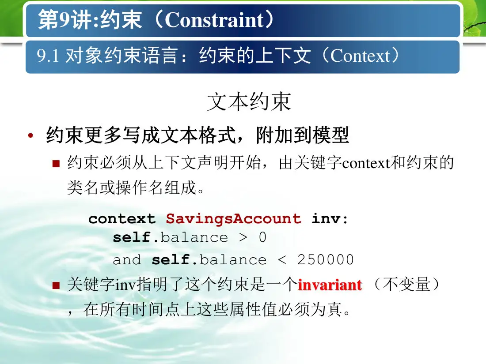

原文：

第9讲:约束（Constraint）

9.1 对象约束语言：约束的上下文（Context）

文本约束

- 约束更多写成文本格式，附加到模型

■ 约束必须从上下文声明开始，由关键字context和约束的类名或操作名组成。

context SavingsAccount inv: self.balance > 0 and self.balance < 250000

■ 关键字inv指明了这个约束是一个invariant（不变量），在所有时间点上这些属性值必须为真。

### 第9讲:约束（Constraint）

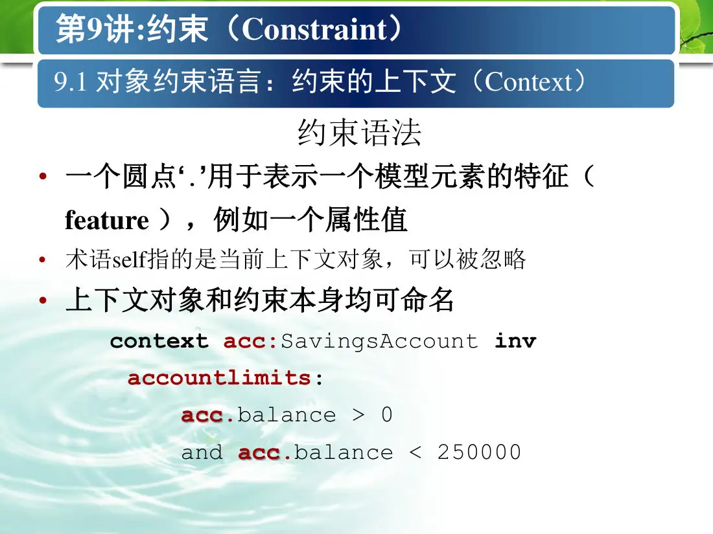

原文：

第9讲:约束（Constraint）

9.1 对象约束语言：约束的上下文（Context）

约束语法

\- 一个圆点‘.’用于表示一个模型元素的特征（feature），例如一个属性值

\- 术语self指的是当前上下文对象，可以被忽略

\- 上下文对象和约束本身均可命名

context acc: SavingsAccount inv accountlimits:

acc.balance > 0

and acc.balance < 250000

### 第9讲:约束（Constraint）

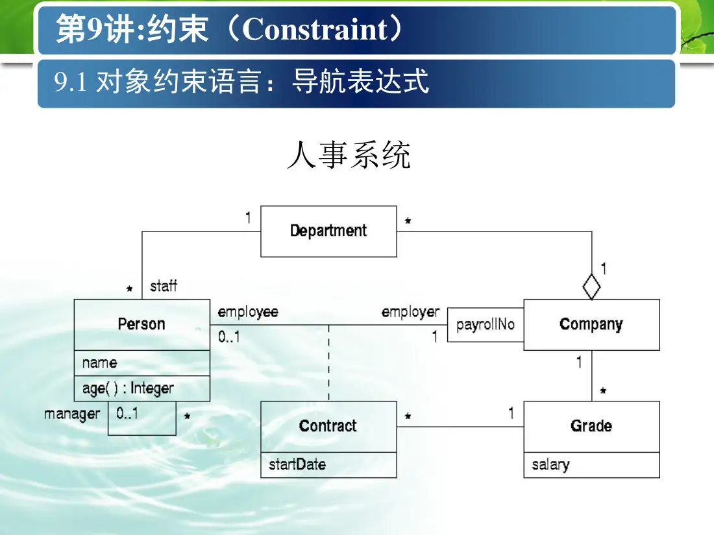

原文：

第9讲:约束（Constraint）

9.1 对象约束语言：导航表达式

人事系统

### 第9讲:约束（Constraint）

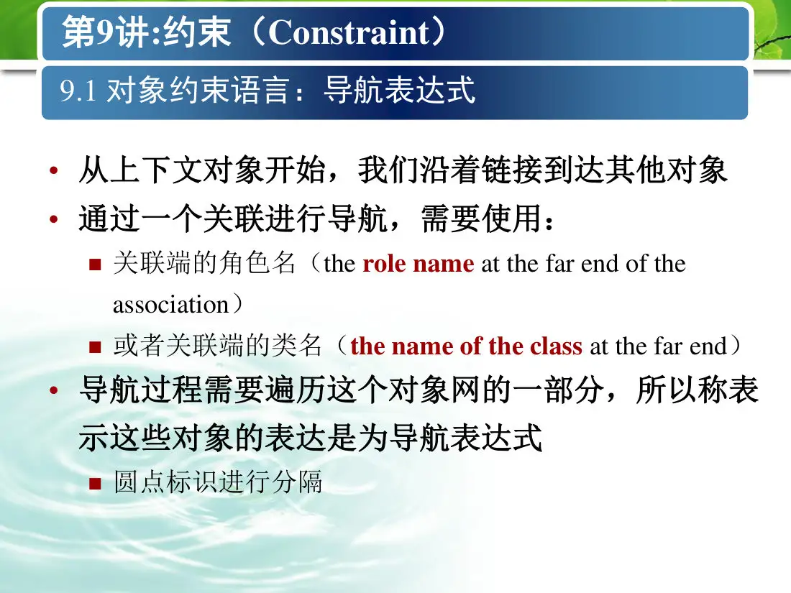

原文：

第9讲:约束（Constraint）

9.1 对象约束语言：导航表达式

\- 从上下文对象开始，我们沿着链接到达其他对象

\- 通过一个关联进行导航，需要使用：

■ 关联端的角色名（the role name at the far end of the association）

■ 或者关联端的类名（the name of the class at the far end）

\- 导航过程需要遍历这个对象网的一部分，所以称表示这些对象的表达是为导航表达式

圆点标识进行分隔

### 9.1 对象约束语言：导航表达式

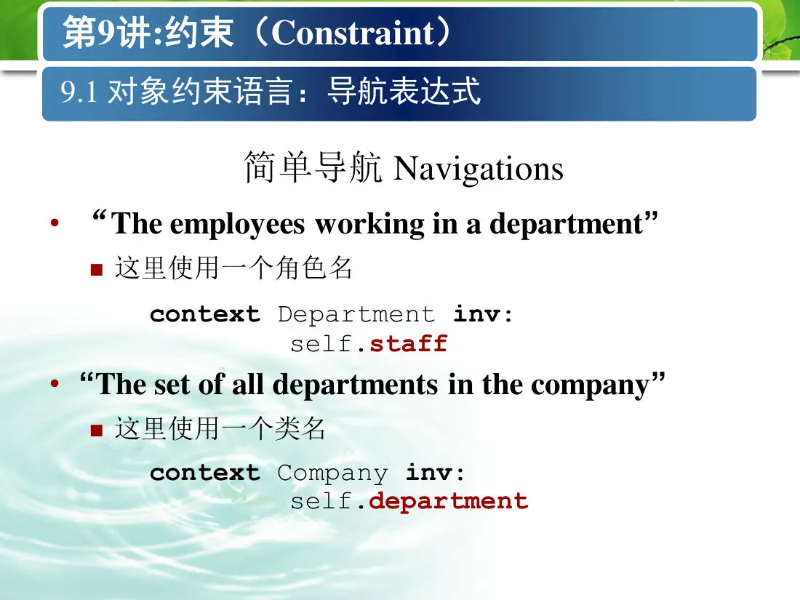

原文：

9.1 对象约束语言：导航表达式

简单导航 Navigations

• “The employees working in a department”

■ 这里使用一个角色名

context Department inv: self.staff

\- “The set of all departments in the company”

■ 这里使用一个类名

context Company inv:

self.department

第9讲:约束（Constraint）

### 第9讲:约束（Constraint）

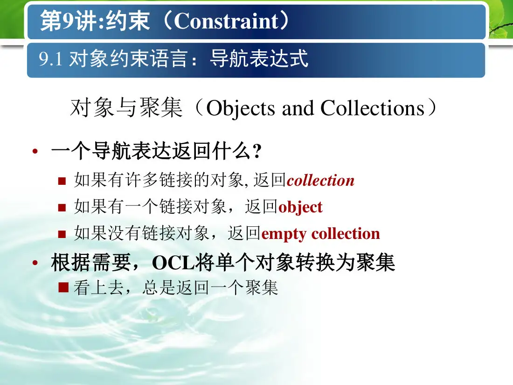

原文：

第9讲:约束（Constraint）

9.1 对象约束语言：导航表达式

对象与聚集（Objects and Collections）

- 一个导航表达返回什么？

■ 如果有许多链接的对象, 返回 collection

■ 如果有一个链接对象，返回object

■ 如果没有链接对象，返回empty collection

\- 根据需要，OCL将单个对象转换为聚集
  - 看上去，总是返回一个聚集

### 9.1 对象约束语言：导航表达式

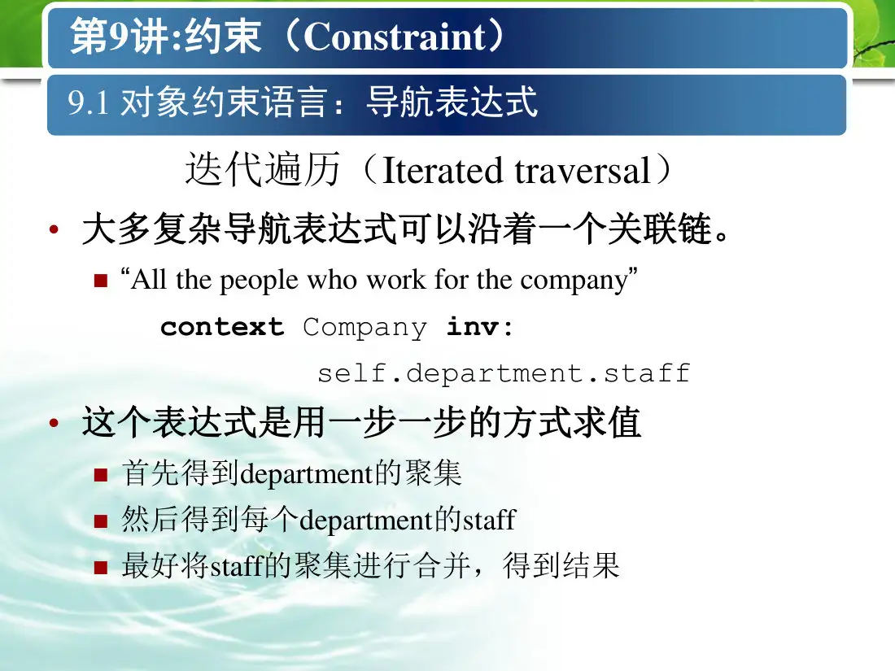

原文：

9.1 对象约束语言：导航表达式

迭代遍历（Iterated traversal）

\- 大多复杂导航表达式可以沿着一个关联链。

■ “All the people who work for the company”

context Company inv:

self.department.staff

\- 这个表达式是用一步一步的方式求值

■ 首先得到department的聚集

■ 然后得到每个department的staff

■ 最好将staff的聚集进行合并，得到结果

第9讲:约束（Constraint）

### 第9讲:约束（Constraint）

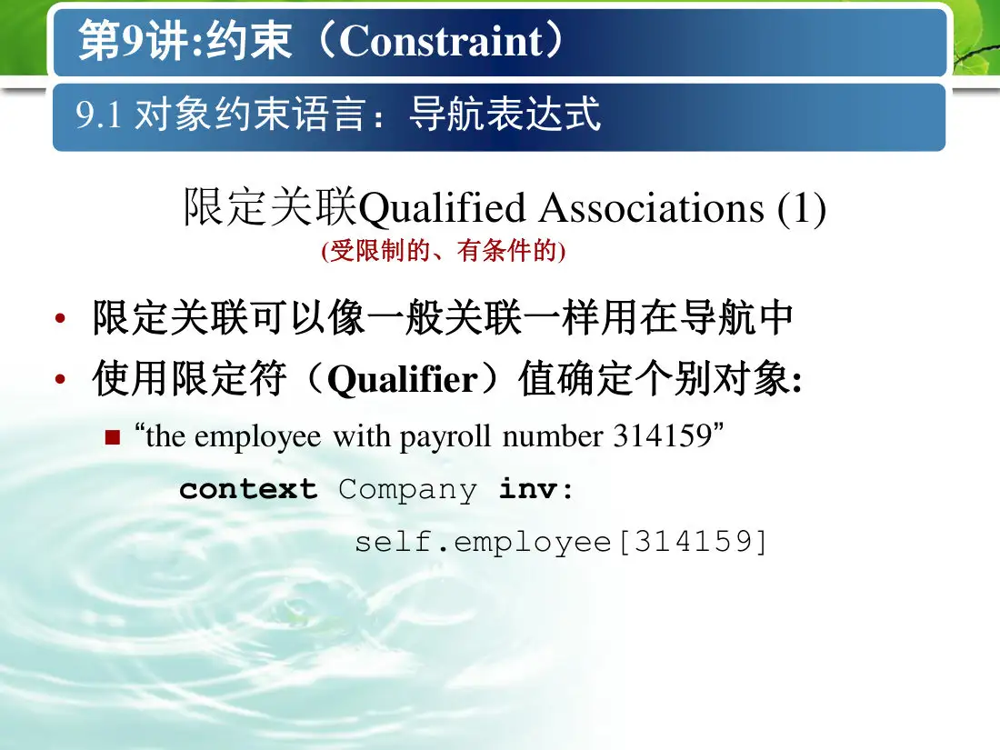

原文：

第9讲:约束（Constraint）

9.1 对象约束语言：导航表达式

限定关联Qualified Associations (1)
(受限制的、有条件的)

\- 限定关联可以像一般关联一样用在导航中

\- 使用限定符（Qualifier）值确定个别对象：

■ “the employee with payroll number 314159”

context Company inv:

self.employee[314159]

### 9.1 对象约束语言：导航表达式

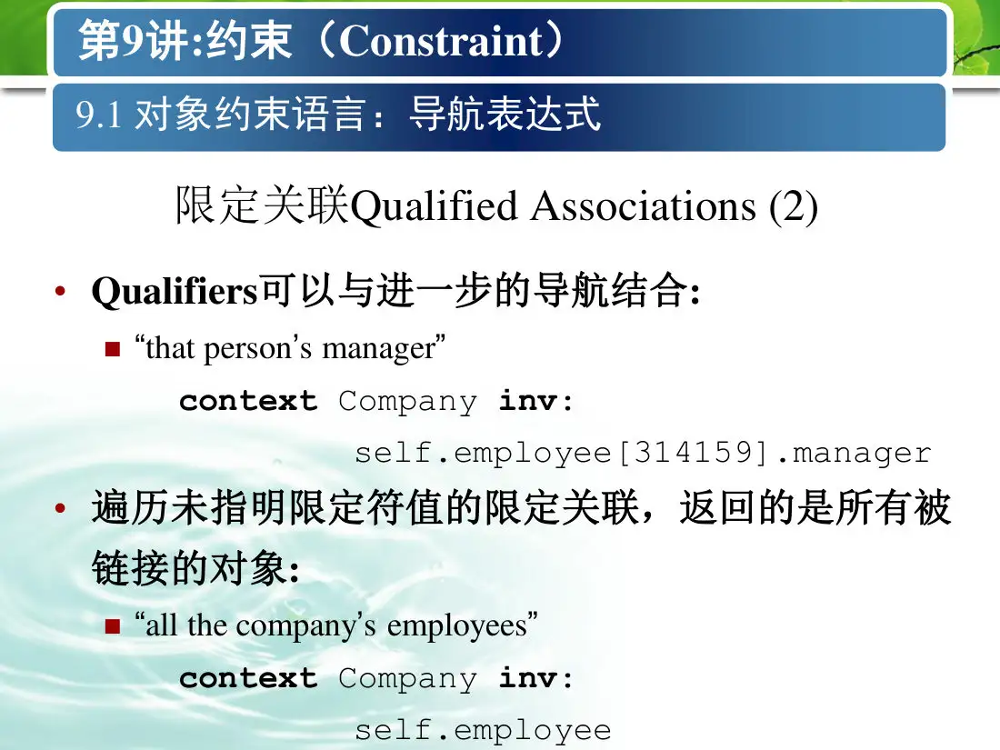

原文：

9.1 对象约束语言：导航表达式

限定关联Qualified Associations (2)

\- Qualifiers可以与进一步的导航结合:

■ “that person’s manager”

context Company inv:

self.employee[314159].manager

\- 遍历未指明限定符值的限定关联，返回的是所有被链接的对象：

context Company inv:

self.employee

第9讲:约束（Constraint）

### 9.1 对象约束语言：导航表达式

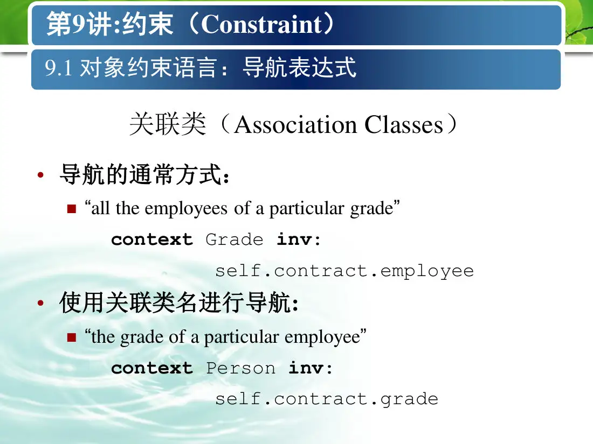

原文：

9.1 对象约束语言：导航表达式

关联类（Association Classes）

\- 导航的通常方式:

\- “all the employees of a particular grade”

context Grade inv:

self.contract.employee

\- 使用关联类名进行导航:

■ “the grade of a particular employee”

context Person inv:

self.contract.grade

第9讲:约束（Constraint）

### 第9讲:约束（Constraint）

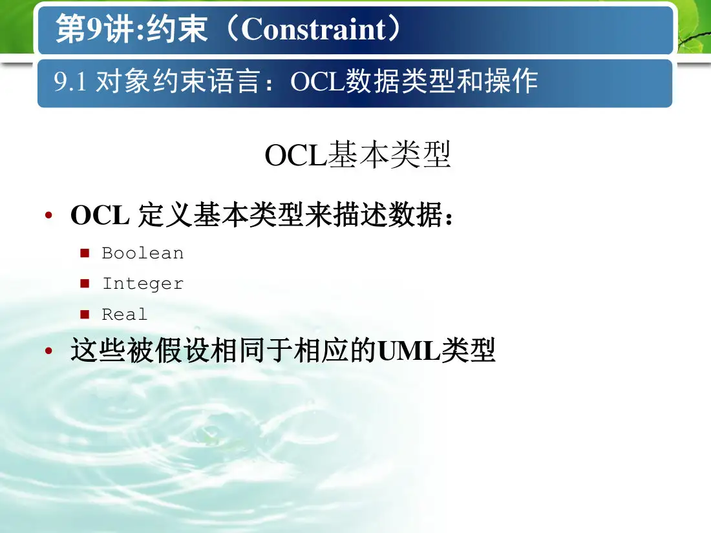

原文：

第9讲:约束（Constraint）

9.1 对象约束语言：OCL数据类型和操作

OCL基本类型

\- OCL 定义基本类型来描述数据:

■ Boolean

\- Integer

Real

\- 这些被假设相同于相应的UML类型

### 第9讲:约束（Constraint）

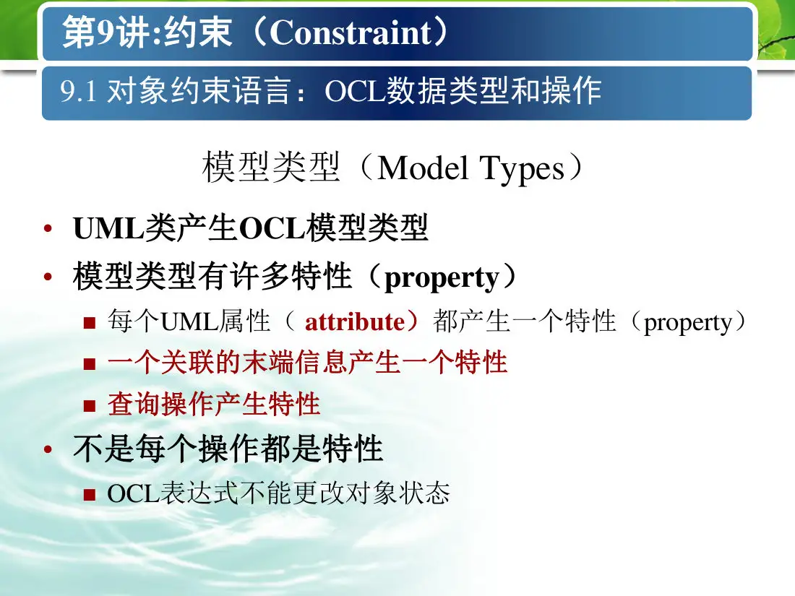

原文：

第9讲:约束（Constraint）

9.1 对象约束语言：OCL数据类型和操作

模型类型（Model Types）

\- UML类产生OCL模型类型

\- 模型类型有许多特性（property）

■ 每个UML属性（attribute）都产生一个特性（property）

■ 一个关联的末端信息产生一个特性

■ 查询操作产生特性

\- 不是每个操作都是特性

■ OCL表达式不能更改对象状态

### 第9讲:约束（Constraint）

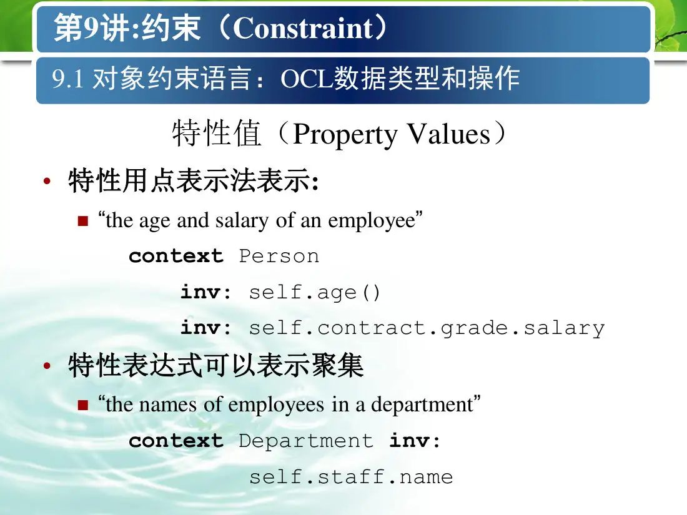

原文：

第9讲:约束（Constraint）

9.1 对象约束语言：OCL数据类型和操作

特性值（Property Values）

\- 特性用点表示法表示:

■ “the age and salary of an employee”

context Person

inv: self.age()

inv: self.contract.grade.salary

\- 特性表达式可以表示聚集

■ “the names of employees in a department”

context Department inv:

self.staff.name

### 9.1 对象约束语言：OCL数据类型和操作

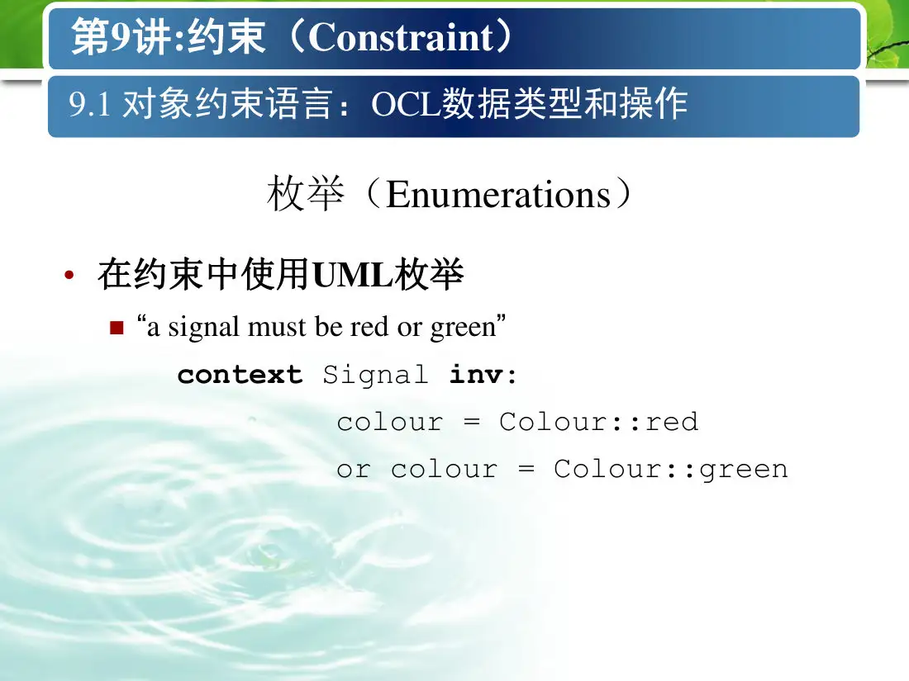

原文：

9.1 对象约束语言：OCL数据类型和操作

枚举（Enumerations）

\- 在约束中使用UML枚举

■ “a signal must be red or green”

context Signal inv:

$$
\mathrm{colour} = \mathrm{Colour}:: \mathrm{red}
$$

$$
\text {or colour} = \text {Colour:::green}
$$

第9讲:约束（Constraint）

### 9.1 对象约束语言：OCL数据类型和操作

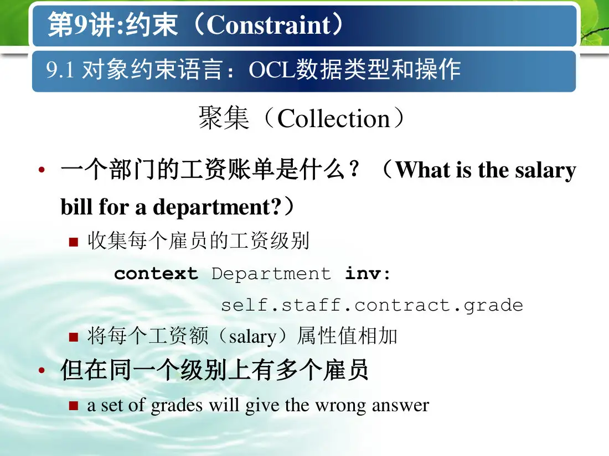

原文：

9.1 对象约束语言：OCL数据类型和操作

聚集（Collection）

- 一个部门的工资账单是什么？（What is the salary bill for a department?）

■ 收集每个雇员的工资级别

context Department inv:

self.staff.contract.grade

■ 将每个工资额（salary）属性值相加

\- 但在同一个级别上有多个雇员

■ a set of grades will give the wrong answer

第9讲:约束（Constraint）

### 9.1 对象约束语言：OCL数据类型和操作

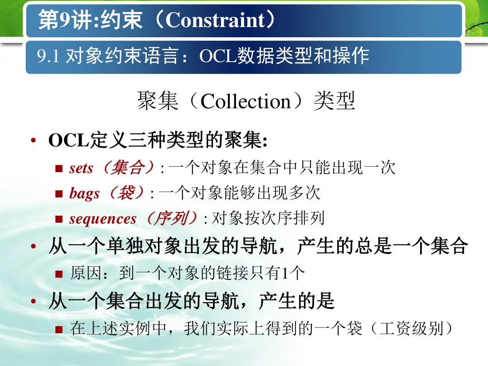

原文：

9.1 对象约束语言：OCL数据类型和操作

聚集（Collection）类型

\- OCL定义三种类型的聚集:

■ sets（集合）: 一个对象在集合中只能出现一次

■ bags（袋）: 一个对象能够出现多次

■ sequences （序列）: 对象按次序排列

\- 从一个单独对象出发的导航，产生的总是一个集合

■ 原因：到一个对象的链接只有1个

\- 从一个集合出发的导航，产生的是

■ 在上述实例中，我们实际上得到的一个袋（工资级别）

第9讲:约束（Constraint）

### 9.1 对象约束语言：OCL数据类型和操作

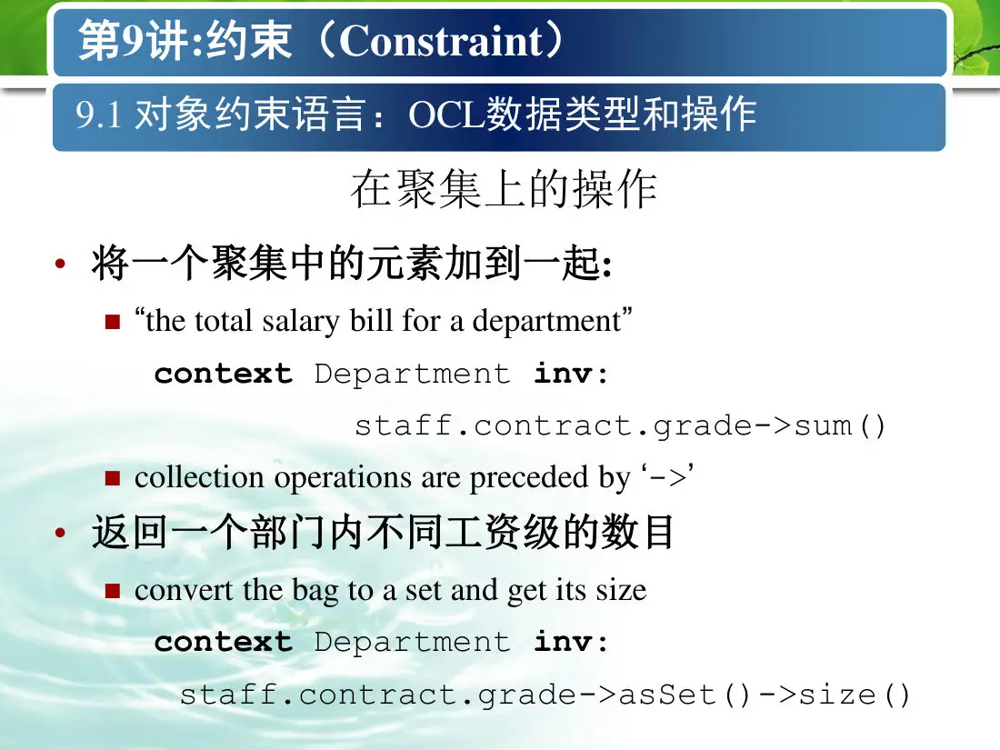

原文：

9.1 对象约束语言：OCL数据类型和操作

在聚集上的操作

\- 将一个聚集中的元素加到一起:

■ “the total salary bill for a department”

context Department inv:

staff.contract.grade->sum()

■ collection operations are preceded by ‘->’

\- 返回一个部门内不同工资级的数目

■ convert the bag to a set and get its size

context Department inv:

staff.contract.grade->asSet()->size()

第9讲:约束（Constraint）

### 9.1 对象约束语言：OCL数据类型和操作

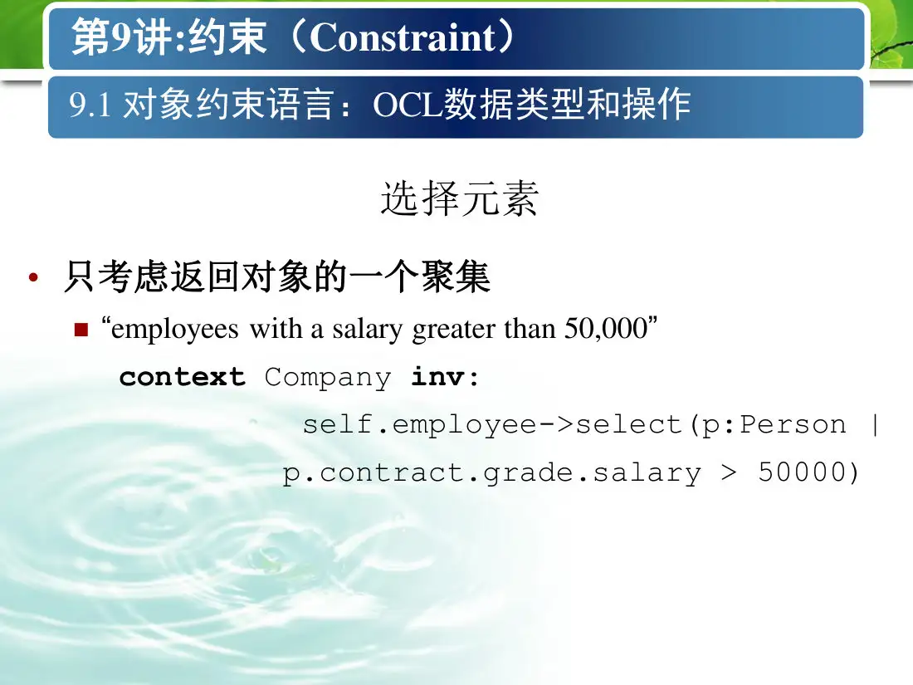

原文：

9.1 对象约束语言：OCL数据类型和操作

选择元素

\- 只考虑返回对象的一个聚集

■ “employees with a salary greater than 50,000”

context Company inv:

self.employee->select(p:Person

p.contract.grade.salary > 50000)

第9讲:约束（Constraint）

### 第9讲:约束（Constraint）

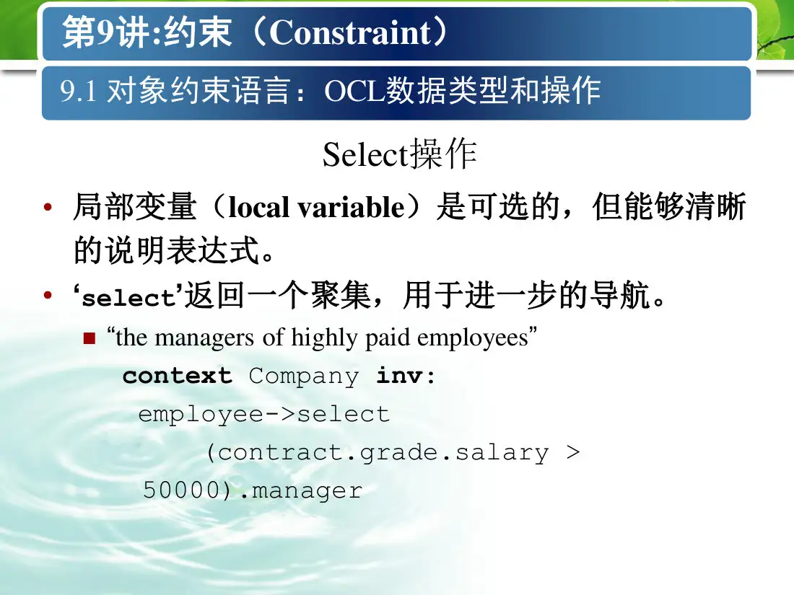

原文：

第9讲:约束（Constraint）

9.1 对象约束语言：OCL数据类型和操作

Select操作

\- 局部变量（local variable）是可选的，但能够清晰的说明表达式。

\- ‘select’返回一个聚集，用于进一步的导航。

■ “the managers of highly paid employees”

context Company inv:

employee->select

(contract.grade.salary >

50000).manager

### 第9讲:约束（Constraint）

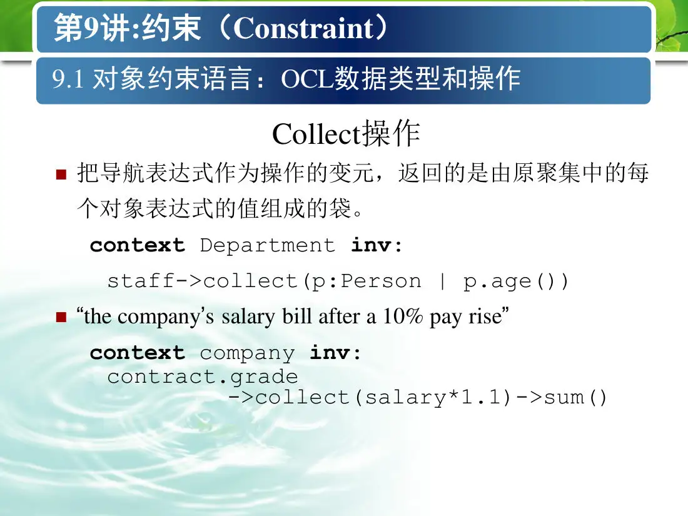

原文：

第9讲:约束（Constraint）

9.1 对象约束语言：OCL数据类型和操作

Collect操作

■ 把导航表达式作为操作的变元，返回的是由原聚集中的每个对象表达式的值组成的袋。

context Department inv:

staff->collect(p:Person | p.age())

■ “the company’s salary bill after a 10% pay rise”

context company inv:
contract.grade
->collect(salary\*1.1)->sum()

### 第9讲:约束（Constraint）

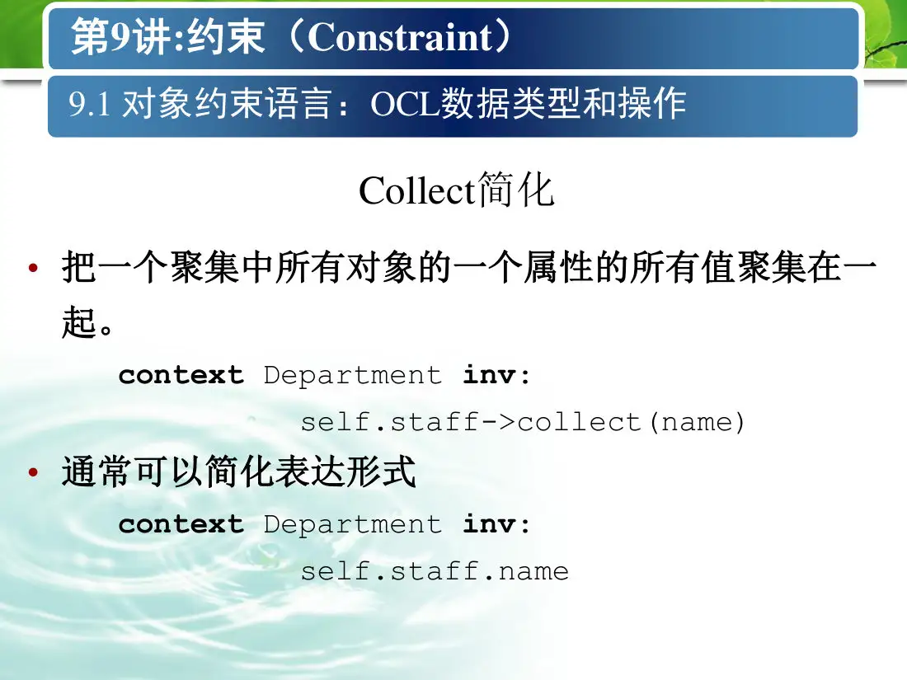

原文：

第9讲:约束（Constraint）

9.1 对象约束语言：OCL数据类型和操作

Collect简化

\- 把一个聚集中所有对象的一个属性的所有值聚集在一起。

context Department inv:

self.staff->collect(name)

\- 通常可以简化表达形式

context Department inv:

self.staff.name

### 第9讲:约束（Constraint）

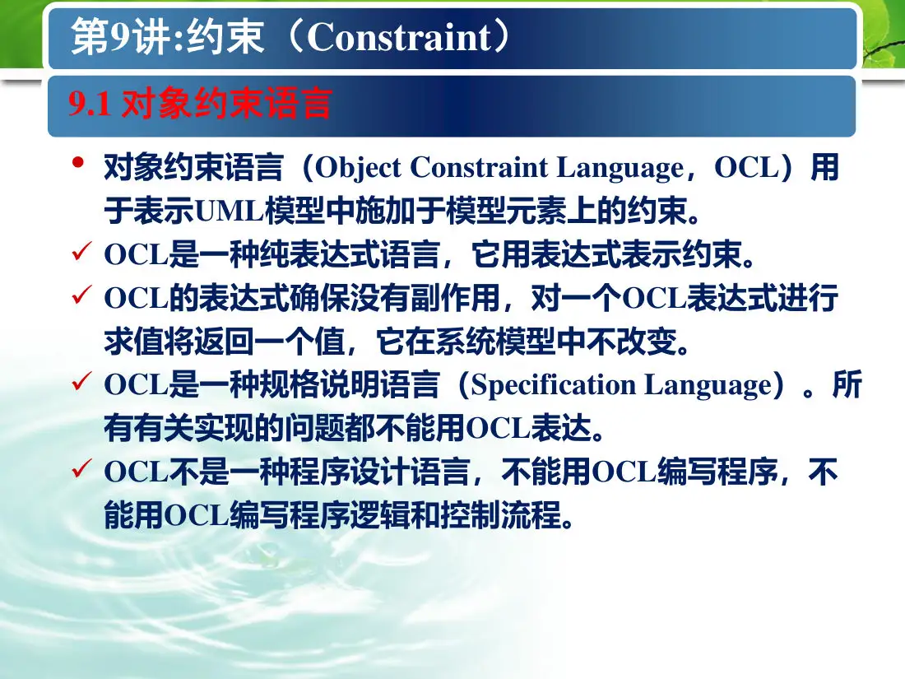

原文：

第9讲:约束（Constraint）

9.1 对象约束语言

\- 对象约束语言（Object Constraint Language，OCL）用于表示UML模型中施加于模型元素上的约束。

√ OCL是一种纯表达式语言，它用表达式表示约束。

√ OCL的表达式确保没有副作用，对一个OCL表达式进行求值将返回一个值，它在系统模型中不改变。

√ OCL是一种规格说明语言（Specification Language）。所有有关实现的问题都不能用OCL表达。

√ OCL不是一种程序设计语言，不能用OCL编写程序，不能用OCL编写程序逻辑和控制流程。

### 第9讲:约束（Constraint）

原文：

第9讲:约束（Constraint）

9.1 对象约束语言：约束的上下文（Context）

文本约束

- 约束更多写成文本格式，附加到模型

■ 约束必须从上下文声明开始，由关键字context和约束的类名或操作名组成。

context SavingsAccount inv: self.balance > 0 and self.balance < 250000

■ 关键字inv指明了这个约束是一个invariant（不变量），在所有时间点上这些属性值必须为真。

### 9.1 对象约束语言：导航表达式

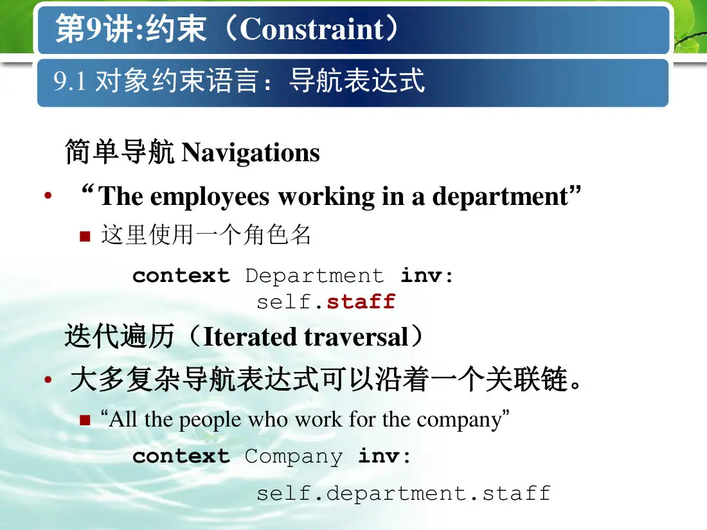

原文：

9.1 对象约束语言：导航表达式

简单导航 Navigations

• “The employees working in a department”

■ 这里使用一个角色名

context Department inv: self.staff

迭代遍历（Iterated traversal）

\- 大多复杂导航表达式可以沿着一个关联链。

\- “All the people who work for the company”

context Company inv:

self.department.staff

第9讲:约束（Constraint）

### 9.1 对象约束语言：导航表达式

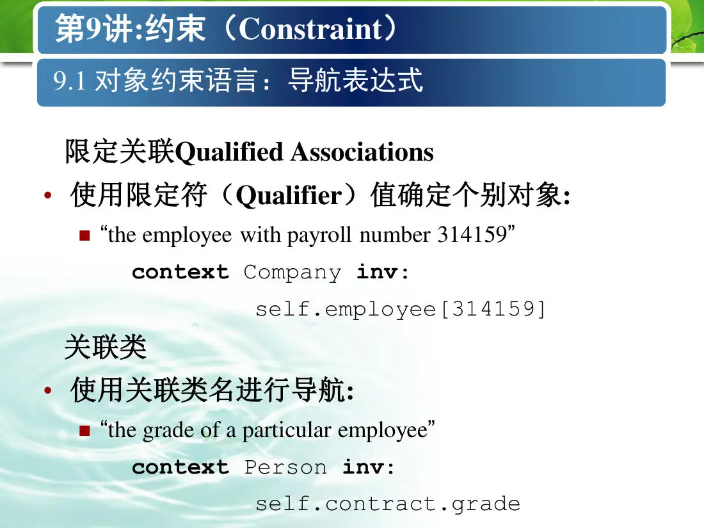

原文：

9.1 对象约束语言：导航表达式

限定关联Qualified Associations

\- 使用限定符（Qualifier）值确定个别对象：

■ “the employee with payroll number 314159”

context Company inv:

self.employee[314159]

关联类

\- 使用关联类名进行导航:

■ “the grade of a particular employee”

context Person inv:

self.contract.grade

第9讲:约束（Constraint）

### 第9讲:约束（Constraint）

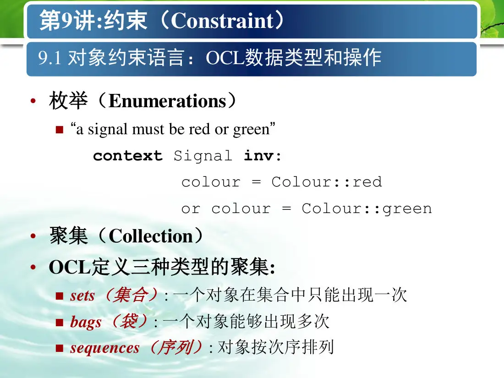

原文：

第9讲:约束（Constraint）

9.1 对象约束语言：OCL数据类型和操作

- 枚举（Enumerations）

■ “a signal must be red or green”

\- 聚集（Collection）

\- OCL定义三种类型的聚集:

■ sets（集合）: 一个对象在集合中只能出现一次

\- bags（袋）:一个对象能够出现多次

■ sequences （序列）: 对象按次序排列

### 第9讲:约束（Constraint）

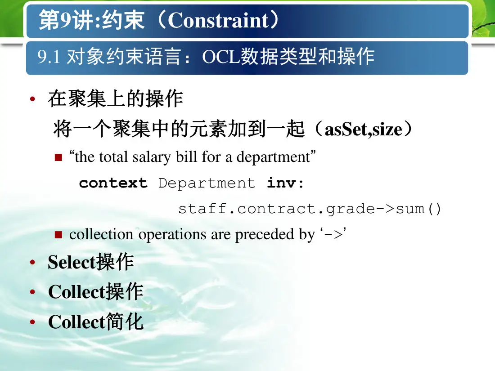

原文：

第9讲:约束（Constraint）

9.1 对象约束语言：OCL数据类型和操作

- 在聚集上的操作

将一个聚集中的元素加到一起（asSet,size）

■ “the total salary bill for a department”

context Department inv:

staff.contract.grade->sum()

■ collection operations are preceded by ‘->’

\- Select操作

\- Collect操作

\- Collect简化

### 第9讲:约束（Constraint）

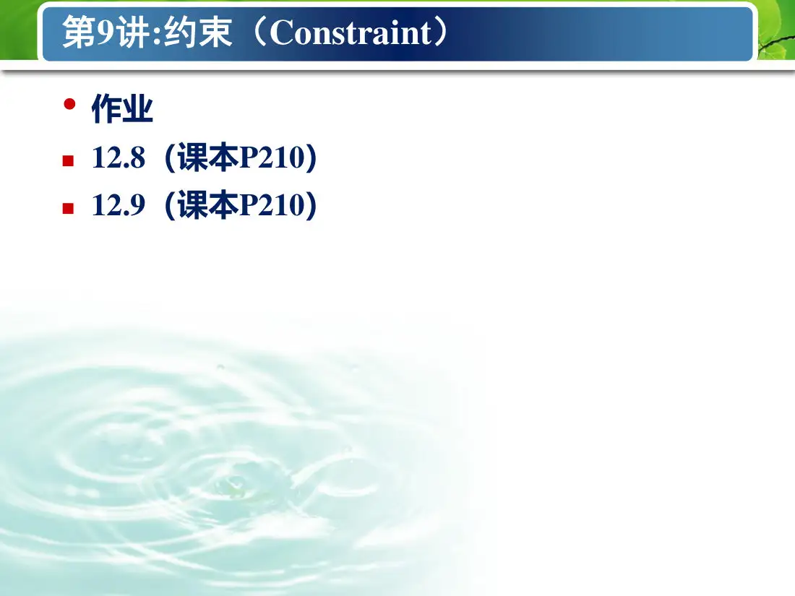

原文：

第9讲:约束（Constraint）

作业

■ 12.8 (课本P210)

■ 12.9 (课本P210)
