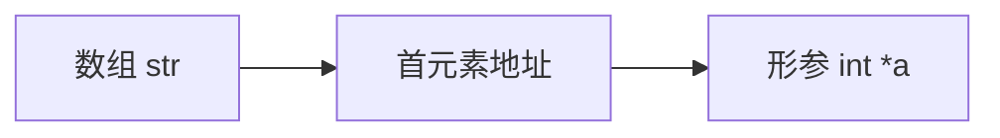

# C程序中的六种符号

## 六种符号分别是什么

C 源程序中，程序设计语言规定了三类符号：

1. **标识符**：程序员起名字用的字符序列，如变量名、函数名、数组名。
2. **关键字**：C 语言预先规定、有固定含义的单词，如 `int`、`if`、`return`。
3. **运算符和分隔符**：用于运算或组织语法结构，如 `+`、`=`、`,`、`;`、`(`、`)`。

课件常把这三类具体归纳为 ==六种符号==：==标识符、关键字、运算符、常量、字符与字符串、语句结束符==。不同教材的分类名称可能略有差异，但共同强调：字符组成词法单元，词法单元再组成 C 程序。

## 为什么需要区分这些符号

编译器不能直接理解整段自然语言，只能按照 C 语法识别各种符号。若把关键字、标识符和运算符混用，程序就无法正确分词，编译时会出现语法错误。

例如：

```c
int total = 10;
```

这里：

- `int` 是关键字，声明整型变量；
- `total` 是标识符，表示变量；
- `=` 是运算符；
- `10` 是整型常量；
- `;` 是语句结束符。

## 各类符号的写法

| 符号类别 | 示例 | 说明 |
|---|---|---|
| 标识符 | `sum`、`max`、`f` | 区分大小写，不能以数字开头，不能使用关键字 |
| 关键字 | `int`、`if`、`else`、`while` | 由 C 语言规定，不能重新定义 |
| 运算符 | `+`、`-`、`*`、`/`、`=` | 参与运算或表达逻辑关系 |
| 常量 | `137`、`3.14`、`'A'`、`"hello"` | 在程序运行期间值不变 |
| 分隔符 | `(`、`)`、`{`、`}`、`,` | 划定语法结构边界 |
| 语句结束符 | `;` | 标志一个语句结束 |

> [!IMPORTANT]
> 六种符号不是六个孤立的字符，而是 C 程序中不同语法角色的概括。做题时先判断它属于哪一类，再检查书写形式是否合法。

## 标识符和关键字怎样区分

判断一个单词时，可以先问：“它是 C 语言预先规定的固定单词吗？”如果是，就是关键字；否则，如果它被用来给变量、函数或数组命名，就是标识符。

```c
int int1 = 0;   // 合法
// int int = 0;  // 错误：int 是关键字
```

标识符由字母、数字和下划线组成，且第一个字符不能是数字。标识符还区分大小写，因此 `sum` 与 `Sum` 是两个不同名称。

> [!TIP]
> 关键字像系统保留词，标识符像程序员申请的名字；保留词不能拿来重新命名。

## 数组作为函数参数中的符号辨析

数组名传给函数时，实际传递的是指向首元素的指针：

```c
int str[10] = {0};
f(str);
```

因此，下列声明都合法：

```c
void f(int a[]);
void f(int a[5]);
void f(int *a);
```

而 `void f(int a);` 错误，因为形参 `a` 是整型变量，不能接收数组名退化后得到的指针。



> [!WARNING]
> 函数形参中的数组长度不会限制实参数组长度。写成 `int a[5]` 并不表示该函数只能接收长度为 5 的数组；其中方括号主要表达“形参按数组方式声明”。

## 整型常量的进制形式

整数常量可以写成十进制、八进制或十六进制。八进制数以 `0` 开头，十六进制数以 `0x` 或 `0X` 开头。

题目给出十进制数 $137$，转换为八进制：

$$
137 = 2\times 64 + 1\times 8 + 1\times 1
= 211_8
$$

所以在 C 源程序中应写为：

```c
int n = 0211;
```

> [!IMPORTANT]
> `0211` 是八进制写法，表示十进制 $137$；它不是“前面随便补一个 0”。

## 常见错误

- 把关键字当作普通变量名，如 `float float;`。
- 混淆单字符常量和字符串常量：`'A'` 是字符常量，`"A"` 是字符串常量。
- 漏写语句结束符，如 `int x = 1` 后面没有 `;`。
- 误以为八进制数字只能是 `0`～`7`，写成 `0218`。
- 看到 `void f(int a[5]);` 就认为它只能接收长度为 5 的数组。

> [!TIP]
> 解题顺序：先找关键字，再认标识符；看到数字先判断进制，看到括号和分号先判断分隔作用，最后检查各符号的书写是否符合 C 语法。
