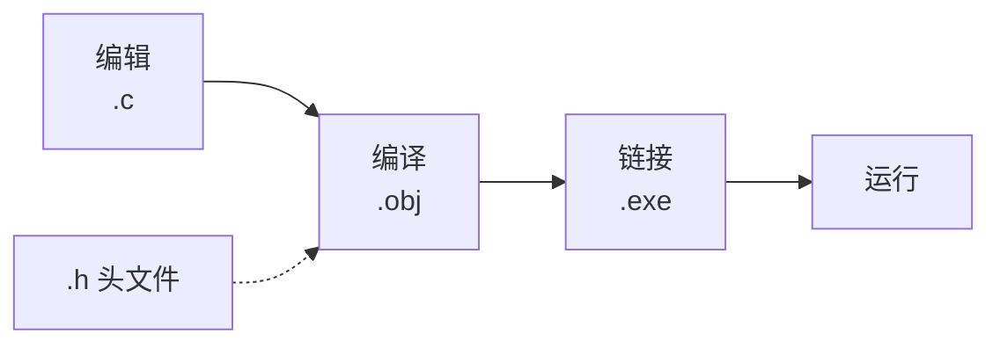

# C程序开发过程（源程序到可执行文件的全过程）

## 为什么不能直接运行 .c 文件？

计算机硬件只能识别二进制机器指令，而 C 源程序是人类可读的高级语言文本。因此，从 `.c` 到可执行文件必须经过一系列==翻译与组装==过程。这个过程通常分为四个阶段：编辑、编译、链接和运行。其中，==编译和链接是考试最常考查的核心环节==。

## 四阶段详解与文件扩展名

> [!IMPORTANT]
> 各阶段生成的文件扩展名必须准确对应：`.c`（源程序）、`.obj`（目标文件）、`.exe`（可执行文件），头文件为 `.h`。

- **编辑**：使用编辑器编写或修改源代码，生成 `.c` 文件。此阶段仅产生文本，==不涉及任何翻译==。
- **编译**：编译器将 `.c` 源程序翻译成机器语言形式的目标代码，生成 `.obj` 文件。编译时会进行语法检查，并处理 `#include` 引入的 `.h` 头文件内容。
- **链接**：链接器将一个或多个 `.obj` 文件与库函数（如 `printf`、`scanf` 的实现）合并，解析外部符号引用，最终生成 `.exe` 可执行文件。
- **运行**：操作系统加载 `.exe` 到内存中执行。若运行时出错（如除零、数组越界），属于逻辑错误，编译器无法在前期发现。

## 编译 vs 解释 vs 汇编

> [!WARNING]
> “编辑”不是翻译方式！选择题常设此陷阱。

| 方式 | 特点 | 产物 |
| :--- | :--- | :--- |
| 编译 | 整体翻译，生成目标代码 | `.obj` / `.exe` |
| 解释 | 逐句翻译执行，不生成目标文件 | 无独立目标文件 |
| 汇编 | 将汇编语言翻译为机器码 | `.obj` |

C 语言采用==编译方式==，而非解释方式。汇编是针对汇编语言的翻译，与 C 语言的编译属于不同层级的概念。

## 常见误区与真题示例

> [!CAUTION]
> 混淆“编译”与“链接”的功能是高频失分点。编译只负责单文件翻译，链接才负责整合多个模块和库函数。

例如填空题曾考查：“从 C 源程序到目标程序的过程称为______”。正确答案是==编译==，而非“链接”或“编辑”。因为目标程序（`.obj`）是编译阶段的直接产物，链接的产物才是可执行程序。

> [!TIP]
> 记忆口诀：“编.c，译.obj，链.exe”。看到“.obj”选编译，看到“.exe”选链接，看到“翻译方式”排除编辑。

在实际开发中，若修改了某个 `.c` 文件，只需重新编译该文件再链接即可，无需全部重编，这正是分阶段处理的优势所在。理解这一流程，不仅有助于应对考试，也为后续学习多文件项目和调试打下基础。
