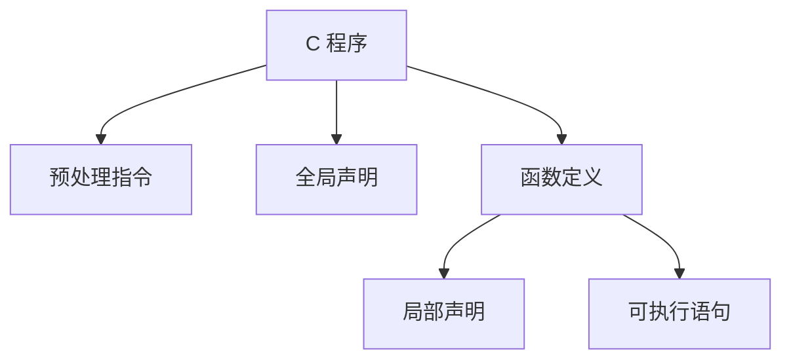

# C语言程序的组成结构

## 从一个“跑不起来”的程序说起

先看一道南邮考过的选择题：

```c
double fun(int x, int y) {
    z = x + y;
    return z;
}
```

这个函数有错吗？有。错不在 `x + y`，也不在 `return`，而在 `z`：它没有 **声明类型**。C 语言要求任何变量先定义、后使用。所以你立刻能理解一个核心事实：

> [!IMPORTANT]
> 一个 C 程序的最小合法单位不是“能看懂的代码”，而是==先声明、后使用==的代码。

## C 程序由什么组成

一个标准 C 程序，从外到里可以分成四层：



- **预处理指令**：`#include <stdio.h>`、`#define PI 3.14`，编译前先处理。
- **全局声明**：在所有函数之外定义变量、函数原型。
- **函数定义**：程序真正执行的部分，有且只有一个 `main`。
- **局部声明**：函数体内部的变量类型说明。

函数定义的标准格式为：

```c
返回类型 函数名(参数类型 参数名, ...) {
    局部声明;
    可执行语句;
    return 表达式;
}
```

## 为什么“结构”比“算法”先考

因为 C 编译器不猜你的意图。下面几个都考过：

| 选项片段 | 问题类型 |
|---|---|
| `z=x+y; return z;` 无 `int z` | 漏定义 |
| `fun(int x, y)` | 参数类型缺失（旧式写法） |
| `k = prt_char(G);` 而声明为 `void` | 返回值与声明矛盾 |
| 形参定义了 `int x,y`，函数体内又写 `int x,y` | 重复定义 |

>`fun(x,y)` 这类写法属于旧式 K&R 风格，默认参数为 `int`。在很多老教材里算合法，但现代 C 标准（C99 以后）已不推荐。  
> 南邮这门课的题目里，如果出现这种写法，往往是在考“是否了解函数定义的历史形态”，而不是让你模仿。

## 常见坑：声明和定义不是一回事

```c
void prt_char();          // 函数声明：告诉编译器有这个东西
k = prt_char(G);          // 函数调用：想要一个返回值
```

声明说“没有返回值”，调用却想要返回值，这就矛盾了。C 语言里 `void` 是“无返回值”，不是“随便返回什么”。

> [!WARNING]
> `void` 函数不能出现在赋值表达式里。`k = prt_char(G);` 这类写法是南邮选择题里的高频错误点。

## 一个算对了的例子

下面这个程序结构完整，能通过编译并执行：

```c
#include <stdio.h>          // 预处理：引入标准输入输出

double fun(int x, int y);   // 函数声明：告诉 main 有 fun 存在

int main(void) {           // 主函数
    int a = 3, b = 4;      // 局部声明
    double result;         // 先定义后使用
    result = fun(a, b);    // 函数调用
    printf("%.1f\n", result);
    return 0;             // main 返回值 0 表示正常结束
}

double fun(int x, int y) { // 函数定义
    double z;              // 局部声明
    z = x + y;
    return z;              // 返回类型与声明一致
}
```

你可以按“从外到内”读它：预处理 → 函数声明 → `main` → 函数定义。每一层都各司其职，函数声明和定义的类型匹配，变量用完即销。

> [!TIP]
> 判错时按顺序问三句：  
> ① 每个变量都有类型吗？  
> ② 函数声明和调用匹配吗？  
> ③ 有没有重复定义名字？
