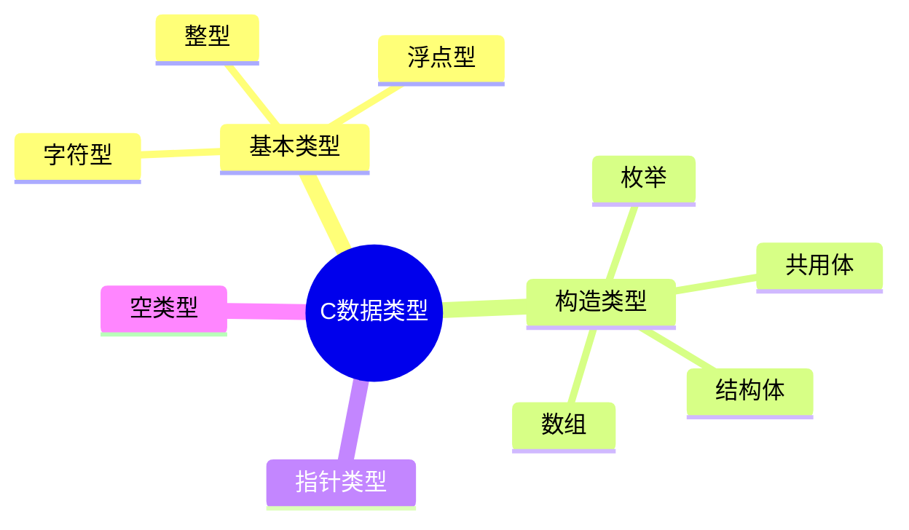

# C语言的数据类型分类

## 为什么要给数据分类型

同样是内存里的若干个字节，解释成整数、实数还是字符，存储方式和允许的运算都不同。C 语言要求先确定数据类型，再由编译器分配存储空间、检查运算并生成相应指令。例如 `12` 是整型常量，`12.0` 是浮点型常量，`'1'` 是字符常量，`"1"` 是字符串常量，四者不能混为一谈。

> [!IMPORTANT]
> C 语言的数据类型分为==基本类型、构造类型、指针类型和空类型==。其中基本类型包括整型、浮点型和字符型。

## 数据类型的分类



| 类别 | 常见类型或写法 | 主要用途 |
|---|---|---|
| 整型 | `int`、`short`、`long`、`unsigned int` | 保存整数，参与整数运算 |
| 浮点型 | `float`、`double`、`long double` | 保存带小数的实数 |
| 字符型 | `char` | 保存单个字符，实际存储其编码值 |
| 构造类型 | 数组、结构体、共用体、枚举 | 由其他类型组合出复杂数据 |
| 指针类型 | `int *`、`char *` 等 | 保存地址 |
| 空类型 | `void` | 表示无值、无返回值或不指定具体类型 |

`void` 不是“可以存任何数据的变量类型”，不能写 `void x;`。指针也不是一种整数变量，它保存的是地址。

## 常量、变量与类型

类型既约束变量，也约束常量。变量必须先定义后使用，例如：

```c
int count = 12;
double score = 15.6;
char grade = 'A';
```

这里 `count` 只能按整型规则使用，`score` 按浮点型规则使用，`grade` 保存一个字符。字符常量用单引号，字符串常量用双引号：`'A'` 是字符，`"A"` 是字符串，后者还包含结尾的 `'\0'`。

常见常量的类型判断如下：

| 写法 | 类型判断 |
|---|---|
| `12` | `int` 型整常量 |
| `12L` | `long` 型整常量 |
| `15.6` | `double` 型浮点常量 |
| `15.6f` | `float` 型浮点常量 |
| `'a'` | 字符常量 |
| `"abc"` | 字符串常量 |

> [!WARNING]
> 类型名称和常量形式都可能成为选择题考点：`double` 是浮点型，不是整型；`'12'` 不是合法的普通单字符写法；`"12"` 是字符串，不是整数 `12`。

## 类型如何影响运算

两个 `int` 相除，结果仍按整数除法处理，小数部分被舍弃；只要参与运算的一方是浮点型，就会进行浮点除法。赋值时还可能发生类型转换。

```c
#include <stdio.h>

int main(void)
{
    int a = 12;
    int b = 5;
    double x = 15.6;

    printf("%d\n", a / b);       /* 2：整数除法 */
    printf("%.1f\n", a / 5.0);   /* 2.4：浮点除法 */
    printf("%.1f\n", x);         /* 15.6 */

    return 0;
}
```

这个例子中，`a / b` 不会因为结果可能有小数就自动变成 `2.4`；要得到 `2.4`，可写成 `a / 5.0`、`(double)a / b`，或直接把 `a` 定义为浮点型。

> [!TIP]
> 判断表达式时按“先看运算对象类型，再看运算规则，最后看赋值或输出格式”的顺序。`printf` 中常用 `%d` 输出 `int`，用 `%f` 输出 `double`；默认通常显示 6 位小数，所以 `15.6` 可能输出为 `15.600000`。

## 相近概念与常见坑

- **基本类型与构造类型**：`int`、`double`、`char` 是基本类型；数组、结构体等是由类型组合得到的构造类型。
- **字符型与字符串**：`char c = 'A';` 合法；不能把 `"A"` 当作一个普通字符赋给 `char`。
- **浮点型与精确小数**：浮点数采用近似表示，不宜简单用 `==` 判断两个计算得到的浮点数是否完全相等。
- **类型与格式符**：变量类型、表达式类型和 `printf`/`scanf` 的格式要求应匹配，不能仅靠格式符改变变量本身的类型。
- **有符号与无符号**：`unsigned` 主要改变整型的取值解释，不会把整型变成浮点型。

==数据类型决定存储方式、取值范围和运算规则==，这是分析声明、表达式求值及输入输出结果的共同出发点。
