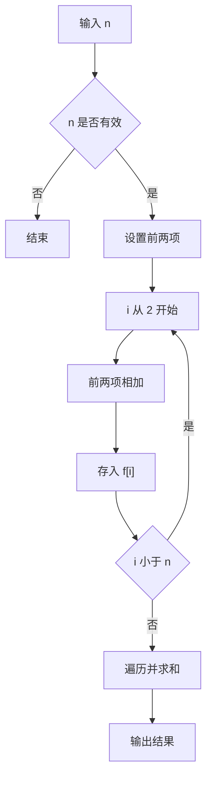

# 利用数组求解Fibonacci数列

## 什么是 Fibonacci 数列

Fibonacci 数列是经典的递推数列：

$$
F_0=0,\quad F_1=1
$$

从第三项开始，每一项都等于前两项之和：

$$
F_n=F_{n-1}+F_{n-2}\quad(n\ge 2)
$$

因此数列为：

$$
0,\ 1,\ 1,\ 2,\ 3,\ 5,\ 8,\ 13,\ 21,\ 34,\ldots
$$

利用数组求解，就是把已经计算出的数列元素依次存入数组，再通过下标访问前两项完成递推。

> [!IMPORTANT]
> ==数组求解的本质是“保存历史结果”==：第 $i$ 项依赖前两项，因此计算第 $i$ 项时必须保证对应数组元素已经正确存储。

## 为什么需要数组

直接逐项打印时，只保留前两项即可；但若题目要求“保存整个数列”“求前 $n$ 项之和”或“查询某一项”，仅有两个变量就不够，需要保存所有已计算结果。

例如，前 10 项为：

$$
0,1,1,2,3,5,8,13,21,34
$$

其和为：

$$
0+1+1+2+3+5+8+13+21+34=88
$$

数组可以让程序统一完成计算、保存、遍历和求和。

## 怎么做

### 基本方法

假设数组 `f` 有 `n` 个元素：

1. 令 `f[0] = 0`、`f[1] = 1`；
2. 从下标 `2` 开始循环；
3. 使用递推式 `f[i] = f[i-1] + f[i-2]`；
4. 最后输出或遍历数组。

```c
#include <stdio.h>

int main(void)
{
    int f[100];
    int n, i, sum = 0;

    scanf("%d", &n);

    if (n < 1 || n > 100)
        return 0;

    f[0] = 0;
    if (n >= 2)
        f[1] = 1;

    for (i = 2; i < n; i++)
        f[i] = f[i - 1] + f[i - 2];

    for (i = 0; i < n; i++)
        sum += f[i];

    for (i = 0; i < n; i++)
        printf("%d%s", f[i], i == n - 1 ? "\n" : " ");

    printf("sum = %d\n", sum);
    return 0;
}
```

### 算法流程



> [!TIP]
> 记忆递推顺序：先设初值，再从下标 $2$ 开始；==先计算、再赋值==。

## 与相近做法的区别

| 方法 | 特点 | 适用情况 |
|---|---|---|
| 两个变量递推 | 只保存前两项，空间为 $O(1)$ | 只求最后一项或总和 |
| 数组递推 | 保存全部结果，空间为 $O(n)$ | 需输出、遍历或多次查询数列 |
| 递归求解 | 结构直观，但重复计算较多 | 讲解递推思想 |
| 动态规划 | 保存子问题结果，避免重复计算 | 本题本质上就是动态规划 |

数组法与两个变量法计算出的数列相同，区别主要在于是否保留所有中间结果。

## 常见坑

> [!WARNING]
> 下标从 $0$ 开始时，第 $i$ 项存放在 `f[i]`；第 $3$ 项是 `f[2]`，不是 `f[3]`。

- 当 $n=1$ 时，不能无条件访问 `f[1]`，否则会越界。
- 不要把初值写成 `f[0]=1`、`f[1]=1`。本题采用 $F_0=0$、$F_1=1$。
- 数组长度必须足以容纳前 $n$ 项。
- `int` 只能保存一定范围内的整数；数列增长很快，元素溢出时应改用 `long long`。
- `sum` 也可能溢出，不能只考虑单个数组元素。

> [!CAUTION]
> 若把 `f[i-1] + f[i-2]` 写成 `f[i-1] + f[i-1]`，程序虽然能运行，但得到的是 $1,1,3,5,\ldots$，并不是 Fibonacci 数列。

## 算对了的例子

输入：

```text
10
```

数组 `f` 依次得到：

```text
0 1 1 2 3 5 8 13 21 34
```

输出：

```text
0 1 1 2 3 5 8 13 21 34
sum = 88
```

校验第 $6$ 项（下标为 $5$）：

$$
f[5]=f[4]+f[3]=3+2=5
$$

最终总和为：

$$
\sum_{i=0}^{9}f[i]=88
$$

该例同时体现了数组的三个用途：==保存递推结果、按顺序输出、统计总和==。
