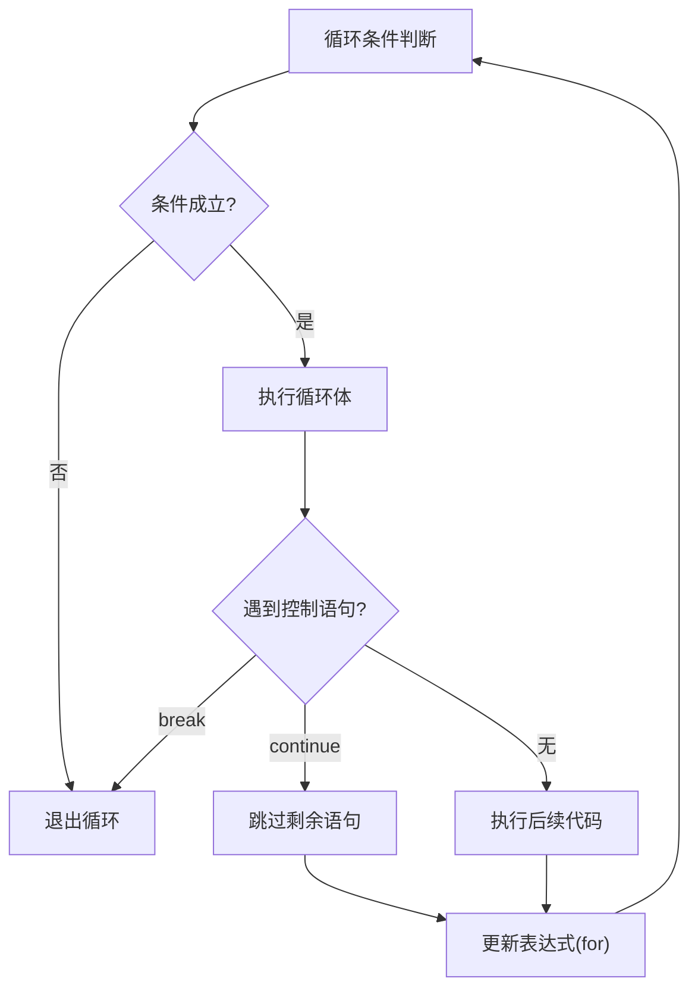

# break跳出循环与continue结束本次循环的区别

在循环结构中，我们常需要根据特定条件改变程序的执行流。如果只想跳过当前这一轮的剩余操作，或者发现目标已达成想立即终止整个循环，该如何精准控制？这就引出了 `break` 与 `continue` 两个关键语句。

## 核心区别与执行流向

> [!IMPORTANT]
> ==`break` 是“彻底退出”，`continue` 是“跳过本次”。== 前者终结整个当前层循环或 `switch` 结构；后者仅结束本次迭代，程序会跳转回循环头部进行下一次条件判断。



[!TIP]
记忆口诀：`break` 砸锅（终止整个循环），`continue` 跳步（仅跳过本轮）。在 `for` 循环中，`continue` 会先执行“表达式3”（如 `i++`）再判断条件；而在 `while/do-while` 中则直接回到条件判断处。

## 适用场景与禁忌

| 特性 | break | continue |
| :--- | :--- | :--- |
| **作用范围** | 循环 / switch | 仅限循环 |
| **执行效果** | 跳出当前最内层结构 | 结束本次循环迭代 |
| **后续流程** | 执行循环/switch后的代码 | 进入下一轮循环判断 |
| **switch中** | ✅ 防止穿透 | ❌ ==语法错误== |

> [!CAUTION]
> `continue` 绝对不能出现在 `switch` 语句中（除非该 `switch` 嵌套在循环内且意在控制外层循环）。若误用，编译器将报错。这是南邮期末考试选择题的高频陷阱。

## 真题实战解析

以历年考题为例，分析 `continue` 对累加逻辑的影响：

```c
int i, s = 0;
for (i = 1; i <= 10; i++) {
    if (i % 2 == 0) continue; // 偶数时跳过本次累加
    s += i;                   // 仅奇数执行此行
}
printf("%d\n", s);            // 输出 25
```

当 `i` 为偶数时，`continue` 使程序跳过 `s += i`，直接进入 `i++` 并判断下一轮条件。因此 `s` 仅累加了 $1+3+5+7+9=25$。若此处误写为 `break`，循环将在 `i=2` 时彻底终止，结果变为 `1`。

> [!WARNING]
> 在 `while` 循环中使用 `continue` 时，务必确保循环变量已在 `continue` 之前完成更新。否则可能因跳过自增语句而导致==死循环==。例如题干阅读5中，`i++` 位于 `if(i==2) continue;` 之前，故能正常输出 `1 3`；若交换两者顺序，程序将永远卡在 `i==2` 的判断中。

理解这两个语句的关键在于明确“当前层”的概念：它们只作用于==直接包裹自己的那一层==循环或 `switch`，对嵌套的外层结构无效。掌握这一边界，便能准确预判复杂嵌套代码的执行结果。
