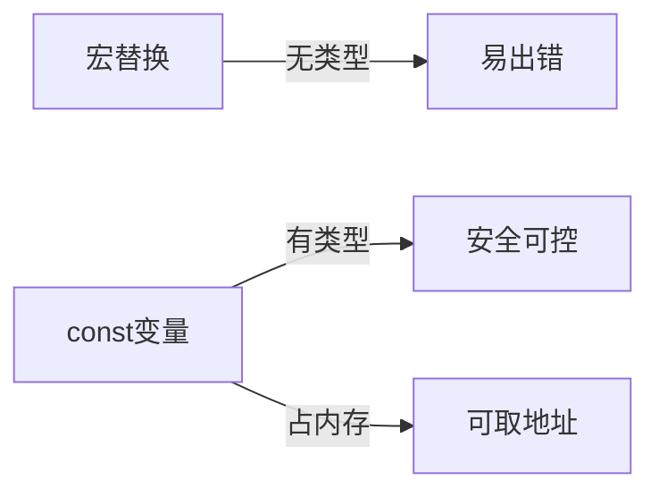

# 用const修饰符限定变量

---
requires: [高级语言程序设计/基本数据类型, 高级语言程序设计/变量与赋值]
---

如果程序中有一个代表圆周率的变量 `pi`，你希望它在整个运行期间都保持 $3.14159$ 不变，但又不想每次都用预编译指令去替换，该怎么办？这就引出了 `const` 修饰符。

## 它是什么

用 `const` 修饰符限定变量，意味着声明一个==只读变量==。它在定义时必须初始化，且此后程序中的任何语句都不能再修改它的值。

语法格式：

```c
const 数据类型 变量名 = 初始值;
```

例如：

```c
const double pi = 3.1415926;
const int MAX_SIZE = 100;
```

> [!IMPORTANT]
> `const` 限定的依然是“变量”（在内存中有确定的地址），只是编译器会强制检查并==禁止对其重新赋值==。

## 为什么需要

既然有宏定义 `#define PI 3.1415926`，为什么还要用 `const`？



| 对比维度 | `#define` 宏常量 | `const` 限定变量 |
| :--- | :--- | :--- |
| **处理阶段** | 预处理阶段文本替换 | 编译阶段类型检查 |
| **数据类型** | 无类型，不参与类型检查 | 有明确的基本数据类型 |
| **内存分配** | 不分配独立内存空间 | 分配内存，有实际地址 |
| **调试难度** | 替换后难以追踪原意 | 可在调试器中直接查看 |

> [!TIP]
> 记忆口诀：宏是“替身”，`const` 是“上锁的真身”。推荐优先使用 `const` 来定义常量。

## 怎么做

使用时只需将 `const` 放在数据类型前面（或后面，两者等价）：

```c
const int n = 10;   // 推荐写法
int const n = 10;   // 等价写法
```

下面是一个完整的正确示例：

```c
#include <stdio.h>

int main() {
    const double g = 9.8;       // 重力加速度，定义为只读
    double t = 2.0;             // 下落时间，普通变量
    double h = 0.5 * g * t * t; // 计算高度，读取 g 的值

    printf("h = %.2f\n", h);    // 输出: h = 19.60
    return 0;
}
```

在这段代码中，`g` 参与了表达式 $h = \frac{1}{2}gt^2$ 的计算，完全表现得像一个普通的 `double` 变量。

## 常见的坑

> [!WARNING]
> 尝试对 `const` 变量赋值会导致==编译错误==。

如果在上面的代码后加上一句：

```c
g = 10.0; // 错误！不能给只读变量赋值
```

编译器会直接报错（如 GCC 提示 `assignment of read-only variable 'g'`）。

> [!CAUTION]
> 常见误区一：忘记初始化。`const` 变量必须在定义时赋初值，否则后续永远无法赋值，它就失去了意义。
>
> ```c
> const int x; // 错误！未初始化
> x = 5;       // 即使写了这句也会报错
> ```

> [!NOTE]
> 常见误区二：认为 `const` 变量可以作为数组的长度。在 C89/C90 标准中，定义数组时方括号内必须是常量表达式（如字面量或宏），`const` 变量本质上仍是变量，不能用于定义静态数组长度（C99 的变长数组 VLA 除外，但南邮课程通常以 C89 为基准考查）。
>
> ```c
> const int N = 10;
> int arr[N]; // 在严格的 C89 标准下是不合法的
>
