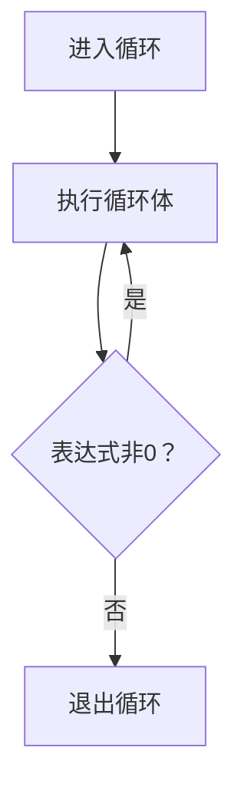

# do-while直到型循环语句

## 先执行，再判断

`do-while` 称为**直到型循环语句**，一般形式为：

```c
do {
    循环体;
} while (表达式);
```

执行顺序是：先执行一次循环体，再计算表达式；表达式为非 $0$ 时继续循环，为 $0$ 时结束。因此，==循环体至少执行一次==。



## 为什么需要它

如果输入、判断、重新输入是重复过程，你会先写输入，还是先判断输入是否正确？

登录程序必须先让用户输入一次，才能判断用户名和密码是否正确。若条件不满足，就再次输入。这类“先做一次，再决定是否重复”的问题适合使用 `do-while`，例如：

- 输入数据并检查是否合法；
- 显示菜单，处理后再等待下一次选择；
- 至少进行一次的交互或计算。

## 与 while、for 的区别

| 对比项 | `while` | `do-while` | `for` |
|---|---|---|---|
| 判断时机 | 循环体之前 | 循环体之后 | 通常先判断 |
| 最少执行次数 | $0$ 次 | ==$1$ 次== | $0$ 次 |
| 典型场景 | 次数不定，可能不做 | 至少做一次 | 次数或范围较明确 |

三种循环都能实现重复操作，并非只有 `do-while` 才能完成登录；题目指定它时，主要考查“先执行、后判断”。

## 登录例题

下面的程序允许最多输入三次，用户名和密码分别为 `admin`、`123456`：

```c
#include <stdio.h>
#include <string.h>

int main(void) {
    char username[20], password[20];
    int attempts = 0;
    int success = 0;

    do {
        printf("请输入用户名：");
        scanf("%19s", username);
        printf("请输入密码：");
        scanf("%19s", password);

        attempts++;

        if (strcmp(username, "admin") == 0 &&
            strcmp(password, "123456") == 0) {
            success = 1;
            break;
        }
        printf("用户名或密码错误！\n");
    } while (attempts < 3);

    if (success)
        printf("登录成功！\n");
    else
        printf("错误三次，系统退出。\n");

    return 0;
}
```

每次循环先输入并计数，再判断两项是否同时正确。正确时置 `success = 1` 并用 `break` 退出；错误时，只要 `attempts < 3` 就继续。第三次失败后条件为假，循环结束，最终输出“错误三次，系统退出”。字符串相等必须写成 `strcmp(...) == 0`，不能直接用 `==` 比较内容。

> [!WARNING]
> `while (表达式);` 末尾的分号不能漏；循环条件表示“继续”，不是“停止”。还要保证循环体能改变相关状态，否则可能形成死循环。

> [!TIP]
> 看到“至少输入一次”“不合法就重输”，优先考虑 `do-while`；若要求“最多三次”，可在每次尝试后计数，再用 `attempts < 3` 控制继续。
