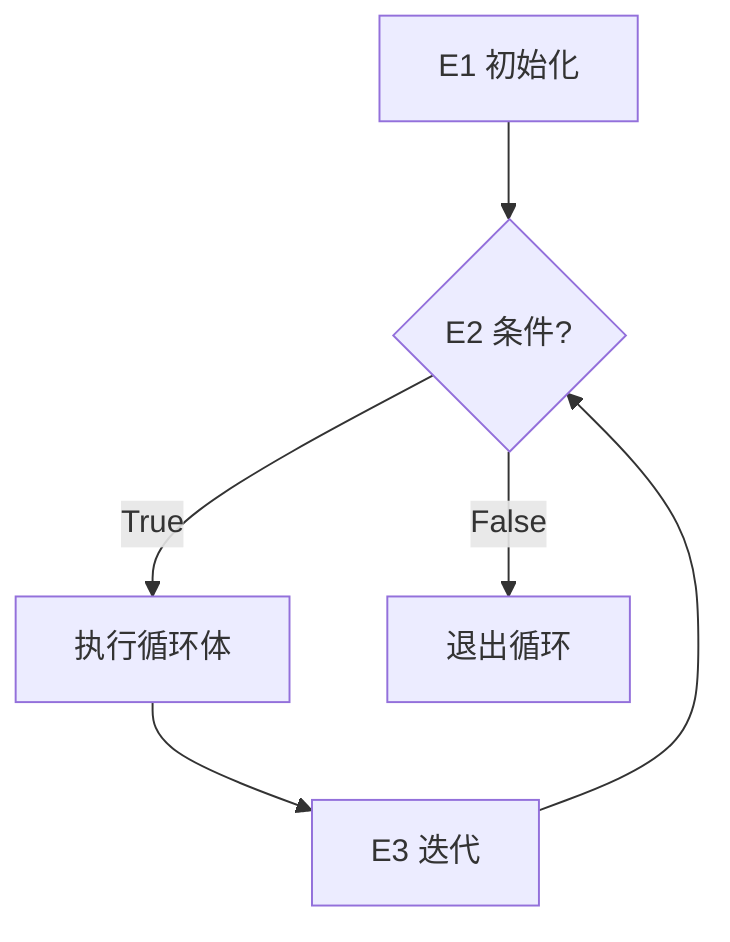

# for循环语句及表达式省略规则

## for循环语句及表达式省略规则

`for` 循环是 C 语言中最灵活、使用频率最高的循环结构。它不仅是“计数循环”的首选，更通过表达式的省略机制，能够完全替代 `while` 和 `do-while`。理解它的执行流与省略规则，是掌握程序流程控制的关键。

### 执行流程与当型特性

`for` 循环属于==当型循环==（先判断后执行），这与 `while` 一致，区别于 `do-while` 的直到型循环。其标准形式为：

```c
for (表达式1; 表达式2; 表达式3)
    循环体;
```

若将三个表达式分别记为 E1（初始化）、E2（条件）、E3（迭代），其执行顺序如下：



> [!IMPORTANT]
> ==E2 为空时默认为真==，这是构成无限循环 `for(;;)` 的语法基础，而非语法错误。

### 三个表达式的省略规则

`for` 的强大在于三个表达式均可省略，但==两个分号绝不能省==。省略后的等价写法如下表所示：

| 省略情况 | 等价形式 | 典型用途 |
| :--- | :--- | :--- |
| 仅省 E1 | `for(; e2; e3)` | 变量已在外部初始化 |
| 仅省 E2 | `for(e1;; e3)` | 需在循环体内 break 退出 |
| 仅省 E3 | `for(e1; e2;)` | 迭代逻辑复杂，写在循环体内 |
| 全省略 | `for(;;)` | 等价于 `while(1)` 无限循环 |
| E1/E3 多表达式 | `for(i=0,j=n; ...; i++,j--)` | 用逗号运算符同步控制多个变量 |

> [!WARNING]
> E1 和 E3 中可使用==逗号表达式==实现多变量操作，但 E2 中的逗号是逻辑运算而非分隔符，切勿混淆。例如 `for(i=0; i<5, j>0; i++)` 中条件只取决于 `j>0`，`i<5` 被丢弃。

### 嵌套循环中的次数计算

考试中高频考查嵌套 `for` 的执行次数。以经典真题为例：

```c
for(i=1; i<5; i++)
    for(j=2; j<=i; j++)
        putchar('#');
```

逐层展开分析：当 `i=1` 时，`j=2; j<=1` 为假，内层==一次都不执行==；`i=2` 时执行 1 次；`i=3` 时执行 2 次；`i=4` 时执行 3 次。总次数为 $0+1+2+3=6$。

> [!TIP]
> 内层循环边界依赖外层变量时，务必从外层最小值开始==逐代验证==，不要直接套等差数列公式，边界偏移是常见失分点。

### 与 while 的区别辨析

虽然 `for` 可完全替代 `while`，但二者在语义上有分工：`for` 适合==循环次数明确或控制变量集中管理==的场景；`while` 适合条件驱动、迭代逻辑分散的场景。选择依据不是“能不能”，而是“清不清晰”。

> [!CAUTION]
> `for` 循环体中修改控制变量（如在循环体内手动 `i++`）会导致 E3 再次递增，极易造成==跳过元素或死循环==，除非你完全清楚自己在做什么。
