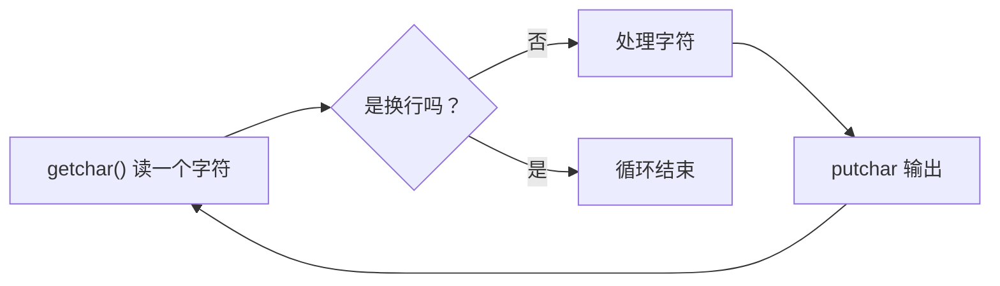

# 字符输入输出函数getchar和putchar的使用

## 字符输入输出：getchar 与 putchar

在 C 语言中，程序与键盘、屏幕之间的字符级交互，主要靠两个函数完成：`getchar()` 负责从键盘读入一个字符，`putchar(c)` 负责把一个字符输出到屏幕。它们是 `<stdio.h>` 中的标准库函数。

为什么需要它们？`scanf` 面对空格、换行等字符时往往会跳过或截断，而在“逐个字符处理”的场景中——比如大小写转换、字符过滤、统计字母个数——我们需要完整地拿到每一个字符，包括空格和标点。这时 `getchar` 就是最直接的工具。

### 基本用法

```c
char c;
c = getchar();      // 从键盘读入一个字符，存入变量 c
putchar(c);         // 把 c 中的字符输出到屏幕
```

`getchar()` 没有参数，返回值为读到的字符。注意它返回的是 `int` 类型，这是为了能表示特殊的文件结束标志 `EOF`，但在普通字符处理中赋给 `char` 变量也可以正常工作。`putchar(c)` 接收一个字符（或 `int`），将其输出。

### 典型模式：逐字符循环处理

期末考试中最爱考的模式是：

```c
char c;
while ((c = getchar()) != '\n') {
    // 对 c 做某种判断或转换
    putchar(c);
}
```

这个循环逐字符读入，直到用户按下回车（`\n`）才停止。关键在于 **`(c = getchar()) != '\n'`** 这一句：先调用 `getchar()` 读一个字符，赋值给 `c`，再用 `c` 和换行符比较。赋值表达式外必须加括号，因为 `!=` 的优先级高于 `=`。



### 一个算对了的例子

题目：输入 `1@Abd%6FmG*H2<回车>`，程序功能是把大写字母转成小写，其余字符原样输出。

```c
#include <stdio.h>
int main() {
    char c;
    while ((c = getchar()) != '\n') {
        if (c >= 'A' && c <= 'Z')
            c = c + 32;        // 大写转小写
        putchar(c);
    }
    return 0;
}
```

逐字符过一遍：

| 输入字符 | 判断结果 | 输出字符 |
|:---:|:---:|:---:|
| `1` | 非字母 | `1` |
| `@` | 非字母 | `@` |
| `A` | 大写 → +32 | `a` |
| `b` | 小写 | `b` |
| `d` | 小写 | `d` |
| `%` | 非字母 | `%` |
| `6` | 非字母 | `6` |
| `F` | 大写 → +32 | `f` |
| `m` | 小写 | `m` |
| `G` | 大写 → +32 | `g` |
| `*` | 非字母 | `*` |
| `H` | 大写 → +32 | `h` |
| `2` | 非字母 | `2` |

最终输出：`1@abd%6fmg*h2`

> [!TIP]
> 记忆口诀：**“getchar 读进来，putchar 送出去，while 里套判断，回车才收工。”**

### 与其他输入方式的区别

| 函数 | 读入内容 | 是否跳过空白 | 适用场景 |
|:---:|:---:|:---:|:---:|
| `scanf("%s", ...)` | 字符串 | 遇空格/换行停止 | 无空格的单词 |
| `gets()` | 字符串（含空格） | 否 | 整行字符串（已弃用，有缓冲区溢出风险） |
| `getchar()` | 单个字符 | 否 | 逐字符处理 |
| `getc()` | 单个字符 | 否 | 从指定文件流读取，`getchar()` 等价于 `getc(stdin)` |

> [!WARNING]
> `gets()` 无法限制读入长度，极易造成缓冲区溢出，C11 标准已将其移除，课程中做了解即可，实际编程应使用 `fgets`。选择题中若问“输入含空格的字符串”，传统答案可能是 `gets()`，但严格来说应优先考虑 `fgets`，需根据课程要求判断。

### 常见坑

- **忘记给赋值表达式加括号**：写 `c = getchar() != '\n'` 实际把比较结果赋给 `c`，而不是读入的字符。
- **多读了换行符**：`getchar()` 会把回车键产生的 `\n` 也读进来，循环条件必须用它做终止，否则会多处理一个“看不见的字符”。
- **连续调用位置搞混**：在循环体里再写一次 `getchar()` 会导致每轮读两个字符，正确答案会“丢”一半字符。
- **大小写转换依赖 ASCII**：`'A' + 32 == 'a'`，因为大写字母和小写字母的 ASCII 码恰好差 32，这是本题的隐藏前提。

> [!NOTE]
> `getchar` 和 `putchar` 本质上是字符流的“搬运工”，它们是所有更复杂输入输出（如 `scanf`、`printf` 的底层实现）的基石。理解逐字符处理，对后续学习字符串、文件操作都有帮助。
