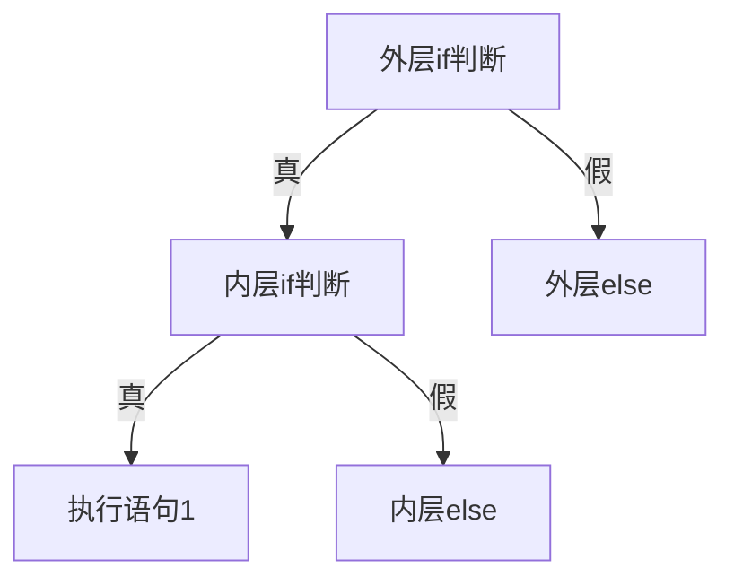
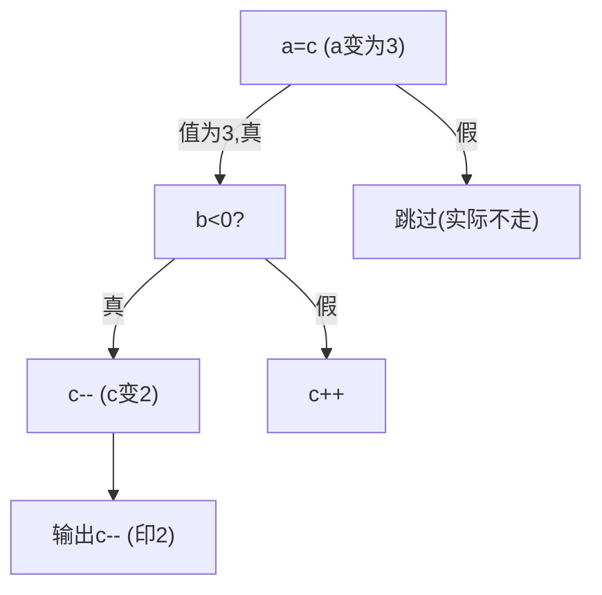

# if语句的嵌套及else就近配对原则

当你写下多层 `if` 时，有没有想过：如果只有一个 `else`，它到底归谁管？是靠缩进对齐的那个，还是离它最近的那个？

## if语句的嵌套是什么

在一个 `if` 或 `else` 分支内部再写 `if` 语句，就是 **if语句的嵌套**。当程序面临多重条件判断（如先判断及格与否，再细分优良中差）时，就需要用嵌套把逻辑一层层展开。



> [!NOTE]
> 嵌套的本质是把“一条分支”替换成“一整组新的判断”。

## else就近配对原则

C语言规定：**`else` 总是与在其之前未配对的最近的 `if` 配对**。

> [!IMPORTANT]
> ==编译器完全无视缩进！== `else` 只认语法上距离自己最近且还没被匹配过的 `if`。

这就解释了为什么选择12题的正确答案是“在其之前未配对的最近的 if”（选C），而不是“缩排位置相同的 if”（A）。

来看南邮真题中的经典陷阱（选择18）：

```c
int a = 0, b = -1, c = 3;
if(a=c)          // 注意：这是赋值，不是比较！
    if(b<0) c--;
    else c++;    // 这个 else 到底属于谁？
printf("%d", c--);
```

很多同学看缩进，以为 `else` 和外层 `if(a=c)` 配对。但根据就近原则，`else` 实际上和 `if(b<0)` 配对。我们用正确的逻辑树画出来：



**一步步算对这道题：**
1. `if(a=c)`：将 `c` 的值 $3$ 赋给 `a`，表达式值为 $3$（非零即真），进入内层。
2. `if(b<0)`：`b` 为 $-1$，条件成立（真）。
3. 执行 `c--`：`c` 从 $3$ 变为 $2$。`else c++;` 被跳过。
4. `printf("%d", c--)`：后置自减，先打印当前值 $2$，然后 `c` 才变成 $1$。最终输出 `2`，选D。

## 嵌套 if 与 else-if 阶梯的区别

初学者常把两者搞混，对比如下：

| 特性 | if 嵌套 | else-if 阶梯 |
| :--- | :--- | :--- |
| **结构** | `if` 写在另一个 `if` 的分支里 | `else if` 平级往下接 |
| **逻辑关系** | 递进、包含（满足A**且**满足B） | 互斥、并列（A或B或C） |
| **阅读真题示例** | 选择18 | 阅读2 |

阅读2题就是典型的 `else-if` 阶梯：

```c
int x = 10, y = 20;
if (x > y) printf("X");
else if (x == y) printf("Y");
else printf("Z");
```
$x=10, y=20$，第一层假，第二层假，走到最后的 `else`，输出 `Z`。这里没有嵌套歧义，因为 `else if` 已经显式规定了配对关系。

## 常见的坑与防范

> [!CAUTION]
> **高危误区：用缩进骗自己。** 考试卷面上故意把 `else` 缩进到外层 `if` 的位置，就是为了引诱你按视觉而非语法规则去读代码。

> [!TIP]
> **解题技巧：加花括号 `{}`。** 无论平时写代码还是考试分析，只要想强制让 `else` 跟外层 `if` 配对，必须手动加 `{}`：
> ```c
> if (条件1) {
>     if (条件2) 语句;
> } else {  // 现在明确属于外层了
>     语句;
> }
> ```

> [!WARNING]
> 别忘了结合其他考点！如选择18中 `if(a=c)` 是**赋值表达式作条件**（值为 $3$ 即真），而 `c--` 是**后置自减**（先用后减），这些前置知识一旦弄错，配对规则看得再准也会算出错误答案。
