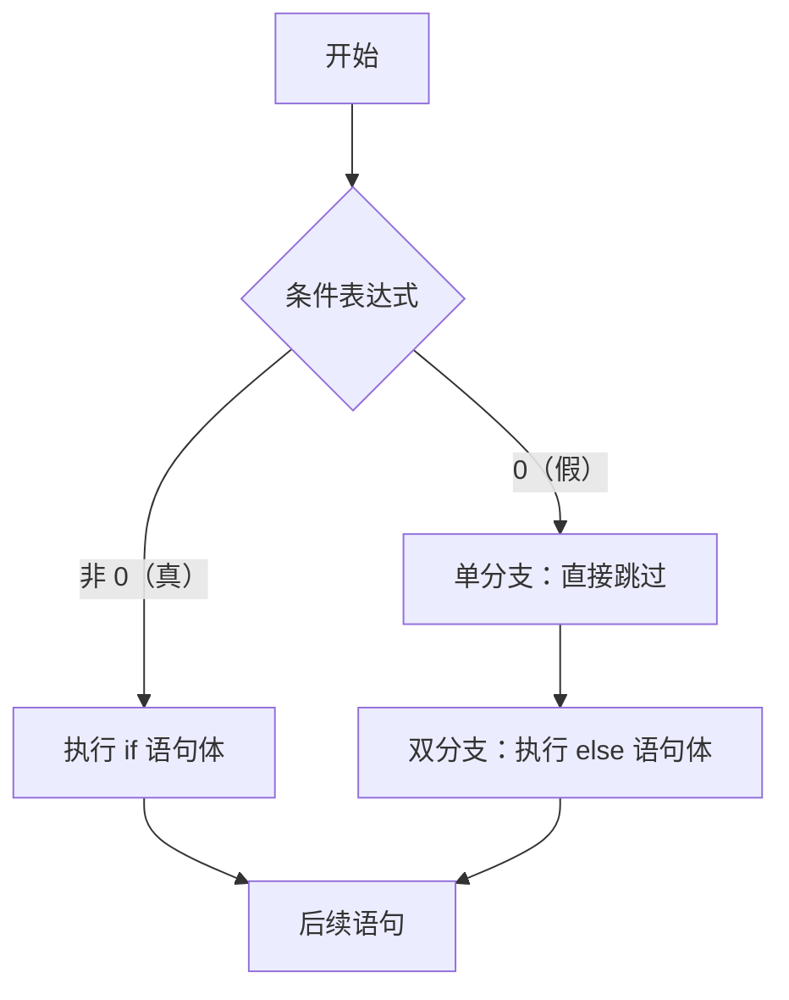

# if单分支与双分支选择语句

## 为什么需要选择语句

程序不可能永远“从头执行到尾”。成绩是否及格、密码是否正确、除数是否为零——这些“要不要做、做哪件事”的判断，都要靠选择语句完成。C 语言里最基础的就是 `if` 单分支与 `if...else` 双分支。

## 基本形式

**单分支**：条件成立才执行，不成立就跳过。

```c
if (表达式)
    语句;        // 条件为真（非 0）时执行
```

**双分支**：两条路必选其一。

```c
if (表达式)
    语句1;       // 条件为真执行
else
    语句2;       // 条件为假执行
```

> [!IMPORTANT]
> `if` 后面**没有分号**。写成 `if (a > b);` 会让空语句成为分支体，后面的语句无论条件真假都会执行。

流程上，二者区别一目了然：



## 条件表达式怎么判断真假

C 语言没有布尔类型，判断规则只有一条：**值为 0 即假，非 0 即真**。因此 `if (a)` 等价于 `if (a != 0)`，`if (!a)` 等价于 `if (a == 0)`。

> [!WARNING]
> 初学者最常犯的错是把赋值号当判断：`if (a = 0)` 是赋值，条件恒为假；`if (a == 0)` 才是比较。编译器能查出 `if (a = 0)` 这类可疑写法，务必留意警告。

## 一个算对了的例子

来看这道经典考题：a 从键盘输入 12，执行下面语句后输出什么？

```c
if(a++>12) printf("%d\n",a);
else printf("%d\n",++a);
```

先想清楚两个关键问题：

- `a++` 和 `++a` 都使 a 加 1，差别在哪？——`a++` 是**先用后加**，`++a` 是**先加后用**。
- 条件 `a++ > 12` 到底在比较谁？——比较的是 a 自增**之前**的旧值。

逐步推演：

| 步骤 | 动作 | a 的值 | 说明 |
|------|------|--------|------|
| 初始 | 输入 | 12 | |
| 判断 | `a++ > 12` | 12→13 | 用旧值 12 比较，12>12 为假，然后 a 变为 13 |
| 分支 | 条件假，走 else | 13 | |
| 输出 | `printf("%d", ++a)` | 14 | 先自增为 14，再输出 |

所以输出是 `14`，选 D。

> [!TIP]
> 遇到 `++`/`--` 与 `if` 混合的题，画一张“先用还是后加”的表格，一步步写下 a 的当前值，比心算可靠得多。

## 与相近概念的区别

| 写法 | 含义 | 适用场景 |
|------|------|----------|
| 单分支 `if` | 满足才做，不满足跳过 | 只需处理一种情况 |
| 双分支 `if...else` | 二选一 | 两种情况都要覆盖 |
| 多分支 `else if` 链 | 依次判断，命中即停 | 三种及以上互斥条件 |
| 条件运算符 `?:` | 双分支的简写 | 赋值或简单表达式 |

> [!NOTE]
> 当分支体超过一条语句时，必须用花括号 `{}` 括成复合语句，否则只有第一条语句受 `if` 控制，其余会“逃逸”出来无条件执行。
